Before a film creature gets a sculpt or a 3D model, someone in the creature department pins down what it *is*: how big it is, how it stands, what its feet leave in the snow, where it lives. This tutorial makes one of those reference sheets for an imaginary film called *YETI*. It borrows the look of a 19th-century zoology plate: one large figure in side view, smaller numbered figures, italic captions, lettered callouts and a scale rod.

The yeti isn't painted from nothing. It starts as a photograph of a silverback gorilla in a zoo. You cut it out, flatten its crest, pull its fur past the outline, map its tones to snow-white with blue-grey shadows, and paint long guard hair over it. Then you add a plaster footprint cast, a contour map made from the Clouds filter, captions in **Old Standard TT**, and an art director's red pencil and stamp.

The photo is [Gorilla gorilla - San Francisco Zoo - San Francisco, CA - DSC03907.jpg](https://commons.wikimedia.org/wiki/File:Gorilla_gorilla_-_San_Francisco_Zoo_-_San_Francisco,_CA_-_DSC03907.jpg) on Wikimedia Commons, released under **CC0**. Download the original (1666 × 1253 px). Before you start, crop it to a box about 1000 × 1050 px around the animal: cut 150 px off the left and 100 px off the top, and keep everything down to the rock under its feet. Any image viewer will do this, or open it in Lopsy and use the Crop tool, then **File → Export**.

Along the way you'll use:

- the **Lasso**, **Select → Inverse** and the Move tool's scale handles to cut out and size the photo
- **Liquify**, the **Clone Stamp**, **Smudge** and **Burn** to reshape a gorilla into something else
- **Find Edges**, a group **Levels** and **Gradient Map**, and a root **Color Grading** node
- noise, Motion Blur and Threshold for hatching, behind a gradient **layer mask**
- the **Brush** with Taper for guard hair, and soft Multiply and Screen layers for shading
- the **grid** and **Snap**, the **Pen** tool, **Path to Selection** and the exact-corner marquee
- **Clouds**, **Posterize** and **Find Edges** for a contour map, copy and paste for map marks
- the **Stroke**, **Drop Shadow** and **Inner Glow** effects, rotated type and a noise-masked stamp

The palette is sepia ink on cream paper, a cold white animal, and red for the art director.

- Paper `#EEE4CC`, plate ink `#2E1E14`, sepia `#6B4A33`, foxing `#9A6B3E`
- Fur `#26221F` → `#5B6470` → `#93A0AE` → `#D9DDDD` → `#F7F3EA`
- Fur shading `#8C99A6`, face `#A7AEB6`, cold tint `#9DBDD2`, limb light `#9A9A9A`
- Guard hair `#B0B0B0` and `#5A5A5A`, eye `#2A2A2A`
- Cast `#E9E0CB`, cast edge `#7A6248`, cast shadow `#4A3322`, print `#CBBB9B`, print shadow `#5E4A35`
- Glacier `#BCD0DC`, sightings `#8B1A1A`
- Red pencil `#B23A2C`

## Make the paper

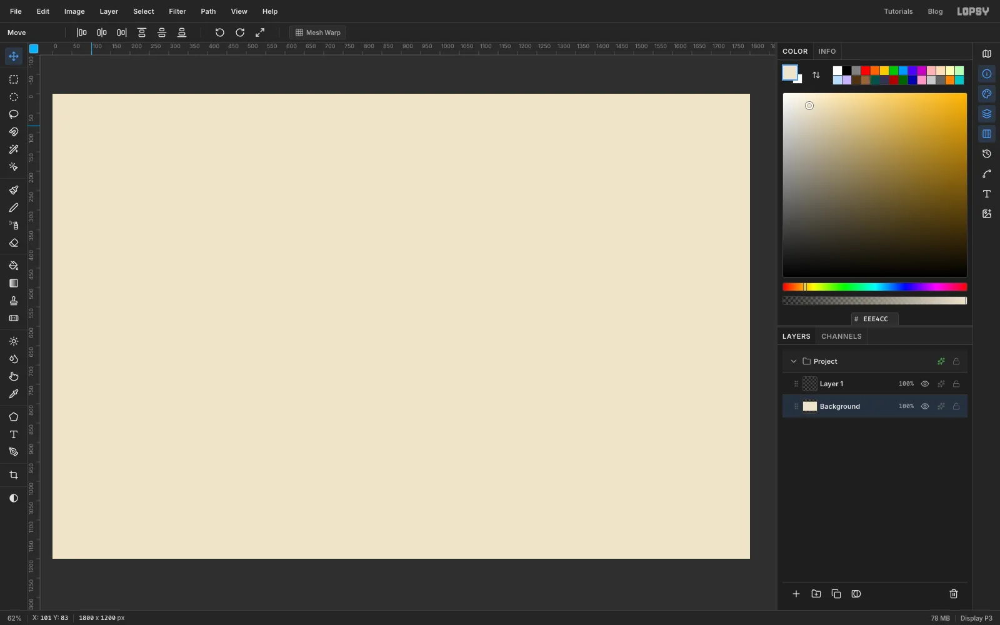

Choose **File → New**, set the size to **1800 × 1200** pixels and click **Create**. Lopsy starts you with a Background layer and an empty Layer 1 inside a group called Project. Leave Layer 1 alone for now. You'll use it for shading later.

Click the Background layer, set the foreground colour to paper `#EEE4CC` in the Color panel's hex field, and choose **Edit → Fill**. With nothing selected, Fill covers the whole layer.

## Age it with Clouds

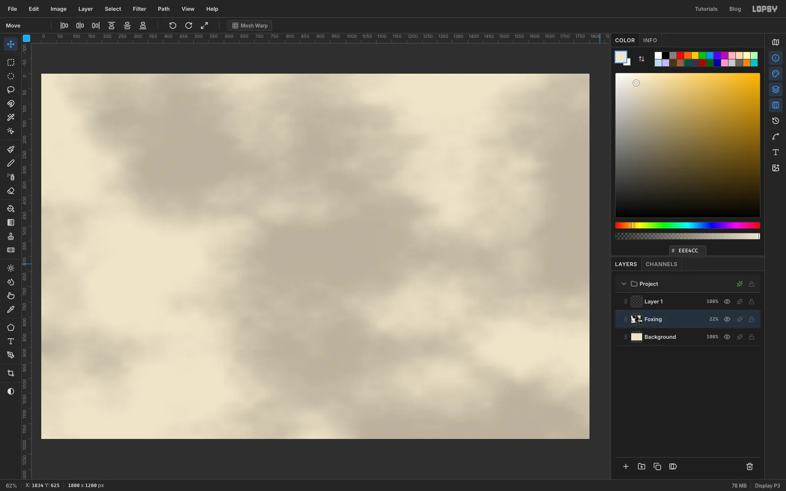

Click **Add Layer** at the bottom of the Layers panel and double-click the new layer's name to rename it `Foxing`. Choose **Filter → Clouds…**, set **Scale** to 4 and click **Apply**.

Open the layer's effects (the ✦ button on its row), set **Blend** to **Multiply** and close the drawer. Then click the opacity figure on the row and drag it down to about 22% for now. Old paper has uneven toning, and Multiply lets the clouds darken the paper without hiding it. You'll turn it down further near the end.

## Rule the plate border

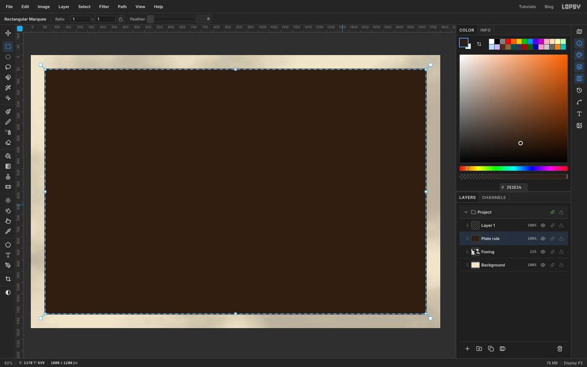

Add a layer called `Plate rule`. Choose the **Rectangular Marquee** (M) and click once on the canvas without dragging. That opens a small dialog for exact corners. Enter **From** 60, 60 and **To** 1740, 1140 and press Enter.

Set the foreground to ink `#2E1E14` and choose **Edit → Fill**. Then choose **Select → Shrink…**, enter 3 and click **Apply**. The selection is now 3 px inside the dark rectangle.

## Cut it to a double rule

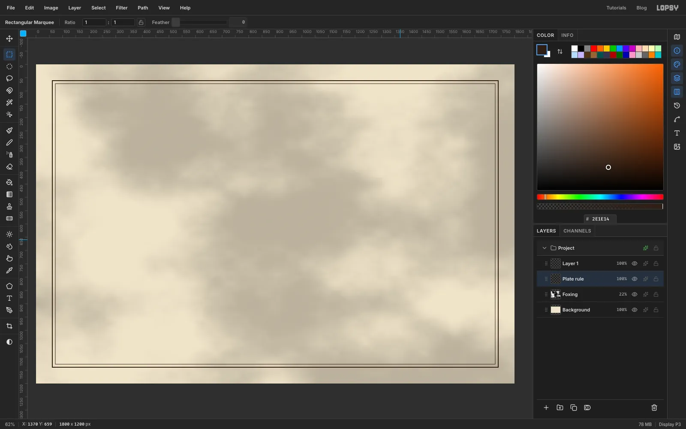

Press **Delete** to clear the inside, leaving a 3 px frame. Make the inner rule the same way: deselect with [[Cmd+D]], click with the Rectangular Marquee again, and enter 72, 72 to 1728, 1128. Fill it, choose **Select → Shrink…** by 1, press **Delete** and deselect.

A heavy outer line and a hairline inside it is the classic frame for an engraved plate.

## Paste in the photo

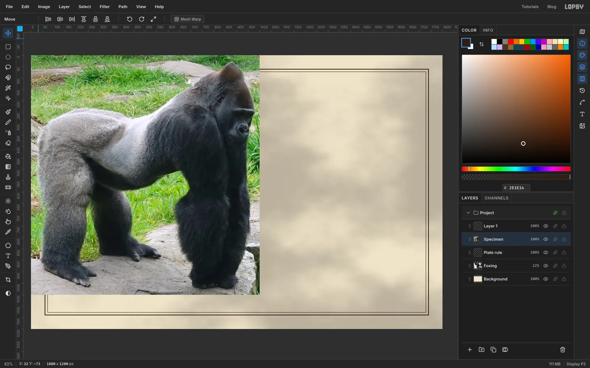

Make sure Plate rule is the active layer, so the photo lands above it. Drag the cropped file onto the canvas, or copy it in another app and press [[Cmd+V]] in Lopsy. A pasted image that fits the canvas lands at the top-left corner at full size, as a new layer called Pasted Layer, with its pixels already selected.

Press [[Cmd+D]] to deselect, and rename the layer `Specimen`.

## Trace around the gorilla

Choose the **Lasso** (L). Zoom in ([[Cmd+=]]) and drag slowly around the animal, keeping just inside its fur. Leave out the grass between the legs and the rock under the feet. Where the silver back meets the pale rock, follow the curve of the rump rather than the rock. When you get back to the start, release to close the selection.

> **Tip:** The Lasso is freehand. If you go wrong, press [[Cmd+D]] and start again. The fur edges will be covered with painted hair later, so a clean, smooth line matters more than catching every tuft.

## Delete the background

Choose **Select → Inverse** so everything except the gorilla is selected, then press **Delete** and [[Cmd+D]]. The grass and rock are gone and the paper shows round the animal.

## Scale it down

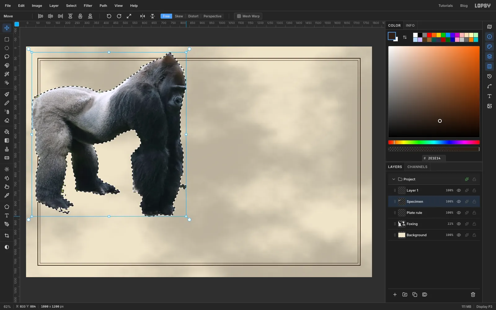

[[Cmd]]-click the Specimen thumbnail in the Layers panel to select its pixels, and switch to the **Move** tool (V). Hold [[Cmd]] so the scale stays in proportion, and drag the bottom-right handle up and to the left until the box is about 85% of its size, roughly 800 px wide. Press [[Cmd+D]] to commit the scale.

## Place it on the plate

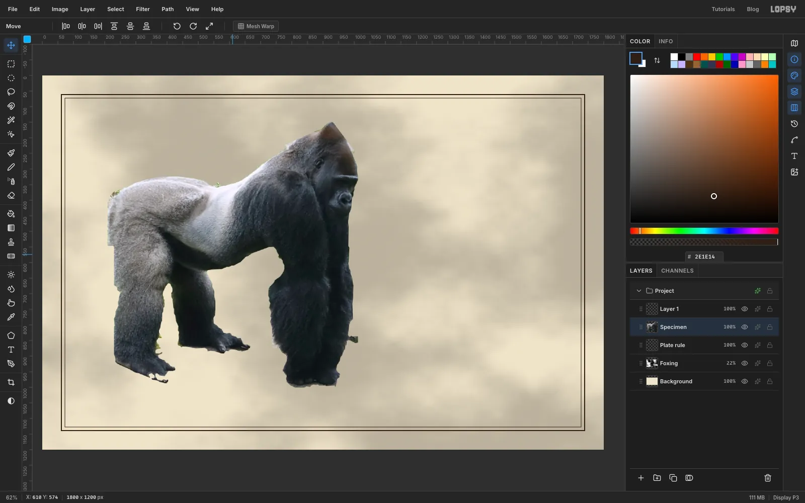

With the Move tool still active, drag the gorilla into place. Put its feet on an imaginary floor at y = 1000 (watch the ruler) and its rump about 210 px from the left edge. That leaves room for a scale rod on the left and a column of smaller figures on the right.

## Desaturate it and flatten the crest

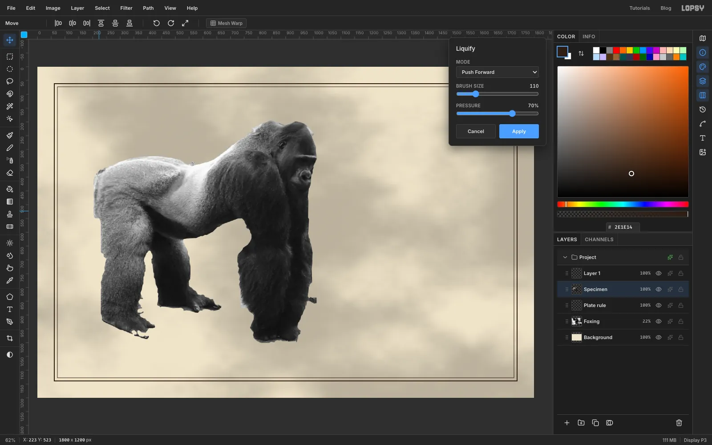

With Specimen active, choose **Filter → Desaturate**.

The tall sagittal crest on top of the head is what makes a gorilla look like a gorilla. Choose **Filter → Liquify…**. Set **Mode** to Push Forward, **Brush Size** to 150 and **Pressure** to 70, then drag down from the peak of the crest in two short strokes, so it becomes a lower dome.

While you're there, change **Brush Size** to 110 and push the straight left edge of the rump outwards in three short strokes, to round it off. Click **Apply**.

## Clone fur over the ear

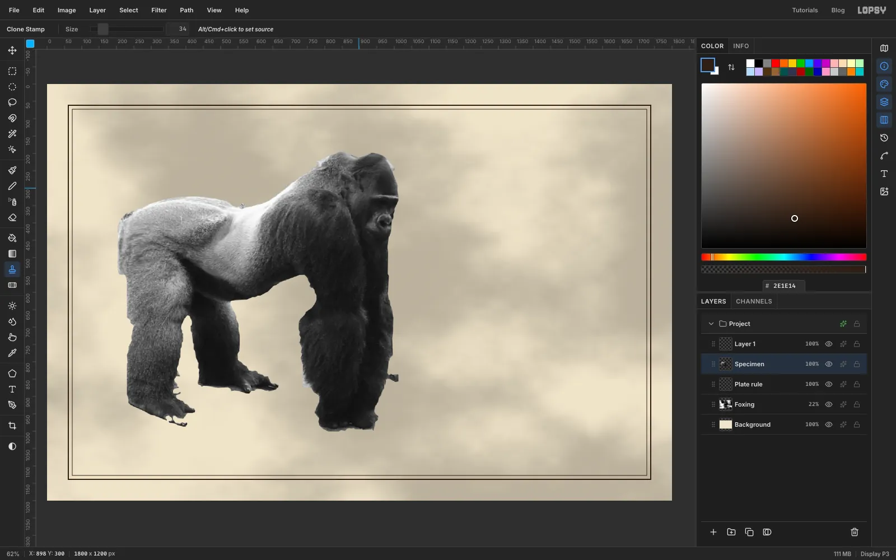

Choose the **Clone Stamp** (S) and set **Size** to 34. [[Alt]]-click on the fur of the neck just behind and below the ear to pick a source, then paint over the ear in two or three short strokes. The ear disappears into the fur.

## Pull the fur past the outline

Choose **Smudge** (R) and set **Strength** to 75. Starting just inside the fur, drag short strokes down and out past the edge along the belly, the backs of the arms and the bottoms of the thighs. Make them 10–40 px long, uneven in spacing, and change **Size** between 14 and 28 every few strokes. The goal is a soft, broken edge rather than a cut-out line.

## Make an ink copy

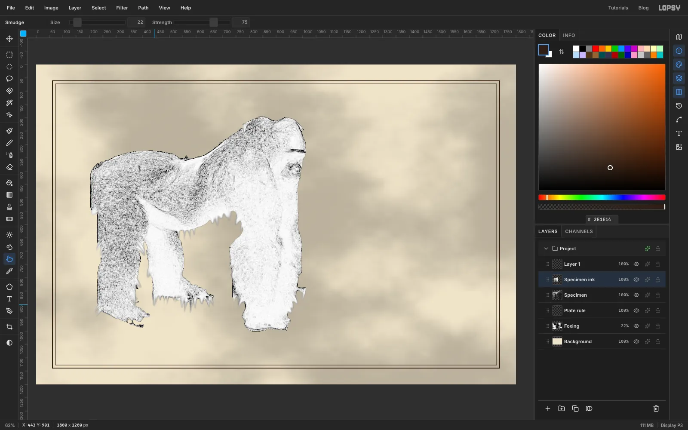

Choose **Layer → Duplicate Layer** and rename the copy `Specimen ink`. Choose **Filter → Find Edges**, then **Filter → Invert**. You get dark lines on white wherever the fur has detail, like an engraver's line work.

Soften it with **Filter → Surface Blur…** at Radius 4 and Threshold 30. Then open its effects, set **Blend** to **Multiply**, and set its opacity to 40%.

## Burn the far leg back

Click the Specimen layer. Choose **Dodge / Burn** (O), set **Mode** to Burn, **Exposure** to 14 and **Size** to 90. Make one long stroke down the far hind leg, the one between the near hind leg and the arms. Pushing the far limbs a little darker keeps them behind the near ones once everything turns white.

## Group the specimen and lift it with Levels

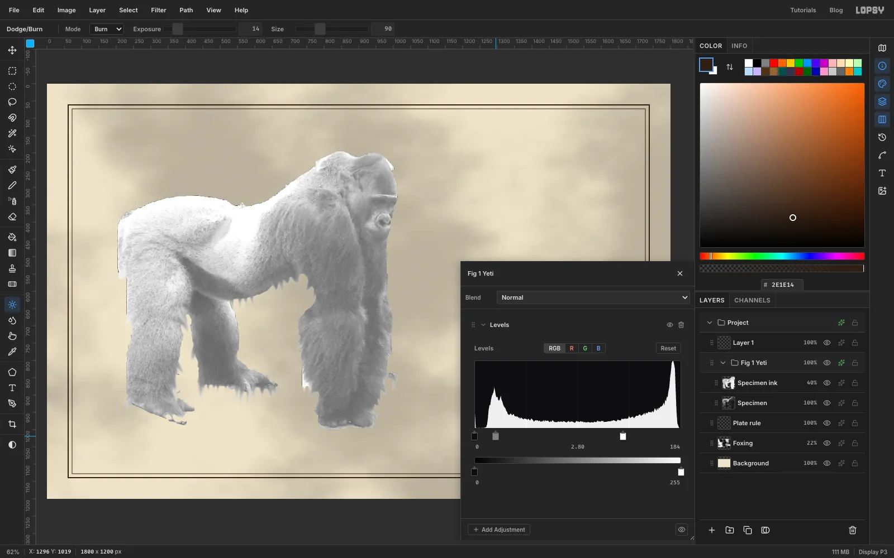

Click Specimen, [[Shift]]-click Specimen ink, and choose **Layer → Group Layers**. Rename the group `Fig 1 Yeti`.

Click the group's ✦ button to open its adjustments, click **Add Adjustment** and choose **Levels**. Drag the white input handle (under the histogram, on the right) left until the readout says about 184. Then drag the grey handle left until the gamma reads about 2.80. The black fur opens up into pale grey and keeps its detail, and the ink lines stay dark.

## Map the tones to snow and blue

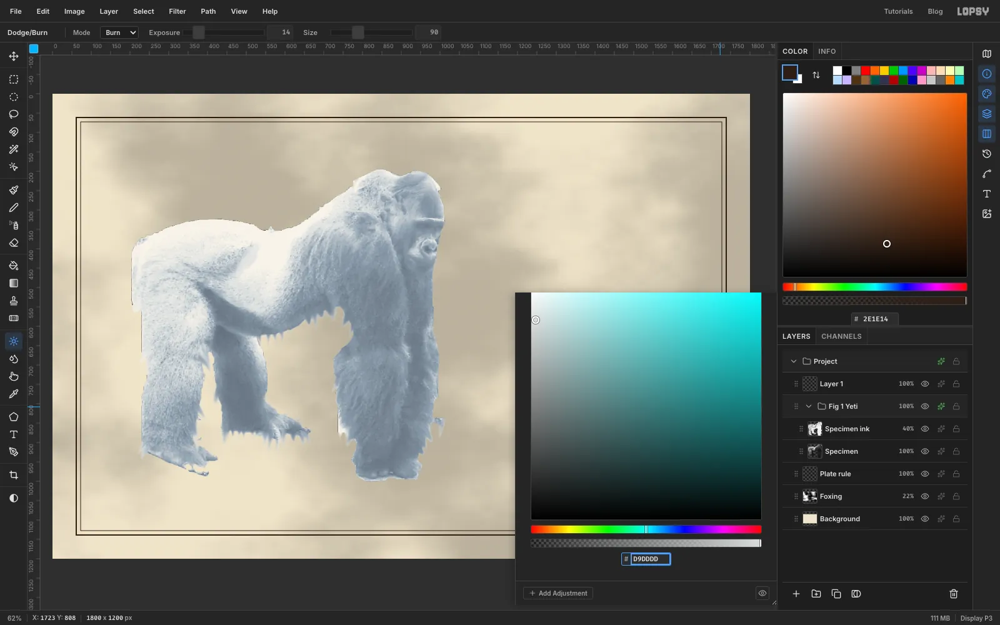

Click **Add Adjustment** again and choose **Gradient Map**. Click the left stop under the gradient bar and type `#26221F` in its hex field. Click the right stop and type `#F7F3EA`. Click the gradient bar at about 34%, 60% and 82% to add three stops (the readout under the bar shows each stop's position), and give them `#5B6470`, `#93A0AE` and `#D9DDDD`.

The pale greys turn creamy white and the shadows turn cold blue-grey. It's the first point where the animal reads as a yeti and not a gorilla.

## Make some hatching

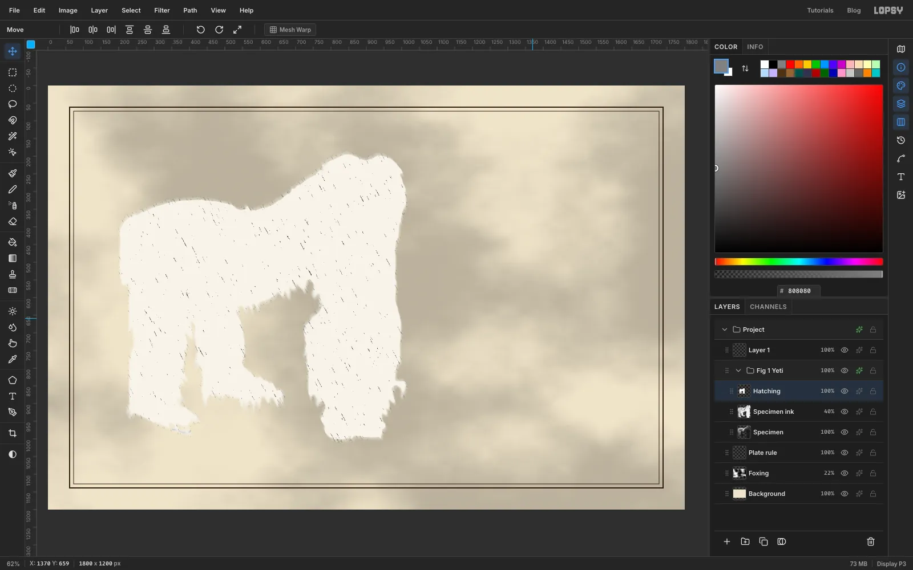

Click Specimen ink and add a layer called `Hatching`. It goes inside the group. [[Cmd]]-click the Specimen thumbnail to select the animal, click the Hatching row again, set the foreground to `#808080` and choose **Edit → Fill**. Deselect.

Now turn the grey into engraved lines:

1. **Filter → Add Noise…**: Amount 100, Mono, Gaussian.
2. **Filter → Motion Blur…**: Angle 62, Distance 26.
3. **Filter → Threshold…**: Level 121.

The blur smears the noise into diagonal streaks, and Threshold turns the streaks into black lines on white. For now the layer covers the whole animal; the next step blends it in.

## Mask the hatching to the shadows

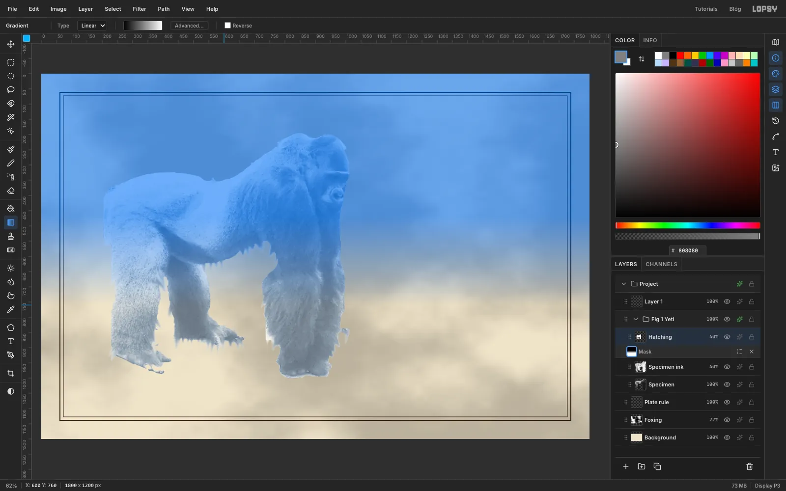

The streaks spill past the animal, so [[Cmd]]-click the Specimen thumbnail, click the Hatching row, choose **Select → Inverse** and press **Delete**. Deselect, set Hatching's **Blend** to **Multiply** and its opacity to 40%.

Hatching on a plate belongs in the shadows, under the belly and down the legs. Click **Add Mask** at the bottom of the Layers panel, then click the mask thumbnail on the row to edit it. Choose the **Gradient** tool, click **Advanced…** in the options bar, make the left stop black and the right stop white, and drag from the top of the back (y ≈ 470) down to the belly (y ≈ 760). The blue overlay shows where the mask hides the layer. Click the Hatching row to leave mask editing.

## Paint guard hair

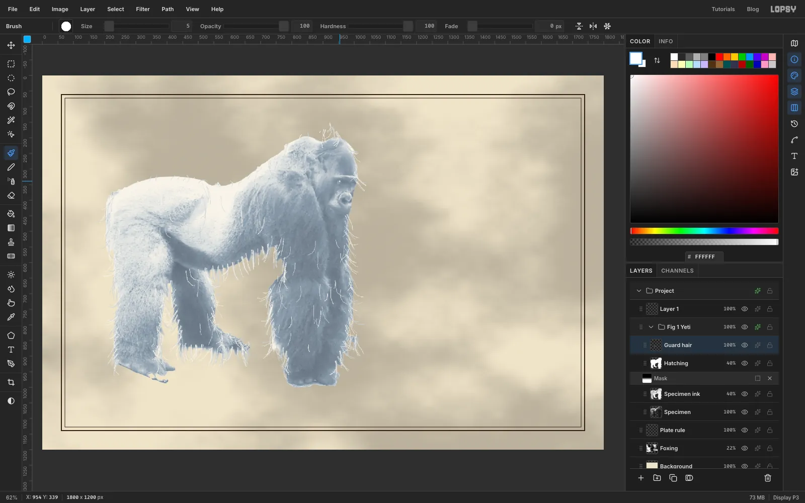

Add a layer called `Guard hair` inside the group. Choose the **Brush** (B). Click the brush tip at the left of the options bar to open the **Brushes** panel, and set **Size** 2, **Hardness** 100, **Taper** 70 and **Opacity** 75.

With the foreground at grey `#B0B0B0`, paint locks of hair: two to four strands from nearly the same spot, hanging down 30–120 px and curling a little at the tips. Put long ones under the belly and the backs of the arms, shorter ones down the sides of the legs and short flicks along the back. Leave the face and the feet clean. Then switch to `#5A5A5A` at Opacity 85 and add darker strands among them, plus a few long ones down the fronts of the limbs.

The Gradient Map is still working on these layers, so the greys come out as pale blue-grey and slate.

Finally, give the face an eye. Set the brush to Size 14, Hardness 70 and Taper 0, and click once in `#2A2A2A` under the brow ridge. Click again in white at Size 5, just above and right of centre, for a catchlight.

## Lighten the limbs

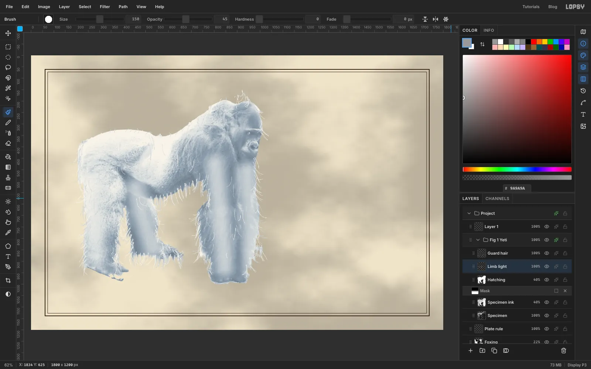

The arms and far legs are still darker than the back. Click Hatching and add a layer called `Limb light`. Set the brush to **Size** 150, **Hardness** 0 and **Opacity** 45, and paint `#9A9A9A` in long strokes down each leg and both arms.

[[Cmd]]-click the Specimen thumbnail, click Limb light, choose **Select → Inverse**, press **Delete** and deselect. Set its **Blend** to **Screen**. Screen only ever lightens, so the limbs come up towards the white of the back.

## Model the form and the face

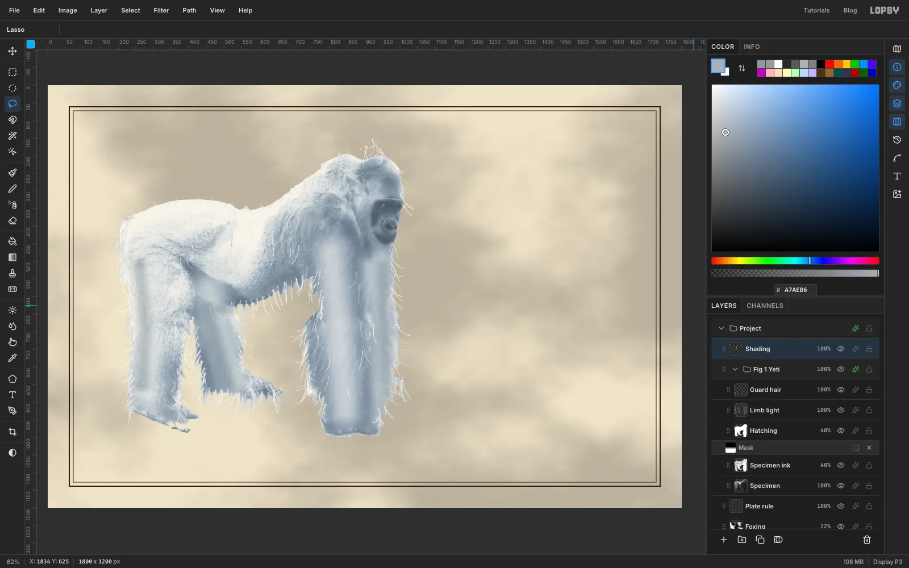

Click Layer 1, which sits above the Fig 1 Yeti group, and rename it `Shading`. Brush **Size** 70, **Hardness** 0, **Opacity** 45, colour `#8C99A6`. Paint under the belly, down the inside of each far leg, along the back of the neck and across the top of the head. Choose **Filter → Gaussian Blur…** at Radius 10 so no stroke edges show.

For the face, take the **Lasso** and draw round the bare skin, from the brow ridge down the muzzle to the chin and back. Choose **Select → Feather…** with 7, set the foreground to `#A7AEB6` and **Edit → Fill**. Deselect.

Clip the layer as before: [[Cmd]]-click the Specimen thumbnail, click Shading, **Select → Inverse**, **Delete**, deselect. Set its **Blend** to **Multiply**.

## Add a cold tint

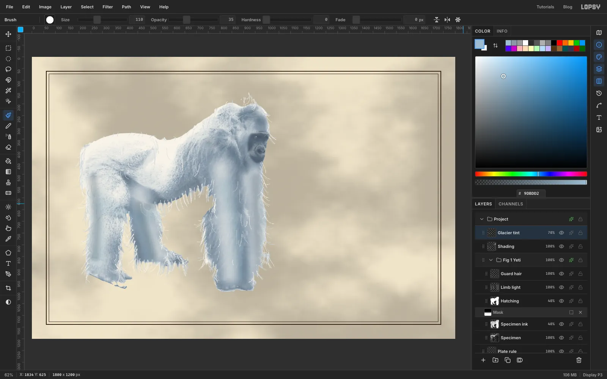

Add a layer called `Glacier tint`. Brush **Size** 110, **Opacity** 35, colour `#9DBDD2`. Make a long stroke along the underside of the body and one down each shadowed leg. Clip it to the animal the same way, then set it to **Multiply** at 70% opacity.

## Engrave the ground

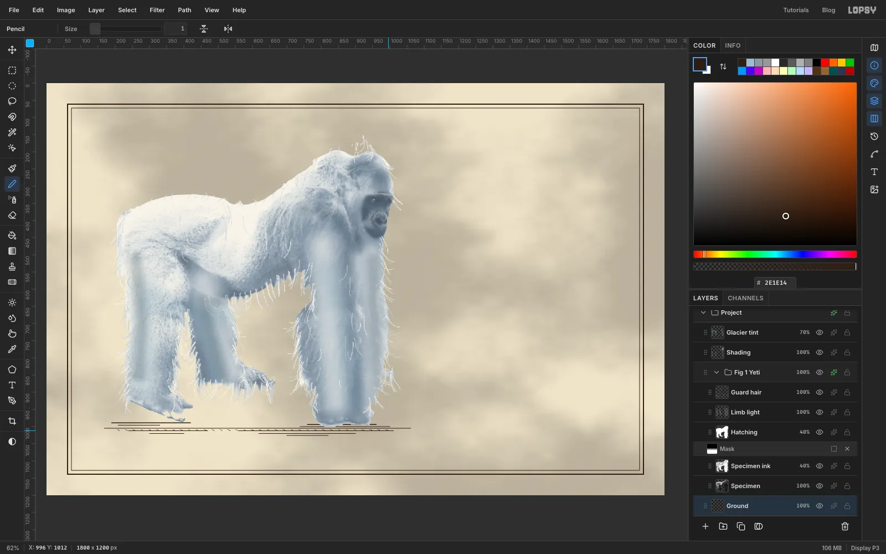

Click Plate rule and add a layer called `Ground`, so it sits under the yeti. Choose the **Pencil** (N), set **Size** to 2, and set the foreground back to ink `#2E1E14`.

Click at the left end of a line and [[Shift]]-click at the right end to draw it straight. Draw one long line right under the feet (y ≈ 1006), with shorter lines under each foot and a few broken lines below. At **Size** 1, add a row of short diagonal dashes between the first two lines. Engravers drew ground this way: dense lines right under the feet and fewer further out.

## Snap a scale rod to the grid

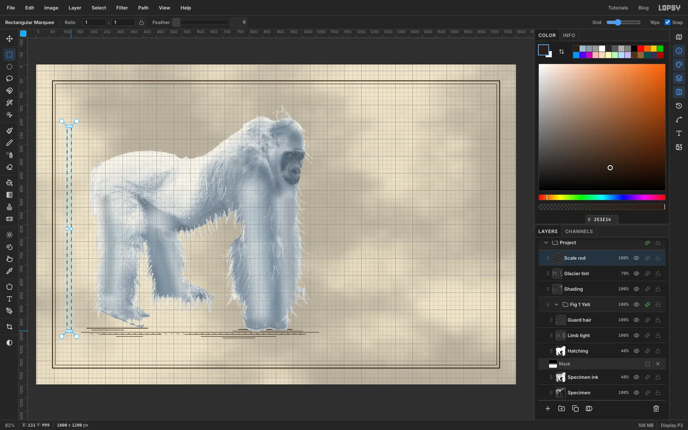

Choose **View → Show Grid**. The grid is 16 px and **Snap** turns on with it. Click Glacier tint, then add a layer called `Scale rod` at the top.

With the Rectangular Marquee, drag a strip one grid square wide down the left margin, from about level with the yeti's crown down to the floor line at y = 1000. Snap pulls it to 116–132 across and 232–1000 down: 768 px tall, which is 1.5 m if one metre is 512 px.

## Fill the rod

Fill it with ink, choose **Select → Shrink…** by 2 and press **Delete** to leave an outline. Then fill three 128 px segments solid: drag the marquee over each one in turn (232–360, 488–616 and 744–872) and **Edit → Fill**. Each black or white block is a quarter of a metre.

Choose **View → Show Grid** again to hide it.

## Spot the paper

Click Foxing and drop its opacity to 8%. Add a layer called `Foxing spots`, choose **Spray** (J) at its default settings (Size 40, Density 20, Opacity 60%) and set the foreground to `#9A6B3E`. Scrub small patches near three or four corners and along the bottom edge. Set the layer to 35% opacity so the spots look like age, not dirt.

## Draw the plaster cast

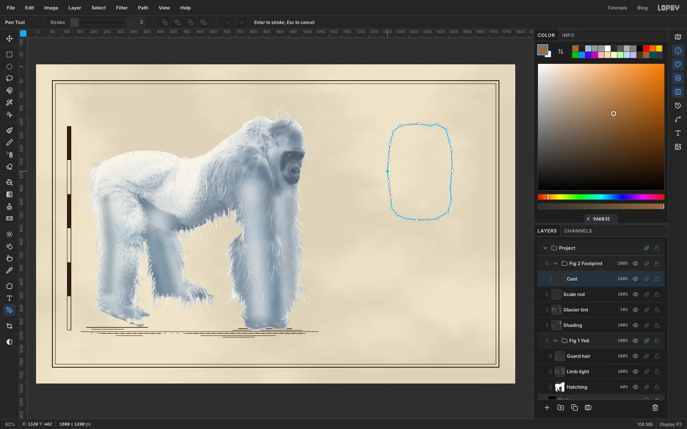

Click Scale rod, click **New Group** at the bottom of the Layers panel and rename the group `Fig 2 Footprint`. Add a layer called `Cast` inside it.

Choose the **Pen** (P) and click round an irregular slab in the right-hand column, from about x 1320 to 1560 and from y 225 down to 585. Make it a little wider at the top, with chipped corners, a few straight breaks and a couple of gentle curves (drag on a point to curve it). Click the first point again to close the path.

## Fill and edge the cast

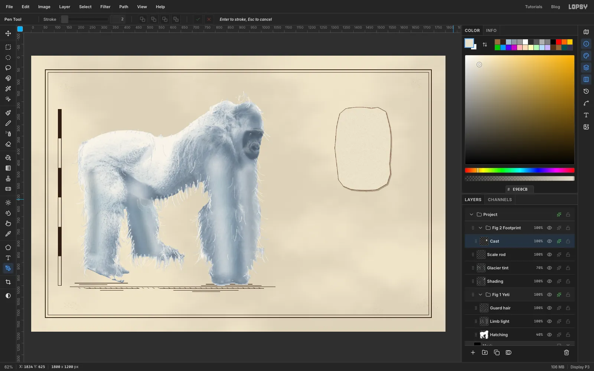

Open the **Paths** panel and click **Path to Selection**, then delete the path. Fill the selection with `#E9E0CB` and deselect. Choose **Filter → Add Noise…**: Amount 18, Mono.

Open the layer's effects and turn on **Stroke** with Width 2 and colour `#7A6248`. Turn on **Drop Shadow** with Offset X 4, Offset Y 5, Blur 2, Opacity 35 and colour `#4A3322`. A small, hard shadow says plaster on paper. A soft, wide one would look like a sticker.

## Press the footprint

Add a layer called `Print`. With the Pen, draw the sole as a smooth closed shape centred in the cast, a little below the middle: broad at the ball, narrowing at the arch, rounded at the heel, about 140 × 240 px. Choose **Path to Selection**, fill with `#CBBB9B` and deselect.

Now the toes. Draw the big toe (the hallux) with the Pen as a teardrop about 48 px long, angled about 30° out to the left, away from the others. That splay is what makes the print not human. Turn it into a selection, then take the **Elliptical Marquee** and [[Shift]]-drag four narrow ovals in an arc for the smaller toes, each smaller than the last. Shift adds each one to the selection.

## Shade the print

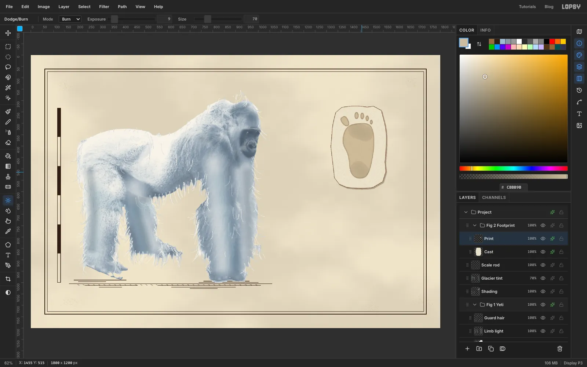

Fill the toes with the same `#CBBB9B` and deselect. Choose **Filter → Add Noise…** with Amount 22, Mono and Gaussian.

Open the effects and turn on **Inner Glow** with Size 9, Opacity 90 and colour `#5E4A35`. On a hole, an inner glow reads as the shadowed wall of a dent. Then choose **Burn** at **Exposure** 9 and **Size** 70 and make one short stroke across the ball and one across the heel, where a heavy animal presses deepest.

## Add a scale bar to the cast

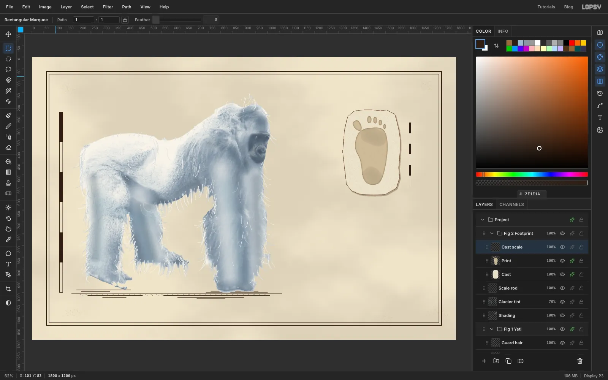

Add a layer called `Cast scale` and set the foreground back to ink `#2E1E14`. Use the exact-corner marquee for a bar from 1600, 278 to 1610, 548, just right of the cast. Fill it, **Shrink** by 1 and **Delete**. Then fill three 45 px segments with the exact-corner marquee (y 278–323, 368–413 and 458–503) to mark 5 cm steps. At this scale one centimetre is 9 px, so the print, about 280 px from heel to toe tips, is roughly 31 cm long.

## Move the whole figure

The cast sits too close to the title you'll set above it. Deselect, click the **Fig 2 Footprint** group row, choose the Move tool and press [[Shift+Down]] once and [[Down]] six times to move it 16 px down. Everything in the group moves together.

## Grow some terrain

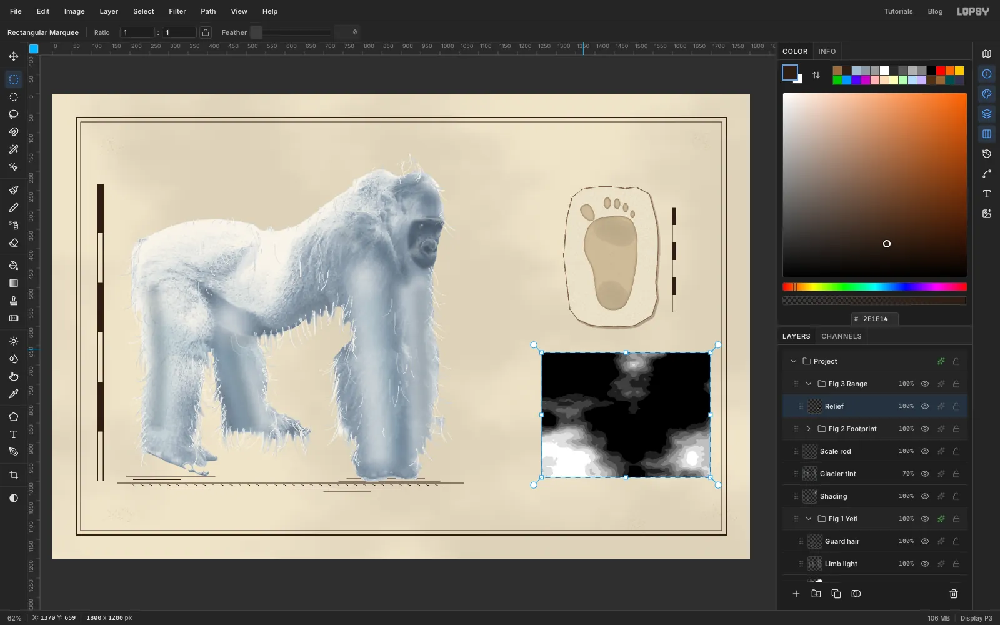

Collapse the footprint group. Click **New Group** and call it `Fig 3 Range`, then add a layer called `Relief`. Make an exact marquee from 1262, 668 to 1698, 990.

Inside the selection:

1. **Filter → Clouds…**: Scale 6.
2. **Filter → Brightness/Contrast…**: Contrast 70.
3. **Filter → Posterize…**: Levels 9.

The clouds become flat bands of height, like a hand-tinted relief map.

## Trace the contours

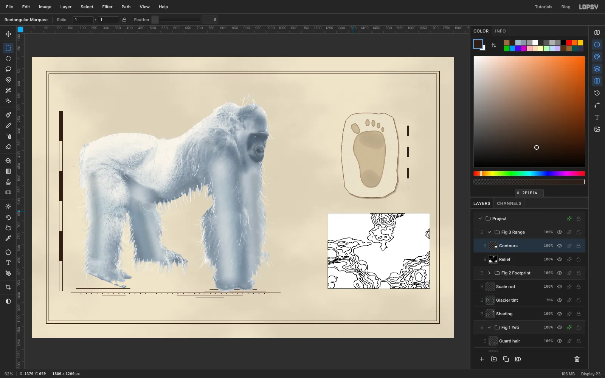

Run **Filter → Gaussian Blur…** at Radius 2 to soften the band edges, then deselect and choose **Layer → Duplicate Layer**. Rename the copy `Contours`.

On Contours:

1. **Filter → Find Edges**, then **Filter → Invert**: dark lines on white along every band boundary.
2. **Threshold** at 200.
3. **Gaussian Blur** at 1.
4. **Threshold** at 175, to smooth out the jaggies.

Take the **Magic Wand** (W), untick **Contiguous**, click a white area and press **Delete**. Only the lines are left. Deselect and set the layer to 75% opacity.

## Mark the glaciers

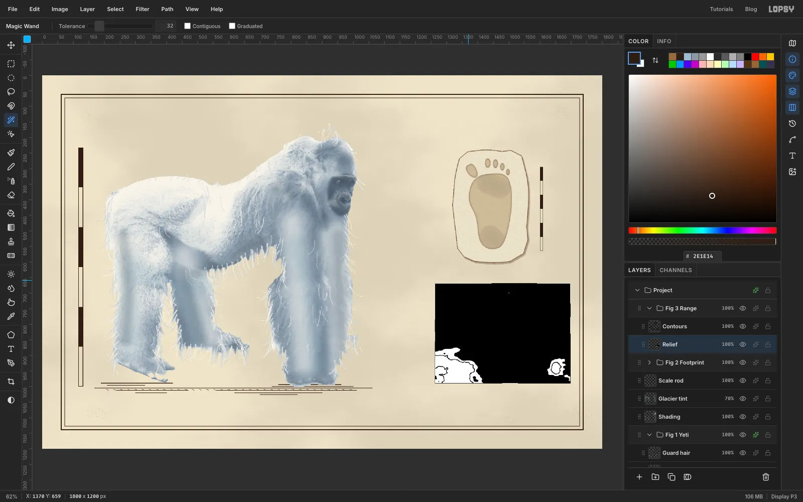

Click Relief and apply **Threshold** at 205. Only the highest ground stays white. Magic-wand a black area and press **Delete**, then [[Cmd]]-click the Relief thumbnail and fill the remaining patches with `#BCD0DC`. Deselect, run **Add Noise…** at 45 (Mono) to stipple them, and set the layer to 85%.

## Plot the sightings

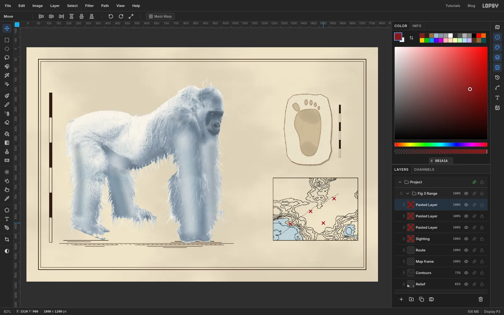

Set the foreground to ink `#2E1E14` and add `Map frame`: an exact marquee on the same rectangle, filled, shrunk by 2 and cleared.

Add `Route`. Choose the Brush, set **Size** 4, **Hardness** 100, **Opacity** 100, **Spacing** 200 and **Taper** 0, and drag a winding line from the bottom-left of the map towards the top-right. The wide spacing turns it into dots. Set **Spacing** back to 10 afterwards.

Add `Sightings`. With the Pencil at **Size** 3 and the colour `#8B1A1A`, draw a small × with two [[Shift]]-click lines. Draw a marquee round it and press [[Cmd+C]]. Press [[Cmd+V]] to paste a copy in place, drag it to another spot with the Move tool, and repeat for three copies in all. Each paste is a new layer, so choose **Layer → Merge Down** three times to fold them back into the Sightings layer.

## Add map furniture

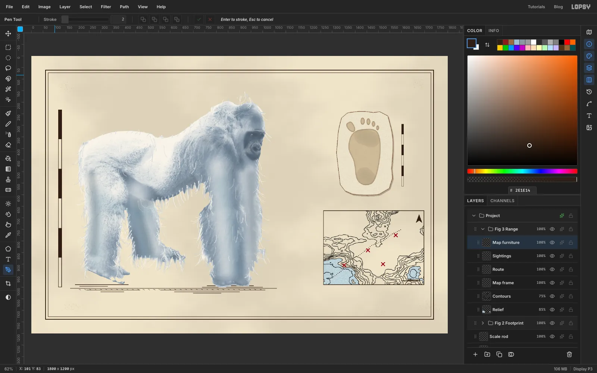

Add a layer called `Map furniture`. With the Pencil at Size 2 in ink, draw a short scale bar near the bottom-right corner, with ticks at each end and in the middle. Then use the Pen to click a narrow arrowhead with a notch at its base in the top-right corner. Turn it into a selection, fill it and deselect.

## Set the type

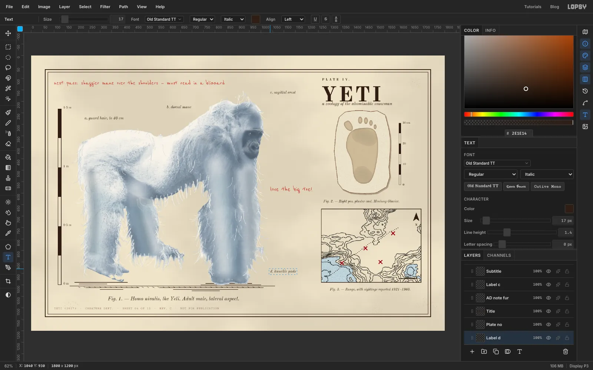

Every label is a separate point-text layer made with the **Text** tool (T). Add an empty layer called `Text anchor` and click it before each new label: with a text layer active, the Text tool's settings would restyle it. Set the size, font, weight, style and colour first, then click and type. Press [[Tab]] to commit. Work from the bottom of the plate up, so a new click never lands inside an earlier text box.

Unless noted, use **Old Standard TT** in ink `#2E1E14`, Letter spacing 0:

- Footer, along the bottom margin under the yeti: **Cutive Mono** 13 in sepia `#6B4A33`, letter spacing 1: `YETI (2027) · CREATURE DEPT. · SHEET 04 OF 12 · REV. C · NOT FOR PUBLICATION`
- Captions, italic, each just under its figure: `Fig. 1. — Homo nivalis, the Yeti. Adult male, lateral aspect.` at 22, then `Fig. 2. — Right pes, plaster cast, Menlung Glacier.` and `Fig. 3. — Range, with sightings reported 1921–1960.` at 15
- Scale labels just right of the rod, level with its foot and every 256 px up: `0 m`, `0·5 m`, `1 m`, `1·5 m` at 14. Beside the cast bar, from its foot up every 90 px: `0`, `10`, `20`, `30 cm` at 12
- Map names, italic 12: `Rongbuk` near the top, `Menlung Gl.` at the left above the first cross and `Barun` at the lower right, plus `10 km` in italic 11 above the scale bar and a bold 13 `N` under the arrow
- Callouts, italic 17: `a. guard hair, to 40 cm` and `b. dorsal mane` in the space above the back, `c. sagittal crest` to the right of the crown, and `d. knuckle pads` to the right of the front hands
- Title block, top of the right-hand column: `PLATE IV.` bold 14 with letter spacing 6, `YETI` bold 92 with letter spacing 8, and `a zoology of the abominable snowman` italic 19
- Red pencil notes, **Reenie Beanie** in `#B23A2C`: `next pass: shaggier mane over the shoulders — must read in a blizzard` at 30 along the top margin, and `love the big toe!` at 34 between the yeti's head and the cast, level with the sole

## Seat the captions and clear the map labels

With the Move tool, nudge each caption so it is centred under its figure, about 22 px below it. Line up `PLATE IV.`, `YETI` and the subtitle on the map's left edge (x = 1262). Put the footer and the top note on the scale rod's left edge. Arrow keys move a layer 1 px, or 10 px with [[Shift]].

On the map, the contour lines run through the place names. Expand the Fig 3 Range group and click Contours. Then, for each label, draw a marquee a few pixels bigger than the word and press **Delete**.

## Draw the leader lines

Add a layer called `Leaders`. With the Pencil at **Size** 1 and the foreground set to ink, click just under or beside each callout and [[Shift]]-click on the feature it names. Run *a* to the shaggy rump, *b* to the dorsal mane on the back, *c* to the top of the skull and *d* to the knuckles. Then switch to the Brush at **Size** 6, **Hardness** 100, **Opacity** 100, and click once at the far end of each line for a dot.

Open the layer's effects and turn on **Stroke**, Width 2, colour `#EEE4CC`. The paper-coloured halo keeps the thin lines readable where they cross the fur.

## Add the art director's red pencil

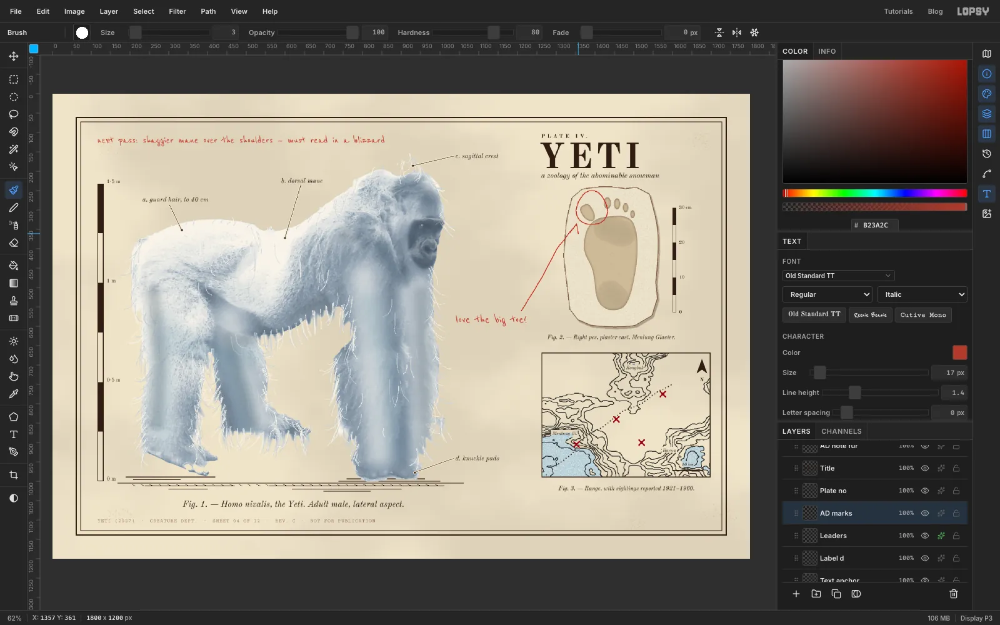

Add a layer called `AD marks`. Brush **Size** 3, **Hardness** 80, **Opacity** 100, colour `#B23A2C`. Draw a loose circle round the big toe, overshooting where it closes, the way a pencil really goes round. Then draw an arrow from the end of *love the big toe!* up to the circle, with two short strokes for the head.

## Tilt the notes

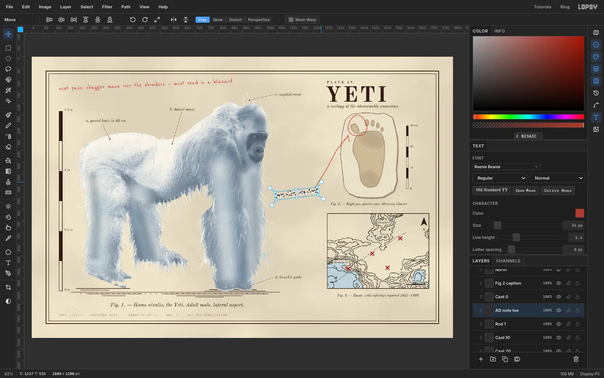

Handwriting is never level. Click the top note's row and click **Rasterize Layer** at the bottom of the Layers panel. [[Cmd]]-click its thumbnail, switch to the Move tool and drag a corner rotation handle until it tilts about 2–3° up to the right. Press [[Cmd+D]]. Do the same to *love the big toe!*, tilting it about 7°.

## Build the stamp

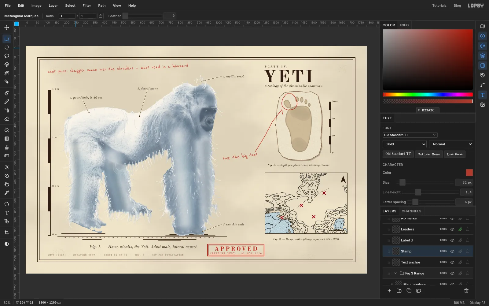

In the empty space right of the Fig. 1 caption, set `CREATURE DEPT. · 02 NOV 2026` in **Cutive Mono** 15 in `#B23A2C`, and rasterize it. With that rasterized line active, set `APPROVED` in Old Standard TT bold 32, letter spacing 6, above it, and rasterize that too. Centre the small line under the word.

Add a layer called `Stamp box`. Draw a marquee about 16 px outside both lines, fill it red, **Shrink** by 3 and **Delete**. Then draw a marquee 6 px inside that one, fill, **Shrink** by 1 and **Delete**: a double rule. Click Stamp box and choose **Layer → Merge Down** twice to merge the box, the word and the line into one layer. Rename it `Stamp`.

## Rotate the stamp

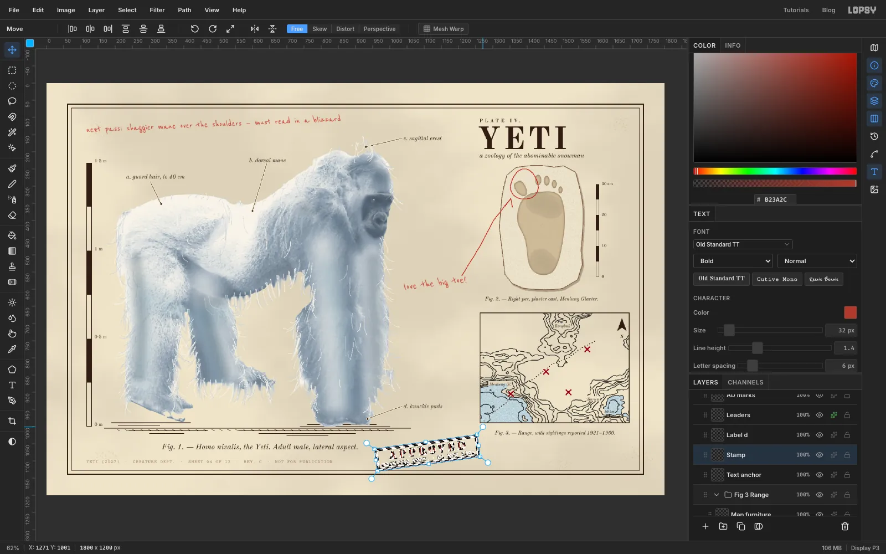

[[Cmd]]-click the Stamp thumbnail and rotate it about 8° anticlockwise with a corner handle, then press [[Cmd+D]]. Rotate before you add the mask. A layer mask stays where it is when the layer's pixels are transformed.

## Break up the ink

A rubber stamp never inks evenly. Click **Add Mask**, then click the mask thumbnail to edit it. Draw a marquee a little bigger than the tilted stamp. Then:

1. **Filter → Add Noise…**: Amount 100, Mono, Gaussian.
2. **Filter → Gaussian Blur…**: Radius 2.
3. **Filter → Threshold…**: Level 244.

Filters run on the mask while you're editing it. The few darkest specks of noise become black, and black in a mask hides the layer, so the stamp is peppered with tiny gaps. Deselect and click the Stamp row to leave mask editing.

## Press the stamp into the paper

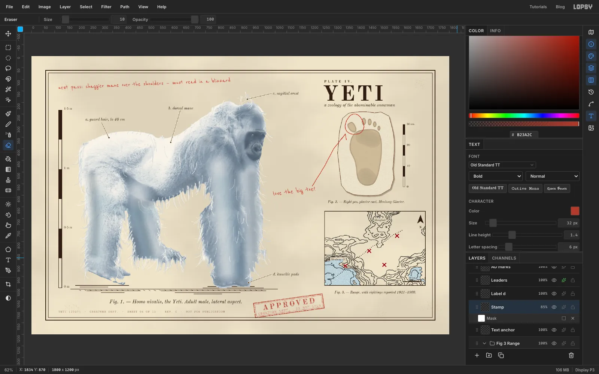

Open the stamp's effects, set **Blend** to **Multiply**, and set the layer to 85% opacity. Multiply lets the paper's grain and foxing show through the red, as real ink would.

## Warm the whole plate

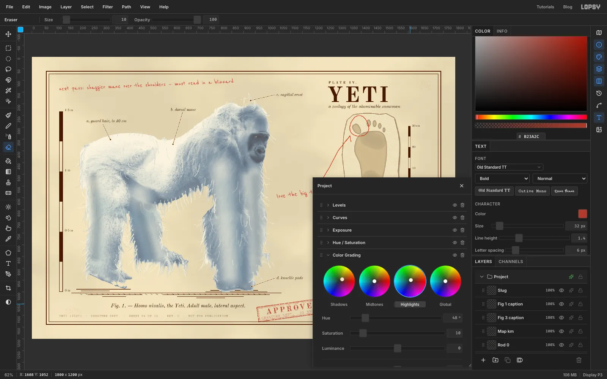

Last, tie everything together. Click the **Project** group at the top of the Layers panel and open its ✦ adjustments. Every new document has a **Color Grading** node there that does nothing until you change it. Expand it.

Click the **Shadows** tab and set **Hue** to 28 and **Saturation** to 24. Click **Highlights** and set **Hue** to 48 and **Saturation** to 10. The shadows go a little brown and the highlights a little cream, as if the whole sheet had been printed on the same old paper. Close the drawer, and choose **File → Save Project** to keep the layers, then **File → Export** for a PNG.
