A real screen print is built one ink at a time. Each colour has its own
stencil, or plate, and is pulled through the mesh onto the paper on its own.
Where two transparent inks overlap they mix into a third colour, which is
called overprinting. Where an ink is meant to stay clean, the colour
underneath is left out of the stencil, which is called a knockout. Plates
never line up perfectly, so you see thin slivers of paper or doubled edges
along some shapes. And the ink skips a little on rough paper.

In this tutorial you'll fake all of that in Lopsy for a 3:1 roadside
billboard: an ad for **Morrow & Finch Fig Marmalade**, an imaginary preserves
maker. Each ink lives in its own group set to **Multiply**, so the inks
really overprint. The billboard is **2700 × 900 px**.

Along the way you'll use:

- **New Group** and the **Multiply** blend mode to make one group per ink
- **Sunburst** and **Halftone** for a dotted ray tint and a halftone shading
- the **Lasso**, **Edit → Fill** and **Select → Grow / Shrink** for the leaves and figs
- knockouts: [[Cmd]]-click a layer thumbnail and press [[Delete]] on the plates underneath
- the **Eraser** with **Shift**-click lines for leaf veins
- copy and paste plus the **Move** tool's rotate and scale handles
- the **Brush** with **Scatter** and **Size Jitter** for seeds
- **Rozha One**, **Young Serif** and **Bevan** type, a **Color Overlay** shadow and a misregistered trap
- the **Pen** tool and text bound to a path for a round badge
- guides with **Snap to Guides**, and moving whole groups with the arrow keys
- **Add Noise**, **Gaussian Blur**, **Threshold** and the **Magic Wand** for ink wear

The palette (four inks on paper):

- Paper `#EFE4CC`
- Ochre `#E2A240`
- Sage `#7B9160`
- Rose `#D2566A`
- Plum `#4A2140`
- Fig shading `#FFFFFF` → `#B58AA6` → `#4A2140`
- Ink wear grey `#808080` (only used to make the specks)

> **Tip:** Positions are in document pixels, written `x, y`. The status bar
> at the bottom shows where the pointer is. **Edit → Fill** fills the
> selection with the foreground colour, and [[Cmd+D]] deselects. New layers
> appear above the selected layer. If the selected row is an *expanded*
> group, the new layer goes inside it; if it's *collapsed*, the new layer
> goes next to it. Open each layer's effects drawer with the sparkle icon on
> its row; the **Blend** dropdown is in there too.

> **Tip:** For an exact circle, pick the **Elliptical Marquee**, make sure
> nothing is selected and click the canvas once without dragging. A dialog
> asks for the **From X / Y** and **To X / Y** corners. A circle of radius
> `r` centred on `x, y` runs from `x − r, y − r` to `x + r, y + r`.

## Set up the canvas and guides

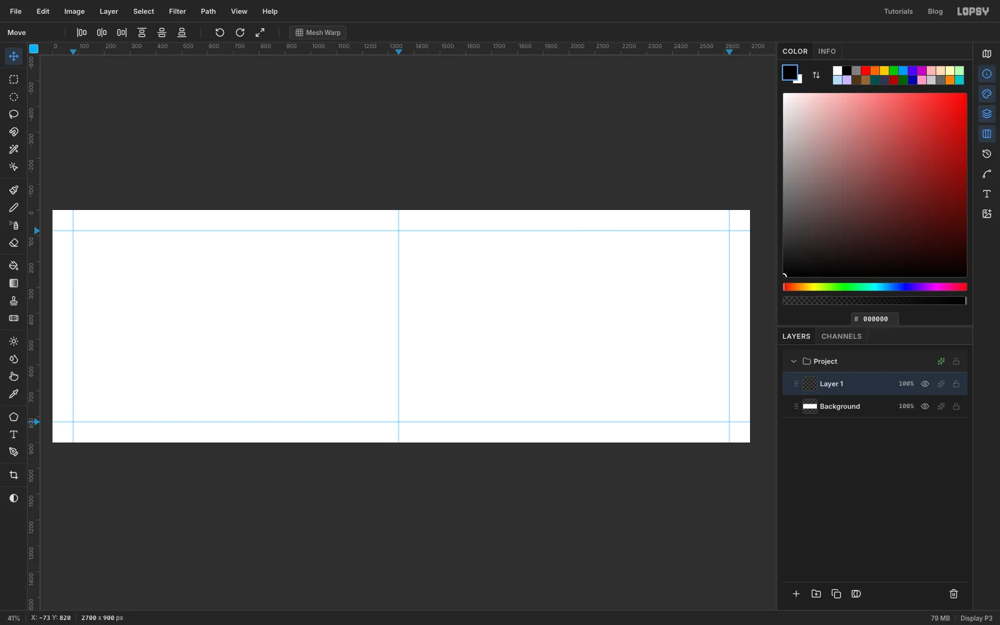

Choose **File → New**, enter **2700 × 900** and click **Create**.

Drop guides for an 80 px margin all round. Click the top ruler at `80` and
at `2620` for vertical guides, and the left ruler at `80` and `820` for
horizontal ones. Click the top ruler once more at `1340`. That's where the
type column starts: the art goes on the left, the words on the right.

## Make the paper

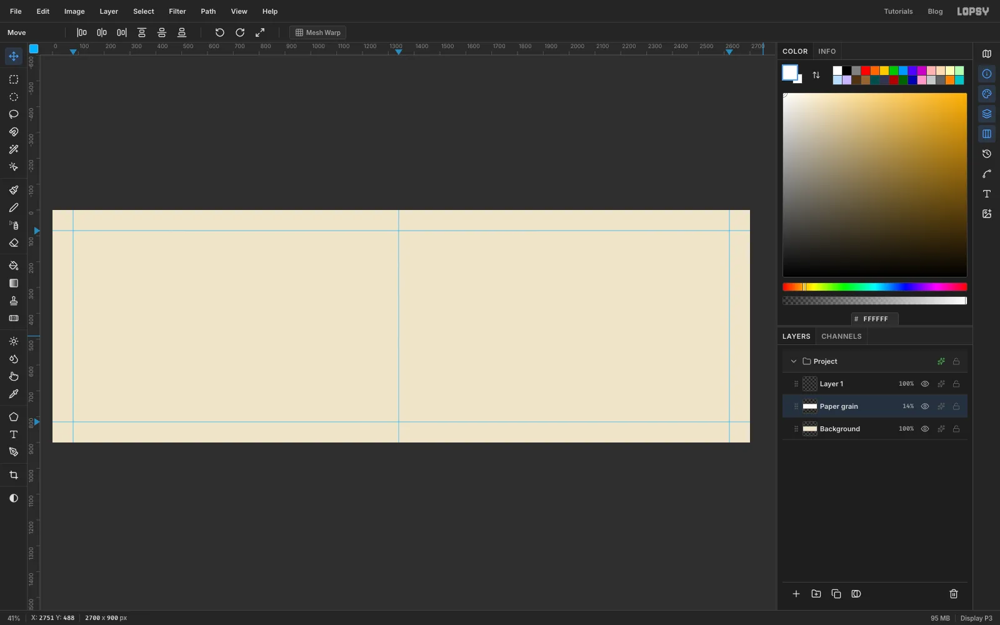

Click the *Background* row, set the foreground to paper `#EFE4CC`, choose
**Select → All** and then **Edit → Fill**. Deselect. Choose
**Filter → Add Noise…** with **Amount** `5`, **Mono** and **Gaussian**. That
gives the flat fill a slight tooth.

The new document also comes with an empty *Layer 1*; leave it for now.
Click **Add Layer**, name the new layer *Paper grain*, set the foreground to
white and choose **Select → All** and **Edit → Fill**. Deselect and run
**Add Noise…** again with **Amount** `60`, **Mono** and **Gaussian**. Then
choose **Filter → Motion Blur…** with **Angle** `80` and **Distance** `6`,
which stretches the noise into short fibres. Set the layer's **Blend** to
**Multiply** and its opacity to **14%**. Multiply drops the white out, so
only the fibres show.

## Make one group per ink

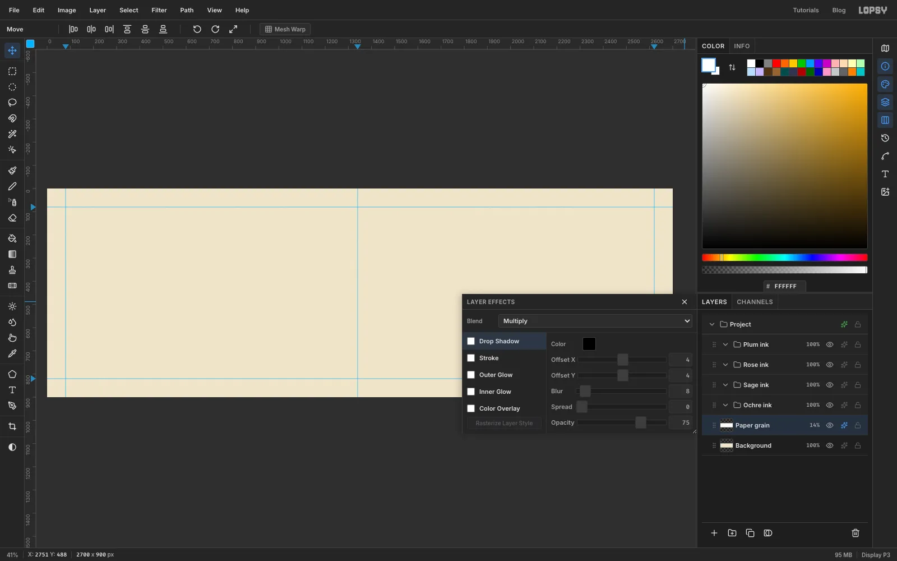

Click *Paper grain* and click the **New Group** button at the bottom of the
Layers panel. Name it *Plum ink*. Open its drawer (the sparkle icon) and
set **Blend** to **Multiply**.

Click *Paper grain* again before each new group, and make *Rose ink*,
*Sage ink* and *Ochre ink* the same way, all set to **Multiply**. Each new
group lands right above *Paper grain*, so the stack ends up in printing
order: ochre at the bottom, then sage, rose and plum on top. Finally click
the empty *Layer 1* and delete it with the trash button.

All the artwork you draw from now on goes into the group for its ink. Because the
groups multiply, a plum shape on top of ochre prints darker, just like two
transparent inks on paper.

## Burst the rays with Sunburst

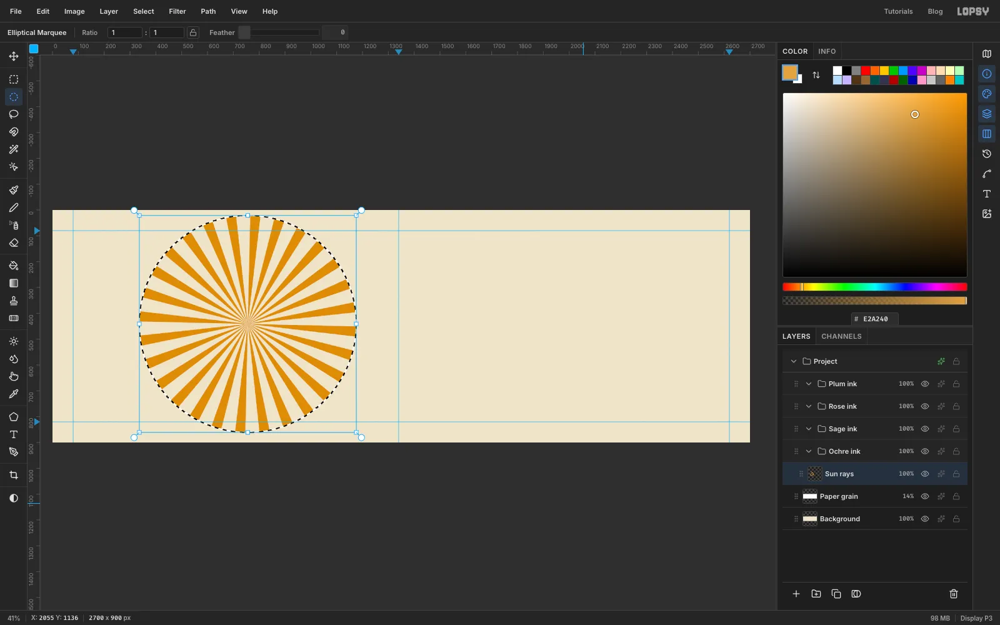

Expand *Ochre ink*, click it and add a layer named *Sun rays*. Set the
foreground to ochre `#E2A240`.

The sun sits at `756, 441`. Make a circle selection of radius `420` around
it, from `336, 21` to `1176, 861`. Then choose **Filter → Sunburst…**:

- **Rays** `28`, **Length** `24`, **Width** `42`, **Rotation** `4`
- **Center X** `28` and **Center Y** `49`
- **Taper**, **Fade**, **Softness** and **Jitter** at `0`, **Opacity** `100`

**Center X** and **Center Y** are percentages of the document, so 28% of
2700 and 49% of 900 put the centre on the sun. **Length** is a percentage of
the distance to the farthest corner, so `24` is long enough to reach the edge
of the selection. The selection trims every ray to the same circle.

## Turn the rays into a halftone tint

Deselect, then choose **Filter → Halftone…** with **Dot Size** `11`,
**Density** `2.2`, **Angle** `45` and **Softness** `0.6`.

Screen printers can't print a pale ochre without mixing a new ink, so they
fake a tint with dots. Halftone does the same thing here: from a distance
the rays read lighter than the solid sun, but up close they're the same ochre
ink.

## Fill the sun

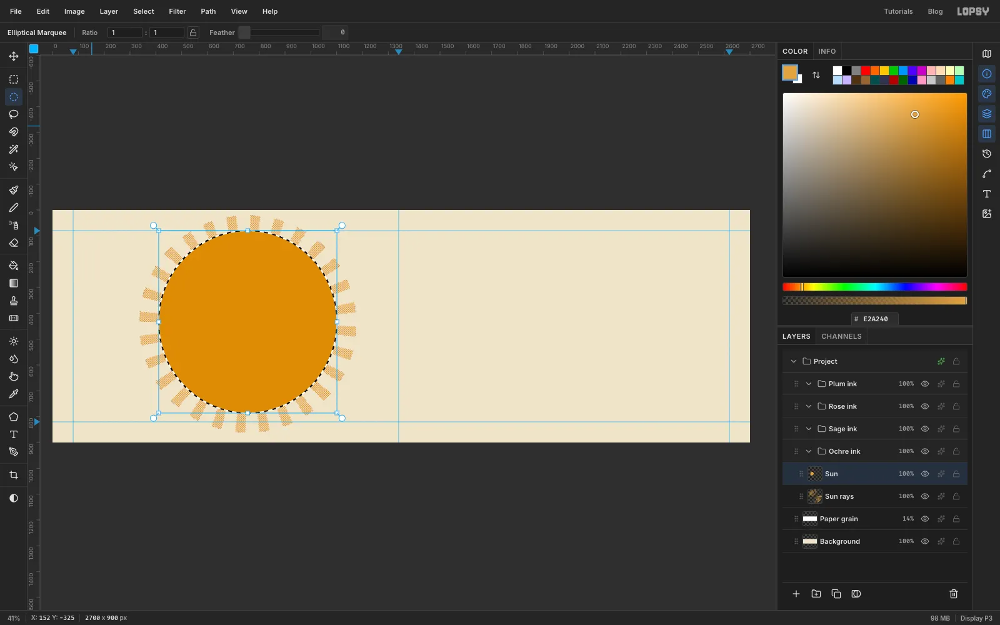

Add a layer named *Sun* above *Sun rays*. Select a circle of radius `345`
around the same centre, from `411, 96` to `1101, 786`, and fill it with
ochre. Deselect, and collapse *Ochre ink*.

## Lasso a fig leaf

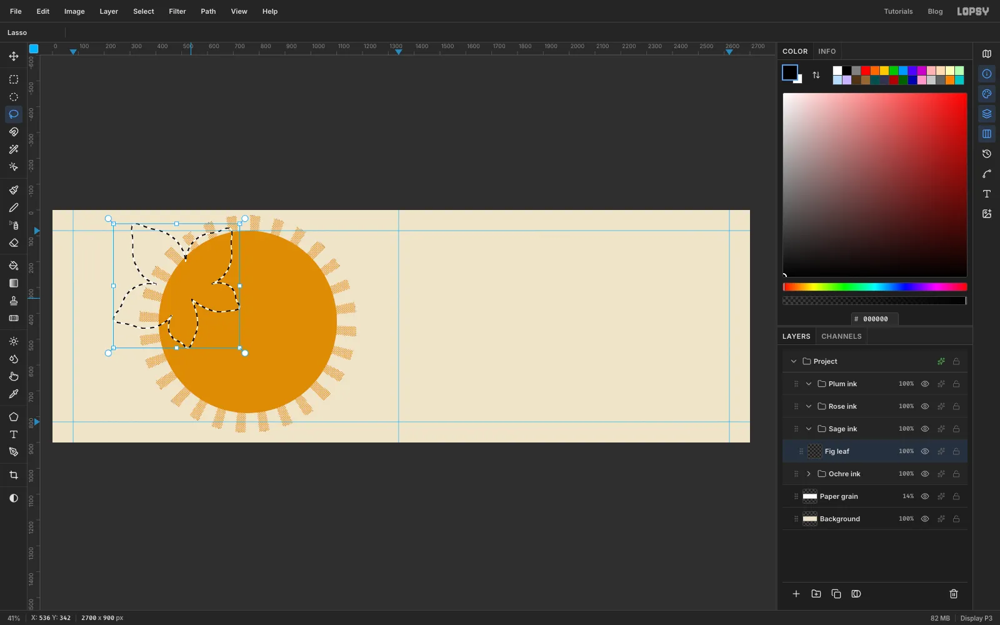

Expand *Sage ink*, click it and add a layer named *Fig leaf*.

Pick the **Lasso** and draw a fig leaf about 470 px across, tilted so its
middle lobe points up and to the left, centred near `520, 322`. A fig leaf
has five lobes: a long middle one, two side lobes and two smaller ones at
the back. Each lobe ends in a soft point. The gaps between them are narrow
and cut about halfway to the centre, and there's a small notch where the
stalk joins. Go slowly; you can undo and redraw as often as you like.

Fill the selection with sage `#7B9160` and deselect.

## Add the stalk and veins

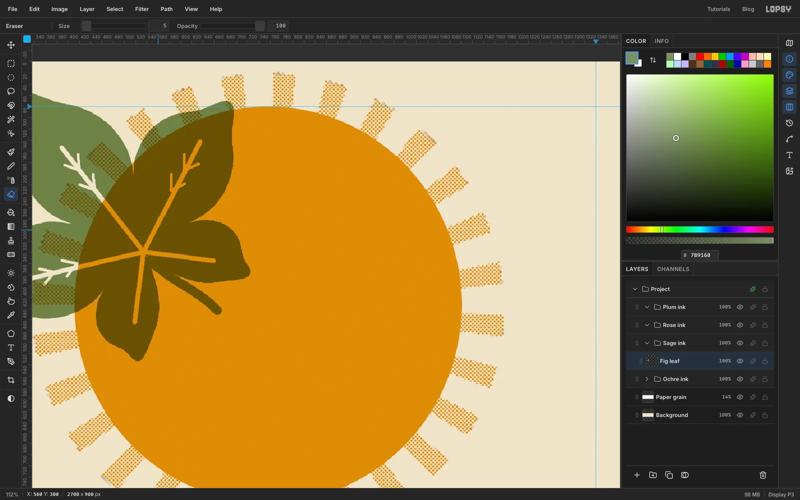

Pick the **Brush** at **Size** `18`, still in sage, and paint a short
curved stalk out of the notch, down and to the right.

Now cut the veins out with the **Eraser** at **Size** `9`. Click the base of
the leaf, just inside the notch, then hold **Shift** and click the tip of
the middle lobe. That draws a straight erased line. Do the same from the
base to each of the other four lobes, stopping the two back lobes a little
short. Then set the **Size** to `5` and add two pairs of short side veins on
the middle and side lobes, angled forward. Keep them inside their lobe.

Off the sun, the veins show bare paper. Over the sun they show ochre for
now; the knockout two steps on turns those to paper too.

## Copy the leaf and rotate it

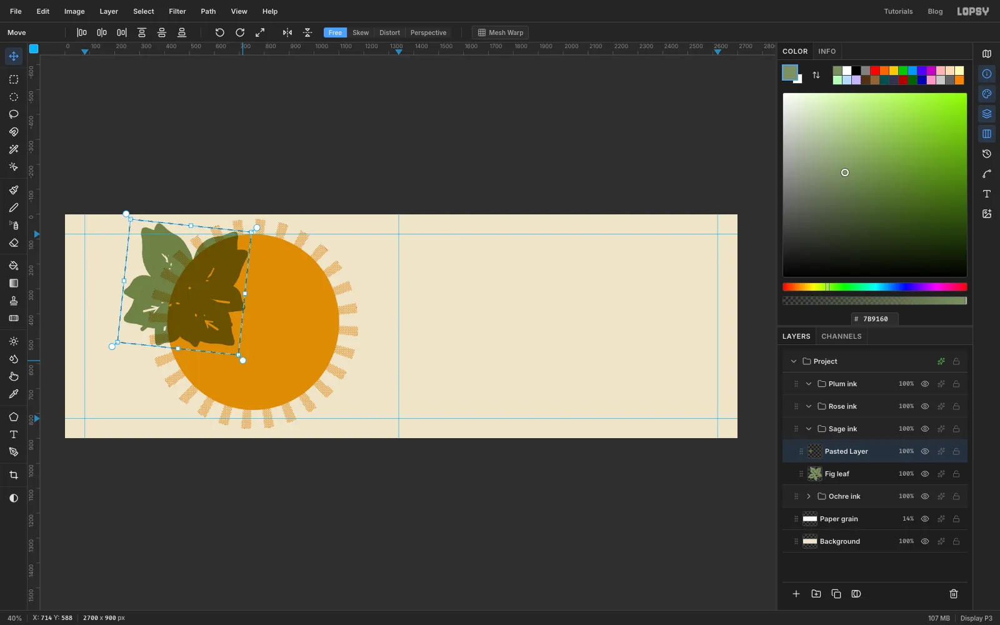

[[Cmd]]-click the *Fig leaf* thumbnail to select the leaf, press
[[Cmd+C]], deselect and press [[Cmd+V]]. The copy is pasted in place on a
new layer.

Pasting in place doesn't leave a selection, so draw a rectangular marquee
just around the copy. Pick the **Move** tool, put the pointer just outside
the top-right corner until it turns into the rotate cursor, and drag
clockwise until the leaf has turned about 96°. Press [[Enter]] to apply the
rotation.

## Scale the copy and move it

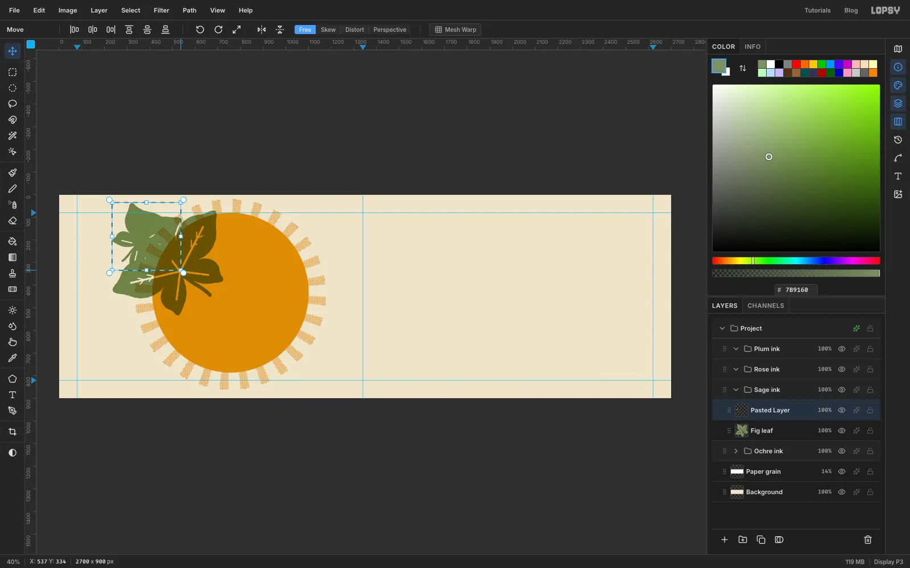

Draw a new marquee around the rotated copy. Hold [[Cmd]] and drag the
bottom-right corner handle in until the leaf is about 60% of its size, then
press [[Enter]] and deselect.

With the **Move** tool, drag the small leaf across to the right edge of the
sun, centred around `1100, 280`, and rename the layer *Fig leaf 2*. It will
peek out from behind the halved fig.

## Knock the sun out under the leaves

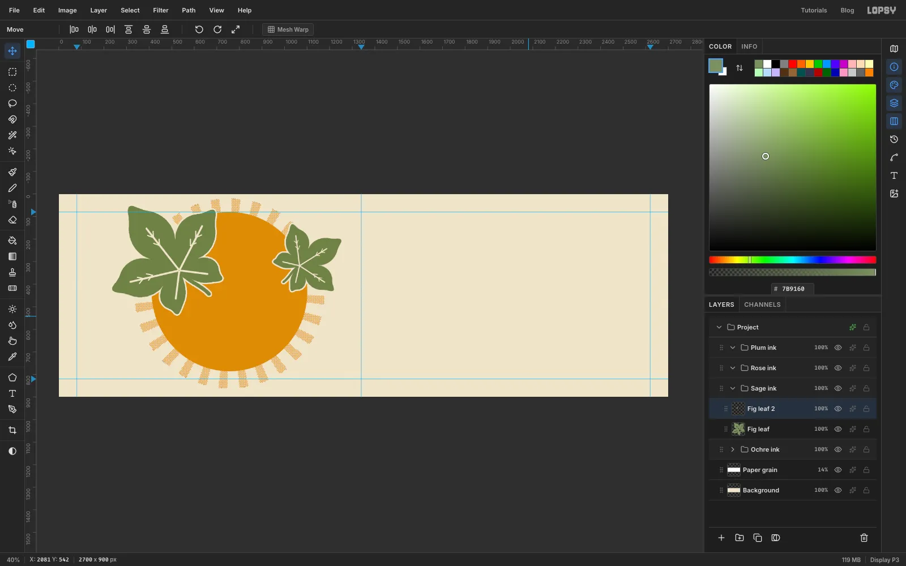

Sage over ochre makes a muddy olive, so take the ochre out from under the
leaves. Expand *Ochre ink*.

[[Cmd]]-click the *Fig leaf* thumbnail and choose **Select → Grow…** `6`.
Growing closes up the vein gaps and adds a hairline all round. Click *Sun*
and press [[Delete]], then click *Sun rays* and press [[Delete]]. Do the same
for *Fig leaf 2*. Deselect.

The leaves are now printed straight onto the paper, and the thin paper
outline around them looks like a printer's trap.

## Draw the whole fig in rose

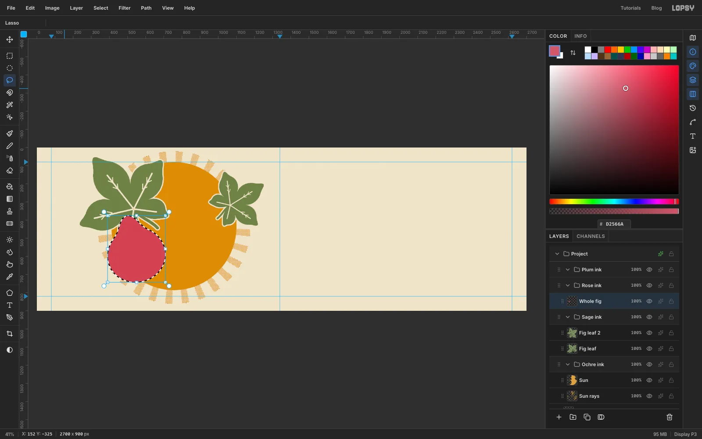

Collapse *Sage ink*, expand *Rose ink*, click it and add a layer named
*Whole fig*.

With the **Lasso**, draw a fig about 320 px wide and 400 px tall, centred
near `550, 596` and tilted about 14° to the left. Make the body round and
the neck short, about a third of the body's width, rising to a rounded
point. Fill it with rose `#D2566A`.

Keep the selection. Expand *Ochre ink* and *Sage ink*, then press
[[Delete]] on *Sun*, *Sun rays* and *Fig leaf*. That knocks them out behind
the fig, so the rose prints on clean paper.

## Shade the fig with a gradient

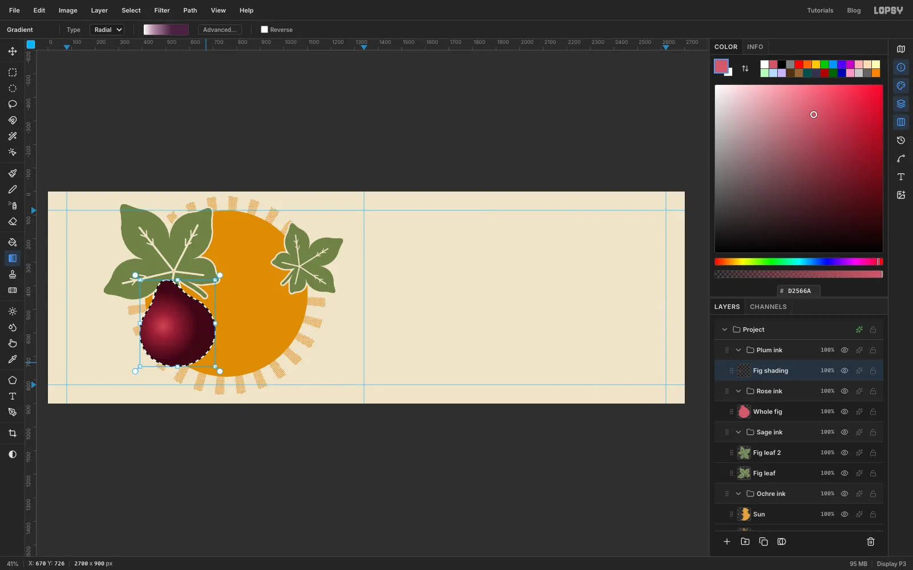

Collapse *Ochre ink* and *Sage ink*, expand *Plum ink*, click it and add a
layer named *Fig shading*. The fig's selection is still active, so the
gradient will only fill the fig.

Pick the **Gradient** tool, set it to **Radial**, and open **Advanced…**.
Give it four stops, typing each colour into the hex field:

- `#FFFFFF` at 0% and `#B58AA6` at 22%
- plum `#4A2140` at 62% and again at 100%

Drag from the light spot just left of the body's centre, about `488, 570`,
down and to the right to `670, 726`.

## Turn the shading into halftone dots

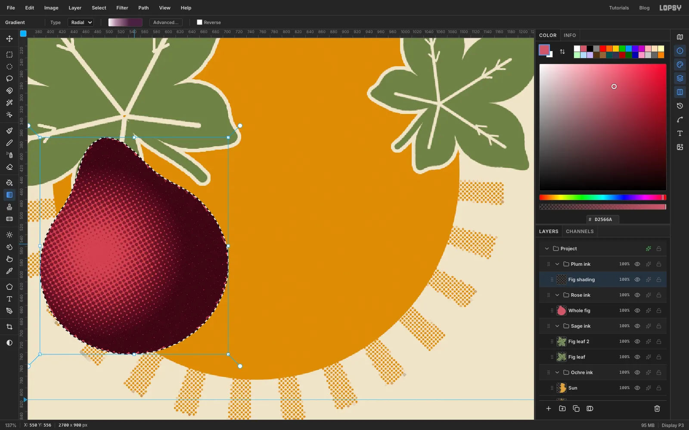

Keep the selection and choose **Filter → Halftone…** with **Dot Size**
`12`, **Density** `1.7`, **Angle** `30` and **Softness** `0.5`.

White makes no dots, so the highlight stays rose, while the dark edges
print solid plum. The dots sit on top of the rose plate and multiply into
it, which is exactly how a two-colour screen print shades a round shape.
Deselect.

## Paint the stems

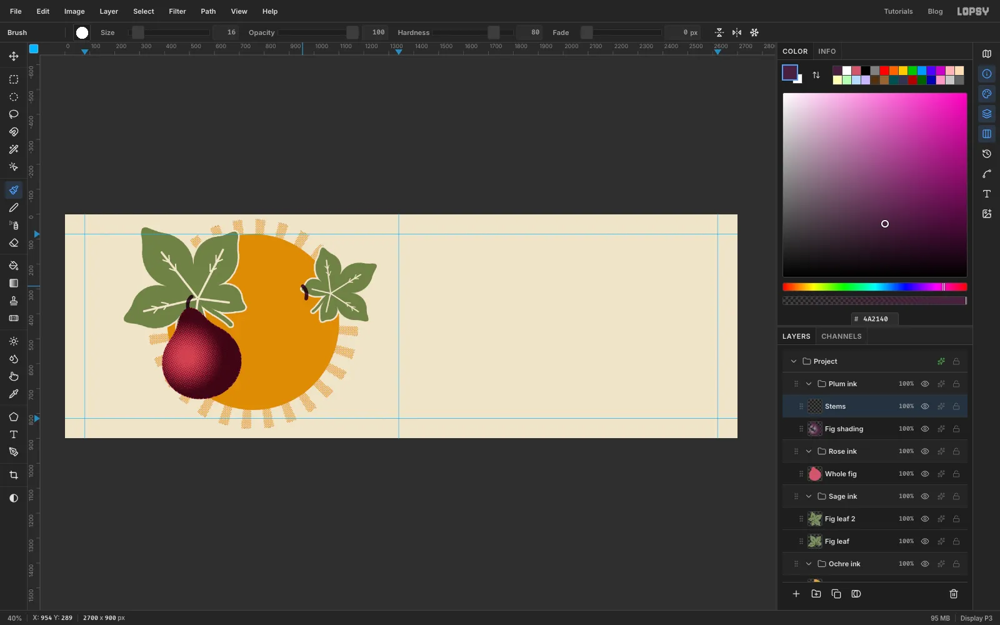

Add a layer named *Stems* inside *Plum ink*. Paint each stem with the
**Brush** at **Size** `16` in plum: a short, slightly hooked stroke rising
straight out of the top of the neck, starting around `495, 381`. Paint the
halved fig's stem now too, at the top of where its neck will be, starting
around `968, 340`. It floats on its own for a moment; the halved fig grows
up to meet it in the next steps, and because *Stems* isn't knocked out it
stays on top.

## Cut a window for the halved fig

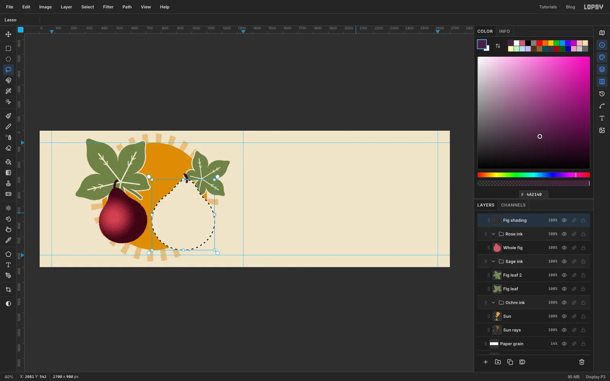

The halved fig needs its own clean patch of paper. With the **Lasso**,
draw the outline of a fig about 390 px wide and 470 px tall, centred near
`945, 598` and leaning slightly right. Give it the same round body and short
neck as the whole fig.

Choose **Select → Grow…** `10`. Expand all four groups and press
[[Delete]] on *Sun*, *Sun rays*, *Fig leaf*, *Fig leaf 2*, *Whole fig* and
*Fig shading*. The extra 10 px leaves a band of paper around the halved fig,
so it doesn't merge into the whole fig.

## Draw the skin

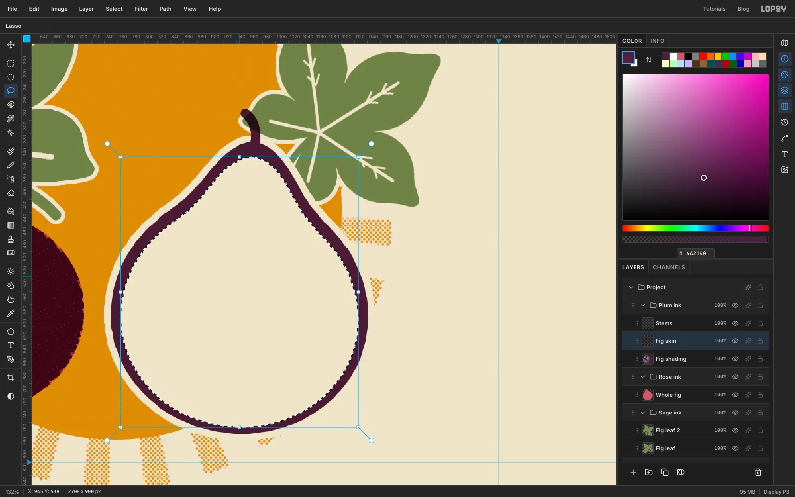

The window's selection is still active. Choose **Select → Shrink…** `10` to
get back to the fig's own outline. Click *Fig shading*, add a layer named
*Fig skin* in *Plum ink*, set the foreground to plum and fill.

Choose **Select → Shrink…** `15` and press [[Delete]]. That leaves a thin
plum rim of even width, the skin.

## Fill the flesh

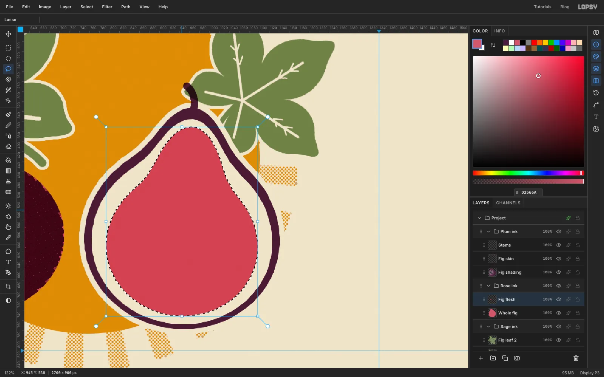

Keep the selection and choose **Select → Shrink…** `22`. Click *Whole fig*
in *Rose ink*, add a layer named *Fig flesh* and fill it with rose. The
22 px you shrank by is the cream pith ring between skin and flesh, and
shrinking keeps it the same width all the way round, even up in the neck.

## Burst the strands with Sunburst

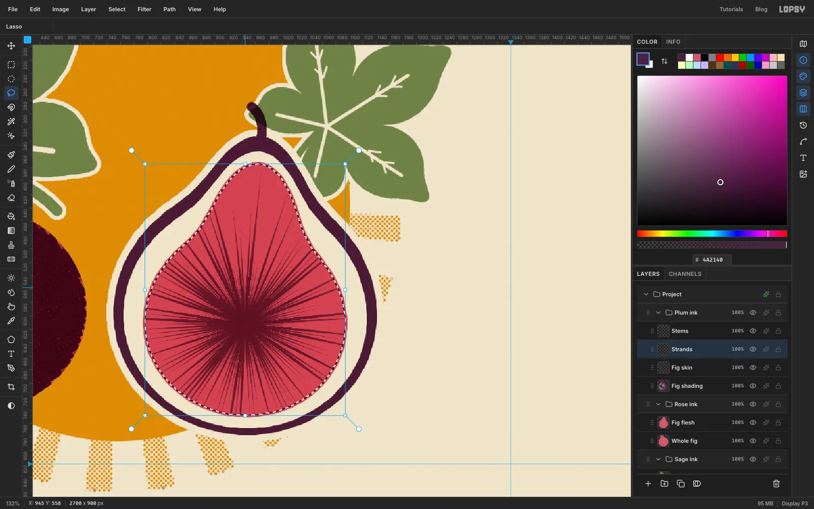

Keep the flesh selected and choose **Select → Shrink…** `3`. Click
*Fig skin* and add a layer named *Strands* above it. With plum as the
foreground, choose **Filter → Sunburst…** again:

- **Rays** `120`, **Length** `13`, **Width** `55`, **Taper** `100`
- **Fade** `35`, **Softness** `20`, **Jitter** `70`, **Seed** `17`, **Opacity** `80`
- **Center X** `35` and **Center Y** `68`

**Center X** `35` and **Center Y** `68` put the burst at `945, 612`, just
below the middle of the flesh. A **Taper** of `100` turns every ray into a
spike that starts thick and thins to a point, and **Jitter** varies their
length, so they look like the stringy inside of a fig. The selection keeps
them inside the flesh. Deselect.

## Scatter the seeds

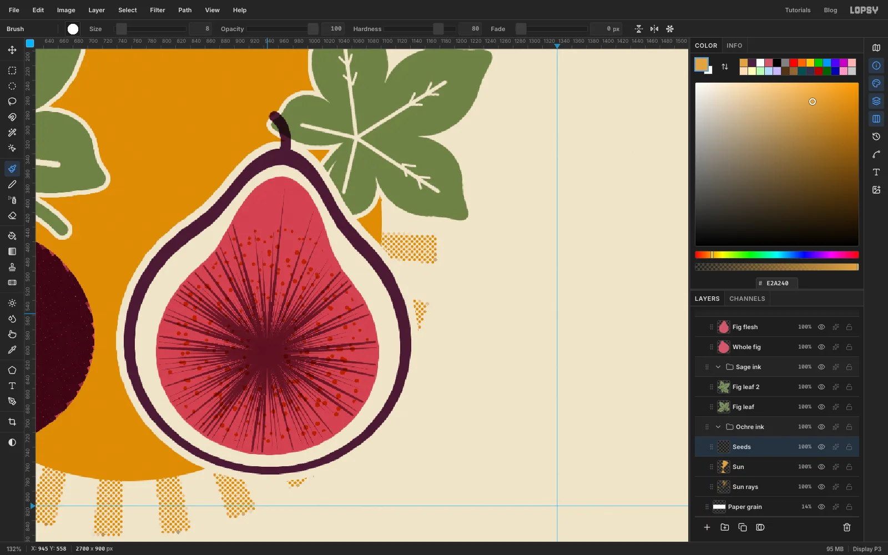

[[Cmd]]-click the *Fig flesh* thumbnail and choose **Select → Shrink…**
`12`. Expand *Ochre ink*, click *Sun* and add a layer named *Seeds*. Set the
foreground to ochre.

Pick the **Brush** at **Size** `8`, click **Open brush presets** and set
**Spacing** to `260` on the **Shape** tab, then **Scatter** `100` and
**Size Jitter** `45` on the **Dynamics** tab. Paint five wobbly loops around
the centre of the flesh, each one a bit bigger than the last. The scatter
throws each seed off the line, so the loops don't look like rings. Deselect.

## Punch the seeds through and hollow the centre

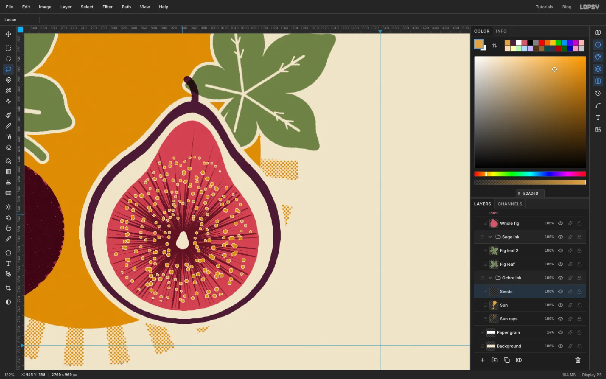

The seeds look too dark printed on top of the rose. Punch them through
instead: [[Cmd]]-click the *Seeds* thumbnail, choose **Select → Grow…** `1`,
and press [[Delete]] on *Fig flesh* and then on *Strands*. Now each seed is
ochre on bare paper, which reads as golden.

Lasso a small teardrop about 26 px wide and 45 px tall at the burst's
centre, `945, 616`. Press [[Delete]] on *Fig flesh*, *Strands* and *Seeds*
to leave the hollow in the middle of the fig. Deselect.

## Cast a halftone shadow

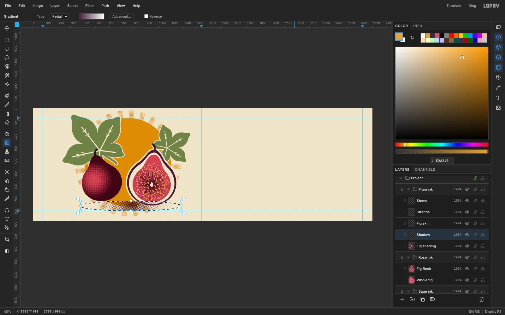

Click *Fig shading* and add a layer named *Shadow*. With the exact-corners
dialog, make an elliptical selection from `380, 742` to `1180, 802`: a flat
oval 800 px wide under the figs, centred on `780, 772`. Pick the
**Gradient** tool, set it to **Radial** and open **Advanced…**. Click each
middle stop and delete it until only the two ends are left, then make the
left one plum and the right one white. Drag from the middle of the oval,
`780, 772`, to its right end. Then run
**Halftone…** with **Dot Size** `12`, **Density** `1.3`, **Angle** `30` and
**Softness** `0.5`.

Lasso the whole fig, then hold **Shift** and lasso the halved fig to add it
to the selection, and press [[Delete]] so the shadow sits behind them.
Finally [[Cmd]]-click the *Sun* thumbnail, choose **Select → Inverse** and
press [[Delete]] on *Shadow*. That keeps the shadow on the sun, so it can't
smudge onto the bare paper. Deselect and collapse all the groups.

## Set the tagline and Marmalade

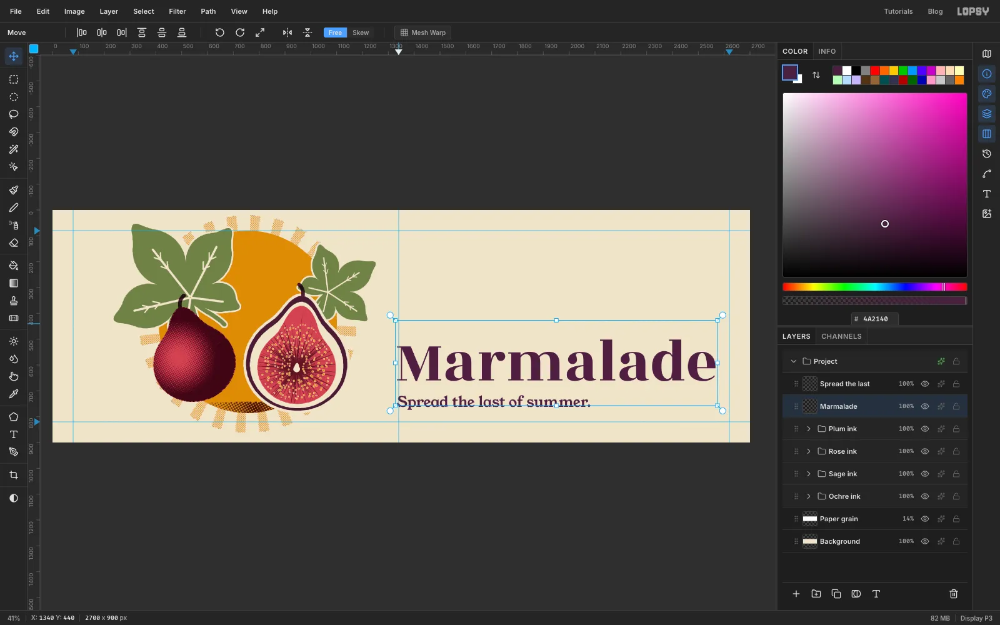

Type goes in from the bottom up. That way each new click lands in empty
space and not on a line you've already set. The type layers sit above the
ink groups rather than inside them; clicking a collapsed group row first
just places each new line in the stack and stops the Text tool restyling
the last one.

Click the collapsed *Plum ink* row so the Text tool's settings don't
restyle anything. Pick the **Text** tool, choose **Young Serif** at size
`56` in plum, click in the type column near `1340, 700` and type
`Spread the last of summer.` Press [[Tab]] to commit it. With the **Move**
tool, nudge it with the arrow keys until its left edge is at `x = 1334`
and the bottom of the *p* sits at `y = 772`.

Click *Plum ink* again. Set **Rozha One** at size `236` in plum, click near
`1340, 440` and type `Marmalade`. Nudge it so it starts at `x = 1334` with
its baseline at `y = 662`. It should end at about `x = 2566`, close to the
right margin.

## Set Fig in rose

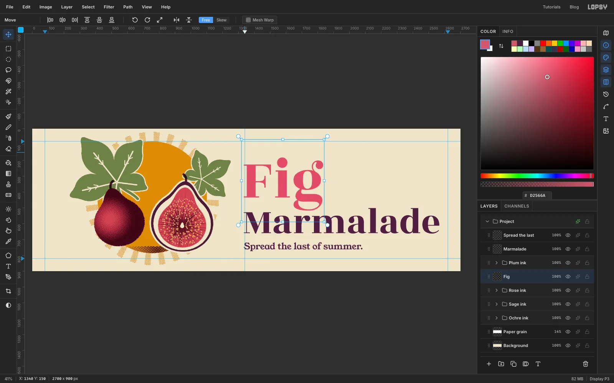

Click *Rose ink*, then choose **Rozha One** at size `372` in rose. Click
near `1340, 150` and type `Fig`. Nudge it to `x = 1334` with the bottom of
the *g*'s loop at `y = 516`. That leaves about 25 px between the loop and
the *r* and *m* of *Marmalade*, so the two words nest without touching.

## Add the brand line

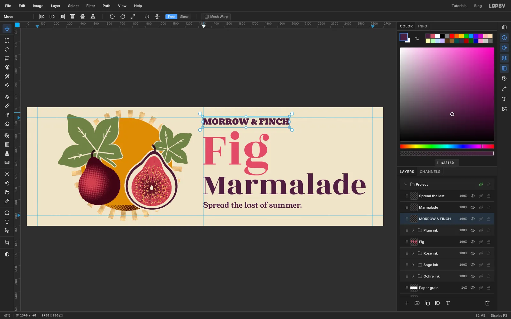

Click *Plum ink* again. Choose **Bevan** at size `60` in plum, click in the
top margin near `1340, 40` and type `MORROW & FINCH`. Nudge it so its left
edge is at `1334` and the tops of its capitals are at `y = 84`. On a
billboard, the advertiser's name has to be readable from the road, so keep
it big.

## Misregister Marmalade

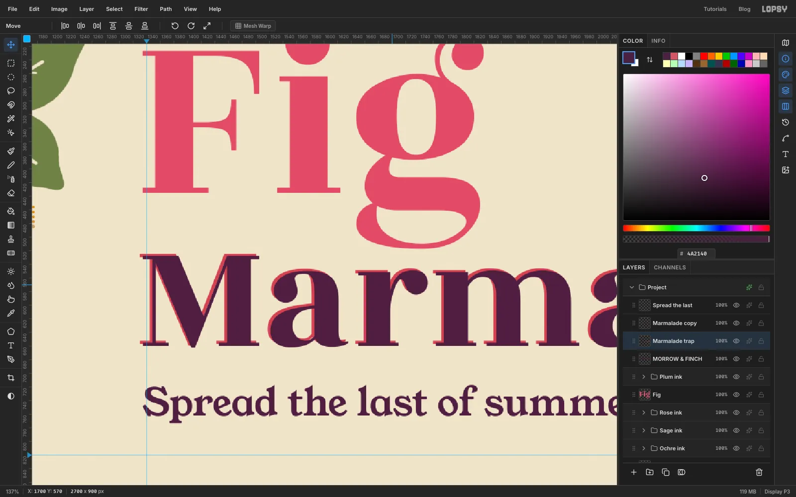

Real plates never line up perfectly. Fake one slip on the headline.

Click *Marmalade* and choose **Layer → Duplicate Layer**. The copy,
*Marmalade copy*, stays live text on top. Click the original *Marmalade*
row, which is now underneath, and click
**Rasterize Layer** at the bottom of the Layers panel. In its drawer turn on
**Color Overlay** in rose, then click **Rasterize Layer Style** to bake it.
Rename it *Marmalade trap* and set its **Blend** to **Multiply**.

With the **Move** tool, press [[ArrowLeft]] four times and [[ArrowUp]]
three times. A thin rose edge now shows along the top left of every plum
letter.

## Snap the badge disc to guides

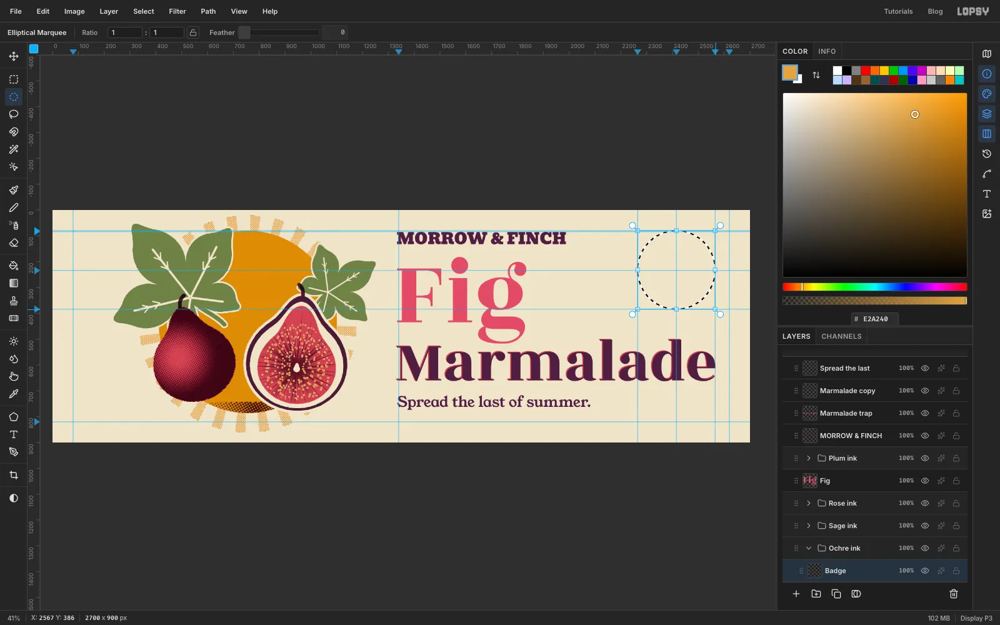

The badge goes in the top-right corner. It's centred on `2415, 234` with a
radius of `150`, so its right edge lines up with the end of *Marmalade*.
Click the top ruler at `2265`, `2415` and `2565`, and the left ruler at
`84`, `234` and `384`.

Expand *Ochre ink*, click *Seeds* and add a layer named *Badge*. With the
**Elliptical Marquee**, drag from the top-left corner of the guide box to
the bottom-right one. **Snap to Guides** is on by default, so both corners
land exactly on the guides. Set the foreground to ochre, fill and
deselect.

## Ring the badge

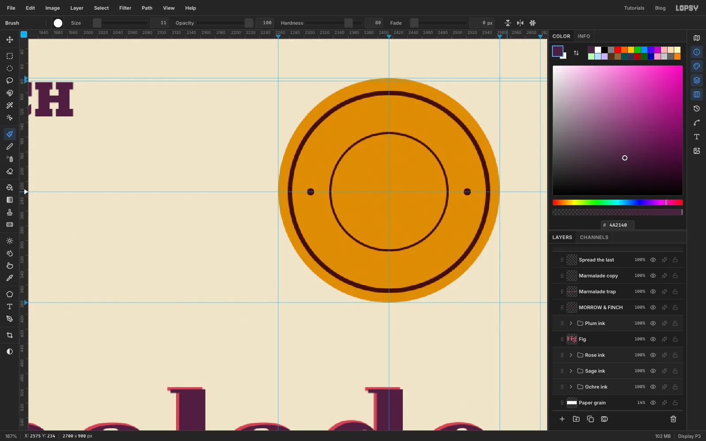

The rings are within a few pixels of those guides, so turn
**View → Snap to Guides** off first, or every circle will jump to the guide
box.

Collapse *Ochre ink*, expand *Plum ink*, click *Strands* and add a layer
named *Badge ring*. Set the foreground to plum. With the exact-corners
dialog, make two rings around `2415, 234`:

- fill `2278, 97` to `2552, 371` (radius 137), then select `2284, 103` to `2546, 365` (radius 131) and press [[Delete]]
- fill `2334, 153` to `2496, 315` (radius 81), then select `2337, 156` to `2493, 312` (radius 78) and press [[Delete]]

Pick the **Brush**, open **Open brush presets** and set **Scatter** and
**Size Jitter** back to `0` (they're still set from the seeds). At **Size**
`11`, click once at `2309, 234` and once at `2521, 234`. These dots split the top line of text from the bottom one.

## Draw two arcs with the Pen

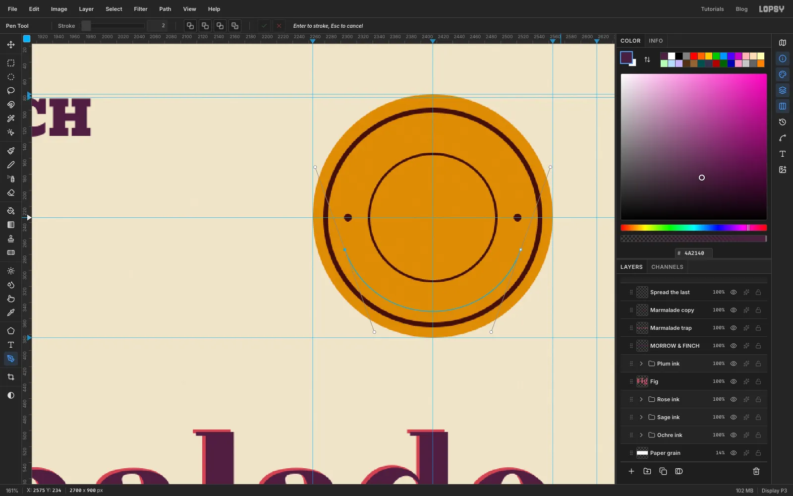

Text on a closed circle runs all the way round, so the bottom half ends up
upside down. Use two arcs instead, both drawn left to right.

Pick the **Pen** tool. For the top arc, press on the left at `2318, 234`
and drag straight up about 130 px to pull out a handle. Then press on the
right at `2512, 234` and drag straight down by the same amount. Click the ✓
**Commit path** button in the options bar. That's a half circle over the
top, 97 px from the centre.

For the bottom arc, press at `2305, 274`, a little below the left dot, and
drag about 110 px down and slightly to the right. Then press at
`2525, 274` and drag the same distance up and slightly to the right. Commit
it. It sags under the inner ring, 117 px from the
centre.

## Bind the badge text to the arcs

Click *Plum ink*. With the **Text** tool, choose **Bevan** at size `27` in
plum, click in the empty bottom margin and type `HAND-STIRRED`. Commit it.
In the options bar set **Path** to *Path 1* and **Align** to **Center**. The
letters jump onto the top arc and centre over the badge.

Click *Plum ink* again, type `COPPER POTS` the same way, and bind it to
*Path 2* with **Align** set to **Center**. Because the bottom arc runs left
to right, the letters sit upright with their tops towards the middle of the
badge. With *COPPER POTS* still selected, open the **Text** panel and set
**Letter spacing** to `3` to loosen it a little. The spacing carries over
to the next text you type, which suits the two small lines in the
middle.

The top line sits on a smaller circle than the bottom one, because the top
letters grow outward from their arc and the bottom letters hang inward. So
both lines fill the same band between the rings.

## Fill the badge centre

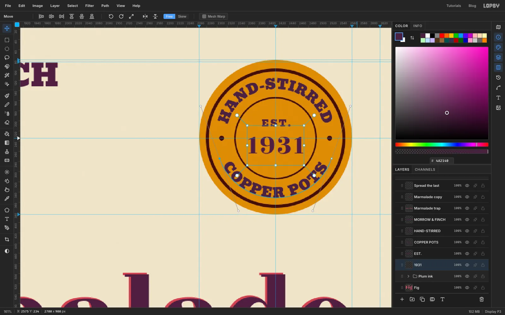

Click *Plum ink*, choose **Bevan** at size `18` and click inside the inner
ring, clear of the arc letters, and type `EST.` Click *Plum ink* again, choose **Rozha One** at size
`56` and type `1931`. Nudge both until they're centred on `x = 2415`, with
*EST.* just above the middle line and *1931* just below it.

## Give Fig a plum shadow

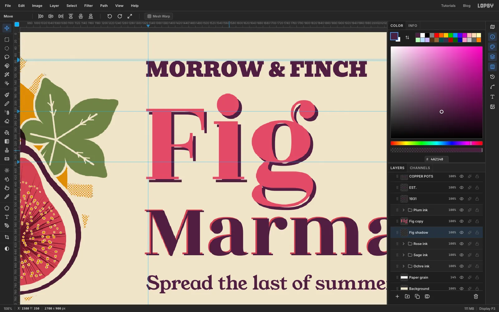

This works like the trap on *Marmalade*. Click *Fig* and choose
**Layer → Duplicate Layer**. The copy, *Fig copy*, stays rose and on top.
Click the original *Fig* underneath, click
**Rasterize Layer**, turn on **Color Overlay** in plum and click
**Rasterize Layer Style**. Rename it *Fig shadow*.

With the **Move** tool, nudge it 9 px right and 9 px down with the arrow
keys (**Shift**+arrow moves 10 px at a time). That's the hard shadow of a
second plate.

## Fill the letters with halftone dots

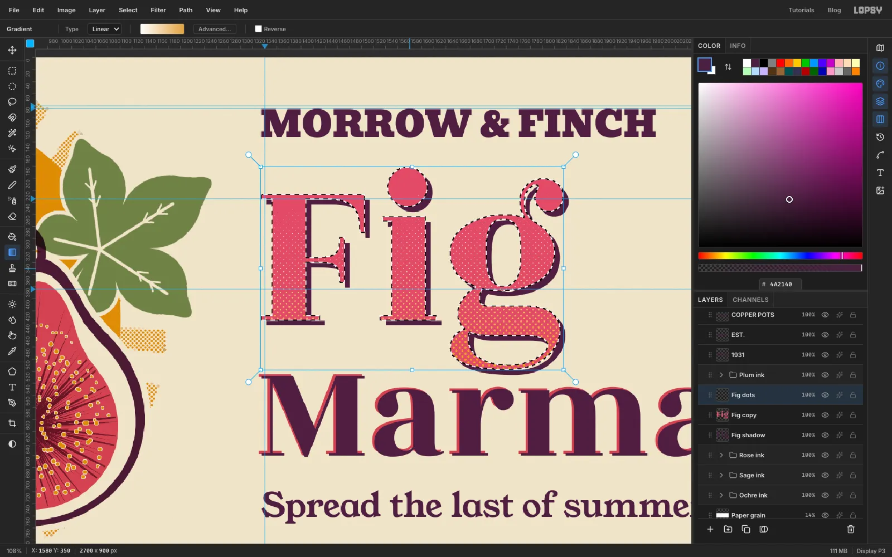

[[Cmd]]-click the *Fig copy* thumbnail to select the letters, click the
*Fig copy* row and add a layer named *Fig dots*.

Pick the **Gradient** tool, set it to **Linear**, and in **Advanced…** make
the left stop white and the right stop ochre. Drag from just below the top of the letters straight down to the
bottom of the *g*. Run **Halftone…** with **Dot Size** `11`,
**Density** `1.6`, **Angle** `45` and **Softness** `0.4`. Deselect and set
the layer's **Blend** to **Multiply**. The dots overprint the rose, so they
print as a deeper orange, heavier towards the foot of each letter.

## Misregister two plates

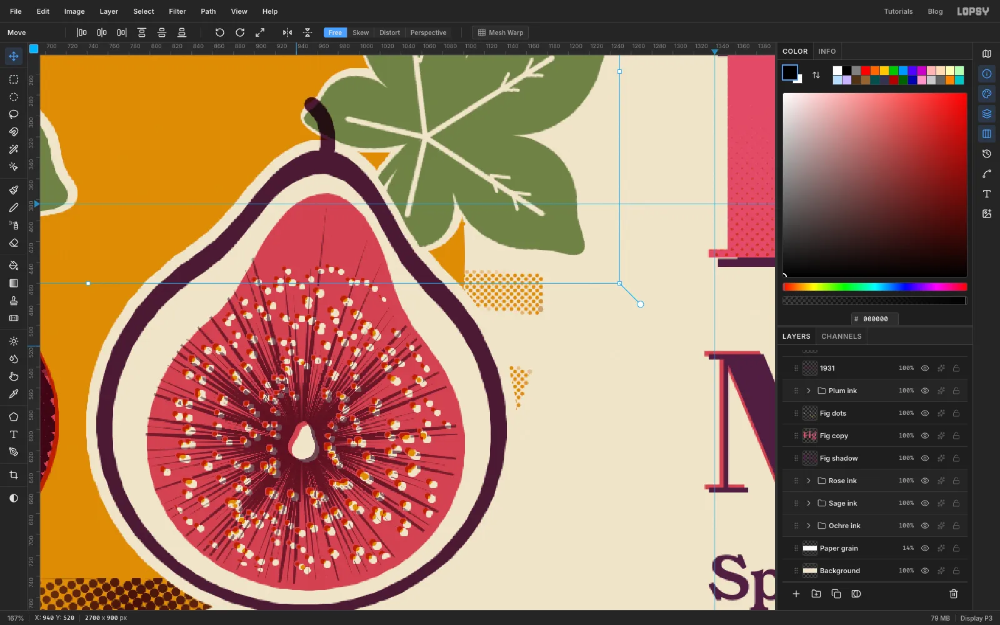

Moving a whole group moves its plate. Click the collapsed *Rose ink* group
row, pick the **Move** tool and press [[ArrowRight]] four times and
[[ArrowDown]] three times. Then click *Sage ink* and press [[ArrowLeft]]
three times and [[ArrowDown]] twice.

The slip opens thin slivers of paper along some edges and doubles others.
The seed holes move too, so the seeds pick up pale paper centres with rose
edges, which sells the misprint.

Each arrow press is its own undo step, so [[Cmd+Z]] twelve times takes both
plates back exactly where they were if you want to compare. Then redo all
twelve with [[Cmd+Shift+Z]].

## Make the ink wear specks

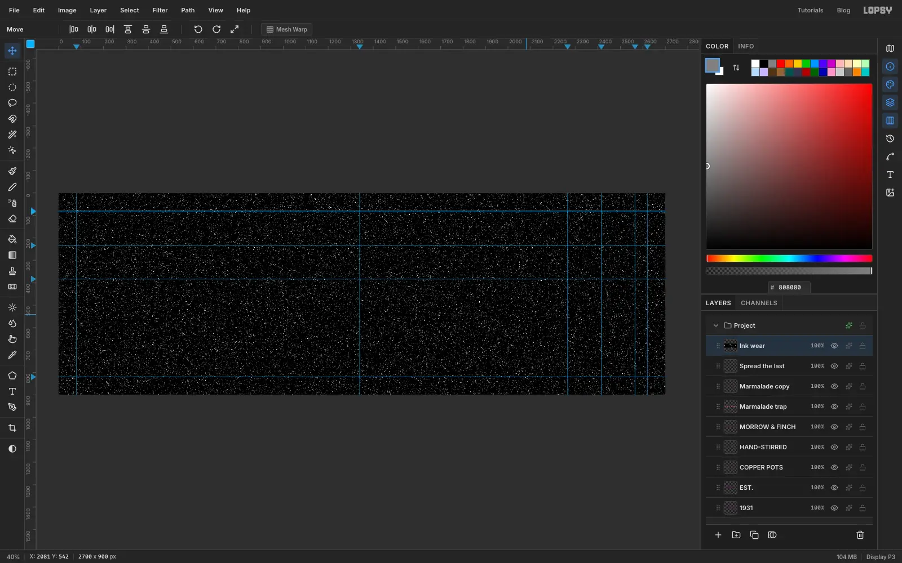

Ink skips on the tooth of real paper. Click the topmost layer in the Layers
panel (the first row under *Project*, here the tagline) and add a layer
named *Ink wear*, so it sits above everything, type included. Set the
foreground to grey `#808080` and fill the whole layer and choose
**Add Noise…** with **Amount** `100`, **Mono** and **Uniform**. Then choose
**Gaussian Blur…** with **Radius** `2`. The blur clumps the noise into small
blobs.

Choose **Filter → Threshold…** and drag the **Level** up until only a few
percent of the blobs stay white, about `150` here. The rest turns black.

## Turn the specks into paper

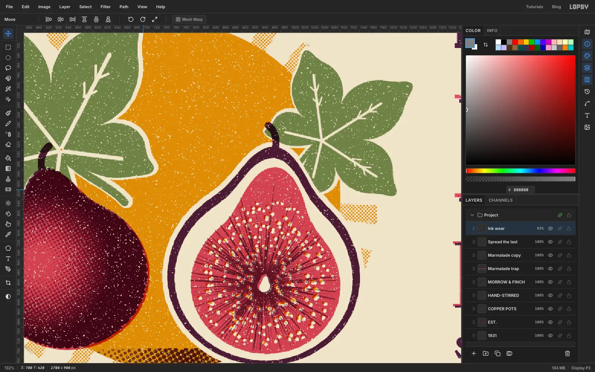

Pick the **Magic Wand**, untick **Contiguous**, and click any black area.
That selects all the black at once. Press [[Delete]] and deselect, so only
the white specks are left.

Open the layer's drawer and turn on **Color Overlay** in paper `#EFE4CC`,
then click **Rasterize Layer Style**. Set the layer's opacity to **85%**.
The specks are invisible on bare paper, but they break up every ink,
type included, like a print where the ink didn't quite cover.

Turn the guides off with **View → Show Guides**. Export with
**File → Quick Export PNG** and keep the layered file with
**File → Save Project**.
