The posters that sold America's national parks were screen-printed. A printer cuts one stencil per ink, pulls each colour through a mesh screen, and builds the picture up in flat, overlapping layers. Five or six inks have to do all the work, so shapes are bold and simple, shading is done with dot screens, and the inks never land in quite the same place twice.

In this tutorial you'll use that look for a magazine cover: **BASIN**, a fictional outdoors quarterly, and its Geyser Issue on Yellowstone. It's 1200 × 1560 px, close to a US magazine page, and it has:

- a dusk sky cut into **hand-cut bands**, with halftone dots along each edge
- **Old Faithful**, built from dozens of elliptical marquees, shaded with crescents and a dot screen
- the rainbow rings of **Grand Prismatic Spring**, with ripples that reflect the plume
- a **bison** traced from a public-domain photo with Threshold and the Magic Wand, standing on a boardwalk
- a masthead the plume overlaps, cover lines, a rotated **sticker**, a footer band and a barcode
- grain and a little **misregistration**, so it looks printed rather than drawn

The tools you'll use:

- **guides**, the Rectangular and Elliptical Marquees and the **Lasso**, with Shift to add, [[Option]] to subtract and [[Shift]]+[[Option]] to intersect
- [[Cmd]]-clicking a layer thumbnail to load its shape, **Select → Inverse**, **Shrink** and **Grow**
- the **Pen** tool and **Path to Selection**, the **Gradient**, **Brush** (with Taper) and **Pencil**
- **Copy**, **Paste**, the Move tool's **Flip**, **scale** and **rotate** handles, and **Merge Down**
- **Threshold**, **Gaussian Blur**, **Halftone** and **Add Noise**, and the **Magic Wand**
- the **Multiply** and **Overlay** blend modes, **Color Overlay** and **Drop Shadow**
- **groups**, and live text in Alfa Slab One, Oswald and Fraunces

The palette:

- Paper `#F3E9D2`
- Sky bands `#132C38` → `#1C4150` → `#2D6470` → `#8C7686` → `#D88A6A` → `#EFAE69` → `#F6D27E`
- Sun `#FCE9BE`, far ridge `#3B6670`, near ridge and pines `#1E3742`
- Sinter `#D9C7A5`, mound `#C9B48F`
- Steam `#FBF3E3`, steam shadow `#A9C9C6`, steam dots `#5E8F92`
- Spring `#9C3D27` → `#DE7631` → `#EDC24A` → `#5DB8A9` → `#1E5E8A` → `#16476E`
- Bison `#2B1E2E`, rust `#B5502C`, masthead yellow `#F6D27E`

> **Tip:** On a wide-gamut (Display P3) screen, Lopsy reads typed hex codes as P3 colours. These codes were picked as P3 values, so they match the finished cover. On an sRGB screen they come out a touch duller.

> **Note:** Shortcuts are written for a Mac. On Windows use [[Ctrl]] wherever it says [[Cmd]], and [[Alt]] for [[Option]].

## Start the cover and set the guides

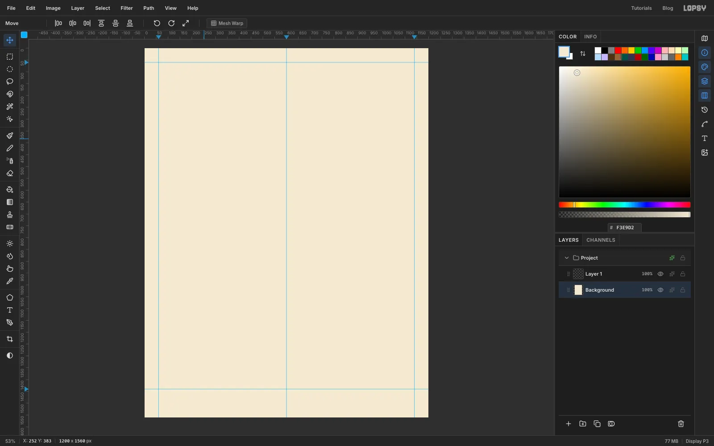

Choose **File → New**, keep the units on **Pixels**, and make the document **1200** wide and **1560** high.

Set the foreground colour to paper `#F3E9D2`, select the **Background** layer and choose **Edit → Fill**.

Click the top ruler at **60**, **600** and **1140** to drop three vertical guides: two margins and a centre line. Click the left ruler at **60** for the top margin and at **1440**, which is where the footer band will start.

Then open the **View** menu and switch off **Snap to Guides**. You'll draw a lot of freehand ellipses and lassos near those guides, and snapping would tug their edges onto the lines. The guides are still there to line type up against.

## Cut the dusk sky into bands

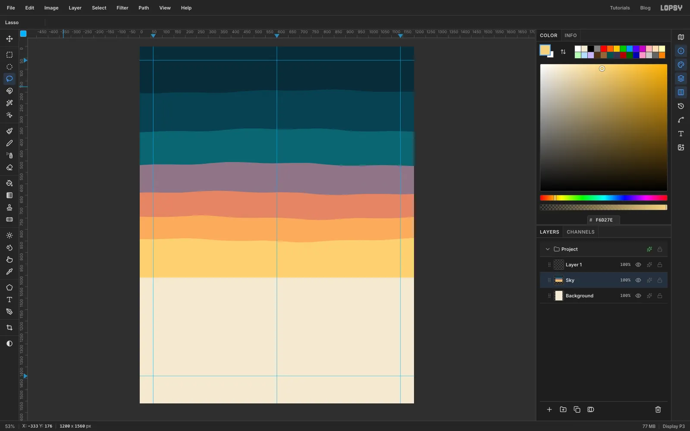

Select **Background** and add a layer called **Sky** with the **+** button under the Layers panel. A new document also comes with an empty **Layer 1**; ignore it for now and delete it at the end. With the **Rectangular Marquee** (**M**), select the full width of the page from the top down to about **y 1010**, and fill it with the darkest sky ink, `#132C38`.

Now cut each lighter band like a paper stencil. Pick the **Lasso** (**L**) and drag a loop that starts just off the left edge, runs across the page with a slight wave, goes down past the bottom of the sky and comes back. Fill it with the next ink. Each band covers everything below it, so you only need to draw each new top edge. The top edges sit at about:

- **196** for `#1C4150`
- **366** for `#2D6470`
- **514** for `#8C7686`
- **640** for `#D88A6A`
- **748** for `#EFAE69`
- **846** for `#F6D27E`

Keep the waves gentle, about ten pixels up and down. You want hand-cut, not wobbly.

> **Tip:** A smooth gradient run through **Filter → Posterize** looks like a shortcut to banded sky, but Posterize steps the red, green and blue channels separately, so you get grey and violet bands you never asked for. Cutting the bands yourself keeps every one on palette.

## Lay a ramp along each band edge

Screen printers soften a colour change with a dot screen. You'll make one dot fringe per band edge, all on one layer.

Add a layer called **Band Dots** above Sky. For the first edge, select **Sky** again, pick the **Magic Wand** (**W**) with **Contiguous** on, and click the second band. That selects exactly the band you cut, wavy top edge and all. Then hold [[Shift]]+[[Option]] and drag a Rectangular Marquee across the full width, from 20 px above the edge to about 64 px below it. [[Shift]]+[[Option]] intersects the two, leaving a strip that follows the wavy edge. Click **Band Dots** in the Layers panel before you paint into it.

Pick the **Gradient** tool, set it to **Linear**, and in **Advanced…** make the stops black `#000000` and white `#FFFFFF`. Drag from just above the edge straight down to the bottom of the strip. Repeat for the other five edges, wanding each band on **Sky** and painting the ramp on **Band Dots**.

## Turn the ramps into dots

Press [[Cmd]]+[[D]] to deselect and run **Filter → Halftone…** with **Dot Size 10**, **Angle 45** and **Softness 0.3**. Black becomes big dots and white prints nothing, so each ramp turns into a fringe that fades out downward.

The dots are black for now. Open the layer's effects (the ✦ button on its row), turn on **Color Overlay** and set it to the night ink `#132C38`. Then set the blend mode to **Multiply** and the layer's opacity to **35%**. Each band now picks up a darker speckle along its top edge.

## Set the sun with a printed ring

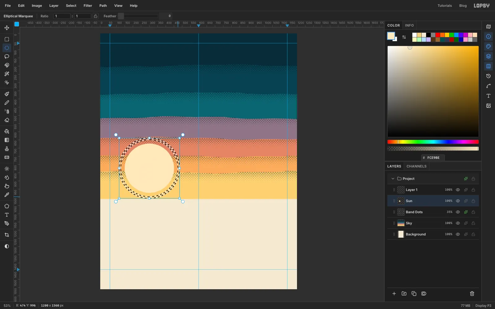

Select **Band Dots** and add a layer called **Sun**. With the **Elliptical Marquee**, hold [[Shift]] for a circle and drag one about **300 px** across, centred at about **x 300, y 822**. Most of it will end up behind the hills. Fill it with `#FCE9BE`.

For the ring, drag a second circle about 34 px larger all round. Then hold [[Option]] and drag a circle 10 px smaller than that, from the same centre. That subtracts the middle and leaves a thin ring. Fill it with the same cream.

## Lay in two ridges

Add a layer called **Far Ridge**. With the Lasso, draw a ridge line across the page with soft, irregular peaks between about **y 740** and **830**, then run the loop down to the bottom of the sky and back. Fill it with `#3B6670`.

Add a layer called **Near Ridge** and draw a lower, flatter line around **y 890–935**. Fill it with `#1E3742`. The near ridge hides the bottom of the sun, so it looks like it's setting behind the hills.

## Draw one pine with the Pen

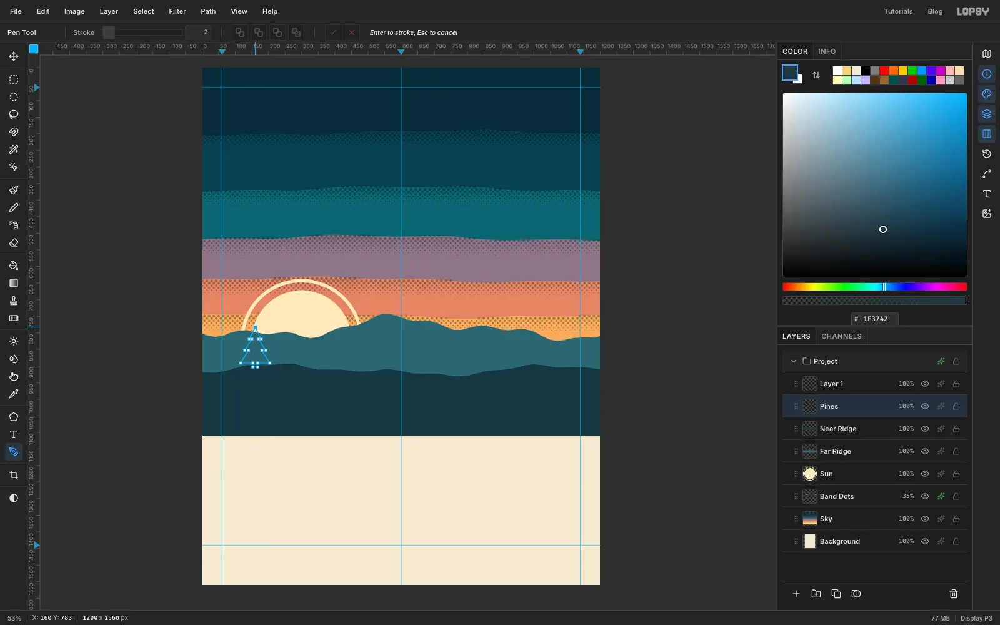

Add a layer called **Pines**. Pick the **Pen** tool (**P**) and click your way round a pine about **120 px** tall, standing on the near ridge at about **x 160**. Start at the tip, then click out and back in to make three tiers that get wider as they go down, then a short trunk. Click the first anchor again to close the path.

Open the **Paths** panel and click **Path to Selection**, then **Delete Path**. Fill the selection with the near-ridge ink `#1E3742`. The trees are cut from the same screen as the ridge, so they print in the same ink.

## Copy the pine along the ridge

Marquee around the pine, press [[Cmd]]+[[C]] and [[Cmd]]+[[V]]. The copy pastes in place on its own layer, already selected, and Lopsy switches to the Move tool.

- To mirror a tree, click **Flip Horizontal** in the Move tool's options bar.
- To resize it, hold [[Cmd]] and drag the bottom-right handle, so it scales without stretching. Keep sizes between about 65% and 105%.
- Drag the tree by its middle so its trunk sits on the ridge, and press [[Enter]].

Choose **Layer → Merge Down** to fold the copy back into Pines. Click **Pines** again before the next copy, since you can only copy from the active layer. Make six copies and spread them out: a cluster on the left, one near the middle and a cluster on the right.

## Lay the basin flat, the mound and the terraces

Old Faithful erupts from a flat, pale plain of sinter, the mineral crust geysers leave behind.

Add a layer called **Basin** above Pines. Lasso a band from about **y 1004** (give the top edge a slight wave) down to near the bottom of the page and fill it with sinter `#D9C7A5`.

The geyser needs something to come out of. Lasso a low dome about **300 px** wide and **36 px** high, centred at about **x 740**, sitting on the flat around **y 1150**. Then hold [[Shift]] and lasso two small flat-topped cones, one at each side, at about **x 190** and **x 1010** just below the ridge. Fill all three with `#C9B48F`.

Pick the **Pencil** (**N**) at **Size 3** in the same colour, and draw a few faint terrace lines across the flat. Click where a line starts, hold [[Shift]] and click where it ends. Keep them short and slightly tilted, and leave a gap in the middle where the plume will be.

## Build the plume from ellipses

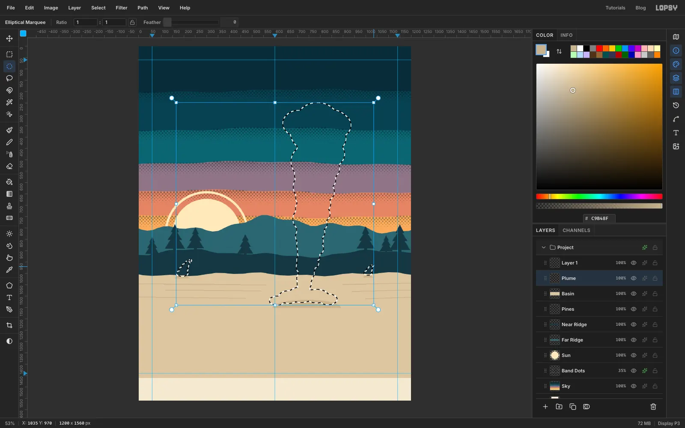

Add a layer called **Plume**. The plume is a union of ellipses, drawn bottom to top with the **Elliptical Marquee**:

1. Drag the first ellipse at the vent, about **50 px** wide, at **x 730, y 1060**.
2. Hold [[Shift]] and keep adding ellipses up the column. Each one is a little bigger than the last and a little further right. By the top, at about **y 330**, the plume should be about **300 px** wide and leaning a few degrees to the right.
3. As you climb, add smaller billows off alternate sides, so the edge scallops instead of looking like a stack of balls.
4. Finish the top with three big overlapping billows.
5. Add five low, flat ellipses around the vent, so steam spills over the mound and onto the far rim of the spring.
6. Add a short wisp of four or five shrinking ellipses over each side cone.

The top of the plume can overlap the masthead area. It will sit in front of the title later, which is a classic cover trick.

Fill the selection with steam `#FBF3E3` and deselect.

## Shade every billow with a crescent

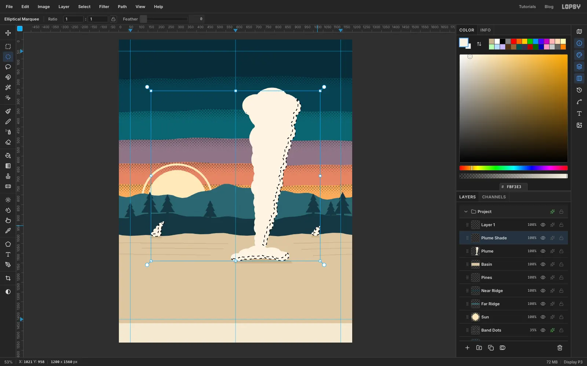

Add a layer called **Plume Shade**. [[Cmd]]-click the **Plume** thumbnail in the Layers panel to load the plume's shape as a selection.

Now go back over the billows with the **Elliptical Marquee**. Over each one, hold [[Option]] and drag an ellipse of about the same size, shifted about **14 px left and 12 px up**. Each one subtracts most of its billow and leaves a thin crescent on its lower-right side, as if the light comes from the setting sun on the left. Most crescents end up down the plume's right-hand edge and under its billows. You don't need to be exact; uneven crescents look more printed.

Fill with steam shadow `#A9C9C6`, deselect, and set the layer's blend mode to **Multiply**.

## Add a dot screen to the shadow side

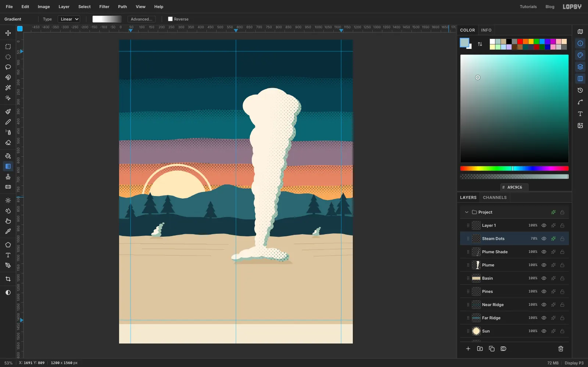

Add a layer called **Steam Dots** and [[Cmd]]-click the **Plume** thumbnail again. The small wisps look better without dots, so hold [[Option]] and drag a rectangle around each one to take it out of the selection.

Pick the **Gradient**, and in **Advanced…** make three stops: white at 0%, white again at 30%, and dark grey `#3A3A3A` at 100%. Drag from the left side of the plume across to its right edge. Deselect and run **Filter → Halftone…** with **Dot Size 12**, **Angle 45** and **Softness 0.4**.

Give the layer a **Color Overlay** of `#5E8F92`, set it to **Multiply**, and drop its opacity to **70%**.

## Start Grand Prismatic with runoff streaks

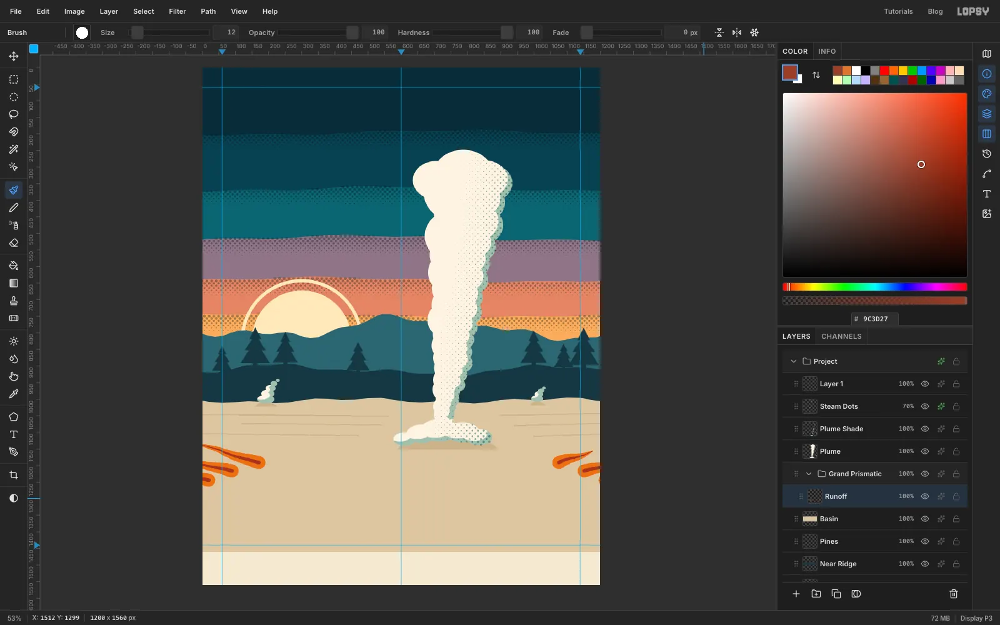

Grand Prismatic Spring is a huge hot spring ringed by bands of coloured bacteria. Orange bacterial mats stream away from its rim across the ground.

Select **Basin** and click **New Group** at the bottom of the Layers panel. Rename the group **Grand Prismatic**, and with the group selected add a layer called **Runoff**. It lands inside the group.

The spring will be a wide ellipse centred at about **x 620, y 1335**. Pick the **Brush** with a hard round tip at **Size 40** and colour `#DE7631`.

Before you paint, open the **Brushes** panel from the brush preview in the options bar and, on the **Shape** tab, set **Taper**. Taper is measured in pixels from where the stroke starts, and the brush shrinks to nothing at that distance, so set it a little longer than the streak you're about to draw. A 300 px streak wants a Taper of about 330.

Draw eight streaks outward from where the rim will be, three on the left and five on the right, fanning gently. Start every stroke at the rim, where the streak is fattest. In perspective a streak that runs away from you looks nearly flat, so keep them within about 10–25° of horizontal.

Then go over the same streaks with a **Size 12** brush in rust `#9C3D27` for a darker vein down each one.

## Cut the colour rings

Each ring is its own layer inside the group, cut from the outside in. Draw each one with the **Lasso** as a slightly wobbly ellipse around the same centre, because a perfect marquee ellipse looks like a target:

- **Ring Rust**, about 1400 × 400 px, `#9C3D27`
- **Ring Orange**, about 1240 × 340, `#DE7631`
- **Ring Yellow**, about 1080 × 284, `#EDC24A`
- **Ring Turquoise**, about 900 × 228, `#5DB8A9`
- **Ring Blue**, about 720 × 176, `#1E5E8A`
- **Ring Deep**, about 420 × 92, `#16476E`

The outer rings run off both sides of the page, which helps the spring feel enormous. The runoff streaks now poke out from under the rust ring.

## Copy the plume for its reflection

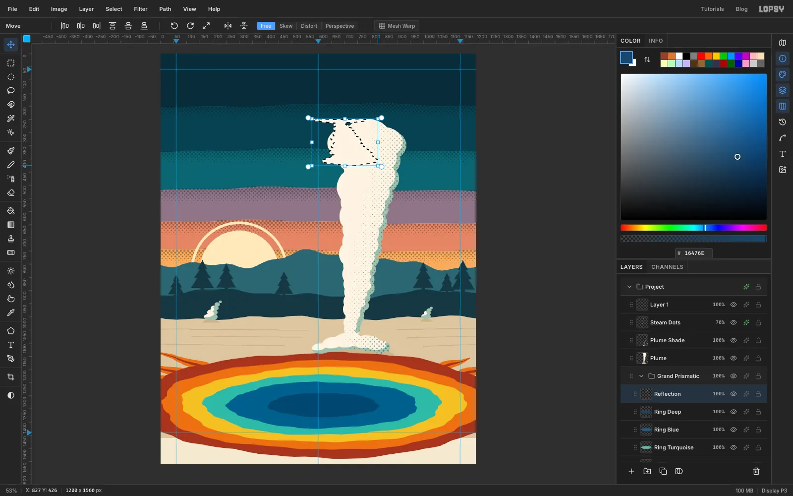

The still water should mirror the plume. Select **Plume**, marquee around the whole plume (leave out the two little wisps over the cones), and press [[Cmd]]+[[C]]. Select **Ring Deep** and press [[Cmd]]+[[V]], so the copy lands inside the group, above the rings. Rename it **Reflection**.

Click **Flip Vertical** in the Move tool's options bar. Then drag the bottom-right handle up and to the left **without** holding [[Cmd]], so you can squash it. Make it about 70% as wide and only about a fifth as tall. Reflections on a far-off pool are very short.

Drag it down so the narrow vent end sits on the far edge of the blue water, right below the real vent, and press [[Enter]].

## Keep the reflection in the water

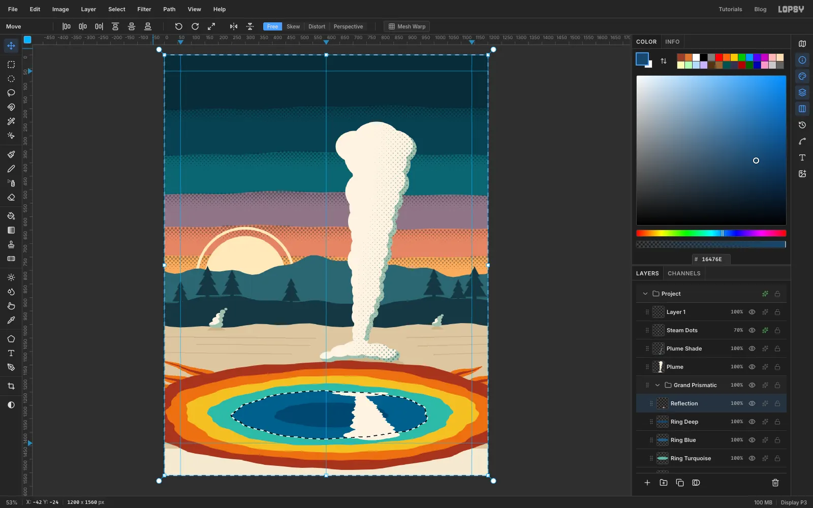

[[Cmd]]-click the **Ring Blue** thumbnail to load the blue water as a selection. Choose **Select → Inverse** and press [[Delete]]. That clears every part of the reflection that hangs over the turquoise and yellow rings.

## Break the reflection into ripples

A soft blurry reflection looks digital. A printer would cut it as crisp dashes.

With the **Rectangular Marquee**, drag a thin horizontal stripe across the reflection near its top, about **3 px** tall. Hold [[Shift]] and add more stripes below it. Make each one a little taller and leave a bigger gap after each, so the ripples spread out as they come toward you. Stop at the bottom of the reflection.

Choose **Select → Inverse**, press [[Delete]] and deselect. Set the layer's opacity to **70%**.

## Build the boardwalk

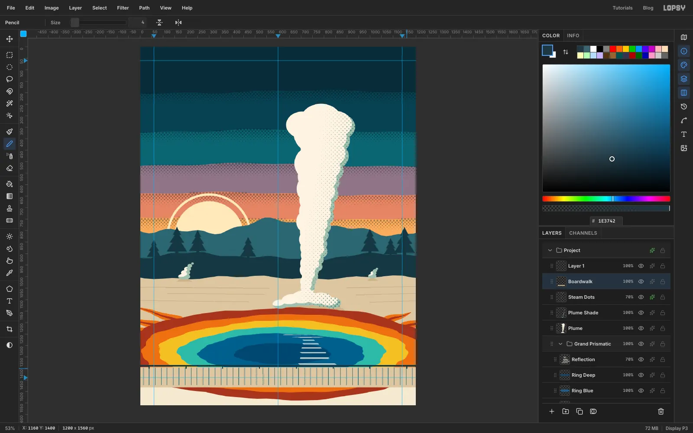

Visitors see Grand Prismatic from a boardwalk, and so will the bison. Select **Steam Dots** and add a layer called **Boardwalk**, so it sits above the spring and the plume.

Marquee a strip from **y 1394** down past the footer guide and fill it with sinter `#D9C7A5`. With the **Pencil** at **Size 2** in `#3B6670`, draw a plank line every **26 px**. Click at the top of the deck, hold [[Shift]] and click straight below.

Switch the Pencil to `#1E3742` at **Size 6** and draw a rail along the top edge of the deck, about 6 px above it. At **Size 4**, add a short post every 160 px, from the rail down into the deck.

## Bring in a bison photo

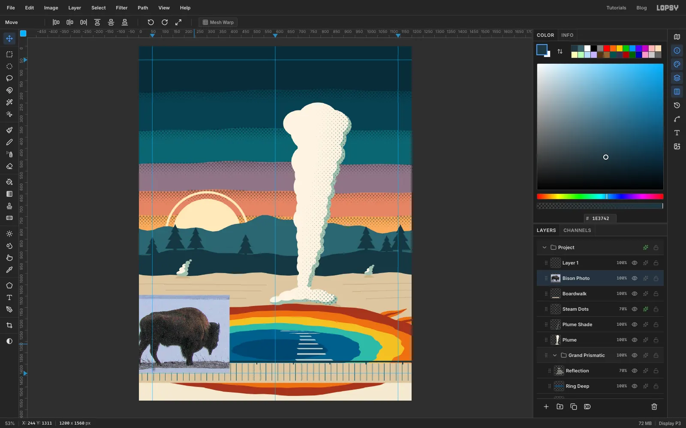

An animal drawn from memory always looks a bit off, so trace a real one. This cover uses *Bison along Yellowstone Lake* by the National Park Service, which is public domain on Wikimedia Commons. The full photo shows two bison, so crop it to the left-hand bull before you bring it in: open it on its own in Lopsy (or any photo app), crop to the bull with a little snow around him, and save it. He's a clean side view against snow, which is ideal for tracing.

Drag the cropped photo onto the canvas. It lands at the top-left corner with its transform handles showing. Hold [[Cmd]] and drag the bottom-right handle inward until the photo is about **420 px** wide, then press [[Enter]].

Drag it to the lower left so the bison's hooves stand on the boardwalk, and let its rump run off the left edge of the page. Cropping it frees up the left side of the spring.

## Turn the photo into ink with Threshold

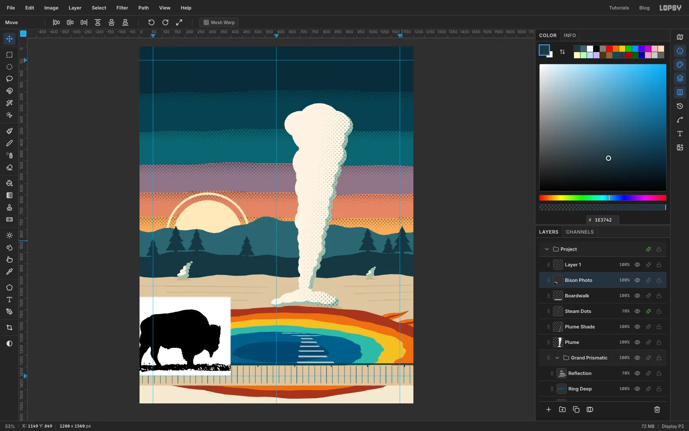

Run **Filter → Gaussian Blur…** at **Radius 4** first. The blur rounds off the fur and the JPEG noise, so the next step gives smooth edges instead of fringes.

Then run **Filter → Threshold…** at **Level 125**. Every pixel becomes black or white, so the dark bison turns into a solid silhouette against the white snow.

## Select the bison, but not the ground

Pick the **Magic Wand** (**W**), set **Tolerance** to **32** with **Contiguous** on, and click the middle of the bison. It selects the whole silhouette, but the snowy ground strip under the hooves is attached, so you need to cut it off.

Hold [[Option]] and lasso the ground strip away. Run the loop along just under the bison's belly line, dipping down around each hoof so the hooves stay selected. Then [[Option]]-drag a small rectangle over any grass specks left by the front legs.

Add a layer called **Bison** and fill the selection with plum `#2B1E2E`. Deselect, select the photo layer and click **Delete Layer**. The photo has done its job.

## Add a rust highlight and an eye

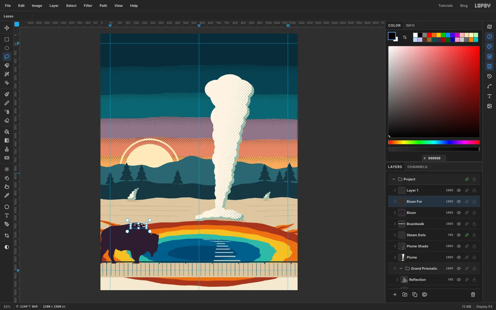

Add a layer called **Bison Fur** above Bison and [[Cmd]]-click the **Bison** thumbnail. Hold [[Shift]]+[[Option]] and lasso a crescent over the hump and shoulder: along the top of the back and down behind the head, then back along a curve about a third of the way down the hump. The intersect keeps only the part inside the bison.

Choose **Select → Shrink…** and shrink by **6 px**. That leaves a plum rim along the back. Without it the rust melts into the rust ring behind the bison. Fill with rust `#B5502C` and deselect.

Pick the **Move** tool and tap the arrow keys to nudge the highlight **2 px** right and **2 px** up. It's a small misregistration, as if the rust screen slipped.

For the eye, pick the **Brush** at **Size 6** in paper `#F3E9D2` and click once in the head, a little above and behind the muzzle.

## Set the masthead

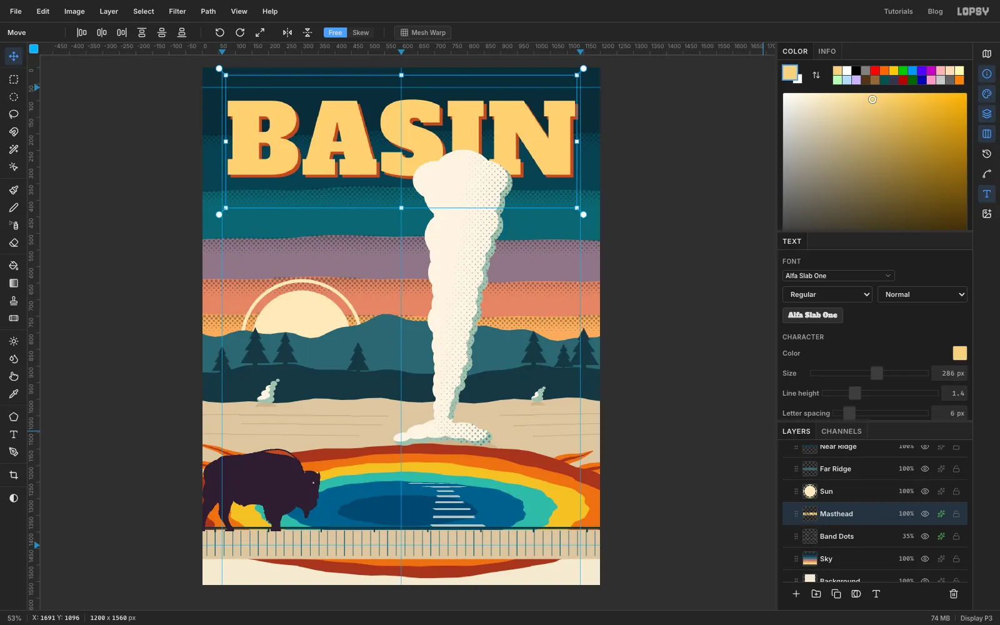

Select **Band Dots** in the Layers panel. New layers land above the active one, and you want the type above the dot fringes but below the plume.

Pick the **Text** tool (**T**) and choose **Alfa Slab One**, with colour `#F6D27E`. Click in empty sky near the top, type **BASIN** and press [[Tab]] to commit it. Set the size to about **286 px**, so the word fills the width just inside the margin guides, and in the **Text** panel set **Letter spacing** to **6**. Double-click the new layer's name and rename it **Masthead**. Drag it so the tops of the letters sit about **96 px** from the top of the page.

Now give it the classic second ink. Open the layer's effects and turn on **Drop Shadow** with **Offset X 9**, **Offset Y 9**, **Blur 0**, **Spread 0** and **Opacity 100**, in rust `#B5502C`. With no blur, the shadow reads as a second printed colour slightly out of register.

The plume's top crosses the bottom of the S and I. The tops of the letters stay clear, so BASIN still reads.

## Add the folio, kicker and headline

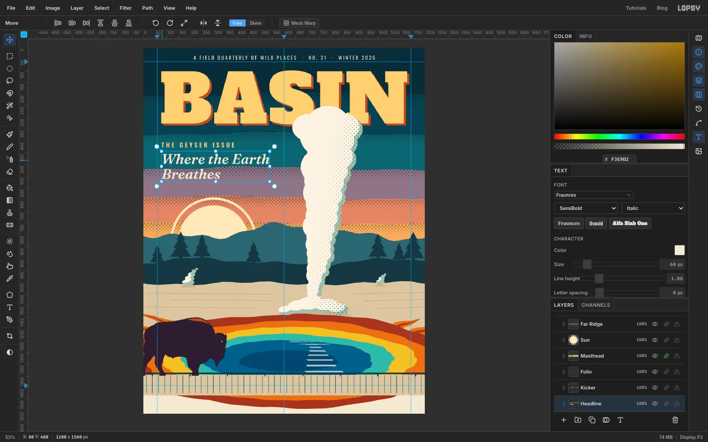

Select **Band Dots** again before each new piece of text, so you don't restyle the last one. Rename each text layer as you go (**Folio**, **Kicker**, **Headline**), since Lopsy names text layers after their words.

- **Folio.** **Oswald** at size **21**, paper colour, **Letter spacing 5**. Type `A FIELD QUARTERLY OF WILD PLACES · NO. 31 · WINTER 2026` and centre it on the centre guide, about **34 px** from the top.
- **Kicker.** **Oswald SemiBold (600)** at **26**, masthead yellow, **Letter spacing 8**: `THE GEYSER ISSUE`. Line its left edge up with the stem of the B, at **x 78**, about **y 404**.
- **Headline.** **Fraunces SemiBold Italic** at **60**, paper colour. Set **Letter spacing** back to **0**, because new text takes the last value. Type `Where the Earth`, press [[Return]] for a new line, type `Breathes`, and set **Line height** to **1.08** for tight leading. Line it up at **x 78**, just under the kicker.

Check that the headline clears the sun's ring by at least **60 px**. If it crowds the ring, the two shapes fight for attention.

The italic style and the tight line height carry over to the next text you make, too, so set the style back to **Normal** and line height to **1.4** before you start the footer.

## Print the footer band

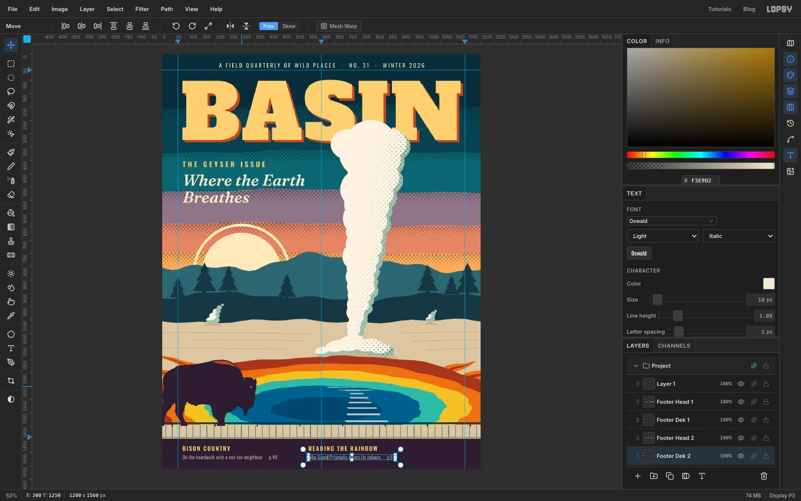

Select **Bison Fur** and add a layer called **Footer**. Marquee from the footer guide at **y 1440** down to the bottom of the page and fill it with plum `#2B1E2E`. With the Pencil at **Size 3** in masthead yellow, draw a rule along the top edge.

Each cover line is two text layers. Select **Footer** before each one, and rename them **Footer Head 1**, **Footer Dek 1** and so on.

- Heads in **Oswald SemiBold (600)**, size **22**, **Letter spacing 3**, masthead yellow: `BISON COUNTRY` at **x 78** and `READING THE RAINBOW` at **x 552**, both about **y 1474**.
- Under each, in **Oswald Light (300)**, size **18**, **Letter spacing 1**, paper colour: `On the boardwalk with a one-ton neighbour · p.48` and `Why Grand Prismatic wears its colours · p.62`, about **y 1508**.

## Draw the barcode

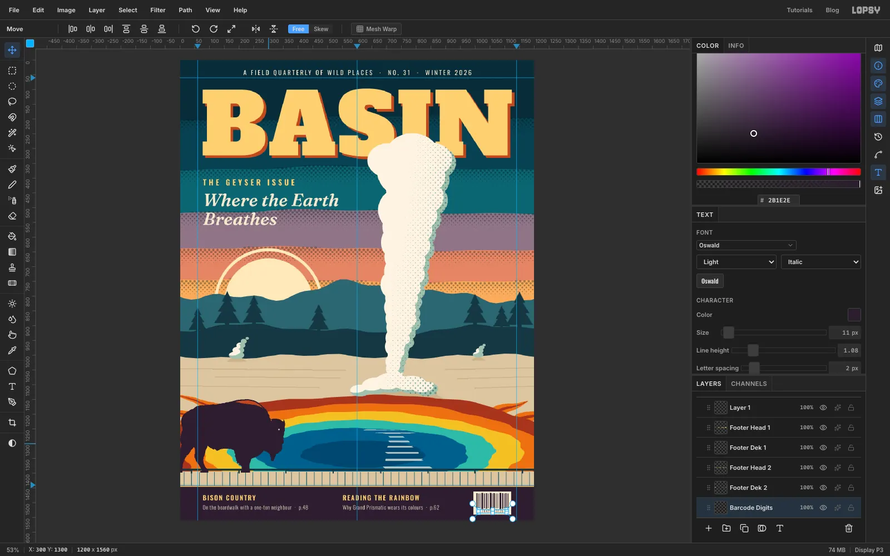

Add a layer called **Barcode**. Marquee a label from about **x 994** to the right margin at **1122**, and from **y 1462** to **1540**. Fill it with paper colour.

Pick the **Pencil** in plum and draw the bars as straight vertical lines, from about 9 px under the top of the label to about 20 px above its bottom. Click the top of a bar, hold [[Shift]] and click its foot. Mix **Size 2**, **4** and **6** bars with uneven gaps of 1 to 3 px, so it reads as a real barcode.

With **Barcode** selected, add **Oswald** text at size **11**, **Letter spacing 2**, in plum: `0 74470 03126 4`. Centre it under the bars.

## Add the sticker and tilt its words

Select **Band Dots** and add a layer called **Sticker**. Drag a circle about **148 px** across to the right of the plume, level with the headline and centred around **x 1030, y 500**, so there are at least **40 px** of sky between it and the steam. Fill it with rust `#B5502C`. For the inner ring, drag a circle 8 px smaller all round, [[Option]]-drag one 3 px smaller than that, and fill with paper colour.

Add `500+` in **Alfa Slab One** at **40** and `GEYSERS` in **Oswald SemiBold** at **17** with **Letter spacing 4**, both in paper colour, and rename them **Sticker Number** and **Sticker Label**. Centre each on the circle, with the pair stacked as one block around the circle's middle.

Click the **Sticker Number** row, then [[Shift]]-click **Sticker Label** so both are selected. With the Move tool, drag the rotation handle just outside a corner of the box to tilt them about **8°** anticlockwise, and press [[Enter]]. They turn together around their shared centre, so they stay seated in the ring.

## Group the type, slip a screen and add grain

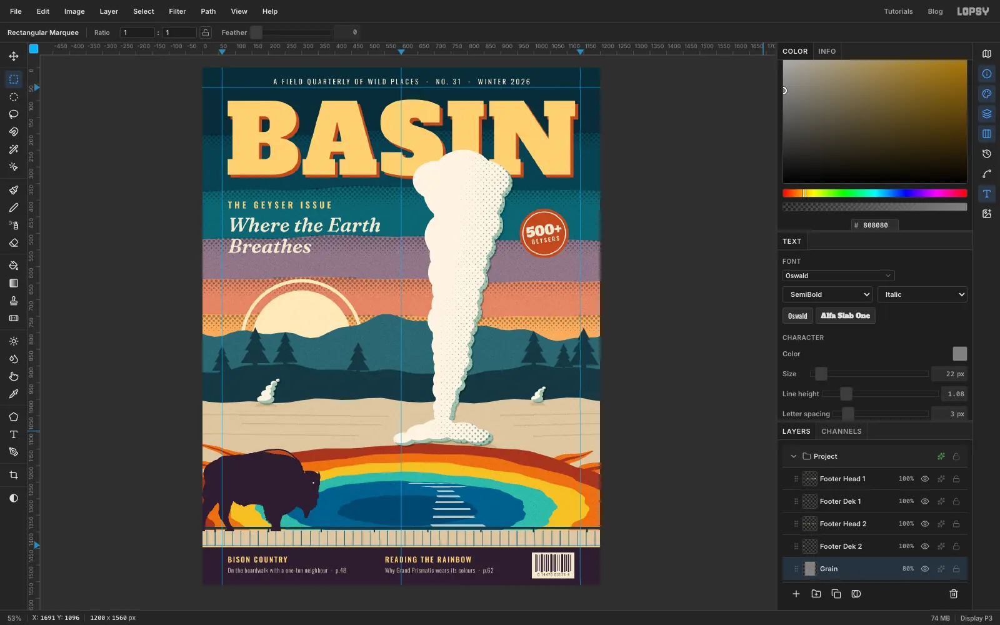

Click **Masthead**, then [[Shift]]-click **Folio**, **Kicker** and **Headline**, and choose **Layer → Group Layers**. Name the group **Cover Type**. Now you can nudge all the cover type as one unit, and undo it in one step.

Real prints never register perfectly. Select **Plume Shade**, pick the **Move** tool and tap the arrow keys to slide it **4 px** right and **4 px** down. The crescents now spill a hair past the billows.

Select the **Barcode** digits layer and add a layer called **Grain**. It lands above all the artwork; only the footer cover lines stay above it, so the small type stays crisp. Fill it with mid-grey `#808080` and run **Filter → Add Noise…** at **70**, **Mono** and **Gaussian**. Set the blend mode to **Overlay** and the opacity to **80%**. Mid-grey disappears in Overlay, so only the speckle shows. It gives the flat inks the tooth of paper.

Select the empty **Layer 1** and click **Delete Layer**. Save the project with **File → Save Project**, and export with **File → Quick Export PNG**.
