This tutorial makes a 1440 × 2380 px landing page mockup for an imaginary skate company, **Mojave Incline**. It sells hand-printed decks and runs full-moon sessions in an empty desert pool. The look borrows from skate graphics. There's flat screen-print colour and a photo turned into night ink and cream, with a slightly off-register pink plate behind it. Hard offset shadows, round stickers and a slanted ticker band finish it off.

Along the way you'll use the **Gradient** tool, the **Spray** tool, a **layer mask**, **Clouds** and **Posterize**, the **Pen**, the **Lasso**, the **Magic Wand**, **Threshold**, Move-tool scale and rotate, **Align**, grid snapping, **Define Pattern** with **Liquify**, copy and paste-in-place, **Group Layers** and **Add Noise**.

The photo is [Frontside air](https://commons.wikimedia.org/wiki/File:Frontside_air.jpg) by NOTPOOP on Wikimedia Commons, licensed CC BY-SA 4.0. Download the **1,280 × 1,920** preview from the file page. The skater is shot against a plain cloudy sky, which makes the cut-out easy.

The fonts are free Google Fonts in Lopsy's font picker. **Anton** is for headlines, **Rubik Mono One** for the logo, ticker and sticker, and **Space Mono** for everything small.

The palette:

- Night sky `#1A1036` → `#3E1D72` → `#D8418A`
- Nav ink `#0D081E`, night ink `#120B2A`
- Moon lime `#D9F84A`, moon glow `#F2FFB0`, rim orange `#FF8A3D`
- Hot pink `#FF4F9A`, teal `#2EC4D6`, cream `#FFF3DE`
- Mesas `#5A2380`, desert floor `#140C2C`
- Pool concrete `#9D94B4` → `#D4CEDD`, far wall `#2E2550` → `#6E6390`, tile `#19A7B8`, coping `#D9CFC0`
- Lilac small print `#B8A8E0`, email field `#221A44`
- Link pink `#D02F78`, spec ink `#3A2B5C`, pool shade `#4A3F6E`

> **Tip:** Positions are written as `x, y` in document pixels. The status bar at the bottom of the window shows the cursor's position, so hover to find a spot. For a website the positions matter: they keep the margins and baselines lined up. Keys are Mac keys; on Windows and Linux, use Ctrl for Cmd.

> **Tip:** For exact rectangles and circles, click once with a marquee tool, without dragging, while nothing is selected. A box opens where you can type the corners. Always press [[Cmd+D]] before starting a new marquee. A drag that starts inside an existing selection moves its outline instead of drawing a new one.

## Set up the page

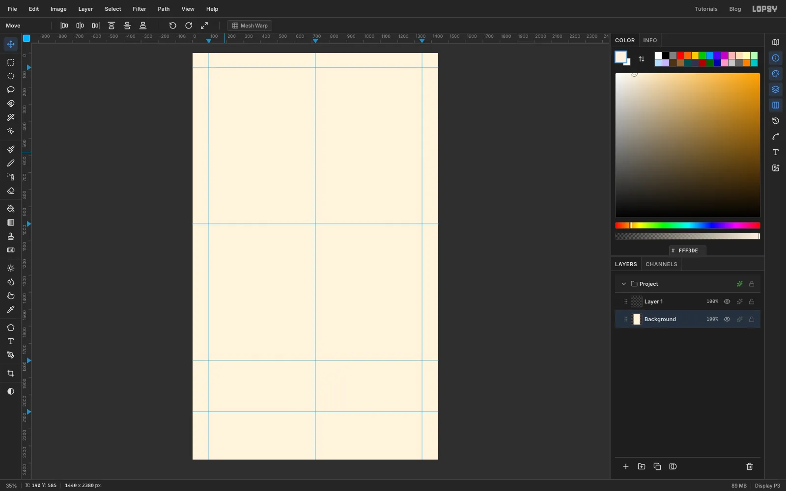

Open [Lopsy](/). In the **New Document** dialog, set **Width** to `1440` and **Height** to `2380`, then click **Create**.

1. Click the `Background` layer. Type `FFF3DE` into the hex field of the **Color** panel and choose **Edit → Fill**. The cream is the deck section's paper.
2. Click the top ruler at `96`, `720` and `1344`. These are the left margin, the centre and the right margin.
3. Click the left ruler at `84`, `1000`, `1800` and `2100`. They mark the bottom of the nav, the hero, the deck section and the sessions band.
4. Choose **View → Snap to Guides** to turn it off. You'll draw a lot of small circles near these guides, and you don't want their edges jumping onto them.

## Paint the night sky

1. Double-click `Layer 1` and rename it `Sky`.
2. With the **Rectangular Marquee** ([[M]]), drag from `-20, 84` to `1460, 1000`. Starting off the canvas makes sure the edges are covered.
3. Pick the **Gradient** tool and set **Type** to **Linear**. Click **Advanced…**. Set the left stop to `1A1036` and the right stop to `D8418A`. Click the bar at about 55% to add a stop and set it to `3E1D72`. Click **Done**.
4. Drag straight down from just under the nav line (`720, 104`) to `720, 900`. Press [[Cmd+D]].

The hottest pink sits low, where the sun has just gone down.

## Spray a field of stars

1. Click the **Add Layer** button at the bottom of the Layers panel and name the new layer `Stars`.
2. Pick the **Spray** tool ([[J]]). Set **Size** `90`, **Density** `1`, **Opacity** `100` and **Softness** `10`. Set the foreground to `FFF3DE`.
3. Sweep quick zigzags across the top of the sky. Lower down, between `y 170` and `560`, only spray right of `x 790`. The headline will sit on the left, and stars behind it would make it noisy.

Keep the strokes quick. If you linger, the Spray keeps spraying and the stars clump.

## Add bright stars and fade them out

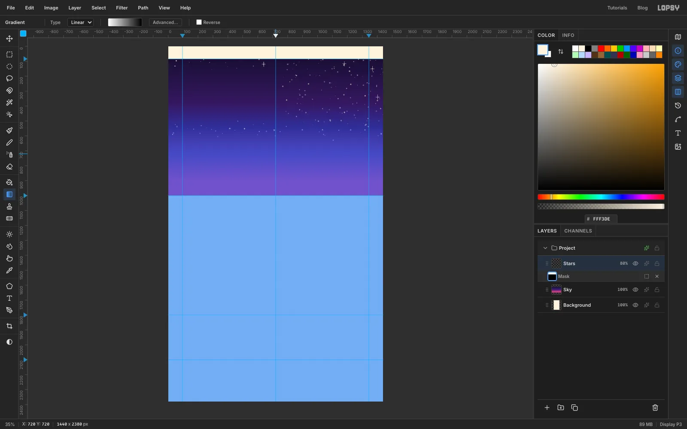

1. Pick the **Brush** ([[B]]) at **Size** `7`, **Hardness** `100`. Click about eight brighter stars. Keep them outside the headline zone.
2. Pick the **Pencil** ([[N]]) at **Size** `2`. On four of the bright stars, click 12 px to the left and [[Shift]]-click 12 px to the right. Then click 16 px above and [[Shift]]-click 16 px below. That makes a four-point twinkle.
3. Set the layer's opacity to `80%`.
4. Click **Add Mask**, then click the mask thumbnail under the layer to edit it.
5. Pick the **Gradient** tool and set its stops to white `FFFFFF` and black `000000` in **Advanced…**. Drag from `720, 380` down to `720, 720`.

The stars now thin out toward the horizon glow. The blue overlay only shows while you're editing the mask. Click the layer's name to go back to the pixels.

## Raise the lime moon

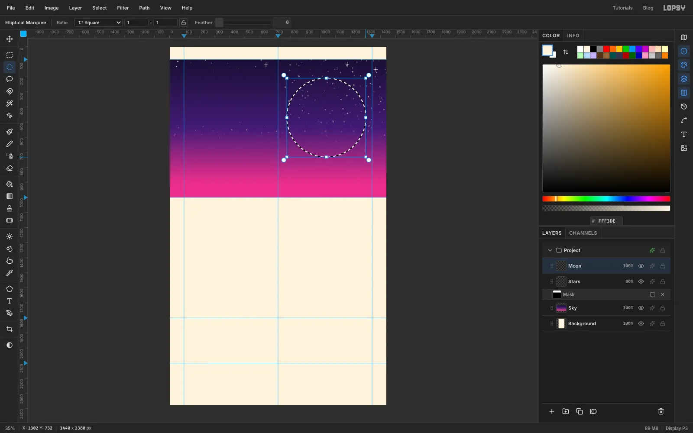

1. Add a layer named `Moon`.
2. With the **Elliptical Marquee**, hold [[Cmd]] (it keeps the circle round) and drag from `778, 208` to `1302, 732`. That's a 262 px radius around `1040, 470`.
3. Fill it with `D9F84A` and press [[Cmd+D]].
4. Click the layer's effects button (the sparkle icon on its row).
   - Turn on **Outer Glow**: **Size** `70`, **Opacity** `40`, colour `F2FFB0`.
   - Turn on **Inner Glow**: **Size** `46`, **Opacity** `55`, colour `FF8A3D`. The orange rim makes the flat disc feel round.

## Give the moon a printed texture

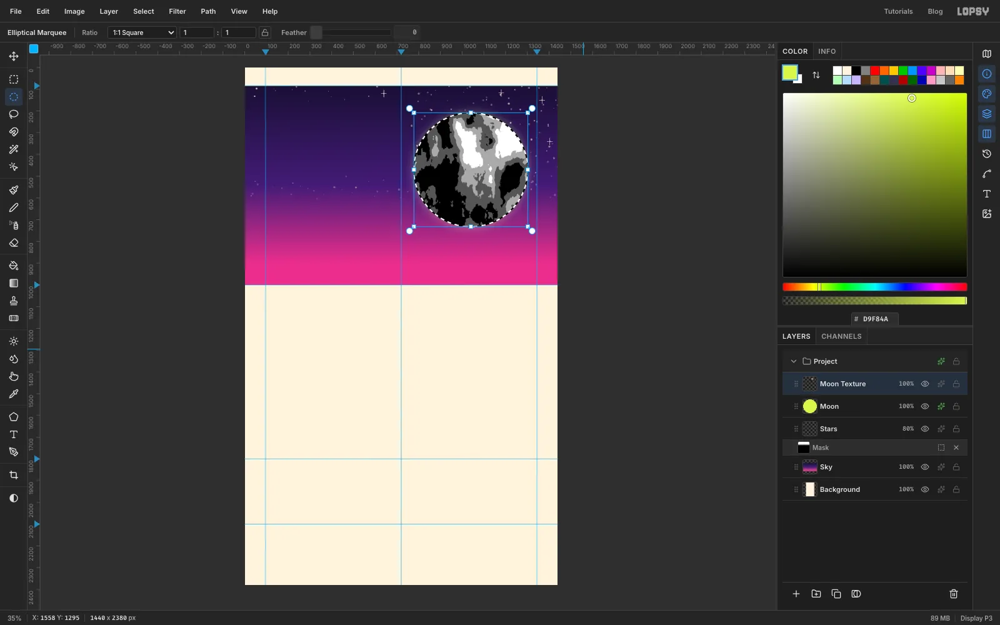

1. Add a layer named `Moon Texture`.
2. [[Cmd]]-click the `Moon` thumbnail to load its shape as a selection.
3. Choose **Filter → Clouds…**, set **Scale** to `14` and click **Apply**.
4. Choose **Filter → Posterize…**, set **Levels** to `4` and click **Apply**. The soft clouds turn into hard-edged blotches, like a two-colour print.
5. Press [[Cmd+D]]. Set the layer to **Multiply** at `16%`.

## Draw the mesas with the Pen

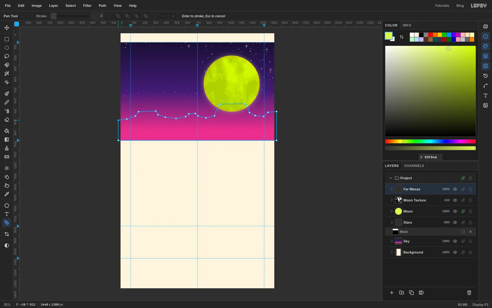

1. Add a layer named `Far Mesas`.
2. Pick the **Pen** ([[P]]) and click corner points along the horizon, from just off the left edge at `y 812` to just off the right edge.
   - Mesas have flat tops and steep sides, so use a few clicks per butte: up, across, down.
   - Make a small butte at `170–330` with its top at `730`, and another at `640–700`.
   - Make a big one from `912` to `1186` with its top at `660`. It hides the bottom of the moon.
3. Click down past the bottom-right corner to `1460, 1000` and across to `-20, 1000`. Then click the first point to close the path.
4. Open the **Paths** panel, click **Path to Selection**, then **Delete Path**.
5. Fill with `5A2380` and press [[Cmd+D]].

## Lay down the ground and saguaros

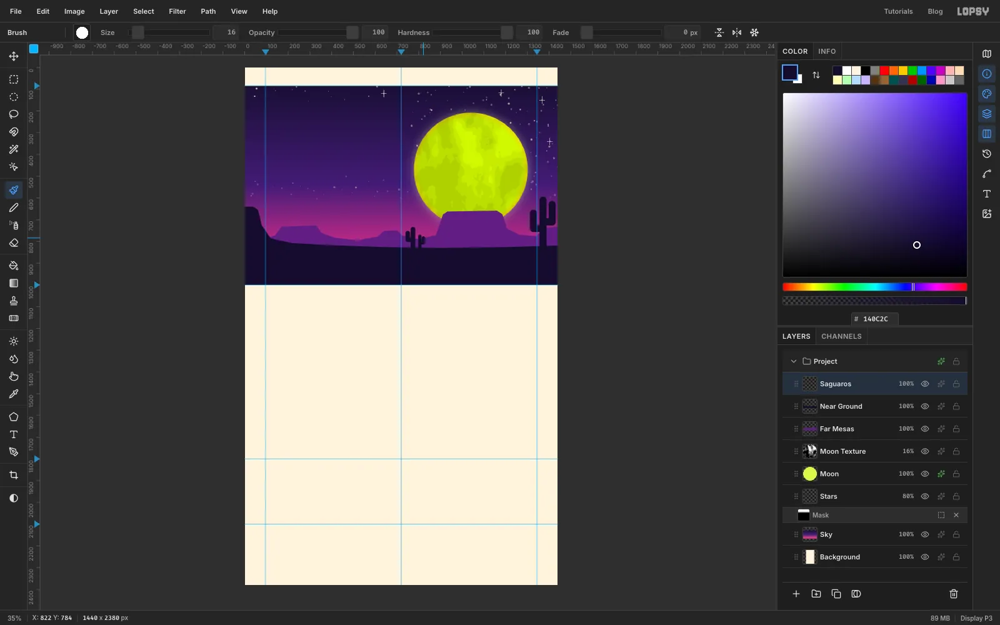

1. Add a layer named `Near Ground`.
2. With the **Lasso** ([[L]]), draw the desert floor. Start with a cliff on the far left whose top is at `640`. Drop to a gentle slope that meets `830` near the middle and `818` at the right edge. Then go down and around the bottom of the hero.
3. Fill it with `140C2C`.
4. Add a layer named `Saguaros`. Pick the **Brush** at **Size** `34`, **Hardness** `100`, in the same `140C2C`.
   - Click the base of a trunk at `1372, 822` and [[Shift]]-click its top at `1372, 610`.
   - For each arm, click on the trunk, [[Shift]]-click sideways about 44 px, then [[Shift]]-click straight up.
5. Paint two smaller saguaros at `x 774` and `x 806`, at **Size** `22` and `16`. Keep them right of `x 760`, so the small print you'll set later doesn't run into them.

The round brush gives each arm a rounded tip for free.

## Shape a kidney pool

1. Add a layer named `Pool`.
2. With the **Elliptical Marquee**, drag from `820, 840` to `1204, 916`. Hold [[Shift]] and drag a second, rounder ellipse from `1120, 832` to `1340, 916`. The two overlap into a kidney.
3. Pick the **Gradient** tool and set it to `9D94B4` → `D4CEDD`. Drag from the top of the pool down to the bottom (`y 834` to `918`). The floor is lighter where it's nearer to you.
4. Press [[Cmd+D]]. Open the effects:
   - **Stroke**: **Width** `10`, **Position** outside, colour `D9CFC0`. This is the coping.
   - **Outer Glow**: **Size** `26`, **Opacity** `35`, colour lime `D9F84A`. It catches the moonlight.

## Shade the far wall

An empty pool shows its far wall. Here's how to get just that strip.

1. Add a layer named `Pool Wall` and [[Cmd]]-click the `Pool` thumbnail.
2. Hold [[Option]] and drag the first ellipse again, 28 px lower and a little wider: `814, 868` to `1210, 944`. Hold [[Option]] again for the second: `1114, 860` to `1346, 944`. Only a crescent along the far edge stays selected.
3. Fill it with a **Linear** gradient from `2E2550` at the top to `6E6390`, dragged from `y 832` to `878`.
4. Press [[Cmd+D]].

## Add the tile strip and the deep end

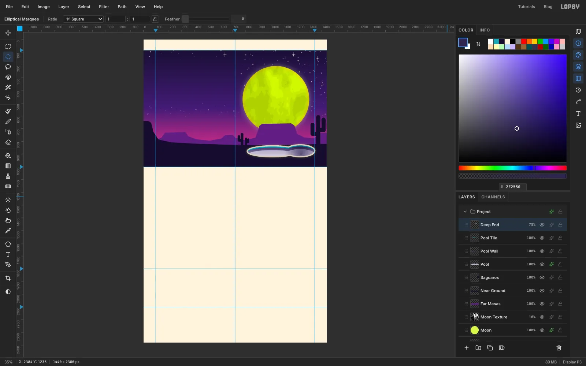

1. Add a layer named `Pool Tile`. [[Cmd]]-click the `Pool` thumbnail, then [[Option]]-drag the two ellipses again, only 8 px lower this time: `814, 848` to `1210, 924`, and `1114, 840` to `1346, 924`. Fill the thin crescent with `19A7B8` and press [[Cmd+D]].
2. Add a layer named `Deep End` and [[Cmd]]-click the `Pool` thumbnail.
3. Set the **Gradient** to **Radial**, `4A3F6E` → `FFFFFF`. Drag from the middle of the right lobe (`1236, 894`) about 130 px to the right.
4. Press [[Cmd+D]]. With the **Elliptical Marquee**, draw a tiny ellipse from `1229, 896` to `1243, 904` and fill it with `2E2550`. That's the drain.
5. Press [[Cmd+D]] and set the layer to **Multiply** at `75%`. White disappears in Multiply, so only the shading and the drain show.

## Bring in the skater photo

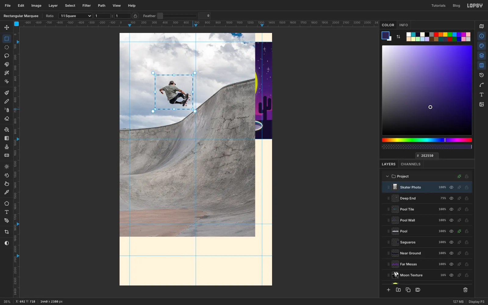

1. Click `Deep End`, then drag the downloaded photo from your desktop onto the canvas. It lands in the top-left corner at full size. Rename the layer `Skater Photo`.
2. Draw a **Rectangular Marquee** around just the skater and board, from `336, 396` to `692, 718`.
3. Choose **Select → Inverse** and press [[Delete]]. Then press [[Cmd+D]].

## Select the sky with the Magic Wand

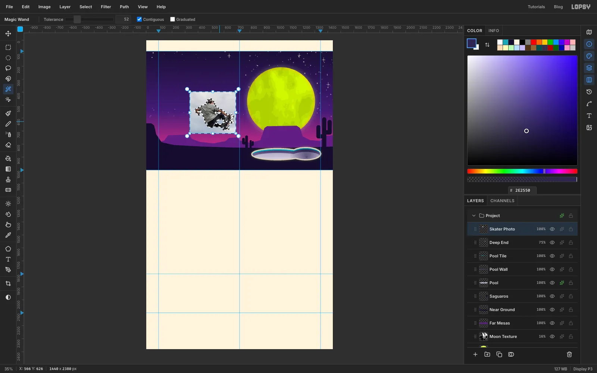

1. Pick the **Magic Wand** ([[W]]). Set **Tolerance** to `40` and tick **Contiguous**.
2. Click the sky near one corner of the photo. [[Shift]]-click near the other three corners and the middle of each edge.
3. Two pockets of sky are trapped inside the figure: one between the arm and the thigh, and one between the legs. Raise **Tolerance** to `52` and [[Shift]]-click each pocket.
4. Choose **Select → Grow…**, enter `1` and click **Apply**. This takes the pale fringe too. Then press [[Delete]] and [[Cmd+D]].

## Scale the skater up

1. [[Cmd]]-click the `Skater Photo` thumbnail and press [[V]] for the **Move** tool.
2. Hold [[Cmd]] (it keeps the proportions) and drag the bottom-right handle until the skater is about `470` px wide.
3. Press [[Cmd+D]] to commit the scale.

## Tilt him and put him on the moon

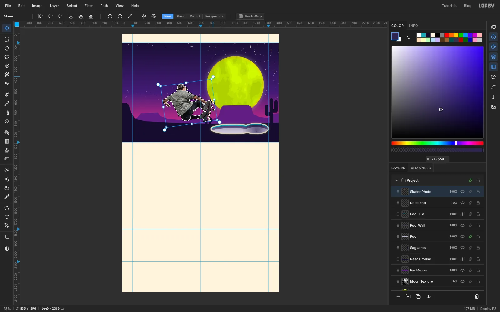

1. [[Cmd]]-click the thumbnail again. Move the pointer just outside the top-right corner until it shows the rotate cursor.
2. Drag counter-clockwise about `8°`, so he leans back into the air. Press [[Cmd+D]].
3. Drag him with the Move tool until he's centred on the moon, at about `1018, 452`. Finish with the arrow keys.

## Turn the photo into ink

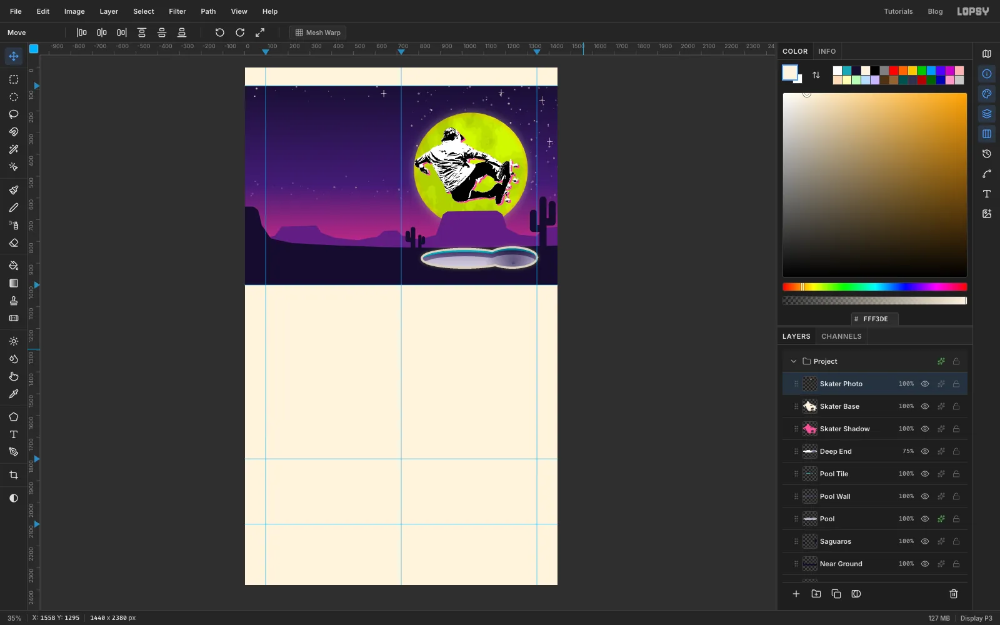

Screen prints use flat inks, so the photo becomes three layers.

1. Click `Deep End` and add a layer named `Skater Shadow`.
   - [[Cmd]]-click the `Skater Photo` thumbnail and fill the selection with pink `FF4F9A`. Press [[Cmd+D]].
   - With the Move tool, press [[Right]] seven times and [[Down]] five times. The pink plate is now slightly off register, like a real print.
2. Add a layer named `Skater Base`. [[Cmd]]-click the photo's thumbnail, fill with cream `FFF3DE` and press [[Cmd+D]].
3. Click `Skater Photo` and run these filters:
   - **Filter → Desaturate**.
   - **Filter → Brightness/Contrast…** with **Brightness** `8` and **Contrast** `35`.
   - **Filter → Gaussian Blur…** with **Radius** `1`. The blur stops Threshold from leaving speckled edges.
   - **Filter → Threshold…** with **Level** `100`.

## Keep only the black ink

1. Pick the **Magic Wand**. Set **Tolerance** `20` and untick **Contiguous**.
2. Click any white part of the shirt. Every white pixel is selected. Press [[Delete]], then [[Cmd+D]].
3. Rename the layer `Skater Ink`. Add a **Color Overlay** effect in `120B2A`, a warmer night ink than pure black.

The cream base now shows through where the white was, and the pink peeks out along one side.

## Paint the board back in

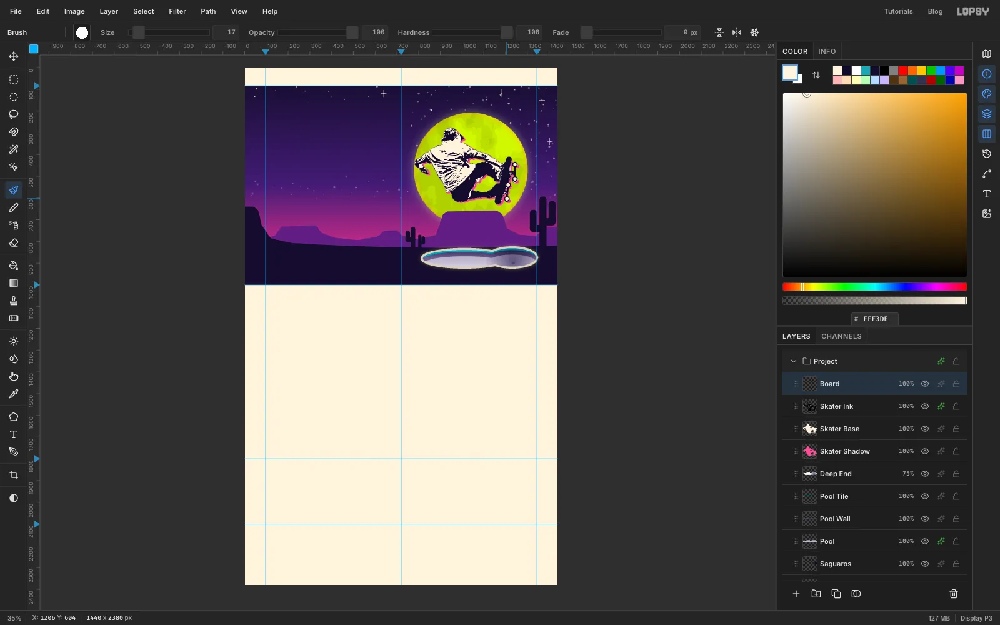

The pale board vanished with the sky, so paint it back on a new layer named `Board`. Use the **Brush** in `120B2A`.

1. At **Size** `26`, click the nose of the board at `1216, 422` and [[Shift]]-click the tail at `1162, 616`.
2. At **Size** `8`, draw the trucks:
   - One line between the front wheels, `1243, 446` to `1243, 512`.
   - One between the back wheels, `1212, 540` to `1206, 604`.
   - A short line from the deck out to the middle of each.
3. At **Size** `26`, click once on each of the four wheel spots. Switch to cream `FFF3DE` at **Size** `17` and click each spot again.
4. Click `Board`, [[Shift]]-click `Skater Shadow`, choose **Layer → Group Layers**, and name the group `Skater`.

## Build the hero buttons

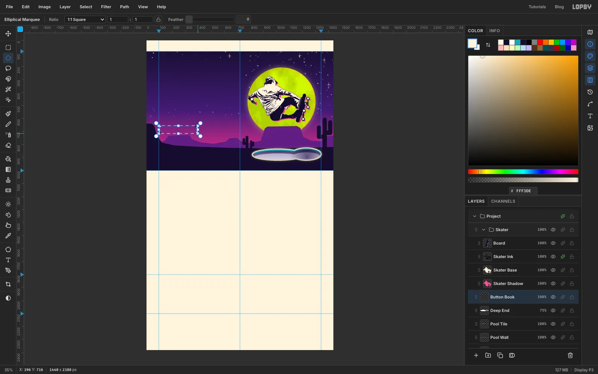

A pill is a rectangle with a circle Shift-added at each end.

1. Click `Deep End` so the buttons stack under the skater. Add a layer named `Button Book`.
2. With the **Rectangular Marquee**, click once without dragging to open the exact-corners box. Enter `126, 656` to `366, 716`.
3. With the **Elliptical Marquee**, [[Shift]]-drag a 60 px circle at each end: `96, 656` to `156, 716` and `336, 656` to `396, 716`.
4. Fill with lime and press [[Cmd+D]]. Add a **Drop Shadow** with **Offset** `4` and `4`, **Blur** `0`, **Opacity** `100`, in pink.
5. Add a layer named `Button Shop` and build a second pill the same height, from `x 424` to `x 652`. Fill it with `0D081E`. Give it an inside cream **Stroke** of `3` and the same pink shadow.

## Set the headline

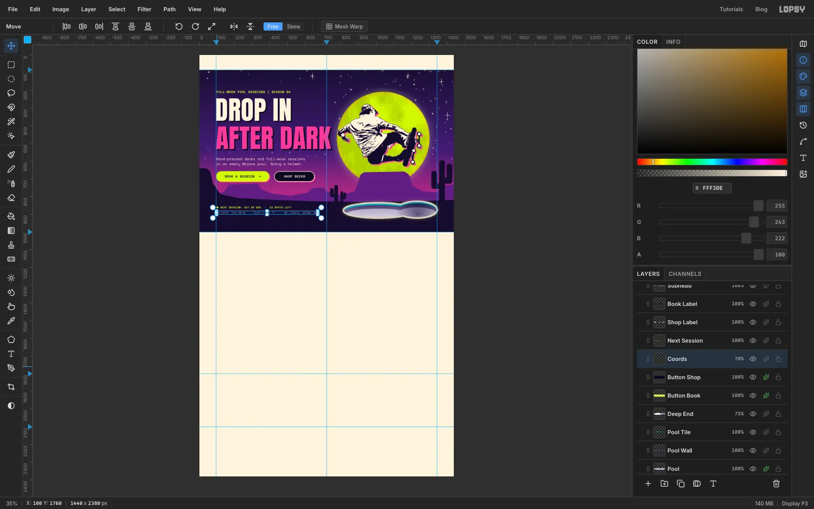

Before each new text, click a raster layer such as `Button Shop`. If a text layer is active, changing the font restyles it. Click to type in an empty area, then drag the text into place with the Move tool and finish with the arrow keys. Lopsy names a text layer after its words. The screenshots rename each one (`Eyebrow`, `Drop In`, `Coords`…) to keep the Layers panel readable, but you don't have to.

1. **Kicker:** `FULL-MOON POOL SESSIONS / SEASON 04` in **Space Mono** Bold, `18` px, lime, **Letter spacing** `1`. Move it so its top-left corner sits at `98, 200`, just inside the margin guide.
2. **Headline:** `DROP IN` in **Anton** `148`, cream, with its top at `244`. Then `AFTER DARK` in pink with its top at `404`. Give both a **Drop Shadow** of `7` / `7`, **Blur** `0`, in `0D081E`.
3. **Tagline:** two lines of **Space Mono** `20` in cream, starting at `y 580`: `Hand-pressed decks and full-moon sessions`, then [[Enter]] and `in an empty Mojave pool. Bring a helmet.`
4. **Button labels:** `BOOK A SESSION  →` and `SHOP DECKS` in Space Mono Bold `18`.
   - To centre one, click its button layer and [[Cmd]]-click the label.
   - Press [[V]], then click **Align center horizontally** and **Align center vertically** in the options bar.
5. **Small print:** on the dark ground below, set `● NEXT SESSION: SAT 26 DEC · 12 SPOTS LEFT` in lime Space Mono Bold `14` at `y 856`. Under it at `886`, set `34.13°N  116.05°W  ·  ELEV 2,001 FT  ·  NO LIGHTS, BRING ONE` in cream Space Mono `14`, and set that layer to `70%` opacity.

## Build the nav bar

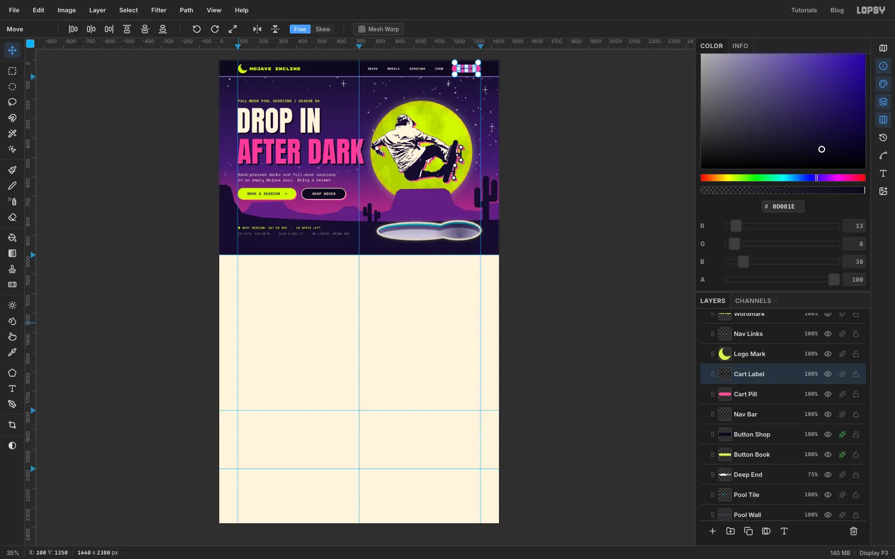

1. Click `Button Shop` and add a layer named `Nav Bar`. Use exact-corners marquees to fill `0, 0` to `1440, 84` with `0D081E`, and the bottom 3 px with pink.
2. Add a layer named `Logo Mark`.
   - Fill a circle from `98, 18` to `146, 66` with lime.
   - Select a second circle from `112, 12` to `152, 52` and press [[Delete]]. What's left is a crescent. You'll reuse it on the Luna deck.
3. Set `MOJAVE INCLINE` in **Rubik Mono One** `22`, lime, starting at `x 158` and centred on the bar.
4. Set `DECKS     WHEELS     SESSIONS     CREW` in Space Mono Bold `15`, cream, and slide it right until its last letter ends at `x 1150`.
5. Add a `Cart Pill` layer: a pink pill from `1196, 22` to `1344, 62`. Centre a `CART (2)` label on it with the two Align buttons.

## Cut the ticker band

1. Click `Cart Pill` and add a layer named `Ticker Band`.
2. With the **Lasso**, trace a slanted strip from off the left edge to off the right edge: `-20, 992` → `1460, 944` → `1460, 1016` → `-20, 1064`. It rises 48 px over its length and is 72 px tall.
3. Fill it with lime. Add a **Drop Shadow** with **Offset X** `0`, **Offset Y** `8`, **Blur** `0`, in `0D081E`. It reads as a strip of tape stuck over the seam.

## Set the ticker type on the slant

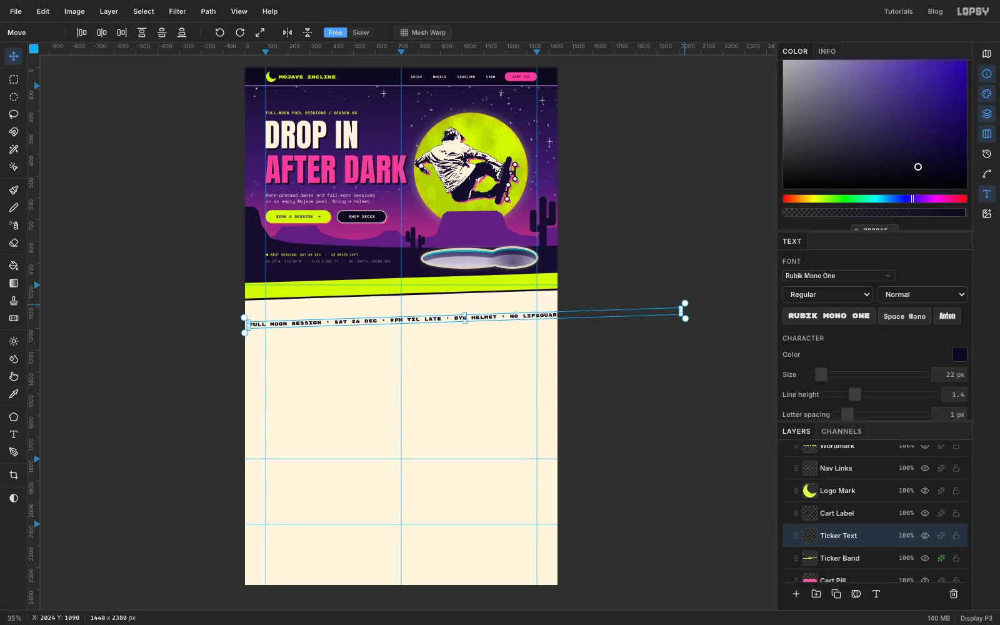

1. Set `FULL MOON SESSION • SAT 26 DEC • 9PM TIL LATE • BYO HELMET • NO LIFEGUARD ON DUTY • FULL MOON SESSION` in **Rubik Mono One** `22`, `0D081E`, with **Letter spacing** `1`. Type it in empty space. It's longer than the page, like a scrolling marquee.
2. Press [[V]] and drag the rotate handle (just outside the top-right corner) until the text tilts up by about `1.9°`, the band's slope.
3. Press [[Cmd+D]]. Drag the text so its left end starts at `x 18`. Use the arrow keys until it sits evenly between the band's top and bottom edges.
4. Click `Ticker Band` too ([[Shift]]-click) and choose **Layer → Group Layers**. Name the group `Ticker`.

## Snap the deck cards to the grid

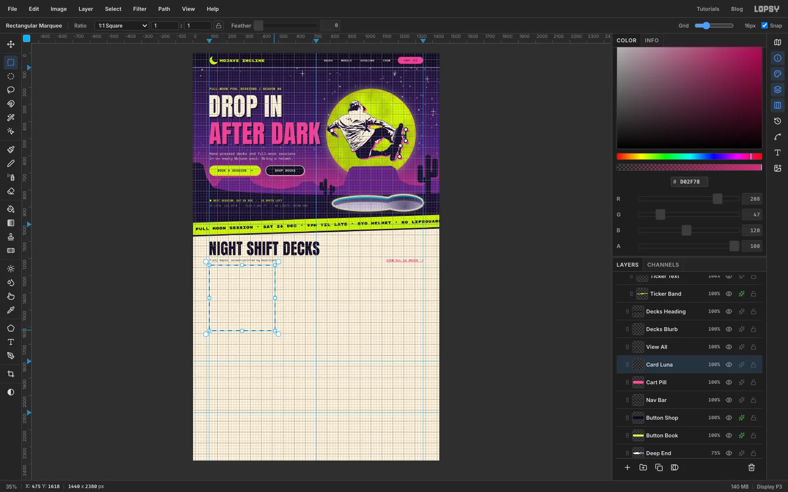

1. Set `NIGHT SHIFT DECKS` in **Anton** `92`, `0D081E`, with its top at `1100`.
   - Below it at `1204`, set `7-ply maple, screen-printed by moonlight.` in Space Mono `16`.
   - On the right, set `VIEW ALL 12 DECKS  →` in Space Mono Bold `16`, `D02F78`. Click **Underline**. Put its right edge on the `1344` guide, level with the line on the left.
   - Click a raster layer and turn **Underline** back off. The Text tool remembers it.
2. Choose **View → Show Grid**. In the options bar, drag the **Grid** slider to `16px` and make sure **Snap** is ticked.
3. Add a layer named `Card Luna`. Drag a marquee roughly from `100, 1244` to `475, 1618`. Both corners snap to the nearest grid lines, giving a clean `384 × 384` square from `96, 1238` to `480, 1622`. The grid is centred on the page, which is why the lines fall on odd-looking numbers.
4. Fill pink. Add an inside **Stroke** of `4` in `0D081E` and a **Drop Shadow** of `8` / `8`, **Blur** `0`, in the same ink.
5. Repeat for `Card Warp` (lime) at `x 528` and `Card Saguaro` (teal `2EC4D6`) at `x 960`. Then choose **View → Show Grid** again to hide the grid.

## Make the Luna deck

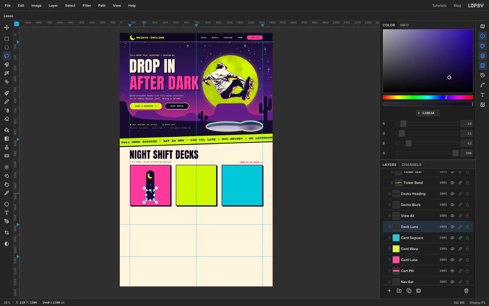

Each deck is a tall pill, 76 px wide and 280 px tall, centred in its card.

1. Add a layer named `Deck Luna`. Build the pill from a rectangle `250, 1328` to `326, 1532` plus two circles: `250, 1290` to `326, 1366`, and `250, 1494` to `326, 1570`.
2. Fill with `120B2A`. Keep the selection, so the stars can't land outside the deck, and spray a few cream stars inside it with the **Spray** at **Size** `70`, **Density** `2`.
3. Press [[Cmd+D]]. Fill a lime circle from `264, 1318` to `312, 1366`. Then fill a smaller circle from `278, 1315` to `318, 1355` with night ink to bite it into a crescent.
4. [[Cmd]]-click the deck's thumbnail. With the **Lasso**, hold [[Shift+Option]] and draw a mesa skyline across the bottom third. Only the overlap stays selected. Fill it with `5A2380`.
5. Give the deck an outside **Stroke** of `4` and a **Drop Shadow** of `8` / `8`, both in `0D081E`.

## Twist a checkerboard with Liquify

1. **Make the tile.** On a scratch layer in an empty corner, fill a 32 px square with cream. Fill its top-left and bottom-right 16 px quarters with `0D081E`. Select the whole 32 px square and choose **Edit → Define Pattern**. Then delete the scratch layer.
2. Add a layer named `Deck Warp`. Make the same pill centred on `x 720`, fill it cream, and give it the same stroke and shadow as Luna.
3. Add a layer named `Warp Checker`. Drag a marquee a little bigger than the deck, `645, 1260` to `795, 1600`. Choose **Edit → Fill with Pattern…**, pick the new pattern and click **Apply**.
4. Choose **Filter → Liquify…**. Set **Mode** to **Twirl CW**, **Brush size** `130` and **Pressure** `60`. Circle the pointer in small loops over `720, 1372` and again over `720, 1490`, then click **Apply**.

## Clip the checker to a straight deck

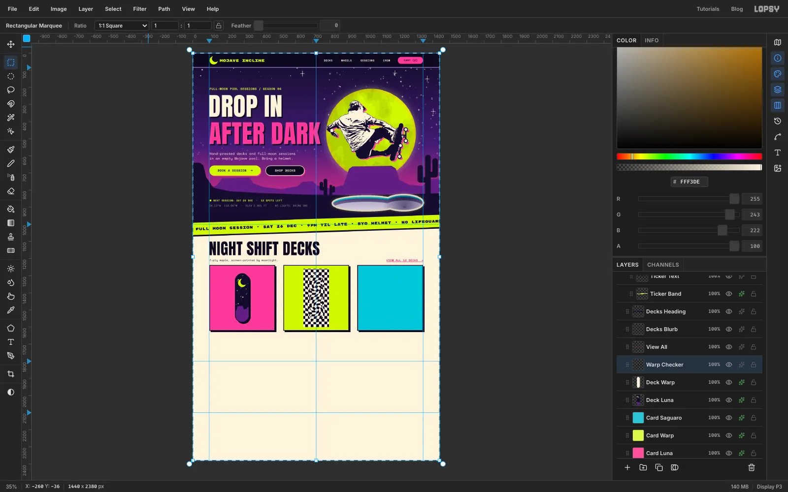

Liquify bends everything it touches, including edges. That's why the twist went on its own layer.

1. [[Cmd]]-click the `Deck Warp` thumbnail and choose **Select → Inverse**.
2. Press [[Delete]] and [[Cmd+D]]. The twisted checker is now trimmed to the straight cream deck underneath.
3. Choose **Layer → Merge Down**. The deck keeps its stroke and shadow.

## Make the Saguaro deck and tilt the outer two

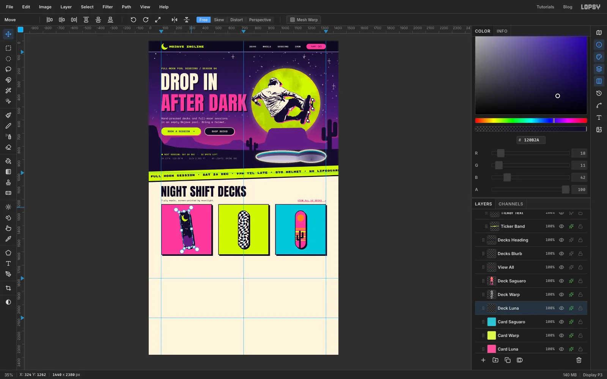

1. Add a layer named `Deck Saguaro` with the pill centred on `x 1152`, filled pink.
2. Press [[Cmd+D]] and fill an orange `FF8A3D` sun from `1126, 1316` to `1178, 1368`.
3. Make sunset stripes across the lower half. For each stripe, [[Cmd]]-click the deck's thumbnail, then [[Shift+Option]]-drag a thin rectangle across it. Fill alternating orange and lime. The stripes get thinner toward the bottom: about 13, 12, 10, 8, 7 and 5 px tall.
4. [[Cmd]]-click the thumbnail once more, so nothing spills off the deck. Paint a saguaro with the **Brush** at **Size** `13` in night ink, the same way as the big ones. Add the same stroke and shadow.
5. Tilt the outer decks. [[Cmd]]-click `Deck Luna`'s thumbnail and drag its rotate handle `8°` counter-clockwise. Press [[Cmd+D]]. Do the same for `Deck Saguaro`, `8°` clockwise.

## Copy the price tags and cart buttons

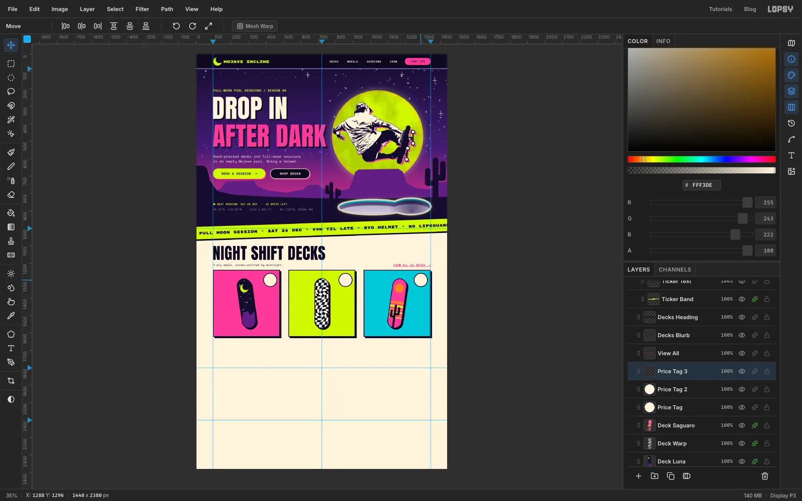

1. Add a layer named `Price Tag`. Fill a circle from `384, 1256` to `464, 1336` with `0D081E`. Fill a circle 4 px smaller inside it with cream.
2. Draw a marquee a little larger than the disc and press [[Cmd+C]], then [[Cmd+V]]. Each paste arrives as a new layer in the same spot, already selected, with the Move tool active. Rename it `Price Tag 2`.
3. Drag the copy from its middle 432 px to the right, onto the second card, and press [[Cmd+D]]. Press [[Cmd+V]] again, rename that copy `Price Tag 3`, and drag it 864 px, onto the third card.
4. Do the same for the add-to-cart pills. Add a layer named `Cart Button` and fill a pill from `96, 1734` to `272, 1770` with `0D081E`. Copy it twice across the cards and rename the copies `Cart Button 2` and `Cart Button 3`.
5. Give each of the three pills a pink **Drop Shadow** of `4` / `4`. Add it after pasting, because a paste doesn't carry layer effects.

## Label the products

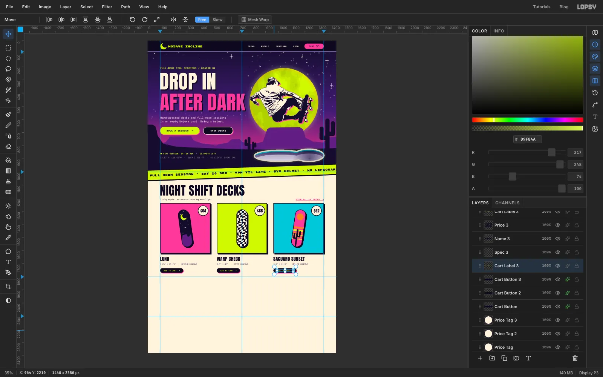

Click `Cart Button 3` before each label so the type stacks on top.

1. **Prices:** `$64`, `$68` and `$62` in **Anton** `30`, `0D081E`, centred in the discs.
2. **Names:** `LUNA`, `WARP CHECK` and `SAGUARO SUNSET` in Anton `36`, flush with each card's left edge at `y 1648`.
3. **Specs:** in Space Mono `14`, `3A2B5C`, at `y 1698`: `8.25" × 31.75"  ·  MEDIUM CONCAVE`, `8.5" × 32"  ·  STEEP CONCAVE` and `8.0" × 31.5"  ·  MELLOW CONCAVE`.
4. **Buttons:** `ADD TO CART  +` in Space Mono Bold `13`, lime, centred in each pill.

## Rule the sessions list

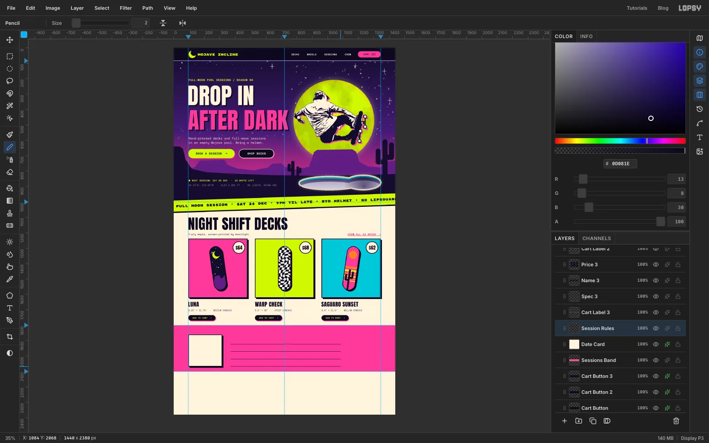

1. Click `Cart Button 3` and add a layer named `Sessions Band`. Fill `0, 1800` to `1440, 2100` with pink.
2. Add a layer named `Date Card`. Fill `96, 1860` to `316, 2068` with cream. Give it an inside **Stroke** of `4` and a **Drop Shadow** of `8` / `8`, both in `0D081E`.
3. Add a layer named `Session Rules`. Pick the **Pencil** at **Size** `2` in `0D081E`.
4. For each rule, click at `x 372` and [[Shift]]-click at `x 1084`. Draw them at `y 1924`, `1972`, `2020` and `2068`, 48 px apart.
5. Add a `Book Spot` pill from `1124, 1968` to `1344, 2024` in ink, with a lime `4` / `4` shadow.

## Fill in the sessions

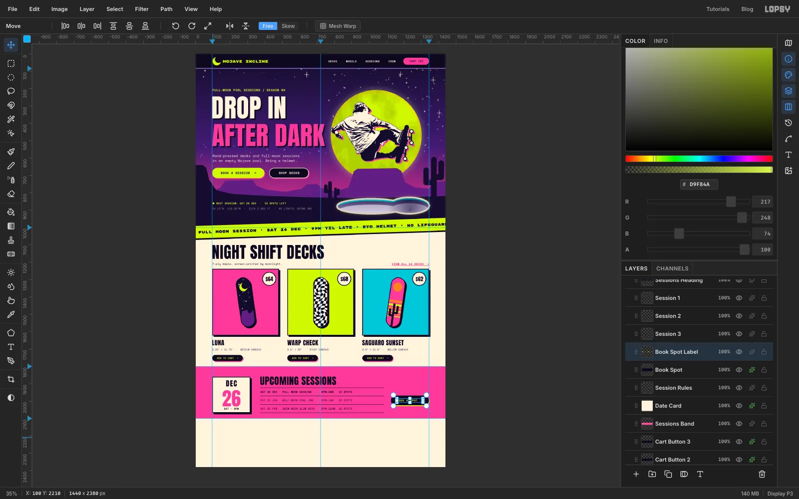

1. On the date card, set `DEC` in Anton `40` with **Letter spacing** `4`. Set `26` in Anton `108`, pink. Set `SAT · 9PM` in Space Mono Bold `14`. Centre all three on `x 206`.
2. Set `UPCOMING SESSIONS` in Anton `56` at `372, 1858`.
3. Set one schedule row per gap in Space Mono `16`, starting at `x 374`. Space Mono is a monospace font, so pad the columns with spaces and they line up row to row:
   - `SAT 26 DEC   FULL MOON SESSION      9PM–2AM   12 SPOTS`
   - `SAT 23 JAN   WOLF MOON BOWL JAM     8PM–1AM   30 SPOTS`
   - `SAT 20 FEB   SNOW MOON SLOW SESH    8PM–12AM  30 SPOTS`
4. Make the first row bold, since it's the next session. Centre each row between its rules.
5. Centre `BOOK A SPOT  →` in lime Space Mono Bold `16` on the pill with the Align buttons.

## Finish the footer and tilt the sticker

1. Click the `DEC` text layer (`Date Month` in the screenshots) so the footer stacks above the sessions band. It was the first text you set there, so it sits highest. Add a layer named `Footer` and fill `0, 2100` to `1440, 2380` with `0D081E`.
2. Add an `Email Field` pill from `96, 2254` to `520, 2302`. Fill it with `221A44` and give it an inside lilac **Stroke** of `2`. Add a pink `Join Button` pill from `532` to `660`, with a lime `4` / `4` shadow.
3. Set the type:
   - `STAY OUT LATE.` in Anton `60`, lime, at `96, 2156`.
   - A lilac `you@desert.mail` placeholder in Space Mono `16`, 26 px inside the field. Centre `JOIN` in Space Mono Bold `16` on its button with the Align buttons.
   - `SHOP  ·  SESSIONS  ·  STOCKISTS  ·  INSTAGRAM` in cream Space Mono Bold `13` at `720, 2176`.
   - `© 2026 MOJAVE INCLINE SKATE CO.` in lilac Space Mono `12` at `x 720`, level with the middle of the field.
4. Add a layer named `Sticker`. Fill a cream circle from `1188, 2044` to `1348, 2204`, then a lime circle 8 px smaller inside it. Give it an `8` / `8` ink shadow.
5. Set `NO`, `LIFEGUARD`, `ON DUTY` on three lines in Rubik Mono One `13`, with **Align** set to **Center**. Centre it on the sticker with the Align buttons.
6. Select the text and `Sticker` and choose **Layer → Group Layers**. Name the group `Sticker Group`. With the group selected, drag the rotate handle `12°` clockwise. The whole sticker turns as one piece and slaps across the seam.

## Add screen-print grit

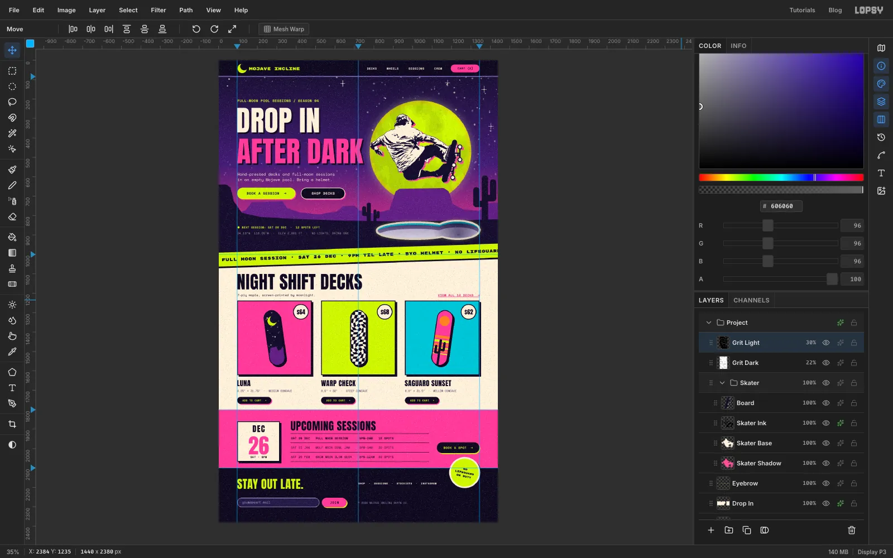

1. **Light specks.** Add a layer named `Grit Light`. Set the foreground to `A0A0A0` and choose **Edit → Fill** with nothing selected. Then:
   - **Filter → Add Noise…** with **Amount** `100` and **Mode** set to **Mono**.
   - **Filter → Desaturate**, so every speck is neutral grey and no coloured fleck survives the Threshold.
   - **Filter → Threshold…** at `206`.
   - Set the layer to **Screen** at `30%`. Only the white specks show, like ink drop-out.
2. **Dark specks.** Add a layer named `Grit Dark`. Do the same with `606060` and **Threshold** `52`, and set it to **Multiply** at `22%`.
3. Drag both grit layers to the very top of the Layers panel, above the `Skater` group, so they cover everything.

Choose **File → Quick Export PNG** to save the page, and **File → Save Project** to keep the layers.
