80s and 90s skateboard graphics were screen printed onto plywood, so they
all follow the same few rules:

- fat black keylines round every shape
- flat colours, with shading done in dots or hard-edged cel tones
- a creature that bursts out of its frame
- loud, chunky lettering

Those rules work just as well on a beer can, which also has to shout from a
fridge. In this tutorial you'll make the wraparound label for an invented
brewery, **Narwhal Ale Co.**, and its hazy pale ale, **Arctic Ollie**. The
front shows a narwhal riding a skateboard out of a porthole badge. The two
sides carry the copy, the ABV, a barcode and the legal text.

The narwhal starts as a photo:
[Narwhal specimen displayed at the Canadian Museum of Nature](https://commons.wikimedia.org/wiki/File:Narwhal_specimen_displayed_at_the_Canadian_Museum_of_Nature_(2010).jpg)
by Salwa Farwaneh Dameh, released as **CC0** (public domain) on Wikimedia
Commons. Download it and crop it to just the body, from the edge of the
frame to the tip of the snout. You can do that in Lopsy by opening it as its
own document and using the **Crop** tool and **Image → Image Size…**. Aim
for about 990 × 350 px. Any side-on whale or dolphin photo works the same way.

Along the way you'll use:

- the **Pen** tool with **Path to Selection** for crisp shapes, the marquee's exact-corners dialog and **Edit → Fill**
- **Voronoi**, a radial **Gradient** and **Halftone**
- the Brush's **Radial Symmetry**
- **Desaturate**, **Brightness/Contrast**, **Surface Blur**, **Oil Paint** and **Cel Shading** to turn a photo into flat cel art
- a **Color** blend layer and **Merge Down** to tint it
- scale and rotate with the Move tool's handles, and [[Shift]]-adding lasso selections
- groups, plus rotating and moving a whole group at once
- **text on a path**, twice
- **Copy**, **Paste**, **Flip Horizontal**, the grid with **Snap**, and **Shrink** / **Grow** for rounded corners
- the **Stroke**, **Drop Shadow** and **Color Overlay** effects, and **Add Noise** for grain

The palette is navy with four screen-print inks:

- Navy `#13204A`
- Orange `#FF6A1A`, halftone ink `#B8360B`
- Yellow `#FFE45C`
- Ice `#9AE8F2`, ribbon teal `#178A9A`
- Narwhal tint `#2BB8D0`, fin `#0A6878`, fluke `#0B3F4A`
- Tusk `#F4ECCF`, tusk grooves `#A8884A`
- Keyline black `#0B0B14`, white `#F6FBFF`, truck grey `#7A8496`

## Set up the label and its panels

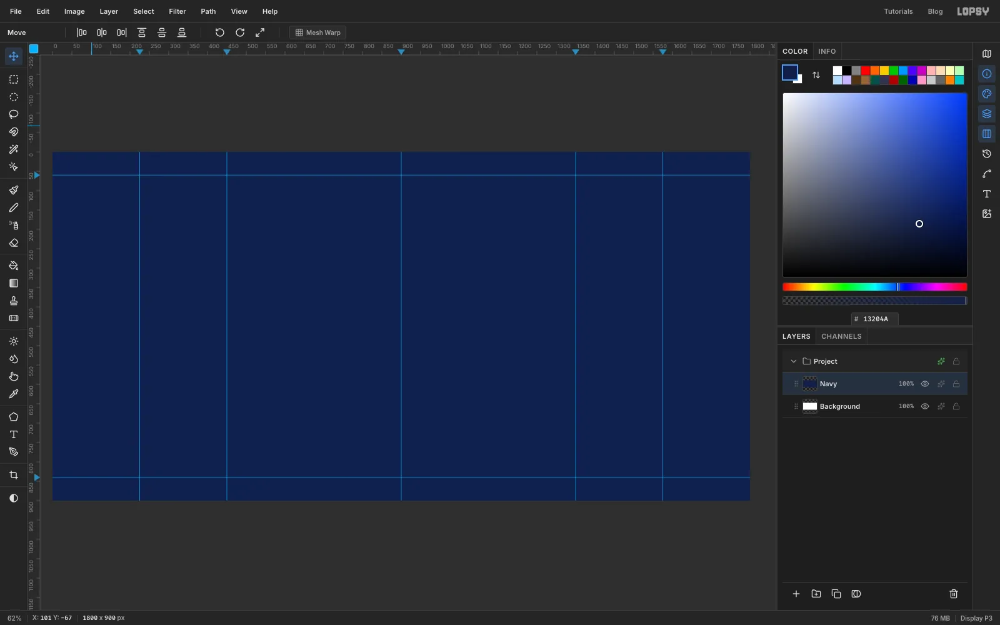

Open [Lopsy](/). In the **New Document** dialog, set **Width** to `1800`
and **Height** to `900` and click **Create**. A 12 oz can label wraps all
the way round, so it's twice as wide as it is tall.

Add guides by clicking the rulers:

- On the top ruler, click at `450` and `1350`. The middle third is the front of the can, and the outer thirds wrap round the sides.
- Click at `225`, `900` and `1575` too. Those are the centre lines of the three panels, and you'll line type up on them.
- On the left ruler, click at `60` and `840` to mark a safe margin top and bottom.

Double-click **Layer 1** and rename it `Navy`. In the Color panel, type
`13204A` into the hex field, then choose **Edit → Fill**.

## Draw an ice starburst with the Pen

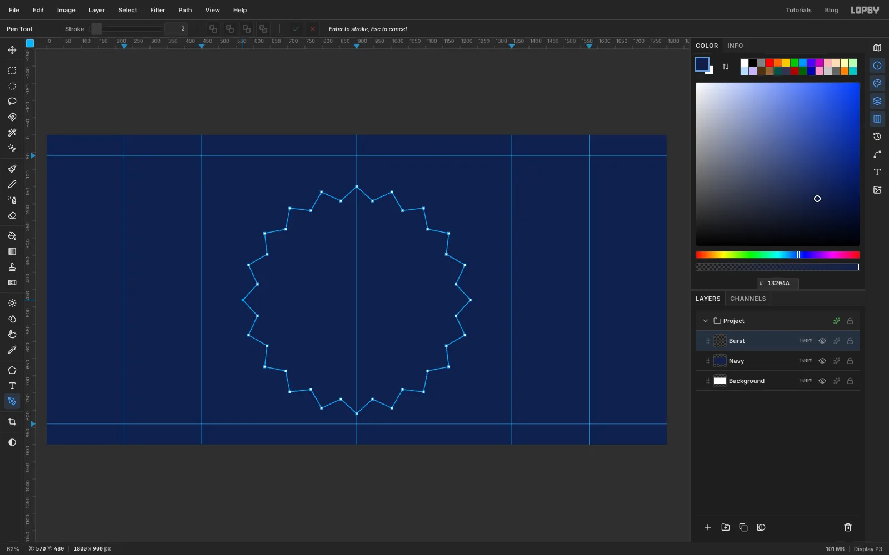

Everything on the front hangs off a badge centred on the middle guide, a
little above the middle of the canvas, at `900, 480`.

Click **Add Layer** at the bottom of the Layers panel and name the layer
`Burst`. Press [[P]] for the **Pen** tool and click round the badge centre
to place 40 corner points, alternating long spikes and short notches: tips
about 330 px out, notches about 290 px out. Twenty spikes is plenty. Click
the first point again to close the path. Plain clicks make sharp corners,
which is what a burst needs.

## Fill the burst and give it a keyline

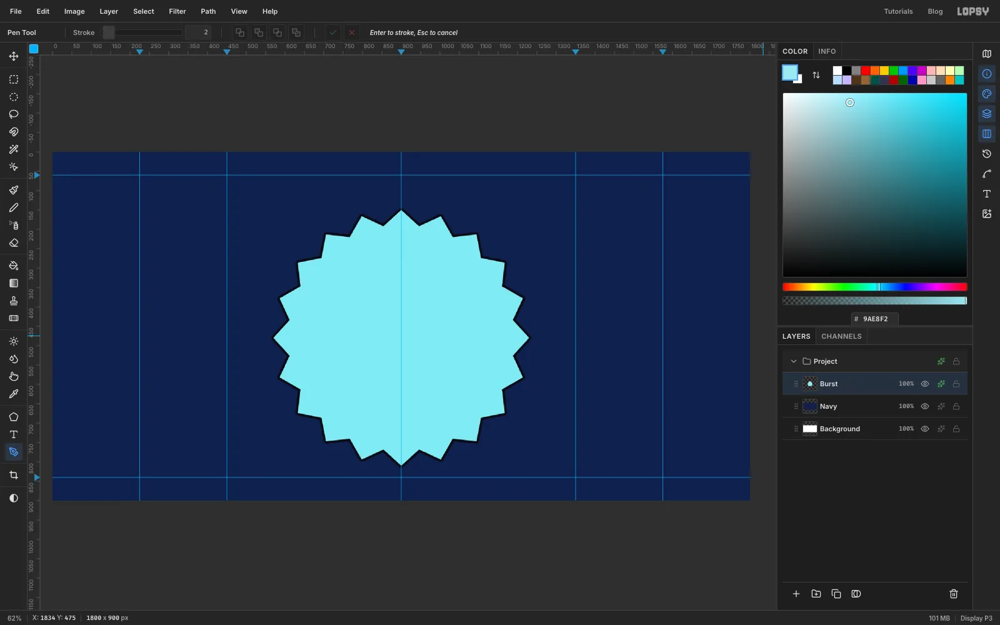

Open the **Paths** panel, make sure your star is selected, and click
**Path to Selection**. Then click **Delete Path**, because you only need the
selection. Set the foreground to ice `#9AE8F2`, choose **Edit → Fill** and
press [[Cmd+D]].

Open the layer's effects drawer with the ✦ button on its row. Tick
**Stroke**, set **Width** to `6` and the colour to `#0B0B14`. That 6 px black
keyline is the house style: almost everything gets the same stroke.

## Add the black rim

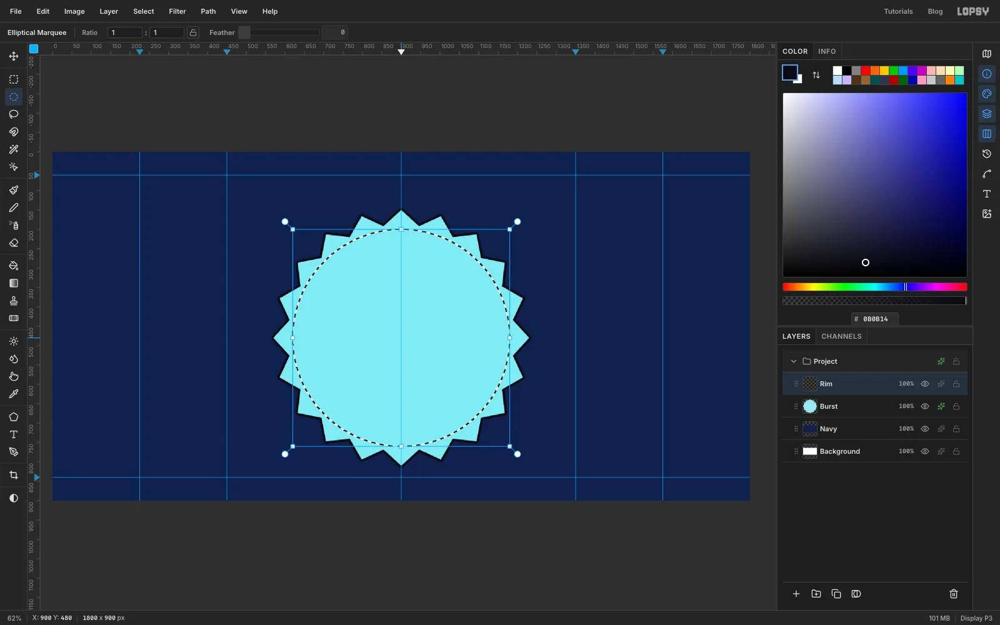

Add a layer named `Rim`. Choose the **Elliptical Marquee** from the
toolbox and click once on the canvas without dragging. In the **Elliptical
Selection** dialog, enter From `620, 200` and To `1180, 760` and press
[[Enter]]. That's a circle of radius 280 round the badge centre.

Set the foreground to `#0B0B14`, choose **Edit → Fill** and deselect.

## Crackle an orange disc with Voronoi

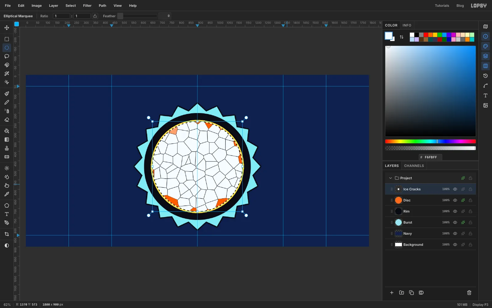

Add a layer named `Disc`. Make an exact elliptical selection from
`664, 244` to `1136, 716` and fill it with orange `#FF6A1A`. Give it a
**Stroke** of **Width** `8` in yellow `#FFE45C`. That's the hard yellow
ring between the orange and the black rim.

Keep the selection. Add a layer named `Ice Cracks`, set the foreground to
white `#F6FBFF` and fill. Then choose **Filter → Voronoi…**, set **Cells**
to `18` and **Edge Width** to `3`, and click **Apply**. The filter breaks
the white circle into cells outlined in black.

## Blend the crackle into the orange

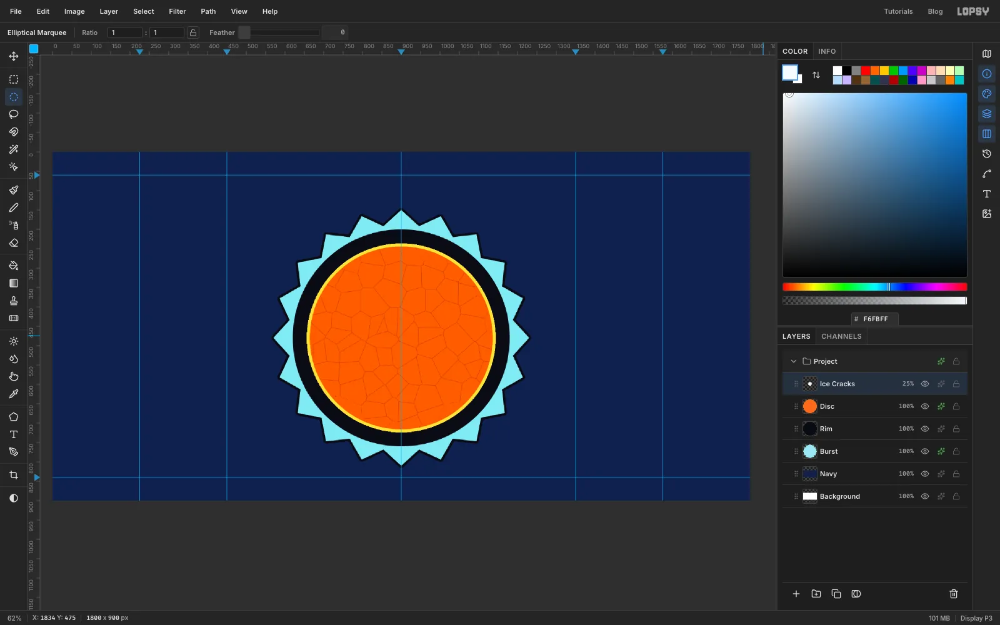

Press [[Cmd+D]]. In the effects drawer, set the layer's **Blend** to
**Multiply** and lower the layer's opacity to `25%`. The white cells vanish
into the orange and the cell edges become thin, darker cracks. Keep it
subtle: at full strength the cracks fight the drawing that goes on top.

## Shade the disc with a radial gradient

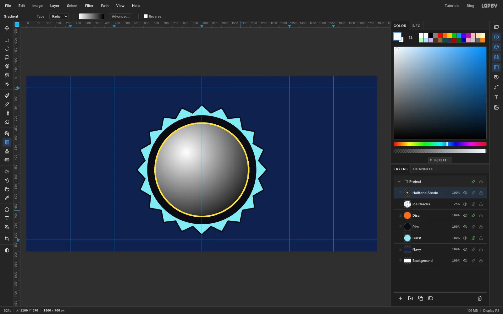

Add a layer named `Halftone Shade` and make the same exact circle again,
from `664, 244` to `1136, 716`.

Choose the **Gradient** tool and set its type to **Radial**. Click
**Advanced…** and set two stops: white `#FFFFFF` on the left and black
`#000000` on the right. Drag from the upper left of the disc to just past
its lower-right edge, so the light falls from the top left. Then deselect.

## Turn the shading into halftone dots

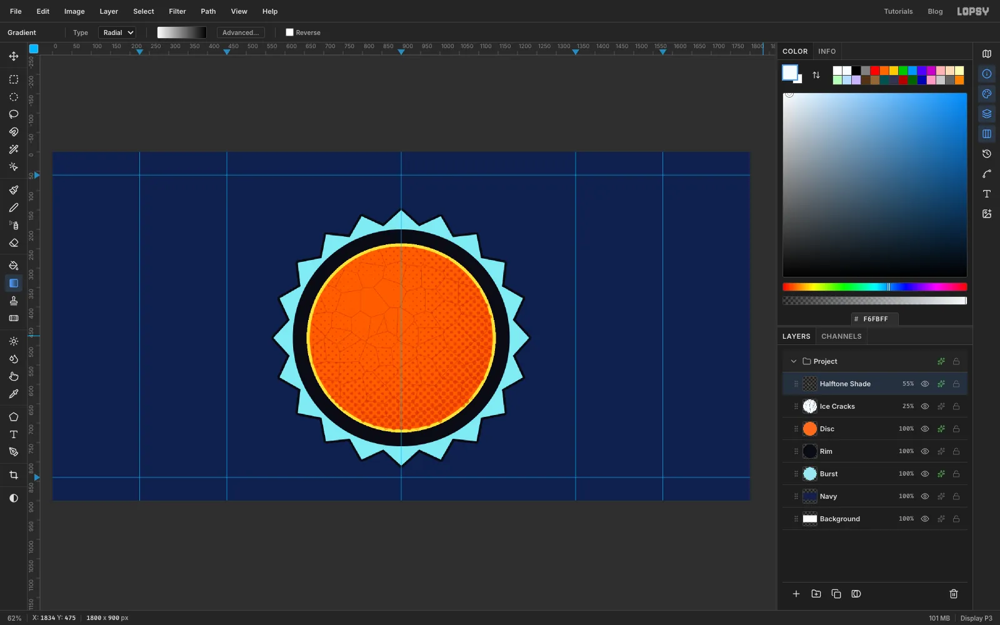

With **Halftone Shade** selected, choose **Filter → Halftone…** and set:

- **Dot Size** `14`
- **Density** `1`
- **Angle** `45`
- **Softness** `0.5`

Click **Apply**. Halftone leaves the gaps between dots transparent, so
only the dots remain. They're big where the gradient was dark and vanish
where it was white. To print them in one dark orange ink, open the effects
drawer, tick **Color Overlay** and set it to `#B8360B`. Then lower the
layer's opacity to `55%`.

## Stamp the rim dots with Radial Symmetry

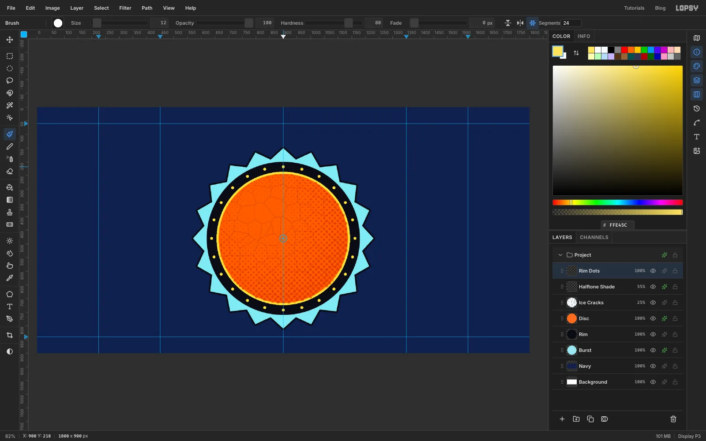

Add a layer named `Rim Dots` and set the foreground to yellow `#FFE45C`.
Press [[B]] for the **Brush** and set **Size** to `12`.

Click **Radial Symmetry** in the options bar and set **Segments** to `24`.
[[Cmd]]-click the badge centre (where the `900` guide crosses the middle of
the disc) to move the symmetry centre there. Then click once in the middle
of the black rim, straight above the centre. One click paints 24 evenly
spaced dots.

Click **Radial Symmetry** again to turn it off.

## Paste the narwhal photo

Make sure **Rim Dots** is selected so the photo lands above it. Copy your
cropped narwhal photo and press [[Cmd+V]] in Lopsy. It arrives on its own
layer in the top-left corner. Rename the layer `Narwhal`.

## Lasso the body

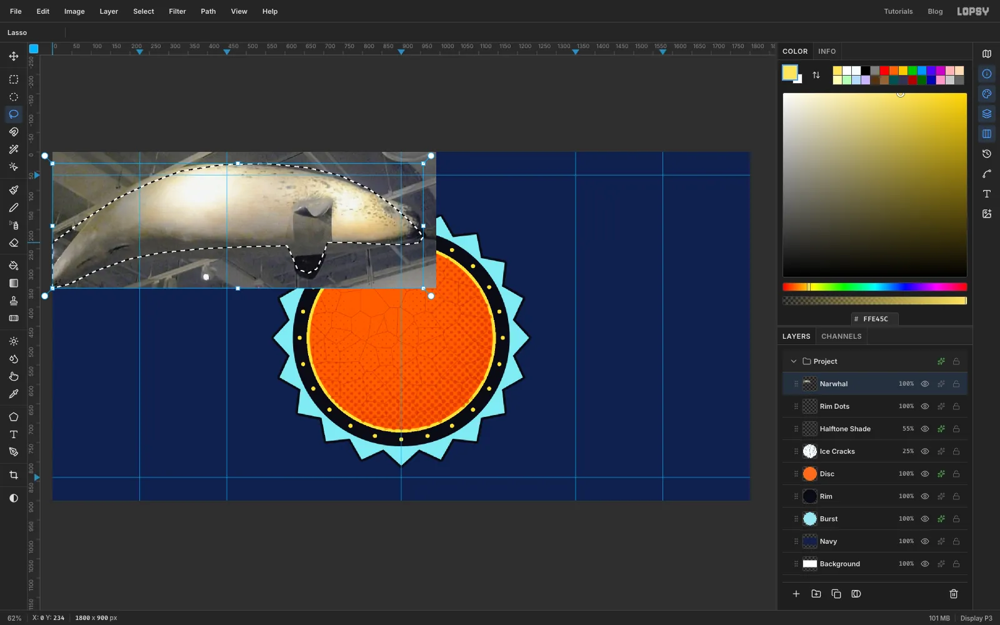

Press [[Cmd+D]], then [[L]] for the **Lasso**. Trace round the narwhal's
body: along the back, round the snout, back along the belly, and down round
the dark flipper hanging under it. Leave out the tusk, because you'll draw
a better one. Where the photo crops the tail, run the lasso straight down
the edge.

## Cut it out and flatten the photo detail

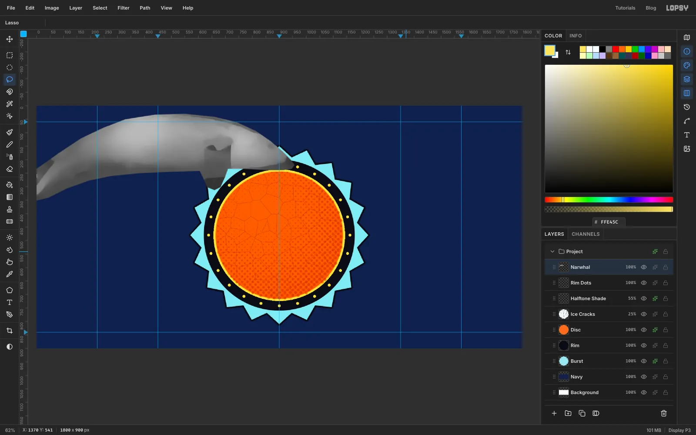

Choose **Select → Inverse** and press [[Delete]], then [[Cmd+D]]. The
ceiling and lights are gone.

Cel shading needs big, simple areas of tone. A photo is full of speckle and
texture, so smooth that away first. Run these filters in order, clicking
**Apply** each time:

1. **Filter → Desaturate**.
2. **Filter → Brightness/Contrast…**: **Brightness** `-5`, **Contrast** `-40`. Lowering the contrast keeps the blown-out shine on the back from turning pure white.
3. **Filter → Surface Blur…**: **Radius** `14`, **Threshold** `40`. This smooths the skin but keeps the outline sharp.
4. **Filter → Gaussian Blur…**: **Radius** `2`.
5. **Filter → Oil Paint…**: **Radius** `8`, **Sharpness** `1.5`. This mops up the last specks.

## Cel-shade it

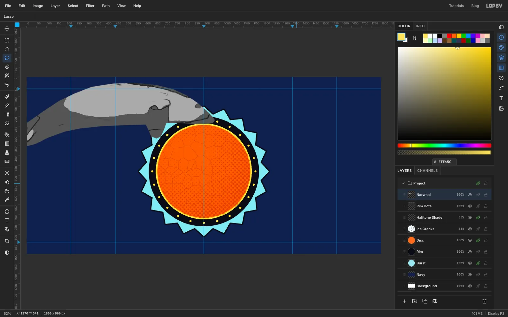

Choose **Filter → Cel Shading…**, set **Color Levels** to `3` and **Edge
Strength** to `60`, and click **Apply**. The body snaps into flat tones
with dark edges, like a screen-printed illustration.

## Tint it icy cyan

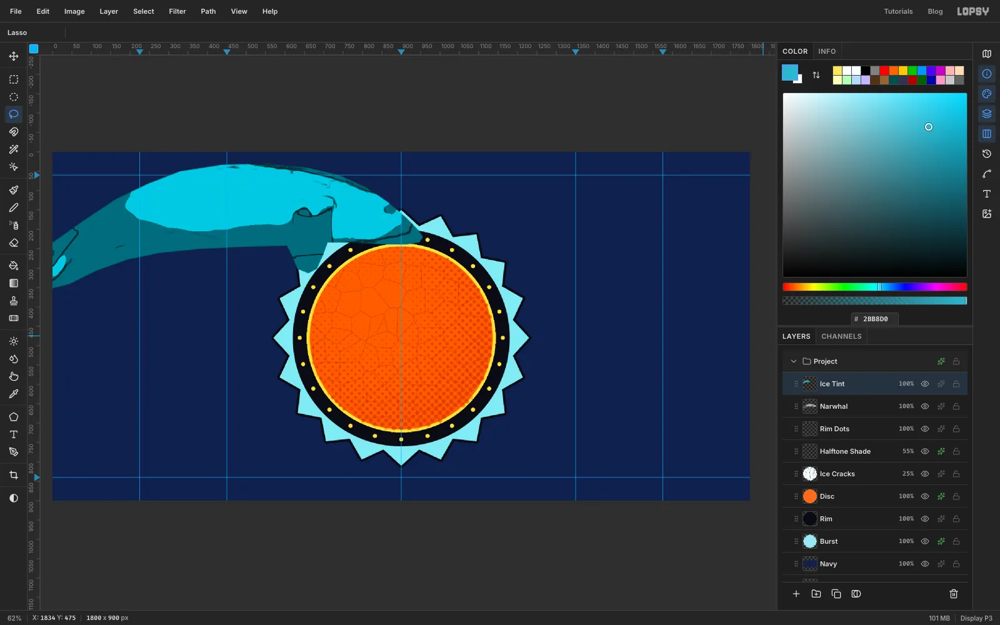

[[Cmd]]-click the **Narwhal** layer's thumbnail to select its pixels. Add a
layer named `Ice Tint`, set the foreground to `#2BB8D0`, fill the
selection and deselect. In the effects drawer, set its **Blend** to
**Color**. Color keeps the narwhal's light and dark but swaps in the hue,
so the grey tones become cyan and teal.

With **Ice Tint** still selected, choose **Layer → Merge Down** to bake the
tint into **Narwhal**.

## Repaint the highlight and the fin

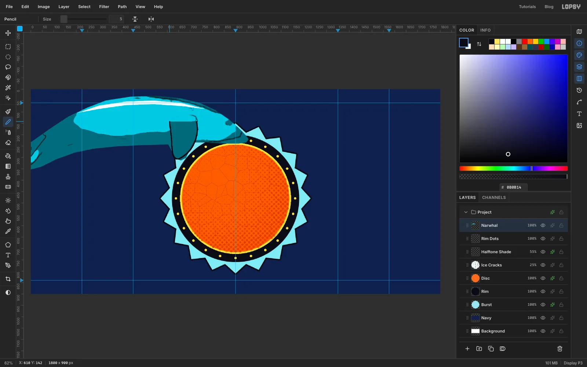

Two spots still look like a photo: the soft shine along the back, and a
grey mounting plate behind the head. Paint over both on the **Narwhal**
layer.

1. With the **Lasso**, drag a long, thin crescent along the back, just under the top edge, pointed at both ends. Fill it with white `#F6FBFF` and deselect.
2. Lasso a rounded paddle over the grey plate behind the head: wide where it meets the body, curving back to a rounded tip below the belly. Fill it with `#0A6878` and deselect.
3. Press [[N]] for the **Pencil**, set **Size** to `5` and the foreground to `#0B0B14`. Click a point on the fin's edge, then [[Shift]]-click your way round it to outline it.

## Scale the narwhal down

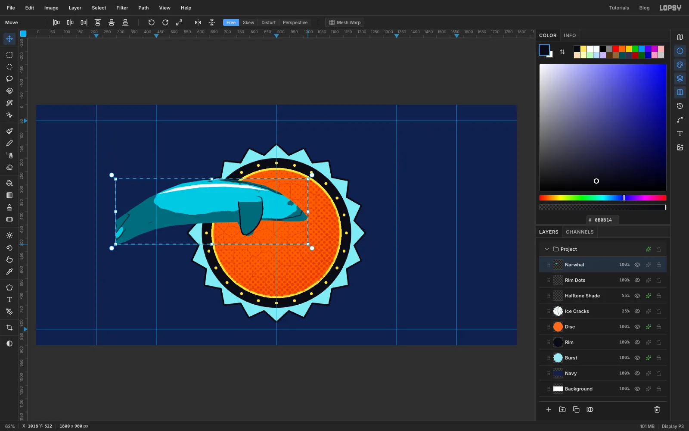

Press [[V]] for the **Move** tool and drag the narwhal down and right, over
the badge, so it has room to move.

Press [[M]] and drag a **Rectangular Marquee** snugly round it. Press [[V]]
again: transform handles appear round the selection. Hold [[Cmd]] and drag
the bottom-right corner handle inwards until the box is about three
quarters of its width. [[Cmd]] keeps the proportions.

## Rotate it into a leap

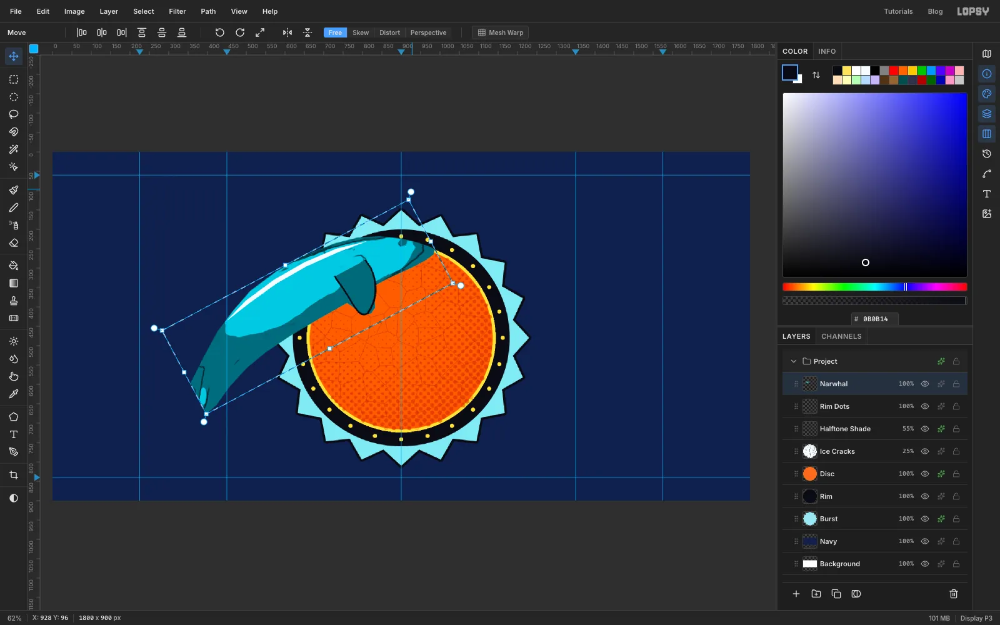

Move the pointer just outside the top-right corner handle until it turns
into the rotate cursor. Drag up and to the left to rotate the narwhal about
`28°` counter-clockwise, so its snout climbs towards the upper right.
Press [[Enter]] to commit, then [[Cmd+D]].

## Place the snout outside the ring

With the **Move** tool, drag the narwhal so the tip of its snout pokes just
past the black rim at the upper right, at about two o'clock. Its body now
crosses the whole badge and its cut-off tail end hangs out past the rim at
the lower left. That's the classic skate-graphic move: the creature breaks
its frame at both ends.

## Taper the tail

A whale's tail narrows to a thin stock before the fluke, but the photo's
tail is cut off thick. Trim it:

1. With the **Lasso**, drag a long thin triangle over the top edge of the tail end. Start it a good way back along the body and finish just past the end, so it shaves the tip down to about a third of its thickness.
2. Hold [[Shift]] and drag a matching triangle under the bottom edge. [[Shift]] adds it to the first selection.
3. Press [[Delete]], then [[Cmd+D]].

## Draw the fluke

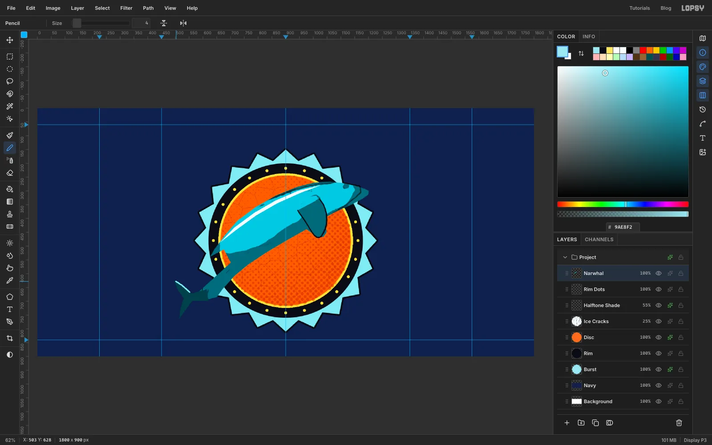

Still on **Narwhal**, lasso a fluke onto the end of the stock: two pointed
lobes, each about 70 px long, with a notch between them. Angle it slightly
up and back so the tail looks like it's flicking. Fill it with dark teal
`#0B3F4A` and deselect. A darker tone keeps the fluke from merging with the
body.

Press [[N]], set **Size** to `4` and the foreground to ice `#9AE8F2`. Click
near the root of the upper lobe and [[Shift]]-click two short segments
along its leading edge as a highlight.

## Outline the narwhal

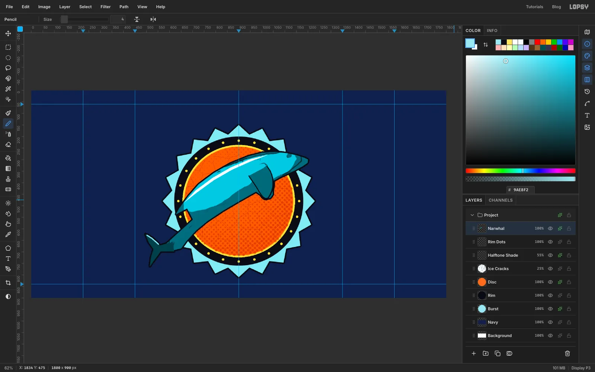

Open the **Narwhal** layer's effects drawer and tick **Stroke**: **Width**
`6`, colour `#0B0B14`. Because the fluke and fin are on the same layer, one
stroke runs round the whole silhouette with no seams.

## Draw a spiral tusk

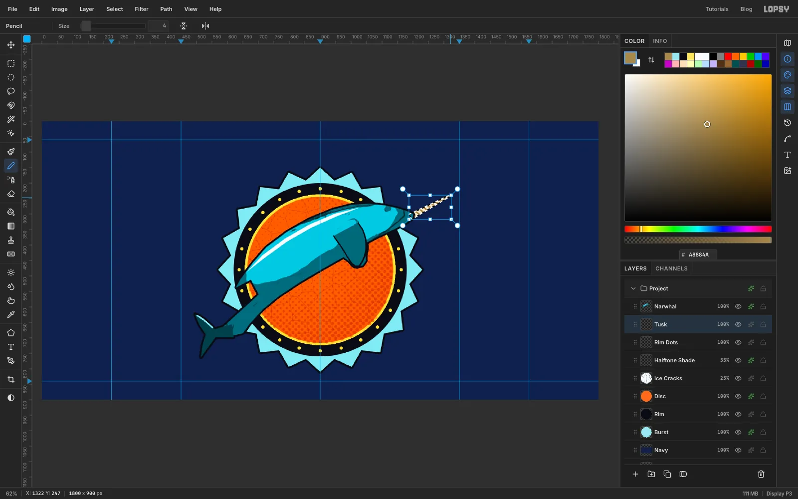

Select **Rim Dots** and add a layer named `Tusk`. It lands just under
**Narwhal**, so the tusk's root tucks behind the snout.

With the **Lasso**, drag a long, thin spike out of the snout tip, following
the narwhal's angle up and to the right. Make it about 150 px long, as
thick as the end of the snout at the root and tapering to a point. Keep the
tip inside the front panel, left of the `1350` guide. Fill it with ivory
`#F4ECCF`, but **don't** deselect.

Press [[N]] for the **Pencil**, set **Size** to `4` and the foreground to
`#A8884A`. Click and [[Shift]]-click short diagonal lines across the tusk,
evenly spaced from root to tip. The selection keeps the grooves inside the
tusk, which gives it a spiral twist. Deselect, then give **Tusk** a
**Stroke** of `6` in `#0B0B14`.

## Give it some attitude

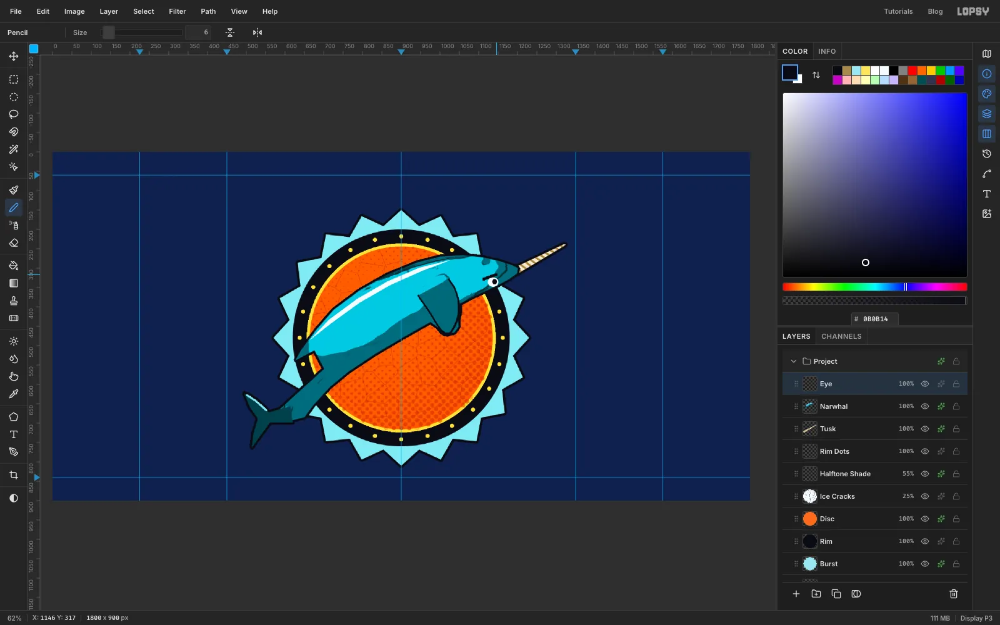

Select **Narwhal** and add a layer named `Eye`. On the head, a little way
back from the snout:

1. Make a small elliptical marquee (about 28 × 24 px) and fill it white.
2. Make a smaller one inside it, offset towards the snout, and fill it black for the pupil.
3. With the **Pencil** at **Size** `6`, [[Shift]]-click a short black brow above it, slanting down towards the snout.

## Draw the title arc with the Pen

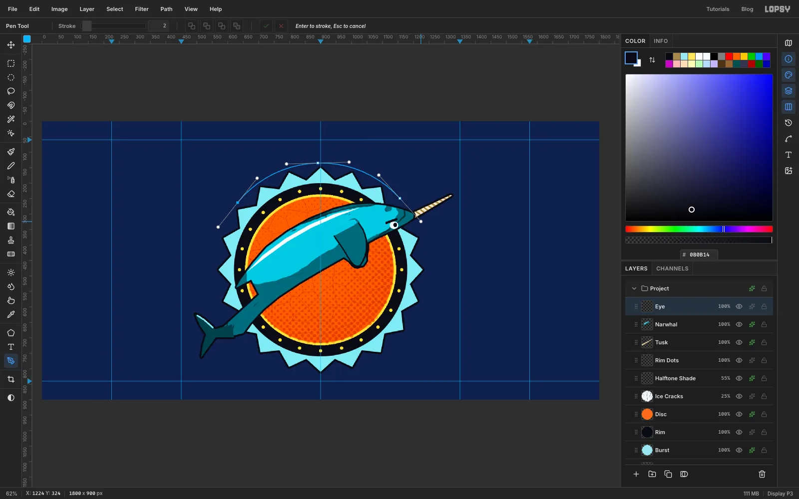

With **Eye** selected, press [[P]] for the **Pen** tool. You'll draw an arc
over the badge with three anchors. At each one, press and drag along the
curve to pull out a handle about 100 px long:

1. Start just outside the burst at about eight o'clock and drag up and to the right.
2. Put the top anchor above the tallest spike, just left of the `900` guide, and drag straight to the right.
3. End just outside the burst at about four o'clock and drag down and to the right.

Click the ✓ **Commit path** button in the options bar. Keep the arc about
15 px clear of the burst's spikes all the way round, so the title doesn't
sit on the points.

## Put NARWHAL on the arc

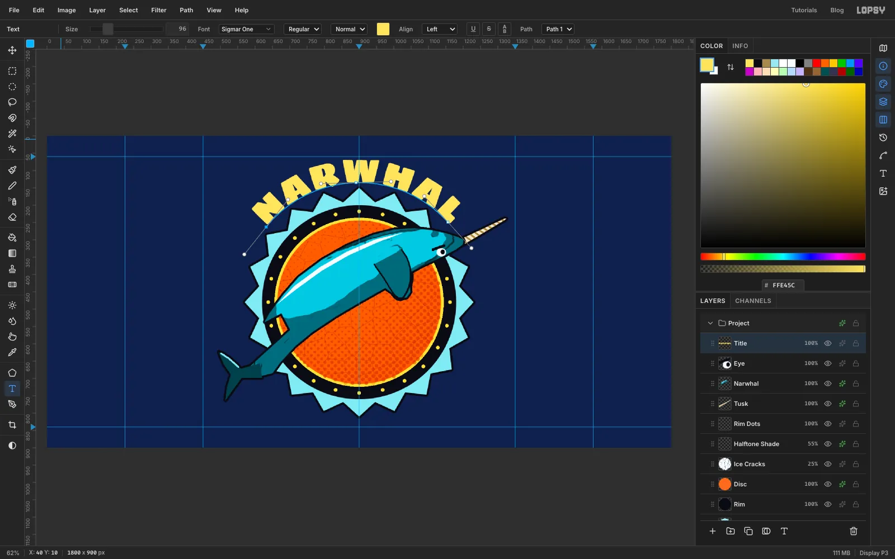

Press [[T]] for the **Text** tool. In the options bar, choose **Sigmar
One**, set **Size** to `96`, and set the foreground to yellow `#FFE45C`.
Click in an empty spot of canvas away from the badge, type `NARWHAL` and
press [[Tab]] to commit.

With the new text layer selected, open the **Path** dropdown in the Text
options bar and choose the path you just drew (the newest one in the
list). The letters jump onto the arc, each one turned to follow the curve.
Rename the layer `Title`.

## Give the title a keyline and a hard shadow

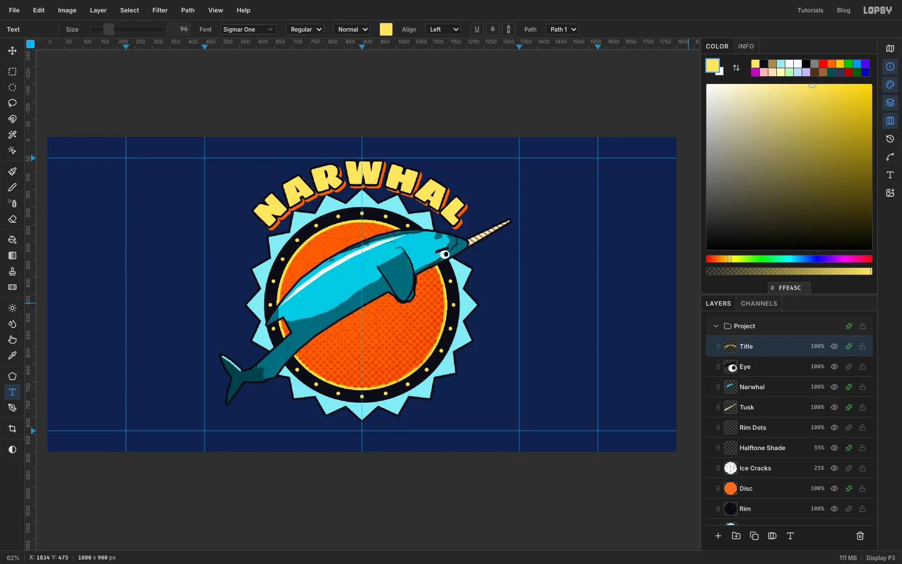

Open **Title**'s effects drawer and tick:

- **Stroke**: **Width** `6`, colour `#0B0B14`
- **Drop Shadow**: colour orange `#FF6A1A`, **Offset X** `6`, **Offset Y** `6`, **Blur** `0`, **Opacity** `100`

A shadow with no blur is a second flat ink, the way a screen printer would
fake depth. To hide the path's outline, open the **Paths** panel and click
the selected path to deselect it.

## Add ribbon tails and draw the band with the Pen

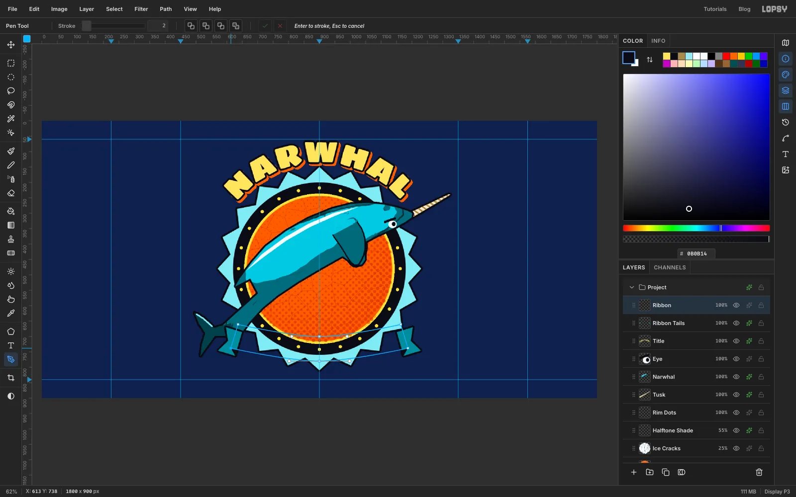

Select **Title** and add a layer named `Ribbon Tails`. With the **Lasso**,
draw a short notched tail low on each side of the badge, where the ends of
a ribbon will go. Fill them with `#178A9A`. Then lasso a small triangle at
the inner bottom corner of each tail and fill it with `#0B0B14`, so the
fold reads. Stroke the layer at `6` in `#0B0B14`.

Add a layer named `Ribbon`. Press [[P]] and draw the band as one closed
path, starting at its bottom-left corner:

1. Click the bottom-left corner, just inside the left tail, then the top-left corner about 80 px above it.
2. Press on the middle of the top edge, on the `900` guide and a little lower than the corners, and drag a handle to the right. That bends the edge into a smile.
3. Click the top-right and bottom-right corners, mirroring the left side.
4. Press on the middle of the bottom edge, about 80 px below the top one, and drag a handle to the left.
5. Click the first point to close the path.

## Fill the ribbon

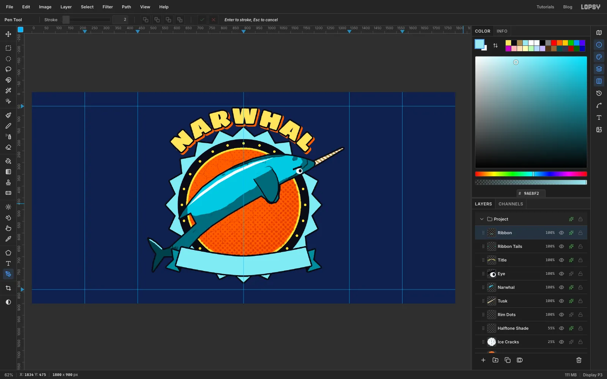

In the **Paths** panel, click **Path to Selection** and then **Delete
Path**. Fill the selection with ice `#9AE8F2`, deselect, and stroke the
layer at `6` in `#0B0B14`.

## Set ARCTIC OLLIE on the curve

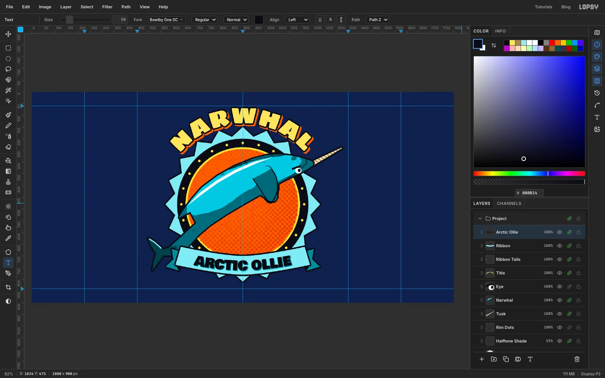

Press [[P]] and draw an open arc along the middle of the ribbon, left to
right, with three anchors:

1. Start about 70 px in from the band's left end and drag down and to the right.
2. Put the middle anchor on the `900` guide, slightly below the band's centre line, and drag straight to the right.
3. End about 70 px in from the right end and drag up and to the right.

Commit it with ✓. Press [[T]], choose **Bowlby One SC** at **Size** `56`,
set the foreground to `#0B0B14`, click in an empty spot of canvas, type
`ARCTIC OLLIE` and press [[Tab]]. Choose the new path in the **Path**
dropdown and rename the layer `Arctic Ollie`.

Give it a **Drop Shadow** of `#178A9A`, **Offset X** `3`, **Offset Y** `3`,
**Blur** `0` and **Opacity** `100`, then deselect the path in the Paths
panel. The path runs parallel to the band, so the letters stay centred in
the ribbon all the way along.

## Add the front line

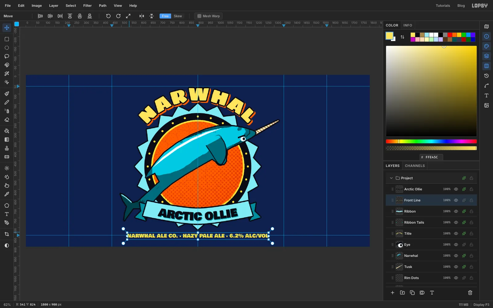

The front of the can has to name the brewery, style and strength too.
Select **Ribbon**, press [[T]], choose **Bowlby One SC** at **Size** `26`
and set the foreground to yellow. Click in empty canvas below the ribbon
and type `NARWHAL ALE CO. · HAZY PALE ALE · 6.2% ALC/VOL`, then press
[[Tab]]. Rename the layer `Front Line`.

Switch to the **Move** tool and drag the line so it's centred on the `900`
guide, just above the bottom margin guide and clear of the burst's lowest
points.

## Build a skateboard in a group

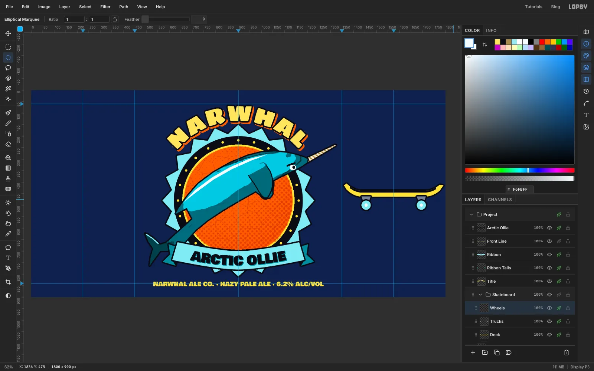

Select **Eye** and click **New Group** at the bottom of the Layers panel.
Rename it `Skateboard`. The group lands between **Eye** and **Title**, so
the board will sit over the narwhal but under all the type. Build the board
in the empty right panel, where it's out of the way. Each layer you add now
lands inside the group.

1. Add a layer named `Deck`. With the **Lasso**, draw a side view of a deck about 420 px long and 26 px thick, with both ends curving up into kicks. Fill it with yellow `#FFE45C`. Then lasso a strip along its top edge, about a quarter of the deck's thickness, and fill it with `#0B0B14` for the grip tape.
2. Add a layer named `Trucks`. Lasso two small trapezoids hanging under the deck, about 120 px in from each end, and fill them with grey `#7A8496`.
3. Add a layer named `Wheels`. Under each truck, make a circle about 40 px across and fill it with ice `#9AE8F2`. Add a white hub about 14 px across in the middle of each.

Give **Deck**, **Trucks** and **Wheels** each a **Stroke** of `6` in
`#0B0B14`.

## Rotate the whole group

Click the **Skateboard** group's row and press [[V]]. The **Move** tool
puts transform handles round the whole group. Drag just outside the
top-right corner to rotate it about `20°` counter-clockwise. The nose
lifts as if the narwhal has just popped an ollie. Press [[Enter]].

## Slide the board under the belly

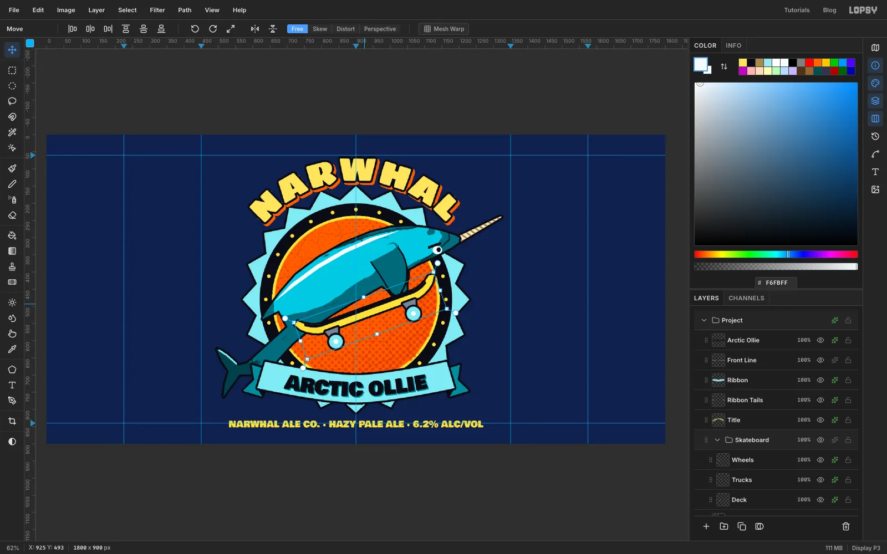

With the group still selected, drag the board onto the badge so its grip
tape just touches the narwhal's belly, below the fin. All three layers
move together.

## Start the left panel with stripes and a rule

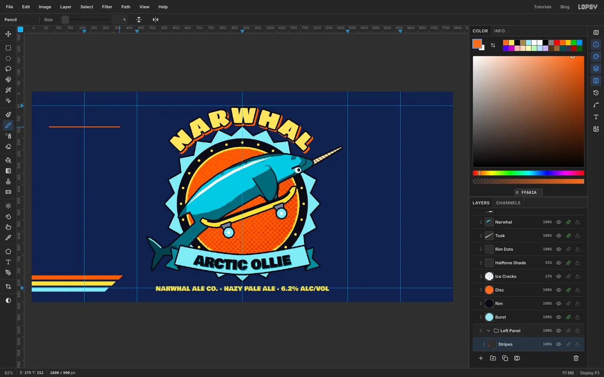

Collapse your groups so the Layers panel stays tidy. Select **Navy** and
click **New Group**. Name it `Left Panel` and add a layer inside it named
`Stripes`.

Draw each stripe with the **Pen**: click four corners to make a bar 18 px
tall, starting just off the left edge of the canvas, with its right end
slanted, and click the first point to close it. Then use **Path to
Selection**, **Delete Path**, fill and deselect. Stack three bars near the
bottom with 8 px gaps between them, each about 30 px shorter than the one
above, and fill them orange `#FF6A1A`, yellow `#FFE45C` and ice `#9AE8F2`
from the top.

For a rule under the heading, press [[N]], set **Size** to `4` and the
foreground to orange. Click near the top of the panel, just inside the
left guide area, and [[Shift]]-click about 300 px to the right, keeping it
centred on the `225` guide.

## Set the left panel type

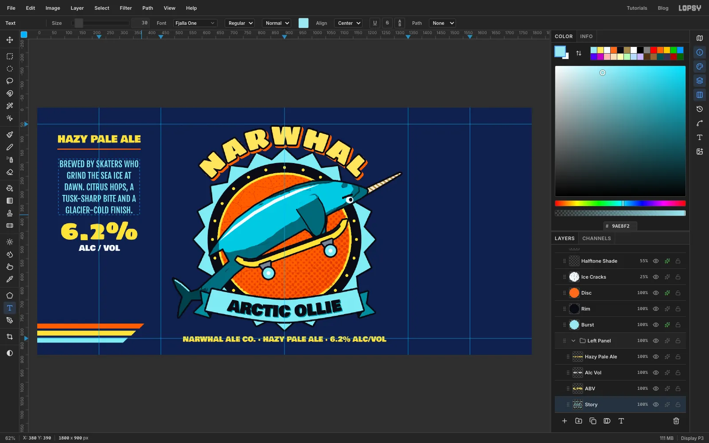

Start each new line on empty canvas. Clicking on existing type edits it
instead, so set the lower lines first and drag each line onto the `225`
guide with the **Move** tool afterwards. Select **Stripes** before each new
line and rename each text layer as you go.

1. `HAZY PALE ALE` in **Bowlby One SC** `36`, yellow, just under the top margin guide. Name it `Hazy Pale Ale`.
2. `ALC / VOL` in **Bowlby One SC** `28`, white, a little above the middle of the panel. Name it `Alc Vol`.
3. `6.2%` in **Sigmar One** `96`, yellow, just above **ALC / VOL**. Name it `ABV`.
4. The story as area text. Choose **Fjalla One** at `30` in ice blue and set **Align** to **Center**. Drag a text box between the orange rule and the `6.2%`, about 310 px wide. Type `BREWED BY SKATERS WHO GRIND THE SEA ICE AT DAWN. CITRUS HOPS, A TUSK-SHARP BITE AND A GLACIER-COLD FINISH.`, press [[Tab]] and name it `Story`.

## Cut a roundel from a circle

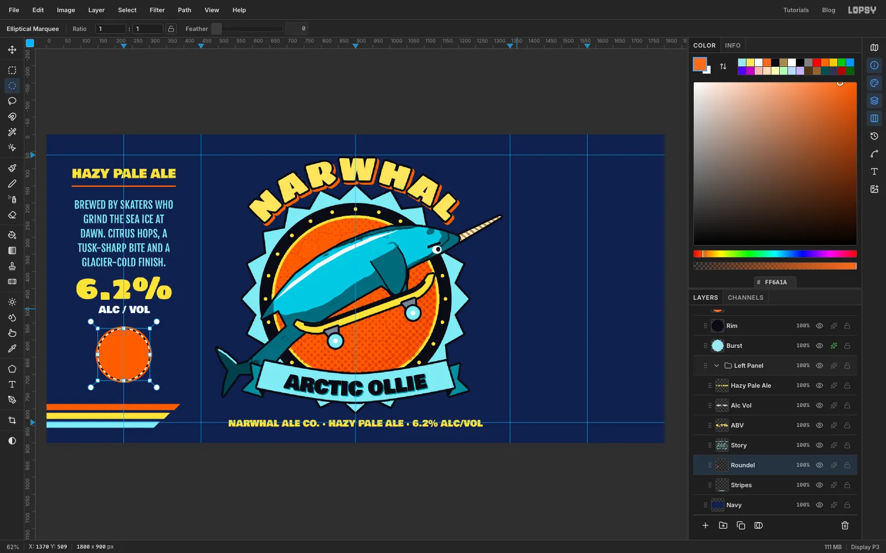

Add a layer named `Roundel`. Make an exact elliptical selection from
`143, 560` to `307, 724` and fill it orange. Choose **Select → Shrink…**,
enter `6` and click **Apply**.

## Finish the roundel

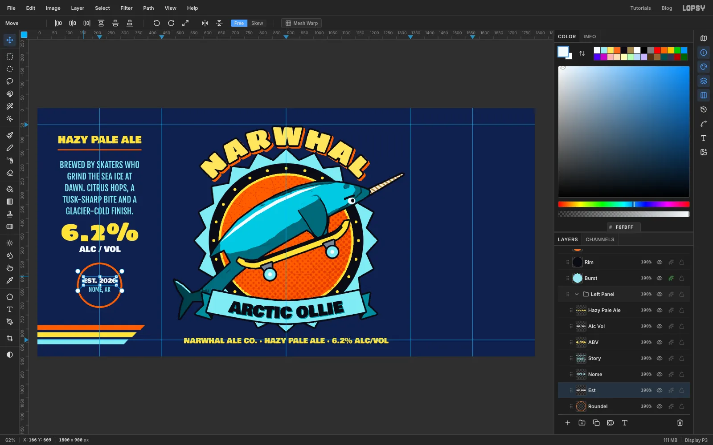

Press [[Delete]] to cut out the middle, leaving a crisp 6 px ring, then
[[Cmd+D]].

Inside it, set `NOME, AK` in **Fjalla One** `22`, ice blue, just below the
ring's centre. Then set `EST. 2026` in **Bowlby One SC** `22`, white, just
above it. Again, the lower line goes first.

## Copy the stripes and flip them

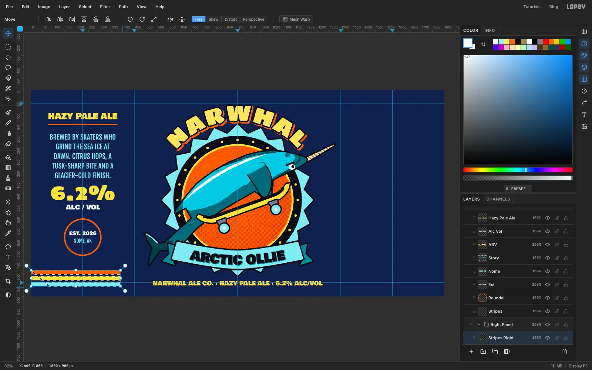

On the can, the stripes should run round the seam: off the right edge and
back on at the left. Copy them to the right panel:

1. Select **Stripes** and drag a marquee round the three bars. Press [[Cmd+C]].
2. Select **Navy** and click **New Group**. Name it `Right Panel`.
3. Press [[Cmd+V]]. The copy pastes in place on its own layer, with its pixels selected. Rename it `Stripes Right`.
4. With the **Move** tool active, click **Flip Horizontal** in the options bar. It's only there while a selection or transform box is showing. The slanted ends now point left.

## Move the stripes to the right edge

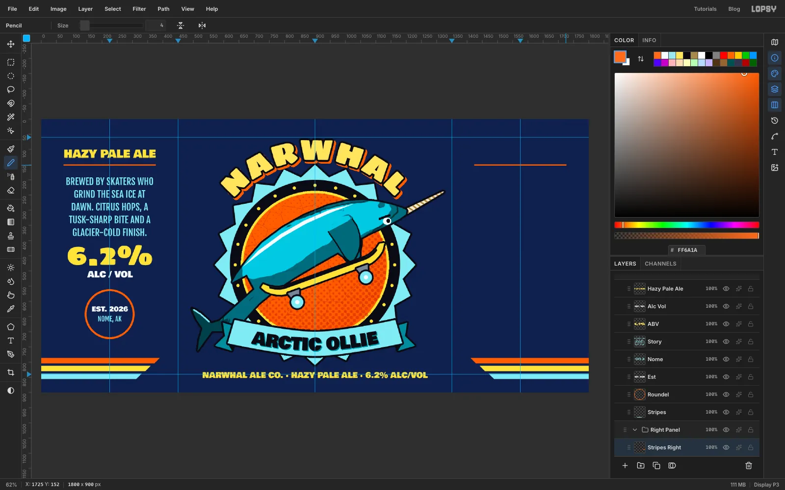

Press [[Cmd+D]], then hold [[Shift]] and drag the stripes along the bottom
until their square ends touch the right edge of the canvas. [[Shift]] keeps
them level with the left set. Wrapped round a can, the two sets meet into
one band.

Add the right panel's rule the same way as the left one: **Pencil**, size
`4`, orange, centred on the `1575` guide.

## Set the right panel type

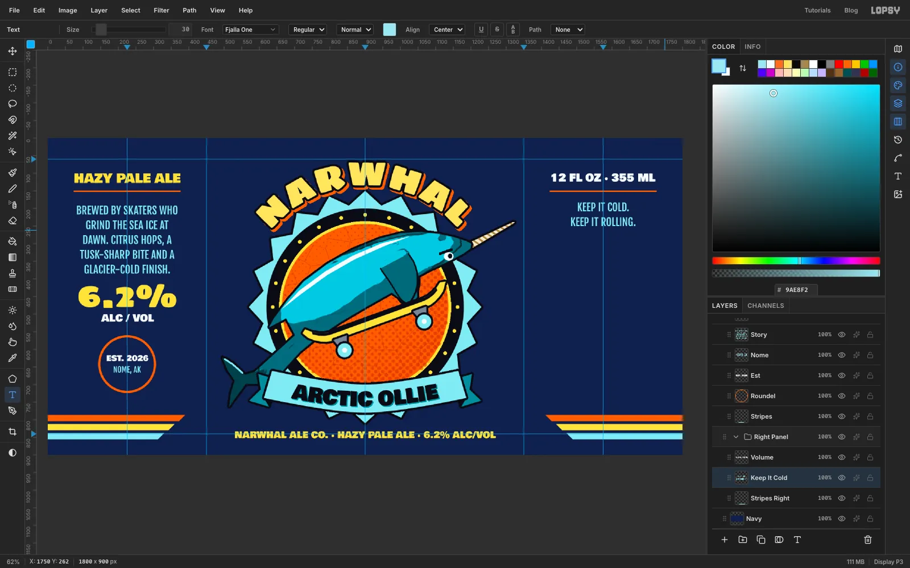

Select **Stripes Right** before each new line, and centre everything on the
`1575` guide:

- `12 FL OZ · 355 ML` in **Bowlby One SC** `30`, white, just under the top margin. Name it `Volume`.
- `KEEP IT COLD.`, a line break, and `KEEP IT ROLLING.` as **Fjalla One** area text at `30` in ice blue, centred, in a box under the rule. Name it `Keep It Cold`.

## Snap a barcode card to the grid

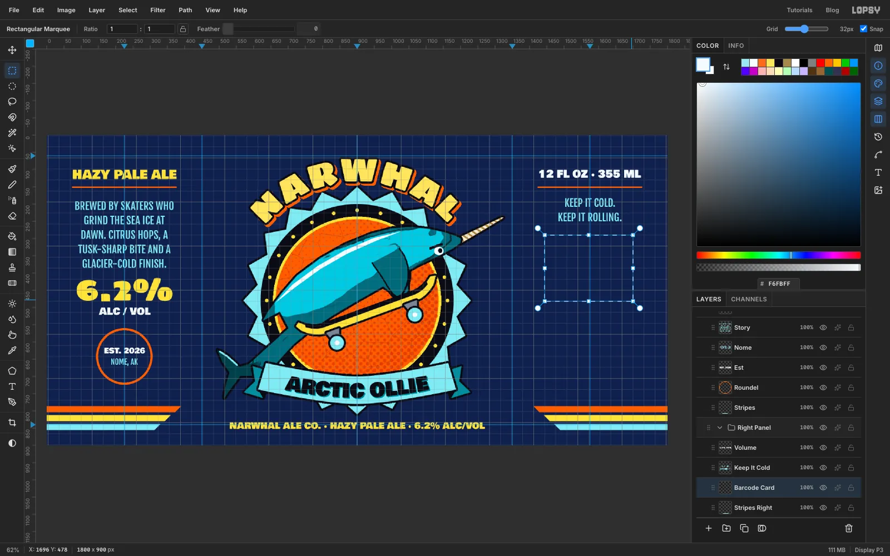

Select **Stripes Right** and add a layer named `Barcode Card`. Choose
**View → Show Grid**, set the grid slider in the options bar to `32px`, and
make sure **Snap** is ticked. Drag a rectangular marquee from about
`1444, 290` to `1700, 482`. Its edges snap to the grid lines, so the card
comes out exactly 8 × 6 cells.

## Round the card's corners

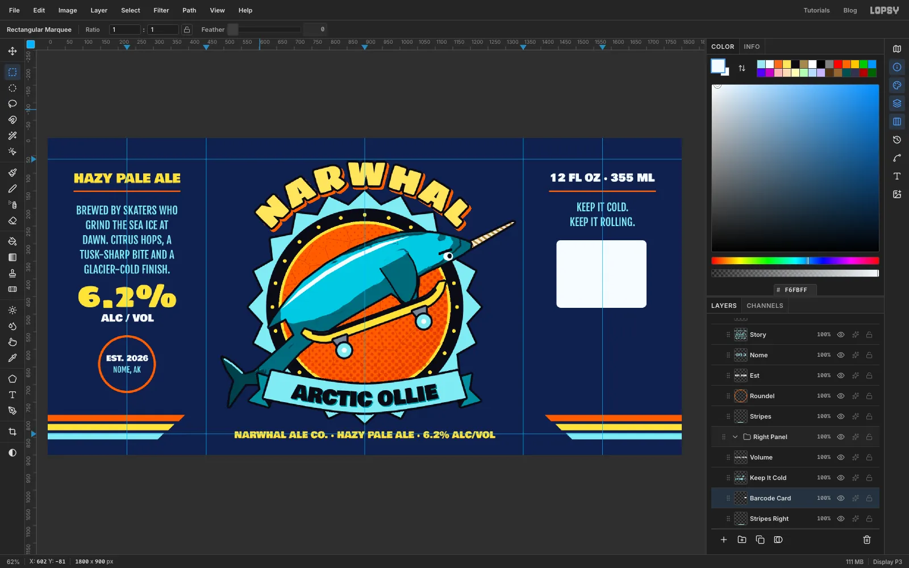

Choose **Select → Shrink…** with `12`, then **Select → Grow…** with `12`.
Growing a shrunken selection rounds off its corners. Fill with white
`#F6FBFF`, deselect, and choose **View → Show Grid** again to hide the grid.

## Draw the barcode bars

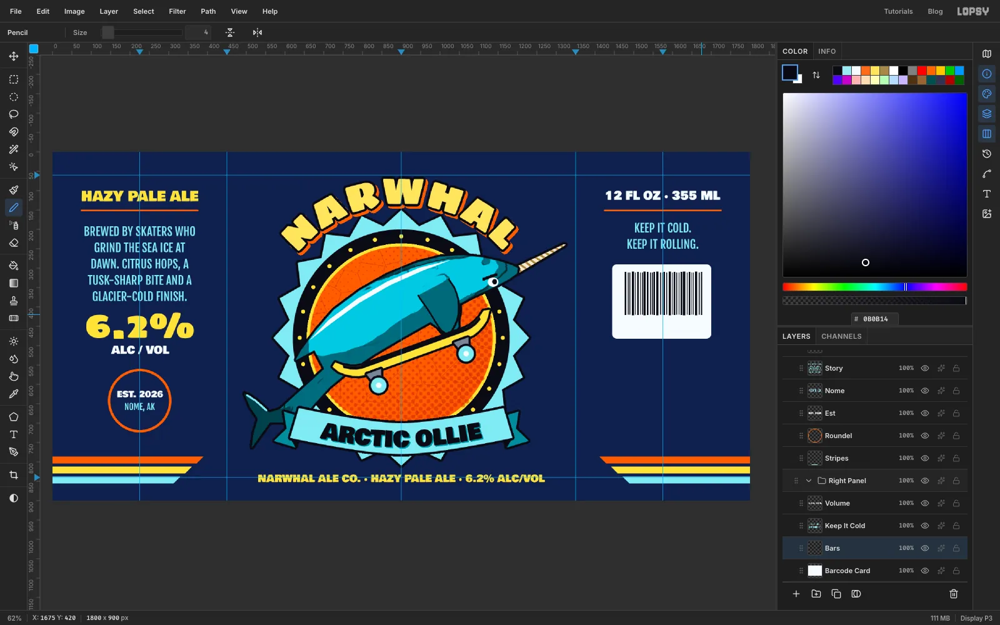

Add a layer named `Bars`. Press [[N]] for the **Pencil** and set the
foreground to `#0B0B14`. Draw vertical bars across most of the card's
width, leaving room at the bottom for the number: click the top of each
bar and [[Shift]]-click its bottom. Switch **Size** between `2`, `4` and `6`
as you go, and pack them unevenly with narrow gaps so it reads as a real
barcode.

## Add the number, brewer line and warning

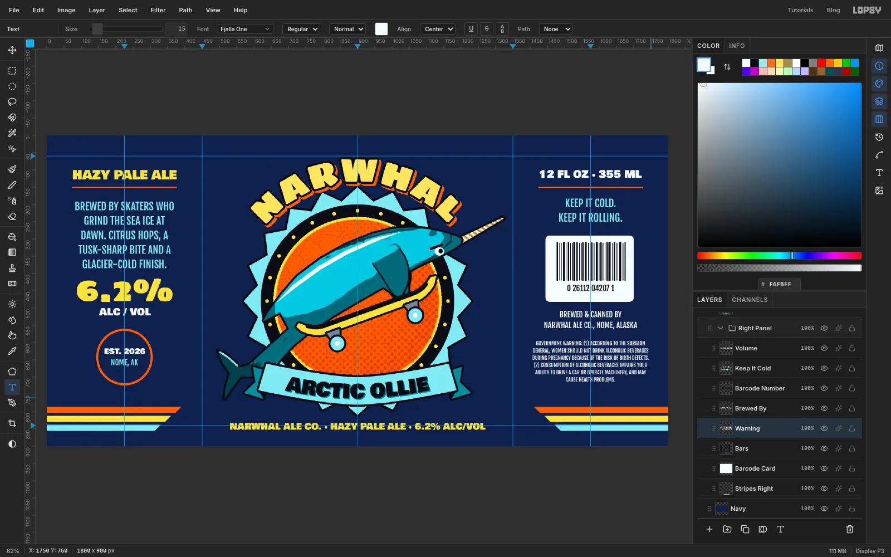

Select **Bars** before each block. All three are **Fjalla One**, centred on
the `1575` guide:

- The number `0 26112 04207 1` in black at `22`, just under the bars, inside the card. Name it `Barcode Number`.
- `BREWED & CANNED BY` and, on a second line, `NARWHAL ALE CO., NOME, ALASKA`, as white area text at `22` under the card. Name it `Brewed By`.
- The warning as white area text at `15` in a box below that, about 350 px wide: `GOVERNMENT WARNING: (1) ACCORDING TO THE SURGEON GENERAL, WOMEN SHOULD NOT DRINK ALCOHOLIC BEVERAGES DURING PREGNANCY BECAUSE OF THE RISK OF BIRTH DEFECTS. (2) CONSUMPTION OF ALCOHOLIC BEVERAGES IMPAIRS YOUR ABILITY TO DRIVE A CAR OR OPERATE MACHINERY, AND MAY CAUSE HEALTH PROBLEMS.` Name it `Warning`.

## Add screen-print grain and export

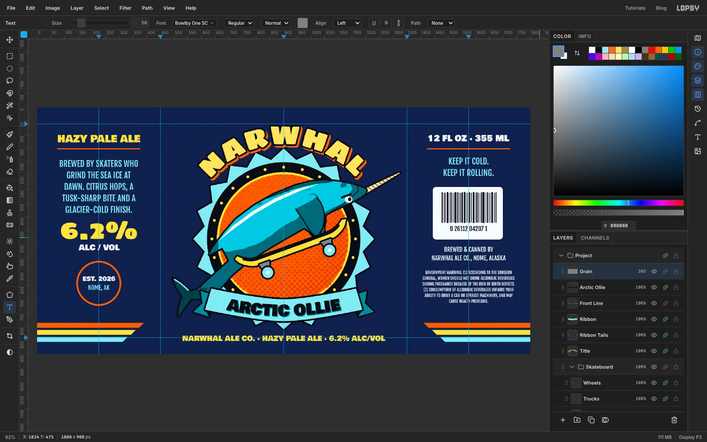

Select **Arctic Ollie**, the top layer of the front, and add a layer named
`Grain`. It lands at the very top of the stack. Fill it with mid grey
`#808080`. Choose **Filter → Add Noise…**, set **Amount** to `40`, pick
**Mono** and **Gaussian**, and click **Apply**. Set the layer's **Blend** to
**Overlay** and its opacity to `30%`. The flat inks pick up a fine, papery
texture.

Choose **File → Quick Export PNG** for the label and **File → Save
Project** to keep every layer, group and effect editable.

For a range of cans, duplicate the project and change the inks and the
ribbon text. An orange-on-teal **Kickflip IPA**, for example, needs only a
new tint colour and a new ribbon.
