A shop flier pinned to a corkboard has two jobs. It has to grab you from across the room, and it has to hand you the phone number. In this tutorial you'll make one for **Dented Axle**, a made-up neighbourhood skate and BMX repair shop, in the style of 1980s skateboard graphics.

That style came from decks, stickers and screen-printed tees:

- thick black outlines around everything
- a few flat, loud ink colours on cream paper
- skulls, flames and hot-rod imagery
- halftone dots instead of soft shading
- checkerboard bands and tilted, hard-shadowed type

The flier is 1600 × 2070 px, the shape of a letter-size sheet. Everything is drawn in Lopsy. You don't need any photos.

The tools you'll use:

- the **Rectangular** and **Elliptical Marquee**, with their exact-size dialog and [[Shift]] / [[Option]] to add and subtract
- the **Lasso**, the **Pen**, and [[Cmd]]-click on a layer thumbnail to load its shape
- a **Brush** with **Taper** for flame tongues, the **Pencil** with [[Shift]]-click lines, and a spaced-out Brush for perforations
- the **Gradient** tool, **Halftone**, **Add Noise**, **Gaussian Blur** and **Threshold**
- **Edit → Define Pattern** and **Fill with Pattern** for the checkerboard
- **Copy**, **paste in place**, **Flip Horizontal**, **Rotate 90° CCW**, and the Move tool's rotate handles, on layers and on whole groups
- Google fonts: **Knewave**, **Bowlby One SC** and **Anton**
- layer effects: **Stroke**, **Color Overlay**, **Outer Glow** and **Drop Shadow**, plus the **Multiply** and **Screen** blend modes

The palette is three inks on cream paper:

- Paper `#EFE4CC`, bone `#FBF5E6`, backing board `#D3C4A4`
- Ink black `#17120F`
- Safety orange `#FF5A1F`
- Acid lime `#B9E32B`

> **Tip:** On a wide-gamut (Display P3) screen, Lopsy reads typed hex codes as P3 colours. These codes were picked that way, so they match the finished flier. On an sRGB screen they look a little duller.

> **Note:** Shortcuts are written for a Mac. On Windows use [[Ctrl]] wherever it says [[Cmd]], and [[Alt]] for [[Option]].

## Set up the paper and guides

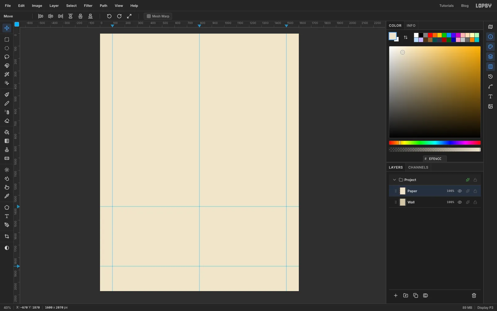

Choose **File → New**, keep the units on **Pixels**, and make the document **1600** wide and **2070** high. If the new document has an empty *Layer 1*, delete it.

You need two base layers:

1. Rename the background layer *Wall*. Set the foreground to backing board `#D3C4A4`, choose **Select → All**, then **Edit → Fill**. This is the board the flier is pinned to. You'll only see it where tabs get torn off.
2. Click **Add Layer**, name it *Paper*, and fill it with paper `#EFE4CC`. Press [[Cmd+D]] to deselect.

Click the top ruler at **100**, **800** and **1500** to drop vertical guides: the side margins and the centre line. Click the left ruler at **1390** and **1870** for horizontal guides. The first marks the bottom of the artwork. The second marks the top of the tear-off tabs.

## Screen a ring of halftone dots

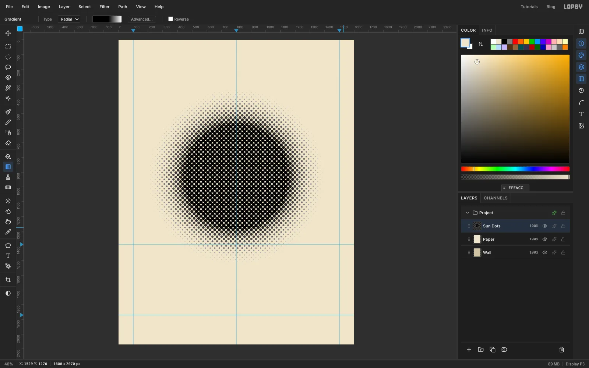

The sun gets a halo of printed dots. Add a layer called *Sun Dots*.

Pick the **Elliptical Marquee** and click once on the canvas without dragging. The exact-size dialog opens. Set **From** to **160, 290** and **To** to **1440, 1570**, and press [[Enter]]. That's a 640 px radius circle centred on (800, 930).

Pick the **Gradient** tool and set it to **Radial**. In **Advanced…**, make three stops: black `#000000` at the left end, another black stop just past the middle, and white `#FFFFFF` at the right end. Drag from the centre of the circle (800, 930) straight out to its edge. Deselect.

Choose **Filter → Halftone…** with **Dot Size 22**, **Angle 45** and **Softness 0.5**, and apply. White prints nothing, so the dots fade out to bare paper at the edge.

Open the layer's effects with the sparkle button on its row and turn on **Color Overlay** in safety orange `#FF5A1F`.

## Drop the orange sun in the middle

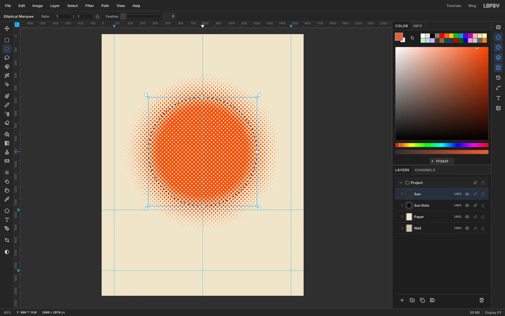

Add a layer called *Sun*. Click the **Elliptical Marquee** once again and set **From** to **370, 500** and **To** to **1230, 1360**. That's a 430 px radius, on the same centre. Fill it with safety orange and deselect.

The biggest dots now ring the sun's edge, as if it were glowing out into the paper.

## Paint the flame tongues

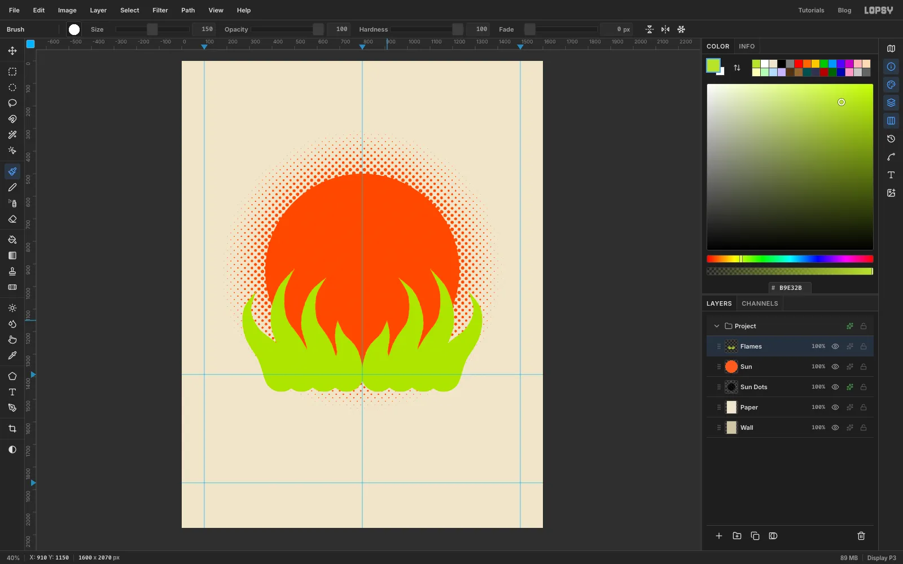

Click *Sun* and add a layer called *Flames*. Set the foreground to acid lime `#B9E32B` and pick the **Brush**.

Click the brush-tip preview at the left of the options bar to open the **Brushes** panel. On the **Shape** tab, set **Size 150**, **Hardness 100** and **Spacing 2**. Then set **Taper**. Taper shrinks the brush from full size at the start of a stroke to nothing at that many pixels. So start each stroke at the wide base and make Taper roughly as long as the stroke.

Paint eight tongues, four mirrored pairs, all starting on the y 1390 guide and sweeping up in a lazy S-curve:

- the outer pair start just inside the sun's edge (about x 440 and x 1160), bulge out past it, and hook back in to points at about y 1020 (Taper **430**)
- the middle pair start near x 530 and x 1070 and reach highest, to about y 920 (Taper **510**)
- the inner pair start near x 630 and x 970 and end at about y 960 (Taper **470**)
- a short centre pair start near x 730 and x 870 and stop around y 1150 (Taper **250**)

Curve each pair as mirror images of each other. The left tongues lean left and the right ones lean right, so the fire spreads out from the middle.

## Give the flames a base and an outline

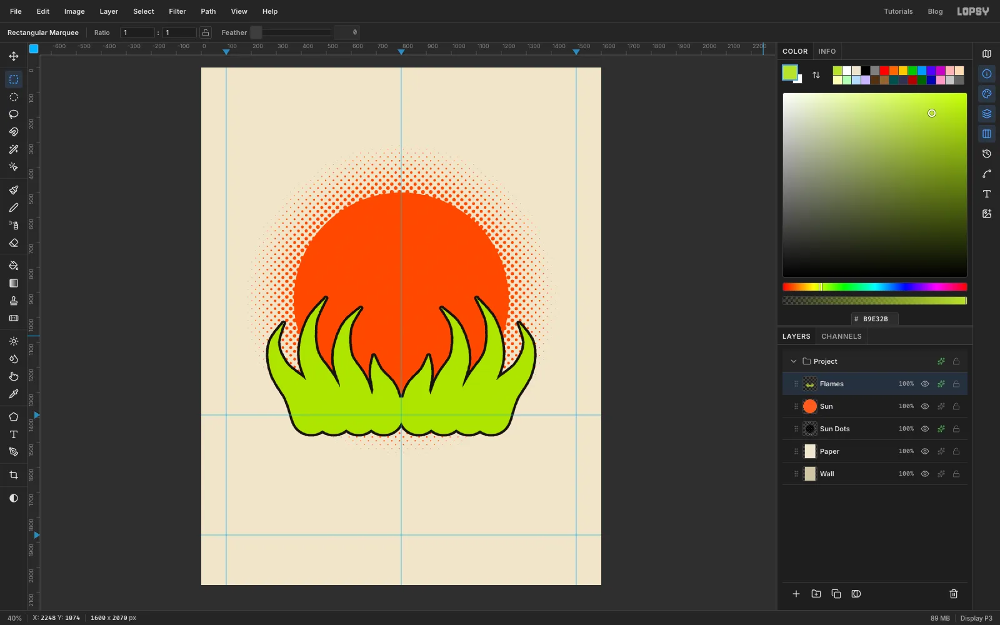

The tongues' round bottoms leave gaps. With the **Rectangular Marquee**'s exact-size dialog, select **From 420, 1320** to **To 1180, 1400** and fill it with lime. Deselect.

Open the layer's effects and add a **Stroke**: **Width 10** in ink black `#17120F`. The stroke traces the outside of the whole flame shape, so the tongues and the base read as one piece.

## Add the orange inner flames

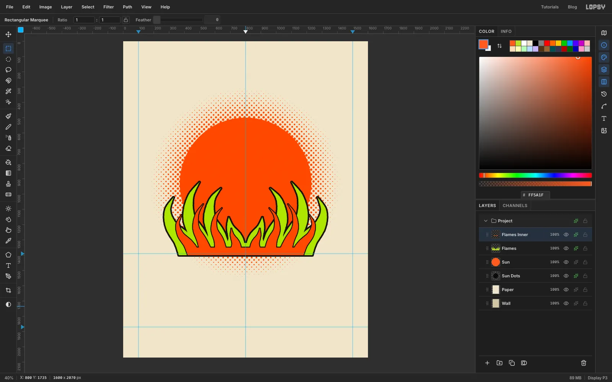

Add a layer called *Flames Inner* and switch the foreground to safety orange. Change the brush **Size** to **80**.

Paint a second set of tongues inside the lime ones. Start each at the same base point and follow the same curve, but stop at about 70% of the height. Shorten Taper to match: about **300**, **360**, **330** and **175**. Fill a base strip from **470, 1350** to **1130, 1400** in orange, and give the layer a **Stroke** of **Width 6** in ink black.

The round dabs at the base hang below the guide. For each flame layer, select **From 0, 1400** to **To 1600, 2070** and press [[Delete]]. That gives the fire a clean, straight bottom for the checkerboard to sit on later.

## Draw an upright wrench

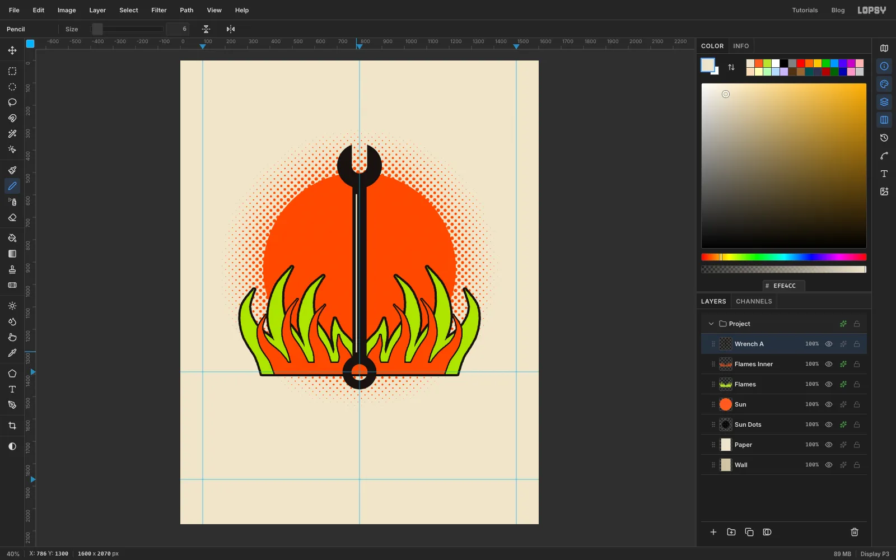

Click *Flames Inner* and add a layer called *Wrench A*. Build the wrench from three marquees, with the foreground set to ink black:

1. Click the **Elliptical Marquee** without dragging and set **700, 370** to **900, 570**. That's the jaw end.
2. Hold [[Shift]] and drag a **Rectangular Marquee** from **768, 520** to **832, 1350** for the handle. [[Shift]] adds it to the circle.
3. Hold [[Shift]] and drag an **Elliptical Marquee** from **724, 1316** to **876, 1468** for the ring end.

Choose **Edit → Fill**, then cut the openings out by selecting each one and pressing [[Delete]]:

- the jaw slot: a rectangle from **766, 360** to **834, 470**
- the round back of the jaw: a circle from **766, 436** to **834, 504**
- the hole in the ring: a circle from **764, 1356** to **836, 1428**

Deselect. Pick the **Pencil**, set the size to **6** and the colour to paper `#EFE4CC`. Click at (786, 600), then [[Shift]]-click at (786, 1300) for a straight line of shine down the handle.

## Rotate the wrench

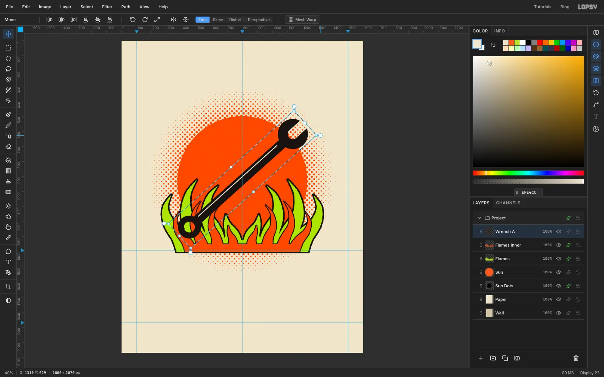

Select a box around the whole wrench, **From 690, 360** to **To 910, 1480**. Pick the **Move** tool. Grab the round rotation handle just outside the top-right corner and drag it clockwise until the wrench leans about **48°**, with the jaw up at the right of the sun.

Press [[Enter]] to apply it, then [[Cmd+D]].

## Duplicate and flip it to cross the wrenches

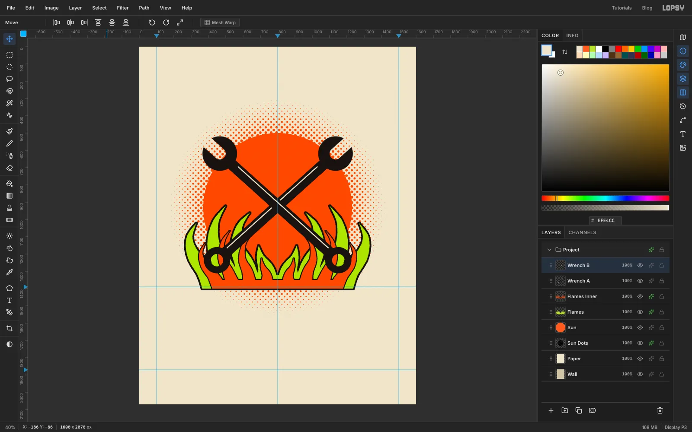

Choose **Layer → Duplicate Layer** and rename the copy *Wrench B*. Choose **Select → All**. With the **Move** tool still active, click **Flip Horizontal** in the options bar. The selection is the whole canvas, so the copy flips around the centre line and lands as a perfect mirror image.

Deselect. The wrenches sit above the flames, so the handles and rings read clearly, and the X will show around the skull.

## Build the skull from overlapping shapes

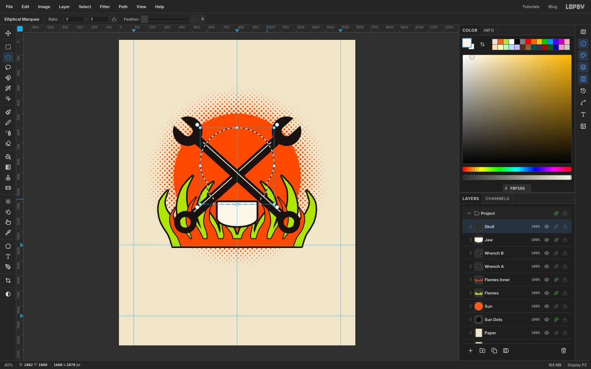

The exact-size dialog only opens when nothing is selected, so the shapes you add with [[Shift]] are dragged by hand. Zoom in and watch the X / Y readout in the status bar as you drag.

Click *Wrench B* and add a layer called *Jaw*. Select a rectangle from **668, 1100** to **932, 1200**, then [[Shift]]-drag an ellipse from **668, 1150** to **932, 1262** to round off the chin. Fill it with bone `#FBF5E6`, deselect, and add a **Stroke** of **Width 12** in ink black.

Add a layer called *Skull* above it. Start with an ellipse from **550, 595** to **1050, 1065** for the cranium. Then hold [[Shift]] and add three more shapes:

- a rectangle from **640, 940** to **960, 1114** for the upper jaw
- an ellipse from **598, 920** to **738, 1080** for the left cheekbone
- an ellipse from **862, 920** to **1002, 1080** for the right cheekbone

## Fill and outline the skull

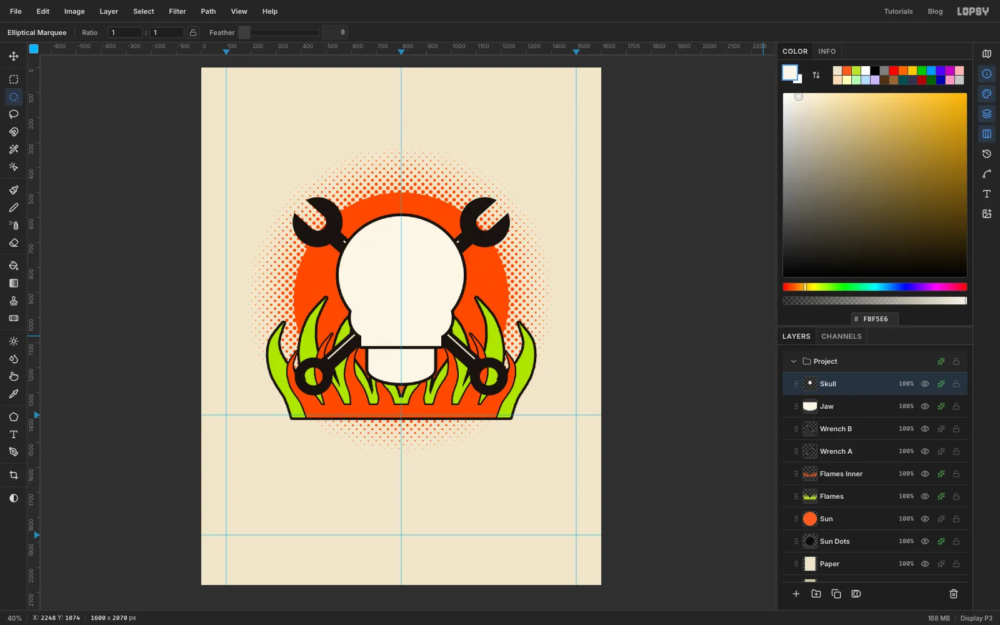

Fill the selection with bone, deselect, and give *Skull* the same **Stroke**: **Width 12**, ink black. The skull's bottom outline doubles as the line where the jaw meets the upper teeth.

## Shade the skull with halftone dots

Add a layer called *Skull Shade*. [[Cmd]]-click the *Skull* thumbnail to load its shape. Then hold [[Option]] and drag an ellipse from **520, 560** to **1020, 1080**. That's the skull's outline shifted left, so subtracting it leaves a thin crescent down the right side. The cheekbones still poke out under it, so [[Option]]-drag a rectangle from **600, 1060** to **1000, 1130** to take that strip out too.

Pick the **Gradient** tool and set its **Type** to **Linear**. In **Advanced…**, delete the middle stop left over from the sun and set the two ends to white `#FFFFFF` and dark grey `#202020`. Drag it from (900, 830) to (1060, 830) so the shade gets darker towards the edge, then deselect.

Run **Filter → Halftone…** with **Dot Size 12**, **Angle 45** and **Softness 0**. Softness 0 gives hard-edged dots. Add a **Color Overlay** in ink black so every dot prints in the same black as the outlines.

## Cut angry eye sockets

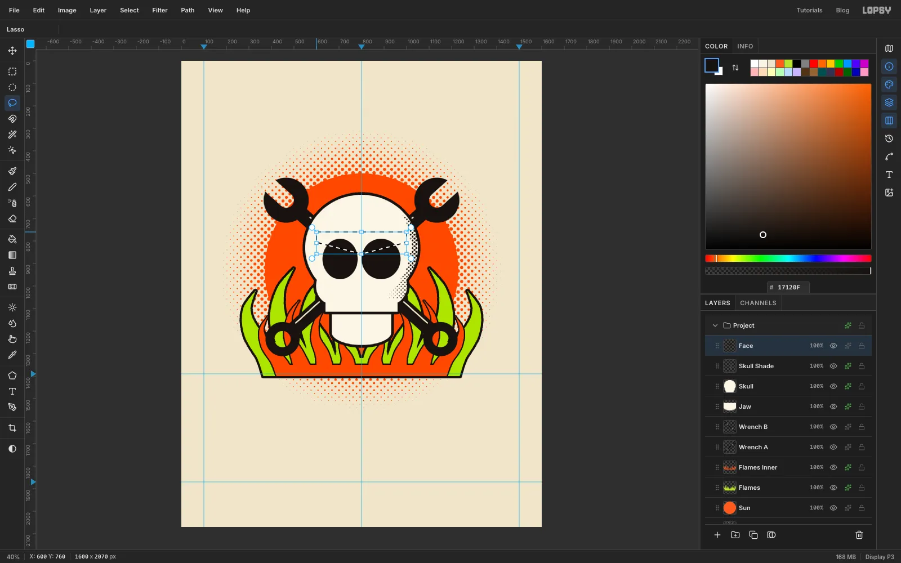

Add a layer called *Face* and set the foreground to ink black. Select an ellipse from **627, 790** to **783, 970**, [[Shift]]-add one from **817, 790** to **973, 970**, and fill. Deselect.

Now give the eyes a scowl. Pick the **Pen** and click the corners of a wide V that covers the tops of both sockets. Its two arms start above the outer corners of the eyes, and its point dips between them to about y 858. Close the path, click **Path to Selection** and **Delete Path** in the **Paths** panel, then press [[Delete]] and deselect. Each socket is now cut flat on a slant down towards the nose.

## Add the nose, teeth and cracks

Pick the **Pen** and draw the nose as an upside-down heart about 70 px wide, centred under the eyes. Click a sharp point at the top, drag out a rounded lobe at the lower right, click a small notch at the bottom centre, drag out a rounded lobe at the lower left, and click the first anchor to close the path. In the **Paths** panel, click **Path to Selection** and then **Delete Path**. Fill the selection with ink black and deselect.

Switch to the **Pencil** at size **10**, still in ink black. Every line below is a click and a [[Shift]]-click:

- the top of the teeth: (701, 1068) to (899, 1068)
- the bite line: (701, 1112) to (899, 1112)
- the bottom of the teeth: (701, 1158) to (899, 1158)
- seven upright lines from y 1068 to y 1158, at x **701, 734, 767, 800, 833, 866** and **899**

The outer uprights close the box, and every rail ends flush with them.

For the cracks, click and [[Shift]]-click a zigzag down the left of the cranium, from (655, 642) to (662, 820), with a sharp kink every 30–40 px. Draw a shorter one at the top right, from (878, 612) to (910, 720).

## Light up the eyes and patch the crack

Click *Face* and add a layer called *Eye Glow*. Set the foreground to acid lime. Select a circle from **705, 881** to **739, 915**, [[Shift]]-drag a matching one from **861, 881** to **895, 915**, fill, and deselect. Turn on **Outer Glow** with **Size 26**, **Opacity 80** and the colour set to acid lime. Lime pupils in black sockets give the skull its menace.

Now add a layer called *Band-Aid* above it. Make a capsule shape: a rectangle from **596, 672** to **704, 728**, plus [[Shift]]-added circles from **568, 672** to **624, 728** and **676, 672** to **732, 728** for the round ends. Fill it with safety orange and deselect. Select a small square from **626, 680** to **674, 720** and fill it with bone for the pad.

Select a box around the band-aid, **560, 664** to **740, 736**. With the **Move** tool, drag the rotation handle anticlockwise about **32°** so the band-aid crosses the crack. Press [[Enter]] and deselect.

## Outline the band-aid

Give *Band-Aid* a **Stroke** of **Width 6** in ink black, like everything else on the skull. The emblem is done.

## Set the kicker banner

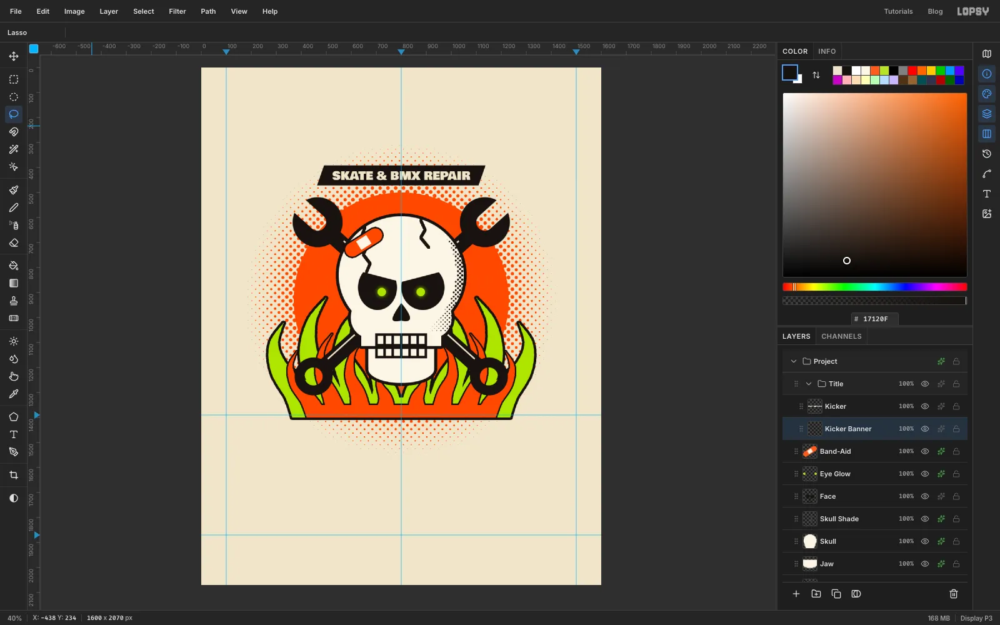

Click *Band-Aid*, then click **New Group** at the bottom of the Layers panel and name the group *Title*. Add a layer inside it called *Kicker Banner*.

Pick the **Text** tool. Choose **Bowlby One SC** at size **46** in paper `#EFE4CC`. Click in an empty part of the canvas and type *SKATE & BMX REPAIR*, then press [[Tab]] to finish. Click **Rasterize Layer** at the bottom of the Layers panel and rename the layer *Kicker*. Move the text with the **Move** tool so it's centred on (800, 432), just above the wrench jaws.

Click *Kicker Banner*. With the **Pen**, click the four corners of a slanted box around the text, about 50 px wider than the words on each side and 22 px taller top and bottom. Shift the top corners about 14 px right and the bottom corners 14 px left, so the ends lean. Close the path and use **Path to Selection** and **Delete Path**. Fill it with ink black and deselect.

## Set the DENTED AXLE headline

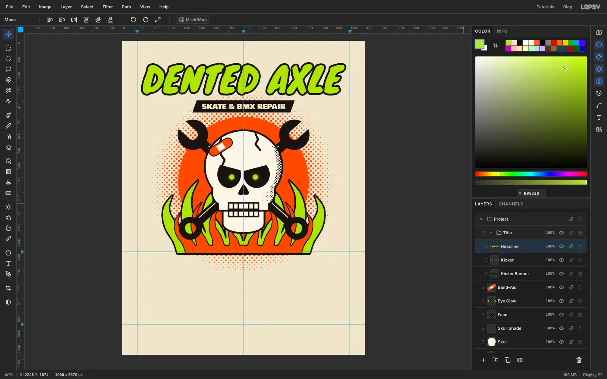

Click *Kicker* so the new text lands above it. Choose **Knewave** in acid lime and type *DENTED AXLE* in an empty spot. Name the layer *Headline*.

Size it to the margins: this flier uses **225**. At that size the ink spans about 1330 px. With the new text layer still active, typing a new size into the options bar restyles it. Rasterize it, then move it so it's centred on (800, 250).

Add a **Stroke** of **Width 12** in ink black.

## Give the headline an orange drop

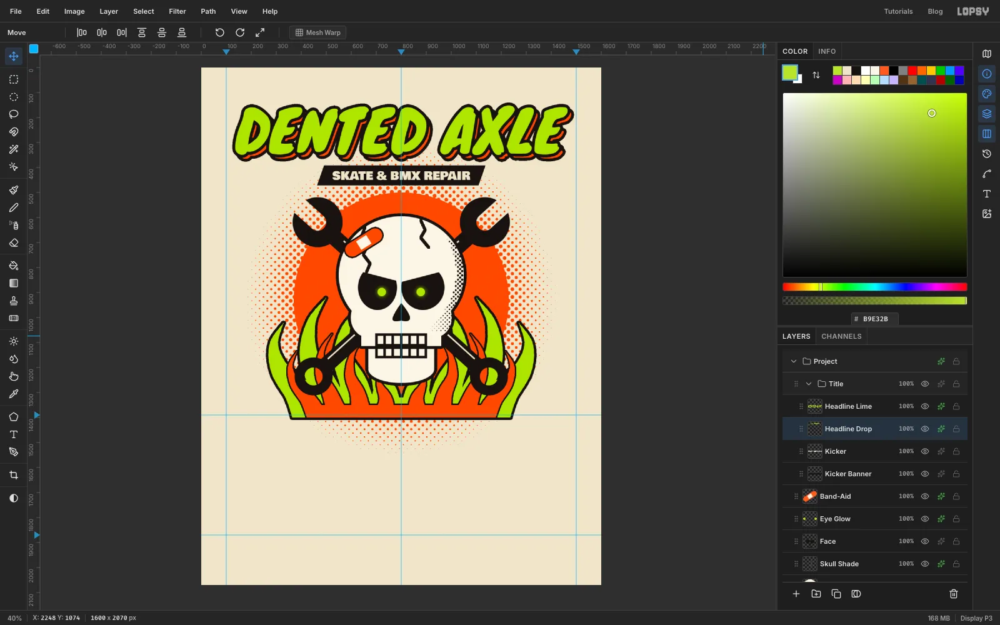

Choose **Layer → Duplicate Layer** and name the copy *Headline Lime*. The copy lands exactly on top of the original.

Click the original underneath, rename it *Headline Drop*, and add a **Color Overlay** in safety orange. The overlay recolours the letters and the stroke stays black. With the **Move** tool, press [[Right]] 14 times and [[Down]] 16 times. That makes a hard orange drop with its own outline, the classic sticker look.

## Tilt the whole title group

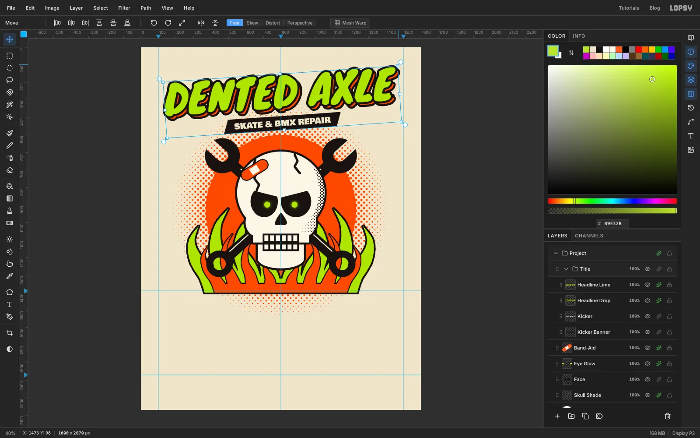

Deselect, then click the *Title* group's row so the whole group is active. Pick the **Move** tool. A transform box appears around the headline, the drop and the banner. Drag its top-right rotation handle anticlockwise about **4°**, then press [[Enter]].

All four layers turn together around the group's centre, so the drop and outlines stay lined up.

## Define a checkerboard pattern

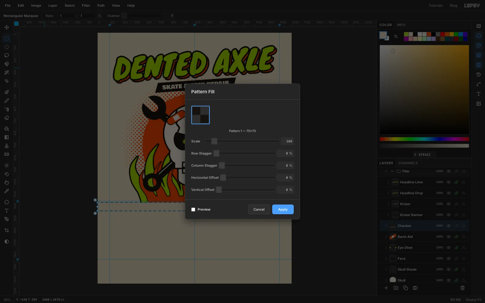

The halftone ring hangs below the artwork. Click *Sun Dots*, select **From 0, 1470** to **To 1600, 2070**, and press [[Delete]].

Click *Band-Aid* (not the group) and add a layer called *Checker*. With ink black, select a square from **0, 0** to **35, 35**, [[Shift]]-add one from **35, 35** to **70, 70**, and fill. Deselect, then select the 70 px tile, **0, 0** to **70, 70**, choose **Edit → Define Pattern**, then press [[Delete]] to clear the tile off the page and deselect.

Select the band, **From 0, 1400** to **To 1600, 1470**. First fill it with paper, so the empty squares hide the halftone dots behind them. Then choose **Edit → Fill with Pattern…**. Your tile is already picked, so click **Apply**. The band starts at 1400, which is 20 tiles down, so the squares line up exactly.

## Rule off the checker band

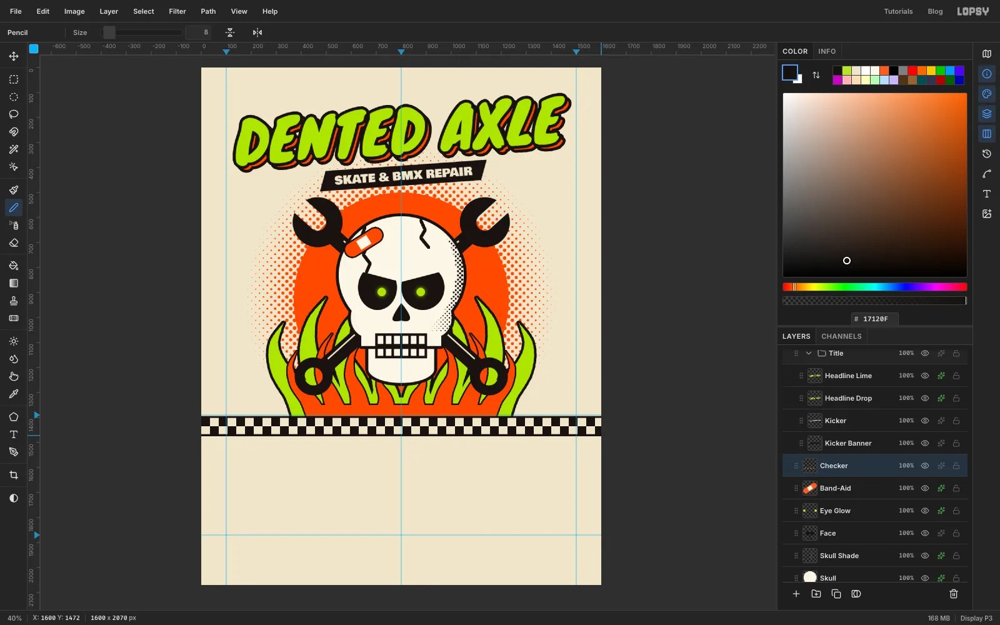

Deselect. Pick the **Pencil** at size **8** in ink black. Click at the left edge at y **1398** and [[Shift]]-click at the right edge. Do the same at y **1472**. The rules finish the band and give the flames a floor.

## List the services

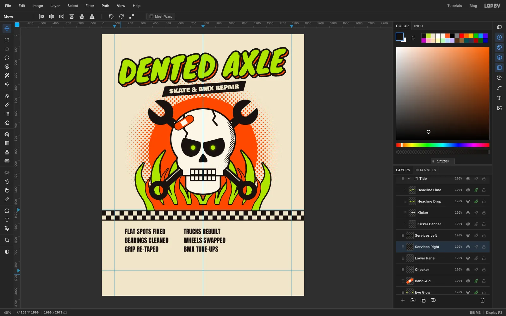

Click *Checker* and add an empty layer called *Lower Panel* to keep new text out of the groups. Choose **Anton** at size **50** in ink black. Click in empty space and type three lines, pressing [[Return]] between them: *FLAT SPOTS FIXED*, *BEARINGS CLEANED*, *GRIP RE-TAPED*. Press [[Tab]], rasterize, name it *Services Left*, and move it so its top-left corner sits at (182, 1539).

Click *Lower Panel* again and set the second column the same way, as *Services Right*: *TRUCKS REBUILT*, *WHEELS SWAPPED*, *BMX TUNE-UPS*. Put its top-left corner at (647, 1539). Anton's default line height of 1.4 puts the rows 70 px apart. That leaves the block with equal space above and below.

## Add bullets and the address bar

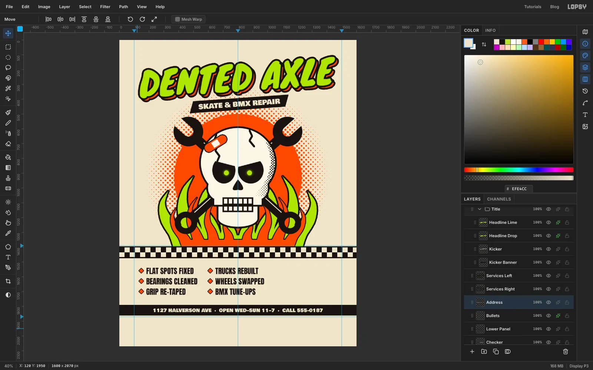

Add a layer called *Bullets* and set the foreground to safety orange. Each bullet is a small diamond about 30 px across. Click its four points with the **Pen**, close the path, use **Path to Selection**, and fill. Put them here:

- left column: centred on x **148**
- right column: centred on x **613**
- rows: y **1559**, **1629** and **1699**

Give the layer a **Stroke** of **Width 4** in ink black so the bullets match the outlined artwork.

Click *Lower Panel*, select a full-width strip **From 0, 1790** to **To 1600, 1862**, and fill it with ink black. Click *Bullets*, choose **Bowlby One SC** at size **32** in paper, and type *1127 HALVERSON AVE  ·  OPEN WED–SUN 11–7  ·  CALL 555-0187*. Rasterize it, name it *Address*, and centre it in the bar at (800, 1826). The phone number belongs in the body of the flier too, not just on the tabs.

## Make a starburst from three squares

Click *Address*, click **New Group** and name it *Sticker*. Add a layer inside it called *Burst*.

Set the foreground to acid lime and select a square **From 1170, 1460** to **To 1410, 1700**. Fill it, and press [[Cmd+C]] to copy it.

Press [[Cmd+V]]. Lopsy pastes the square in place on a new layer. It arrives selected with the **Move** tool active, so drag a corner rotation handle clockwise to turn it **30°**. Press [[Enter]] and deselect. Paste again and turn this copy **60°**.

Three squares turned 0°, 30° and 60° stack into a twelve-point starburst.

## Outline the burst and give it a hard shadow

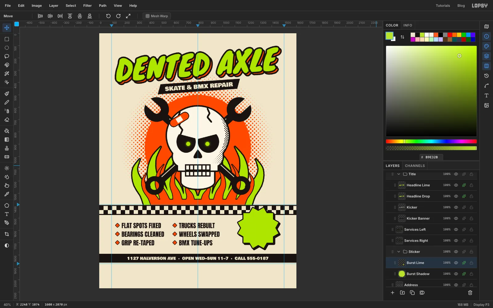

Choose **Layer → Merge Down** twice so the three squares become one layer, and name it *Burst*. Add a **Stroke** of **Width 8** in ink black.

Use the same trick as the headline. Duplicate the layer and name the copy *Burst Lime*. Rename the original *Burst Shadow*, give it a **Color Overlay** in ink black, and nudge it **10 px** right and **10 px** down with the arrow keys.

## Price the sticker and tilt it

Click *Burst Lime*. Choose **Knewave** at size **100** in ink black and type *$5*. Knewave's dollar sign runs into the 5, so open the **Text** panel and set **Letter spacing** to **12**. Rasterize it and centre it on (1290, 1560).

Type *BEARING BATH* in **Anton** at size **30**. Set **Letter spacing** back to **0** first, because the Text panel carries the last value over to new text. Rasterize it and centre it on (1290, 1638), well inside the spike valleys.

Click the *Sticker* group's row, and with the **Move** tool drag its top-right rotation handle clockwise about **12°**. Press [[Enter]]. The sticker now overlaps the checker band on purpose, with its shadow clear of the address bar.

## Dot the perforations

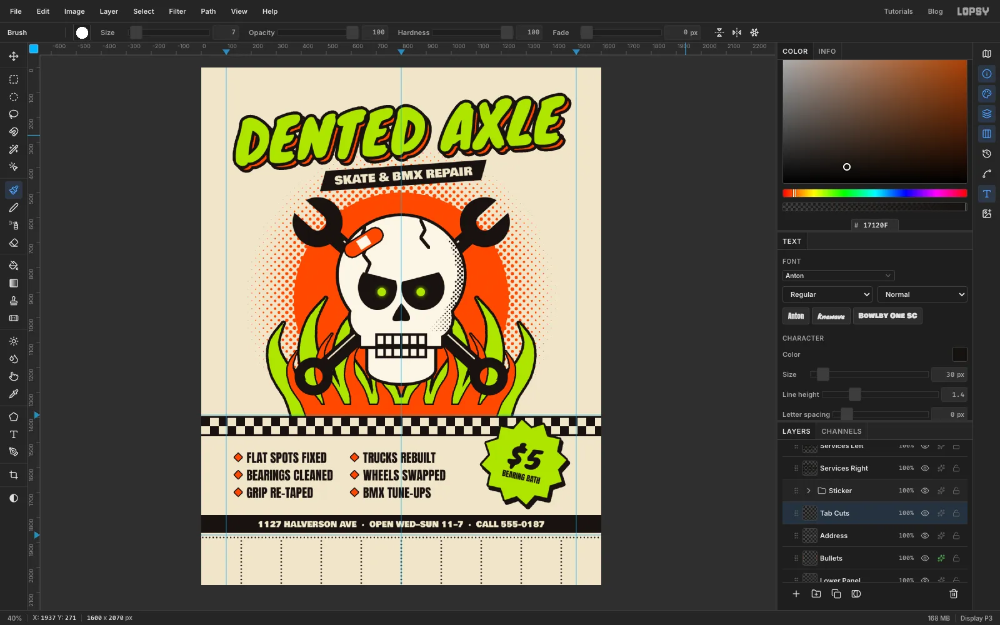

Click *Address* and add a layer called *Tab Cuts*. Pick the **Brush** in ink black and open its settings. Set **Size 7**, **Hardness 100** and **Spacing 200**, the slider's maximum. The spacing is so wide that each dab stands alone, which turns a stroke into a dotted line. Set **Taper** back to **0**.

Click at the left edge at y **1880**, just under the y 1870 guide, and [[Shift]]-click at the right edge. Then draw nine vertical dotted lines from y 1894 down to the bottom edge, at x **160, 320, 480 … 1440**. That's every 160 px, for ten tabs.

Set **Spacing** back to **2** when you're done, or your next brush stroke will come out dotted.

## Set the text for one tab

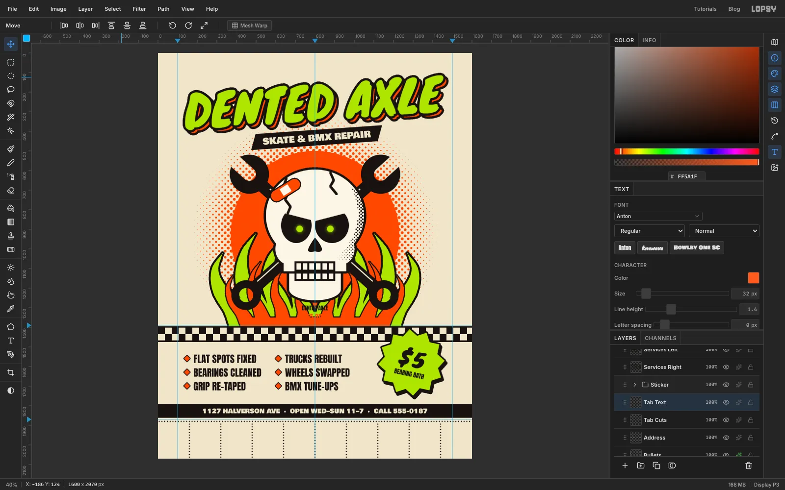

Choose **Anton** at size **28** in ink black and type *DENTED AXLE* in an empty spot. Rasterize it and name the layer *Tab Text*. Type *555-0187* in **Anton** at size **32** in safety orange, rasterize it, and place it centred just under the name.

With the phone number layer active, choose **Layer → Merge Down**. Name and number are now one layer.

## Turn it upright into the first tab

With no selection, pick the **Move** tool and click **Rotate 90° CCW** in the options bar. The whole layer turns to read from bottom to top, the way tear-off tabs do. Move it so it's centred in the first tab, at about (80, 1975).

## Double the tabs up to ten

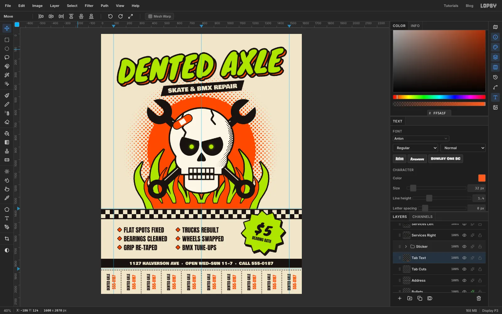

Copying one tab nine times is slow. Doubling is quicker:

1. **Select → All**, [[Cmd+C]], [[Cmd+V]]. Deselect, then with the **Move** tool press [[Shift+Right]] 16 times to move the paste 160 px right. **Merge Down**. You have 2 tabs.
2. Do the same, moving it 320 px ([[Shift+Right]] × 32). You have 4.
3. Again, moving it 640 px. You have 8.
4. Select just the first two tabs, **0, 1884** to **320, 2070**. Copy, paste, move the paste 1280 px right, and **Merge Down**. You have 10.

Name the merged layer *Tab Text* again after each merge.

## Tear two tabs off

Pick the **Lasso**. Around the fourth tab (x 480 to 640), drag a shape whose top edge wobbles irregularly just under the dotted line, between 2 and 24 px below it. Run straight down the dotted dividers and off the bottom of the canvas. Keep the wobble uneven. A regular zigzag looks cut with pinking shears, not torn.

Keep the selection, and click *Tab Text*, *Tab Cuts* and *Paper* in turn, pressing [[Delete]] on each. Then do the eighth tab (x 1120 to 1280) the same way, with a different wobble.

## Shadow the gaps and add paper fibres

The holes show the tan *Wall* layer. To make it look like the board sits behind the paper, give *Paper* a **Drop Shadow** with **Offset X 0**, **Offset Y 5**, **Blur 7**, **Opacity 45** and the colour `#3A2A18`. The paper covers its own shadow everywhere except in the holes. There it falls just under the torn edge.

Click *Tab Text* and add a layer called *Tear Fibres*. With the **Pencil** at size **2** in bone, trace along each torn edge with clicks and [[Shift]]-clicks. Then drop to size **1** and add a few short hairs hanging down from the edge. Torn paper always shows a pale rim of fibres.

## Add grain and ink wear

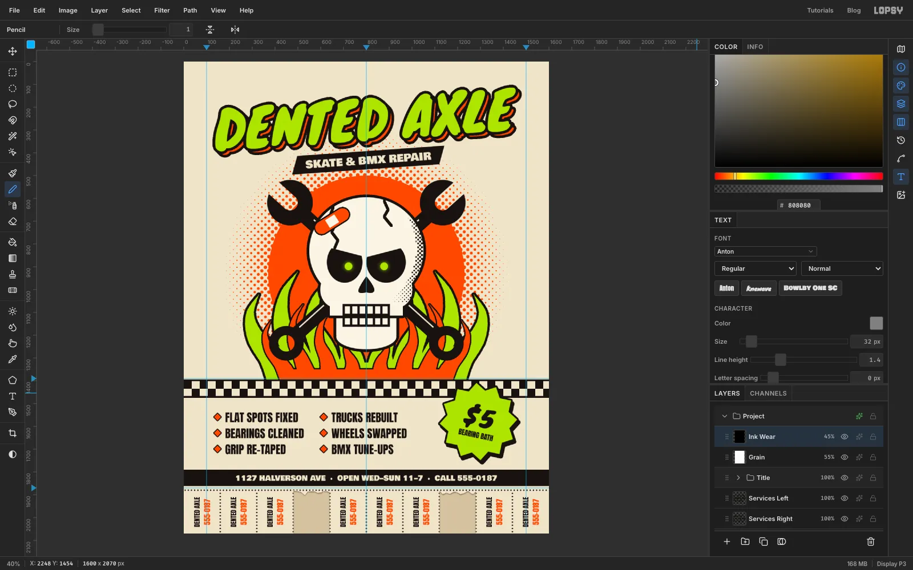

Click *Services Left* and add a layer called *Grain*. Fill it with white, then run **Filter → Add Noise…** with **Amount 22**, **Mono** and **Gaussian**. Set its blend mode to **Multiply** and its opacity to **55%**. Grab the grip on the *Grain* row and drag it above the *Title* group, so the grain lies over everything, headline included.

With *Grain* active, add a layer called *Ink Wear*. Fill it with mid grey `#808080` and run:

1. **Add Noise** at **Amount 100**, **Mono**
2. **Gaussian Blur** at **Radius 1**
3. **Threshold** at **Level 178**

That leaves sparse white specks on black. Set the layer to **Screen** at **45%**. The black disappears, and the specks knock tiny holes in the ink, like a screen that didn't quite fill.

Turn off the guides with **View → Show Guides**, then use **File → Quick Export PNG** for the flier and **File → Save Project** to keep the layers.
