Multi-layer spray stencils are how a lot of skateboard graphics start. You
split a picture into a few flat tones, cut one card for each tone, and spray
them one after another onto the board, lightest first. Each card is called a
*plate*. Holes in the corners line the plates up, so the colours land "in
register".

In this tutorial you'll make **Mako Jaws**, a 2400 × 1600 px stencil kit for
an invented skate crew. It's laid out like a contact sheet. Four cut
chipboard cards sit on a cutting mat: a bone base, a teal mid tone, a black
key and an orange lettering plate. Next to them is the sprayed deck proof,
circled in grease pencil as the pick.

The shark comes from a photo:
[Isurus oxyrinchus by Mark Conlin](https://commons.wikimedia.org/wiki/File:Isurus_oxyrinchus_by_mark_conlin2.JPG),
taken for NOAA's Southwest Fisheries Science Center and in the **public
domain**. Download the full 1130 × 753 px version from its Commons page. Any
side-on shark or fish photo against open water works the same way.

Along the way you'll use:

- **Define Pattern** and **Fill with Pattern** for the mat grid, the **Pencil** with [[Shift]]-click straight lines, **Add Noise** and **Clouds**
- pasting a photo, the **Magic Wand** with [[Shift]]-click seeds, an [[Option]]-drag **Lasso** to subtract, and **Select → Inverse**
- **Desaturate**, **Gaussian Blur**, **Brightness/Contrast** and **Posterize** to split the photo into tones
- **Grow**, **Shrink** and **Feather**, and [[Cmd]]-clicking layer thumbnails to cut one layer with another
- groups, **Duplicate Layer**, and scaling and rotating several layers at once with the **Move** tool
- ruler **guides** with snapping marquees
- the **Pen** tool, **text on a path**, letter spacing, **Rasterize Layer** and **Merge Down**
- the **Spray** tool, the **Brush**, **Fibers**, a **layer mask**, and the **Multiply** and **Soft Light** blend modes
- the **Drop Shadow**, **Stroke**, **Inner Glow** and **Outer Glow** effects
- copy and paste, dragging layers in the Layers panel, and undo and redo

The palette:

- Cutting mat `#2D5B4C`, mat lines `#9CCBB3`
- Chipboard `#C9A46E`, cut edge `#8A6A3E`, card shadow `#0B1F18`
- Maple `#D4A877`, ply edge `#6E4A2A`, deck glow `#5A3518`
- Bone `#EDE4CE`, teal `#14918C`, key black `#161616`, orange `#E2662F`
- Redrawn tail `#2C4F7C`
- Masking tape `#E6D9B4`, marker `#2A2320`
- Grease pencil `#D8322A`, frame numbers `#F47A35`

## Fill the cutting mat

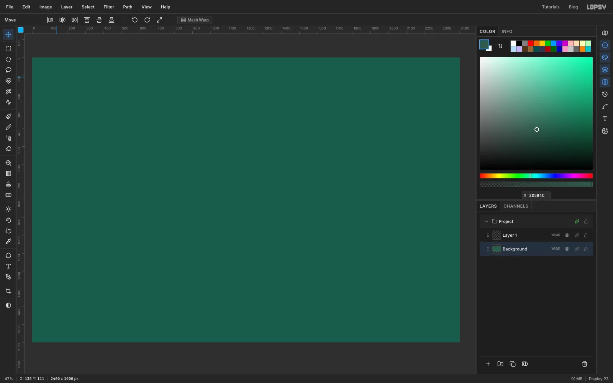

1. Create a new document **2400 × 1600** px.
2. Click **Background** in the Layers panel, set the foreground colour to `#2D5B4C` and choose **Edit → Fill**.

This green is a self-healing cutting mat, the board the stencils are cut on.

## Draw one grid tile

A cutting mat has a printed grid. You'll draw one square of it and repeat it.

1. Click **Layer 1** and rename it `Grid Tile`.
2. Pick the **Pencil**, set **Size** to `2` and the colour to `#9CCBB3`.
3. In an empty area near the top left, draw a horizontal line and a vertical line that cross, each about 120 px long. Click to start a line, then hold [[Shift]] and click to finish it.
4. Set **Size** to `1` and draw a second, thinner pair 50 px further right and 50 px further down. These are the half-way lines.
5. Pick the **Rectangular Marquee** and, with nothing selected, click once (don't drag) on the point where the thick lines cross. A **Rectangular Selection** dialog opens. Type the crossing point into **From X / Y** and add 100 to each for **To X / Y**, so you get an exact 100 × 100 px square, and apply it.
6. Choose **Edit → Define Pattern**, deselect with [[Cmd+D]], and delete the `Grid Tile` layer.

## Fill the mat with the grid

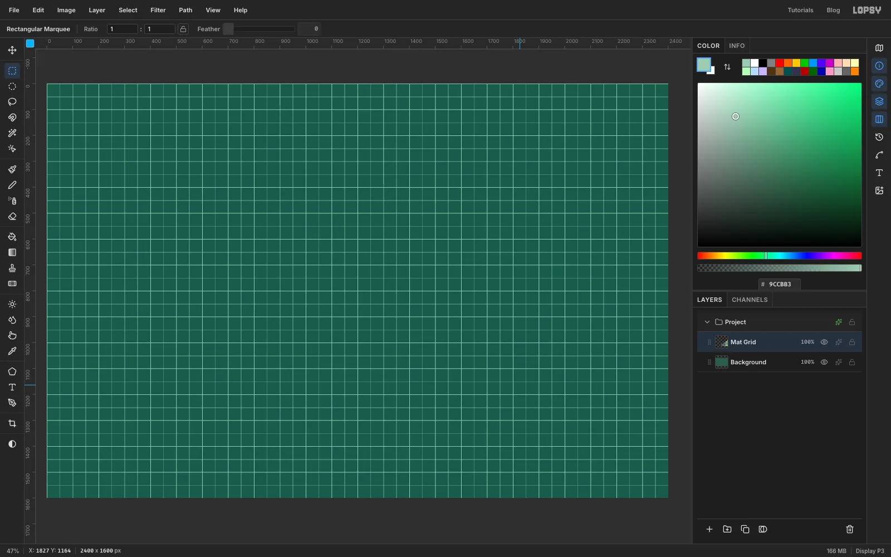

1. Click **Add Layer** and name it `Mat Grid`.
2. Choose **Edit → Fill with Pattern…**, pick the tile you just made and click **Apply**. With nothing selected, the pattern fills the whole canvas.
3. Set the layer's opacity to `45%` so the grid sits back.

## Add the angle lines and heavy lines

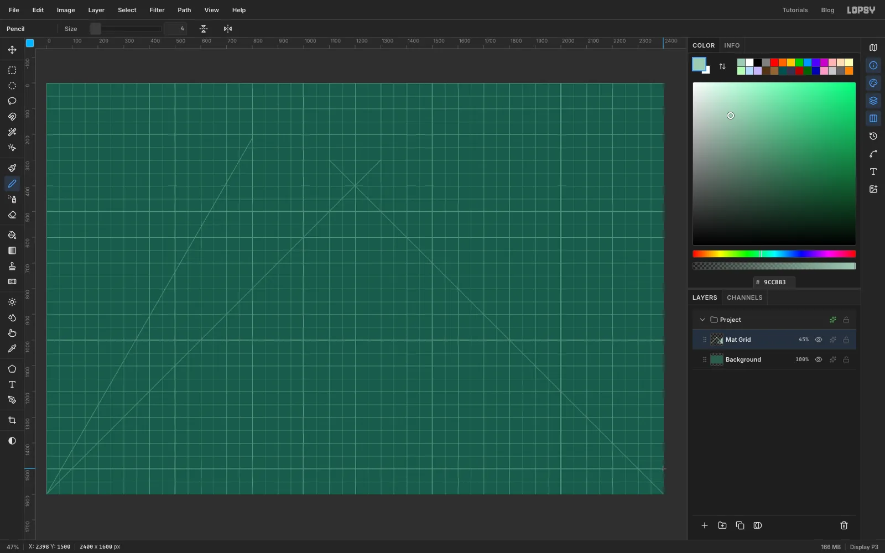

Cutting mats also print angle guides and heavier lines every few squares.

1. Still on `Mat Grid`, use the **Pencil** at size `2` in `#9CCBB3`.
2. Click in the bottom-left corner, then hold [[Cmd+Shift]] and click about four fifths of the way up. Holding Cmd snaps the line to 15° steps, so you get an exact 45°. Draw a steeper 60° line from the same corner, and another 45° line from the bottom-right corner.
3. Set **Size** to `4` and draw full-length lines on every fifth grid line: down the canvas at `x 500`, `1000`, `1500` and `2000`, and across at `y 500`, `1000` and `1500`. Watch **X** and **Y** in the status bar to land on them.

## Texture the mat and number the edges

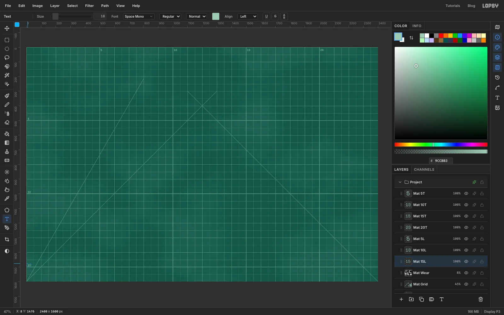

1. Click **Background** and run **Filter → Add Noise…** with **Amount** `10`, **Mono** and **Gaussian**.
2. Click `Mat Grid`, add a layer called `Mat Wear` and fill it with black. Run **Filter → Clouds…** with **Scale** `6`.
3. Open the layer's effects drawer, set the blend mode to **Soft Light**, and set the opacity to `8%`. Any stronger and the mat looks like smoke.
4. With `Mat Wear` active, pick the **Text** tool and set **Space Mono**, **Size** `18`, colour `#9CCBB3`. Click just right of each heavy line along the top edge and type `5`, `10`, `15` and `20`, pressing [[Tab]] after each one. Do the same with `5`, `10` and `15` down the left edge.
5. Click `Mat Grid`, [[Shift]]-click the top number, choose **Layer → Group Layers** and name the group `Cutting Mat`. Click its arrow to collapse it.

## Paste the shark photo

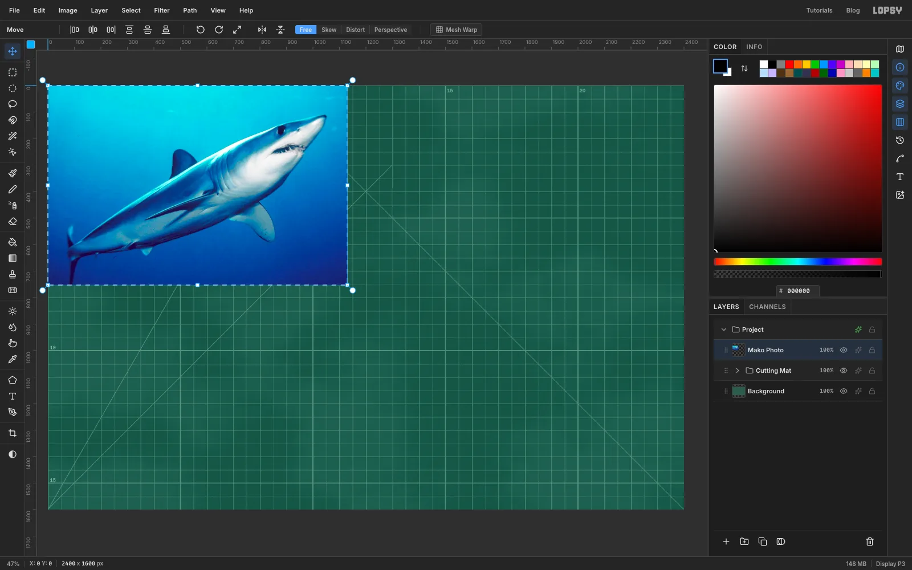

Keep `Cutting Mat` selected, open the photo in your browser or image viewer,
copy it and press [[Cmd+V]] in Lopsy. It arrives at its full size in the top-left
corner on a new layer. Rename the layer `Mako Photo` and deselect.

The photo stays at this size. You'll cut the plates from it here and scale them down later.

## Select the water with the Magic Wand

1. Pick the **Magic Wand**, set **Tolerance** to `40` and tick **Contiguous**.
2. Click the bright water near the top left.
3. Hold [[Shift]] and click the water in seven or eight more places, from the bright cyan at the top to the deep blue at the bottom and right. Each click adds to the selection.

Zoom in and look closely at the ants round the dorsal fin and the tail. They
are dark navy, close to the deep blue water, so the wand can easily take part of them too.

## Take the fins back with the Lasso

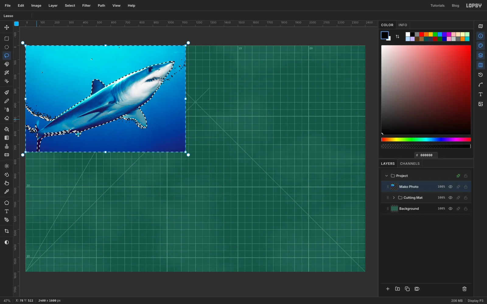

If the ants cut across the base of the dorsal fin or the tail, take them back:

1. Pick the **Lasso**.
2. Hold [[Option]] and drag a tight loop around the dorsal fin. Option-drag subtracts from the selection.
3. Do the same around the tail.

## Delete the water and the specks

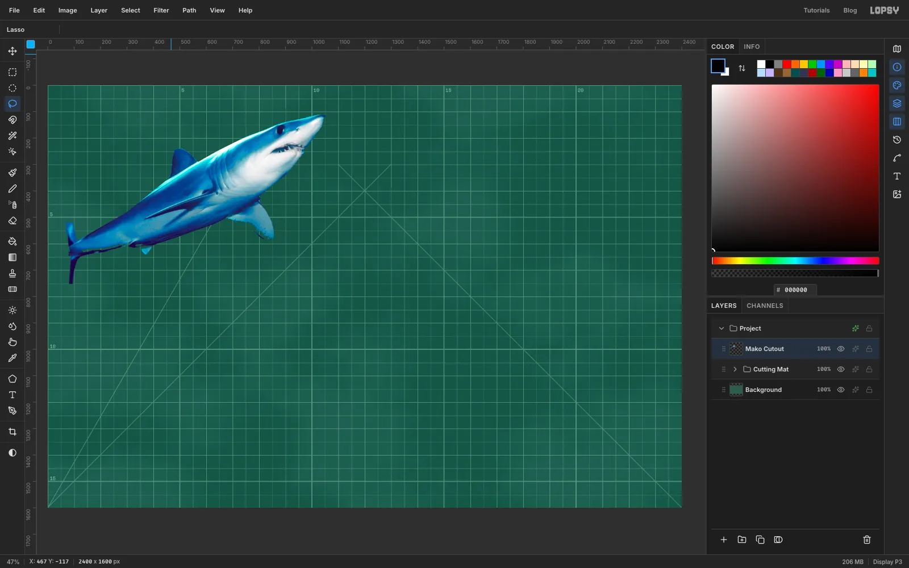

1. Press [[Delete]] to clear the water, then deselect.
2. Bubbles and specks are left floating in the water. Lasso a loose outline around the whole shark, choose **Select → Inverse**, and press [[Delete]] again.
3. Deselect and rename the layer `Mako Cutout`.

## Redraw the tail as a crescent

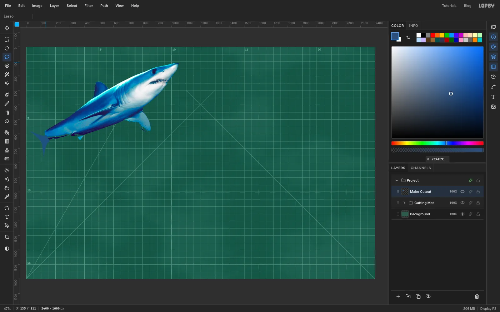

The photo cuts off the bottom of the tail. Cut as it is, that would make a
straight bar on the stencil instead of a fin.

1. With the **Lasso**, loop around the tail from the narrow point where it joins the body, and press [[Delete]].
2. Draw the new tail as a lasso shape. Start at the narrow stalk, sweep out to a pointed tip above the body line, curve back in to a notch in the middle, then out to a matching tip below and back to the stalk. A mako's tail is almost symmetrical, like a crescent moon.
3. Fill it with `#2C4F7C`, a mid blue that will posterize into the dark plates, and deselect.

## Posterize a tone map

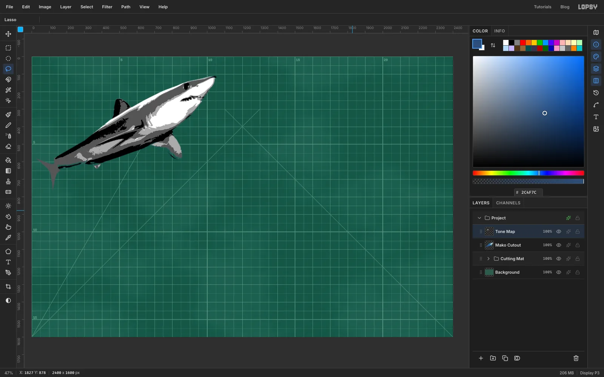

1. Click **Duplicate Layer** and rename the copy `Tone Map`.
2. Run **Filter → Desaturate**.
3. Run **Filter → Gaussian Blur…** with **Radius** `4`. This smooths the photo detail into shapes you could actually cut.
4. Run **Filter → Brightness/Contrast…** with **Brightness** `4` and **Contrast** `100`.
5. Run **Filter → Posterize…** with **Levels** `4`.

Black is the shadows, dark grey the mid tones, light grey and white the
highlights. The plates come from the two darker tones.

## Separate the three shark plates

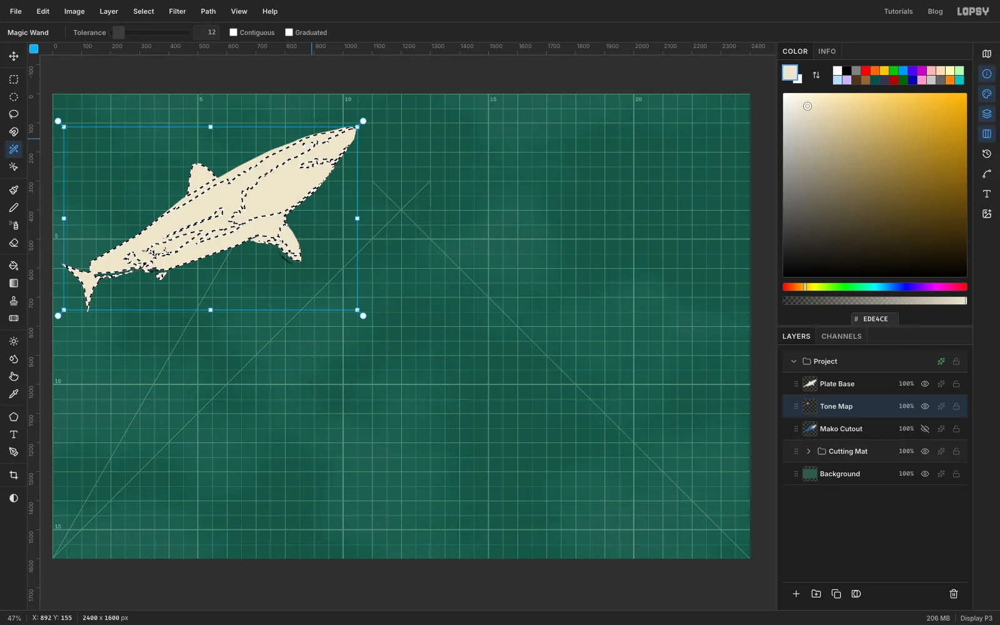

First the **base plate**, the whole silhouette:

1. Hide `Mako Cutout`. [[Cmd]]-click its thumbnail to load its outline as a selection.
2. Run **Select → Shrink…** `2`, then **Select → Grow…** `2`. Shrinking then growing removes specks smaller than the shrink.
3. Click `Tone Map`, add a layer called `Plate Base` and fill it with bone `#EDE4CE`. Deselect.

Then the **mid plate**, everything darker than the light grey:

1. Hide `Plate Base` so you can see the tone map, and click `Tone Map`. Pick the **Magic Wand**, set **Tolerance** to `12` and untick **Contiguous**.
2. Click a dark grey area, then [[Shift]]-click a black area.
3. Shrink `2`, Grow `2`, click `Plate Base`, add a layer called `Plate Mid` and fill it with teal `#14918C`.

Then the **key plate**, just the black. Hide `Plate Mid` too, wand only a black area on `Tone Map`, shrink and grow
`2`, click `Plate Mid`, and fill a new `Plate Key` layer with `#161616`. Deselect and show all three plates again.

## Check the plates in register

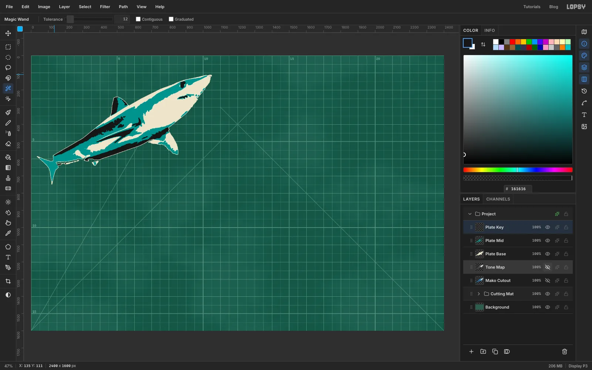

Hide `Tone Map`. The three plates now stack into the stencil look you're aiming for: bone underneath, teal over it, black on top.

> **Tip:** If a plate picked up a wrong area, [[Cmd+Z]] steps back one fill or selection at a time, and [[Cmd+Shift+Z]] puts it back.

## Group and duplicate the plates

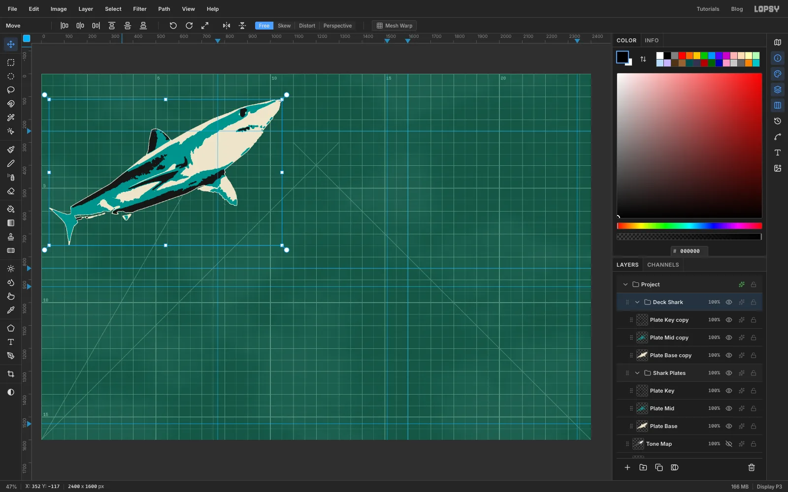

First add guides for the card layout: two 740 × 600 px card spaces across and two down, with gutters between them, leaving a column on the left for the deck. Click the top ruler at `770`, `1510`, `1600` and `2340`, and the left ruler at `250`, `850`, `930` and `1530`. Each click drops a guide.

You need the plates twice: once to cut the cards and once for the sprayed deck.

1. Click `Plate Key`, [[Shift]]-click `Plate Base` and choose **Layer → Group Layers**. Name the group `Shark Plates`.
2. Click **Duplicate Layer**. Name the copy group `Deck Shark`, then hide it for now.

## Scale the plates to stencil size

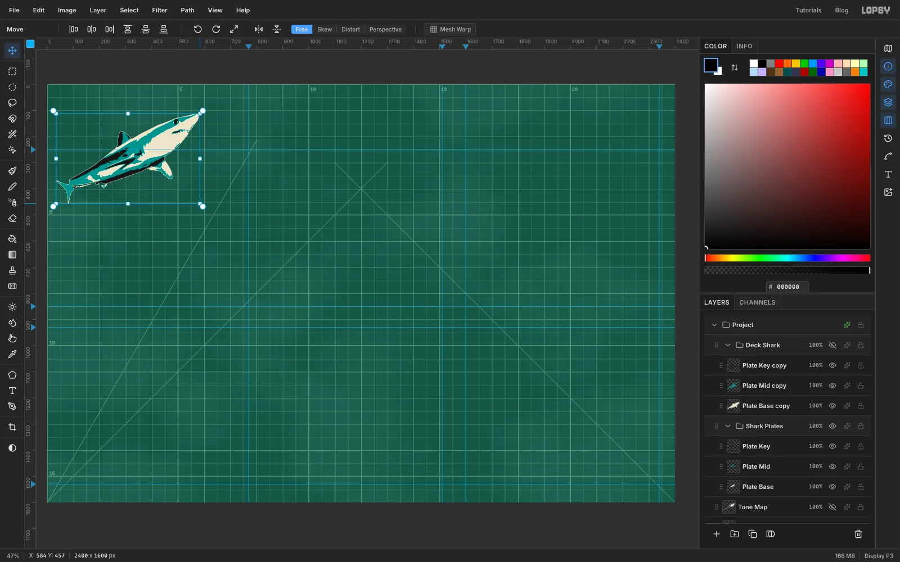

1. Click the `Shark Plates` group, pick the **Move** tool and make sure nothing is selected. The Move tool frames all three plates with one transform box.
2. Hold [[Cmd]] and drag the bottom-right corner handle up and left until the box's right edge reaches about `600` on the top ruler. The shark is then about 530 px long, 54% of its photo size, which fits a card with room to spare. Cmd keeps the proportions.
3. Press [[Cmd+D]] to finish the transform.

## Deal one plate onto each card space

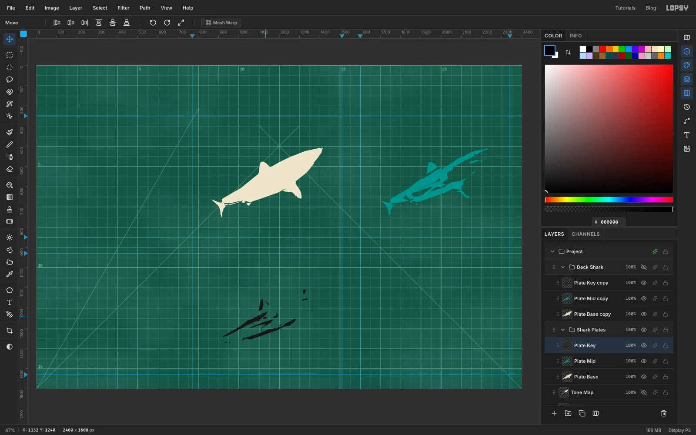

The guides mark four card spaces: two across and two down, to the right of a
column left free for the deck.

1. Click `Plate Base` and drag it with the **Move** tool into the middle of the top-left space, a little below centre to leave room for a label.
2. Drag `Plate Mid` into the top-right space and `Plate Key` into the bottom-left space.

The plates have to stay in register, so move each one by exactly the same
amount relative to its space. The spaces are 830 px apart across and 680 px
down. Hover the shark's nose tip on `Plate Base` and note its **X** and **Y** in
the status bar. The same point on `Plate Mid` should end up 830 px further
right, and on `Plate Key` 680 px further down. Drag close, then switch to the
**Move** tool's arrow keys for the last few pixels ([[Shift]] moves 10 px).

## Smooth the plate edges

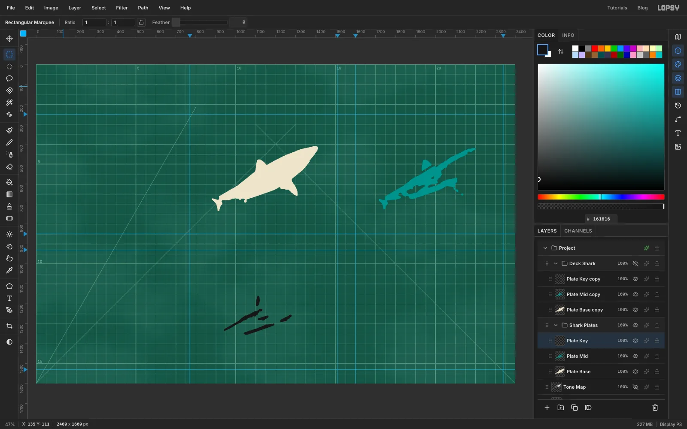

Real stencils are cut with a knife, so the wand's ragged edges have to go.

1. Zoom in on each plate. Box any tiny floating speck with the **Rectangular Marquee** and press [[Delete]]. Delete the eye and the little gill slits on the key plate too, because they're too small to cut.
2. On each plate, [[Cmd]]-click its own thumbnail, run **Shrink** `4` then **Grow** `4`, choose **Select → Inverse** and press [[Delete]]. This trims the thin, ragged bits.
3. [[Cmd]]-click the thumbnail again and run **Grow** `4` then **Shrink** `4`. Set the foreground to that plate's colour (bone, teal or black) and fill. This fills in the little nicks.

## Lay out the first card

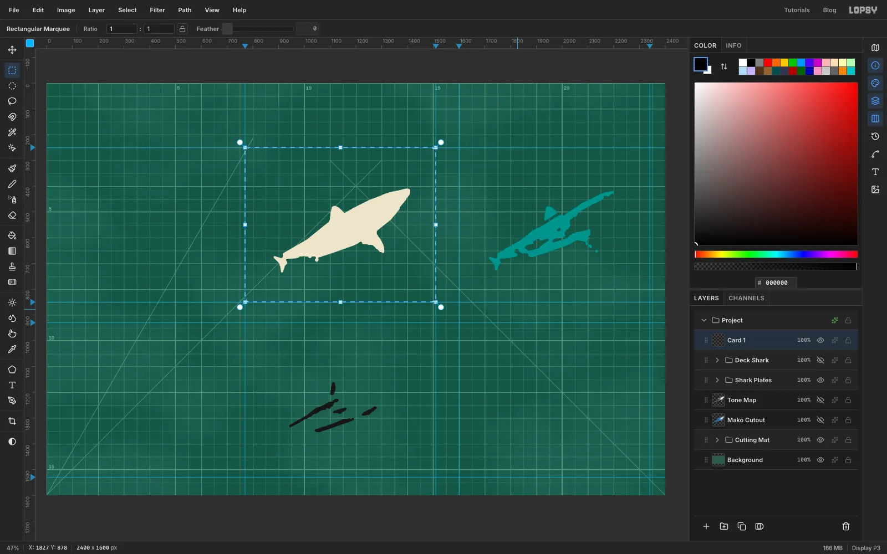

1. Collapse both groups. Click `Deck Shark` and add a layer called `Card 1`. It goes above the groups, not inside them.
2. Drag the **Rectangular Marquee** from the top-left guide corner of the first space to its bottom-right corner. The marquee snaps to the guides.
3. Run **Shrink** `18` and then **Grow** `18`. Growing a shrunken rectangle gives it round corners.
4. Fill with chipboard `#C9A46E` and deselect.

## Cut the first card

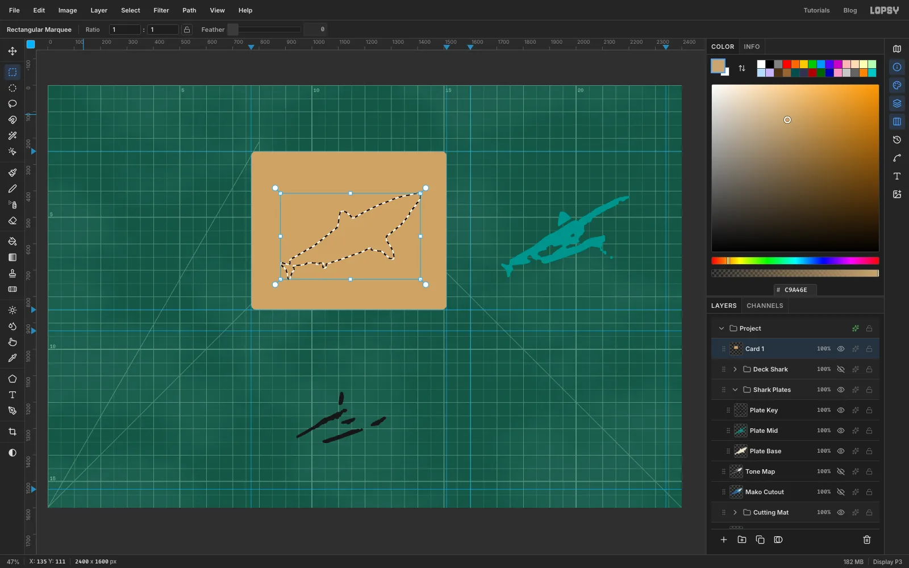

1. Expand `Shark Plates` and [[Cmd]]-click the `Plate Base` thumbnail.
2. Click the `Card 1` row and press [[Delete]]. The shark becomes a hole, and the mat shows through.
3. Punch two registration holes. Every card gets them in the same two spots, so the plates line up when you spray. Pick the **Elliptical Marquee** and, with nothing selected, click once near the bottom-left corner. An **Elliptical Selection** dialog opens. For card 1 type **From** `801, 793` and **To** `827, 819`, a 26 px circle centred 44 px in from the corner, apply it and press [[Delete]]. Do the same 44 px in from the top-right corner (**From** `1453, 281`, **To** `1479, 307`). On the other cards, add the same offsets to the card's corners.
4. Deselect and hide `Shark Plates`.
5. Finish the card. Run **Add Noise** at **Amount** `9`, **Mono** and **Gaussian**, for a little grain. Open the effects drawer and tick **Drop Shadow**: **Offset X** `7`, **Offset Y** `9`, **Blur** `12`, **Opacity** `60`, colour `#0B1F18`. Then tick **Stroke**: **Width** `2`, colour `#8A6A3E`, position **Inside**. The shadow falls into the cut, so the holes look real, and the stroke darkens every cut edge like a knife cut.

## Bridge the islands

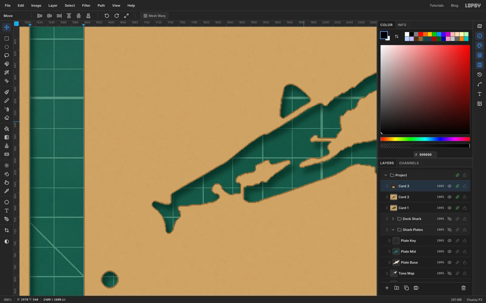

Repeat *Lay out the first card* and *Cut the first card* for `Card 2` in the
top-right space, cut with `Plate Mid`, and `Card 3` in the bottom-left space,
cut with `Plate Key`. Click the previous card's row before adding each new card layer.

Before you finish each card, zoom in and look for **islands**: pieces of card
that the cut has separated from the rest. In a real stencil they would fall
out. Stencil cutters leave thin straps called **bridges** to hold them.

1. Pick the **Pencil**, set **Size** `7` and the colour `#C9A46E`.
2. For each loose piece, click on it, then [[Shift]]-click on the nearest solid card across the gap to draw a straight strap.
3. Slivers too small to bridge would fall out anyway. Box them with the marquee and delete them so they become part of the hole.

Then give the card the same grain, drop shadow and stroke as card 1.

## Check the three shark cards

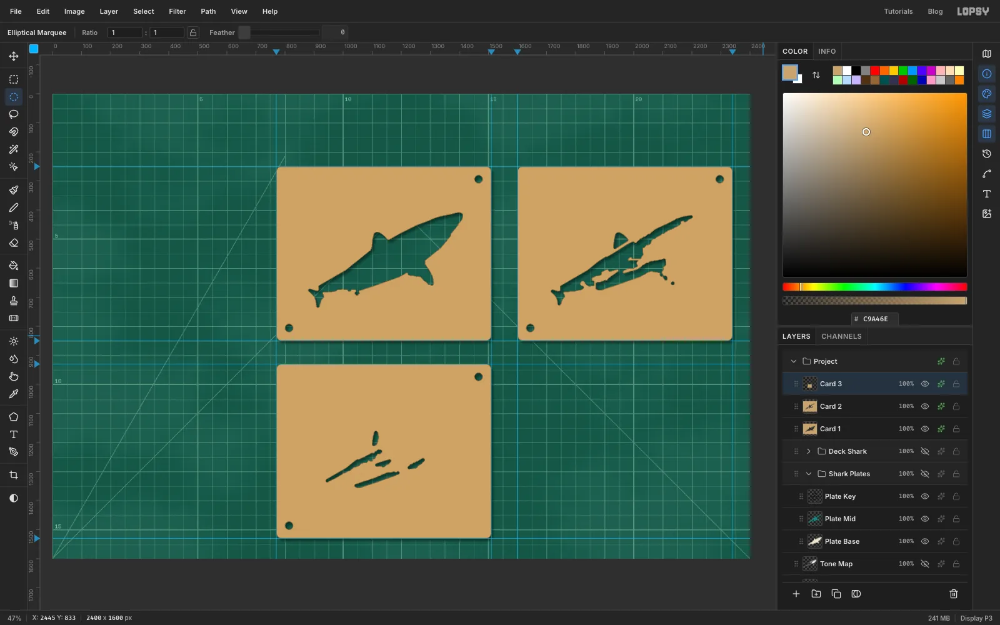

Zoom out. You have three cards: the whole silhouette, the teal mid tones and
the black shadows. The registration holes sit in the same corners on each,
and every hole shows the mat with a soft shadow inside.

## Draw the lettering arc with the Pen

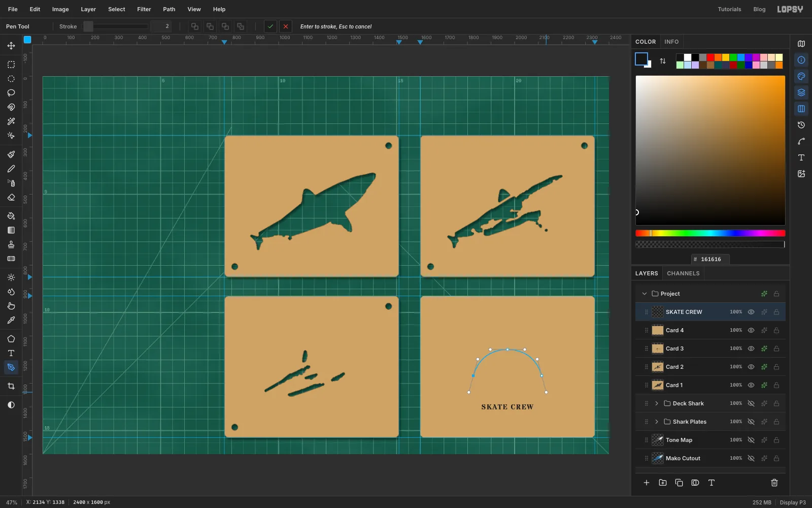

Make `Card 4` above `Card 3` the same way, but don't cut it yet. This card
holds the lettering plate: an arched **MAKO JAWS**, a sun disc and **SKATE CREW**.

1. First set the bottom line, because a click near existing text edits it. Pick the **Text** tool, choose **Stardos Stencil**, **Bold**, size `30`, colour `#161616`, and type `SKATE CREW` low on the card. Press [[Tab]]. In the **Text** panel set **Letter spacing** to `3`. Switch to the **Move** tool and nudge it with the arrow keys until it's centred across the card, about 90 px below the card's middle.
2. Pick the **Pen** tool. The arc is part of a circle with a 150 px radius, centred on the card's middle (1970, 1307 here). That centre is also where the sun disc will go.
3. Press on the left end of the arc, about 145 px left of the centre and 40 px above it, and drag up and to the right along the curve. Press at the top, 150 px straight above the centre, and drag straight right. Press at the right end, mirroring the left one, and drag down and to the right. Dragging pulls out smooth curve handles.
4. Click the **✓ Commit path** button in the options bar. It adds the path without painting a stroke.

## Set MAKO JAWS on the arc

1. Click the `Card 4` row so the next settings don't restyle `SKATE CREW`.
2. With the **Text** tool, choose **Stardos Stencil**, **Bold**, size `52`, click inside the arc and type `MAKO JAWS`. Press [[Tab]] to finish.
3. Set **Align** to **Center**, then pick **Path 1** in the **Path** menu of the options bar. The letters jump onto the arc, centred.
4. In the **Text** panel set **Letter spacing** to `8` so no letters touch.
5. Open the **Paths** panel and click **Path 1** again to deselect it, so its outline stops drawing over the card.

> **Tip:** If the arc is shorter than the text, the last letters are cut off. Drag the end anchors further round if a letter goes missing.

## Build the lettering plate

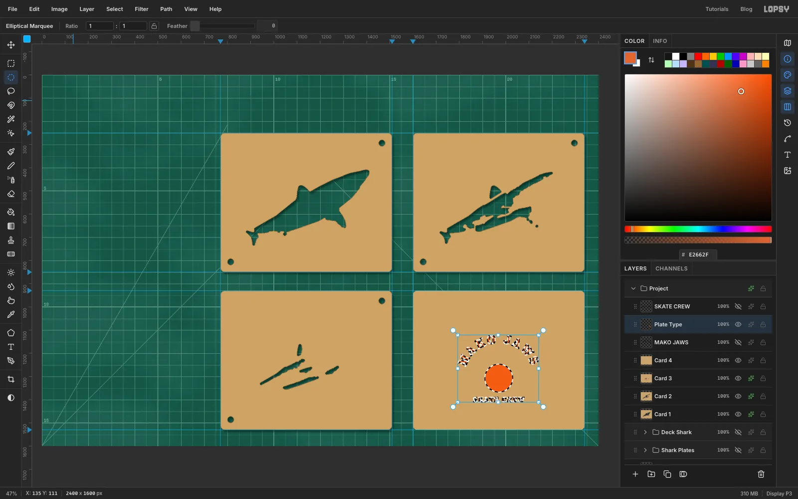

To cut the letters and the disc in one go, they need to be on one pixel layer.

1. Click `MAKO JAWS` and add a layer called `Plate Type`. With the **Elliptical Marquee**, [[Cmd]]-drag a 120 px circle centred on the arc's centre point, fill it with orange `#E2662F` and deselect. Cmd keeps it round.
2. Click `MAKO JAWS`, click **Duplicate Layer**, then the **Rasterize Layer** button in the Layers panel toolbar. The copy lands below `Plate Type`, so drag it by its grip until it sits right above `Plate Type`, then choose **Layer → Merge Down**.
3. Do the same with `SKATE CREW`.
4. Hide the two live text layers. [[Cmd]]-click `Plate Type` and fill it with orange, so the letters match the disc.

## Cut the lettering card

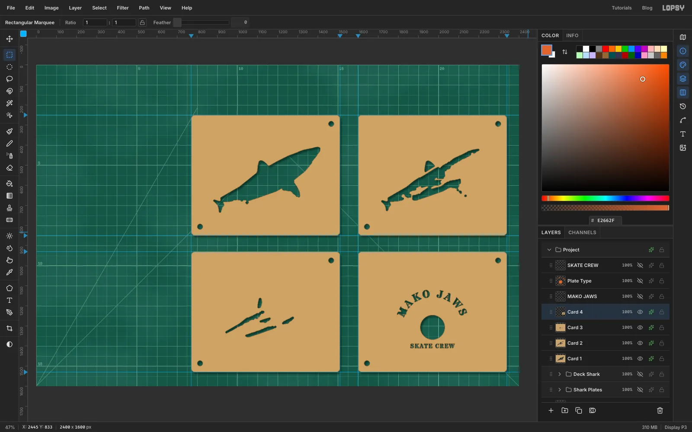

1. [[Cmd]]-click the `Plate Type` thumbnail, click `Card 4` and press [[Delete]].
2. Hide `Plate Type`, punch the two registration holes, and finish the card with grain, a drop shadow and a stroke as before.

The kit is cut. Now spray a proof.

## Shape the deck

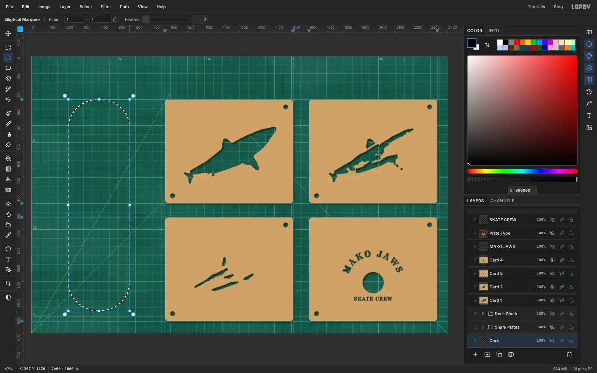

1. Click `Tone Map` and add a layer called `Deck`.
2. With the **Elliptical Marquee** and nothing selected, click once in the left column. In the dialog type **From** `213, 250` and **To** `567, 580` for the nose: an oval 355 px wide and 330 px tall, its top on the first guide.
3. Pick the **Rectangular Marquee**, hold [[Shift]] and drag a rectangle from the left end of the oval's middle (`213, 415`) to `567, 1305`. Shift adds to the selection.
4. Switch back to the **Elliptical Marquee** and [[Shift]]-drag a matching oval for the tail, from `213, 1140` to `567, 1470`. The deck is 355 × 1220 px, close to a real board's shape.

## Make it maple

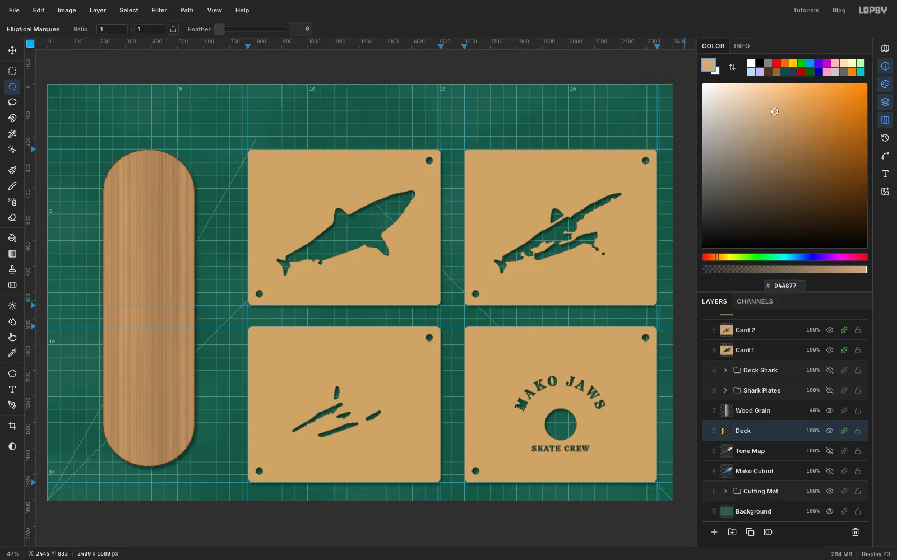

1. Fill the selection with maple `#D4A877`.
2. Add a layer called `Wood Grain` and run **Filter → Fibers…** with **Variance** `30` and **Strength** `64`. The fibres stay inside the selection and run along the board.
3. Deselect, set `Wood Grain` to **Multiply** at `40%`.
4. On `Deck`, add **Inner Glow** (**Size** `14`, **Opacity** `45`, `#5A3518`), a **Stroke** (**Width** `3`, `#6E4A2A`, **Inside**) for the ply edge, and a **Drop Shadow** (**Offset X** `9`, **Offset Y** `12`, **Blur** `16`, **Opacity** `60`, `#0B1F18`).

## Spray the lettering onto the deck

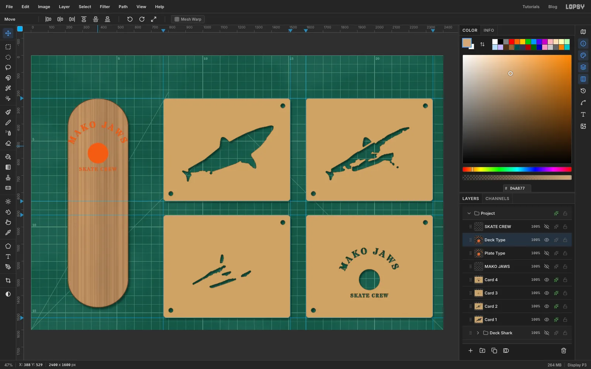

The deck uses the same plates as the cards, at the same size, so the proof
shows exactly what the stencils would print.

1. Click `Plate Type`, click **Duplicate Layer**, rename the copy `Deck Type` and show it.
2. With the **Move** tool, drag it onto the nose of the deck, centred across the width, with the top of the arch about 130 px below the tip.

## Turn the shark to run up the deck

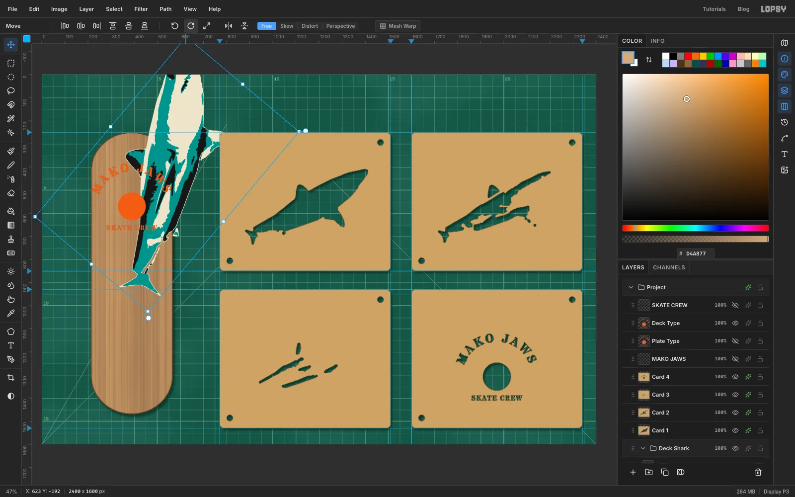

The stencils can be held at any angle when you spray, so the deck shark is
turned to swim up the board.

1. Show the `Deck Shark` group and click it. With the **Move** tool and nothing selected, a box frames all three plates.
2. Drag a round rotation handle just outside a corner so the shark turns about 50° anticlockwise, nose up.

## Scale the deck shark to match the cards

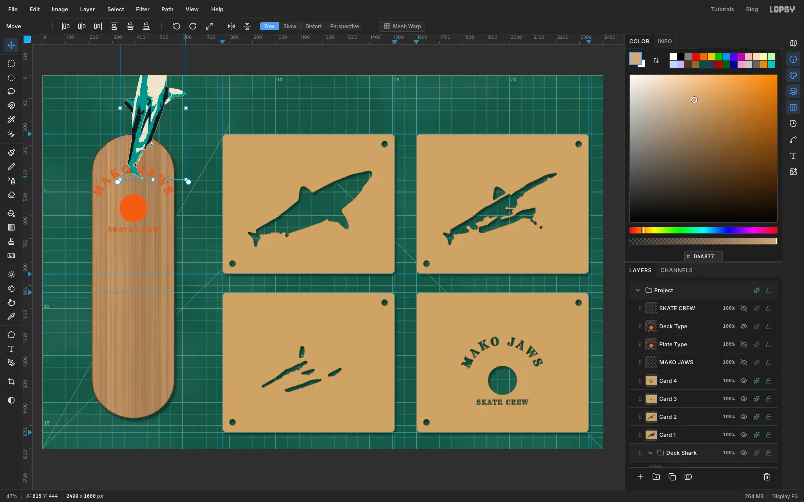

1. Press [[Cmd+D]] to finish the rotation.
2. [[Cmd]]-drag the bottom-right corner handle in until the box is about 285 × 610 px. That's 54%, the same size as the shark on the cards. Press [[Cmd+D]].

## Place the shark on the deck

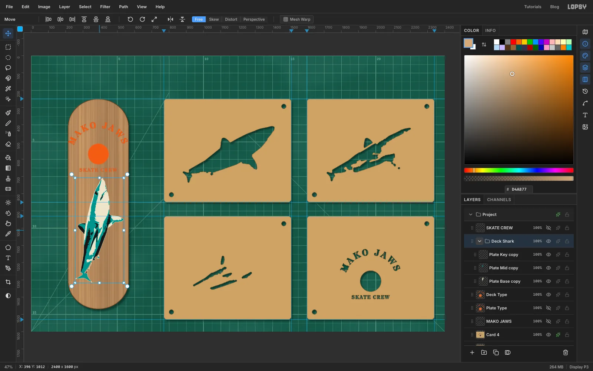

1. With the group still selected, drag the shark onto the deck so its nose sits just below **SKATE CREW** and its tail ends above the tail of the board.
2. In the Layers panel, drag the `Deck Shark` row by its grip above `Deck Type`.
3. Trim the paint to the board. [[Cmd]]-click the `Deck` thumbnail, choose **Select → Inverse**, then click each plate copy and `Deck Type` in turn and press [[Delete]].

## Make the paint look sprayed

Flat fills look printed, not sprayed. On each paint layer (the three plate copies and `Deck Type`):

1. Run **Gaussian Blur** with **Radius** `1` and **Add Noise** at `14`, **Mono**, **Gaussian**.
2. Set the bone and orange coats to `90%`. Set the teal and black coats to **Multiply** at `85%` so the grain shows through.

Then add the overspray. Spray paint drifts a little past the stencil's edge.

1. Click `Wood Grain` and add a layer called `Deck Overspray` under the paint.
2. Pick the **Spray** tool: **Size** `50`, **Density** `100`, **Opacity** `18`, **Softness** `40`.
3. [[Cmd]]-click the bone plate copy, run **Grow** `22`, click `Deck Overspray`, set the colour to bone and spray back and forth over the shark.
4. Do the same around `Deck Type` in orange at **Opacity** `10`.
5. [[Cmd]]-click `Deck`, choose **Select → Inverse** and delete the overspray that landed on the mat.

## Add paint drips

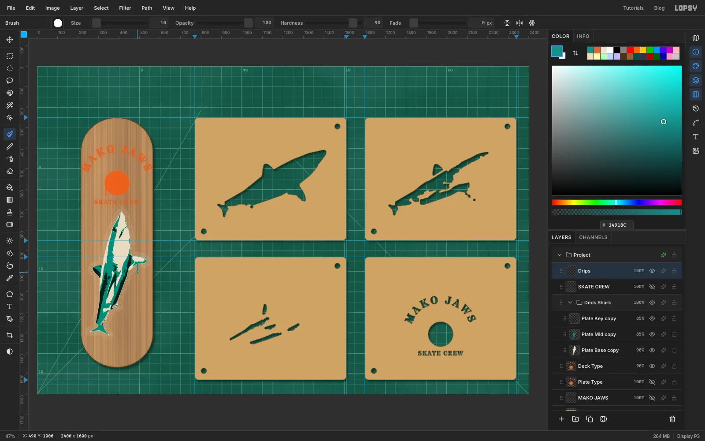

1. Add a layer called `Drips` and drag it above `Deck Shark`.
2. Pick the **Brush** with **Hardness** `90` and **Opacity** `100`.
3. Set **Size** `5` and orange. Click on the bottom edge of the sun and [[Shift]]-click 25–45 px straight below. Set **Size** `10` and click once at the end for the bead of paint.
4. Add one more orange drip and one teal drip from the bottom of the shark's pectoral fin.

## Drill the truck bolt holes

1. With the **Elliptical Marquee**, drag a 14 px circle where the first front bolt goes, in the gap between the arch and the sun.
2. [[Shift]]-drag three more to make a square about 42 px wide and 52 px tall. Make a second square of four near the tail, below the shark.
3. Click `Deck`, `Wood Grain`, `Deck Overspray`, the three plate copies and `Deck Type` in turn and press [[Delete]] on each, so the holes go through the board and every coat of paint.

## Spray overspray on the cards

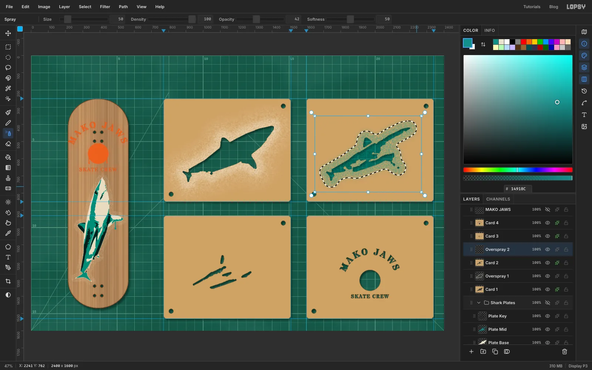

Used stencils are covered in paint, heaviest right at the cut edge.

1. Click `Card 1` and add a layer called `Overspray 1`.
2. [[Cmd]]-click `Plate Base`, run **Grow** `40` and then **Select → Feather…** `28`.
3. Pick the **Spray** tool: **Size** `50`, **Density** `100`, **Opacity** `60`, **Softness** `50`, in bone. Spray back and forth over the whole shape.
4. [[Cmd]]-click `Plate Base` again, **Grow** `130`, **Feather** `70`, and spray once more at **Size** `90`, **Opacity** `26`. This is the faint outer mist.
5. Clean up: [[Cmd]]-click `Plate Base` and press [[Delete]] to clear paint from the hole. Then [[Cmd]]-click `Card 1`, choose **Select → Inverse** and press [[Delete]] to clear paint from the mat.

Repeat for the other cards. Expand `Shark Plates` so you can reach the plate thumbnails. Each card's overspray layer goes directly above it:

- Card 2: `Plate Mid`, teal. Pass 1 Grow `40`, Feather `28`, Opacity `42`; pass 2 Grow `130`, Feather `70`, Opacity `14`.
- Card 3: `Plate Key`, black `#141414`. Pass 1 the same as card 2; pass 2 Grow `70`, Feather `40`, Opacity `10`. Then set `Overspray 3` to **Multiply** at `65%`.
- Card 4: `Plate Type`, orange. The same passes as card 2.

## Label each plate in marker

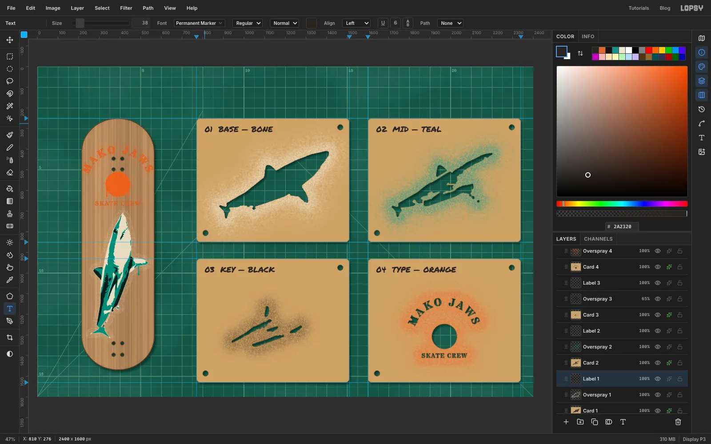

Pick the **Text** tool, choose **Permanent Marker** at size `38` in
`#2A2320`, and write a label 40 px in from the top-left corner of each card:
`01  BASE — BONE`, `02  MID — TEAL`, `03  KEY — BLACK` and `04  TYPE — ORANGE`.
Click the card's overspray layer before each one, so the new label lands
above it and no earlier label gets restyled. Rename the four text layers
`Label 1` to `Label 4`.

## Scuff the deck with a mask

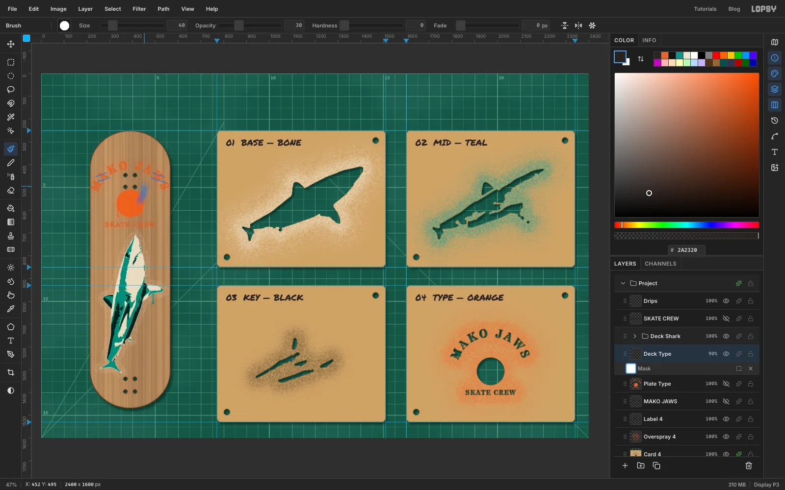

1. Click `Deck Type` and click **Add Mask** in the Layers panel toolbar.
2. Click the white mask thumbnail on the **Mask** row under `Deck Type` to paint on the mask. In mask editing, the **Brush** always hides.
3. With the **Brush** at **Size** `6`, **Opacity** `85`, **Hardness** `70`, drag a few short scrapes over the outer letters near the rails, where a board gets scuffed.
4. Set **Size** `40`, **Opacity** `30`, **Hardness** `0` and brush once down the right edge of the sun.
5. Click the `Deck Type` row to leave mask editing.

## Tilt the deck

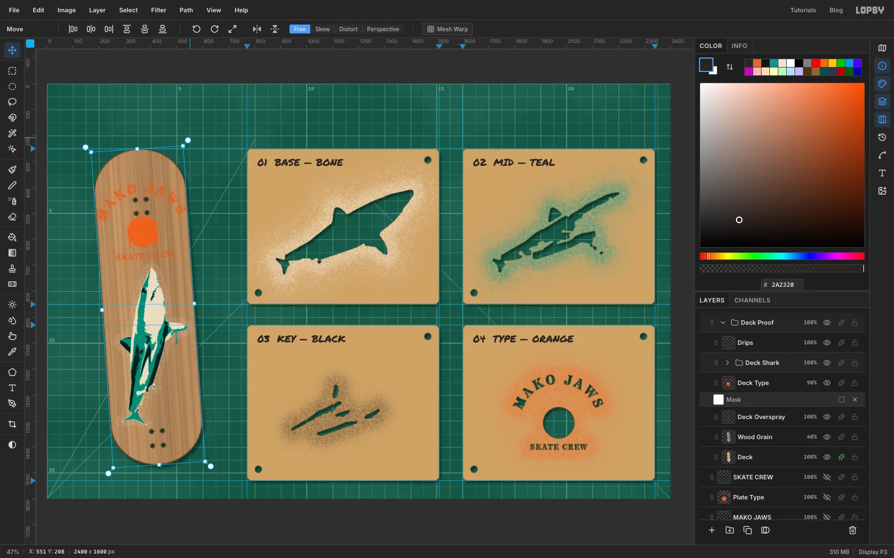

1. Click `Deck Shark`, then [[Cmd]]-click `Drips`, `Deck Type`, `Deck Overspray`, `Wood Grain` and `Deck`.
2. Choose **Layer → Group Layers** and name the group `Deck Proof`.
3. With the **Move** tool and nothing selected, drag a rotation handle to turn the whole deck about 4° anticlockwise, then press [[Cmd+D]] and collapse the group.

## Give the chipboard some texture

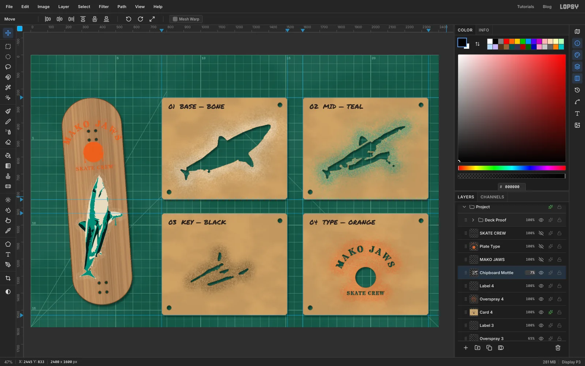

1. Click `Label 4` and add a layer called `Chipboard Mottle`.
2. [[Cmd]]-click `Card 1`, click `Chipboard Mottle` and run **Filter → Clouds…** with **Scale** `18`. Repeat for the other three cards, so the clouds fill only the cards.
3. Deselect, run **Add Noise** at `30`, **Mono**, **Gaussian**, and set the layer to **Multiply** at `7%`.

## Tape the cards down

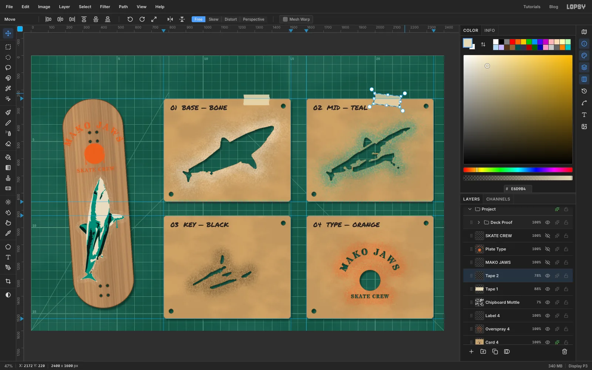

1. Add a layer called `Tape 1`. Lasso a strip about 150 × 62 px across the top edge of the first card, with short zigzag ends like torn tape.
2. Fill it with `#E6D9B4`, add noise at `6` and set the layer to `88%`.
3. [[Cmd]]-click `Tape 1` and press [[Cmd+C]]. Press [[Cmd+V]]: the paste lands in place on a new layer. Name it `Tape 2` and drag it to the top edge of card 2. Paste twice more for `Tape 3` and `Tape 4`, on the bottom edges of cards 3 and 4.
4. Turn each tape a few degrees with its rotation handle, some one way and some the other, and give each a slightly different opacity (78–92%).
5. Give every tape a small **Drop Shadow**: **Offset X** `2`, **Offset Y** `3`, **Blur** `4`, **Opacity** `35`.

## Spray the title through a selection

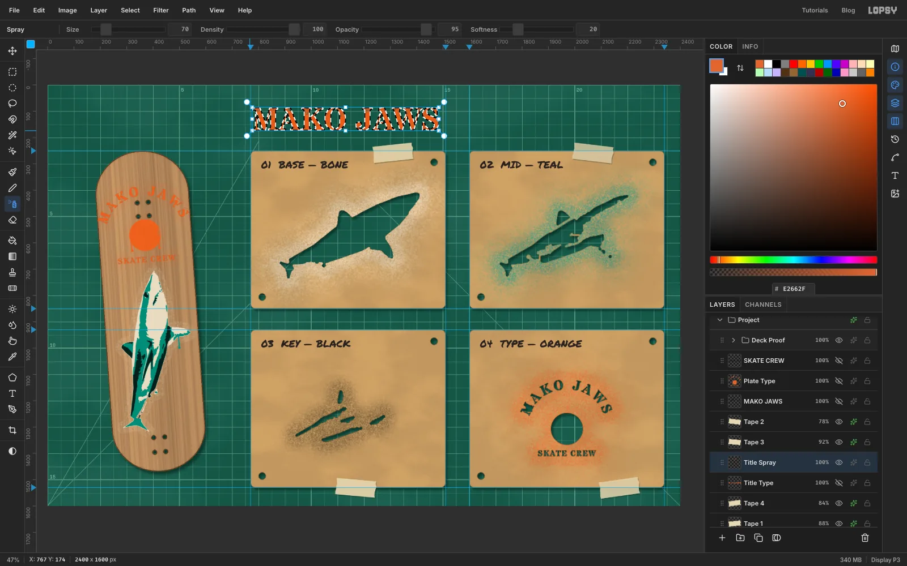

1. Type `MAKO JAWS` in **Stardos Stencil**, **Bold**, size `122`, along the top, starting above the first card. Name the layer `Title Type`.
2. [[Cmd]]-click the text's thumbnail, hide the text and add a layer called `Title Spray`.
3. Pick the **Spray** tool: **Size** `70`, **Density** `100`, **Opacity** `95`, **Softness** `20`, in orange. Spray back and forth across the selection until the letters are solid but still speckled at the edges.
4. Deselect and add an **Outer Glow** in orange (**Size** `16`, **Spread** `0`, **Opacity** `40`) for the mist.

> **Tip:** Each spray stroke is its own undo step, so if a pass lands too heavy, [[Cmd+Z]] takes back just that stroke.

## Add the kit label

1. Add a layer called `Header Tape` and lasso a long tape strip, about 790 × 76 px, to the right of the title. Fill it with tape colour, add noise and a small shadow.
2. Write `STENCIL KIT No.1 — 4 PLATES + DECK PROOF` on it in **Permanent Marker**, size `30`, and name the layer `Kit Label`. Switch to the **Move** tool and centre it on the tape with the arrow keys.
3. Click `Header Tape`, [[Shift]]-click the label text, and rotate both together by about 1.5° with the **Move** tool.

## Number the frames

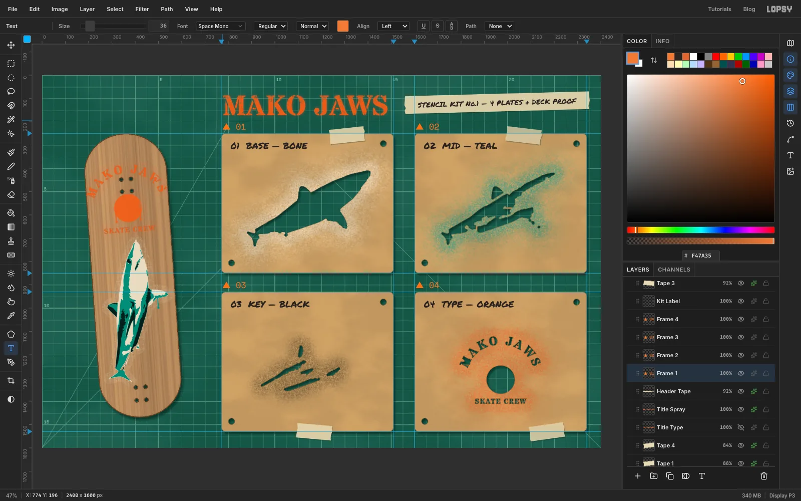

Contact sheets number every frame. With **Space Mono** at size `36` in
`#F47A35`, type `▲ 01` to `▲ 04` just above the top-left corner of each card.
There's no key for ▲, so copy it from this page and paste it into the text.

## Mark the pick in grease pencil

1. Click the collapsed `Deck Proof` group and add a layer called `Grease Pencil`, so it sits on top of everything.
2. Pick the **Brush**: **Size** `10`, **Opacity** `92`, **Hardness** `80`, colour `#D8322A`. In one stroke, draw a loose loop around the deck, starting near the top right and overshooting past where you started.
3. Write `05 —  PRINT  THIS  ONE` above the loop in **Rock Salt**, size `27`, in the same red, with two spaces between words. Give it a 2 px **Stroke** in the same red so it has the weight of a wax pencil.
4. Back on `Grease Pencil`, draw a tick after the note and a short arrow down into the loop. Then run **Add Noise** at `18` on the layer for a waxy texture.
5. Type `▲ 05` above the deck in the frame-number style.

Choose **Edit → Clear Guides**, then **File → Quick Export PNG** for the
finished sheet, and **File → Save Project** to keep the layers.
