*Skeuomorphism* is the art of making a picture of a thing look like the thing: wood that has grain, metal that has been brushed, glass that catches the light, buttons that sink when you press them. It was the house style of early iPhone apps, and it works because every material follows the same few rules. There is one light source, so every highlight sits on the same side. Every raised part throws a shadow the same way. Every recessed part has a shadow inside its top edge. And every surface has a texture, even if it's faint.

In this tutorial you'll use those rules to build an Enigma cipher machine from scratch, then design a magazine cover around it: **KEYSPACE**, a made-up quarterly about codes and secret history. The cover is 1248 × 1600 px, close to the shape of a US magazine. You'll build it in this order:

- a green **leather desk** and a typed **cipher sheet**
- a **walnut case** with real-looking grain on the sides and rails
- a **crinkle-paint panel** and a **brushed-aluminium rotor plate** with windows, brass thumbwheels, screws and engraved lettering
- 26 **lamps** and 26 **keys**, each drawn once and repeated with **Fill with Pattern**, with one lamp lit and one key pressed
- a **manila tag** on a loop of twine
- a **gold-foil masthead**, cover lines, a barcode and a footer

Light comes from the **top-left** throughout. Whenever you add a shadow, it goes down and to the right; whenever you add a highlight, it goes up and to the left.

You'll use:

- **guides**, the **Shape** tool's click-to-create size dialog, and the **Rectangular** and **Elliptical Marquee**, including the exact-corners dialog and [[Shift]]/[[Option]] to add and subtract
- the **Lasso**, **Select → Inverse**, **Grow**, **Feather**, and [[Cmd]]-clicking layer thumbnails to load a shape as a selection
- **Add Noise**, **Gaussian Blur**, **Motion Blur**, **Emboss**, **Fibers**, **Clouds** and **Brightness/Contrast**
- **Define Pattern** and **Fill with Pattern** with **Row Stagger**
- the **Gradient** tool (linear and radial), the **Brush** and the **Pencil**
- the Move tool's **Rotate 90° CW** button, corner **scale** and **rotate** handles, **Cut**, **Copy**, **Paste**, **Duplicate Layer** and **Merge Down**
- groups, rotated as a whole
- **Overlay**, **Hard Light**, **Soft Light** and **Screen** blend modes
- the layer effects **Drop Shadow**, **Inner Glow** and **Stroke**, and a **Vignette** adjustment on the whole document
- live text in **Gloock**, **IBM Plex Mono**, **Courier Prime**, **Anton**, **Barlow Condensed** and **DM Serif Display**

The palette:

- Leather `#1E3529`
- Walnut `#4A2B14` → `#70482A` → `#5B361B` → `#7C5130` → `#4A2B14`
- Crinkle paint `#1C1B19`
- Aluminium `#CDD1D5` → `#959A9E` → `#B8BCC0` → `#7C8084`
- Brass `#3E2C0E` → `#F2D88E` → `#C79B48` → `#3E2C0E`
- Ivory rotor rings `#E6DCC2`, cipher paper `#EEE6D2`, manila `#D8BB84`
- Lamp amber `#FFF1C4` → `#FFB23A` → `#C55A08`
- Masthead gold `#7A5518` → `#F6DE97` → `#B98A35` → `#FFE9A8` → `#8C6420`
- Cream type `#F1E7CF`, amber kicker `#FFB23A`, brick red `#8E2A1E`, ink `#1A1712`

> **Tip:** Lots of steps start with "[[Cmd]]-click the thumbnail". Holding [[Cmd]] and clicking a layer's thumbnail in the Layers panel selects everything painted on that layer. It's the quickest way to keep a gradient, a texture or a deletion inside a shape you already drew.

> **Tip:** New layers are added directly above the layer you have selected. Before you click **Add Layer**, click the row you want the new layer to sit on top of.

> **Tip:** Lopsy names a new text layer after the words in it. Each time this tutorial makes a text layer, double-click its name in the Layers panel and rename it as given, so later steps can refer to it.

> **Note:** Shortcuts are written for a Mac. On Windows use [[Ctrl]] wherever it says [[Cmd]], and [[Alt]] for [[Option]].

## Set up the page and the leather

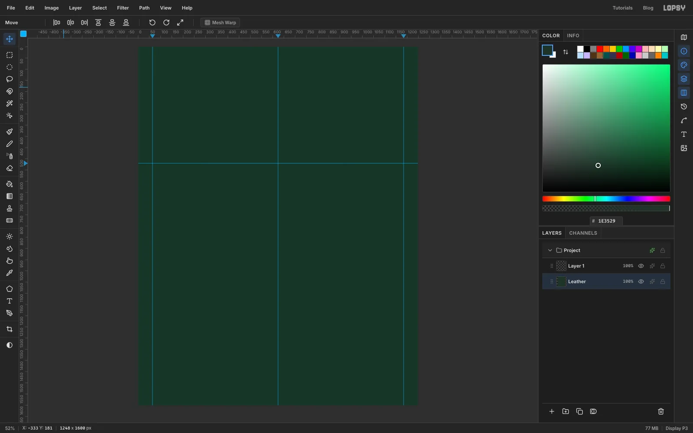

Choose **File → New**, keep the units on **Pixels**, and make the document **1248** wide and **1600** high.

Click the top ruler to drop vertical guides at **64**, **624** and **1184**. The outer two are the margins every line of type will hang from, and the middle one is the centre line. Click the left ruler to drop one horizontal guide at **520**: that's where the top of the machine will be.

Select the *Background* layer, rename it *Leather* (double-click its name), set the foreground colour to `#1E3529` and choose **Edit → Fill**.

## Give the leather a grain and a sheen

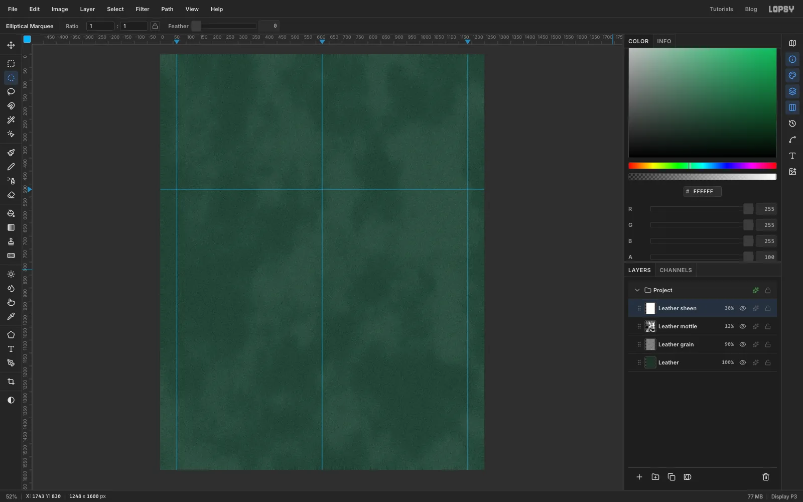

Leather isn't flat colour. It has a fine pebble grain, a few darker patches, and it shines where the light hits it.

1. Rename the empty *Layer 1* to *Leather grain*, fill it with mid grey `#808080`, then run **Filter → Add Noise** (Amount **100**, **Mono**, **Gaussian**), **Filter → Gaussian Blur** (Radius **1.6**) and **Filter → Emboss** (Angle **135**, Strength **90**). The blur clumps the noise into pebbles, and Emboss turns them into little bumps lit from the top-left. Open the layer's effects drawer with the ✦ button on its row, set the blend mode to **Overlay**, and set the layer's opacity to **90%**. Overlay ignores the grey and keeps only the bumps.
2. Click **Add Layer**, name it *Leather mottle*, and run **Filter → Clouds** with Scale **9**. Set it to **Soft Light** at **12%** for faint, uneven patches.
3. Add a layer called *Leather sheen*. With the **Elliptical Marquee**, drag a big circle centred near the top-left corner, about 1000 px across, so most of it hangs off the page. Choose **Select → Feather** with **250**, fill it white, deselect with [[Cmd]]+[[D]], and set the layer to **Soft Light** at **30%**.

## Type the cipher message

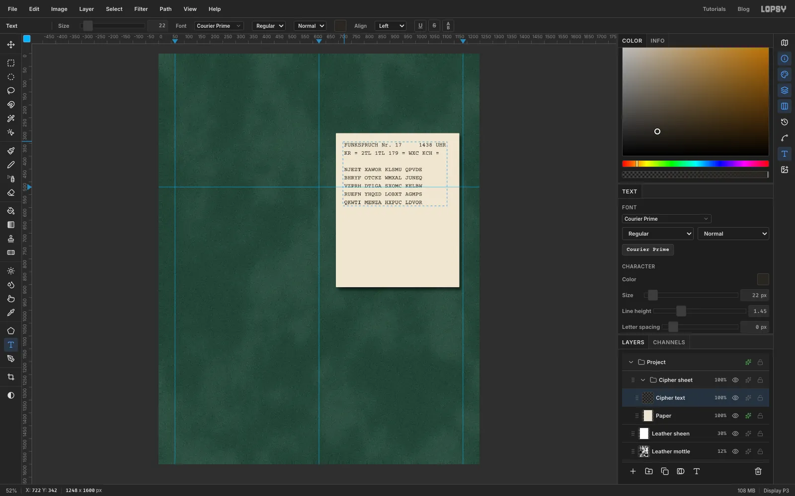

The coded sheet will sit under the machine, so build it first.

With *Leather sheen* selected, click **New Group** and name it *Cipher sheet*. Inside it, add a layer called *Paper*. Pick the **Shape** tool, set Shape to **Rectangle**, Output to **Pixels**, Corner Radius to **3**, and make sure there's a fill. Click once, without dragging, at about 930 px across and 610 px down. A **Shape Size** dialog opens: type **480** × **600** and press [[Enter]]. The shape is drawn centred on your click.

Shapes come out white. [[Cmd]]-click the *Paper* thumbnail, fill the selection with `#EEE6D2`, and add **Filter → Add Noise** at Amount **8** (**Mono**, **Gaussian**) for a little paper tooth. Deselect, then open the effects drawer and turn on **Drop Shadow** with Offset X **8**, Offset Y **12**, Blur **18** and Opacity **55**.

Pick the **Text** tool, choose **Courier Prime** at size **22** in `#2A2620`, click near the top-left of the sheet, and type this message, one line at a time, pressing [[Enter]] after each line:

- `FUNKSPRUCH Nr. 17     1438 UHR` (with five spaces before the time, so it sits at the right)
- `KR = 2TL 1TL 179 = WXC KCH =`
- an empty line
- `NJEZT XAWOR KLSMU QPVDE`
- `BHRYF OTCKZ WMXAL JUNEQ`
- `VZPRH DTIGA SXOMC KELBW`
- `RUEFN YHQZD LOBXT AGMPS`
- `QKWTI MENZA HXPUC LDVOR`

Press [[Tab]] to commit, rename the layer *Cipher text*, and set **Line height** to **1.45** in the Text panel. Only the top few lines will show; the rest will be hidden under the machine.

## Mark the sheet and tilt it

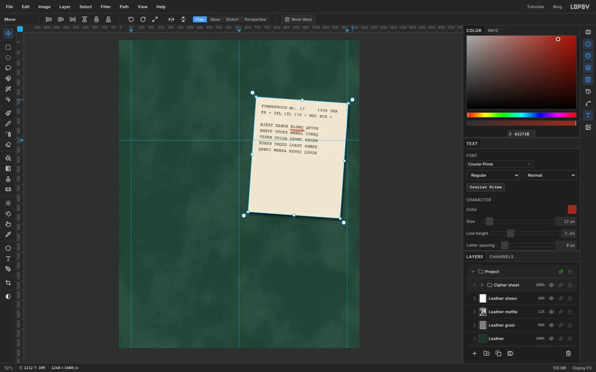

A codebreaker has been at this sheet. Select the *Cipher text* layer and add a layer called *Red pencil* above it. Pick the **Brush** at size **4**, Hardness **80**, Opacity **90%**, in `#A3271B`, and draw two short, slightly wobbly strokes under the group **KLSMU**: one right under the letters and one a few pixels lower.

Now tilt the whole sheet. Collapse the *Cipher sheet* group with its arrow and click its row, so the group is selected. Pick the **Move** tool. A transform box appears around the sheet. Move the pointer just outside the top-right corner handle until it becomes a rotate cursor, drag down about **4°**, and press [[Enter]] to apply.

## Draw the walnut case

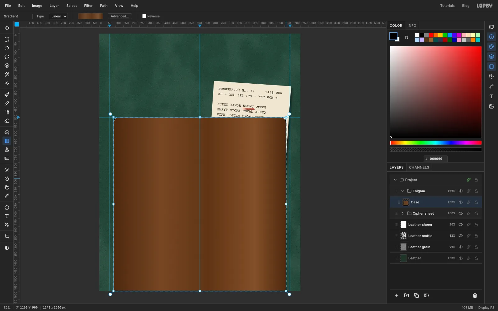

With the *Cipher sheet* group still selected, click **New Group** and name it *Enigma*. Everything that belongs to the machine goes in here, so you can turn it later in one move.

Add a layer called *Case*. With the **Shape** tool still on **Rectangle**, set Corner Radius to **34** and click once at **624**, **1080** (on the centre guide, well below the horizontal guide). Make it **1072** × **1120**. Its top edge lands on the 520 px guide, and its bottom runs a little off the page, which is what you want: the machine is cropped by the bottom of the cover.

[[Cmd]]-click the *Case* thumbnail. Pick the **Gradient** tool, set it to **Linear**, open the gradient editor and set five stops: `#4A2B14`, `#70482A` at 28%, `#5B361B` at 55%, `#7C5130` at 82% and `#4A2B14` at the end. Drag from the left edge of the case to the right edge, holding [[Shift]] to keep it level. The uneven bands read as boards of wood rather than a smooth gradient.

## Add the vertical grain

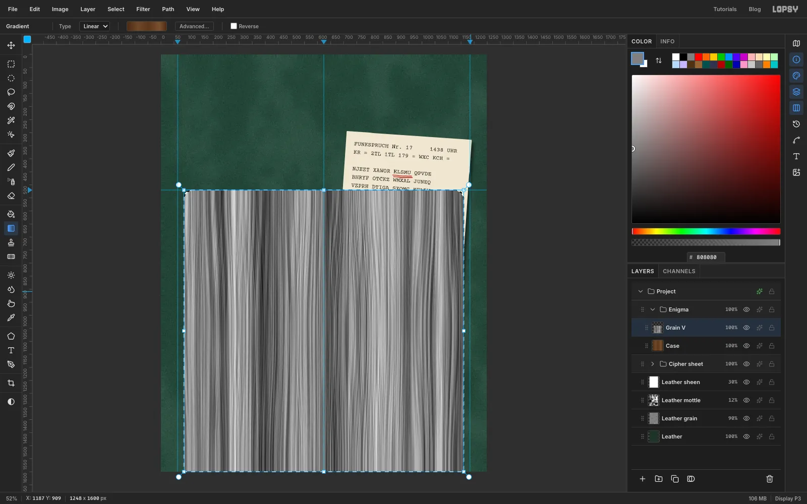

Keep the case selected. Add a layer called *Grain V* and fill the selection with `#808080`. Run **Filter → Fibers** with Variance **40** and Strength **50**. Fibers draws long vertical strands, like grain running down a plank, and stays inside the selection.

The top and bottom rails of a real box run sideways, so their grain should too. With the **Lasso**, draw a trapezoid around the top rail. The panel you'll add next will start 52 px inside the case on every side, at **140**, **572** and **1108**, **572** at the top. Start just outside the case's top-left corner, go across to just outside its top-right corner, then in to **1108**, **572**, along to **140**, **572**, and back to the start. Hold [[Shift]] and draw the matching trapezoid around the bottom rail: from **140**, **1508** to **1108**, **1508**, then out and down past the case's bottom corners, off the bottom of the page. Press [[Delete]] to clear the fibres from both rails, then deselect.

## Make sideways grain for the rails

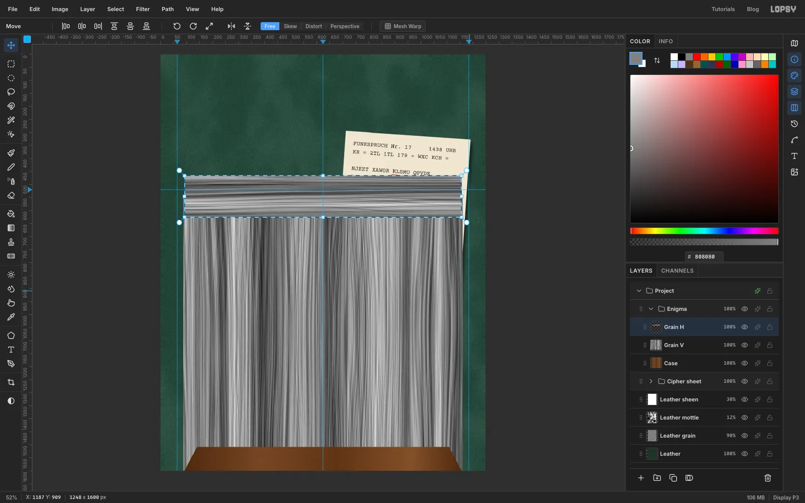

Fibers only draws vertical strands, so draw them on a tall strip and turn the strip on its side.

Add a layer called *Grain H*. With the **Rectangular Marquee**, select a strip **160** px wide and about **1064** px tall, centred on the centre guide, from near the top of the page down to about 1078 px. Clicking once with the marquee without dragging opens the exact-corners dialog, so you can type **544**, **14** and **704**, **1078**. Fill it with `#808080` and run **Fibers** again with the same settings.

Pick the **Move** tool and click **Rotate 90° CW** in the options bar. The strip turns about its own centre and lands across the top rail. Deselect.

## Copy the grain to the bottom rail

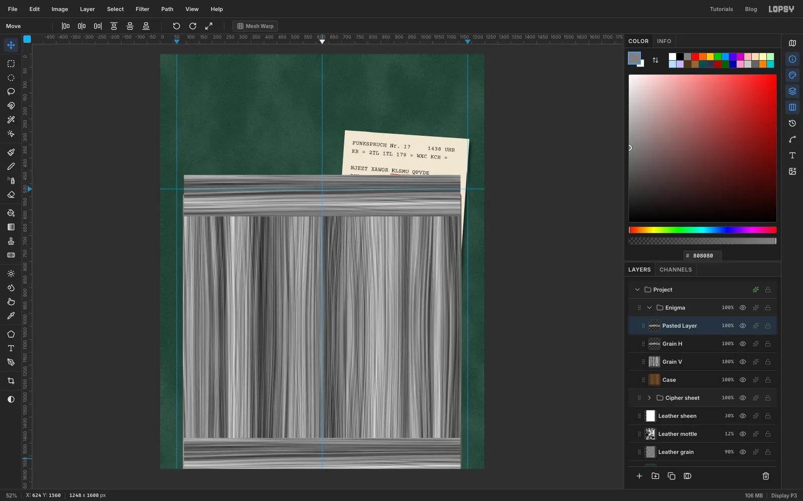

Select the turned strip again (the marquee dialog makes this easy: **90**, **466** to **1158**, **626**), press [[Cmd]]+[[C]], then [[Cmd]]+[[V]]. The copy lands on a new layer in the same place. Deselect, and with the **Move** tool drag the copy straight down about **1014** px, until it covers the bottom rail. Choose **Layer → Merge Down** to merge it into *Grain H*.

## Trim the grain and blend it in

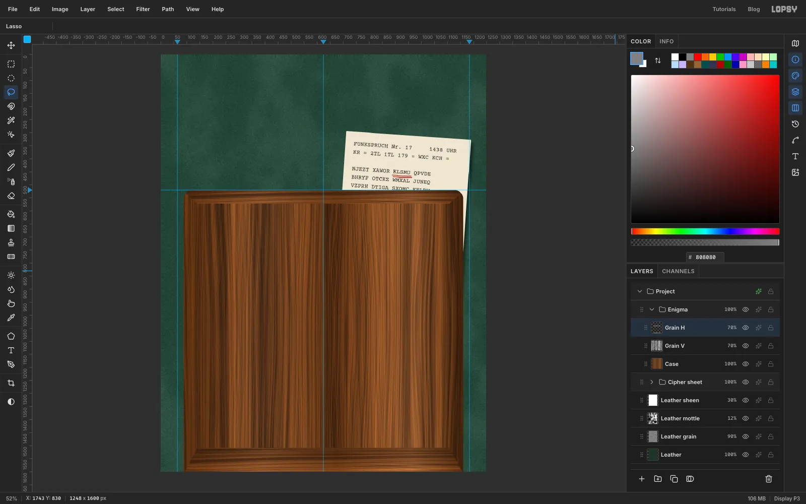

Lasso the two rail trapezoids again (the second with [[Shift]]), choose **Select → Inverse** and press [[Delete]]. That clears the strips everywhere except the rails. Then [[Cmd]]-click the *Case* thumbnail, choose **Select → Inverse** and press [[Delete]] again to trim the strips to the rounded corners. Deselect.

Set both *Grain V* and *Grain H* to **Overlay** at **70%**. The grey disappears and only the light and dark streaks show, so the brown gradient underneath becomes walnut.

Add a layer called *Mitres*. Pick the **Pencil** at size **2** in `#24130A`. At each top corner, click the panel's corner (52 px in from both edges) and [[Shift]]-click the case's outer corner, to draw the 45° joint where two boards meet. The bottom rail is much deeper than the sides, and its change of grain already shows the joint, so it doesn't need a line.

## Paint the panel in crinkle finish

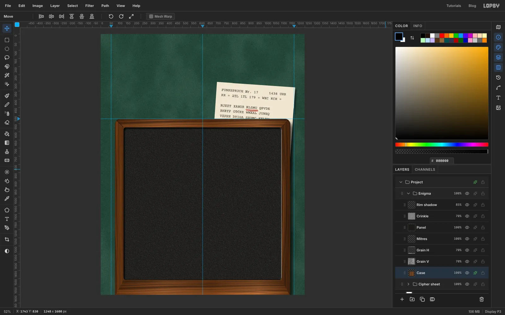

Add a layer called *Panel*. Use the **Shape** tool to click-create a **968** × **936** rectangle with Corner Radius **16** at **624**, **1040**. [[Cmd]]-click it and fill it with `#1C1B19`.

Enigmas were painted in a black wrinkle finish. Keep the selection, add a layer called *Crinkle*, fill it with `#808080`, and run **Add Noise** (Amount **60**, **Mono**, **Gaussian**), **Gaussian Blur** (Radius **0.8**) and **Emboss** (Angle **135**, Strength **40**). Deselect and set it to **Hard Light** at **70%**. Hard Light keeps the bumps visible on near-black, where Overlay would hide them.

The wooden rim stands above the panel, so it should cast a shadow inside the panel's top-left edge. Add a layer called *Rim shadow*:

1. [[Cmd]]-click *Panel*, choose **Select → Grow** with **40**, and fill with black.
2. [[Cmd]]-click *Panel* again and press [[Delete]]. You now have a black frame around the panel.
3. Deselect, run **Gaussian Blur** at **10**, and with the **Move** tool nudge the layer **7** px right and **9** px down with the arrow keys.
4. [[Cmd]]-click *Panel*, choose **Select → Inverse**, press [[Delete]] and deselect. Set the layer to **85%** opacity.

Finally select *Case* and add two effects: an **Inner Glow** in `#120904` at Size **14** and Opacity **55**, which darkens the rounded outer edge of the wood, and a **Drop Shadow** with Offset X **14**, Offset Y **22**, Blur **34** and Opacity **75**, so the machine sits on the desk.

## Add the rotor rings

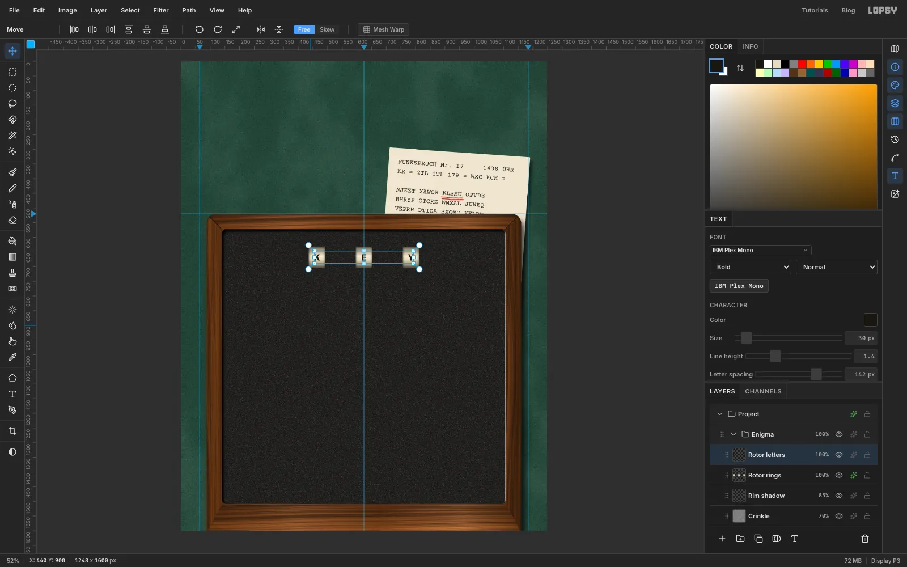

The rotors sit under a metal plate, and you see one letter of each through a little window. Draw the rotor rings first, then lay the plate over them.

Select *Rim shadow* and add a layer called *Rotor rings*. With the **Rectangular Marquee**, drag three rectangles **56** × **72**, holding [[Shift]] for the second and third so they add up: **436**, **632** to **492**, **704**; **596**, **632** to **652**, **704**; and **756**, **632** to **812**, **704**. The pointer position shows in the status bar while you drag. They're centred on **464**, **624** and **784** across. Fill them with ivory `#E6DCC2`, then drag a vertical **Linear** gradient from their top edge to their bottom edge with stops `#6E6552`, `#F3EAD3` at 45%, `#E6DCC2` at 60% and `#6E6552`. Dark top and bottom edges make them read as the curved face of a wheel. Deselect, and give the layer a black **Inner Glow** at Size **12**, Opacity **80**.

Now the letters. Pick the **Text** tool, choose **IBM Plex Mono**, **Bold**, size **30**, colour `#1A1712`, click in an empty part of the panel and type **KEY**. Commit with [[Tab]], rename the layer *Rotor letters*, and set **Letter spacing** to **142**.

Why 142? IBM Plex Mono is a monospaced font: every letter is 0.6 of the type size wide, so 18 px at size 30. The windows are 160 px apart, and 160 − 18 = 142. Switch to the **Move** tool and nudge the text with the arrow keys until the E sits in the middle tile.

## Brush the aluminium plate

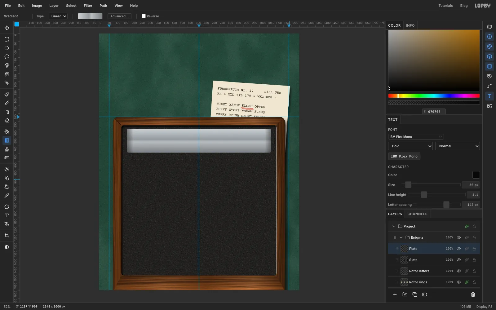

Add a layer called *Slots* and fill three dark `#070707` rectangles, **30** × **118**, each centred **54** px to the right of a window: **503**, **609** to **533**, **727**; **663**, **609** to **693**, **727**; and **823**, **609** to **853**, **727** (drag the first, [[Shift]]-drag the others). These are the holes the thumbwheels poke through.

Add a layer called *Plate*. Click-create a **900** × **150** rectangle with Corner Radius **12** at **624**, **668**. [[Cmd]]-click it and drag a vertical **Linear** gradient from its top edge to its bottom edge: `#CDD1D5`, `#959A9E` at 45%, `#B8BCC0` at 55% and `#7C8084`. Then, still selected:

1. **Add Noise**, Amount **30**, **Mono**, **Gaussian**.
2. **Motion Blur**, Angle **0**, Distance **80**.

The blur drags every speck of noise into a short horizontal line. That's exactly what brushed metal looks like. Deselect.

## Cut the windows and slots

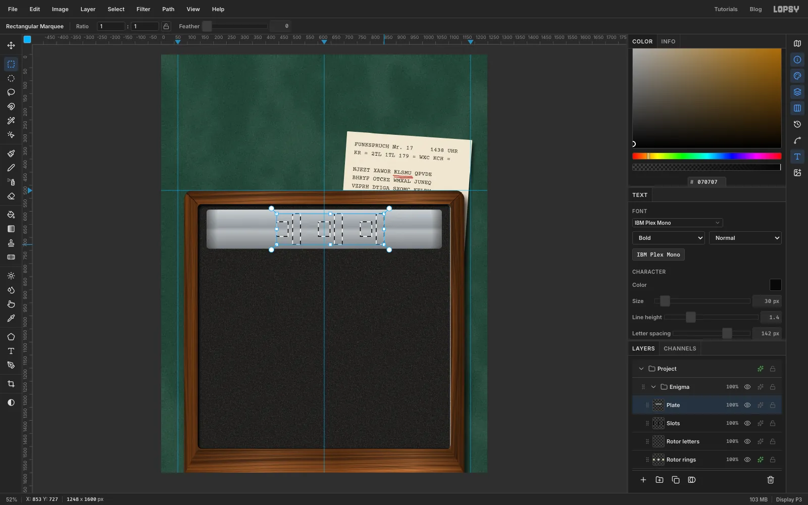

Still on *Plate*, drag a **44** × **56** rectangle over each window (**442**, **640** to **486**, **696**, then the same 160 and 320 px further right), holding [[Shift]] for every one after the first, and add the three slot rectangles from the last step the same way. Press [[Delete]] to punch them all out. The ivory rings and the dark slots now show through, framed by the plate. Deselect.

Give *Plate* three effects:

- **Drop Shadow**, Offset X **4**, Offset Y **6**, Blur **6**, Opacity **90**. Because the windows are holes in the plate, this shadow falls inside their top and left edges, so the letters look sunk below the metal.
- **Inner Glow** in white, Size **3**, Opacity **70**: a bright bevel on the plate's edge.
- **Stroke**, Width **1**, `#3A3D40`: a crisp dark outline.

## Knurl a brass thumbwheel

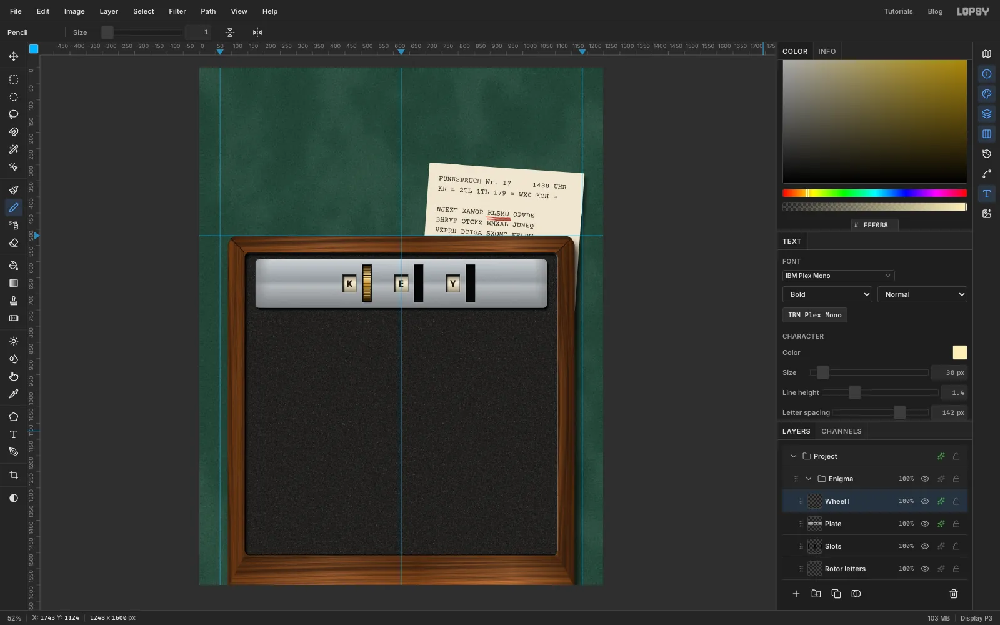

Add a layer called *Wheel I*. Select a **22** × **108** rectangle centred in the first slot and drag a vertical **Linear** gradient over it from top to bottom: `#3E2C0E`, `#F2D88E` at 30%, `#C79B48` at 50% and `#3E2C0E`. The bright band near the top makes it read as a lit cylinder. Deselect.

Now the grip ridges. Pick the **Pencil** at size **1** in `#1E1405`. Click at the wheel's left edge and [[Shift]]-click at its right edge to draw a hairline straight across, and repeat for about 17 lines. Space them about 8 px apart in the middle and closer together towards the top and bottom: the wheel is round, so its ridges crowd together where it curves away from you. Then switch to `#FFF0B8` and draw a short bright line just under each of the middle dark lines. Dark groove plus bright ridge is what makes knurling look three-dimensional.

Give the wheel a **Drop Shadow**: Offset X **3**, Offset Y **5**, Blur **4**, Opacity **90**.

## Add the other wheels, screws and engraving

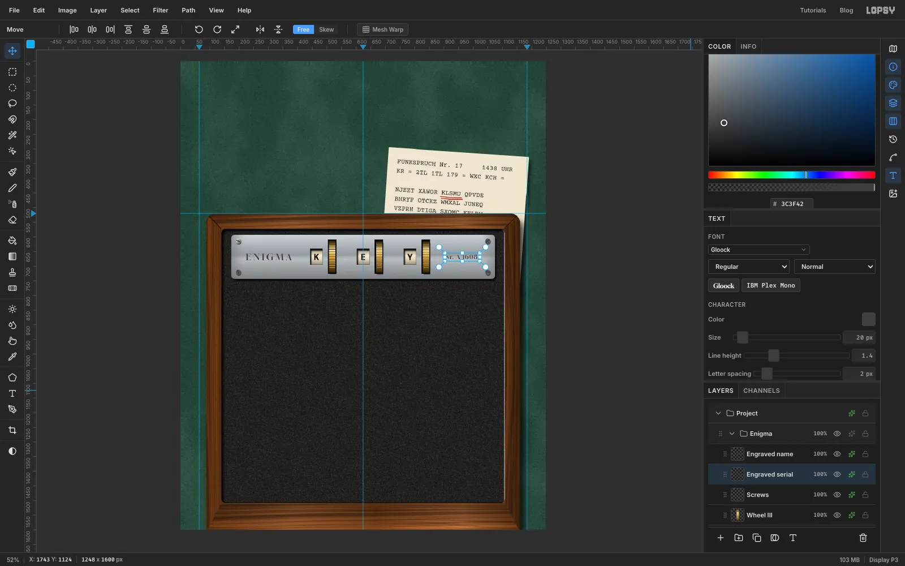

Click **Duplicate Layer** and move the copy **160** px to the right with the **Move** tool, into the second slot; use the arrow keys to land it exactly. Duplicate again and move that copy **320** px from the first wheel, into the third slot. Name them *Wheel II* and *Wheel III*.

Add a layer called *Screws*. With the **Elliptical Marquee**, drag four **18** px circles, one about 24 px in from each corner of the plate (centred near **198**, **615** and **1050**, **615** at the top, and **198**, **721** and **1050**, **721** at the bottom), holding [[Shift]] to add them up. Fill them with steel grey `#8C9094`; for extra shine, drag a short diagonal **Linear** gradient from `#E3E6E8` to `#55595C` across a screw. Deselect, and with the **Pencil** at size **2** in `#2B2D2F`, draw a slot across each screw at a different angle: real screws never line up. Add a small **Drop Shadow** (Offset X **1**, Offset Y **2**, Blur **2**, Opacity **70**).

For the engraving, select *Screws* first, then make two text layers in **Gloock** in `#3C3F42`: **ENIGMA** at size **30** with Letter spacing **7**, named *Engraved name* and centred in the space to the left of the first window, and **Nr. A 16081** at size **20** with Letter spacing **2**, named *Engraved serial*, to the right of the last wheel. Give each a **Drop Shadow** in **white** with Offset X **0**, Offset Y **1.5**, Blur **1** and Opacity **70**. A thin light edge under dark letters is the classic engraved look: the bottom lip of each cut catches the light.

## Draw one lamp

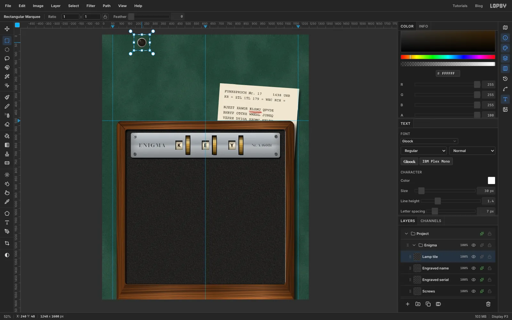

The lampboard has 26 identical lamps. Draw one, turn it into a pattern, and let Lopsy repeat it.

Select *Engraved name* and add a layer called *Lamp tile*. Draw it in an empty spot near the top of the page, inside the square from **192**, **0** to **288**, **96**, so its centre is at **240**, **48**:

1. Select a **56** px circle centred there. Use the exact-corners dialog (click once with the **Elliptical Marquee**: **212**, **20** to **268**, **76**). Dragging near a guide can snap the edges to it and squash the circle.
2. Fill it, then drag a diagonal **Linear** gradient across it from `#B0AA9F` at the top-left to `#5E5A53` at the bottom-right. This is the metal bezel. Deselect with [[Cmd]]+[[D]], because the exact-corners dialog only opens when nothing is selected.
3. Select a **46** px circle with the same centre (**217**, **25** to **263**, **71**) and drag a **Radial** gradient from the centre to the edge, `#2F2922` to `#15120F`. This is the smoked-glass lens.
4. For a glint, select a small circle about 10 px across just up and left of centre, **Feather** it by **3**, and fill it white at **25%** opacity (set the colour's A value to 25). Deselect.

Select the whole **96** × **96** square (**192**, **0** to **288**, **96**) and choose **Edit → Define Pattern**. Then delete the *Lamp tile* layer: the pattern keeps a copy.

## Fill the lampboard

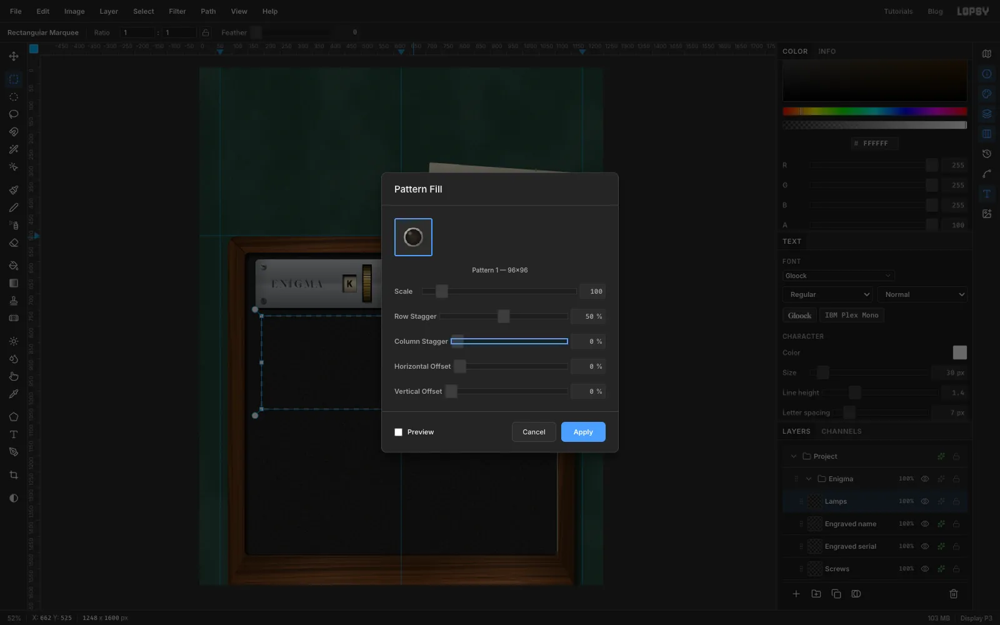

Add a layer called *Lamps*. Select the rectangle from **192**, **768** to **1056**, **1056**. That's nine lamps wide and three rows tall.

Choose **Edit → Fill with Pattern**, click the lamp pattern, and set **Row Stagger** to **50%**. Row Stagger shifts each row of tiles sideways by half a tile, which is exactly how the rows of an Enigma, and of a typewriter, are offset. Click **Apply**.

## Trim the middle row and lower the lamps

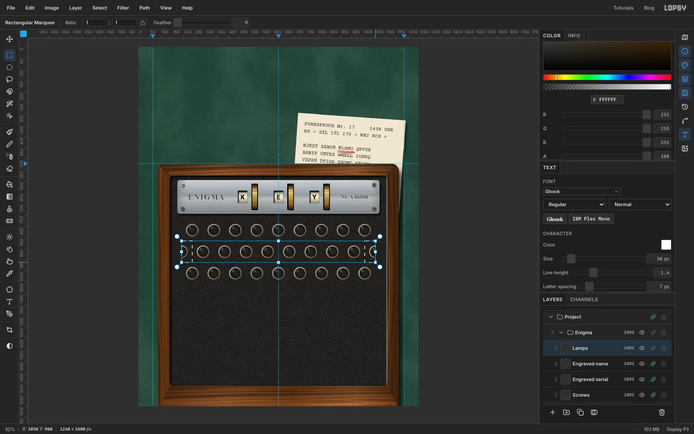

Because the middle row is shifted by half a lamp, it has a half lamp at each end. Select the left 48 px of the middle row and, with [[Shift]], the right 48 px, and press [[Delete]]. The middle row now has eight whole lamps, like the real machine. Deselect.

The lamps sit a little close to the plate. With the **Move** tool, drag the *Lamps* layer down **48** px (half a row), using the arrow keys to land it exactly. Add a **Drop Shadow**: Offset X **2**, Offset Y **4**, Blur **5**, Opacity **70**.

## Letter the lamps

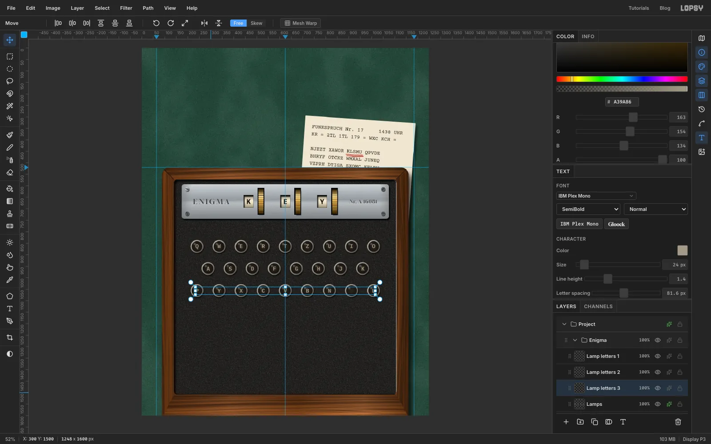

The Enigma's letters follow a German QWERTZ typewriter, except that P and L moved down to the bottom row. With *Lamps* selected each time, make three text layers in **IBM Plex Mono**, **SemiBold**, size **24**, colour `#A39A86`, set **Letter spacing** to **81.6** on each, and name them *Lamp letters 1*, *2* and *3*, top to bottom. The lamps are 96 px apart and each letter is 24 × 0.6 = 14.4 px wide, so 96 − 14.4 = 81.6.

- `QWERTZUIO`
- `ASDFGHJK`
- `PYXCVBN L`, with a space instead of the M, which you'll light up separately

Click each one into empty space, then nudge it with the **Move** tool until its first and last letters sit in the middle of the first and last lenses. In a monospaced font, the letters in between fall into place on their own.

## Light the M lamp

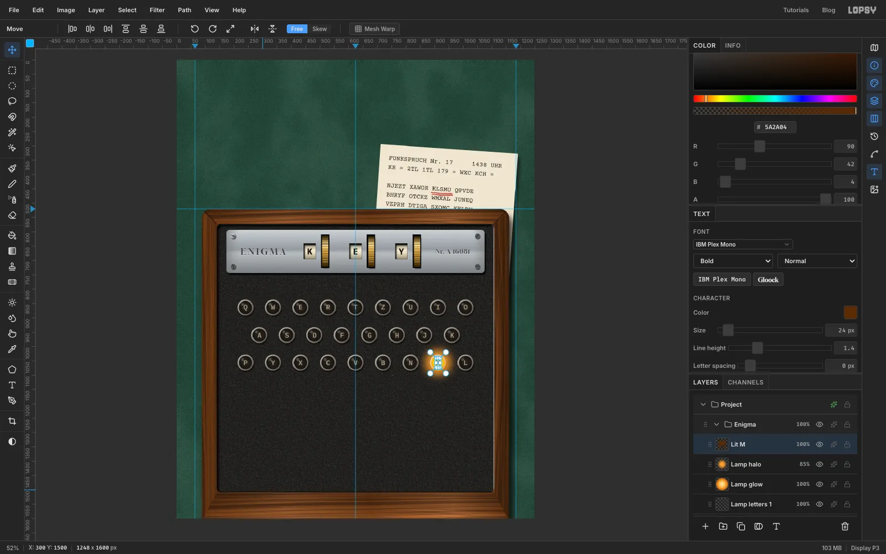

Select *Lamp letters 1* and add a layer called *Lamp glow*. Select a **46** px circle over the empty lens in the bottom row and drag a **Radial** gradient from its centre to its edge: `#FFF1C4`, `#FFB23A` at 55% and `#C55A08`. Deselect.

Add a layer called *Lamp halo*. Select a circle about **92** px across on the same lamp, fill it with `#FF9F2E`, deselect, and run **Gaussian Blur** at **40**. Set it to **Screen** at **85%**. Screen only ever lightens, so the halo warms the panel and the neighbouring bezels without muddying them.

Add the letter on top: **M** in IBM Plex Mono **Bold** size **24**, in dark amber `#5A2A04`, named *Lit M* and nudged into the centre of the lit lens. On the real machine the letters were printed dark on the lamp glass, so the lit one shows a dark letter against the bright bulb.

## Draw one key

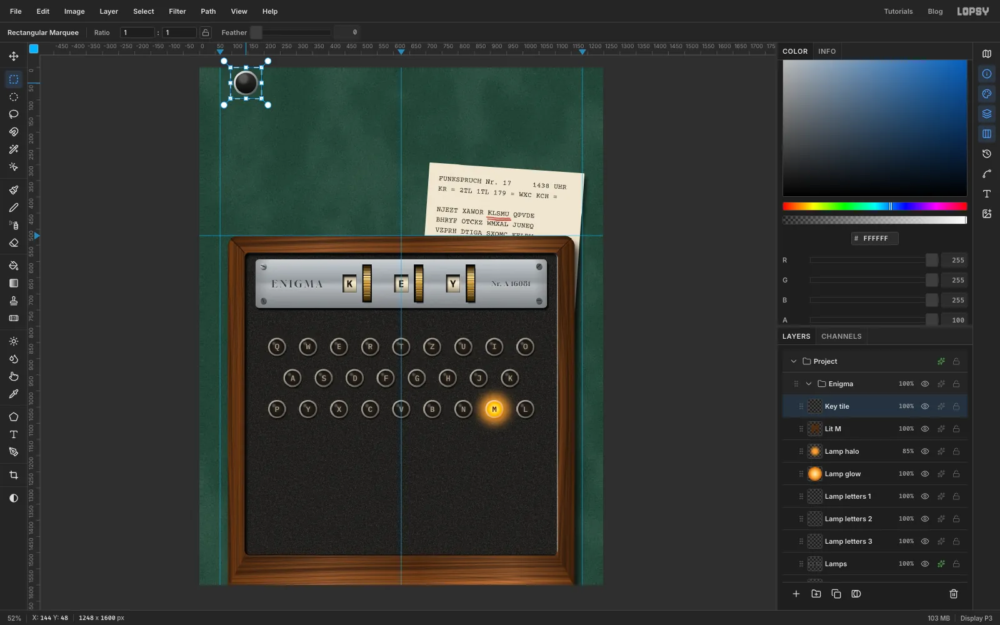

Keys work the same way. Select *Lit M*, add a layer called *Key tile*, and draw it centred at **144**, **48**, inside the square from **96**, **0** to **192**, **96**:

Deselect between the circles so the exact-corners dialog opens each time.

1. A **76** px circle with a diagonal **Linear** gradient, `#F2F4F5` → `#9A9EA2` → `#4A4E52`, from top-left to bottom-right: the chrome rim.
2. A **64** px circle with a vertical gradient, `#34322F` to `#0A0A0A`: the Bakelite cap.
3. A **32** px circle a little up and left of centre, **Feather**ed by **7**, filled white at **22%**: the gloss.

Select the 96 × 96 square, choose **Edit → Define Pattern**, and delete the tile layer.

## Fill the keyboard

Add a layer called *Keys*. Select the rectangle from **192**, **1152** to **1056**, **1440**, choose **Edit → Fill with Pattern**, click the key pattern (the newest one), set **Row Stagger** to **50%** and click **Apply**. Delete the two half keys at the ends of the middle row, just as you did for the lamps.

Add a **Drop Shadow** with Offset X **4**, Offset Y **8**, Blur **9**, Opacity **80**. The keys stand taller than the lamps, so their shadow is longer.

## Press the E key

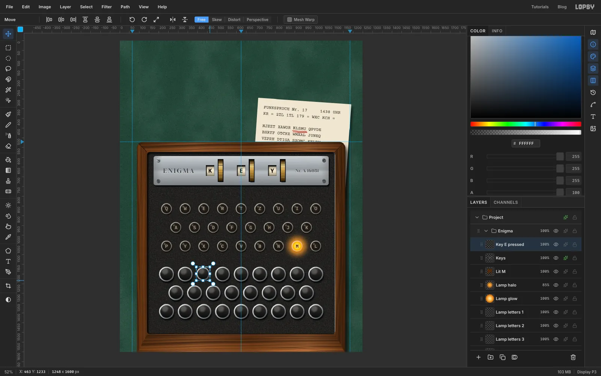

Somebody has just pressed E, and that's what lit the M. Never the same letter: an Enigma could never encrypt a letter as itself, the flaw the cover story is about.

Select the E key (third in the top row) with a circle about 80 px across and press [[Cmd]]+[[X]], then [[Cmd]]+[[V]]. The key comes back on its own layer, in the same place; name it *Key E pressed*. With the **Move** tool, nudge it 3 px down with the arrow keys, so it sits a little lower than its neighbours.

Make it smaller, as if it has dropped into the machine. Select a box just around the key, then hold [[Cmd]] and drag the bottom-right corner handle about 10 px up and left, to about 87%. Press [[Enter]], deselect and nudge it back to the centre of its gap.

Then:

- **Filter → Brightness/Contrast**, Brightness **−22**, Contrast **−10**, so it falls into shade.
- A black **Inner Glow**, Size **9**, Opacity **65**, in place of a drop shadow. A pressed key doesn't stand up, so it casts no shadow; its edges are shaded instead.

## Letter the keys

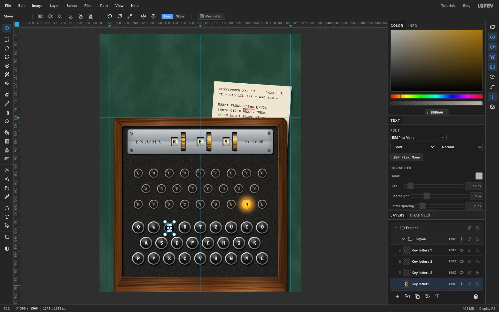

With *Key E pressed* selected each time, make three text layers in **IBM Plex Mono**, **Bold**, size **30**, colour `#EFE8D8`, with **Letter spacing** **78** (96 − 30 × 0.6), named *Key letters 1*, *2* and *3*:

- `QW RTZUIO` (with a space instead of the E)
- `ASDFGHJK`
- `PYXCVBNML`

Centre each row on its keys as you did for the lamps. Then make a separate **E** at size **27** in a dimmer `#BDB6A6`, name it *Key letter E*, and nudge it onto the pressed key, a couple of pixels below the other letters in its row.

## Turn the whole machine

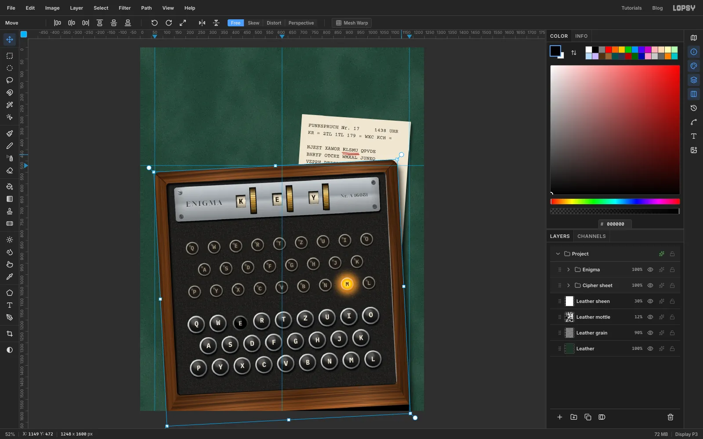

A machine sitting perfectly square looks like a diagram. Collapse the *Enigma* group and click its row to select the whole group. Pick the **Move** tool: the transform box wraps everything in the group. Drag just outside the top-right corner handle upwards to turn it about **3°** anticlockwise, and press [[Enter]].

Every layer turns together, including the live text and the effects, and the shadows still fall down and to the right because effects are drawn after the turn.

> **Tip:** This is a good moment to try undo and redo. [[Cmd]]+[[Z]] puts the machine back square in one step, and [[Cmd]]+[[Shift]]+[[Z]] turns it again.

## Cut the manila tag

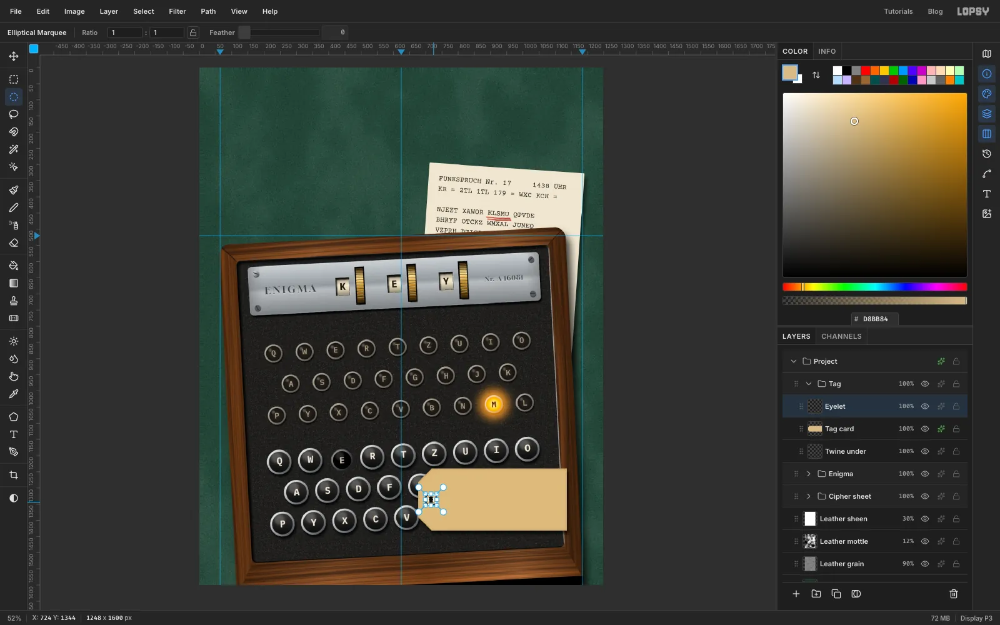

With the collapsed *Enigma* group selected, click **New Group** and name it *Tag*. Add two layers inside it: *Twine under* first (leave it empty for now), then *Tag card*.

On *Tag card*, use the **Lasso** to draw the classic shipping-tag shape: a rectangle about **460** × **192** px whose left end has its two corners clipped off at 45° by about 40 px. Place it over the right half of the keys, with its top edge in the gap between the first and second rows of keys and its right end hanging over the wooden rail. Fill it with manila `#D8BB84` and add **Add Noise** at **10** (**Mono**, **Gaussian**). Deselect. Select a **16** px circle about 40 px in from the pointed end and press [[Delete]] to punch the string hole.

Give the card an **Inner Glow** in `#7A5A2C` at Size **12**, Opacity **45**, which looks like the edges have been handled, and a **Drop Shadow** with Offset X **6**, Offset Y **10**, Blur **14**, Opacity **70**.

Add a layer called *Eyelet*. Drag a **36** px circle centred on the hole, then hold [[Option]] and drag a smaller circle, about **16** px across, right over the hole to subtract it, leaving a ring. Fill it with `#C2A066` and add a small **Drop Shadow** (Offset X **1**, Offset Y **1**, Blur **2**, Opacity **50**).

## Type the tag

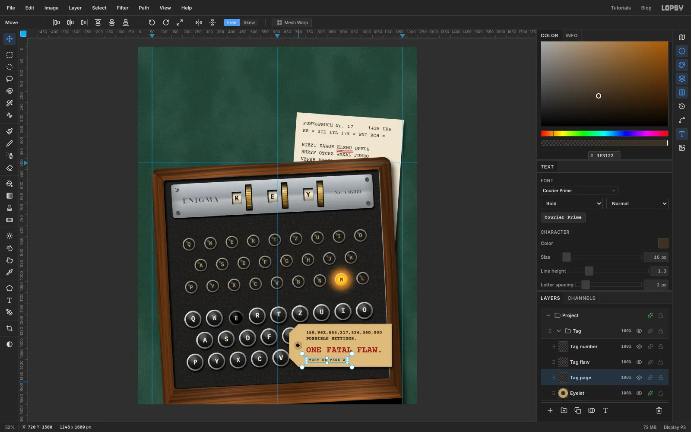

With *Eyelet* selected each time, add three text layers in **Courier Prime**, **Bold**:

- *Tag number*: `158,962,555,217,826,360,000` and, on a second line, `POSSIBLE SETTINGS.` at size **21** in `#2B2117`, with Line height **1.3**. That really is the number of possible daily keys for the army's three-rotor Enigma.
- *Tag flaw*: `ONE FATAL FLAW.` at size **38** in brick red `#8E2A1E`.
- *Tag page*: `STORY ON PAGE 22` at size **16** in `#3E3122`, Letter spacing **2**.

Line up their left edges about 38 px right of the eyelet. Keep the right margin about the same as the space between the eyelet and the text.

## Tilt the tag and thread the twine

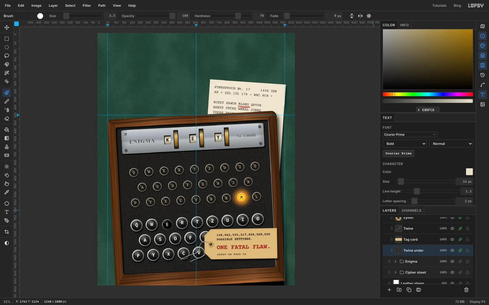

Collapse the *Tag* group, select it, and with the **Move** tool turn it about **1°** anticlockwise from its top-right rotate handle. Press [[Enter]]. It now lies almost, but not quite, square with the keys, as if somebody dropped it there.

Expand the group again. Select *Tag card* and add a layer called *Twine*. Pick the **Brush** at size **3.5**, Hardness **70**, in `#E8DFC8`. Start in the middle of the eyelet hole and drag a loop up and out to the left, then down and away across the keys, so the strand looks like it comes out of the hole. The layer sits under *Eyelet*, so the brass ring stays on top of the string, as it would on a real tag. Add a **Drop Shadow** with Offset X **2**, Offset Y **3**, Blur **2**, Opacity **75**: thin, close shadows keep it lying flat on the keys.

Select the empty *Twine under* layer and draw the other end of the loop from the hole down under the tag's edge. Because this layer is under the card, the string seems to go *through* the hole. Give it the same drop shadow.

## Set the gold masthead

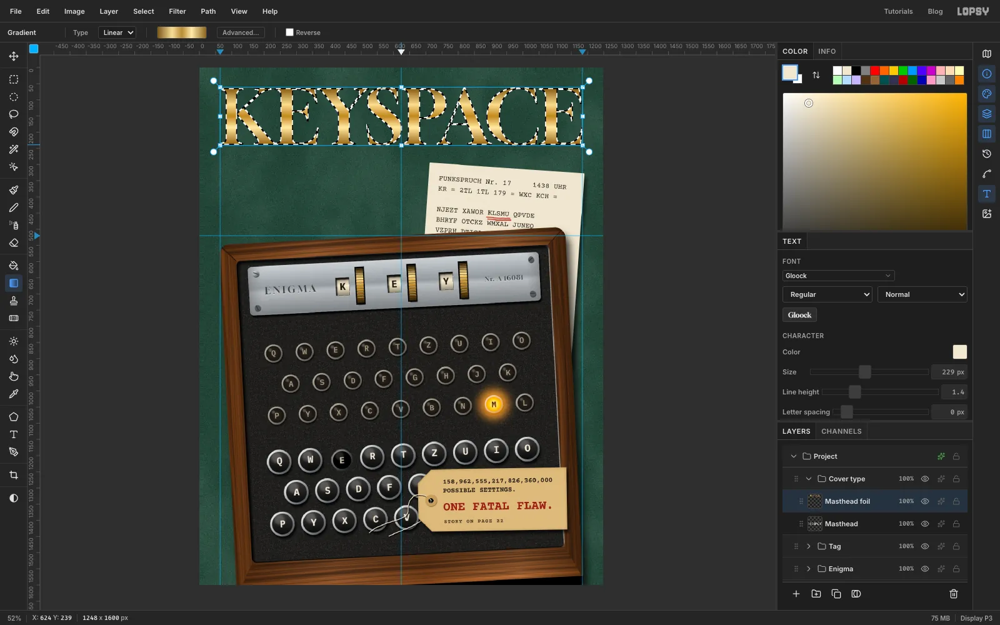

With the collapsed *Tag* group selected, click **New Group** and name it *Cover type*.

Pick the **Text** tool, choose **Gloock** in cream `#F1E7CF`, and type **KEYSPACE** in an empty spot. Name the layer *Masthead*. Change the **Size** in the Text panel until the word runs exactly from the 64 px guide to the 1184 px guide, about **229**, then move it so the tops of the letters are about 62 px from the top of the page.

Now gild it. [[Cmd]]-click the *Masthead* thumbnail to select the letter shapes, add a layer called *Masthead foil*, and drag a vertical **Linear** gradient from the top of the letters to the bottom with five stops: `#7A5518`, `#F6DE97` at 30%, `#B98A35` at 50%, `#FFE9A8` at 70% and `#8C6420`. Alternating light and dark bands are what make a gradient read as polished metal rather than yellow. Deselect, then add a 1 px **Stroke** in `#4A3410` and a **Drop Shadow** with Offset X **4**, Offset Y **6**, Blur **8**, Opacity **80**.

## Set the cover lines

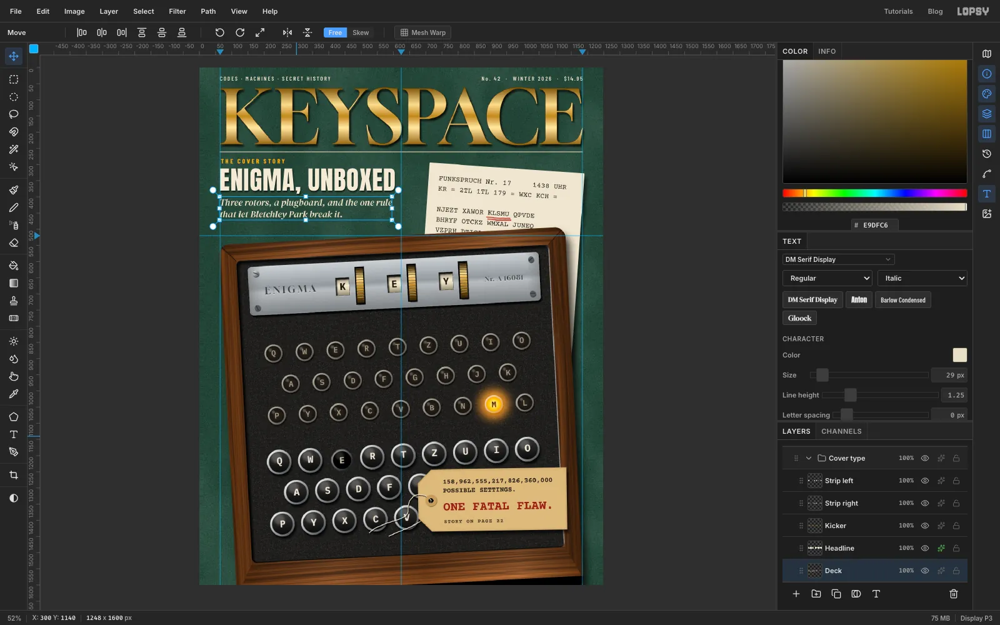

Add a layer called *Rules*. With the **Pencil** at size **2** in cream `#F1E7CF`, click at the left guide about 22 px under the masthead and [[Shift]]-click at the right guide to draw a rule across the page.

With *Rules* selected before each one, add the type, naming each layer as given. Every left-aligned line starts on the 64 px guide, and the one right-hand line ends on the 1184 px guide:

- The folio, in **Barlow Condensed** **SemiBold** **18**, `#E9DFC6`, Letter spacing **3.5**, with the tops of its capitals about 28 px from the top of the page: *Strip left* `CODES · MACHINES · SECRET HISTORY` at the top left, and *Strip right* `No. 42 · WINTER 2026 · $14.95` at the top right, on the same line.
- The *Kicker* `THE COVER STORY` in **Barlow Condensed** **Bold** **20**, amber `#FFB23A`, Letter spacing **5**, about 22 px under the rule.
- The *Headline* `ENIGMA, UNBOXED` in **Anton** **80**, `#F3EAD6`, Letter spacing **1**, about 16 px under the kicker, with a **Drop Shadow** (Offset X **2**, Offset Y **4**, Blur **6**, Opacity **70**).
- The *Deck* in **DM Serif Display** **Italic** **29**, `#E9DFC6`, Line height **1.25**, about 18 px under the headline: `Three rotors, a plugboard, and the one rule` / `that let Bletchley Park break it.`

> **Tip:** When you start a new text layer, set its font and size with a non-text layer selected. With a text layer selected, changing the options restyles that layer instead.

## Add the footer band and barcode

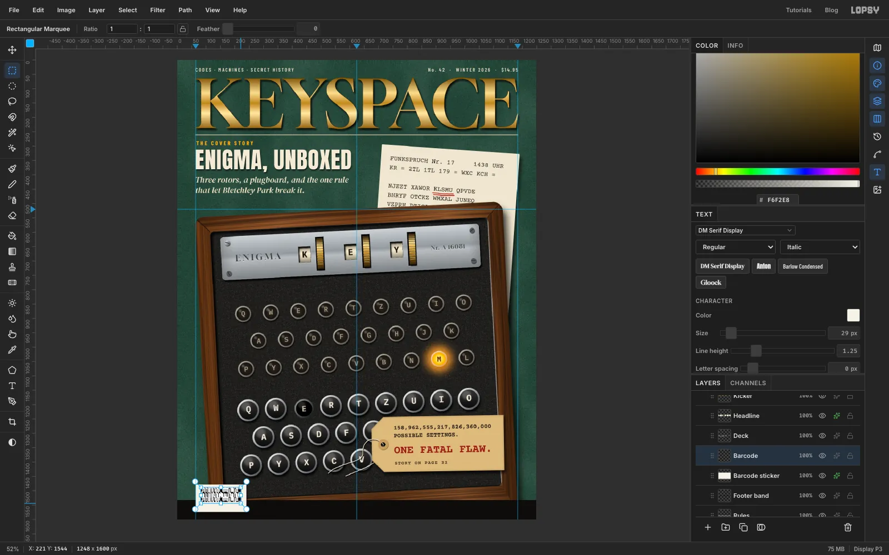

Select *Rules*, add a layer called *Footer band*, and fill the strip from **1532** px down to the bottom of the page with `#0E0C0A`.

Add a layer called *Barcode sticker* and fill a **176** × **96** rectangle from **64**, **1478** to **240**, **1574** with `#F6F2E8`. Give it a **Drop Shadow** (Offset X **3**, Offset Y **5**, Blur **6**, Opacity **60**).

Add a layer called *Barcode*. With the **Rectangular Marquee**, drag a thin vertical bar near the left of the sticker, then hold [[Shift]] and keep adding bars from left to right, between 1 and 4 px wide with 1 to 3 px gaps. Run the bars from about **1488** to **1537** px down, and make the two bars at each end and two in the middle about 7 px longer: those are the guard bars every real barcode has. Fill all the bars at once with `#141210` and deselect. Under them, add `0 74470 01942 6` in **IBM Plex Mono** **Medium** **13**, `#1A1712`, Letter spacing **0.5**, centred on the sticker.

## Finish with the footer line and a vignette

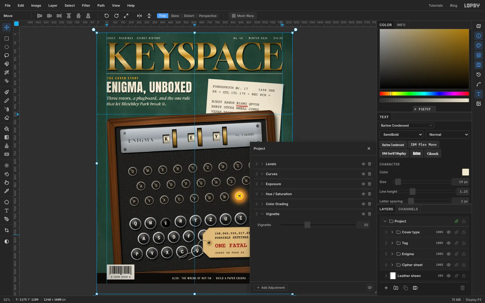

Select *Barcode*, then add the last cover line in **Barlow Condensed** **SemiBold** **19**, `#F1E7CF`, Letter spacing **2**: `ALSO: THE WRENS OF HUT 11A · BUILD A PAPER ENIGMA · ROTOR WIRING, DECODED`. Move it so it ends on the 1184 px guide and its baseline lines up with the bottom of the barcode sticker. Give it a small **Drop Shadow** (Offset X **1**, Offset Y **2**, Blur **3**, Opacity **80**).

Last, darken the corners so the eye stays in the middle. Collapse *Cover type*, click the *Project* row at the top of the Layers panel and open its ✦ drawer. Click **Add Adjustment**, choose **Vignette** and set it to **35**. Do this last, so you judge it on the finished cover.

Save with **File → Save Project** and export with **File → Quick Export PNG**.

> **Tip:** Skeuomorphism lives or dies on consistency. Before you export, zoom in on a few objects and check that every highlight is on the top-left and every shadow is on the bottom-right. One wrong shadow makes the whole picture look fake.
