Look closely at an embroidered patch and you'll see why it's so hard to fake.
Every colour is a field of parallel threads, each field runs in its own
direction, and the light catches each one differently. The edge is a thick
rolled cord of thread, and the whole thing sits slightly proud of the cloth
and casts a shadow.

In this tutorial you'll make **Ibex Backcountry**, a 1800 × 1800 px picture of
an iron-on patch for an imaginary alpine hut-to-hut club, lying on a denim
jacket. You'll start by drawing a tiny tile of thread and turning it into big
sheets of stitching at different angles. From then on, every shape in the
patch gets the same treatment: fill it with a flat colour, clip a thread sheet
to it, and blend the thread in. That one recipe does nearly all the work.

The ibex is traced from a photo,
[Capra ibex moraine du glacier de la Grande-Casse](https://commons.wikimedia.org/wiki/File:Capra_ibex_moraine_du_glacier_de_la_Grande-Casse.jpg)
by Rémih on Wikimedia Commons, licensed
[CC BY-SA 4.0](https://creativecommons.org/licenses/by-sa/4.0/). The screenshots
that show the photo share that license. Download it and resize it to 1800 px
wide before you start. Any side-on photo of a standing ibex or mountain goat
will work, though your outline and tone shapes will then differ from mine.

Two habits make this easier:

- **Most circles are centred on the canvas, at 900, 900.** I'll give you a radius, and you drag the **Elliptical Marquee** from 900 minus the radius to 900 plus the radius on both axes. Radius 672, for example, runs from 228, 228 to 1572, 1572. Hold [[Cmd]] as you drag to keep it perfectly round. The status bar shows the cursor position as you go, and it's worth zooming in for the thin rings.
- **The light comes from the upper left**, so every shadow falls down and to the right.

Along the way you'll use:

- the **Pencil** with [[Shift]]-click lines, **Define Pattern** and **Fill with Pattern** to make thread and twill
- **Define Brush** and the brush **Angle** dial for dashed topstitching
- **Sunburst** for radial threads, sun rays and a beaded edge
- **Add Noise**, **Motion Blur**, **Gaussian Blur**, **Clouds**, **Fibers**, **Threshold**, **Desaturate**, **Brightness/Contrast** and **Posterize**
- the **Lasso**, the **Elliptical Marquee** with [[Alt]] to subtract, the **Magic Wand** with Contiguous off, **Grow**, **Shrink**, **Feather** and **Inverse**
- [[Cmd]]-clicking thumbnails, copy and paste in place, and **Merge Down**
- **Hard Light**, **Overlay**, **Soft Light**, **Screen** and **Multiply**
- rotating and scaling with the **Move** tool
- **Drop Shadow**, **Inner Glow** and **Stroke**
- the **Pen**, **text on a path** and the Alfa Slab One font
- **New Group** and **Group Layers**

The palette:

- Denim `#2C3E56`, crease `#AFC4DA`, seam lip `#8FA8C4`, topstitch `#D9A441`
- Rivet `#D9A27A` → `#8F5429` → `#3F200D`, ring `#2E160A`, glint `#FFE3C6`
- Sky `#BC5320` / `#D5752A` / `#E59633` / `#EFB54F` / `#F6D388`, rays `#FFE7AE`
- Sun `#F2D494`, sun core `#F6E7C2`
- Mountains `#3D7C78` / `#1C4640` / `#122E2A`, pines `#0B211D`, snow `#F5E8C8`
- Ledge `#54463A`, ledge lights `#8C7B66`
- Ibex `#20140E` / `#2A1B13` / `#5A3C24` / `#6A4628` / `#94703F` / `#A5804C`, muzzle `#1E130D`, outline `#33231A`
- Horns `#D9BF8C` / `#A98C5E`, horn ridges `#6E5230`, hooves `#0C0705`, inner ear `#C49A68`
- Band `#0E2420`, lettering `#F5E8C8`, lettering edge `#5A3A18`
- Merrow `#BE4F1C`, merrow shade `#4A1806`, crown `#FFD9B0`, loose thread `#E8742F`

## Start with indigo cloth

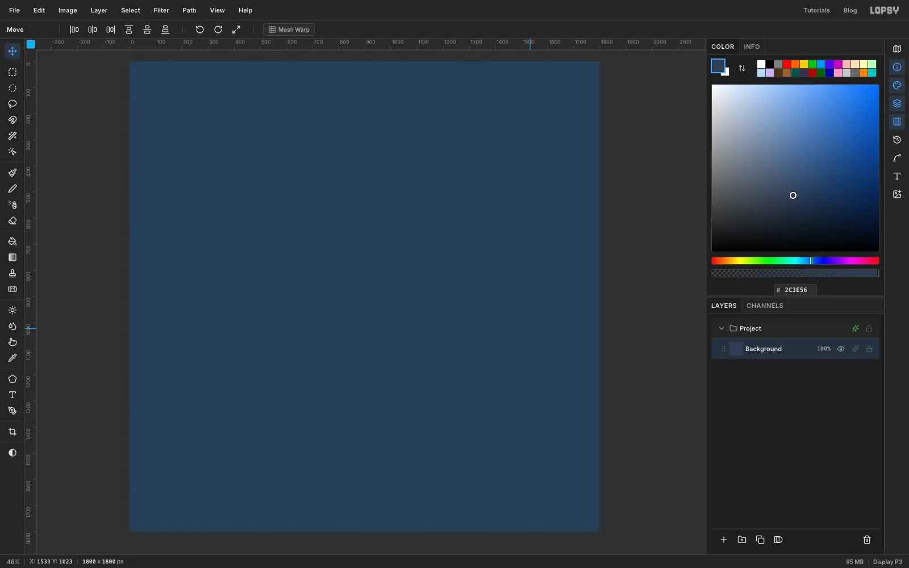

Choose **File → New** and create an **1800 × 1800** px document. Delete the
empty *Layer 1* with the trash button under the Layers panel.

Click *Background*, set the foreground to `#2C3E56` and choose **Edit → Fill**.
Run **Filter → Add Noise…** with **Amount 40**, **Mono** and **Gaussian**. Then
run **Filter → Motion Blur…** with **Angle 90** and **Distance 26**. The specks
stretch into vertical streaks, like the uneven yarns in real denim.

## Draw a twill tile

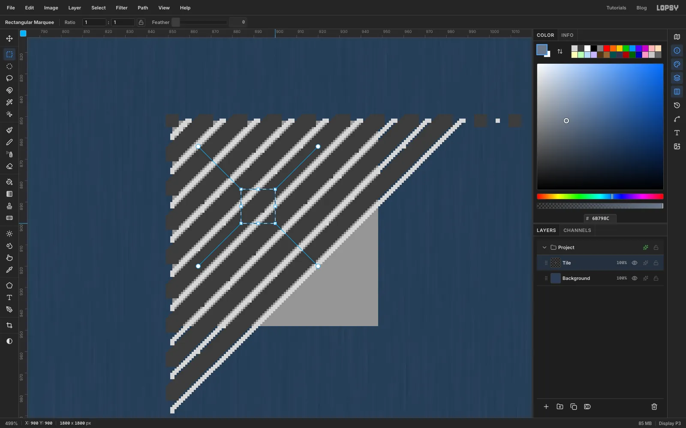

Denim is woven in diagonal ridges called twill. You'll draw a small tile of them.

Click **Add Layer** and name it *Tile*. Zoom in on the middle of the canvas to
about 500%. Use the **Rectangular Marquee** to draw a square about 96 px wide,
fill it with `#969696`, and press [[Cmd+D]] to deselect.

Pick the **Pencil** at **Size 6** with `#3C3C3C`. Draw diagonal lines across the
square, going from the top edge down to the left edge: click on the top edge,
then [[Shift]]-click the same distance down the left edge. Start each new line
exactly 16 px further along than the last. Six or seven lines are plenty, because
you only need stripes around the centre of the square. Don't worry about the rest.

Set the Pencil to **Size 2** with `#D6D6D6` and draw a thin line halfway between
each pair of dark ones, so 8 px along from each.

Now draw a marquee of exactly **16 × 16 px** near the centre of the stripes.
Because the lines repeat every 16 px, this little square tiles without a seam.
Choose **Edit → Define Pattern**. Press [[Cmd+D]], then delete the *Tile* layer.

## Weave the denim

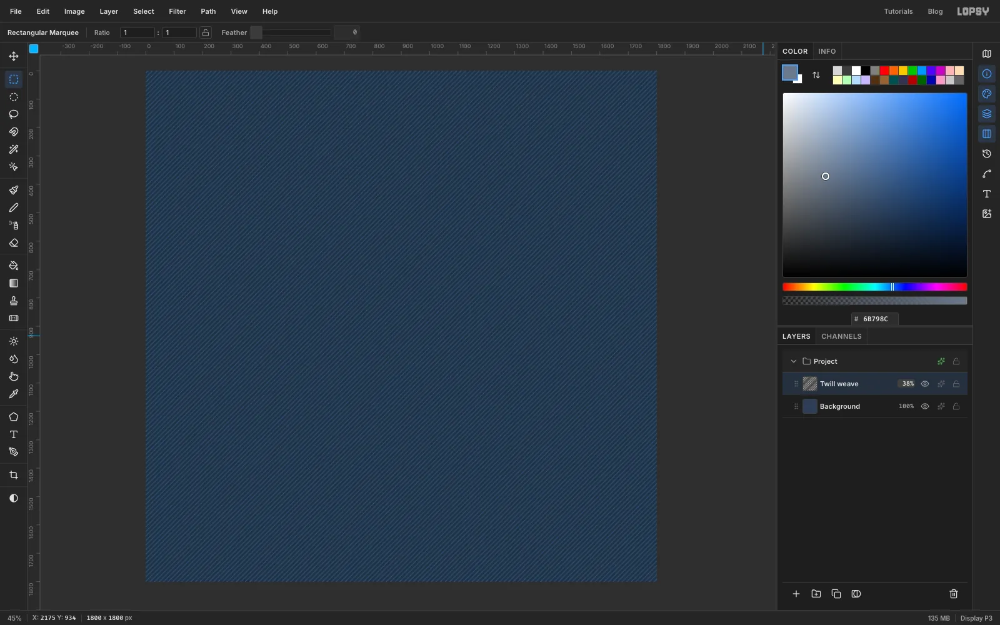

Press [[Cmd+0]] to fit the canvas in the window. Click **Add Layer** and name it
*Twill weave*. Choose **Edit → Fill with Pattern…**, pick your tile and click
**Apply**. Set the layer to **Overlay** at **38%**. The blend mode is at the top of
the drawer that opens from the effects button on the layer's row, and clicking the
percentage on the row gives you the opacity slider. You'll do this a lot.

Add one more layer, called *Twill fine*, and fill it with the same pattern, this
time with **Scale** set to **60**. Leave it at Normal. It covers the denim for
now, which is fine, because you'll hide it shortly. It's the first of your
stitching sheets.

## Draw a thread tile

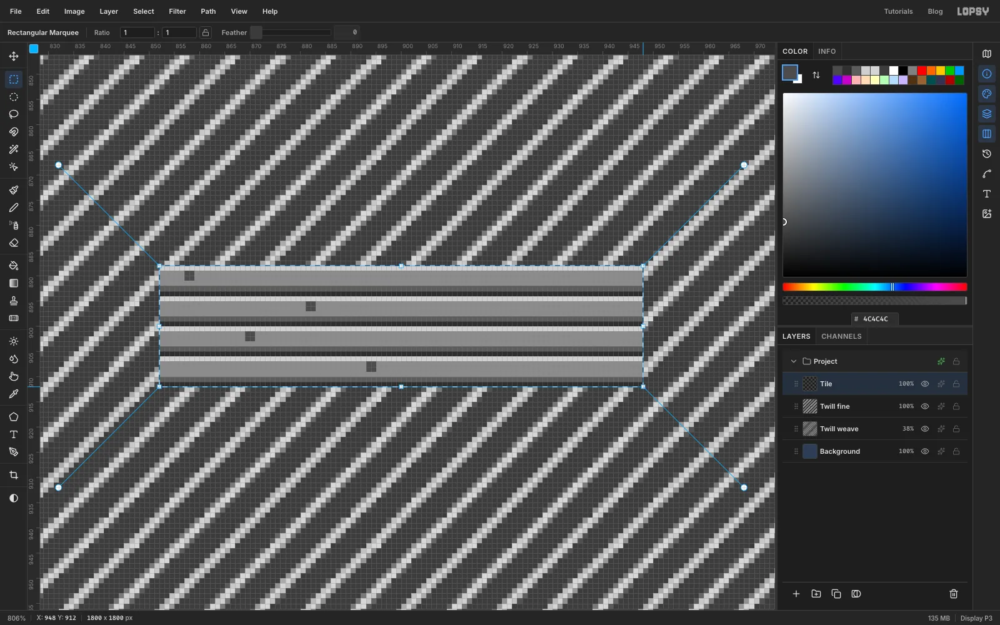

Add a new *Tile* layer and zoom in on the middle of the canvas to about 800%.
Marquee a rectangle **96 × 24 px**, fill it with `#8C8C8C`, and deselect.

The tile holds four threads, each 6 px tall. With the **Pencil** at **Size 1**,
use a click and a [[Shift]]-click to draw these lines across the full width of
the tile, repeating them for each of the four threads:

- on the thread's first row of pixels, a highlight in `#CFCFCF`
- on its fifth row, a shadow in `#5C5C5C`
- on its sixth row, a darker shadow in `#2E2E2E`

Next, each thread gets one needle hole. Set the Pencil to **Size 2** with
`#4C4C4C` and click once in the middle of each thread. Stagger them, so the
holes sit about 6, 30, 18 and 42 px from the left on the four threads. Evenly
staggered holes are what make stitching look like brickwork rather than stripes.

Marquee the whole tile again, choose **Edit → Define Pattern**, deselect and
delete the *Tile* layer. Press [[Cmd+0]].

## Make a sheet of thread

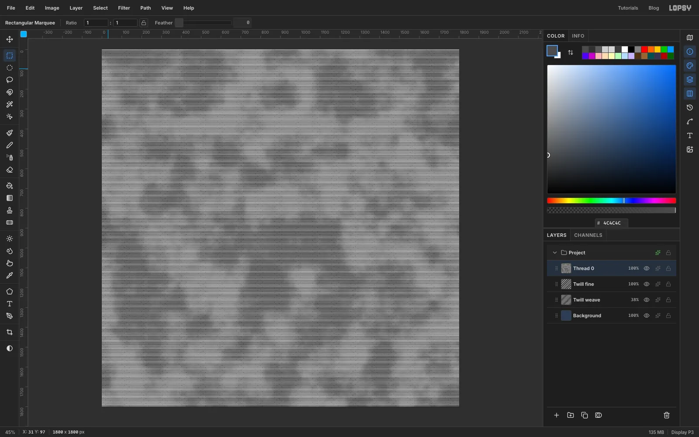

Add a layer called *Thread 0* and use **Edit → Fill with Pattern…** to fill it
with the thread tile at **100%**. Run **Filter → Add Noise…** with **Amount 18**
and **Mono**, so no two threads are quite the same.

Real thread catches the light unevenly. Add a layer called *Sheen*, run
**Filter → Clouds…** at **Scale 14**, set it to **Soft Light** at **40%**, and
choose **Layer → Merge Down**.

## Rotate copies for each stitch direction

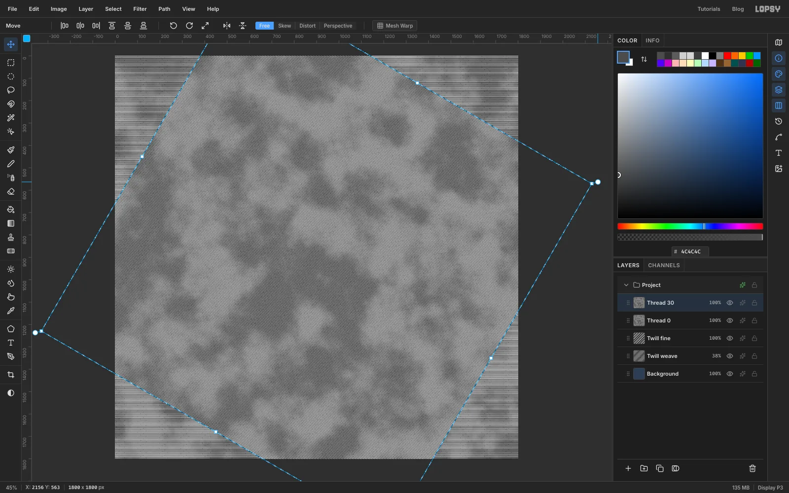

Each area of the patch needs its threads running a different way, so you need
sheets at several angles.

With *Thread 0* active and the **Move** tool selected, click **Duplicate Layer**
and rename the copy *Thread 30*. Click its row in the panel, then press [[Cmd+A]].
Hold [[Cmd]] and drag the round rotation handle just outside the top right corner
to turn the layer **30°** clockwise. Holding [[Cmd]] snaps it to 15° steps. Press
[[Cmd+D]] to commit.

The corners of the rotated sheet go missing, but the patch only uses the middle
of the canvas, so that doesn't matter.

Click *Thread 0* again and repeat three more times:

- *Thread 60*, rotated 60° clockwise
- *Thread 120*, rotated 60° anticlockwise
- *Thread 150*, rotated 30° anticlockwise

## Make a radial sheet

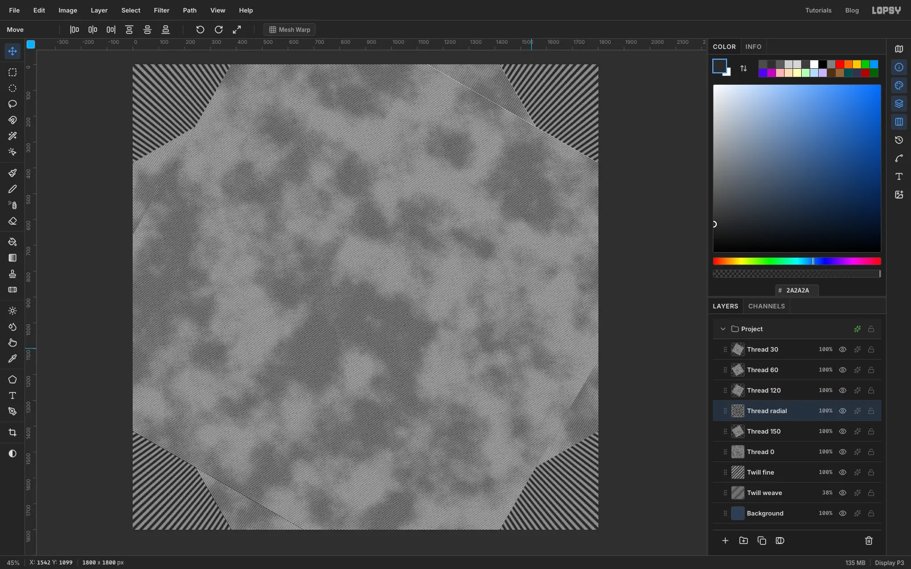

The round parts of the patch need threads that fan out from the centre. Add a
layer called *Thread radial*, fill it with `#8C8C8C`, and set the foreground to
`#2A2A2A`.

Run **Filter → Sunburst…** with **Rays 120**, **Length 120**, **Width 16** and
**Softness 30**, leaving the rest at their defaults. Run it twice more, changing
**Rotation** to **1** and then **2**. The dialog resets each time, so you'll need to
enter the other values again. That gives you
360 fine dark lines. Then run **Filter → Add Noise…** with **Amount 24** and
**Mono**.

Don't worry about the odd patterns you can see while zoomed out. That's your
screen struggling with such fine lines, and it'll look clean at 100%.

## Put the sheets away

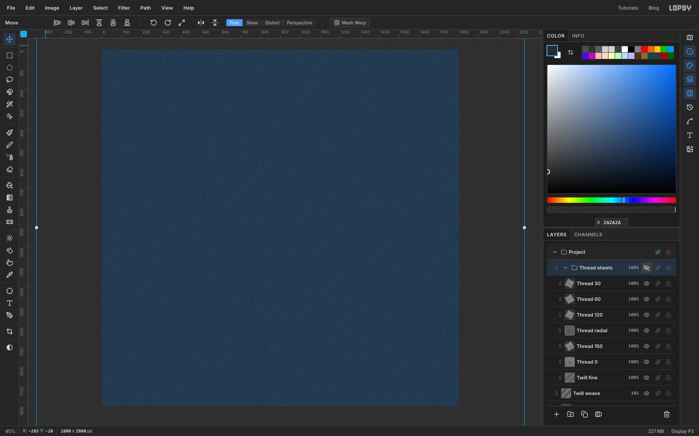

Click *Twill fine*, then [[Cmd]]-click *Thread 0*, the four rotated sheets and
*Thread radial* so all seven are selected. Click **Group Layers** under the panel
and rename the group *Thread sheets*. Click its eye icon to hide it. The denim
comes back.

Leave the group expanded, because you'll be clicking these rows a lot.

## Wash the denim

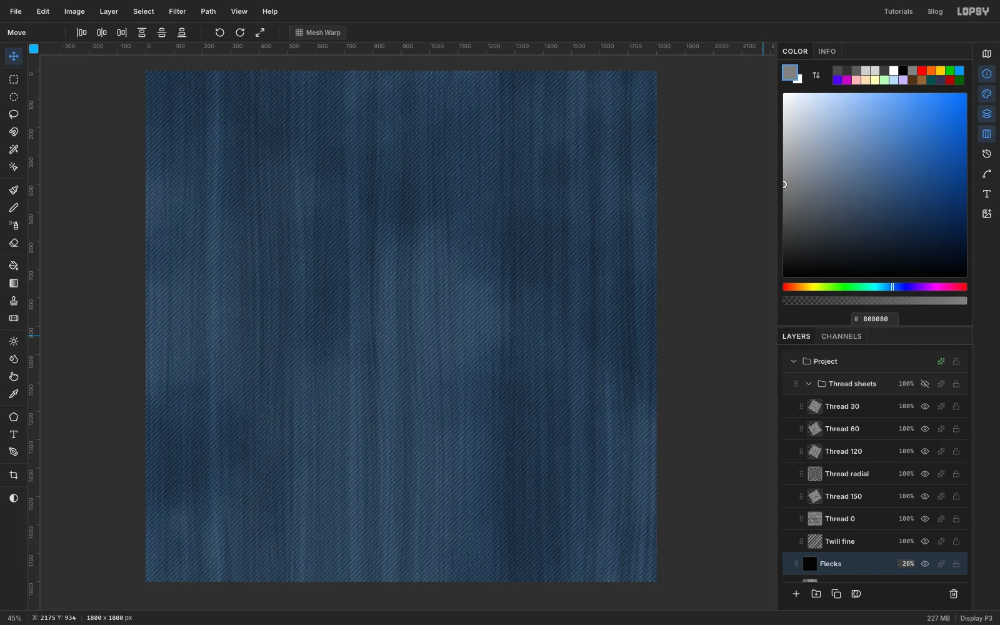

Click *Twill weave* so these next layers land underneath the sheets.

- Add a layer called *Wash*, run **Filter → Clouds…** at **Scale 4**, and set it to **Soft Light** at **17%**.
- Add a layer called *Slubs*, run **Filter → Fibers…** with **Variance 40** and **Strength 50**, and set it to **Overlay** at **30%**.
- Add a layer called *Flecks* and fill it with `#808080`. Run **Filter → Add Noise…** with **Amount 100** and **Mono**, then **Filter → Threshold…** at **176**, then **Filter → Motion Blur…** with **Angle 90** and **Distance 9**. Set it to **Screen** at **26%**. These are the pale flecks of undyed yarn you see in real denim.

## Add creases and seams

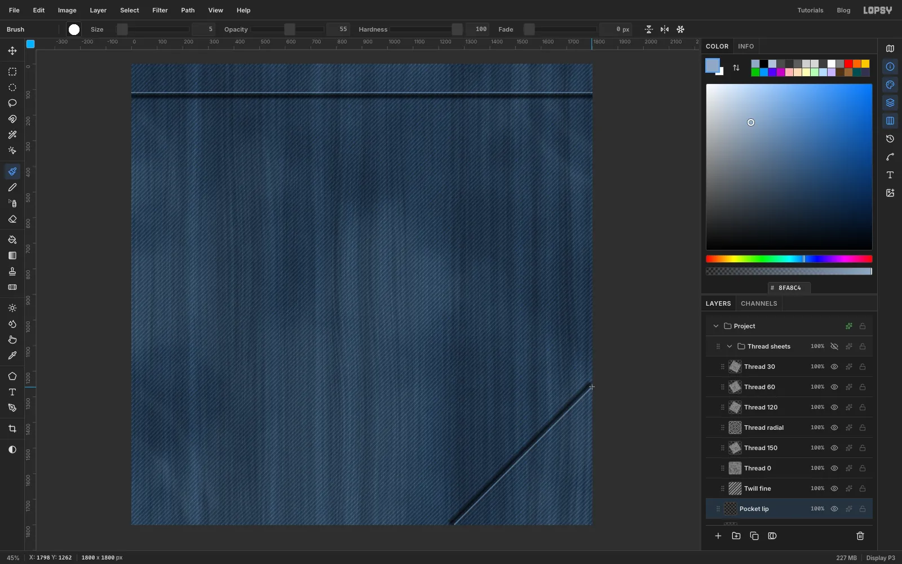

Add a layer called *Whiskers*. Pick the **Brush** at **Size 60**, **Hardness 0**
and **Opacity 12**, with `#AFC4DA`. Paint five loose, slightly curved strokes
that fan out of the corners. Keep them away from the middle, because the patch
will sit there. Run **Filter → Gaussian Blur…** at **Radius 26** and set the
layer to **Screen** at **34%**.

For the seam across the top, add a layer called *Yoke shadow*. Marquee a strip
about 16 px tall across the whole width, roughly 120 px down from the top, and
fill it with black. Deselect, blur it at **Radius 12**, and set it to
**Multiply** at **70%**. Add a layer called *Yoke lip*, and paint a straight
line just above the shadow with the Brush at **Size 5**, **Hardness 100** and
**Opacity 55**, using `#8FA8C4`. Click at the left edge and [[Shift]]-click at
the right edge. This is the lit edge of the fold.

Do much the same for the pocket in the lower right. Add a layer called *Pocket
shadow*. With a black Brush at **Size 30**, **Hardness 0** and **Opacity 100**,
draw a straight diagonal line from the bottom edge, about 550 px in from the
corner, to the right edge, about 550 px up from the corner. Blur it at
**Radius 10** and set it to **Multiply** at **75%**. Add a layer called *Pocket
lip*, and draw a parallel line just inside the shadow, with the Brush back at
**Size 5**, **Hardness 100** and **Opacity 55**, using `#8FA8C4`.

## Make a stitch brush

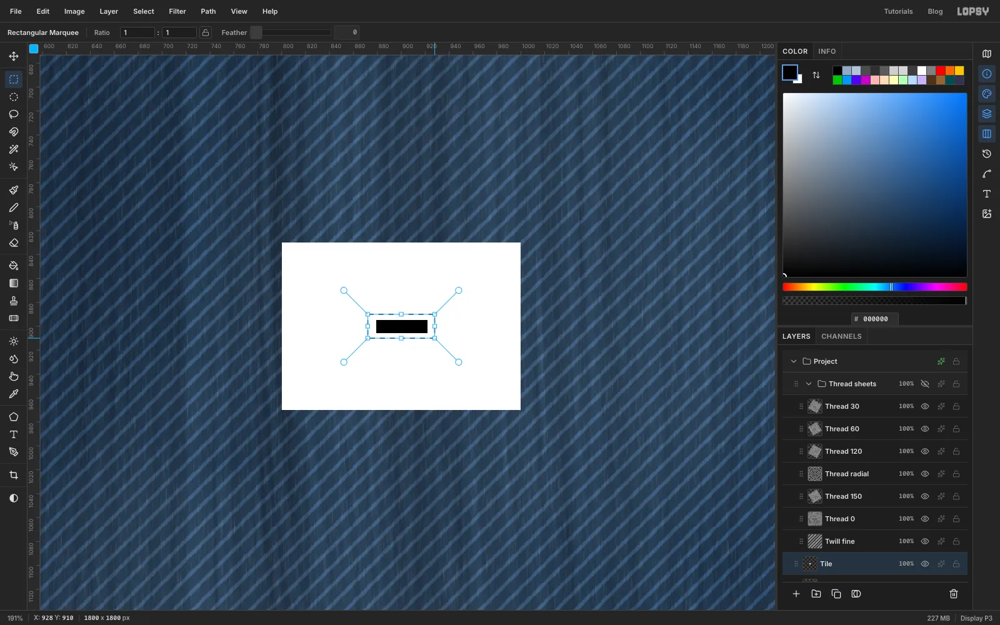

Topstitching is a row of short dashes, which is a job for a custom brush tip.

Add a new *Tile* layer and fill a small marquee with white. Zoom in a little.
With the **Pencil** at **Size 11** in black, click and [[Shift]]-click to draw a
short horizontal dash about 32 px long. Marquee around it, leaving a small margin,
about 56 × 20 px.

Choose **Edit → Define Brush…** and call it *Topstitch*. The dark pixels become
the tip. Deselect, delete the *Tile* layer, and press [[Cmd+0]].

## Stitch the yoke

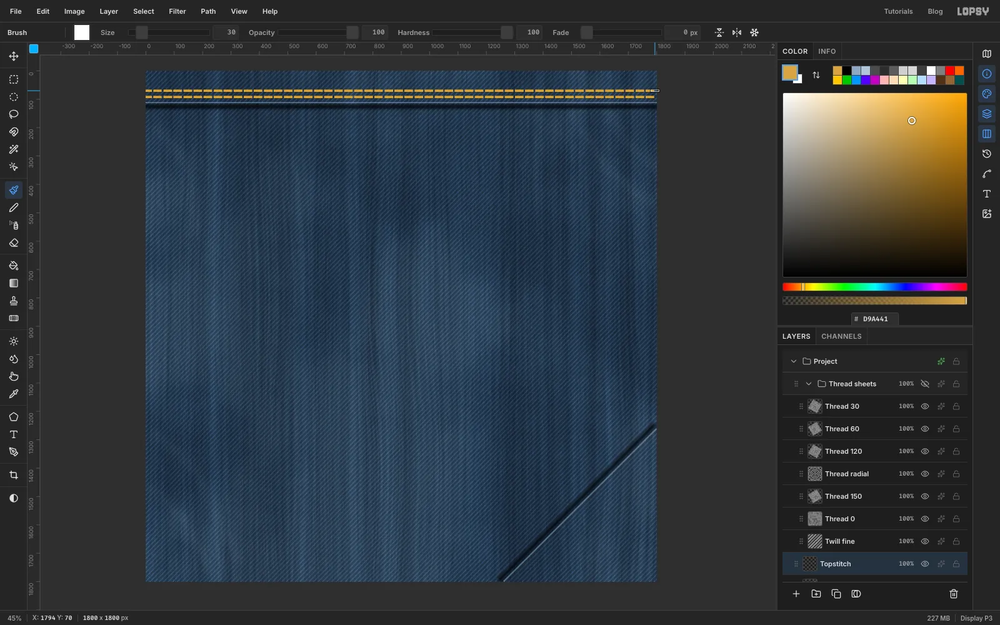

Click *Pocket lip* and add a layer called *Topstitch*. Set the foreground to
`#D9A441` and pick the **Brush**. Click the tip thumbnail at the left of the
options bar to open the Brushes window, and on the **Shape** tab set **Size 30**,
**Spacing 118**, **Hardness 100** and **Opacity 100**. Close the window.

Click at the left edge, about 92 px down, and [[Shift]]-click at the right edge
at the same height. Draw a second row the same way, about 70 px down.

## Stitch the pocket

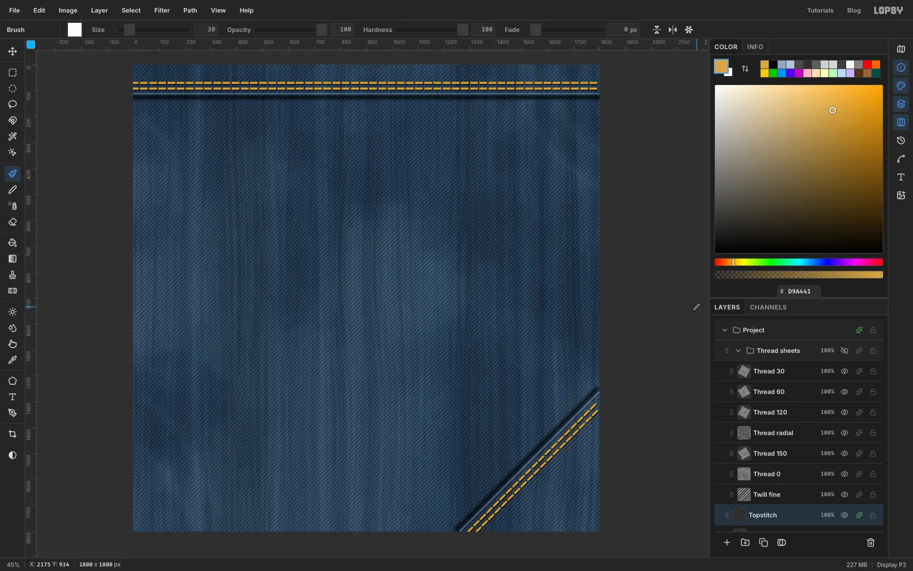

Open the Brushes window again. On the **Shape** tab, press inside the **angle
dial** towards the upper right, halfway between the top and the right, so it reads
**315**. The dash now points along the pocket's diagonal seam. Close the window.

Draw two more rows parallel to the seam, on the pocket side of it. Put the first
about 30 px inside the lip, and the second about 25 px further in. For each, click
at the bottom edge and [[Shift]]-click at the right edge.

Click the effects button on the *Topstitch* row and turn on:

- **Drop Shadow**: black, **Offset X 2**, **Offset Y 3**, **Blur 2**, **Opacity 80**
- **Inner Glow**: `#5A3A10`, **Size 3**, **Opacity 65**

Then open the Brushes window, go to the **Presets** tab and click **Hard Round**.
That swaps the dash tip out and resets the brush, so your next strokes are solid.

## Press in a copper rivet

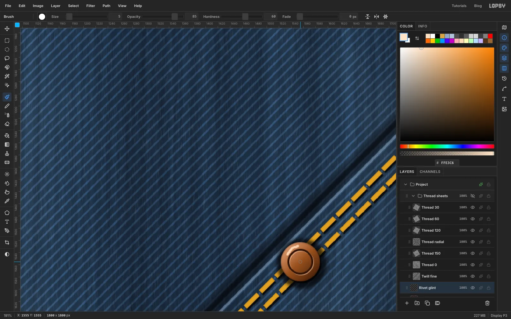

Build the rivet on top of the two rows of stitching, about 350 px in from the
corner of the canvas.

- **Dent.** Add a layer called *Rivet dent*. Fill a circle of **radius 41** with black, centred just down and right of where the rivet will go. Blur it at **Radius 8** and set it to **Multiply** at **70%**. The denim now looks pressed in.
- **Body.** Add a layer called *Rivet*. Select a circle of **radius 32**. Pick the **Gradient** tool, set it to **Linear**, click **Advanced…**, and set three stops: `#D9A27A`, `#8F5429` and `#3F200D`. Drag from the upper left of the circle to the lower right, and deselect. Add a **Drop Shadow** in black (**X 2**, **Y 3**, **Blur 2**, **Opacity 85**) and an **Inner Glow** in `#1F0E05` (**Size 4**, **Opacity 60**).
- **Stamped ring.** Add a layer called *Rivet ring*. Select a circle of **radius 21**, hold [[Alt]] and drag a circle of **radius 18** to cut out the middle, then fill the ring with `#2E160A`. Add a **Drop Shadow** in `#F4C9A0` (**X 1**, **Y 1**, **Blur 0**, **Opacity 70**), which reads as a lit lower edge on the groove.
- **Glint.** Add a layer called *Rivet glint*. With the Brush at **Size 5**, **Hardness 60** and **Opacity 85** in `#FFE3C6`, paint a short curved stroke along the upper left of the rim.

That's the jacket finished. Save your work with **File → Save Project**.

## Lift the patch off the cloth

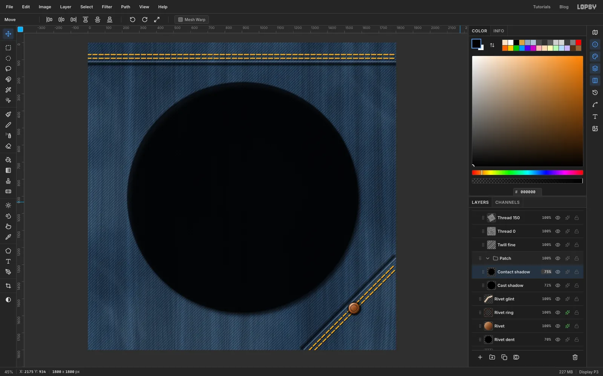

With *Rivet glint* active, click **New Group** and name it *Patch*. Everything
else goes inside this group.

Add a layer called *Cast shadow*. Fill a circle of **radius 672** with black,
deselect, and blur it at **Radius 30**. Set it to **Multiply** at **72%**. Pick
the **Move** tool and press the arrow keys to nudge it **18 px right** and
**28 px down**. [[Shift]]+arrow moves by 10 px.

Add a layer called *Contact shadow*. Fill a circle of **radius 676** with black,
deselect, and blur it at **Radius 7**. Set it to **Multiply** at **75%**. Pick the
**Move** tool again, because the arrow keys nudge a layer only with Move active, and
nudge it **4 px right** and **6 px down**. This is the tight, dark line where the
patch touches the denim, and it stops the patch looking like a sticker.

## Lay in the sky

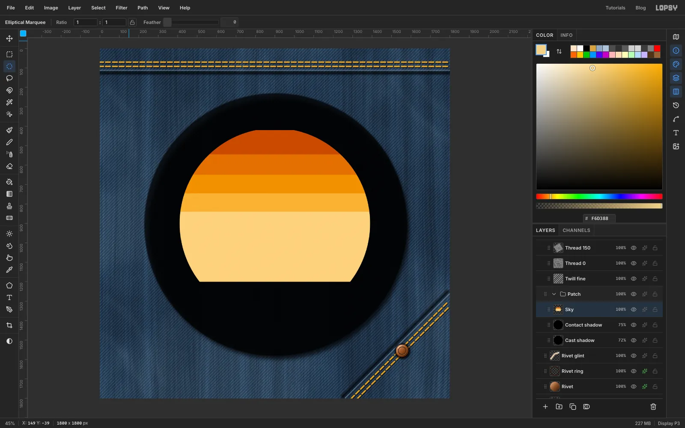

Add a layer called *Sky*. Draw five marquees, stacked on top of each other, each
wide enough to reach beyond the circle, from about 390 to 1410 across. Fill each
with its colour, and press [[Cmd+D]] before drawing the next one:

- from about 420 to 545 down, `#BC5320`
- from 545 to 650, `#D5752A`
- from 650 to 745, `#E59633`
- from 745 to 840, `#EFB54F`
- from 840 to 1200, `#F6D388`

Select a circle of **radius 490**, choose **Select → Inverse** and press
[[Delete]], then deselect. You'll repeat this trim on most of the scene layers,
because anything outside radius 490 would otherwise poke out from under the band.
The flat top and bottom of the sky are fine, since the band and the rock ledge will
hide them.

## Learn the stitching recipe

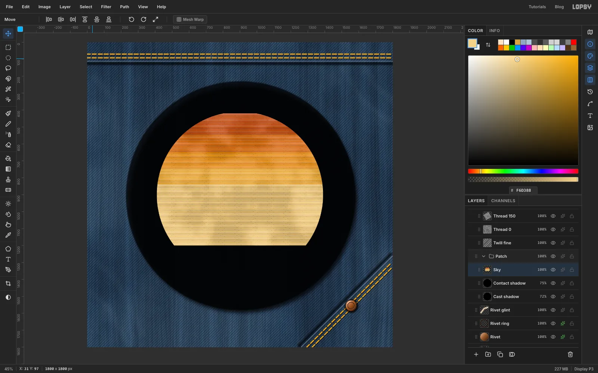

This is the technique behind the whole patch, so it's worth getting comfortable
with it. To stitch the *Sky* layer with *Thread 0*:

1. [[Cmd]]-click the *Sky* thumbnail to select its shape.
2. Click the *Thread 0* row in the Thread sheets group, and press [[Cmd+C]].
3. Click the *Sky* row, and press [[Cmd+V]]. The clipped thread pastes in exactly the right place, on a new layer above *Sky*. The app may switch you to the Move tool, so re-pick your selection tool before you draw anything else.
4. Press [[Cmd+D]].
5. Set the new layer to **Hard Light** at **68%**.
6. Choose **Layer → Merge Down**.

From here on, when I say "stitch it with" a sheet, this is what I mean. Use
**Hard Light** at **68%** unless I say otherwise.

There's a second small habit too. When I say "puff it", add these two effects so
the area looks raised:

- **Drop Shadow**: black, **Offset X 2**, **Offset Y 3**, **Blur 3**, **Opacity 55**
- **Inner Glow**: black, **Size 7**, **Opacity 30**

## Check the thread up close

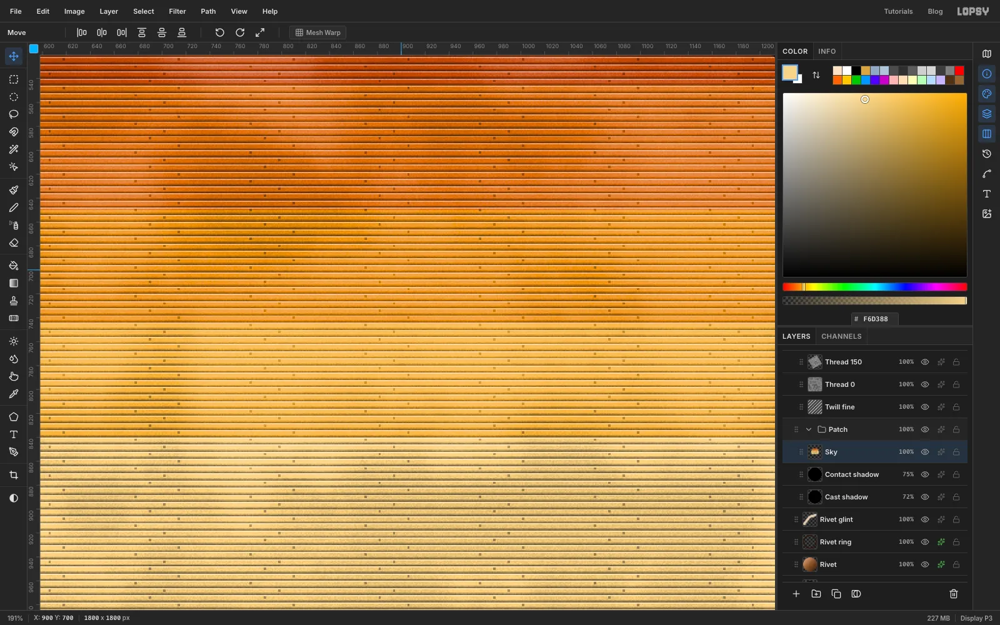

Zoom in on the sky. You should see individual threads with a bright top and a
dark lower edge, plus a scattering of needle holes.

If the thread looks too strong or too faint, this is the moment to fix it. Undo
the Merge Down and adjust the layer's opacity, then use the same value for the
rest of the patch. Press [[Cmd+0]] when you're happy.

## Add the sun and its rays

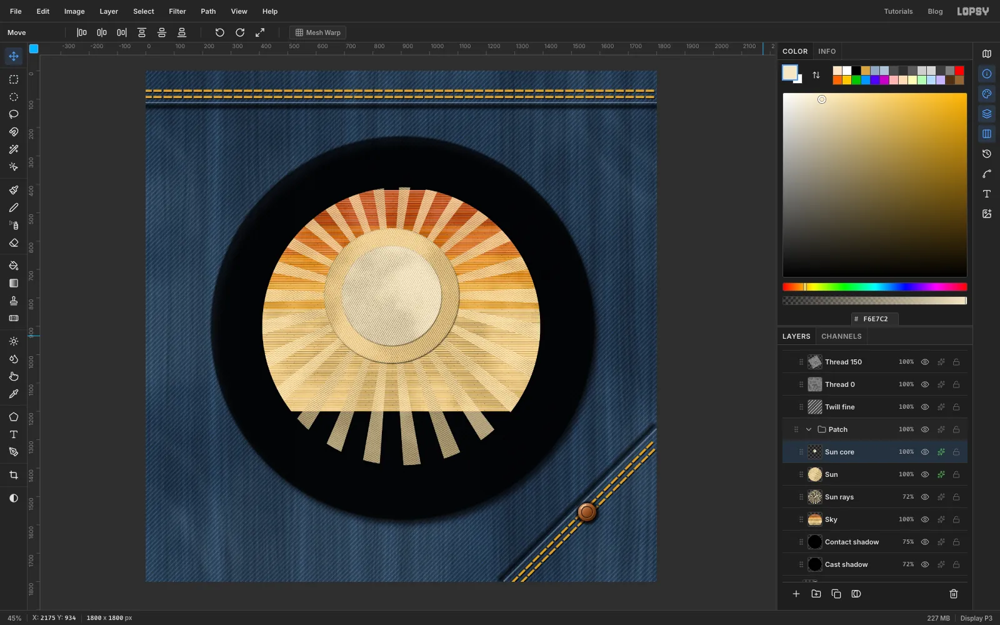

Add a layer called *Sun rays*. Set the foreground to `#FFE7AE` and run
**Filter → Sunburst…** with **Rays 26**, **Length 45**, **Width 42**,
**Center X 48** and **Center Y 44**. Trim it to radius 490 as you did for the sky.
Stitch it with *Thread 30*, then lower the layer to **72%**, so the bands of the
sky show through.

Add a layer called *Sun*. Fill a circle of **radius 238** centred at about 866,
792 with `#F2D494`. Stitch it with *Thread 120*, and puff it, with the Inner Glow
**Size** at **10**.

Add a layer called *Sun core*. Fill a circle of **radius 176** at the same centre
with `#F6E7C2`. Stitch it with *Thread 60*, which runs across the outer ring's
threads and makes the two tones read as separate fields. Puff it, with the Drop
Shadow **Opacity** at **40** and the Inner Glow at **Size 8** and **Opacity 16**.

## Build the mountains

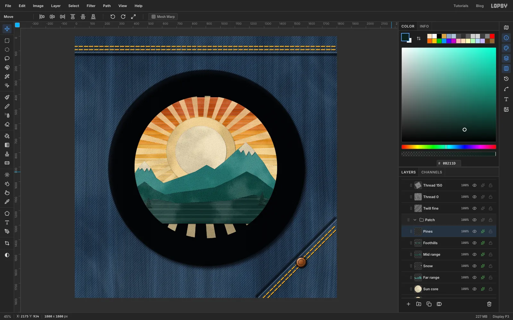

Each range is its own layer, built the same way: add a layer, draw the shape with
the **Lasso**, fill it, trim to radius 490, stitch it, and puff it. Draw each
shape well past the circle at the sides and bottom. Work from back to front:

- **Far range**, `#3D7C78`, stitched with *Thread 30*. Draw a low peak near the left edge of the circle and a tall peak on the right, which rises to about 730 down. Between them, keep it low, around 900 to 1000, so the ibex's head will stand against the sky.
- **Snow**, `#F5E8C8`, stitched with *Thread 120*. Lasso a jagged cap on each peak, holding [[Shift]] for the second one. Use an Inner Glow **Opacity** of **18**.
- **Mid range**, `#1C4640`, stitched with *Thread 150*. A long ridge in front, about 1000 down at the left and 930 at the right.
- **Foothills**, `#122E2A`, stitched with *Thread 0*. A gentle line at about 1130 down.
- **Pines**, `#0B211D`, stitched with *Thread 60*. Lasso five small zigzag trees along the foothills, three at the left and two at the right, holding [[Shift]] to add each one. These only need the Drop Shadow.

## Add the rock ledge

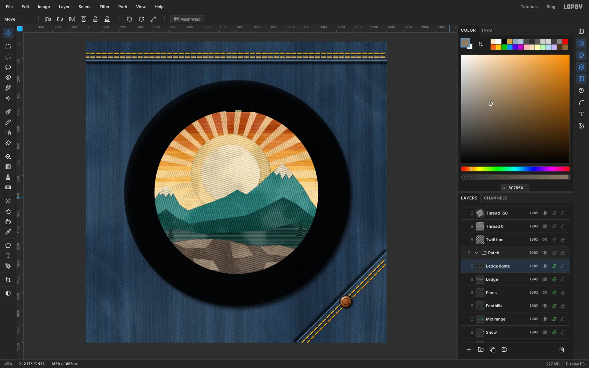

Add a layer called *Ledge*. Lasso a rock shape in `#54463A`, with the top edge
wavering around 1180 to 1240 down, higher towards the middle left, where the
ibex's front feet will go. Fill it and trim to radius 490. Stitch it with
*Thread 60*, then puff it, with the Drop Shadow **Opacity** at **70**, and the
Inner Glow at **Size 9** and **Opacity 35**.

Add a layer called *Ledge lights*. Lasso five flat, angular facets, three along
the top surface and two lower down, holding [[Shift]] to add each one, and fill
them with `#8C7B66`. Trim, then stitch with *Thread 120*. Add just an **Inner
Glow**: black, **Size 7**, **Opacity 25**.

## Bring in the ibex photo

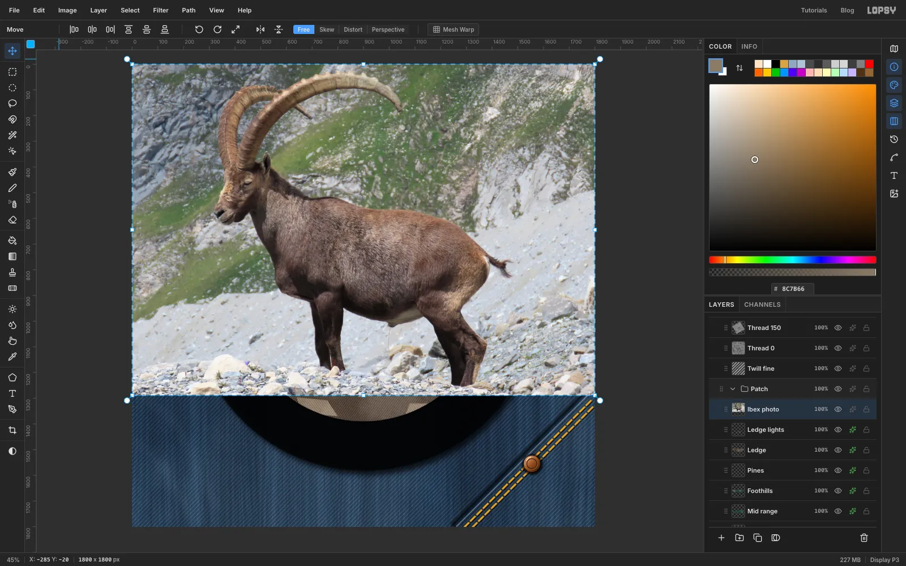

Open your resized photo in an image viewer and copy it. Back in Lopsy, click
*Ledge lights* and press [[Cmd+V]]. Rename the new layer *Ibex photo*.

The photo is only a guide. You won't keep any of its pixels in the finished
patch, but you will borrow its outline and its light and dark shapes.

## Size the photo to the patch

[[Cmd]]-click the *Ibex photo* thumbnail to get handles around it. Hold [[Cmd]]
and drag the bottom right corner handle inwards until the photo is about
**1000 px** wide. Holding [[Cmd]] keeps the proportions. Press [[Cmd+D]] to commit.

Using the **Move** tool, drag the photo so the ibex stands on the ledge, roughly
centred in the circle. The tips of its horns should sit well inside the circle,
and the back hoof should land on the ledge.

## Trace the body

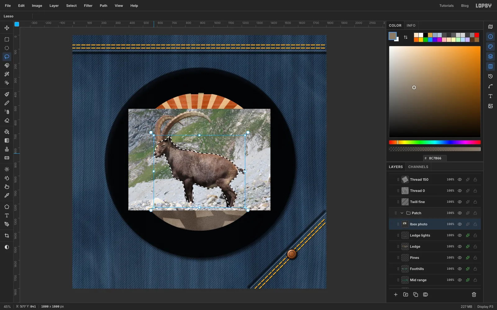

Click the *Ibex photo* row and pick the **Lasso**. Zoom in if it helps. Drag
slowly around the head, neck, back, tail, legs and chest. Leave out the horns,
because you'll draw those on their own layers. Exaggerate the ear a little, and
make the tail a soft, simple tuft.

Press [[Cmd+C]], then [[Cmd+V]]. Rename the new layer *Ibex cut*, press
[[Cmd+D]], and click the eye icon on *Ibex photo* to hide it.

## Simplify the tones

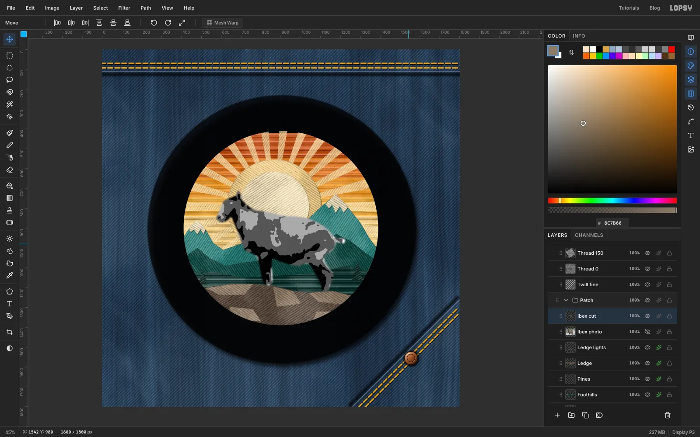

With *Ibex cut* active, run these in order:

- **Filter → Desaturate**
- **Filter → Gaussian Blur…** at **Radius 11**, which rounds the shapes off, since thread can't hold tiny details
- **Filter → Brightness/Contrast…** with **Brightness 8** and **Contrast 45**
- **Filter → Posterize…** at **Levels 4**

You now have a simple map of the animal's light and dark areas, with sharp edges
that the Magic Wand can pick up.

## Stitch the far horn

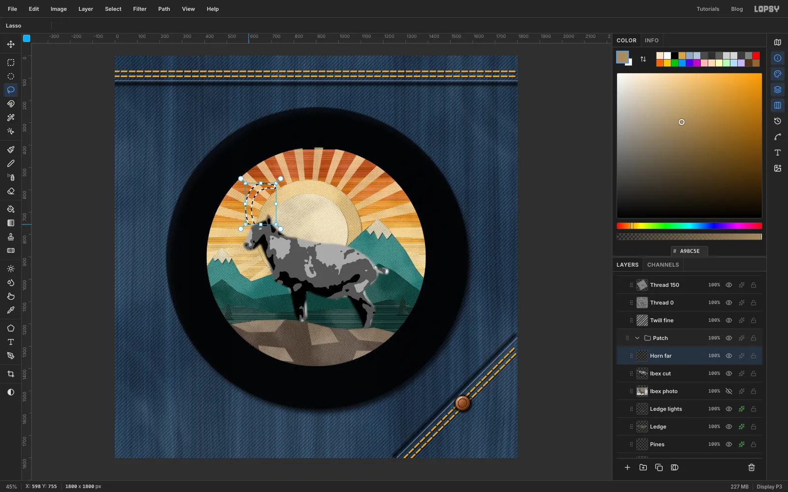

With *Ibex cut* still active, add a layer called *Horn far*. Turn *Ibex photo* on
again for a moment so you can see the horn, and **Lasso** the horn on the far side
of the head. Follow it from the top of the skull, up and around, to where the near
horn crosses in front of it. Hide the photo again, fill the selection with
`#A98C5E`, and stitch it with *Thread 60*.

Pick the **Brush** at **Size 4**, **Hardness 100** and **Opacity 100**, with
`#6E5230`. Add about 15 short strokes across the horn, each a click on one edge
and a [[Shift]]-click on the other, spaced evenly along its length. These are the
ridges that make an ibex's horns so recognisable.

Add a **Stroke** effect: `#33231A`, **Width 3**.

## Add the far legs

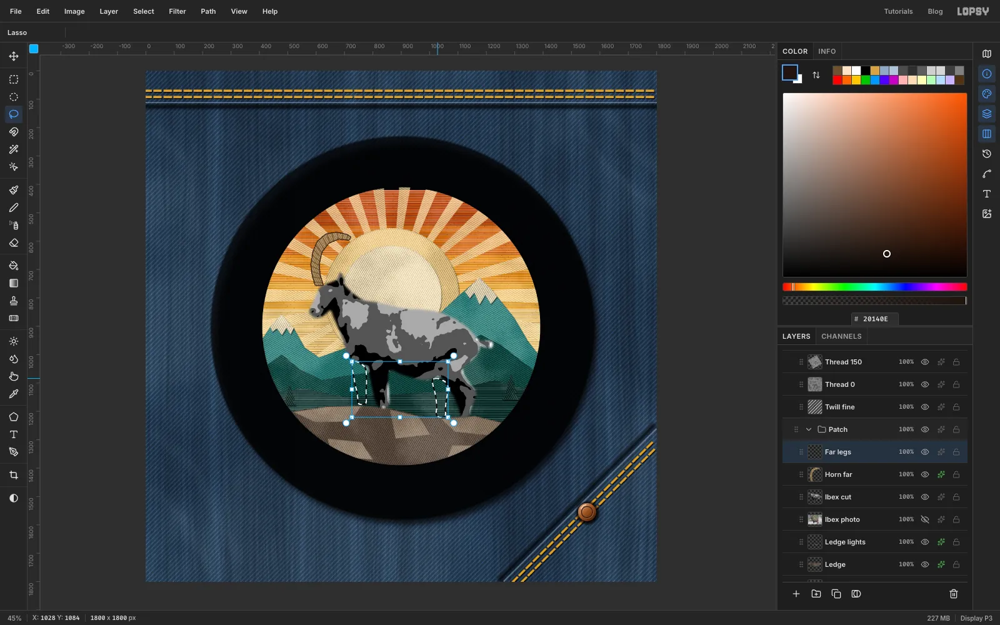

The photo only shows two clear legs, and two legs would make the animal read
badly, so you'll add a far pair.

Add a layer called *Far legs*. Lasso a leg just in front of the near front leg,
and, holding [[Shift]], a second one just in front of the near back leg. Both
should start up inside the body so that they join it cleanly. Fill them with
`#20140E`, stitch with *Thread 150*, and add the same **Stroke** as the horn.

## Pick out the tones with the Magic Wand

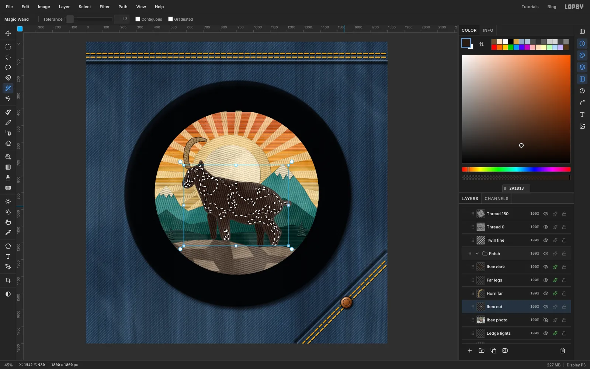

Now the base coat. [[Cmd]]-click the *Ibex cut* thumbnail, add a layer called
*Ibex dark*, fill it with `#2A1B13` and deselect. Stitch it with *Thread 30*, and
add the same **Stroke** again. The whole animal is now a dark silhouette.

The silhouette now hides the tone map underneath, so click the eye icon on *Ibex
dark* to hide it for a moment. Click the *Ibex cut* row. Pick the **Magic Wand**, set
**Tolerance** to **12** and untick **Contiguous**. Click any dark grey area, and every
dark grey area on the layer is selected. Tidy the small specks with
**Select → Shrink…** at **3**, and then **Select → Grow…** at **3**. Show *Ibex dark*
again. The screenshot shows the selection with the silhouette back on.

## Lay the coat colours

With that selection still live, click the *Ibex dark* row and add a layer called
*Ibex mid*. Fill it with `#6A4628` and deselect.

Embroiderers blend colours with long-and-short stitches, where the two colours
overlap in a ragged edge. You can get close with a blur along the thread. Run
**Filter → Motion Blur…** with **Angle 60** and **Distance 12**. Then stitch it
with *Thread 60* and lower the finished layer to **40%**.

Do the same for the lightest areas. Hide *Ibex dark* and *Ibex mid*, click *Ibex
cut*, wand a light grey area, shrink and grow by 3, and show both layers again. Click
*Ibex mid*, and add a layer called *Ibex light*. Fill
it with `#94703F`, Motion Blur at **Angle 120** and **Distance 12**, stitch it
with *Thread 120*, and lower it to **40%**.

## Add anatomy on top

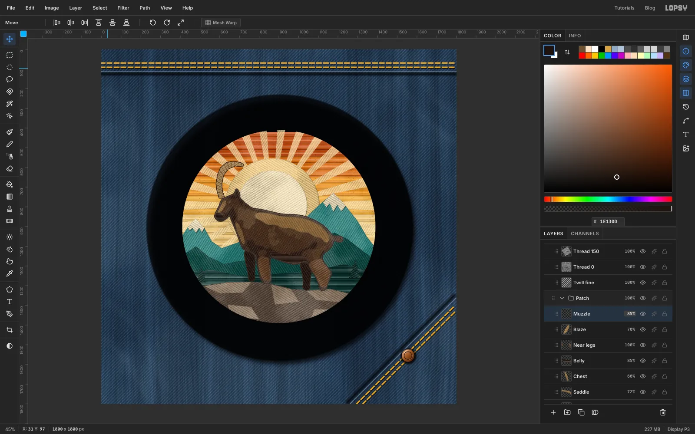

Photo tones alone look blotchy. Give the eye clear shapes that follow the body.
Each of these is a new layer, drawn with the Lasso, then filled and deselected.
Then run **Motion Blur** with the Angle and Distance given, stitch the layer, and
set the opacity last. Click *Ibex light* first, and each new layer will land on top
of the one before:

- **Saddle**: the upper back from the withers to the rump, with a wavy lower edge. Fill `#A5804C`, Motion Blur Angle 150 and Distance 8, stitch with *Thread 150*, and set the layer to **72%**.
- **Chest**: a narrow strip down the front of the chest. Fill `#A5804C`, Motion Blur Angle 60 and Distance 6, stitch with *Thread 60*, and set the layer to **60%**.
- **Belly**: the underside between the legs. Fill `#2A1B13`, Motion Blur Angle 0 and Distance 8, stitch with *Thread 0*, and set the layer to **85%**.
- **Near legs**: both near legs, from where they leave the body to just above the hoof. Fill `#5A3C24`, Motion Blur Angle 90 and Distance 10, and stitch with *Thread 60*. Leave this one at 100%, because it separates the near legs from the darker far ones.
- **Blaze**: a thin stripe along the bridge of the nose. Fill `#A5804C`, Motion Blur Angle 120 and Distance 8, stitch with *Thread 120*, and set the layer to **70%**.
- **Muzzle**: the nose and mouth. Fill `#1E130D`, Motion Blur Angle 0 and Distance 6, stitch with *Thread 0*, and set the layer to **85%**.

## Stitch the near horn

Click *Muzzle* and add a layer called *Horn near*. Show *Ibex photo* for a moment
again, and **Lasso** the big front horn, from the top of the head, along its outer
edge to the tip, and back along its inner edge. Hide the photo again.

Fill it with `#D9BF8C` and stitch it with *Thread 120*. Using the Brush at
**Size 5** with `#6E5230`, add about 24 ridges across the horn, spaced evenly and
fanning around the curve. Add the same **Stroke**.

## Finish the face and feet

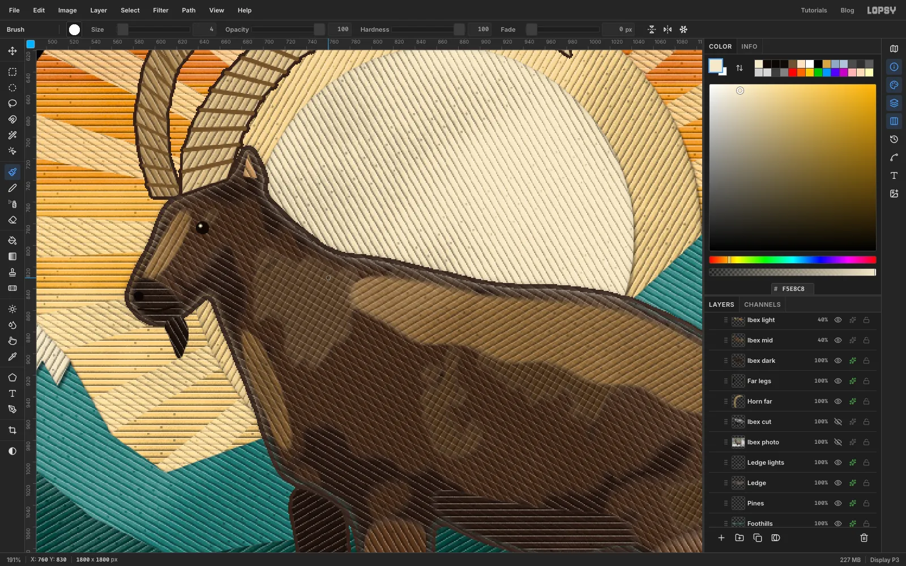

Add a layer called *Hooves*. Lasso a small dark wedge at the bottom of each of the
four legs, holding [[Shift]] to add each one, and fill them with `#0C0705`. Stitch
them with *Thread 0* at **45%**. Add a **Drop Shadow**: black, **X 3**, **Y 5**,
**Blur 3**, **Opacity 80**.

Add a layer called *Face*. Lasso a small pointed beard under the chin, fill it
with `#1E130D`, then lasso the inside of the ear, and fill it with `#C49A68`.
Deselect and stitch the layer with *Thread 60*.

Now paint the small details on the same layer, with the Brush at **Hardness 100**:

- the eye: a single click at **Size 13** in `#100906`
- the nostril: a single click at **Size 10** in `#0A0504`
- the mouth: a short click and [[Shift]]-click line at **Size 3** in `#120A06`
- the eye's glint: a single click at **Size 4** in `#F5E8C8`, just up and left of the eye's centre

Hide *Ibex cut* with its eye icon.

## Make the twill band

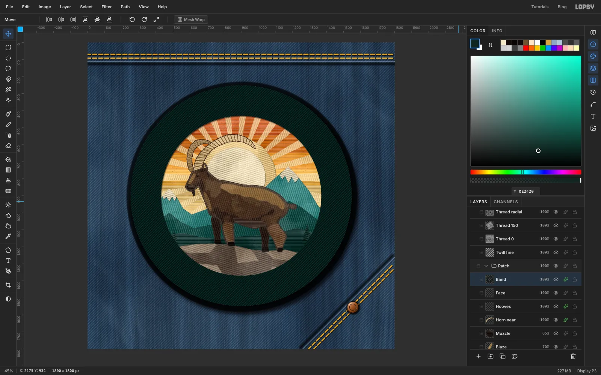

Click *Face* and add a layer called *Band*. With the **Elliptical Marquee**, select a
circle of **radius 648**. Hold [[Alt]] and drag a circle of **radius 470** to cut out
the middle. Fill the ring with `#0E2420` and deselect.

Stitch it with *Twill fine*, but with two changes: **Overlay** at **100%**. This
part of a real patch is woven fabric, not embroidery, so you want the diagonal
twill rather than thread. Add a **Drop Shadow** in black: **X 3**, **Y 5**,
**Blur 7**, **Opacity 60**, which throws a shadow on to the scene.

## Add the gold rims

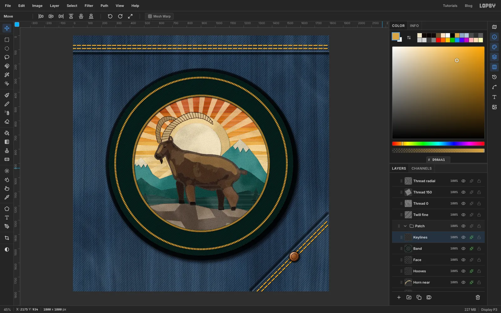

Add a layer called *Keylines*, and set the foreground to `#D9A441`. Select a ring
from **radius 610** down to **radius 598**, and fill it. Press [[Cmd+D]], then select
another ring from **radius 484** down to **radius 472**, and fill that as well.
Deselect.

Stitch it with *Thread radial* at **Hard Light** and **100%**, so these rims look
like tiny chain stitches. Add a **Drop Shadow** in black: **X 2**, **Y 3**,
**Blur 3**, **Opacity 60**.

## Draw two curved paths for the lettering

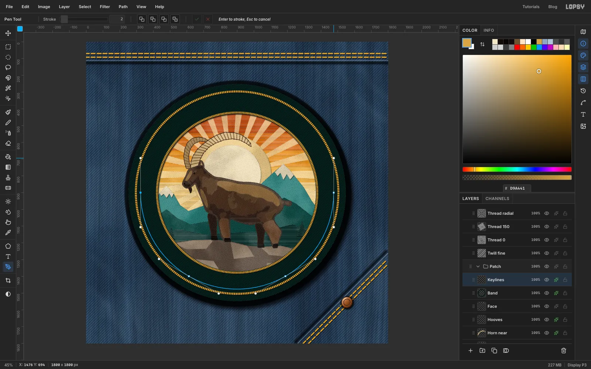

Pick the **Pen** tool. You'll draw each arc as three spans of a circle, with four
anchors. Press at each anchor and drag along the direction of travel to pull out
the handles.

For the top path, the circle has **radius 505**. Start at the far left of the
circle, at 395, 900, and work clockwise over the top: press and drag at 395, 900,
then at about 648, 463, then at about 1152, 463, and finally at 1405, 900. Drag
about 180 px each time, following the curve. Click the tick button in the options
bar to commit the path.

For the bottom path, the circle has **radius 576**. Start at 324, 900 and go
anticlockwise under the bottom: press and drag at 324, 900, at about 612, 1399, at
about 1188, 1399, and at 1476, 900. Drag about 205 px each time, and commit. Only
the selected path is drawn on the canvas, so the top one disappears here. It's safe
in the **Paths** panel.

The direction matters. Letters stand on the left side of the direction you drew
in, so both paths have to run from left to right for the text to end up upright.

## Set the top lettering

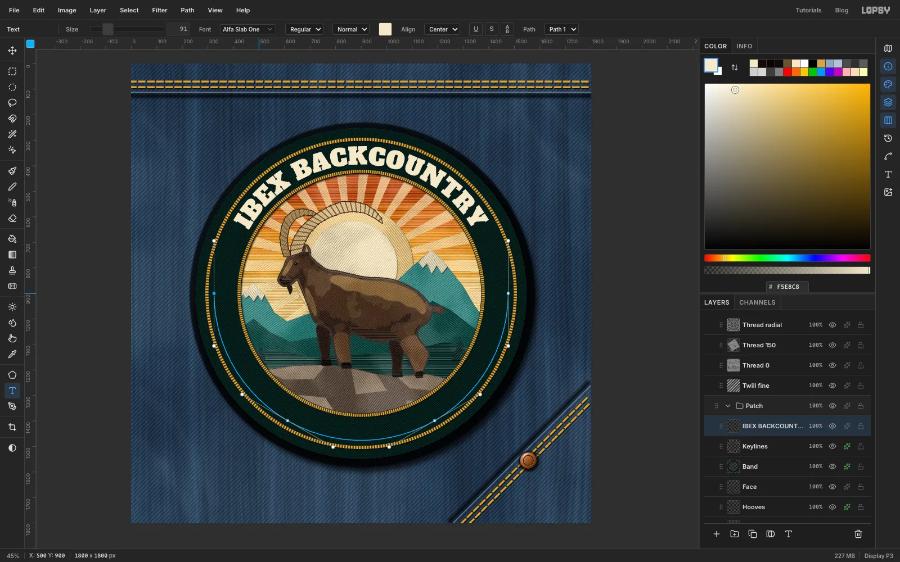

Click *Keylines* so the text lands above it. Set the foreground to `#F5E8C8` and
pick the **Text** tool. In the options bar, choose the **Alfa Slab One** font at
**Size 91**.

Click anywhere in empty space, type **IBEX BACKCOUNTRY** and press [[Tab]]. In the
options bar, set **Path** to *Path 1*, and **Align** to **Center**. The text jumps
on to the arc and centres itself.

Look at the margins: the letters should have an even gap to the gold rims on both
sides. If not, change the **Size** a little.

## Stitch the lettering

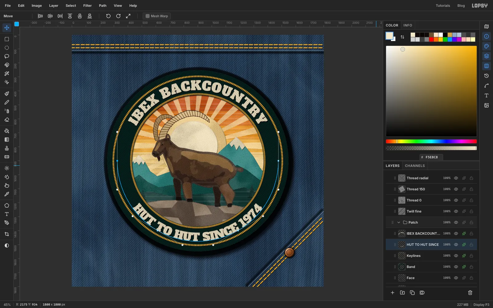

Click **Rasterize Layer**, the T icon under the Layers panel, because the recipe needs
pixels. Stitch
it with *Thread radial* at **Hard Light** and only **42%**, because letters need to
stay crisp. Run **Filter → Add Noise…** with **Amount 6** and **Mono**, so the
ridges aren't too perfect. Then add:

- **Drop Shadow**: black, **X 3**, **Y 4**, **Blur 3**, **Opacity 85**
- **Inner Glow**: `#5A3A18`, **Size 5**, **Opacity 45**

Click *Keylines* again and set the second line the same way: **HUT TO HUT SINCE
1974** at **Size 80**, on *Path 2*, centred. Rasterize it, stitch it, and add the
same noise and effects. The layer's name will be cut short, which is fine.

## Add the stars

Add a layer called *Stars*. Set the foreground to `#D9A441`. Using the **Lasso**,
draw a five-pointed star about 76 px across, midway across the band at the far left,
a little below the patch's halfway line. Hold [[Shift]] and draw a matching star at
the far right. Fill them and deselect.

Stitch with *Thread radial* at **80%**. Add a **Drop Shadow** in black: **X 2**,
**Y 3**, **Blur 3**, **Opacity 70**.

Stars sit nicely in the gaps because the top text spans a wider arc than the
bottom. Placing them slightly low splits the gaps evenly.

## Lay down the merrow edge

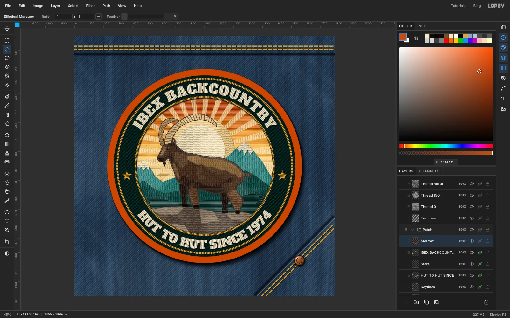

A *merrow* is the thick, overlocked cord around a patch's edge. It's the first
thing anybody notices.

Open the **Paths** panel and click the selected path's row to deselect it, so its
blue line stops showing on the canvas. Then click the *IBEX BACKCOUNTRY* row, and
add a layer called *Merrow*. Select a ring from **radius 672** down to
**radius 628**, fill it with `#BE4F1C`, and deselect.

## Roll the merrow

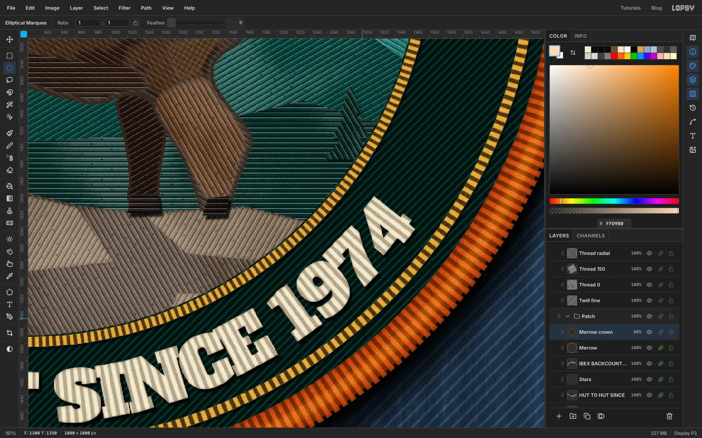

Stitch it with *Thread radial* at **62%**, then run **Filter → Add Noise…** with
**Amount 10** and **Mono**.

Next, bead the outer edge, because real merrow isn't a perfect circle:

1. Add a layer called *Notch*. Select a ring from **radius 680** down to **radius 668**.
2. Set the foreground to black and run **Filter → Sunburst…** with **Rays 120**, **Length 120** and **Width 11**. Run it twice more, entering those values again each time, with **Rotation 1** and then **Rotation 2**. Then deselect.
3. [[Cmd]]-click the *Notch* thumbnail, click the *Merrow* row, press [[Delete]] and deselect.
4. Delete the *Notch* layer.

Give the cord a rounded form. Add an **Inner Glow** to *Merrow*: `#4A1806`,
**Size 14**, **Opacity 75**. Then add a layer called *Merrow crown*, select a ring
from **radius 658** down to **radius 644**, and use **Select → Feather…** at **5**.
Fill it with `#FFD9B0`, deselect, and set it to **Soft Light** at **80%**. That's
the soft highlight along the top of the cord.

## Light the patch

Add a layer called *Patch light*. Select a circle of **radius 672**. Pick the
**Gradient** tool, set it to **Linear** and click **Advanced…**. Set three stops:

- `#FFFFFF` at 90% opacity on the left
- `#808080` at 0% opacity in the middle
- `#000000` at 90% opacity on the right

Drag from the upper left of the patch to the lower right, and deselect. Set the
layer to **Soft Light**. All the separate fields now share the same light, which
ties them together.

## Leave a loose thread

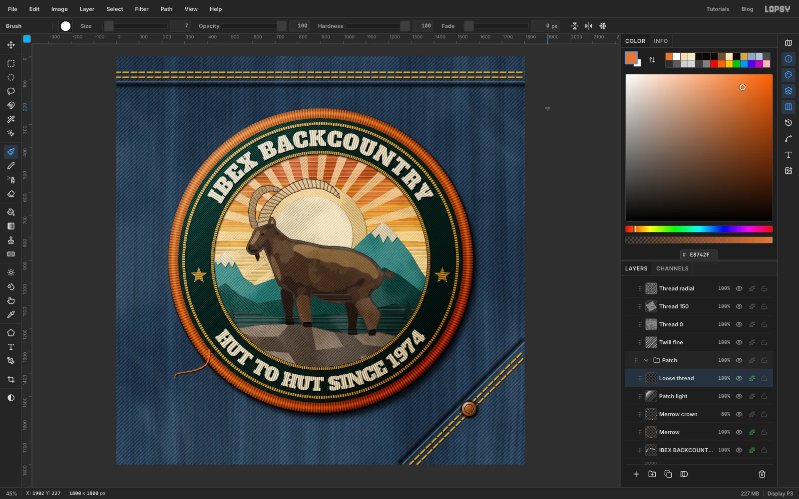

Every real patch has one. Add a layer called *Loose thread*, and set the
foreground to `#E8742F`. Open the Brushes window and, on the **Shape** tab, set
**Size 7**, **Hardness 100**, **Opacity 100** and **Taper 620**. Close it.

Press on the merrow at about 7:30 on the clock face, and drag a loose S-curve down
and to the left on to the denim. Taper thins the stroke from where you start, so
the thread is thickest at the patch, and fades to a point. Add a **Drop Shadow** in
black: **X 3**, **Y 4**, **Blur 3**, **Opacity 75**.

Open the Brushes window again and set **Taper** back to **0**.

## Add window light and a vignette

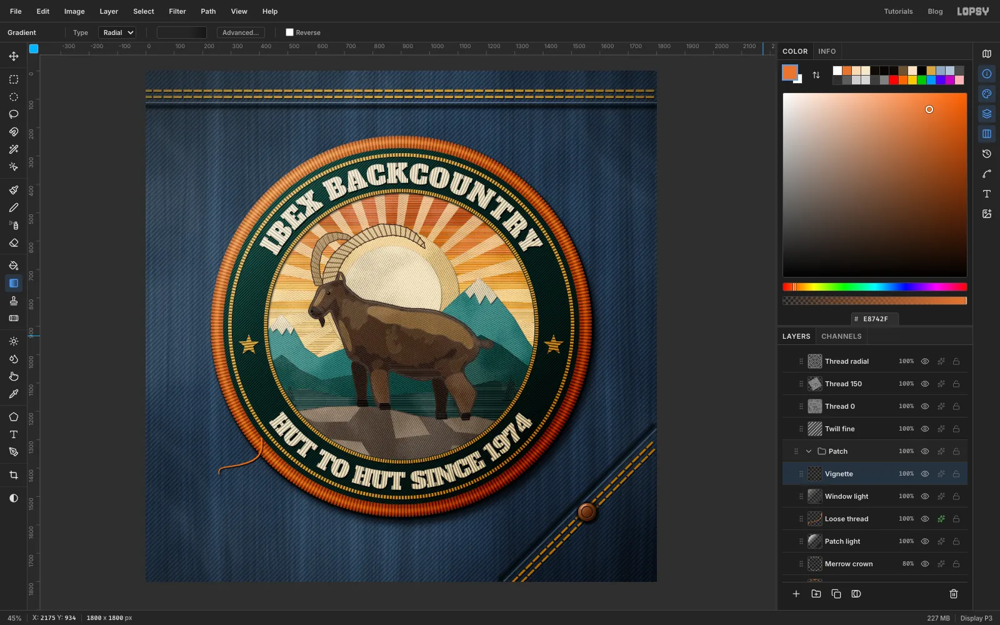

Click the *Patch* group's row, with the group still expanded, and add a layer
called *Window light*. It lands at the top of the group, above everything else in
the picture except the thread sheets.

Set up a **Linear** gradient with these stops:

- `#FFF4E0` at 45% opacity on the left
- `#808080` at 0% opacity at about 55%
- `#000000` at 80% opacity on the right

Drag from the upper left corner of the canvas to the lower right. Set the layer to
**Soft Light**.

Add a layer called *Vignette*. Set up a **Radial** gradient with these stops, all
of them black:

- 0% opacity at the start
- 0% opacity at about 62%
- 42% opacity at the end

Drag from the centre of the canvas to past the right edge, about 350 px outside the
canvas. Set the layer to **Multiply**.

## Tidy the layers and save

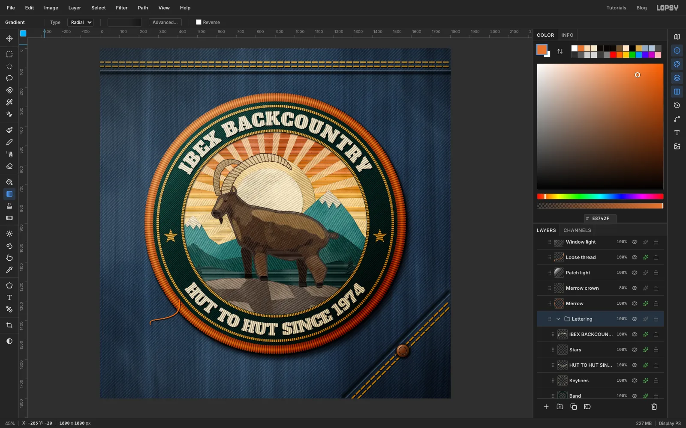

Delete *Ibex cut* and *Ibex photo*. Delete the *Thread sheets* group too, unless you
want to keep stitching, because the sheets make the project file much bigger.

To group the rest, click the first layer in each list, [[Cmd]]-click the others,
click **Group Layers**, and rename the group:

- **Scene**: *Sky*, *Sun rays*, *Sun*, *Sun core*, *Far range*, *Snow*, *Mid range*, *Foothills*, *Pines*, *Ledge*, *Ledge lights*
- **Ibex**: *Horn far*, *Far legs*, *Ibex dark*, *Ibex mid*, *Ibex light*, *Saddle*, *Chest*, *Belly*, *Near legs*, *Blaze*, *Muzzle*, *Horn near*, *Hooves*, *Face*
- **Lettering**: *Band*, *Keylines*, the two text layers, *Stars*

Save with **File → Save Project** and export with **File → Quick Export PNG**.

If you want the patch on its own, hide the jacket layers, both shadows and the
*Window light* and *Vignette* layers before you export.
