Skeuomorphic design makes a flat picture look like a real object, with real materials, real light and real wear. In this tutorial the album cover *is* the object. **Midnight Quartz**, a record by the imaginary artist Mira Quell, is dressed up as the front panel of a 1970s hi-fi tuner. The radio dial window doubles as the artwork: a cluster of rose-quartz crystals glowing in a night sky.

The canvas is 1600 × 1600 px. Nothing in it is painted freehand. The wood, the metal and the glass are filters and gradients. The crystals are flat polygons drawn with the Lasso, then copied, scaled and rotated. Everything else is simple shapes plus a few carefully chosen layer effects.

Along the way you'll use:

- ruler **guides**, the **grid** with **Snap**, and **groups**
- the **Fibers**, **Add Noise**, **Motion Blur** and **Gaussian Blur** filters
- **Linear** and **Radial** gradients with transparent stops
- the **Shape** tool, the **Rectangular** and **Elliptical Marquee**, the **Lasso**, and selections made from a layer's pixels with [[Cmd]]-click
- **Select → Inverse** and **Shrink**, plus adding, subtracting and intersecting selections
- **Duplicate Layer**, scaling and rotating with the transform handles, layer reordering and **Merge Down**
- **Define Pattern** and **Fill with Pattern**
- the **Brush**, **Pencil**, **Spray** and **Eraser**
- live text with letter spacing, in Michroma and Share Tech Mono
- **Drop Shadow**, **Inner Glow**, **Outer Glow** and **Stroke**, with the **Overlay**, **Soft Light**, **Screen** and **Multiply** blend modes
- **Copy** and **Paste** (which pastes in place)

The palette:

- Walnut `#4A2816`
- Aluminium `#A9AFB6`, highlight `#F4F6F8`, engraving ink `#2A2E34`
- Bezel `#16181C`, rim `#D9DDE2`
- Night sky `#04061A` → `#141346` → `#3A1C5E`
- Nebula `#C2478F` / `#6A3FC0` / `#2E6FB8`
- Quartz `#FFE3F0` / `#F2A2C8` / `#D873AB` / `#9B4686` / `#5E2A6B`
- Quartz glow `#FF6FC4`, rock `#1C0F2C`, druzy sparkle `#F7A8D0`
- Dial cream `#F3E7C6`, tuning red `#FF4B3E`
- VU face `#FCF3D9` → `#E6CC94`, VU red `#C8322B`
- Lamp `#FFF1B8` → `#FFA42B` → `#A8460A`

> **Tip:** Positions are given as `x, y` in document pixels. The status bar at the bottom left shows where your cursor is. Mac key names are used; on Windows and Linux use Ctrl for Cmd. The one exception is a drag on the canvas, such as scaling with the transform handles: there, use the Windows (Meta) key in place of Cmd.

> **Tip:** "Fill" means set the foreground colour in the Color panel's hex field, then choose **Edit → Fill**. Press [[Cmd+D]] before you draw a new marquee, because pressing inside an existing selection moves its outline instead of starting a new one.

> **Tip:** The light comes from the top left. Every highlight sits on the upper left of a shape and every shadow falls down and slightly to the right.

## Set up the canvas and grow the walnut

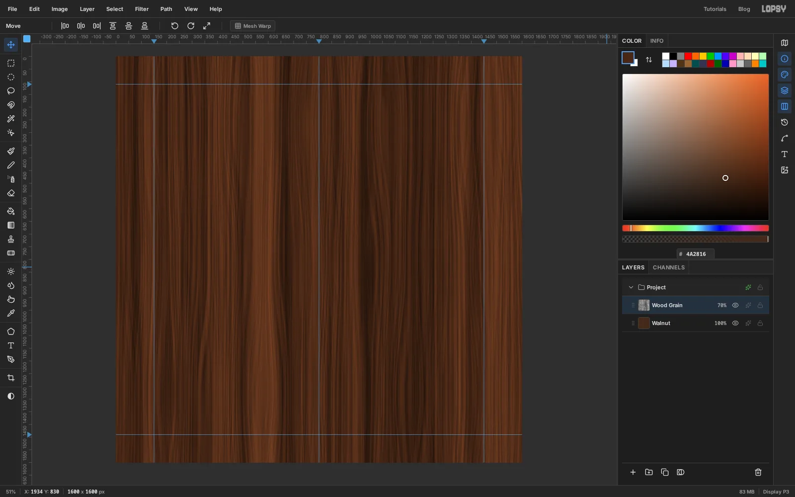

Create a new document `1600` × `1600` px with a white background. Click the top ruler at x `150`, `800` and `1450`, and the left ruler at y `110` and `1490`, to drop guides. The outer four mark the edges of the metal panel, and the one at 800 is the centre line.

Double-click the `Background` row and rename it `Walnut`, then fill it with `#4A2816`.

Rename `Layer 1` to `Wood Grain` and choose **Filter → Fibers…**. Set **Variance** to `40` and **Strength** to `48`, and apply. Fibers makes long vertical streaks, which is already close to wood. To smear them into a real grain, choose **Filter → Motion Blur…** with **Angle** `90` and **Distance** `30`.

Open the layer's effects drawer, set the blend mode to **Overlay**, and lower the layer's opacity to `70%`. The grey streaks now tint the brown underneath into light and dark grain.

## Brush the aluminium faceplate

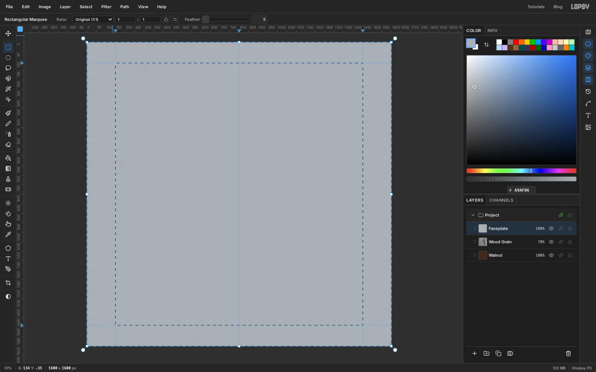

Add a layer named `Faceplate` and fill the **whole layer** with `#A9AFB6`. Don't select the panel first. Motion Blur samples past the edge of a selection, which would leave dark smears down both sides.

1. Choose **Filter → Add Noise…**, set **Amount** to `40`, click **Mono** and **Gaussian**, and apply.
2. Choose **Filter → Motion Blur…** with **Angle** `0` and **Distance** `90`. The speckles stretch into fine horizontal brush marks.
3. With the **Rectangular Marquee** ([[M]]), drag from the top left guide crossing (`150, 110`) to the bottom right one (`1450, 1490`). The marquee snaps to the guides.
4. Choose **Select → Inverse** and press [[Delete]]. Then press [[Cmd+D]].

You're left with a clean brushed panel and walnut showing all around it.

## Add a sheen and lift the panel

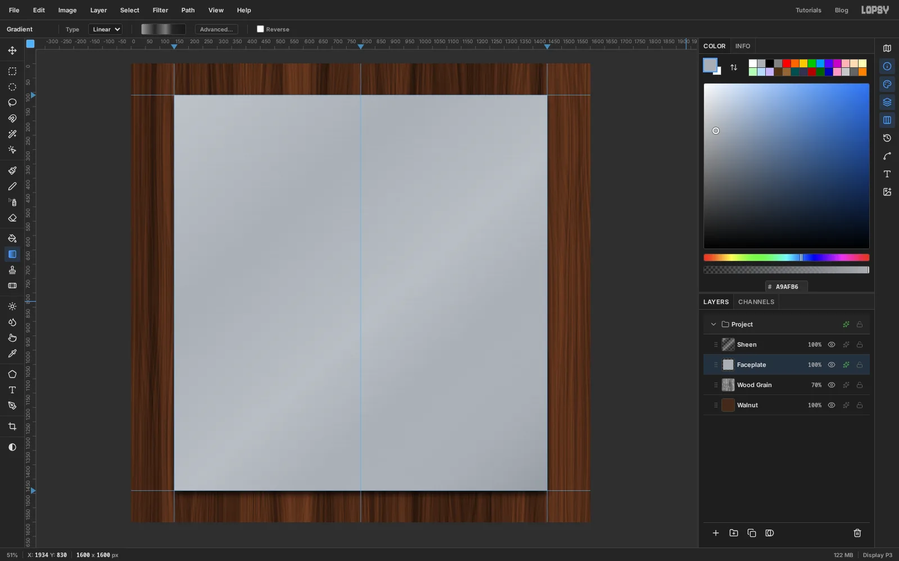

Real brushed metal catches light in broad bands. Add a layer named `Sheen` and [[Cmd]]-click the `Faceplate` thumbnail to select the panel.

Pick the **Gradient** tool, set **Type** to **Linear** and open **Advanced…**. Build five stops:

- white, 55% opacity, at the left end
- white, 0% opacity, at the 30% mark
- white, 40% opacity, at the 55% mark
- white, 0% opacity, at the 70% mark
- black, 35% opacity, at the right end

Drag from the panel's top left corner to its bottom right corner, press [[Cmd+D]], and set the layer's blend mode to **Soft Light**.

Select `Faceplate` and give it a **Drop Shadow**: **Offset X** `0`, **Offset Y** `14`, **Blur** `30`, **Opacity** `75`. The shadow is subtle against the dark wood, but it stops the panel looking painted on.

## Cut the display window

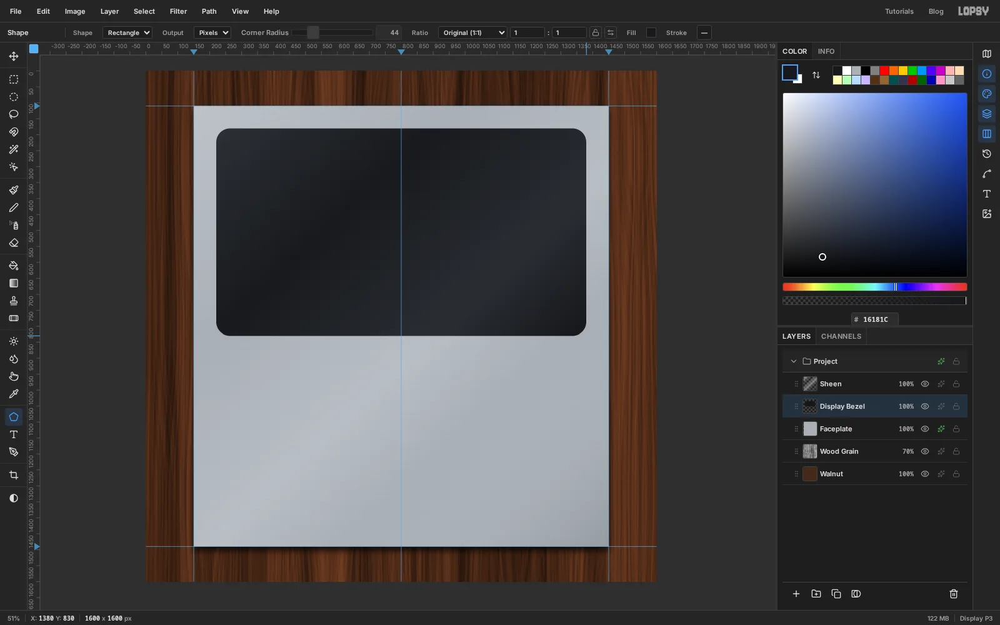

Add a layer named `Display Bezel`. Pick the **Shape** tool ([[U]]), set **Shape** to **Rectangle** and **Corner Radius** to `44`. Click the **Fill** swatch and set it to `#16181C`.

The Shape tool draws from the centre outwards. Press at the centre of the window, `800, 505`, and drag out to `1380, 830`. That makes a box from `220, 180` to `1380, 830`.

## Fill the window with night sky glass

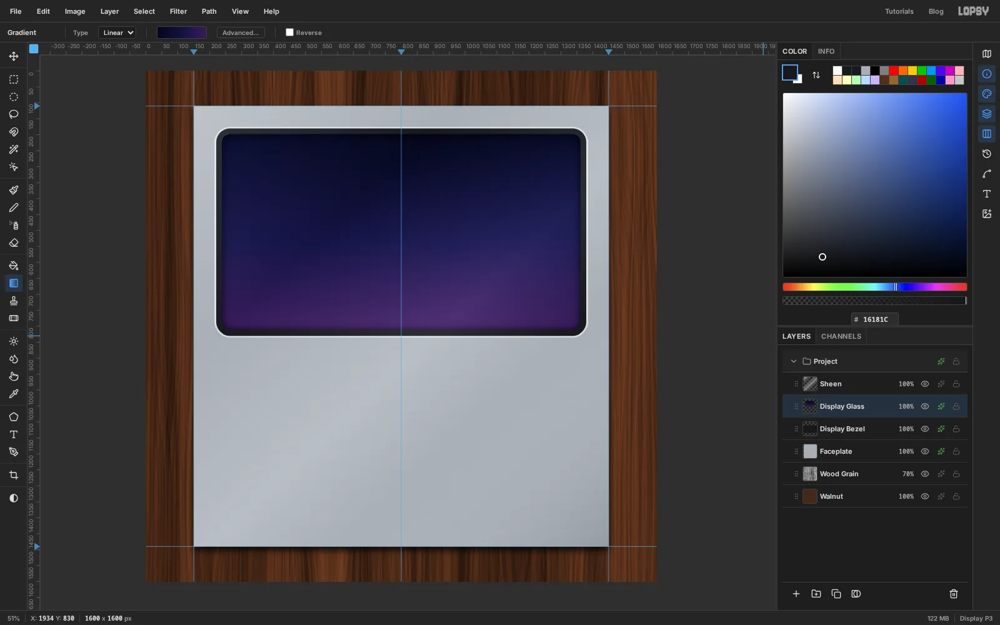

First give `Display Bezel` a **Stroke**: **Width** `5`, colour `#D9DDE2`, position **outside**. That's the polished chrome rim around the window.

Add a layer named `Display Glass`. [[Cmd]]-click the `Display Bezel` thumbnail, then choose **Select → Shrink…** and shrink by `18` px. That leaves a black lip of bezel all the way round.

With the **Gradient** tool, set three stops: `#04061A`, `#141346` at about 55%, and `#3A1C5E`. Drag from the top of the window straight down to the bottom, then press [[Cmd+D]].

Add an **Inner Glow** in black, **Size** `40`, **Opacity** `85`. Glass that is set back in a frame always looks darker at its edges.

## Paint a nebula

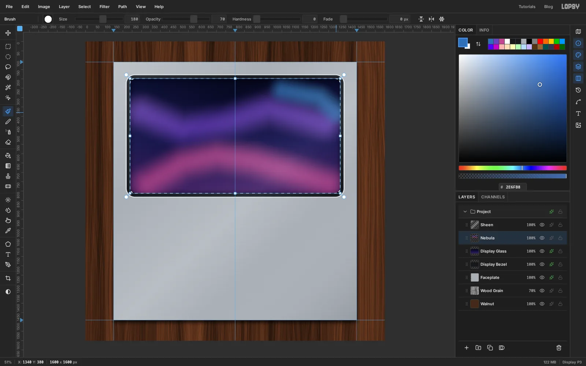

Add a layer named `Nebula` and [[Cmd]]-click the `Display Glass` thumbnail so you can't paint outside the window.

Pick the **Brush** ([[B]]) with **Size** `260`, **Hardness** `0` and **Opacity** `70`. Paint one long, gently curved stroke of `#C2478F` across the lower third, and another of `#6A3FC0` across the upper middle. Drop the size to `180` and add a short stroke of `#2E6FB8` in the top right corner.

Keep the selection, and choose **Filter → Gaussian Blur…** with **Radius** `70`. Then press [[Cmd+D]] and set the layer's blend mode to **Screen**. The strokes melt into a soft aurora that lightens the sky without hiding it.

## Scatter the stars

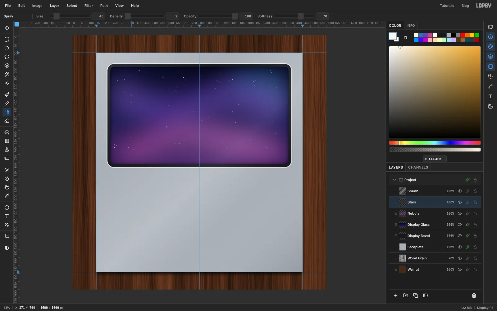

Add a layer named `Stars`. [[Cmd]]-click `Display Glass` again and shrink the selection by `14` px, so no stars sit right against the frame.

Pick the **Spray** tool ([[J]]) with **Size** `46`, **Density** `2` and **Opacity** `100`, and set the colour to `#FFF4E0`. Click, don't drag, about seventy times around the window. Click more often near the top and only now and then near the bottom, where the nebula is brightest. Press [[Cmd+D]] when you're done.

## Draw one quartz crystal, facet by facet

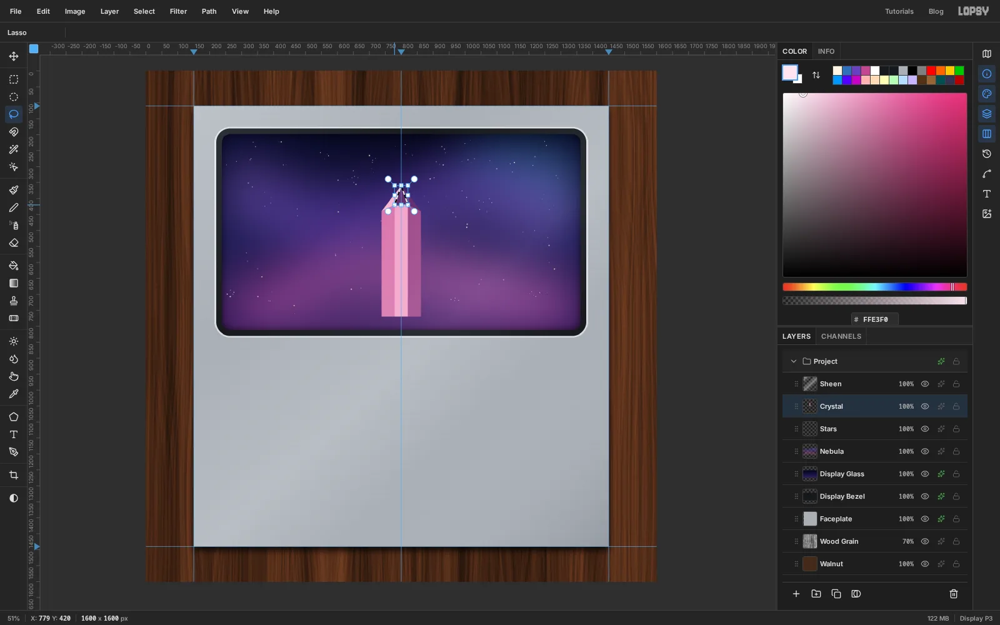

A quartz crystal is a six-sided prism with a pointed tip. From the front you see three long faces and three triangular facets at the top. Lit from the top left, each one is a different shade of pink.

Add a layer named `Crystal`. The crystal stands on `800, 770`, is 124 px wide and reaches up to `800, 359`.

1. With the **Lasso** ([[L]]), draw the whole outline: a rectangle from `738, 770` up to y `440`, topped by a point at `800, 359`. Drag in straight runs from corner to corner. Fill it with `#5E2A6B` and press [[Cmd+D]].
2. Split the body into three strips, each about 41 px wide: the left face from x `738` to `779`, the middle from `779` to `821`, the right from `821` to `862`. Lasso each one and fill it: left `#D873AB`, middle `#F2A2C8`, right `#9B4686`. Let the middle strip run 20 px higher than the outer two, so its top edge meets the point.
3. Lasso the three triangles at the tip, all meeting at the point `800, 359`. The left one runs from `738, 440` to `779, 420`; fill it `#F6B6D4`. The middle one sits on top of the middle strip, from `779, 420` to `821, 420`; fill it `#FFE3F0`. The right one runs from `821, 420` to `862, 440`; fill it `#C35E9A`.

The dark first fill sits under every facet, so there are no gaps between the shapes.

## Add a glint and shade the base

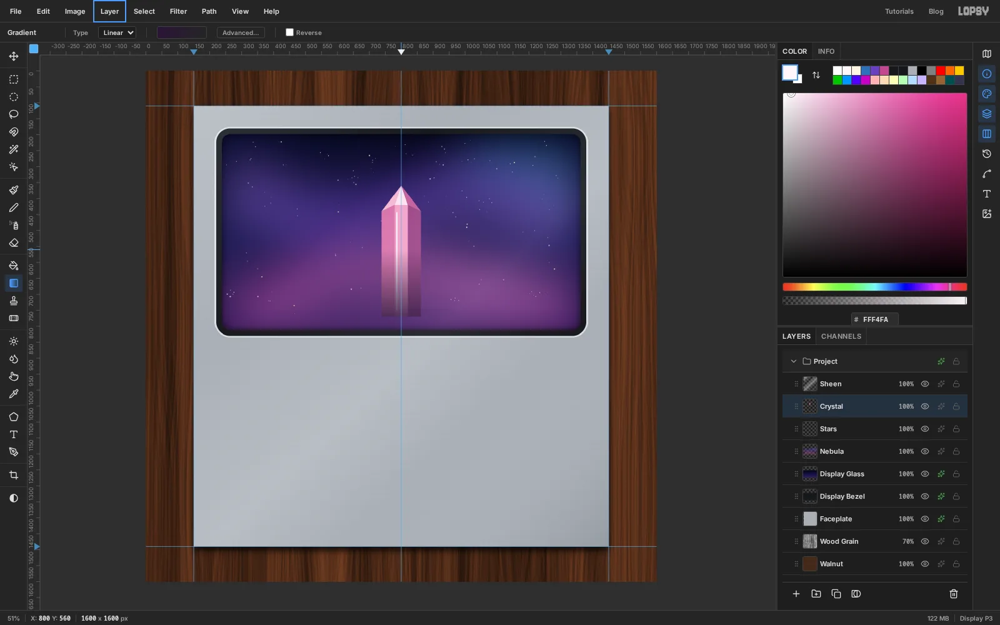

Pick the **Pencil** ([[N]]) at **Size** `4` with `#FFF4FA`. Click near the bottom of the middle face, just inside its left edge, then [[Shift]]-click near its top. That draws a straight glint, the kind of line you'd see where light runs along a crystal's edge.

[[Cmd]]-click the `Crystal` thumbnail. With the **Gradient** tool, set two stops, both `#2A1238`: 90% opacity at the left and 0% at the right. Drag from the crystal's base up to about y `560`, then press [[Cmd+D]]. The bottom of the crystal now sinks into shadow, ready to be buried in rock.

## Copy, scale and rotate the crystal

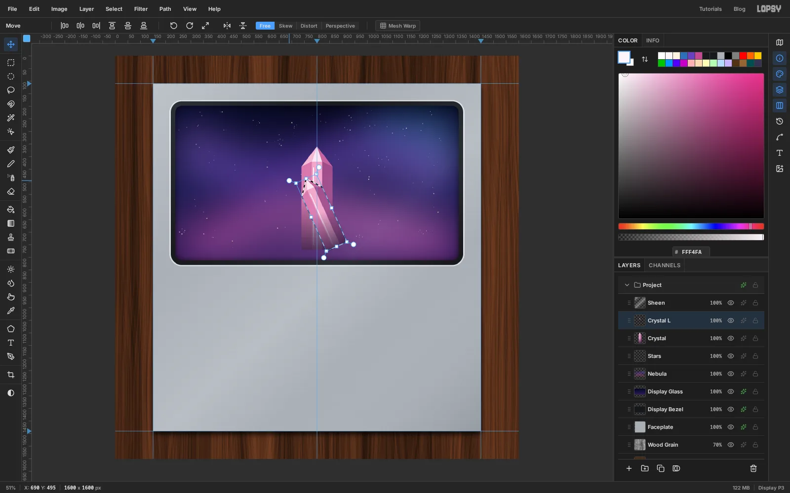

The rest of the cluster is copies of this crystal.

1. With `Crystal` selected, click **Duplicate Layer** at the bottom of the Layers panel and rename the copy `Crystal L`.
2. [[Cmd]]-click its thumbnail to select its pixels and switch to the **Move** tool ([[V]]).
3. Hold [[Cmd]] and drag the top left corner handle down and to the right until the selection is about 72% as tall. Cmd keeps the proportions.
4. Drag the round rotation handle just outside a corner to tilt the crystal about 24° to the left. Press [[Enter]] to commit, then [[Cmd+D]].
5. Drag it with the Move tool until its base sits at about `712, 790`, beside the original.

## Grow the cluster

Repeat the last step for five more copies, always duplicating the original `Crystal`:

- `Crystal R`: 80% of the height, tilted 20° right, base at about `892, 792`
- `Crystal FL`: 45%, tilted 48° left, base at about `640, 798`
- `Crystal FR`: 50%, tilted 44° right, base at about `968, 798`
- `Crystal Front`: 32%, tilted 7° left, base at about `765, 806`
- `Crystal Front 2`: 25%, tilted 14° right, base at about `845, 808`

The two big ones lean in towards the middle, the two small ones splay out low, and the two tiny ones stand in front of the main crystal's base. Varying the size and the angle is what makes the copies read as a natural cluster.

## Stack, merge and light the cluster

The order of the layers decides which crystal is in front. Drag rows by their grip on the left of the Layers panel:

1. Drag `Crystal` above `Crystal L`, so the main crystal sits in front of the four leaning ones.
2. Drag `Crystal Front` and then `Crystal Front 2` above `Crystal`.

When the order looks right, select the top crystal layer and choose **Layer → Merge Down** six times, until they're all one layer. Rename it `Quartz`.

Give `Quartz` an **Outer Glow** in `#FF6FC4`, **Size** `45`, **Opacity** `70`. Now the cluster looks lit from inside.

## Bury the bases in rock

A druse is the glittering crust of little crystals that big ones grow out of. Add a layer named `Druse`. With the **Lasso**, draw a low, lumpy mound from about `440, 812` to `1160, 812`, rising to about y `750` in the middle. Make the top edge bumpy rather than smooth, and finish the shape below the window.

To trim it to the glass, hold [[Cmd+Shift+Alt]] and click the `Display Glass` thumbnail. That intersects your selection with the window.

Fill with `#1C0F2C`. Then pick the **Spray** tool at **Size** `30`, **Density** `3`, with `#F7A8D0`, and click along the top of the mound to scatter tiny sparkles. Press [[Cmd+D]] and add an **Inner Glow** in `#B04A8E`, **Size** `18`, **Opacity** `60`.

## Make a dial tick pattern

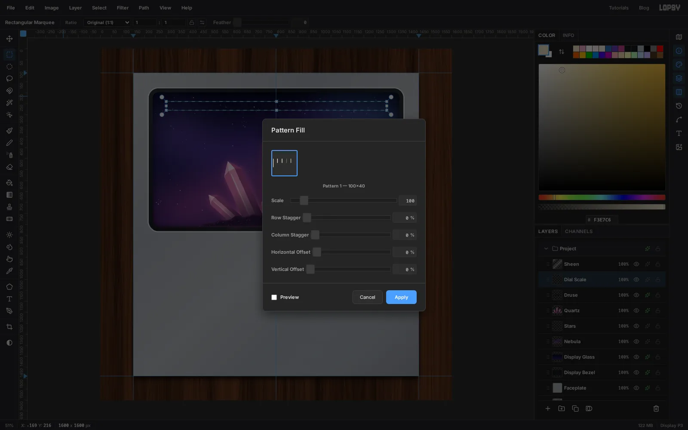

A radio dial has hundreds of evenly spaced ticks. Draw one repeat and let a pattern do the rest.

1. Add a layer named `Tick Tile`. Pick the **Pencil** at **Size** `3` in `#F3E7C6`. Click at `301, 241` and [[Shift]]-click at `301, 276` for a long tick.
2. Set **Size** to `2` and draw four short ticks from y `241` to `258`, at x `320`, `340`, `360` and `380`.
3. With the **Rectangular Marquee**, select exactly `300, 240` to `400, 280`. Choose **Edit → Define Pattern**, press [[Cmd+D]], and delete the `Tick Tile` layer.
4. Add a layer named `Dial Scale` and select `300, 240` to `1304, 280`. Choose **Edit → Fill with Pattern…** and apply it at 100%.

The pattern tiles from the canvas's top left corner, so the 100 × 40 tile lines up exactly with x `300` and y `240`. Every hundred pixels you get a long tick, with four short ones between. Press [[Cmd+D]] and add an **Outer Glow** in `#FFD9A8`, **Size** `10`, **Opacity** `55`, so the scale looks backlit.

## Number the dial and set the needle

Pick the **Text** tool ([[T]]) and set the font to **Share Tech Mono**, **Size** `26`, colour `#F3E7C6`. Click under the first long tick and type `88`, then press [[Tab]] to commit.

Repeat for `92`, `96`, `100`, `104` and `108` under every second long tick (x `500`, `700`, `900`, `1100` and `1300`). Centre each number on its tick with the **Move** tool and the arrow keys, at about y `308`. Add a small `MHz` under the `108`.

Add a layer named `Tuning Needle`. With the **Pencil** at **Size** `5` in `#FF4B3E`, click at `1012, 224` and [[Shift]]-click at `1012, 336`. Give it an **Outer Glow** in `#FF3B2E`, **Size** `18`, **Spread** `40`, **Opacity** `90`. Spread matters for thin shapes. Without it, the glow of a 5 px line fades to almost nothing.

Select `Dial Scale`, every number, `MHz` and `Tuning Needle`, and choose **Layer → Group Layers**. Name the group `Dial`.

## Add glare to the glass

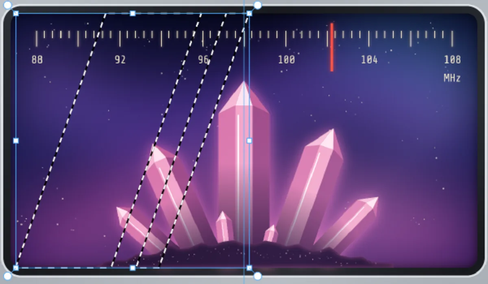

Collapse the `Dial` group, select it, and add a layer named `Glass Glare` above it. A new layer added while an expanded group is selected goes inside that group, so keep groups collapsed when you're adding layers next to them. With the **Lasso**, draw a wide diagonal band from the top of the window down towards the bottom left. Hold [[Shift]] and add a thinner parallel band to its right. Then hold [[Cmd+Shift+Alt]] and click the `Display Glass` thumbnail to trim both bands to the window.

Fill with white, press [[Cmd+D]], and lower the layer's opacity to `9%`. Pick the **Eraser** ([[E]]) at **Size** `360` and **Opacity** `70`, and stroke once along the bottom of the bands, so the reflection fades out instead of ending in a hard line.

## Engrave the title

The title is engraved into the metal: dark letters with a thin bright lip along the bottom edge, where the cut catches the light.

Select a non-text layer first. With the **Text** tool active, any change you make to the font or size applies to the selected text layer, which isn't what you want here. Then set the font to **Michroma**, **Size** `70`, colour `#2A2E34`. Click in empty space below the window and type `MIDNIGHT QUARTZ`, then press [[Tab]].

Open the **Text** panel and set **Letter spacing** to `10` px. The title is now 1080 px wide. Use the **Move** tool and arrow keys to centre it on the guide at x `800`, with its capitals running from y `888` to `948`.

Add a **Drop Shadow** in `#F4F6F8`: **Offset X** `0`, **Offset Y** `2`, **Blur** `0`, **Opacity** `80`. Then add an **Inner Glow** in black, **Size** `3`, **Opacity** `100`, so the letters look cut in rather than printed on.

## Add the artist and an engraved rule

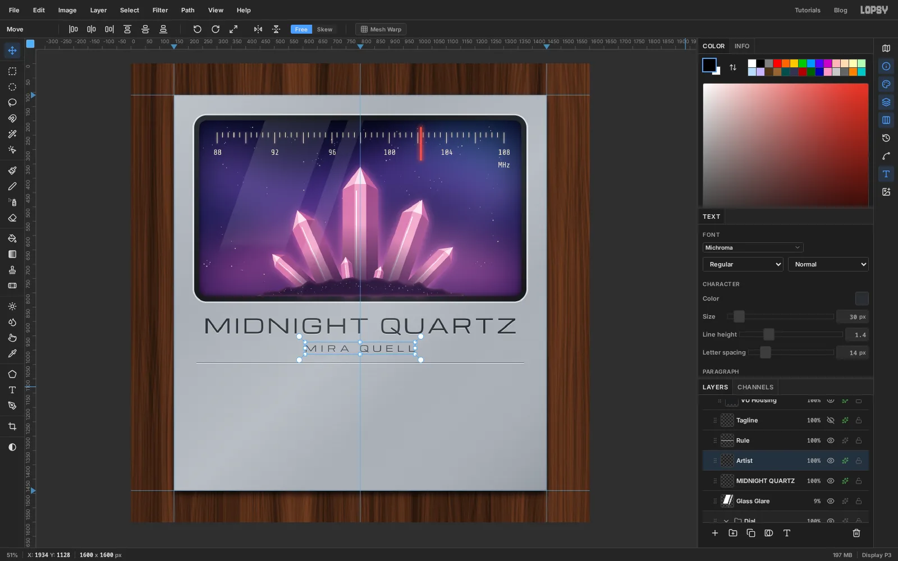

Select a non-text layer again before you change anything, or the new settings will restyle the title. Text settings also carry over to the next layer you create, so set all three: **Michroma**, **Size** `30`, **Letter spacing** `14`. Type `MIRA QUELL` and centre it at `800, 995`. Give it the same light drop shadow as the title. At less than half the title's size, but bigger than every label to come, it reads second.

Add a layer named `Rule`. With the **Pencil** at **Size** `2`, draw a line of `#5E636B` from `230, 1044` to `1370, 1044` (click, then [[Shift]]-click). Draw a second line of `#EEF1F4` two pixels lower. Dark above light is how a groove looks when the light comes from above.

## Build the VU meter housing

Add a layer named `VU Housing`. With the **Shape** tool still on **Rectangle**, set **Corner Radius** to `22` and the fill to `#1B1D21`, then drag from the centre `420, 1205` out to `610, 1330`. Add a **Drop Shadow**: **Offset Y** `6`, **Blur** `10`, **Opacity** `60`.

Add a layer named `VU Face`. [[Cmd]]-click the housing thumbnail and **Shrink** the selection by `12` px. Fill it with a linear gradient from `#FCF3D9` at the top to `#E6CC94` at the bottom, and press [[Cmd+D]]. Add an **Inner Glow** in `#B9771F`, **Size** `30`, **Opacity** `65`. That's the look of an old meter lit by a bulb behind its face.

## Draw the meter scale

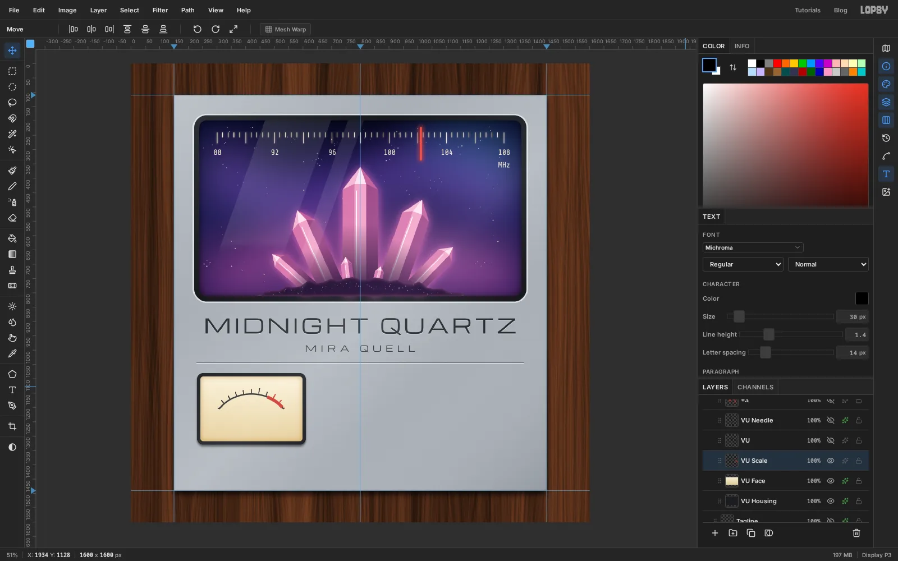

The needle pivots at `420, 1300`, near the bottom of the face, and every part of the scale is centred on that point. Add a layer named `VU Scale`.

1. With the **Elliptical Marquee**, drag a circle from `270, 1150` to `570, 1450` (radius 150 around the pivot). Hold [[Alt]] and drag a second circle from `275, 1155` to `565, 1445` to cut out the middle. You now have a 5 px ring.
2. With the **Lasso**, hold [[Shift+Alt]] and draw a wedge: start at the pivot, go out to `221, 1133`, sweep up over the top of the face to `619, 1133`, and back to the pivot. That's 50° either side of straight up. The wedge intersects the ring, leaving only the top arc. Fill it with `#2B2B2B`, then press [[Cmd+D]].
3. Do the same again with a slightly thicker ring (circles from `267, 1147` to `573, 1453` and from `278, 1158` to `562, 1442`), intersected with a wedge from the pivot out to `517, 1059` and `619, 1133`. Fill it with `#C8322B` for the red overload zone.
4. With the **Pencil** at **Size** `3` in `#2B2B2B`, draw nine radial ticks. Each one is a click on the arc and a [[Shift]]-click just outside it:
   - `324, 1185` to `316, 1176`
   - `345, 1170` to `336, 1155` (long)
   - `369, 1159` to `365, 1148`
   - `394, 1152` to `391, 1135` (long)
   - `420, 1150` to `420, 1138`
   - `446, 1152` to `449, 1135` (long)
   - `471, 1159` to `475, 1148`
   - `495, 1170` to `504, 1155` (long), in `#C8322B`
   - `516, 1185` to `524, 1176`, in `#C8322B`

## Label the meter

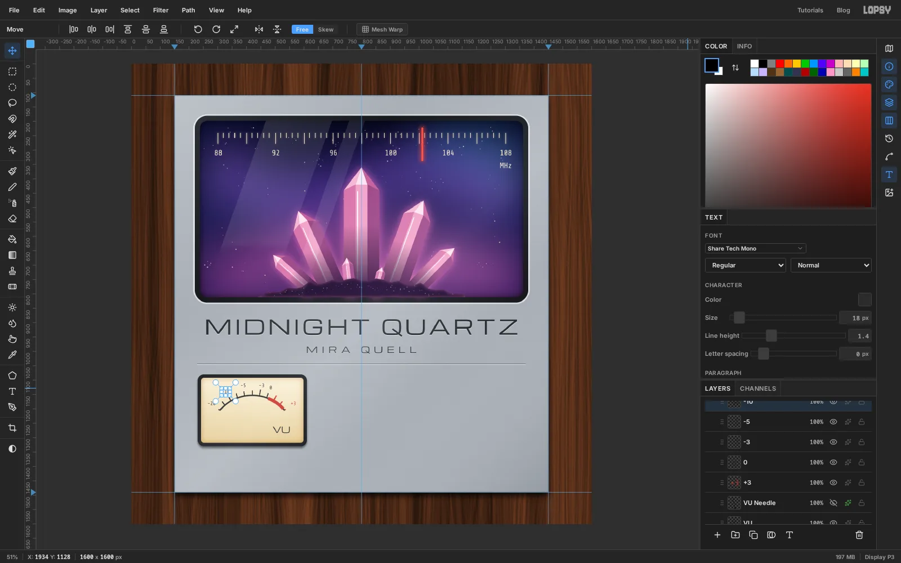

Before you type, open the **Text** panel and set **Letter spacing** back to `0`. Text settings carry over to the next layer you create, so the meter labels would otherwise inherit the artist line's wide spacing.

Use **Share Tech Mono** at **Size** `18`, colour `#2B2B2B`. Type each label, then centre it on its point with the **Move** tool and the arrow keys:

- `-20` at `278, 1180`, beside the left end of the arc
- `-10` at `327, 1139`
- `-5` at `388, 1117`
- `-3` at `452, 1117`
- `0` at `484, 1125`, where the red begins
- `+3` in `#C8322B` at `562, 1180`, beside the right end

Finally type `VU` in **Michroma** **Size** `30` and centre it at about `520, 1272`, in the lower right of the face where the needle won't cross it.

## Add the needle

Add a layer named `VU Needle`. With the **Pencil** at **Size** `3` in `#16171A`, click the pivot at `420, 1300` and [[Shift]]-click about 172 px away, 14° left of vertical (at `378, 1133`).

With the **Elliptical Marquee**, draw a 32 px circle centred on the pivot and fill it with the same colour, so the needle looks pinned in place. Add a soft **Drop Shadow** (**Offset X** `3`, **Offset Y** `5`, **Blur** `4`, **Opacity** `35`). The shadow lifts the needle off the face, as if there's a little space behind the glass.

Group all the meter layers as `VU Meter`.

## Build the first knob

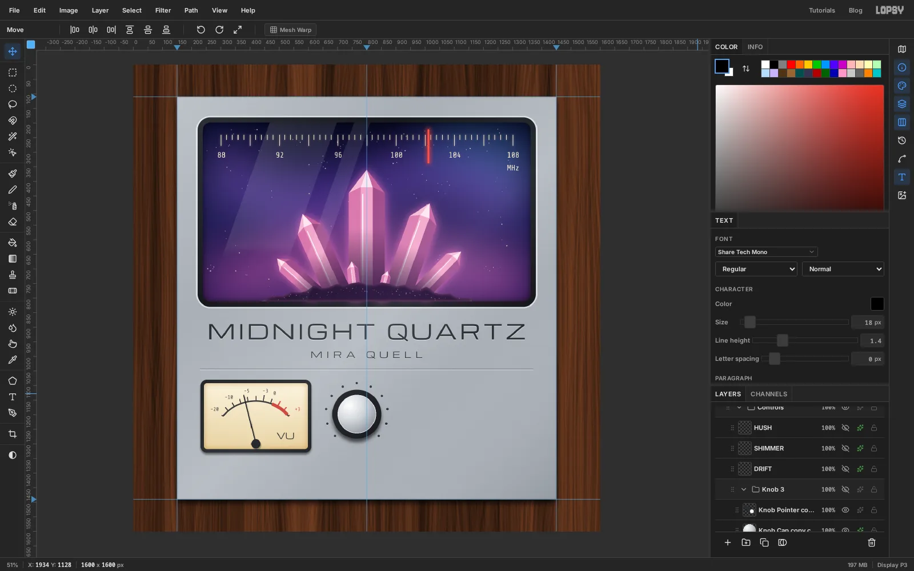

The knob is centred at `765, 1197` and is made of three layers. Add them in this order, so each new one lands on top:

1. `Knob Ticks`: pick the **Brush** at **Size** `9`, **Hardness** `100`, in `#2A2E34`. Click eleven dots on a circle 106 px from the centre, every 27° from the lower left round to the lower right: `690, 1272`, `664, 1230`, `660, 1180`, `679, 1135`, `717, 1103`, `765, 1091`, `813, 1103`, `851, 1135`, `870, 1180`, `866, 1230` and `840, 1272`. Give the layer a light **Drop Shadow** like the title's (`#F4F6F8`, **Offset Y** `1`, **Blur** `0`, **Opacity** `80`), so the dots look stamped into the metal.
2. `Knob Skirt`: fill an 84 px radius circle with `#1A1B1F`. Add a **Drop Shadow**: **Offset Y** `12`, **Blur** `18`, **Opacity** `65`.
3. `Knob Cap`: select a 64 px radius circle. Set a **Radial** gradient: `#FFFFFF`, then `#CDD2D8` at 40%, then `#6E747C`. Drag from just up and left of the centre to beyond the bottom right edge, so the brightest spot sits upper left. Add **Noise** of `6` (Mono) to take the plastic sheen off, press [[Cmd+D]], and add a 2 px `#E9ECEF` **Stroke** for the polished rim.

Select the three layers and choose **Layer → Group Layers**. Name the group `Knob 1`, and collapse it before you go on. A new layer added while an expanded group is selected goes inside that group.

## Duplicate the knob on the grid

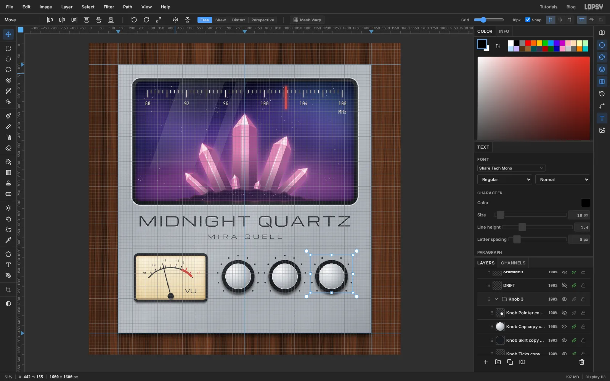

Press [[Cmd+']] to show the grid. The options bar shows **Grid** `16px` with **Snap** ticked. Showing the grid turns snapping on, so leave the **View → Snap to Grid** menu item alone. Clicking it would switch snapping off again.

With `Knob 1` selected, click **Duplicate Layer**, rename the copy `Knob 2`, and drag it 240 px to the right with the **Move** tool. With snapping on, the drag moves in whole 16 px cells, so 240 px (fifteen cells) is easy to hit exactly. Duplicate `Knob 2`, rename it `Knob 3` and drag it another 240 px. The knobs are now centred at about x `765`, `1005` and `1245`. Together with the VU meter, the row runs from x `230` to about `1355`, roughly centred on the panel.

Press [[Cmd+']] again to hide the grid before you nudge anything else. While snapping is on, each arrow-key nudge moves a whole grid cell.

## Set the pointers and label the knobs

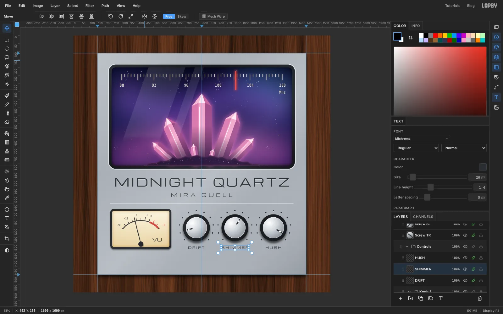

Expand each knob group, select its `Knob Cap` and add a layer named `Knob Pointer` above it. With the **Pencil** at **Size** `6` in `#2A2E34`, draw a short line from near the centre out towards the rim (click, then [[Shift]]-click). Then select a circle of 5 px radius near the outer end and fill it with white. Turn each knob to a different setting:

- `Knob 1`, about 8 o'clock: line `740, 1204` to `710, 1212`, dot at `719, 1209`
- `Knob 2`, about 1 o'clock: line `1018, 1174` to `1034, 1148`, dot at `1029, 1155`
- `Knob 3`, about 4 o'clock: line `1268, 1210` to `1294, 1226`, dot at `1287, 1221`

Different settings make the panel look used rather than freshly assembled.

For the labels, use **Michroma** **Size** `20` with **Letter spacing** `5` in `#2A2E34`. Type `DRIFT`, `SHIMMER` and `HUSH`, centre each under its knob at y `1322`, and give each the light engraving **Drop Shadow** (`#F4F6F8`, **Offset Y** `1`, **Blur** `0`, **Opacity** `80`). Collapse the knob groups, then group the three knobs and their labels as `Controls`.

## Add the lamp, screws and small print

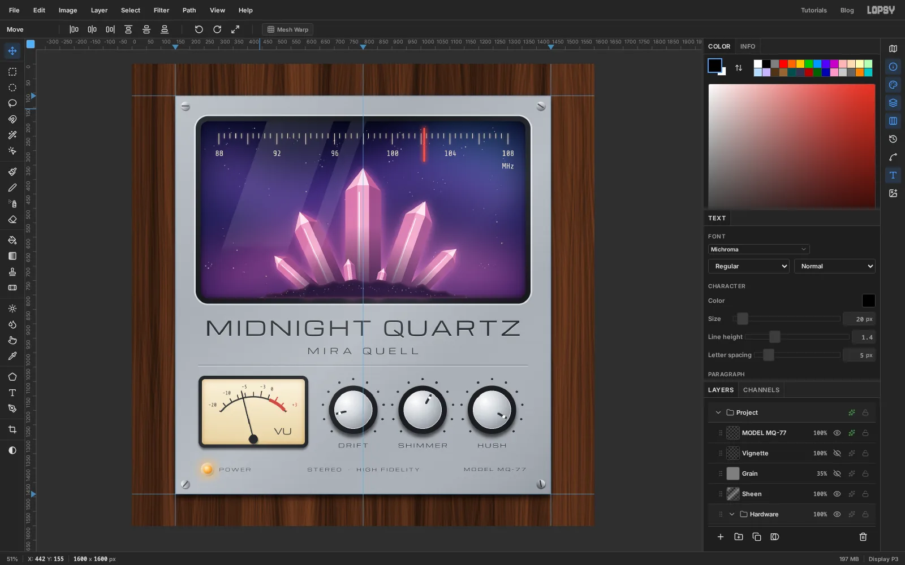

**Pilot lamp.** On a layer named `Lamp Bezel`, select a circle of 24 px radius centred on `262, 1405` and fill it with a linear gradient from `#F2F4F6` to `#6E747C`, top left to bottom right. On a new `Pilot Lamp` layer above it, select a circle of 15 px radius on the same centre and fill it with a radial gradient from `#FFF1B8` through `#FFA42B` to `#A8460A`, starting just above and left of centre. Add an **Outer Glow** in `#FFB347` with **Size** `40`, **Spread** `55`, **Opacity** `90`. Again, a small shape needs Spread before its glow shows.

**Small print.** In **Michroma** **Size** `16`, letter spacing `5`, type `POWER` just right of the lamp, `STEREO · HIGH FIDELITY` centred on the centre guide and `MODEL MQ-77` ending at x `1362`, the same distance from the panel edge as the lamp. Give all three the same vertical centre, y `1405`, so they share a baseline, and give each the light engraving shadow (`#F4F6F8`, **Offset Y** `1`, **Blur** `0`, **Opacity** `80`).

**Screws.** On a layer named `Screw`, select a circle of 15 px radius centred on `185, 145`, fill it with a linear gradient from `#F4F6F8` to `#5F656D` (top left to bottom right), and draw a 4 px slot of `#34383E` across it with the Pencil. Add a small **Drop Shadow** (**Offset X** `1`, **Offset Y** `3`, **Blur** `3`, **Opacity** `55`).

[[Cmd]]-click the screw's thumbnail, press [[Cmd+C]] and then [[Cmd+V]]. The copy is pasted in place on a new layer. Name it `Screw TR` and drag it 1230 px to the right with the **Move** tool. Paste two more copies, `Screw BL` and `Screw BR`, for the bottom corners (1310 px down). Rotate each copy's slot to a different angle with the rotation handle. Screws are never all lined up in real life.

Paste copies pixels, not layer effects, so the copies have no shadow yet. Give each one the same **Drop Shadow** as the first screw.

Group the two lamp layers and the four screws as `Hardware`. The three lines of small print can stay on their own.

## Finish the materials

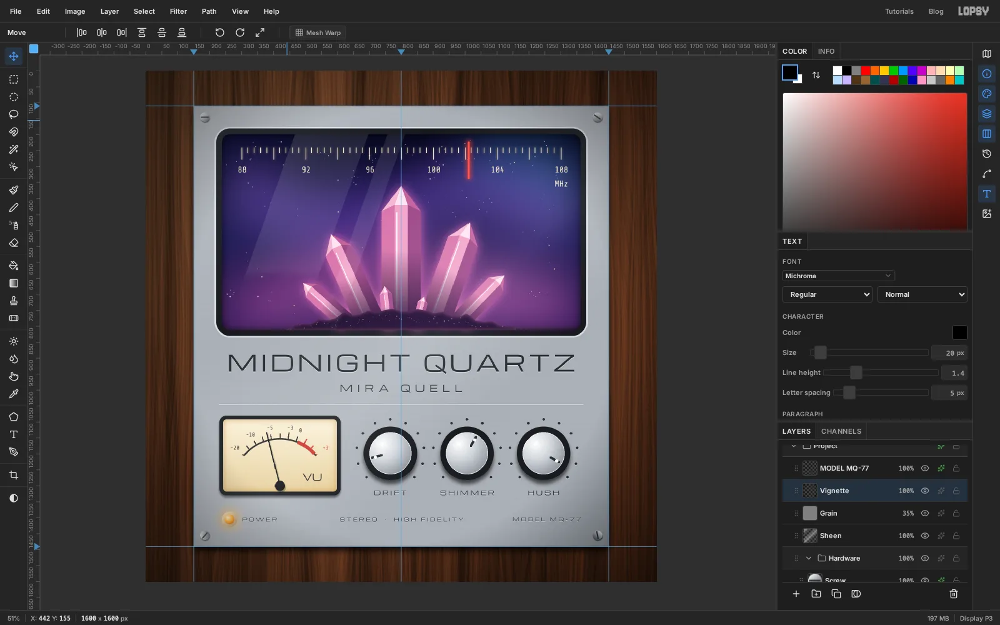

Four last layers make the materials convincing:

1. **Brushed Grain.** Select `Faceplate` and add a layer above it. Fill it with `#808080`, add **Noise** of `70` (Mono, Gaussian) and a horizontal **Motion Blur** of `100`. Then [[Cmd]]-click `Faceplate`, choose **Select → Inverse** and delete. Set it to **Overlay** at `60%`. Also give `Faceplate` an **Inner Glow** in `#1B1E22`, **Size** `8`, **Opacity** `45`, for a hint of edge thickness.
2. **Varnish.** Above `Wood Grain`, add a layer with a linear gradient of three stops: white at 35% opacity on the left end, white at 0% opacity at the 45% mark, and black at 35% opacity on the right end. Drag it from the top left corner to the bottom right and set it to **Soft Light**. The walnut now has a polished sheen.
3. **Grain.** At the very top of the stack, fill a layer with `#808080` and add **Noise** of `18` (Mono, Gaussian). Set it to **Overlay** at `35%`, so the flat colours pick up a little film texture.
4. **Vignette.** Above that, add a layer with a **Radial** gradient of three stops: black at 0% opacity at the left end and again at the 60% mark, and black at 55% opacity at the right end. Drag it from the centre to a corner, and set it to **Multiply**.

Hide the guides with [[Cmd+;]], save the project, and use **File → Quick Export PNG** for the finished cover.
