Skeuomorphism is design that imitates real materials. Think of the
leather-stitched calendars and wooden bookshelves of early-2010s phones.
An iOS 6 app icon was a little object: a glossy tile with a highlight
across the top, chrome that caught the light, and soft shadows underneath.

In this tutorial you'll make **Vinyl Xchange**, a logo for a record shop.
The mark is a 1600 × 1600 px presentation board: a lacquered tangerine
turntable seen from above, built as an app-icon tile, with the shop's name
set underneath. Every part is a simple shape. The realism comes from
gradients, noise, fine detail and consistent shadows.

The light comes from above and slightly to the left, so every shadow in
this piece falls down and a little to the right. Keep that in mind each
time you add a **Drop Shadow**.

Along the way you'll use:

- the **Shape** tool for rounded rectangles, circles, rings and a circle **path**
- many-stop linear and radial **gradients** for lacquer, chrome and vinyl
- **Add Noise**, **Motion Blur**, **Gaussian Blur** and two very different uses of **Sunburst**
- marquee **intersect** and **subtract**, **Shrink** and [[Cmd]]-clicking thumbnails
- **Duplicate Layer**, scaling and rotating with the **Move** tool, **Merge Down**, and copy and paste
- **Drop Shadow**, **Inner Glow** and **Stroke** effects
- text in **Shrikhand** and **Josefin Sans**, letter spacing, and **text on a path**
- ruler **guides**, the **grid**, the **Pencil** and the **Eraser**, and groups

The palette:

- Linen `#E7E1D5`, thread grey `#808080`, vignette `#6A4428`
- Lacquer `#F27A3E` → `#DE6834` → `#B9461E`, flat fill `#E8692F`
- Bevel light `#FFF6EC`, bevel dark `#5E1C06`, tile shadow `#4A2210`
- Chrome `#F4F5F7` → `#9EA2A8` → `#E9EBEE` → `#7D8187` → `#D2D5D9`
- Vinyl `#161618`, grooves `#7A7A84`, track gaps `#050506`, strobe marks `#34363A`
- Label cream `#F1E4C3`, label red `#C8381F`, label ink `#3A2A22`, band text `#F6EBD0`
- Model line `#B4481C`, deboss lip `#FFB48A`, slider ticks `#7A2A0C`
- Wordmark `#2B211C`, offset shadow `#E2652F`, keyline `#F3EADB`, tagline `#6B5548`, rules `#6B5A4E`

## Weave a linen backdrop

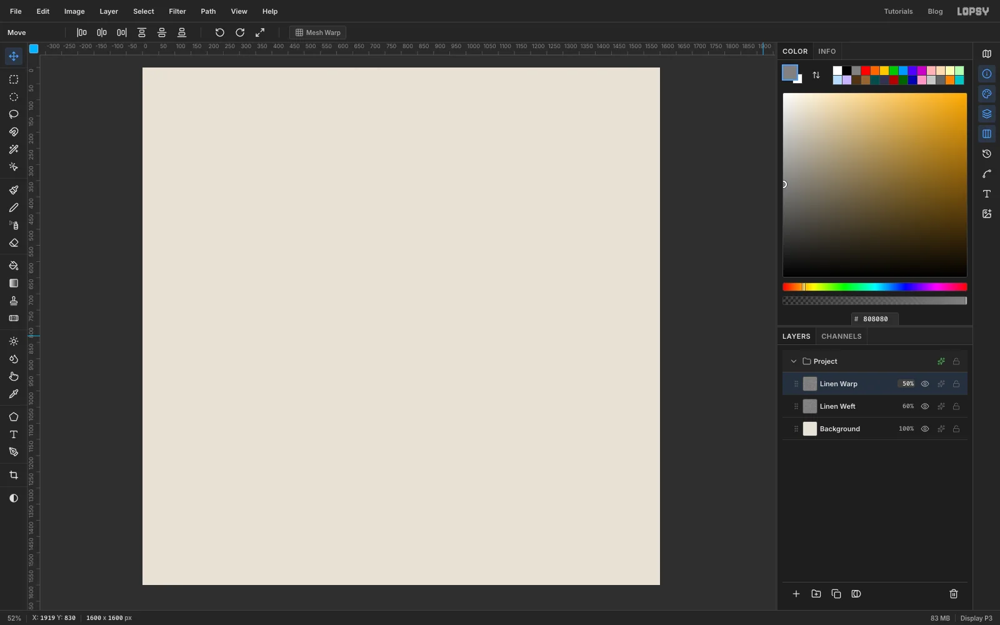

Choose **File → New** and create a **1600 × 1600** px document. Click the
*Background* layer, set the foreground to `#E7E1D5` and choose
**Edit → Fill**.

Rename *Layer 1* to *Linen Weft*. Set the foreground to `#808080`, choose
**Edit → Fill**, and run
**Filter → Add Noise…** with **Amount 100**, **Mono** and **Gaussian**.
Then run **Filter → Motion Blur…** with **Angle 0** and **Distance 4**,
which stretches the specks into horizontal threads. Set the layer to
**Overlay** at **60%**.

Add a layer called *Linen Warp* and repeat the fill, noise and blur, but use
**Angle 90** for the blur so the threads run vertically. Set it to
**Overlay** at **50%**.

## Add a warm vignette

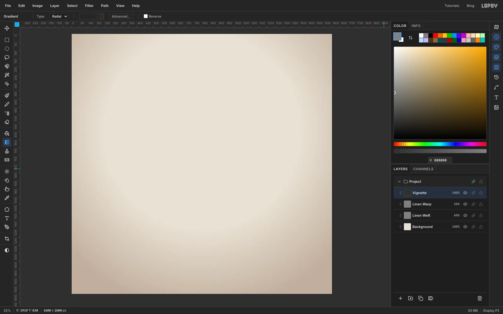

Add a layer called *Vignette*. Pick the **Gradient** tool, set **Type** to
**Radial**, and open **Advanced…**. Make three stops, all `#6A4428`: one at
the left end at **0%** opacity, one just past the middle also at **0%**,
and one at the right end at **30%**.

Drag from just above the middle of the canvas down past the bottom edge.
Set the layer to **Multiply**. The centre stays clean and the corners darken
gently.

## Drop two guides

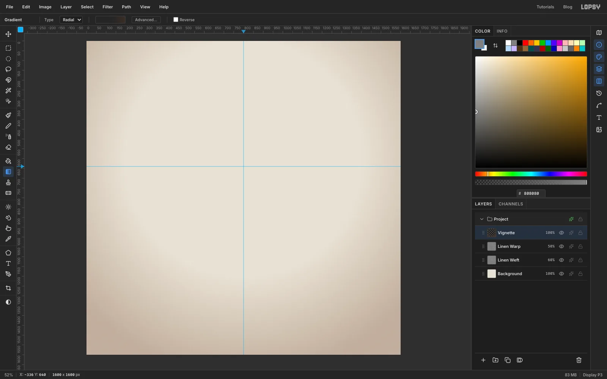

The tile is centred across the canvas but sits above the middle, to leave
room for the name underneath. Click the top ruler at **800** to drop a
vertical guide, and click the left ruler at **640** for a horizontal one.
Most of the turntable will be drawn out from where they cross.

## Draw the tile

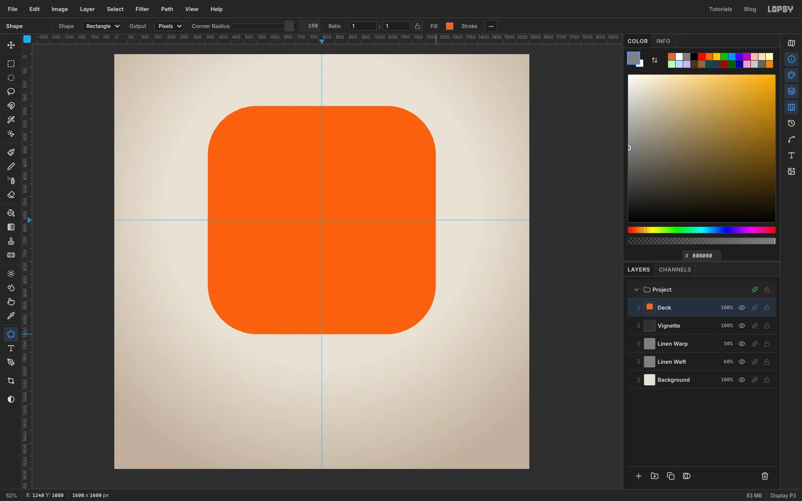

Add a layer called *Deck*. Pick the **Shape** tool and set **Shape** to
**Rectangle**, **Output** to **Pixels** and **Corner Radius** to **190**.
Set the fill to `#E8692F` and remove the stroke.

Shapes grow from where you press. Press on the guide crossing and drag down
and right until the box is **880 × 880** px. Its corner should land at
1240, 1080.

## Shade it like lacquer

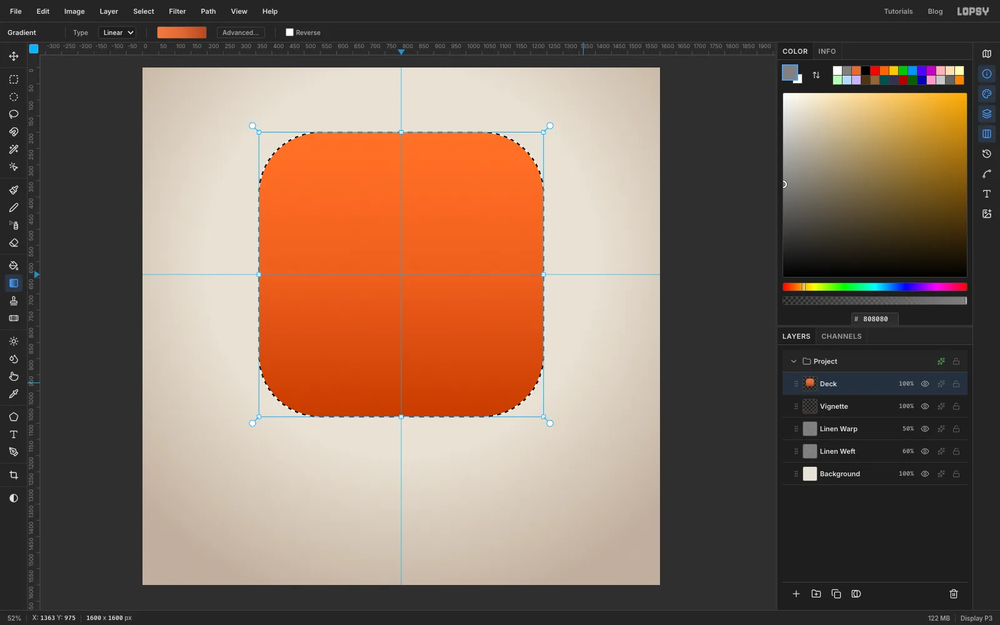

[[Cmd]]-click the *Deck* thumbnail in the Layers panel to load its shape
as a selection. Pick the **Gradient** tool, set it to **Linear**, and use
three stops: `#F27A3E`, `#DE6834` in the middle and `#B9461E`. Drag from the
top edge of the tile straight down to its bottom edge.

Run **Filter → Add Noise…** with **Amount 6**, **Mono** and **Gaussian**.
The faint grain is what keeps a large gradient from looking like plastic.
Press [[Cmd+D]].

## Bevel the edge

Add a layer called *Deck Bevel* and [[Cmd]]-click the *Deck* thumbnail
again. Use a four-stop linear gradient: `#FFF6EC` at **100%** opacity on
the left, `#FFF6EC` at **0%** about a third of the way along, `#5E1C06` at
**0%** two thirds of the way, and `#5E1C06` at **90%** on the right. Drag
from the top of the tile to the bottom.

Choose **Select → Shrink…** with **5** px and press [[Delete]], then
[[Cmd+D]]. Only a 5 px ring is left. It is pale where light hits the top
edge and dark where the bottom edge turns away.

## Select the gloss

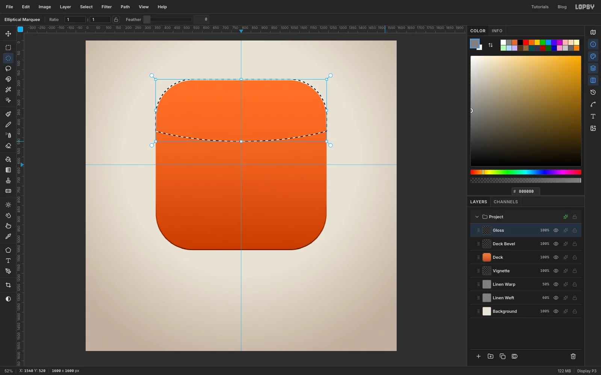

Add a layer called *Gloss* and [[Cmd]]-click the *Deck* thumbnail.

Pick the **Elliptical Marquee**. Hold [[Shift]] and [[Alt]] together, then
drag a very wide ellipse from just above the top-left corner of the canvas
to the right edge, ending about 520 px down. With both keys held, the new
ellipse **intersects** the tile selection. What's left is the top of the
tile with a gently curved lower edge.

## Fill the gloss and lift the tile

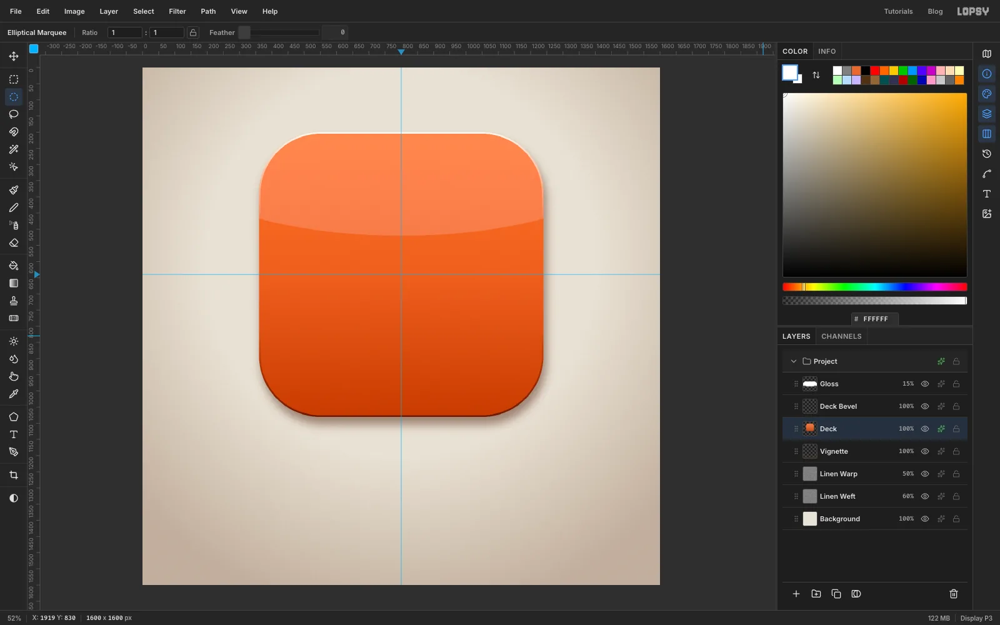

Set the foreground to white, choose **Edit → Fill**, press [[Cmd+D]] and
set the *Gloss* layer to **15%**. A crisp lower edge reads as a reflection
on a glossy surface. A soft gradient would read as a faded one.

Click the *Deck* layer and click the effects button on its row in the
Layers panel to open the effects drawer. Turn on **Drop Shadow**:
**Offset X 8**, **Offset Y 24**, **Blur 44**, **Spread 0**,
**Opacity 50**, colour `#4A2210`.

## Spin up a chrome platter

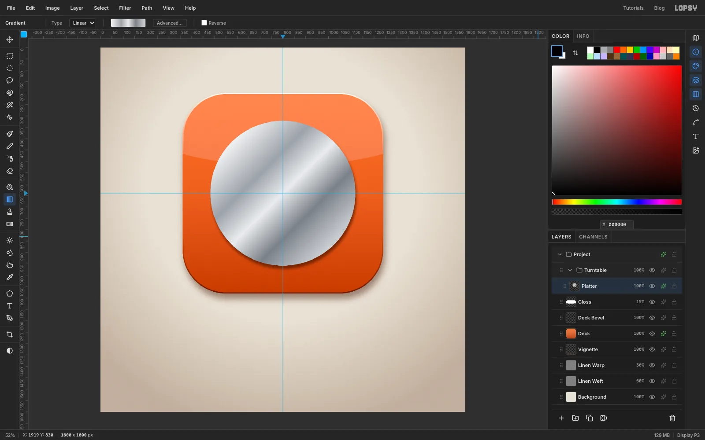

Click *Gloss*, then click **New Group** in the Layers panel and name it
*Turntable*. Inside it, add a layer called *Platter*.

With the **Shape** tool set to **Ellipse**, fill `#A9ACB1` and no stroke,
drag a circle out from the guide crossing **318 px** in each direction.
Hold [[Cmd]] while you drag so the ellipse stays a perfect circle; do the
same for every circle in this tutorial.
[[Cmd]]-click its thumbnail and drag a five-stop linear gradient diagonally
across the disc, from upper left to lower right: `#F4F5F7`, `#9EA2A8`,
`#E9EBEE`, `#7D8187`, `#D2D5D9`. Alternating light and dark bands are what
make metal read as chrome. Press [[Cmd+D]].

Give the platter a **Drop Shadow** of **5**, **14**, **Blur 18**,
**Opacity 70**, colour `#4A1A08`.

## Select just inside the rim

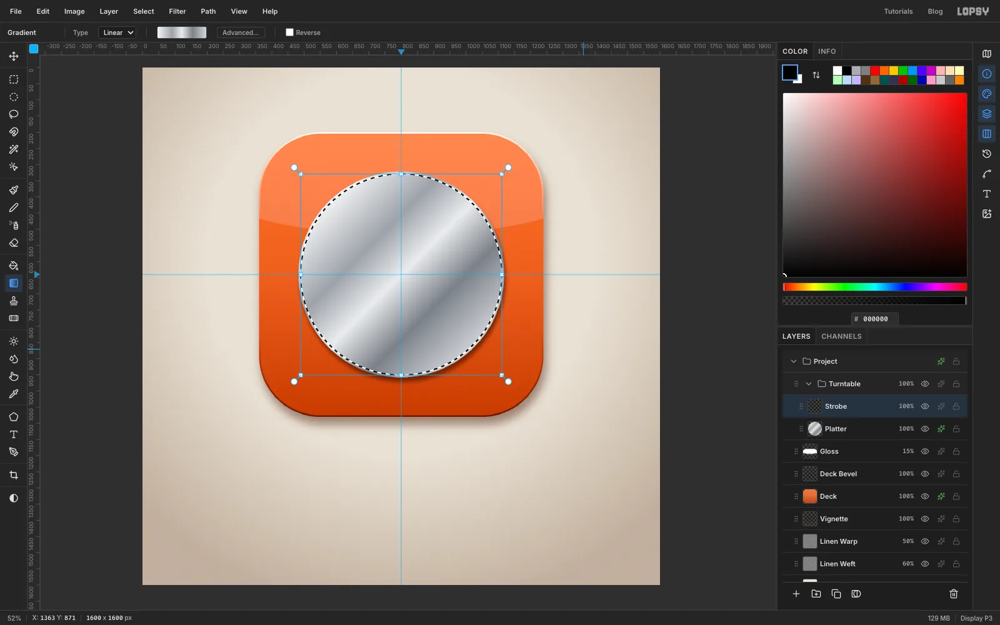

Real turntable platters have rows of strobe marks round the rim for
checking the speed. Add a layer called *Strobe*, [[Cmd]]-click the
*Platter* thumbnail, and choose **Select → Shrink…** with **7** px.

## Fire Sunburst rays

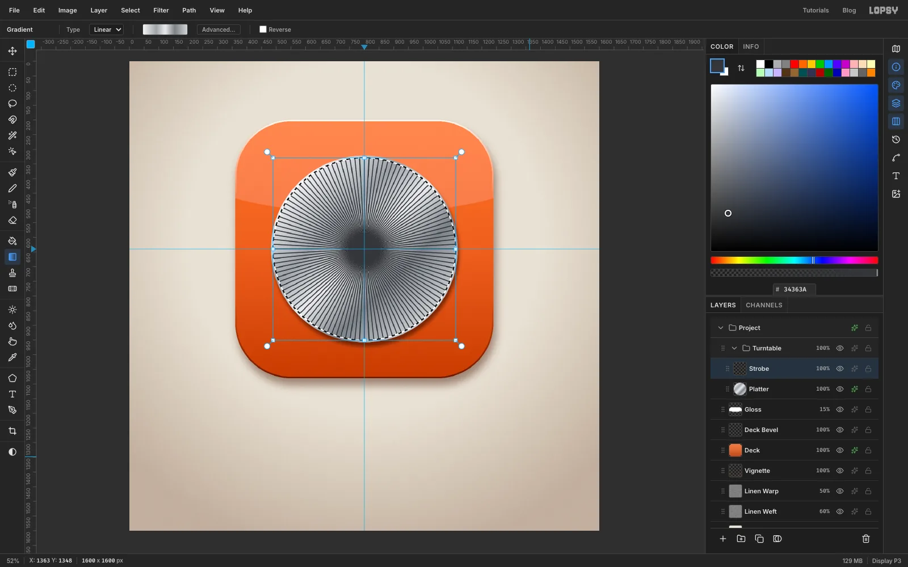

**Sunburst** draws rays from a point. Set the foreground to `#34363A` and
run **Filter → Sunburst…** with **Rays 120**, **Length 26**, **Width 38**,
**Taper 50**, **Softness 10** and **Opacity 100**. Set **Center X** to
**50** and **Center Y** to **40**: the centre is a percentage of the
canvas, and the guide crossing at 800, 640 is 50% across and 40% down. The
selection stops the rays just short of the rim.

## Cut away the middle

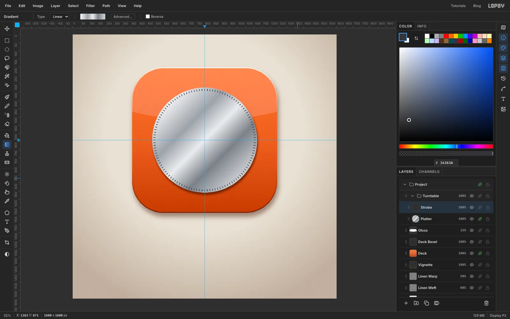

[[Cmd]]-click the *Platter* thumbnail again and choose
**Select → Shrink…** with **19** px. Press [[Delete]] and then [[Cmd+D]].
Only the outer 12 px of each ray is left, as a ring of tick marks.

## Lay the record on

Add a layer called *Vinyl* and draw an `#161618` circle **285 px** out from
the crossing. [[Cmd]]-click it and drag a **Radial** gradient from the
centre out to the edge, with seven near-black stops: `#111113`, `#0B0B0C`
at about 36%, `#1F1F22` at 42%, `#18181B` at 60%, `#202024` at 78%,
`#19191C` at 96% and `#2C2C30` at the very edge. The dark band near the
middle is the smooth run-out groove.

Add **Noise** at **5** (Mono, Gaussian) and press [[Cmd+D]]. Give the
record a small **Drop Shadow**: **2**, **4**, **Blur 6**, **Opacity 60**,
`#111111`.

## Add soft groove bands

Add a layer called *Bands* and [[Cmd]]-click the *Vinyl* thumbnail. In
the gradient editor, make every stop `#3C3C42`. Keep the first stop
transparent, then click the bar to add stops evenly across its right-hand
60%, alternating **0%** and **55%** opacity. That's 16 stops in all. Drag
the radial gradient from the centre to the record's edge, then press
[[Cmd+D]].

## Draw hairline grooves

Add a layer called *Grooves*. Set the **Shape** tool to **Ellipse** with
no fill, a `#7A7A84` stroke and **Width 1**. Starting on the guide
crossing each time, drag out circles every 16 px, from a **112 px**
radius to **272 px**. That's eleven rings.

## Scale copies between them

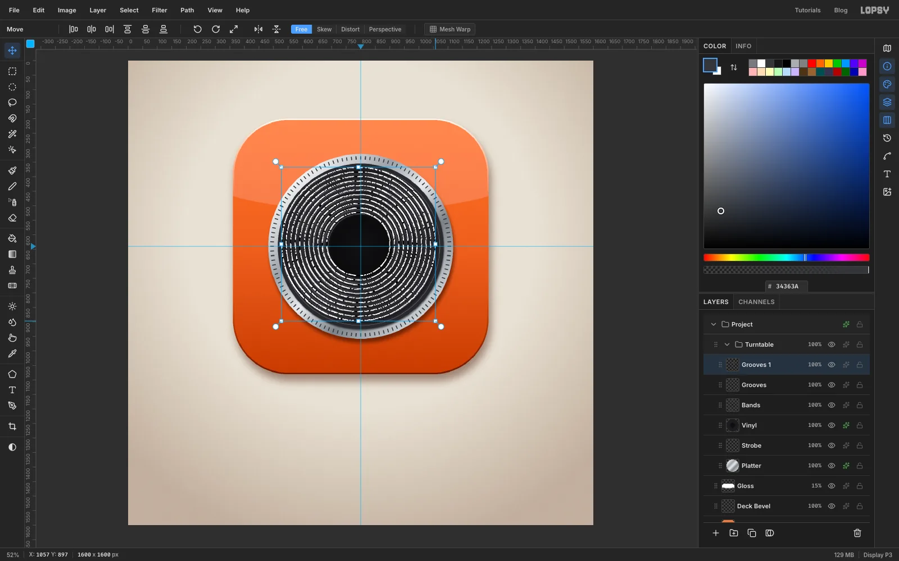

Choose **Layer → Duplicate Layer** and [[Cmd]]-click the copy's thumbnail.
With the **Move** tool, hold [[Cmd]] and drag the bottom-right corner
handle in about 16 px, until the copy's outer ring sits halfway between the
two outermost original rings. Press [[Cmd+D]].

Scaling pins the opposite corner, so the copy is now off-centre by half
that amount. Press [[←]] and [[↑]] about 8 times each, until the rings are
concentric again, then choose **Layer → Merge Down**. Do it once more,
dragging the corner in about 8 px and nudging back about 4 px, and merge
again.

## Fade the grooves

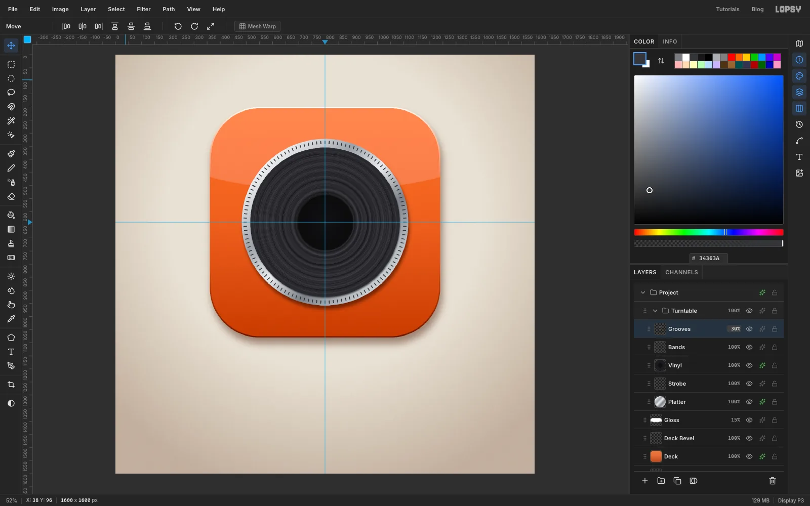

You now have about 40 rings. Because the copies scale by a percentage, the
spacing changes across the disc, which looks more natural than a perfectly
even pattern. Rename the merged layer *Grooves* and set it to **30%**.

## Throw light across the record

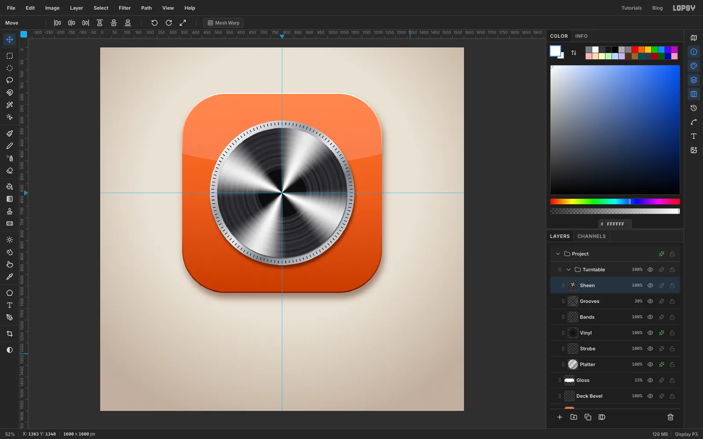

Vinyl catches light in two opposite wedges that look like a bow tie.
Sunburst can draw those too.

Add a layer called *Sheen*, [[Cmd]]-click the *Vinyl* thumbnail and set
the foreground to white. Run **Filter → Sunburst…** with **Rays 4**,
**Length 23**, **Width 38**, **Taper 0**, **Fade 10**, **Softness 100**,
**Rotation 25**, **Center X 50**, **Center Y 40** and **Opacity 100**.
Press [[Cmd+D]].

## Keep a bow tie

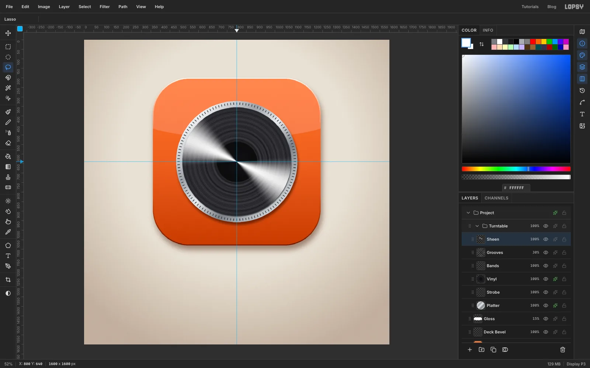

The light is coming from the upper left, so keep that wedge and its
opposite. With the **Lasso**, draw a generous pie slice around the wedge
pointing up and to the right and press [[Delete]]. Do the same for the
wedge pointing down and to the left, then press [[Cmd+D]].

## Soften the sheen

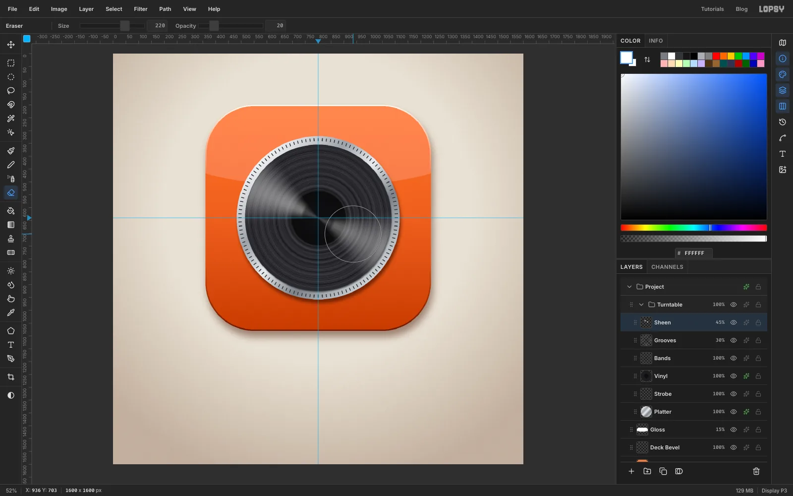

Run **Filter → Gaussian Blur…** with **Radius 6** and set the layer to
**45%**.

Pick the **Eraser** at **Size 140** and **Opacity 50**, and click once
on the centre of the record so the wedges don't meet in a hard point. The
lower lobe will look a little brighter than the upper one. Set the Eraser
to **Size 220**, **Opacity 20** and click once in the middle of the lower
lobe to even them up.

## Cut the track gaps

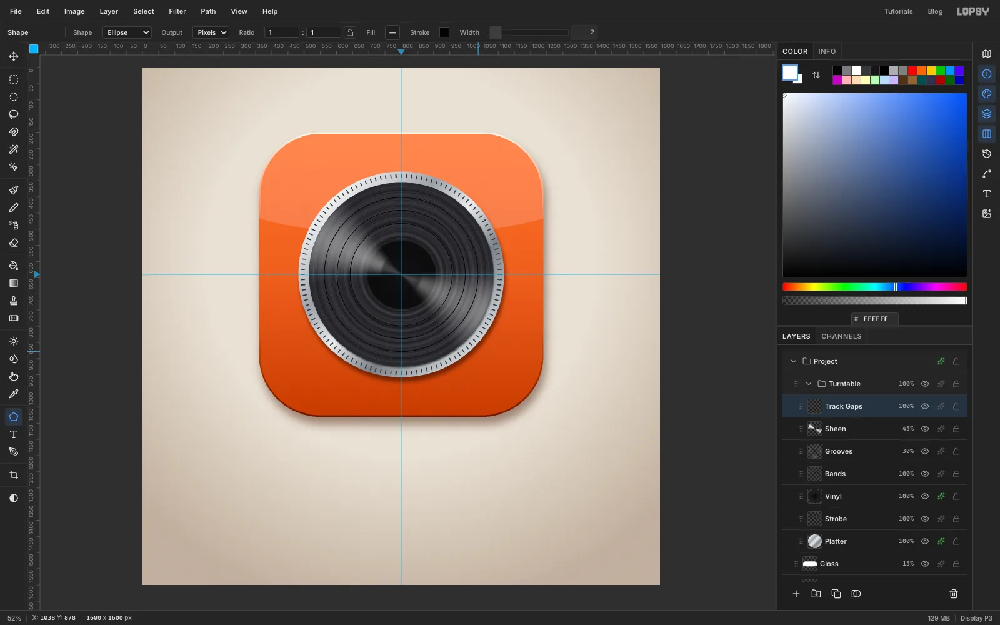

The smooth gaps between songs show up as darker rings. Add a layer called
*Track Gaps* and draw three stroke-only circles from the crossing in
`#050506` at **Width 2**: radius **158**, **198** and **238**.

## Stick on the label

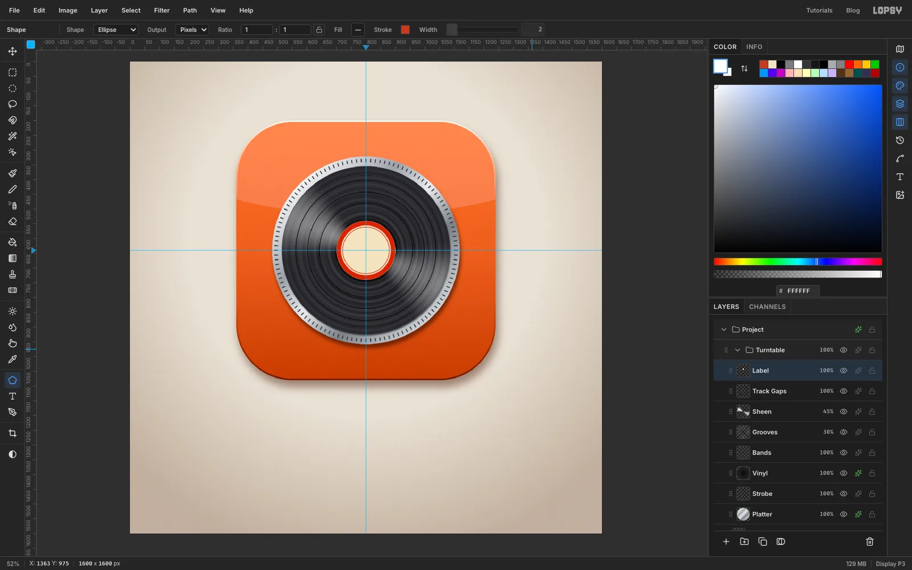

Add a layer called *Label*. Draw a `#F1E4C3` filled circle with a
**100 px** radius. On the same layer, draw two stroke-only circles in
`#C8381F`: one at radius **92** with **Width 15**, and one at radius
**79** with **Width 2**.

[[Cmd]]-click the thumbnail and add **Noise** at **16** (Mono,
Gaussian) for a paper feel. Press [[Cmd+D]].

## Add the spindle

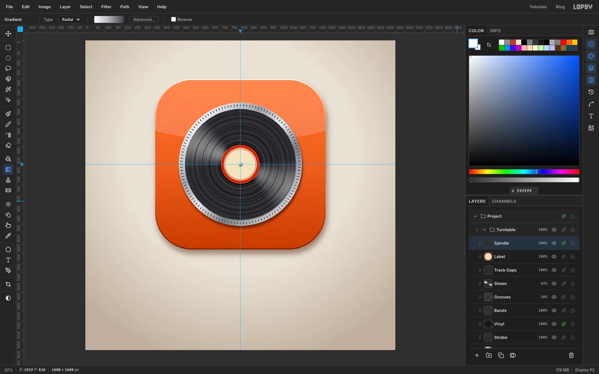

Add a layer called *Spindle*. A 20 px circle is too small to drag out, so
with the **Shape** tool set to fill `#8A8D92`, **click** the guide crossing
without dragging. In the **Shape Size** dialog that opens, enter
**20 × 20** and click **Create**.

[[Cmd]]-click it and drag a radial gradient of white, `#B8BBC0` and
`#45474C` from just above and left of the centre to the lower right. Give
it a **Drop Shadow** of **1**, **2**, **Blur 2**, **Opacity 70**, `#2A1A10`.

## Slide the whole turntable over

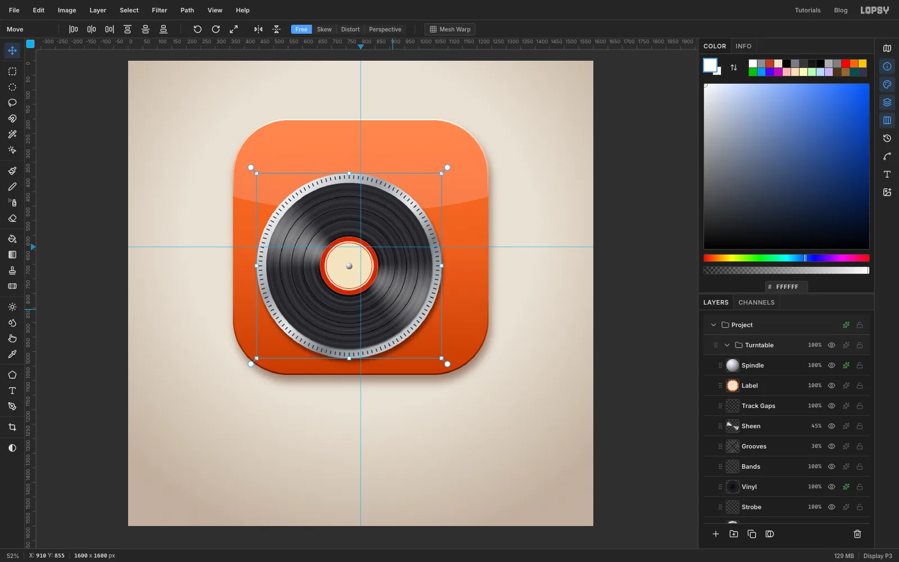

The tonearm needs room on the right. Click the *Turntable* group row, pick
the **Move** tool and drag on the canvas **40 px left** and **65 px
down**. Every layer in the group moves together. The record's centre is now
at 760, 705.

## Build the pivot base

Collapse the *Turntable* group, click **New Group** and name it *Tonearm*.
The pivot sits at **1080, 390**. Watch the cursor position in the status
bar to find it.

Add a layer called *Pivot Base*. Draw a `#2C2C31` circle with a **58 px**
radius on the pivot point. [[Cmd]]-click the thumbnail and drag a radial
gradient of `#3A3A40`, `#26262A` and `#4A4A50` from just up and left of the
centre out past the lower-right edge. Press [[Cmd+D]].

On the same layer, draw a `#B8BBC0` circle with a **40 px** radius. To
select just that circle, pick the **Elliptical Marquee** and click without
dragging: the **Elliptical Selection** dialog lets you type its corners,
1040, 350 to 1120, 430. Drag a chrome gradient across it from upper left
to lower right: `#FAFBFC`, `#A3A6AC`, `#E2E4E7`, `#5E6166`. Then select a
circle with a **31 px** radius in the middle (1049, 359 to 1111, 421) and
fill it with `#202024`. Press [[Cmd+D]].

Give the layer a **Drop Shadow**: **3**, **8**, **Blur 8**, **Opacity 50**,
`#3A1406`.

## Machine the counterweight

Draw the whole arm straight up and down first. It's much easier to shade
a vertical rod, and you'll rotate it into place afterwards.

Add a layer called *Counterweight*. Draw a **Rectangle** with **Corner
Radius 10** and fill `#8B8E94`, **68 × 72** px, centred 78 px above the
pivot. [[Cmd]]-click it and drag a five-stop linear gradient from its left
edge to its right edge: `#4A4D52`, `#D9DBDF`, `#FAFBFC`, `#878A90`,
`#34363A`. For the machined grooves, marquee two 3 px strips right
across the weight, about a quarter and three quarters of the way down, and
fill them with `#2A2B2E`. Press [[Cmd+D]].

## Run the arm tube down

Add a layer called *Arm Tube*. With the **Rectangular Marquee**, select a
strip **20 px** wide centred on the pivot's x position. Start it just
inside the counterweight and run it down about **490 px**. Shade it with a
linear gradient dragged straight across the strip: `#64676D`, `#F6F7F9`,
`#C3C6CB`, `#4E5156`. The narrow bright stripe near one side is what reads
as a round, polished rod. Press [[Cmd+D]].

## Angle the headshell

Add a layer called *Headshell*. Draw a **Rectangle** with **Corner Radius
8** in `#2B2B30`, **44 × 100** px, centred on the bottom of the tube. Shade
it by [[Cmd]]-clicking the thumbnail and dragging a linear gradient from
its left edge to its right edge: `#4A4A52`, `#2B2B30` and `#141416`. Press
[[Cmd+D]].

On the same layer, use click-to-size for two small shapes. Make a cream
`#F1E4C3` cartridge, **28 × 44** with **Corner Radius 4**, in the lower half.
Then make a chrome `#D6D8DC` finger lift, **18 × 8** with **Corner Radius 3**,
sticking out of the right side.

Headshells are set at an angle to the arm. [[Cmd]]-click the *Headshell*
thumbnail, pick the **Move** tool and drag a corner's rotation handle
counter-clockwise for a slight tilt, about 10°. Press [[Cmd+D]]. The rotation swung the top of
the headshell sideways, so tap [[→]] until the tube meets the middle of its
top edge again.

## Merge the arm

With *Headshell* selected, choose **Layer → Merge Down**. Then click *Arm
Tube* and merge it down into *Counterweight*. Rename the result *Arm*.

## Swing the arm onto the record

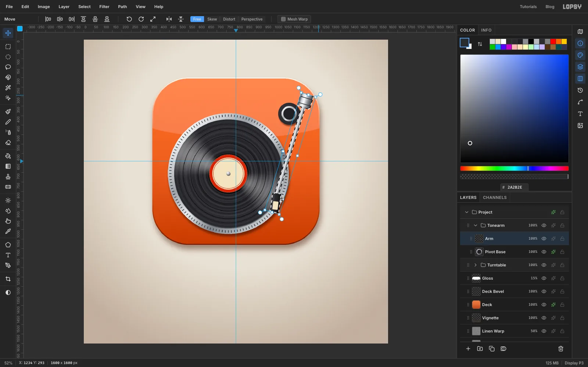

[[Cmd]]-click the *Arm* thumbnail and, with the **Move** tool, drag a
rotation handle clockwise until the cartridge swings in over the outer
grooves, around 930, 875. That's roughly 17°. Press [[Cmd+D]].

## Re-seat it on the pivot

Rotating turns the arm around the middle of its box, not around the pivot.
Use the arrow keys (hold [[Shift]] to move 10 px at a time) until the tube
runs through the centre of the pivot again.

Add a **Drop Shadow** of **6**, **18**, **Blur 8**, **Opacity 70**, black.
The arm stands higher off the deck than anything else, so its shadow falls
furthest.

## Cap the bearing

Add a layer called *Bearing*. Click the pivot point with the **Shape**
tool and make a **36 × 36** `#B8BBC0` circle. [[Cmd]]-click it and drag a
radial gradient of white, `#C9CCD1` and `#55585E` from just up and left of
its centre. Add a **Drop Shadow**: **2**, **5**, **Blur 4**,
**Opacity 60**, `#1C0D06`. The arm now looks like it comes out of the
middle of the bearing.

## Make one speed button

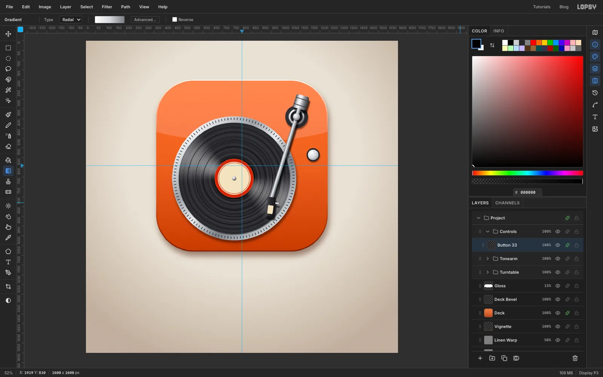

Collapse *Tonearm*, click **New Group** and name it *Controls*. Add a layer
called *Button 33*.

At **1165, 585**, draw a `#26262B` circle with a **34 px** radius, then a
`#C9CCD0` circle with a **27 px** radius on top. Click the **Elliptical
Marquee** without dragging and select the inner circle exactly, 1138, 558
to 1192, 612. Drag a radial gradient of white, `#D5D8DC` and `#7A7D83`
from its upper left down past its lower-right edge. Press [[Cmd+D]] and add a **Drop
Shadow**: **2**, **6**, **Blur 6**, **Opacity 55**, `#4A1A08`.

## Copy it for the second button

[[Cmd]]-click the *Button 33* thumbnail and press [[Cmd+C]] then
[[Cmd+V]]. The copy pastes on its own layer in the same spot. Rename it
*Button 45*. Drag it **85 px** straight down with the **Move** tool and
press [[Cmd+D]].

Copy and paste only copies pixels, so add the same **Drop Shadow** to
*Button 45*.

## Add a pitch slider

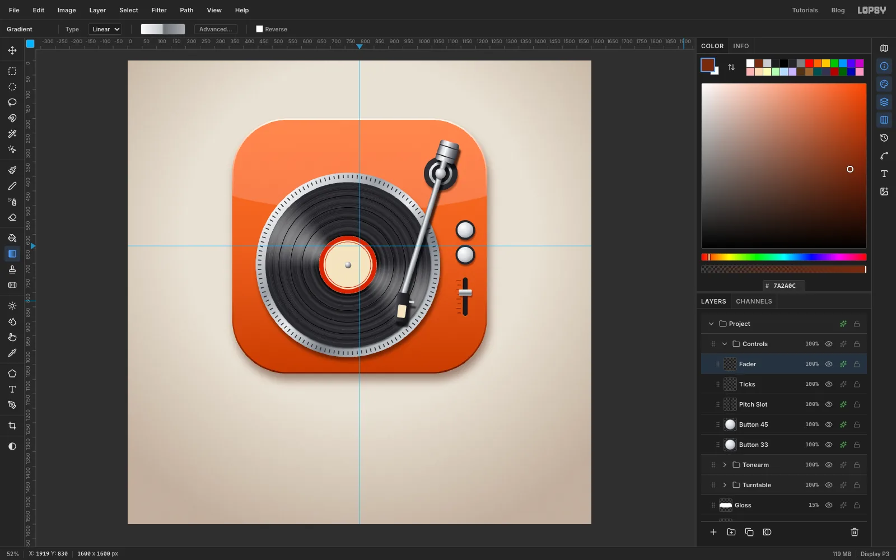

Add a layer called *Pitch Slot*. Draw a `#1C1C20` rectangle with **Corner
Radius 8**, **16 × 132** px, centred at 1165, 815. Turn on **Inner Glow**
in black at **Size 5** and **Opacity 90** so it looks sunk into the deck.
Add a **Drop Shadow** at **0**, **2**, **Blur 1**, **Opacity 60** in
`#FFB48A`. The light lip under the slot catches the light.

Add a layer called *Ticks*. Pick the **Pencil** at **Size 2** with
`#7A2A0C`. Draw a short line left of the slot every 16 px: click where it
starts and [[Shift]]-click where it ends. Alternate 14 px and 10 px lengths.

Add a layer called *Fader*. Draw a `#C9CCD0` **44 × 22** rectangle with
**Corner Radius 4** over the top half of the slot. Shade it top to bottom
with `#FBFCFD`, `#C3C6CB`, `#6E7177` and `#A9ACB1`. Put the middle two stops
right next to each other so the cap has a crisp ridge. Add a **Drop
Shadow**: **2**, **5**, **Blur 5**, **Opacity 55**, `#4A1A08`.

## Number the buttons

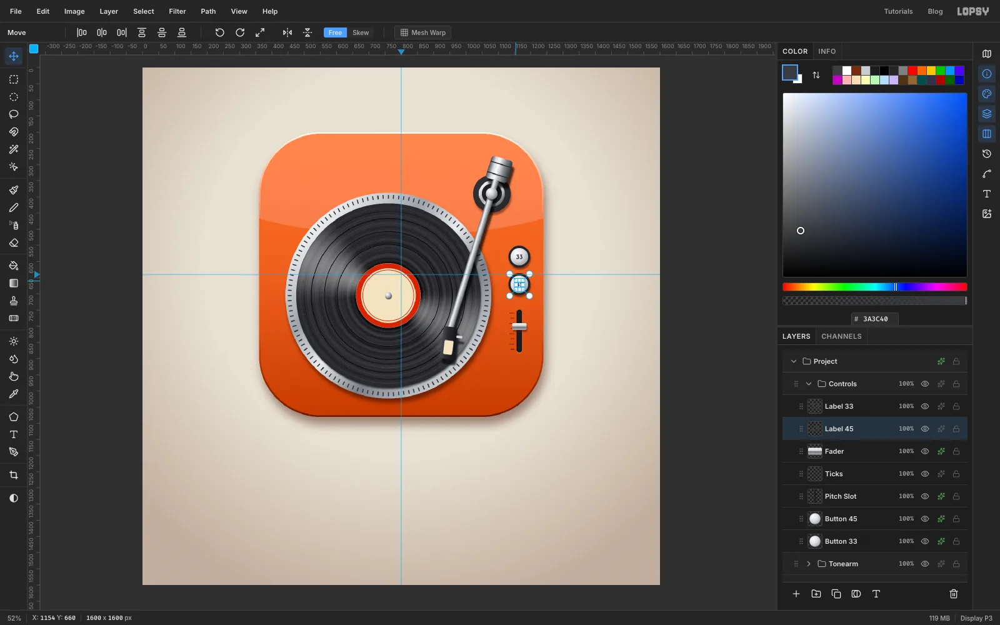

Pick the **Text** tool and set **Josefin Sans**, **Bold**, **Size 20**,
colour `#3A3C40`. Click on the top button, type `33` and press [[Tab]] to
commit. Use the arrow keys with the **Move** tool to centre it on the cap.

Click the *Fader* layer before setting new type. If a text layer is active
when you change the options, they restyle that layer. Then type `45` on
the lower button and centre it the same way.

## Press in the model name

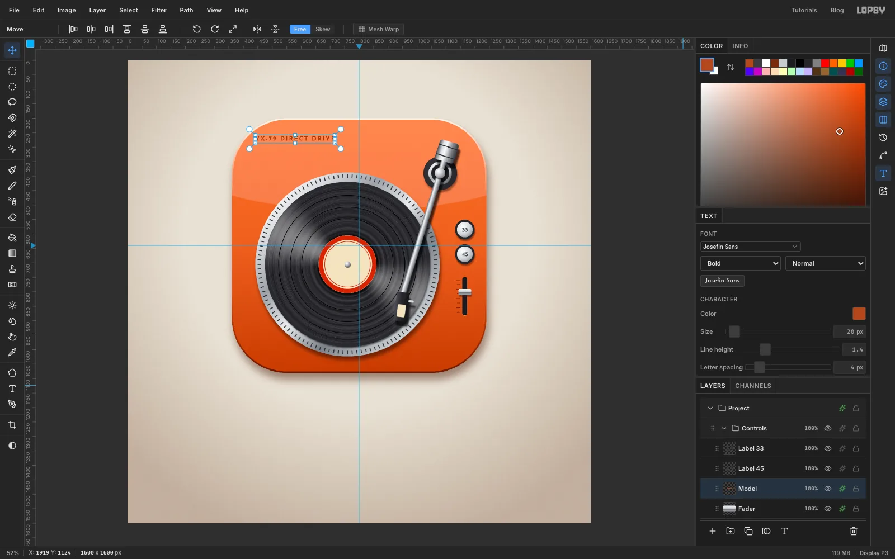

Click *Fader* again. Set **Josefin Sans Bold 20** in `#B4481C`, click near
the top-left of the tile and type `VX-79 DIRECT DRIVE`. In the **Text**
panel, set **Letter spacing** to **4**. Nudge the text so its left edge
lines up with the platter's left edge.

To press it into the lacquer, add an **Inner Glow** in `#4A1404` at **Size
3**, **Opacity 85**, which darkens the letter edges. Then add a **Drop
Shadow** of **0**, **2**, **Blur 1**, **Opacity 90** in `#FFB48A`. The
pale lip below each letter makes it look pressed in.

## Letter the label

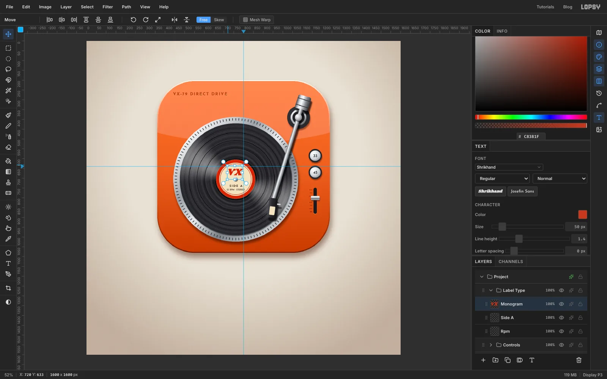

Collapse *Controls*, click **New Group** and name it *Label Type*. Before
setting each line, click the *Label Type* group row again and only then
change the options; otherwise they restyle the line you just typed. Press
[[Tab]] to commit each line. Work from the bottom up so each click lands in
empty space rather than on the text you just set.

- **Josefin Sans SemiBold 11**, `#3A2A22`, letter spacing **0**:
  `33 RPM · STEREO`. Centre it about 52 px below the spindle.
- **Josefin Sans Bold 15**, letter spacing **3**: `SIDE A`, about 33 px
  below the spindle.
- **Shrikhand 50**, `#C8381F`, letter spacing **0**: `VX`, centred about 38
  px above the spindle.

The space above and below the spindle should look about the same, and the
lower line has to clear the thin red inner ring.

## Draw a circle for the band text

Click the *Label Type* group and set **Josefin Sans Bold 11** in `#F6EBD0`.
Click in an empty corner of the canvas and type:

`XCHANGE  •  RECORDS BOUGHT  •  SOLD  •  TRADED  •  HI-FI  •  VINYL `

Use two spaces each side of the bullets, and end with one space. Press
[[Tab]] to commit, then double-click the new layer's name and rename it
*Band Text*. Set **Letter spacing** to **2** in the **Text** panel. At this
size the run is about 540 px long.

Now expand *Turntable* and click the *Label* layer, because the **Shape**
tool won't draw while a text layer or a group is active, even for a path.
Set the Shape tool to **Ellipse** and **Output** to **Path**. Then drag a
circle with an **86 px** radius out from the record's centre. Its
circumference is 2 × π × 86 ≈ 540 px, the same as the text.

## Wrap the text round the band

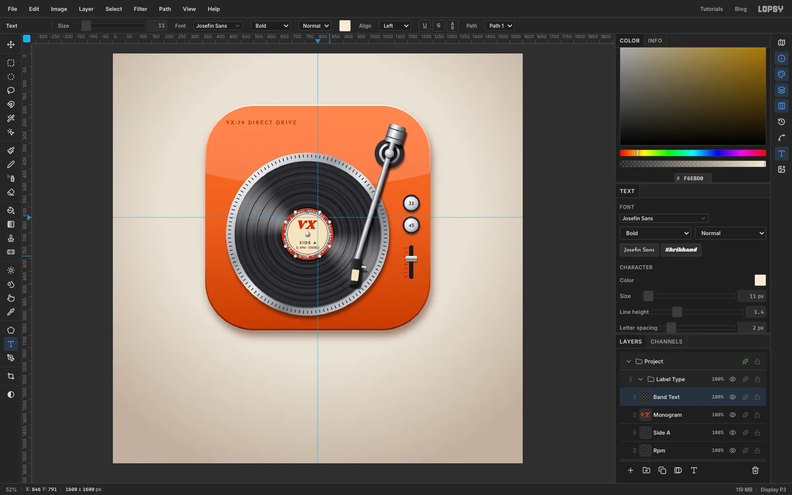

Click the *Band Text* layer, pick the **Text** tool and choose **Path 1**
in the **Path** menu on the options bar. The type flows clockwise from the
top of the circle, which is where the path starts.

The text starts with `XCHANGE` and ends with `VINYL ` because that puts
VINYL XCHANGE across the top, joined over the start of the circle. Because
the run matches the circumference, the last space closes the gap exactly.
Collapse *Turntable* again.

## Set the wordmark

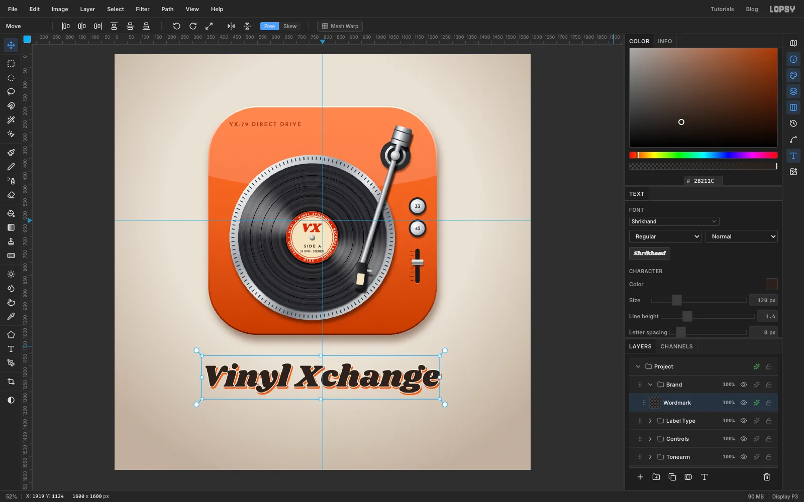

Collapse *Label Type*, click **New Group** and name it *Brand*. Set
**Shrikhand 120** in `#2B211C`, letter spacing **0**. Type
`Vinyl Xchange` below the tile, press [[Tab]], and centre it on the vertical guide, about
165 px below the tile. At this size it's about 900 px wide, the same width
as the tile.

Add a **Stroke**, **Outside**, **Width 3**, in `#F3EADB`. Then add a
**Drop Shadow** at **4**, **6**, **Blur 1**, **Opacity 100** in
`#E2652F`. The cream keyline keeps a gap between the letters and the
tangerine shadow, like a two-colour print.

## Add the tagline

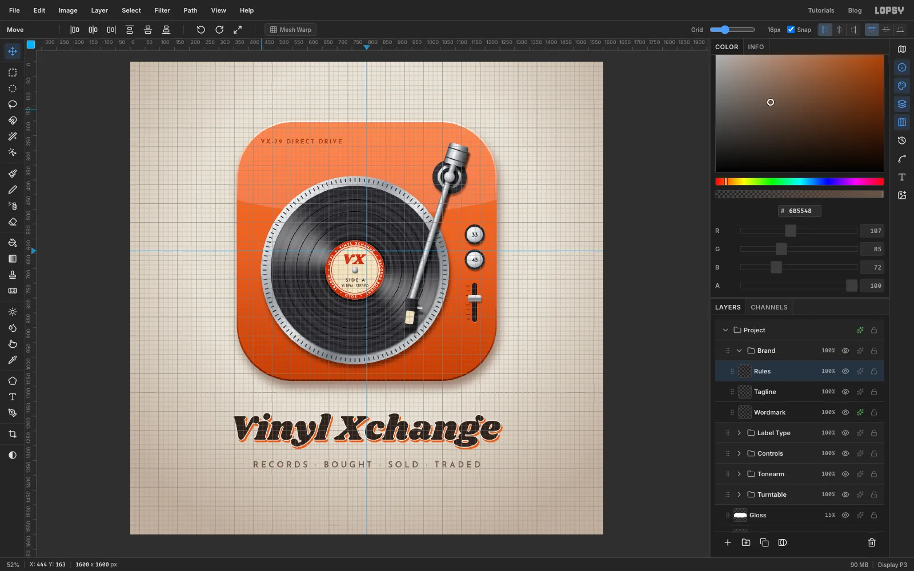

Click the *Brand* group, set **Josefin Sans SemiBold 28** in `#6B5548`, and
type `RECORDS · BOUGHT · SOLD · TRADED` under the wordmark. Set
**Letter spacing** to **8** and centre it on the guide, about 60 px below
the wordmark.

Add a layer called *Rules* and choose **View → Show Grid**. The grid makes
it easy to see that the tagline sits level and centred under the wordmark.

## Frame it with rules

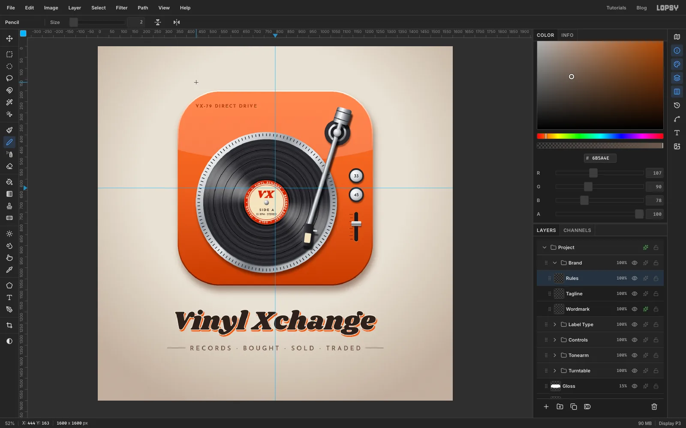

Pick the **Pencil** at **Size 2** with `#6B5A4E`. Leave a 24 px gap before
the tagline's first letter and draw an 80 px rule leading up to it: click
where the rule starts and [[Shift]]-click where it ends. Draw a matching
rule after the last letter. Turn the grid off with
**View → Show Grid**.

Save with **File → Save Project** and export with
**File → Quick Export PNG**.
