Before flat design took over around 2013, the web was full of things that
looked real: wooden shelves, stitched leather, brushed aluminium, paper
notes and letterpress type. That style is called **skeuomorphism**: digital
things dressed up as the physical objects they replace. Done with care it
still looks warm and tactile, and it's a great workout for an image editor,
because every material is a small recipe of noise, blur, gradients and
shadows.

In this tutorial you'll mock up **Kingfisher Lodge**, a desktop landing page
for an invented lakeside fishing lodge. You'll build:

- a walnut plank wall
- a stitched leather nav bar with an engraved brass badge
- a cream paper hero with a taped Polaroid of a real kingfisher
- a brushed-metal booking form with screws, inset fields, a glossy button and an iOS-style switch
- three pinned index cards with handwriting sitting on their ruled lines
- a felt footer laid out on the grid

The photo is
[European Kingfisher](https://commons.wikimedia.org/wiki/File:European_Kingfisher.jpg)
by Phil Armitage on Wikimedia Commons, released into the **public domain**.
Download the original (800 × 553 px) to follow along. Any side-on bird photo
works too.

Along the way you'll use:

- **Fibers**, **Add Noise**, **Emboss**, **Motion Blur**, **Gaussian Blur** and **Hue/Saturation** for wood, leather, paper, metal and felt
- **Define Pattern** and **Fill with Pattern** for stitching and ruled lines
- the exact-size **Rectangular** and **Elliptical Marquee** dialogs, **Shrink**, **Feather**, **Inverse**, and **Alt**-drag to subtract
- linear and radial **gradients** with transparent stops
- the **Shape** tool for rounded rectangles and pills
- **Drop Shadow**, **Inner Glow** and **Stroke**, with **Overlay**, **Soft Light** and **Multiply** blend modes
- pasting a photo, scaling it, a **layer mask**, and **Merge Down**
- rotating with the **Move** tool's handles, **Flip Horizontal**, **Duplicate Layer**, groups, **Snap to Layers** and the **grid**
- **Canvas Size**, the **Lasso** and the **Eraser**
- live text in **Yellowtail**, **Oswald**, **Playfair Display**, **Lora**, **Caveat** and **Special Elite**

The palette:

- Walnut `#4E301B`, seams `#1E1008`, lit edge `#9A6A42`, knots `#3A1E0E` / `#6A3A1C` / `#2A140A`
- Leather `#6B3A20`, thread `#EAD7AE`, cream type `#F3E4C2` / `#EBD3AA`
- Brass `#FFF0B8` → `#D8A946` → `#8A5A1A` → `#E9C46A` → `#6E4512`, engraving `#4A2C0C`
- Paper `#F2EAD6`, Polaroid `#FAF8F1`, tape `#EFE6C8`, ballpoint `#2B3A67`
- Headline `#33200F`, body `#5A4636`, kicker `#9A4A22`
- Aluminium `#C3C8CD`, fields `#FBFAF6`, labels `#4A5157`
- Button `#8FCF7C` → `#4FA24C` / `#3A8A3E` → `#4E9E4A`, switch `#2C66B8` → `#6FB1F5`
- Cards `#FBF6E6`, rules `#A9C3DA`, header rule `#D9867B`, pins `#E0533D` / `#3F8FD8` / `#E6B23A`
- Felt `#24553A`, footer type `#EFE6CC` / `#BFD3BF`, footer heads `#D9B877`

> **Tip:** A web mockup lives on a grid, so many steps give exact positions.
> Click once with the **Rectangular Marquee** (or **Elliptical Marquee**)
> without dragging and a dialog opens where you can type the **From** and
> **To** corners. **To** is exclusive, so From `80, 200` To `1360, 830` is
> exactly 1280 × 630 px. The **Info** panel shows the pointer position if
> you'd rather drag.
>
> Every **Drop Shadow** in this tutorial uses **Offset X 0** unless a step
> says otherwise. The default is 4, so set it each time.

## Set up the page and guides

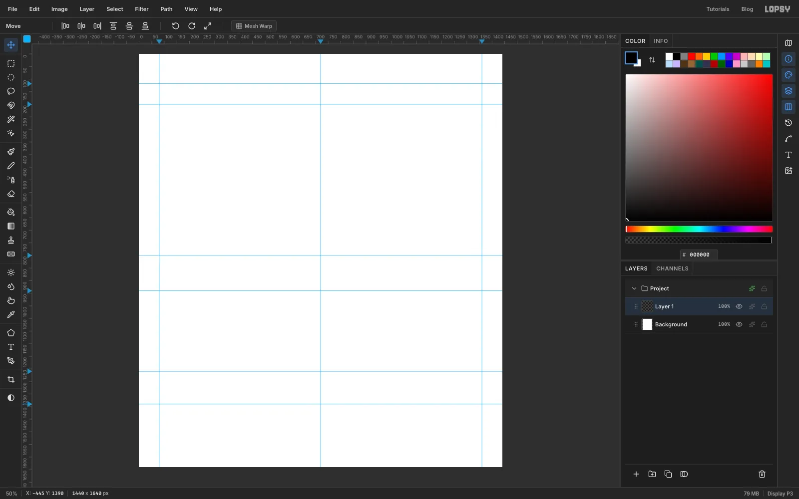

Open [Lopsy](/) and create a **1440 × 1640** px document. That's a common
desktop width, tall enough for one scroll of page. You'll add 30 px to the
height later, when the hero sheet turns out to need more room.

Click the top ruler at `80`, `720` and `1360` for the margins and centre
line. Click the left ruler at `118`, `200`, `800`, `940`, `1260` and `1390`
to rough out the nav bar, the hero, the cards and the footer. They're only a
sketch of the layout. Each step gives the final positions.

Then turn off **View → Snap to Guides**. Many small selections in this
project sit a few pixels from a guide, and snapping would pull them onto it.

## Grow wood grain with Fibers

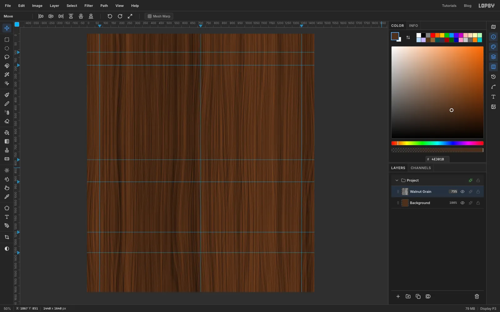

Click **Background**, set the foreground colour to `#4E301B` and choose
**Edit → Fill**.

Rename **Layer 1** to *Walnut Grain* and choose **Filter → Fibers…** with
**Variance 28** and **Strength 44**. Fibers draws long, wavering grey
strands, which is exactly what wood grain looks like.

Open the layer's effects drawer, set its blend mode to **Overlay**, and set
the layer's opacity to **75%**. The grey strands now tint the brown
underneath into grain.

## Give every board its own tone

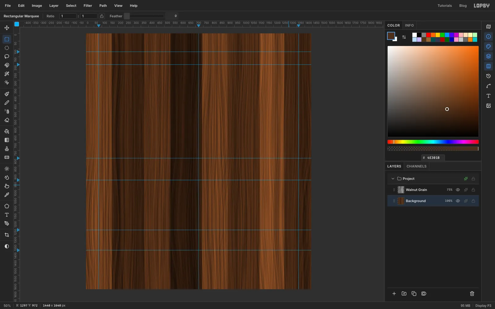

Real panelling never matches board to board. Click **Background** again and
select each board in turn with the marquee dialog. The board edges are at
x = `0`, `164`, `372`, `540`, `742`, `906`, `1110`, `1268` and `1440`, the full
height of the page.

For each board, run **Filter → Hue/Saturation…** and change only the
**Lightness**. Use `6`, `-5`, `3`, `-8`, `5`, `-3`, `8` and `-4` from left
to right. Press [[Cmd+D]] when you're done.

## Cut the plank seams

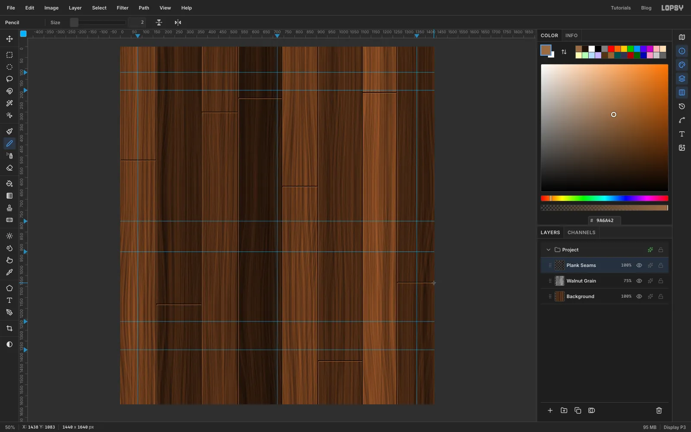

Click *Walnut Grain* and add a layer called *Plank Seams*. Pick the
**Pencil** at **Size 4** with `#1E1008`. At each board edge, click at the
top of the page and [[Shift]]-click at the bottom. That draws a dead-straight
groove.

Switch to **Size 2** and `#9A6A42`, and draw a second line 3 px to the right
of every groove. That thin lit edge makes the groove read as cut into the
wood.

Boards come in lengths, so add one short horizontal joint per board, at a
different height on each. Use the same dark line with a lit line 3 px below
it. Keep them out of places where content will sit on the wood later.

## Add a few knots

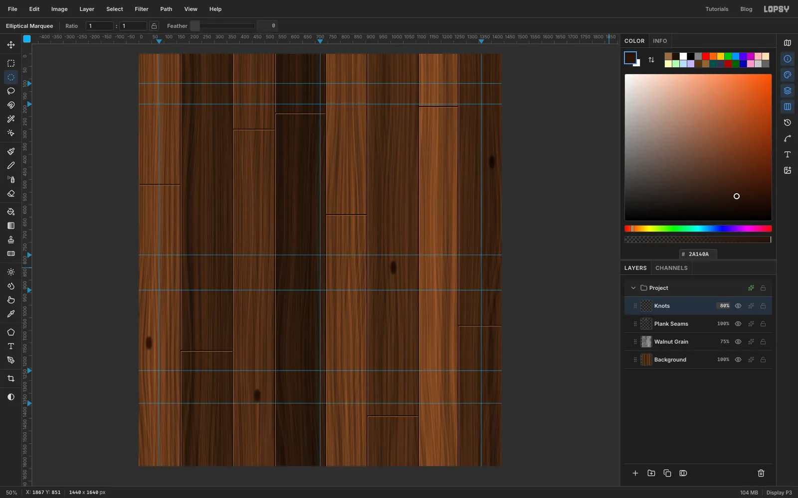

Add a layer called *Knots*. For each knot:

1. Make an elliptical selection about 24 × 52 px, choose
   **Select → Feather…** with **6**, and fill it with `#3A1E0E`.
2. Select a smaller 18 × 34 px ellipse at its centre and fill it with
   `#6A3A1C`.
3. Choose **Select → Shrink…** by **2** and fill with `#2A140A`.

That gives a soft halo, a light ring and a hard core. Run
**Filter → Motion Blur…** at **90°** and **6** px to stretch them along the
grain. Set the layer to **Multiply** at **80%**.

The *Knots* layer stays above everything you add later, so only put knots
where the wall will stay bare: near the left and right edges, in the gap
below the hero, and below the cards.

## Make the leather band

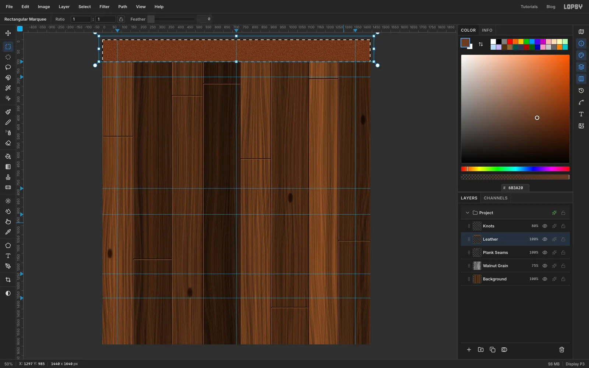

Click *Plank Seams* and add a layer called *Leather*. Select a band across
the top, from `-20, -20` to `1460, 118`. It's fine to start outside the
canvas so the edges are clean.

1. Fill it with `#6B3A20`.
2. Run **Add Noise…** at **70**, **Mono**, **Gaussian**.
3. Run **Gaussian Blur…** with **Radius 1**.
4. Run **Emboss…** with **Angle 120** and **Strength 30**.

The blurred noise becomes a field of tiny bumps, and Emboss lights them from
the top-left like pebbled hide. Deselect when you're done.

## Stitch it with a pattern

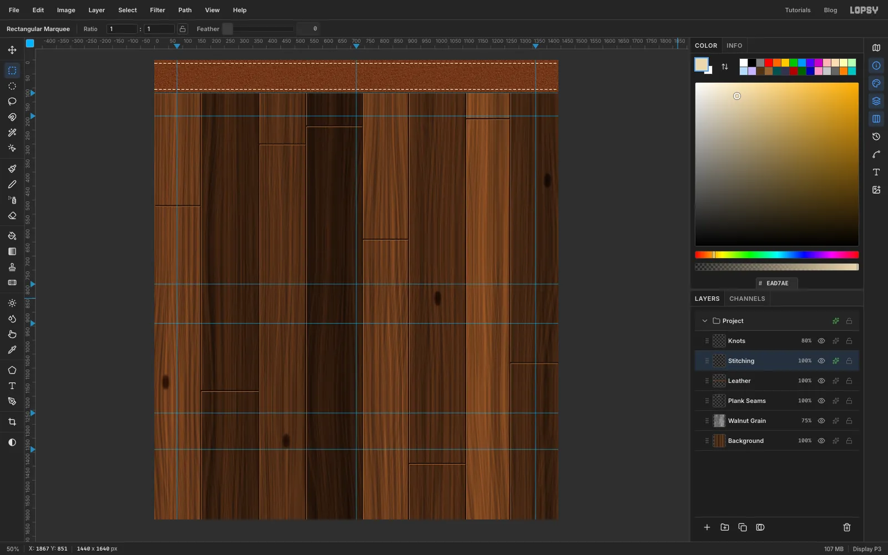

Stitching is a repeating dash, so make it a pattern:

1. Add a scratch layer called *Stitch Tile*.
2. Select `0, 300` to `10, 303` and fill it with `#EAD7AE`.
3. Select `0, 300` to `16, 303`, a 10 px stitch plus a 6 px gap, and choose
   **Edit → Define Pattern**.
4. Delete the scratch layer.

Add a layer called *Stitching*. Select a 3 px strip from `0, 11` to
`1440, 14` and choose **Edit → Fill with Pattern…**. Pick your new pattern
and click **Apply**. Do the same for a strip from `0, 104` to `1440, 107`.

Give the layer a **Drop Shadow** in `#1A0C04`: **Offset X 0**, **Offset Y 1**,
**Blur 1**, **Opacity 80**. Each stitch now sits on the leather instead of
being printed on it.

## Light the leather from above

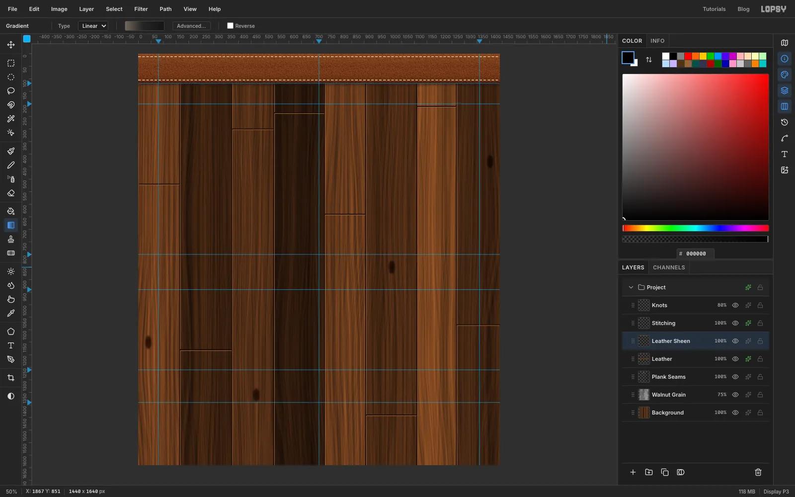

[[Cmd]]-click the *Leather* thumbnail to select its shape, then click the
*Leather* row and add a layer called *Leather Sheen*.

Pick the **Gradient** tool and open **Advanced…** to set three stops:

- `#FFE2B8` at 35% opacity
- `#FFE2B8` at 0% opacity, about halfway along
- black at 45% opacity

Drag from the top of the band straight down to its bottom edge. Deselect and
set the layer to **Soft Light**.

Back on *Leather*, add a **Drop Shadow** in `#120804` with **Offset Y 6**,
**Blur 16** and **Opacity 55**.

## Turn a circle into brass

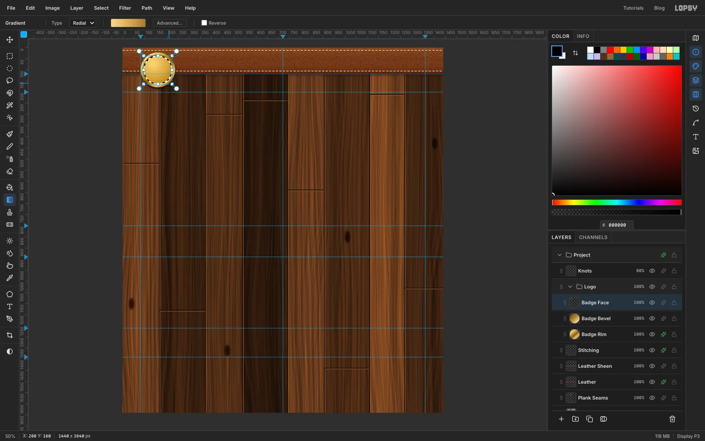

Click *Stitching*, click the **New Group** button in the Layers panel and
name the group *Logo*. Add a layer inside it called *Badge Rim*.

Select a circle from `80, 22` to `236, 178`. That's a 156 px badge that hangs
off the bottom of the bar. Set a five-stop linear gradient:

- `#FFF0B8`
- `#D8A946` at about 30%
- `#8A5A1A` at about 55%
- `#E9C46A` at about 78%
- `#6E4512`

Drag it diagonally from the top-left of the circle to the bottom-right.
Alternating light and dark bands is what makes a gradient read as polished
metal. Give the rim a **Drop Shadow** in `#120804` with **Offset Y 7**,
**Blur 12** and **Opacity 80**.

Add a layer called *Badge Bevel*, **Shrink** the selection by **9**, and drag
a dark-to-light gradient the other way round: `#6E4512`, then `#B88A34`,
then `#FFF0B8`. A ring lit from the opposite side looks like a chamfer.

Add *Badge Face*, **Shrink** by **5** more and drag a **radial** gradient
from just above the centre: `#F6D987`, then `#D2A64C`, then `#A77A2C`.
Deselect and run **Add Noise…** at **8**, **Mono**, so the brass isn't too
perfect.

## Lasso the kingfisher

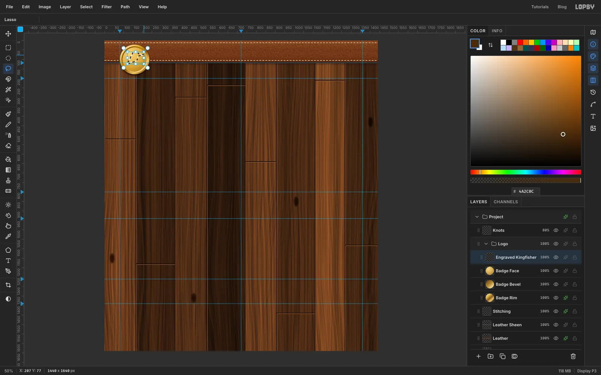

Add a layer called *Engraved Kingfisher* and set the foreground to
`#4A2C0C`. With the **Lasso**, draw a kingfisher in profile facing right, in
the middle of the badge and about 85 px nose to tail:

- a long, straight dagger beak
- a big round head with a flat crown
- a plump body leaning forward
- a short tail angled down to the left

Choose **Edit → Fill**. A silhouette reads best at small sizes, so keep the
outline simple.

## Engrave the eye and branch

Deselect. Make a tiny 6 px circle where the eye goes and press
[[Delete]] to punch it out.

Pick the **Brush** at **Size 5**. Click at the left of the badge under the
bird's feet and [[Shift]]-click at the right to draw a branch. Keep both ends
inside the face.

Give the layer a **Drop Shadow** in `#FFF3C4` with **Offset Y 1**,
**Blur 0** and **Opacity 70**. A light lip below a dark line is how
engraving catches the light.

## Add an engraved ring

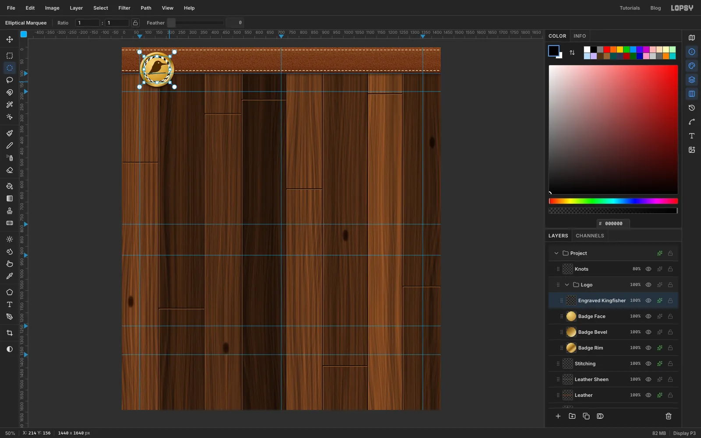

Still on *Engraved Kingfisher*, select a circle from `99, 41` to `217, 159`.
Then hold [[Alt]] and drag a circle 3 px smaller all round with the
**Elliptical Marquee**, from `102, 44` to `214, 156`. Alt subtracts, so only
a thin ring stays selected. Fill it with `#4A2C0C` and deselect.

## Stamp the date

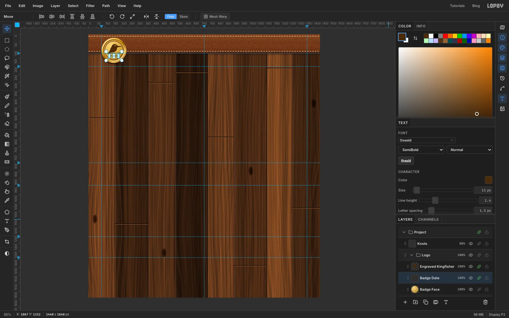

Click *Badge Face*. Pick the **Text** tool and set **Oswald SemiBold** at
**11** px in `#4A2C0C`, click in an empty part of the canvas and type
`EST · 1952`. Press [[Tab]] to finish, and set **Letter spacing** to **1.5**
in the **Text** panel.

Drag it with the **Move** tool so it's centred under the branch, about 34 px
below the badge centre, and give it the same light **Drop Shadow** as the
bird.

> **Tip:** Changing the Text options while a text layer is selected restyles
> that layer. Always click a non-text layer before setting up the next piece
> of type. New text also inherits the last letter spacing and line height,
> so check both every time.

## Set the wordmark

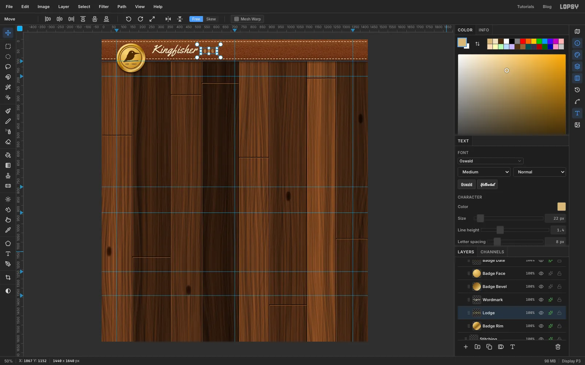

Click *Badge Rim*. Set **Yellowtail** at **62** px in `#F3E4C2` and type
`Kingfisher`. Leave **Letter spacing** at the 1.5 the date used. It opens the
script up just a touch. Give it a **Drop Shadow** in `#1A0C04`: **Offset Y 2**,
**Blur 2**, **Opacity 85**. Move it so it starts at x = `272`, centred on the
bar. Check that the tail of the **g** clears the lower stitching.

Click *Badge Rim* again. Set **Oswald Medium** at **22** px in `#D9B877`, type
`LODGE`, and set **Letter spacing** to **8**. Place it 18 px after the
script on the same line, with a **Drop Shadow** in `#1A0C04`: **Offset Y 1**,
**Blur 1**, **Opacity 85**.

## Add the nav links and a brass button

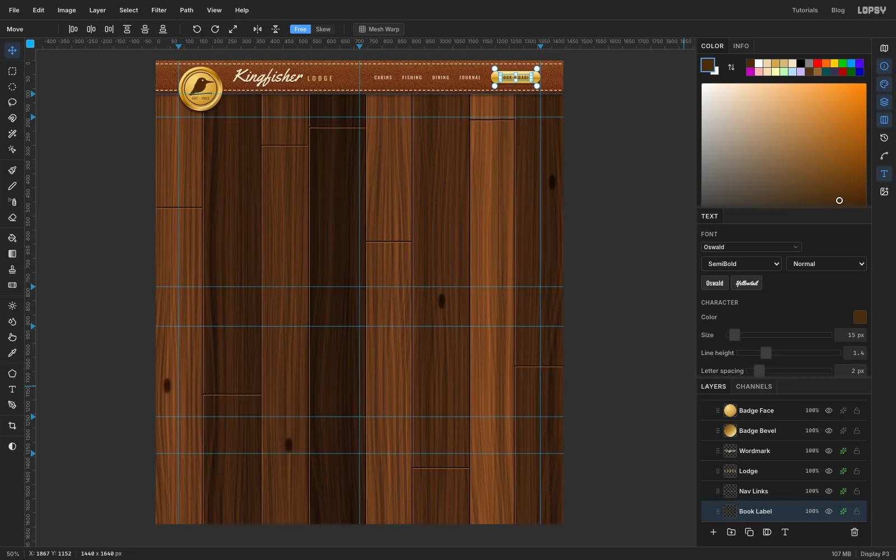

Click *Badge Rim*, set **Oswald Medium** at **16** px in `#EBD3AA`, and type
`CABINS     FISHING     DINING     JOURNAL` with five spaces between the
words. Set **Letter spacing** to **3** and centre it at x = `960` on the bar.
For letterpress, use a **Drop Shadow** in `#2A1208` with **Offset Y -1**,
**Blur 0** and **Opacity 75**. A dark edge on top makes the letters look
pressed into the leather.

Add a layer called *Book Button*. Pick the **Shape** tool with
**Rectangle**, fill `#D2A64C`, no stroke and **Corner Radius 21**. Drag a
176 × 42 px pill out from its centre at `1272, 59` (shapes grow from where
you press).

[[Cmd]]-click its thumbnail and drag a vertical gradient over it:
`#FFF0B8`, then `#D9AC4E` and `#B98A30` almost touching at the middle, then
`#E2BC5E`. That hard step in the middle is the classic glossy button. Add a
1 px **Stroke** in `#5E3A0E` and a **Drop Shadow** in `#120804` with
**Offset Y 3**, **Blur 5** and **Opacity 70**.

Click the button layer, type `BOOK A CABIN` in **Oswald SemiBold** **15** px
`#4A2C0C` with **Letter spacing 2**, and centre it on the pill.

## Make room with Canvas Size

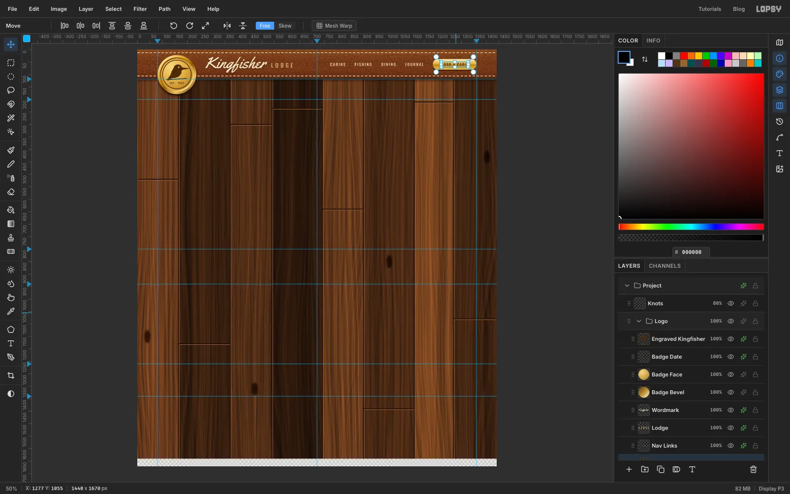

The hero sheet looks cramped if it stops at the 800 guide, so it will end
at 830 instead. Everything below it moves down 30 px, so the page needs
30 px more. Choose **Image → Canvas Size…**, set the **Height** to **1670**,
click the **top-centre** anchor and apply. The page grows at the bottom, and
the footer will cover the new strip.

## Lay down the paper sheet

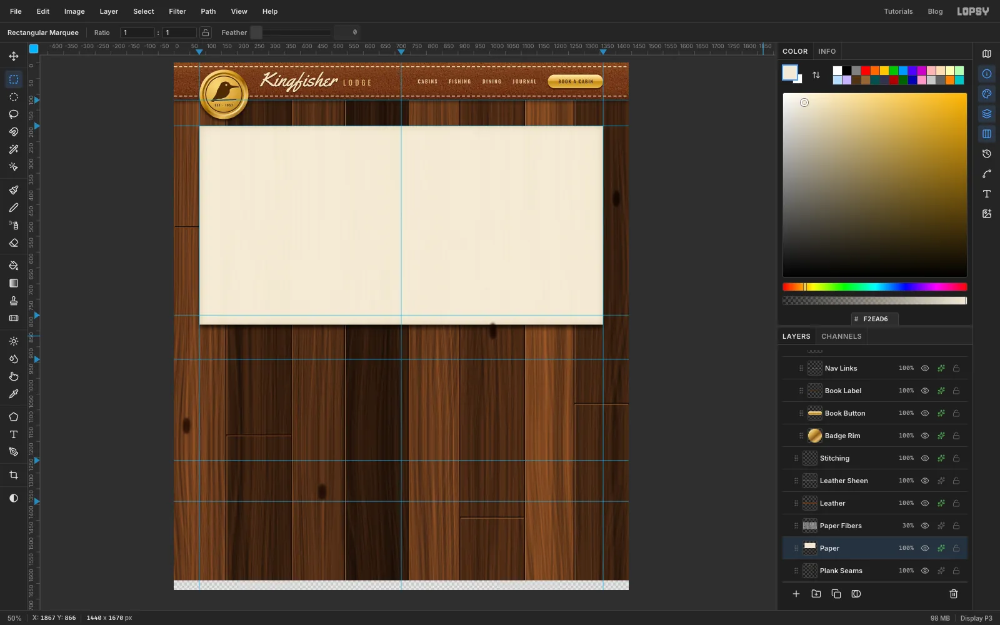

Click *Plank Seams* and add a layer called *Paper*. Select from `80, 200` to
`1360, 830`, fill it with `#F2EAD6`, and run **Add Noise…** at **6**,
**Mono**.

Keep the selection and add a layer called *Paper Fibers*. Run **Fibers…**
with **Variance 12** and **Strength 30**, deselect, and set the layer to
**Soft Light** at **30%**.

On *Paper*, add these effects:

- a **Drop Shadow** in black: **Offset Y 9**, **Blur 22**, **Opacity 80**
- an **Inner Glow** in `#7A5A2E`: **Size 36**, **Opacity 22**, to darken the
  edges like old stock
- a 1 px **Stroke** in `#D6C49C`, set to **inside**

## Paste the photo into a Polaroid

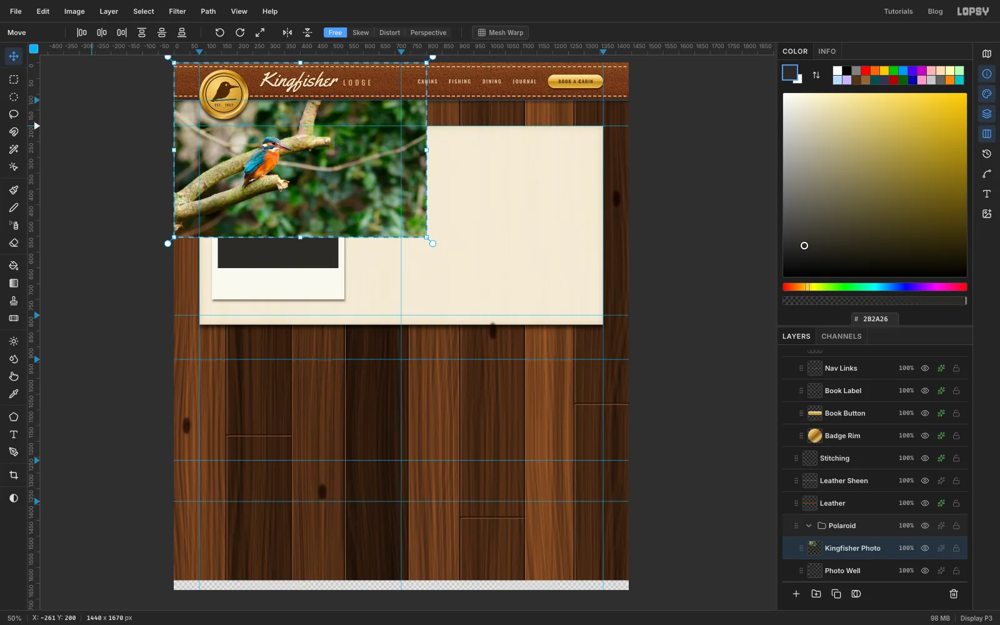

Click *Paper Fibers*, add a group called *Polaroid*, and inside it add:

- *Polaroid Frame*: a white rectangle from `120, 250` to `540, 750` in
  `#FAF8F1`, with **Add Noise** at **4** and a **Drop Shadow** in `#2A1808`
  (**Offset X 2**, **Offset Y 6**, **Blur 10**, **Opacity 55**)
- *Photo Well*: a dark `#2B2A26` square from `139, 269` to `521, 651`

The frame is about 20 px wide at the top and sides, with a deep margin at
the bottom, just like the real thing.

Copy the kingfisher photo in another app and press [[Cmd+V]]. It lands at
the top-left of the canvas, selected, with the **Move** tool active. Rename
the layer *Kingfisher Photo*.

## Scale and place the photo

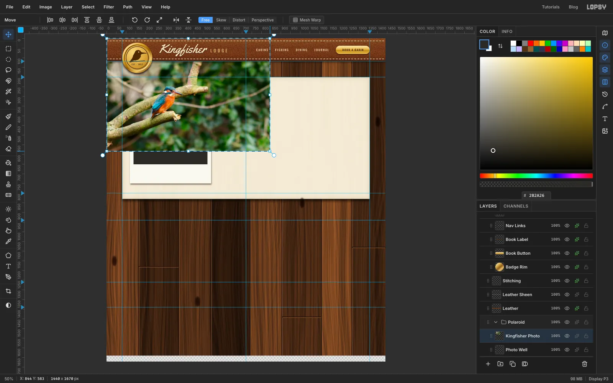

With the **Move** tool still active, hold [[Cmd]] and drag the bottom-right
corner handle about 44 px out, so the
photo grows by roughly 5%. [[Cmd]] keeps the proportions.

Then drag inside the photo until the bird and its branch sit in the middle
of the photo well. The well is your viewfinder. Press [[Cmd+D]] to commit.

## Mask it to the well

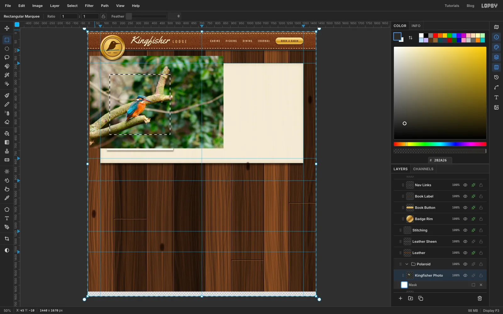

Click **Add Mask** at the bottom of the Layers panel, then click the new mask
thumbnail so you're painting on the mask.

Select 1 px inside the well, `140, 270` to `520, 650`, so no photo edge
peeks out around it, and choose
**Select → Inverse**. Set the foreground to black and choose
**Edit → Fill**. Everything outside the well disappears, but the photo is
still all there if you want to reframe it later. Deselect and click the
layer's row to leave mask editing.

## Caption it and merge the photo

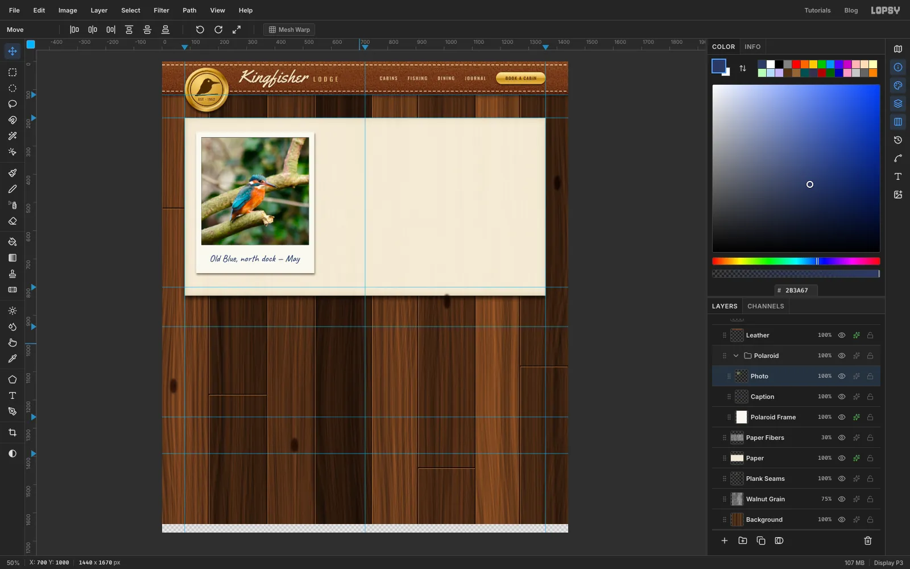

Click *Polaroid Frame*. Set **Caveat Medium** at **34** px in `#2B3A67`
with **Letter spacing 0**, type `Old Blue, north dock — May`, and centre it on the frame's bottom
margin, about `330, 700`.

You're about to rotate the whole Polaroid, and a group rotation leaves layer
masks where they are. Click *Kingfisher Photo* and press [[Cmd+E]]
(**Merge Down**) to bake the mask into the photo well. Rename the merged
layer *Photo*.

## Tape the corner

Add a layer called *Tape Left*. With the **Lasso**, draw a strip about
150 × 42 px centred on the frame's top-left corner. Give both ends an uneven
zigzag, the way tape tears. Fill it with `#EFE6C8`, then run:

- **Add Noise…** at **10**, **Mono**
- **Hue/Saturation…** with **Saturation 18** and **Lightness -7**

Switch to the **Move** tool, grab the round rotation handle just outside a
corner of the selection, and turn the strip about 38° counter-clockwise so it
crosses the corner diagonally. Press [[Cmd+D]].

Set the layer to **72%** opacity and give it a faint **Drop Shadow**:
**Offset Y 1**, **Blur 2**, **Opacity 30**.

## Mirror a second strip

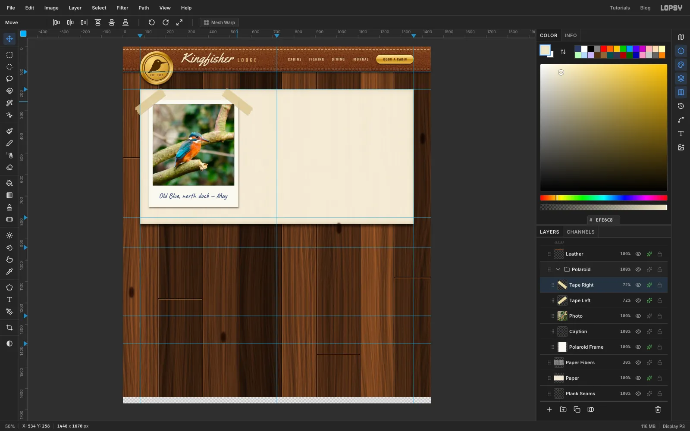

Click **Duplicate Layer** and rename the copy *Tape Right*. Choose
**Image → Flip Horizontal**. The copy's texture covers the whole canvas, so
it flips across the page and lands mirrored on the far right.

Drag it with the **Move** tool back to the Polaroid's top-right corner.

## Tilt the whole Polaroid

Click the *Polaroid* group row and make sure nothing is selected. The
**Move** tool shows one box around everything in the group. Drag a rotation
handle about 4° counter-clockwise, then press [[Cmd+D]]. The frame, photo,
caption and tape all turn together, and the caption stays live, editable
text.

## Write the hero copy

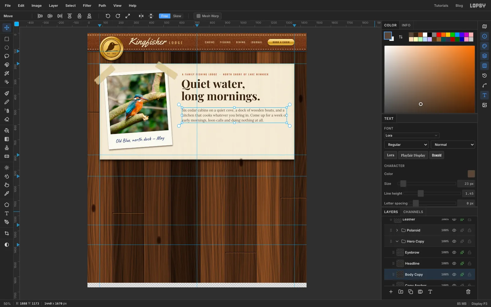

Collapse the *Polaroid* group. Click *Paper Fibers* and add a group called
*Hero Copy*. Inside it, add an empty layer called *Copy Anchor*. Click it
before setting up each piece of type, so the Text options never restyle the
text you just made.

1. **Kicker:** **Oswald Medium** 15 px in `#9A4A22`,
   `A FAMILY FISHING LODGE  ·  NORTH SHORE OF LAKE WINNOCK`, letter spacing
   **4**. Place it at x = `622`, y ≈ `270`.
2. **Headline:** **Playfair Display Bold** 74 px in `#33200F`,
   `Quiet water,` [[Enter]] `long mornings.` Set **Line height** to **1.1**
   and **Letter spacing** back to **0**. Left-align it with the kicker, just
   below it.
3. **Body:** **Lora Regular** 23 px in `#5A4636`, **Line height 1.45**,
   left-aligned at x = `622` below the headline:
   `Six cedar cabins on a quiet cove, a dock of wooden boats, and a` /
   `kitchen that cooks whatever you bring in. Come up for a week of` /
   `early mornings, loon calls and doing nothing at all.` Adjust the
   **Size** if needed so the longest line ends at about x = `1300`, the
   right edge of the booking panel you're about to build.

Give each a 1 px white **Drop Shadow** (**Offset Y 1**, **Blur 0**) at 50 to
70% opacity. On paper, that's letterpress: type pressed in, with light
catching the lower edge.

## Brush the aluminium

Collapse *Hero Copy*. Add a group called *Booking Widget* with a layer
called *Brushed Plate*.

Pick the **Shape** tool with **Rectangle**, fill `#C3C8CD`, no stroke and
**Corner Radius 12**. Drag a 680 × 150 px plate from its centre at
`960, 695`, so it spans `620, 620` to `1300, 770`.

[[Cmd]]-click its thumbnail, then run:

- **Add Noise…** at **40**, **Mono**, **Gaussian**
- **Motion Blur…** at **0°** and **60** px

Horizontal motion blur turns the noise into the long streaks of brushed
metal.

## Give the metal a sheen and an edge

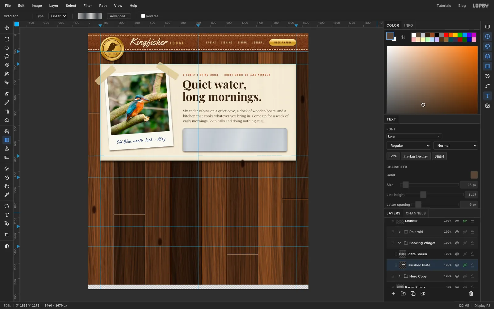

Keep the selection, add a layer called *Plate Sheen*, and drag a five-stop
gradient from the plate's top-left to its bottom-right. Alternate white and
grey `#6E757C` stops at 40 to 80% opacity. Deselect and set it to
**Soft Light**. Brushed metal shows light as soft bands across the grain.

On *Brushed Plate*, add a 1 px **Stroke** in `#7D838A` and a
**Drop Shadow** in `#2A1808` with **Offset Y 5**, **Blur 12** and
**Opacity 60**.

## Screw it down

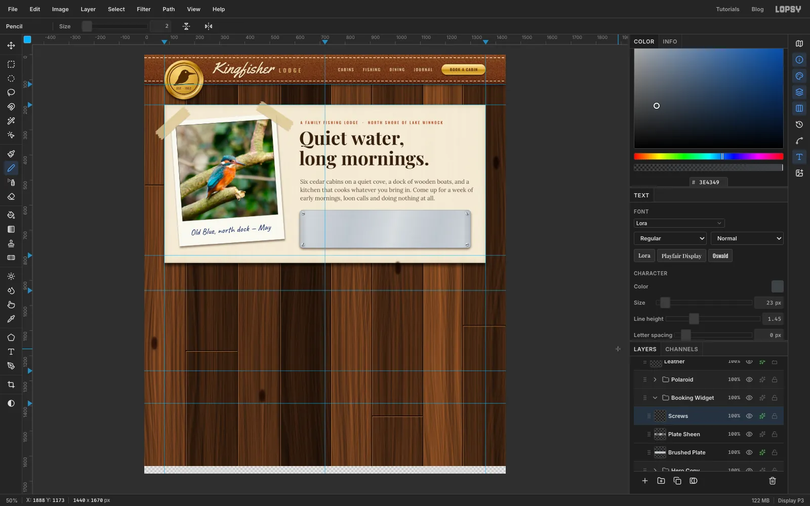

Click *Plate Sheen* and add a layer called *Screws*. Set a radial gradient
of `#FBFCFD`, `#A9AFB5` and `#6B7178`. In each corner, select a 14 px circle
centred 13 px in from both edges and drag the gradient from just above-left of
its centre to its lower-right edge.

Draw each slot with the **Pencil** at **Size 2** in `#3E4349`: click one
end and [[Shift]]-click the other. Turn every slot a different way, as real
screws never line up. Add a tight dark **Drop Shadow** (**Offset Y 1**,
**Blur 1**).

## Inset the fields

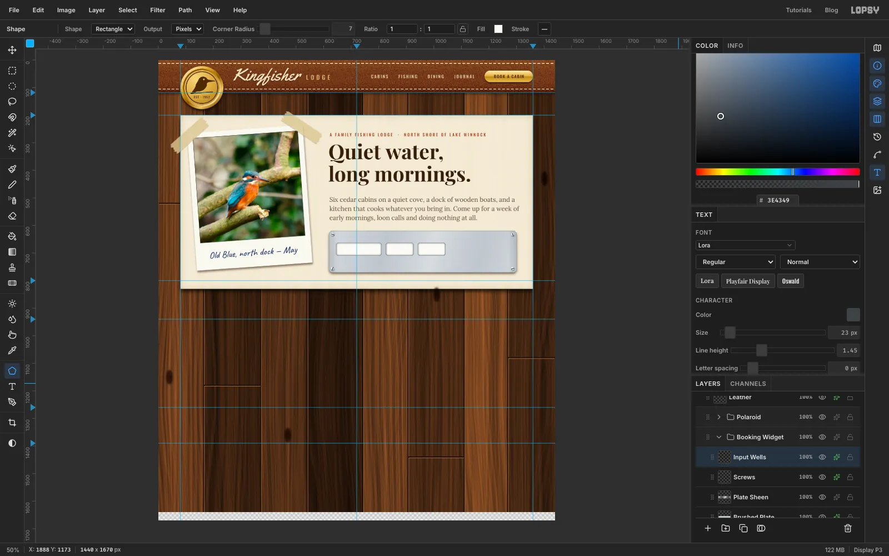

Add a layer called *Input Wells*. Set the **Shape** tool to fill `#FBFAF6`
with **Corner Radius 7**, and drag three 46 px tall fields, all centred on
y = `686`:

- *Arrive*: from x `646` to `810`
- *Nights*: from x `826` to `926`
- *Guests*: from x `942` to `1042`

Add an **Inner Glow** in `#1C2024` at **Size 9** and **Opacity 85**, plus a
1 px **Stroke** in `#8A9096`. A dark glow on the inside edge is what makes a
field look sunk into the panel.

## Label and fill the fields

Click *Input Wells* before each piece of type.

**Labels:** **Oswald SemiBold** 12 px in `#4A5157`, **Letter spacing 2**:
`ARRIVE`, `NIGHTS` and `GUESTS`. Line each one up with the left edge of its
field plus 2 px, about 14 px above the field. Add a white 1 px shadow, so
they look stamped into the metal.

**Values:** **Lora Medium** 19 px in `#2E2A26`, **Letter spacing 0**. Centre `4` and `2` in their
fields. Centre `Fri, June 12` in its field, then nudge it with the arrow keys
until its capitals line up with the top of the digits. The comma's tail
shouldn't decide where the line sits.

## Make the glossy button

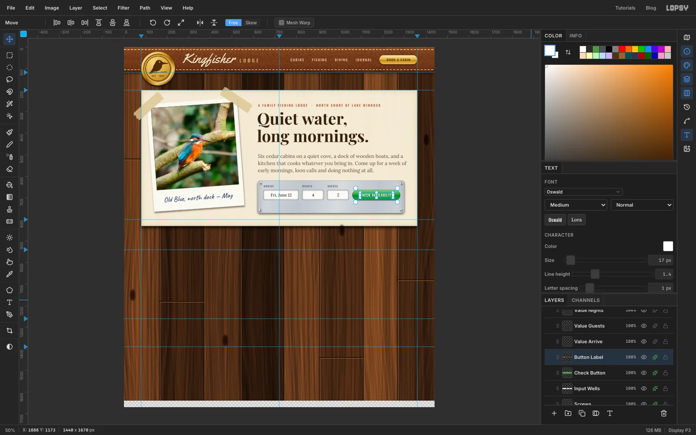

Click *Input Wells* and add *Check Button*. Draw a 220 × 46 px pill with
**Corner Radius 23** centred at `1170, 686`.

[[Cmd]]-click it and drag a vertical gradient: `#8FCF7C`, then `#4FA24C`
and `#3A8A3E` a hair apart at the middle, then `#4E9E4A`. Add a 1 px
**Stroke** in `#23561F` and a **Drop Shadow** in `#1C2024` with
**Offset Y 2**, **Blur 4** and **Opacity 55**.

Type `CHECK AVAILABILITY` in **Oswald Medium** 17 px white with
**Letter spacing 1**. Centre it on the pill and give it a dark green shadow
in `#1F4D16` with **Offset Y -1**. Light type on a dark button gets its
shadow on top.

## Add the switch and a rate note

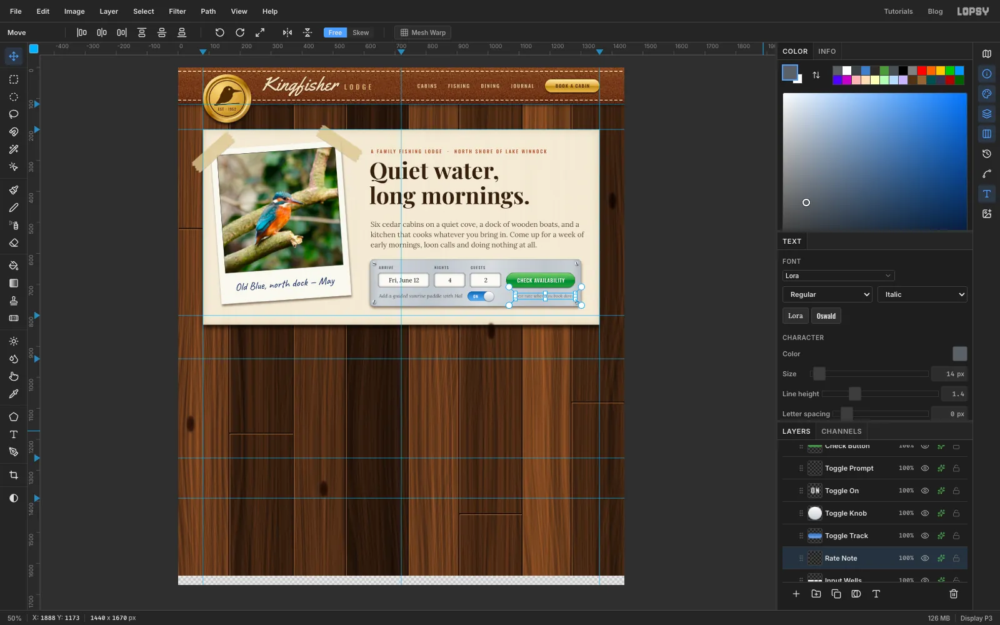

Under the fields, type `Add a guided sunrise paddle with Hal` in
**Lora Italic** 16 px `#3C4247` with **Letter spacing 0**, at x = `648`,
centred on y ≈ `738`.

For the switch, add *Toggle Track*: an 84 × 30 px pill with
**Corner Radius 15**, centred on y = `738` and 60 px past the end of the
prompt.

1. [[Cmd]]-click *Toggle Track* and drag a blue gradient from `#2C66B8` at
   the top to `#6FB1F5` at the bottom.
2. Add an **Inner Glow** in `#0F2A52` at **Size 5**, **Opacity 70**.
3. Type a white `ON` in **Oswald SemiBold** 13 px on its left half.

On a layer called *Toggle Knob*, select a 32 px circle at the right end and
fill it with a white-to-`#C7CCD1` gradient. Give it a 1 px **Stroke** in
`#8A9096` and a **Drop Shadow** with **Offset Y 1**, **Blur 3** and
**Opacity 60**.

Finally, type `Best rate when you book direct` in **Lora Italic** 14 px
`#5A6067`. Right-align it 20 px inside the plate's right edge, on the same
line as the prompt.

## Shift the Polaroid with the group

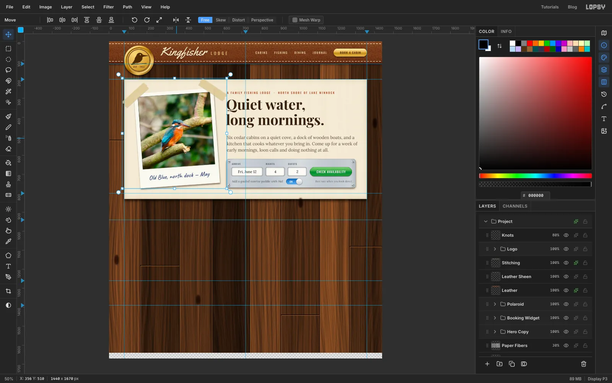

Collapse the open groups. Click the *Polaroid* group row and drag on the
canvas with the **Move** tool, about 26 px right and 10 px down. Every layer
in the group moves together, and the Polaroid gets a little more room from the
paper's edge.

## Add the section heading

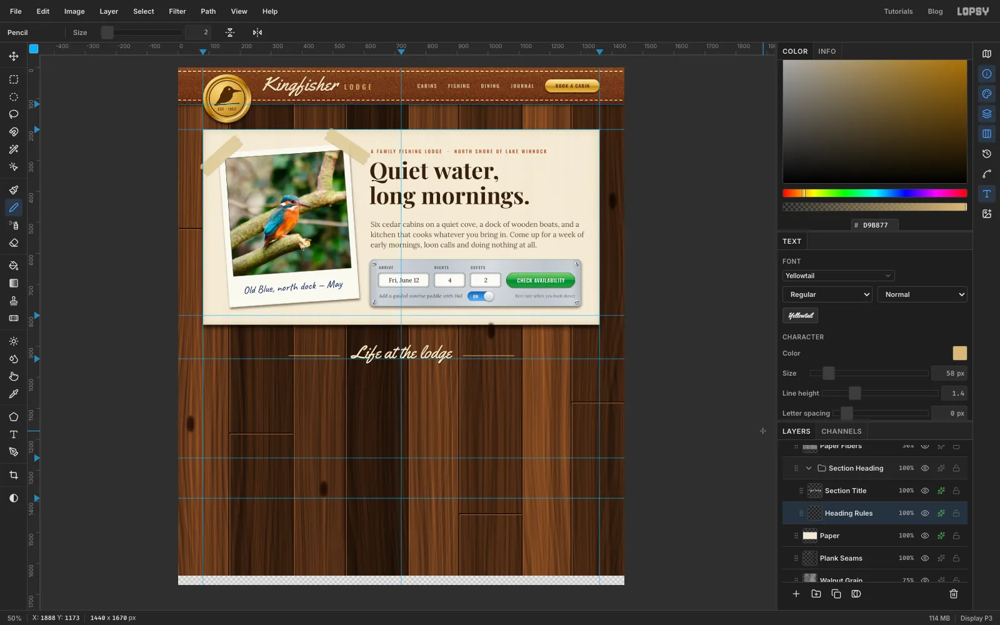

Click *Paper* and add a group called *Section Heading* with a layer called
*Heading Rules*. Type `Life at the lodge` in **Yellowtail** 58 px
`#F3E4C2` and centre it at `720, 924`. Give it a dark **Drop Shadow**
(**Offset Y 2**, **Blur 3**, **Opacity 85**) so it lifts off the wood.

On *Heading Rules*, draw a 2 px **Pencil** line in `#D9B877` on each side of
the title. Make each about 160 px long and end it 36 px from the words. Add a
**Drop Shadow** in `#120804` with **Offset Y 1**, **Blur 0** and
**Opacity 90**.

## Build an index card

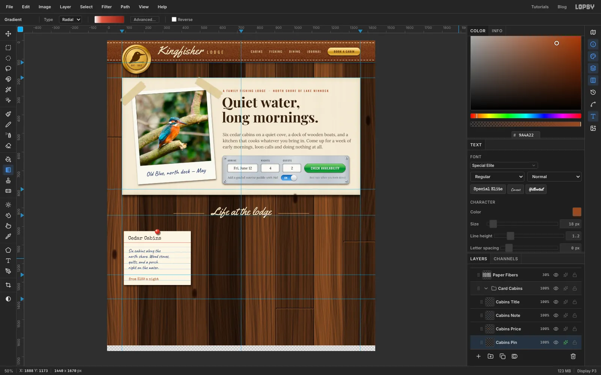

First make a ruled-line pattern. On a scratch layer, select a 1 px line
from `0, 929` to `8, 930` and fill it with `#A9C3DA`. Then select `0, 900` to
`8, 930`, one 30 px cell with the line along its bottom, and choose
**Edit → Define Pattern**. Delete the scratch layer.

Collapse *Section Heading*, click it, and add a group called *Card Cabins*.
Each card is 360 × 290 px with its top at y = `1025`.

1. **Card:** add *Cabins Card*, a `#FBF6E6` rectangle with **Corner Radius 3** centred at
   `270, 1170`, with a **Drop Shadow** of **Offset X 3**, **Offset Y 7**,
   **Blur 10**. Light comes from the top-left, so shadows fall down and right.
2. **Rules:** [[Cmd]]-click the card, add *Cabins Rules*, and choose
   **Fill with Pattern…** with your rule pattern. The pattern tiles from the
   top-left of the canvas, so the lines fall at y = 29 + 30n on every card.
   Select the header area above y = `1097` and press [[Delete]]. Then draw a
   2 px `#D9867B` header line at y = `1087` with the **Pencil**.
3. **Title:** **Special Elite** 27 px `#2B2622`, `Cedar Cabins`.
4. **Note:** **Caveat Medium** 25 px `#2B3A67`, **Letter spacing 0**,
   **Line height 1.2**: `Six cabins along the` / `north shore. Wood stoves,` /
   `quilts, and a porch` / `right on the water.` A line height of 1.2 is
   exactly 30 px per line, the same as the rules. Nudge the note until the
   bottom of the first line's small letters sits 2 px above the second rule
   under the header (y ≈ `1139`).
5. **Price:** **Special Elite** 18 px `#9A4A22`, `from $189 a night`,
   sitting on the last rule.
6. **Pin:** a 26 px circle straddling the card's top edge, filled with a
   radial gradient from white to `#E0533D` to `#8E2116`. Give it a
   **Drop Shadow** with **Offset X 5**, **Offset Y 7**, **Blur 4**, as the
   pin stands off the card.

## Make all three cards

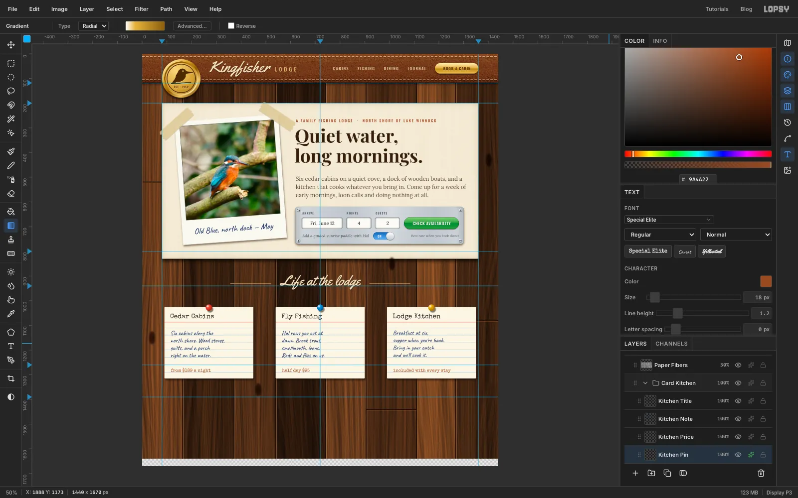

Collapse *Card Cabins* and build *Card Fishing* centred at x = `720` and
*Card Kitchen* at x = `1170` the same way. Give them a blue pin
(`#3F8FD8` / `#17457A`) and a gold pin (`#E6B23A` / `#8A5E0E`). Their notes:

- *Fly Fishing*: `Hal rows you out at` / `dawn. Brook trout,` /
  `smallmouth, loons.` / `Rods and flies on us.`, `half day $95`
- *Lodge Kitchen*: `Breakfast at six,` / `supper when you're back.` /
  `Bring in your catch` / `and we'll cook it.`, `included with every stay`

## Turn each card a little

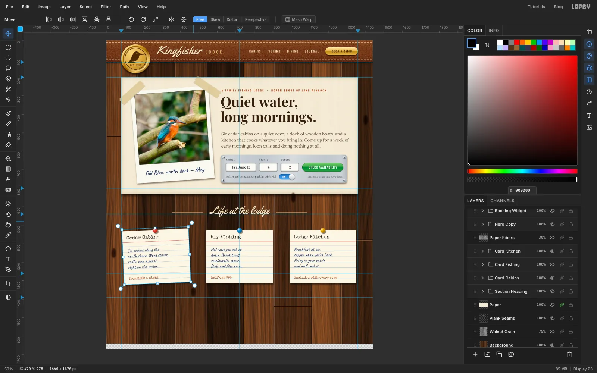

Pinned cards are never straight. Click a card's group row and drag a
rotation handle with the **Move** tool, then press [[Cmd+D]]:

- *Cedar Cabins*: about 2.5° counter-clockwise
- *Fly Fishing*: 1.5° clockwise
- *Lodge Kitchen*: 1.2° counter-clockwise

The handwriting turns with its rules, so it stays seated on them, and it
remains live text you can still edit.

## Stagger the middle card

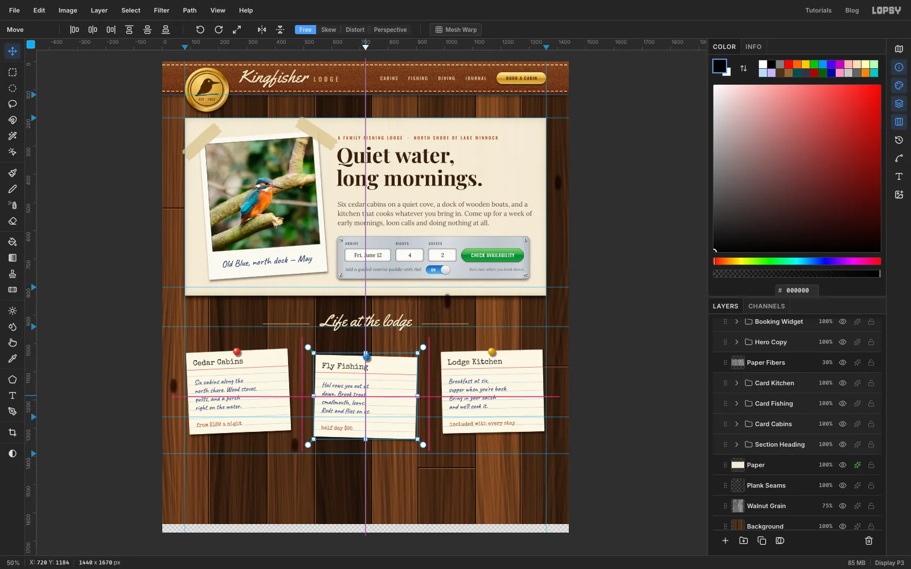

Turn on **View → Snap to Layers**. Click *Card Fishing* and drag it straight
down about 14 px. Snap to Layers keeps the card locked on the page's centre
line while you drag, and the pink lines show what it's lined up with. A
slightly lower middle card stops the row from looking ruled. Turn snapping
off again afterwards.

## Tear the left tape at the paper's edge

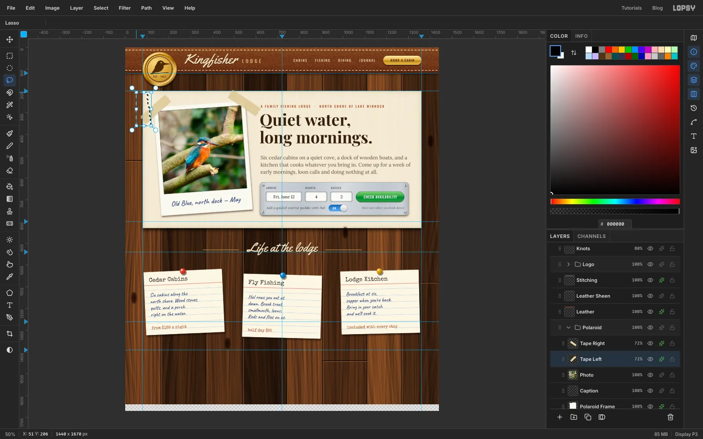

Expand the *Polaroid* group and click *Tape Left*. With the **Lasso**, draw
around the end of the tape that hangs past the paper, tearing it at about
x = `100`, just inside the sheet's edge. Make
the inner edge a ragged zigzag. Press [[Delete]], then deselect. The tape
now looks torn off at the edge of the sheet.

## Bite back the right tape with the Eraser

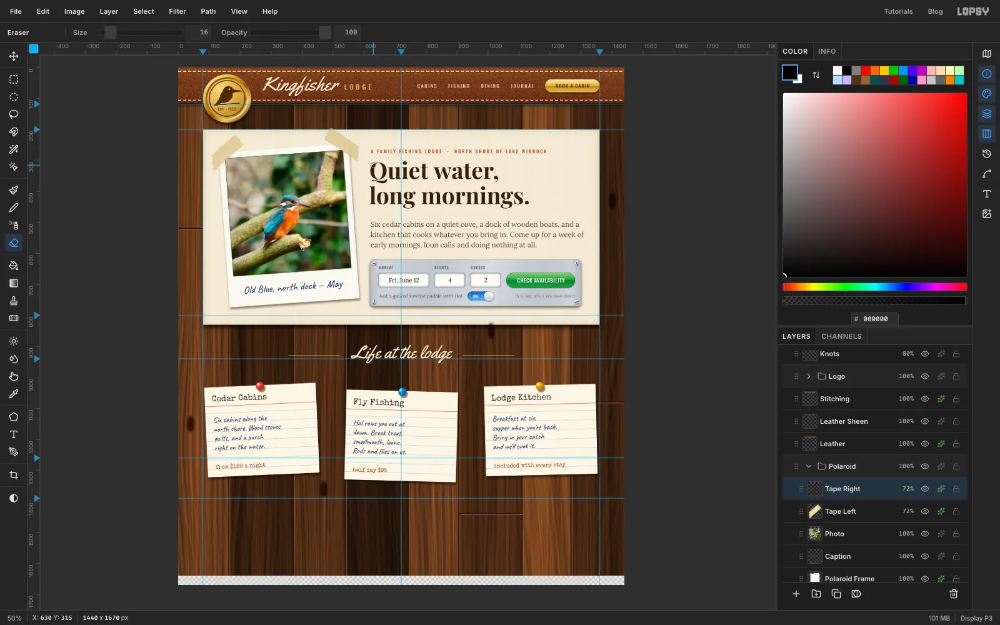

Click *Tape Right*, pick the **Eraser** at **Size 16**, and drag one
zigzag stroke back and forth across the last 20 px or so of its outer end.
One stroke is one undo step if you overdo it. This keeps the tape clear of
the kicker line.

## Darken the wood toward the edges

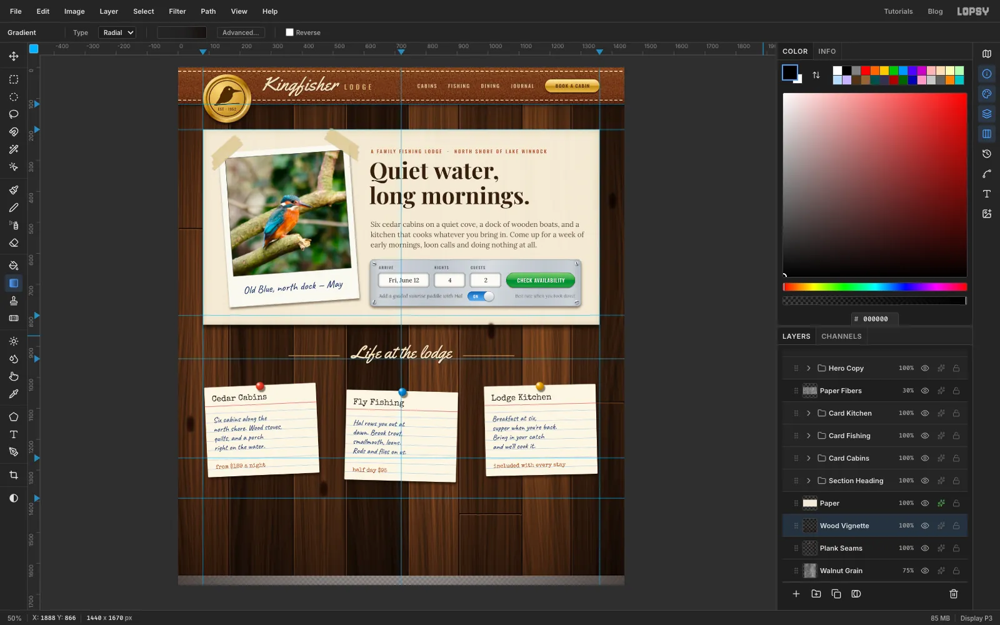

Click *Plank Seams* and add a layer called *Wood Vignette*. Drag a
**radial** gradient from the middle of the page out past the bottom-right
corner. Use `#120804` at 0% opacity in the centre, 15% at about 55% of
the way out, and 75% at the edge. Set it to **Multiply**.
It sits below the paper and cards, so only the wall darkens.

## Lay the felt

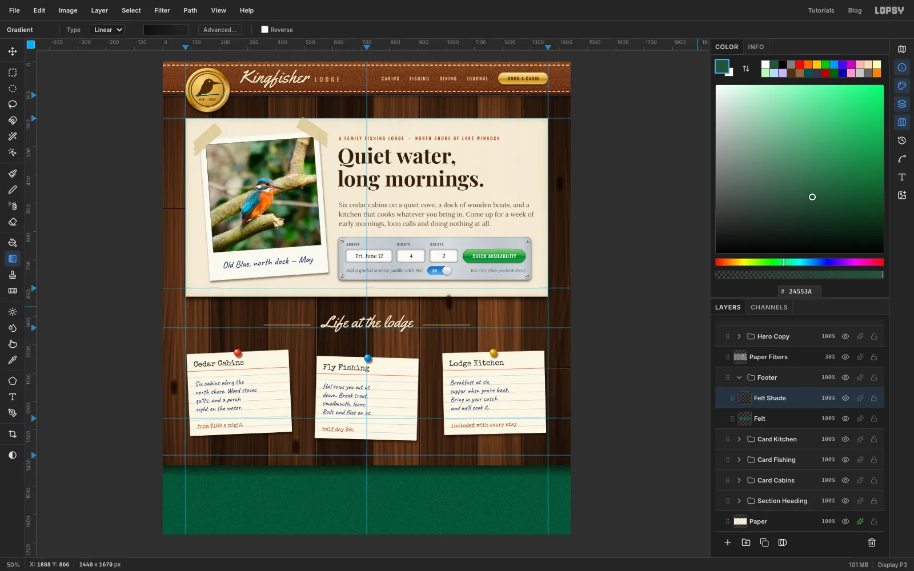

Click *Card Kitchen* and add a group called *Footer* with a layer called
*Felt*. Select from `0, 1426` to the bottom-right corner and fill it with
`#24553A`. Then run:

1. **Add Noise…** at **45**, **Mono**, **Gaussian**
2. **Gaussian Blur…** with **Radius 1**
3. **Add Noise…** at **12**, **Mono**

The blurred noise is the felt's nap, and the second pass adds stray fibres.
Keep the felt selection, add *Felt Shade*, and drag a black-to-transparent
gradient down over the felt's top 40 px. Deselect and set it to
**Multiply**.

## Trim it with brass and stitching

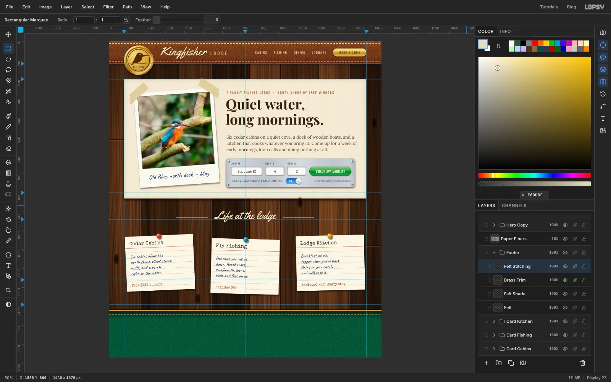

Add *Brass Trim*: select an 8 px strip from `0, 1418` to `1440, 1426`, set
three stops in the gradient's **Advanced…** editor (`#FFF0B8`, `#D2A64C`,
`#6E4512`) and drag it from the top of the strip to the bottom. Its
**Drop Shadow** goes up onto the wood: **Offset Y -3**, **Blur 6**,
**Opacity 60**.

Define a new stitch tile the way you did for the leather, this time in
`#E6DDBF`. Then add *Felt Stitching* and fill a 3 px strip from `0, 1440` to
`1440, 1443` with the pattern. Give it a **Drop Shadow** in `#0D1F12`:
**Offset Y 1**, **Blur 1**, **Opacity 80**.

## Set the footer on the grid

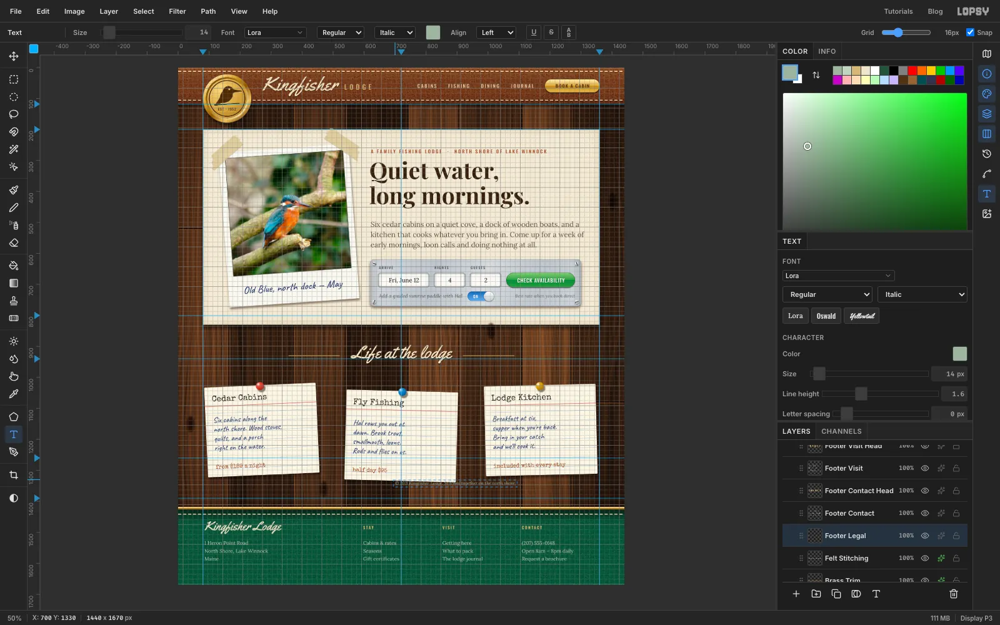

Turn on **View → Show Grid** and **View → Snap to Grid**. Whole-layer Move
drags now snap to the 16 px grid.

Click *Felt Stitching* before each block. Type it in the empty strip above
the footer, then drag it home:

- `Kingfisher Lodge` in **Yellowtail** 40 px `#EFE6CC`, at x = `80`
- the address in **Lora** 16 px `#BFD3BF`, **Letter spacing 0**,
  **Line height 1.6**: `1 Heron Point Road` / `North Shore, Lake Winnock` /
  `Maine`, under the wordmark
- `STAY`, `VISIT` and `CONTACT` in **Oswald SemiBold** 13 px `#D9B877`,
  with **Letter spacing 3**, near x = `592`, `852` and `1112`
- the link lists in the same Lora as the address, under each head:
  - `Cabins & rates` / `Seasons` / `Gift certificates`
  - `Getting here` / `What to pack` / `The lodge journal`
  - `(207) 555-0148` / `Open 8am – 8pm daily` / `Request a brochure`

Hide the grid, then finish with the arrow keys:

- Line each column up at exactly x = `592`, `852` and `1112`, an even 260 px
  step. The grid only snaps to multiples of 16.
- Raise the column heads so they share the wordmark's cap line.
- Make every list start on the same line as the address.

## Finish the footer

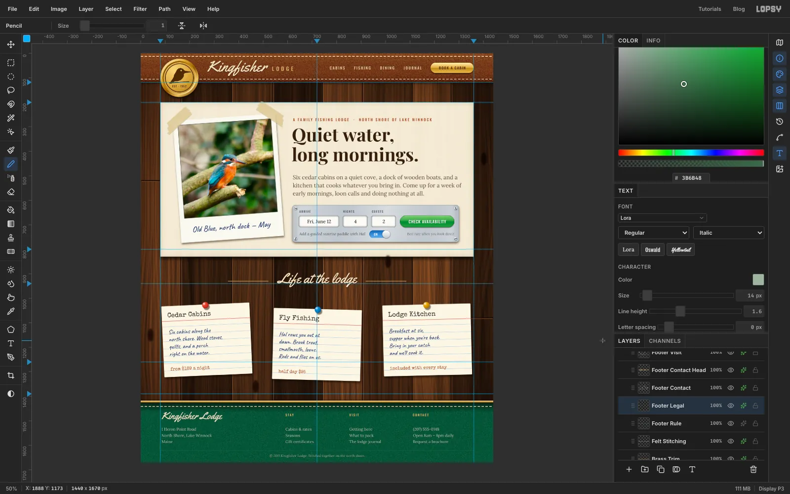

Type
`© 2011 Kingfisher Lodge. Stitched together on the north shore.` in
**Lora Italic** 14 px `#9DB59F` and centre it at `720, 1644`. Above it, on a
*Footer Rule* layer, draw a 1 px **Pencil** line in `#3B6B48` from x = `80`
to `1360`.

Give every footer text layer a 1 px dark green **Drop Shadow** in `#0D1F12`
so the type sits on the felt rather than floating over it.

Save with **File → Save Project** and export with
**File → Quick Export PNG**.
