*Solarpunk* imagines a future that went right: warm light, clean energy and
plants growing over everything. It borrows curves from Art Nouveau and adds solar
panels, wind turbines and rooftop gardens. In this tutorial you'll put that on a
souvenir patch for **Kelp Keepers**, a made-up cooperative that farms seaweed on
the tide, and show it ironed onto a hemp work jacket.

The star is a sea otter, because otters really do keep kelp forests alive by eating
the urchins that graze them. You'll start from a photo,
[Sea Otter Ready for a Nap](https://www.usgs.gov/media/images/sea-otter-ready-a-nap)
by Lilian Carswell of the U.S. Fish and Wildlife Service, which is in the public
domain. Download it before you start. It's 1280 × 828 px. The photo gives you the
fur texture, and you paint a friendlier, front-on face over it.

The whole patch rests on two small recipes, which I'll explain once and then refer
to by name:

- **Stitch a layer.** This clips a sheet of grey thread texture to a shape and blends it in. It's the move that makes flat colour read as embroidery.
- **Trim to the patch.** This cuts away anything that hangs past the patch's edge.

Three habits will save you some trouble:

- **For exact shapes, click instead of dragging.** With nothing selected, a single click on the canvas with either marquee tool opens a small dialog where you can type the corners. If something is selected, the click only clears it, so press [[Cmd+D]] first. Everything round is centred on **800, 740**, so a circle of radius 362 runs from 438, 378 to 1162, 1102.
- **Deselect with [[Cmd+D]]** when you finish with a selection. A live selection limits the next fill or filter.
- **Delete each Pen path when you've used it**, with the **Delete Path** button in the Paths panel. The next Pen click near a selected path edits that path instead of starting a new one.

Along the way you'll use:

- **Add Noise**, **Pixelate**, **Motion Blur**, **Gaussian Blur**, **Clouds**, **Surface Blur**, **Desaturate**, **Brightness/Contrast** and **Sunburst**
- the **Pencil**, **Define Pattern** and **Fill with Pattern**
- the **Brush** with **Radial Symmetry**, **Spacing**, **Scatter**, **Size Jitter** and **Taper**
- the **Pen**, with **Path to Selection** and strokes
- a **group Gradient Map** with hard stops, which turns a grey photo into thread colours
- **Shrink**, **Grow**, **Inverse**, [[Cmd]]-clicking thumbnails, and copy and paste in place
- **text on a path**, **Rasterize Layer** and **Merge Down**
- **Drop Shadow** and **Inner Glow**
- **Hard Light**, **Overlay**, **Soft Light** and **Multiply**

The palette:

- Canvas `#D2C7AC`, seam `#7F7050`, topstitch `#B4582A`
- Sea `#3FA69A` → `#1E7A78` → `#156368` → `#0E3F45`, foam `#CDEBD4`
- Sun `#FFF0A8` → `#FFD24A` → `#F09A24`, gold `#F2B632`, cream `#F6E7C1`
- Solar cells `#124E58` / `#1B7480`, sky `#FBD68A` → `#BFE3C8`
- Thread browns `#1B120C` → `#4A2D19` → `#8B5A2E` → `#C9954F` → `#F1DDB0`
- Kelp `#6C7E24` / `#8D9A2E` / `#A9A83C`, bead `#B9851F`, shell `#E2603A`

## Weave the hemp canvas

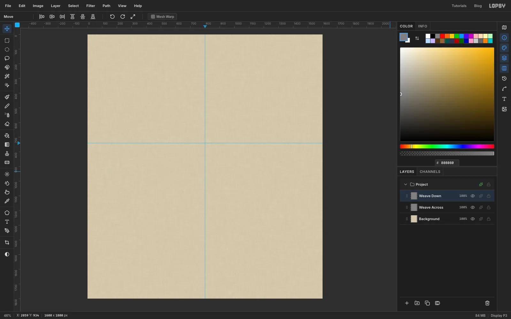

Choose **File → New** and make a document of **1600 × 1800 px**. Click once on the
top ruler at **800** and once on the left ruler at **740** to place two guides. All
the round parts of the patch are centred where they cross.

Click the *Background* layer. Type `D2C7AC` into the **Hex** field in the Color panel
to set the foreground colour, then choose **Edit → Fill**. Fill always uses the
foreground colour, with no dialog, and it stays within any selection. Every "fill it
with" in this tutorial means those two steps.

Click *Layer 1* and rename it *Weave Across* by double-clicking its name. Fill it with
mid-grey `#808080`, then:

1. **Filter → Add Noise…** with **Amount 100** and **Mono** on
2. **Filter → Pixelate…** with **Block Size 3**
3. **Filter → Motion Blur…** with **Angle 0** and **Distance 26**

Open the effects drawer with the ✦ button on the layer's row and set the blend mode
to **Overlay**. Close the drawer. Grey disappears in Overlay, leaving only the
lighter and darker threads.

Add a new layer called *Weave Down* and repeat all of that with **Angle 90**. The
two together cross like woven cloth.

## Add folds and seams

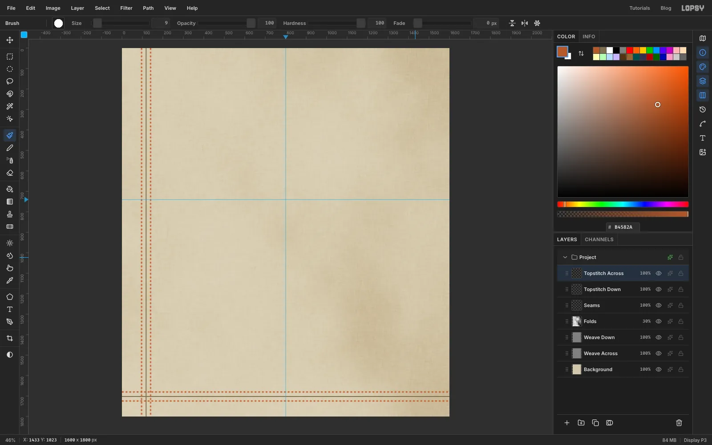

Add a layer called *Folds*. Run **Filter → Clouds…** with **Scale 2**, then
**Gaussian Blur** at **Radius 60**. Set it to **Soft Light** and, by clicking the
percentage on its row, **30%** opacity.

Add a layer called *Seams*. Pick the **Brush** (B). Click its tip thumbnail in the
options bar to open the Brushes panel and set **Size 5**, **Hardness 100** and
**Spacing 2**, then close the panel. With `#7F7050`, draw one line down the canvas,
about 120 px in from the left: click at the top, then [[Shift]]-click at the bottom.
Draw another across, about 100 px up from the bottom.

Now for the dashes. Add a layer called *Topstitch Down*, set the Brush to **Size 9**
and **Spacing 200**, and use copper `#B4582A` to draw two [[Shift]]-click lines down
the canvas, one each side of the seam, at about x 96 and x 140. You'll see rows of
dots. **Motion Blur** with **Angle 90** and **Distance 7** stretches them into thread
dashes.

Do the same on a layer called *Topstitch Across*, with two lines either side of the
bottom seam at about y 1680 and y 1724, and **Motion Blur** at **Angle 0**.

## Draw a tile of thread

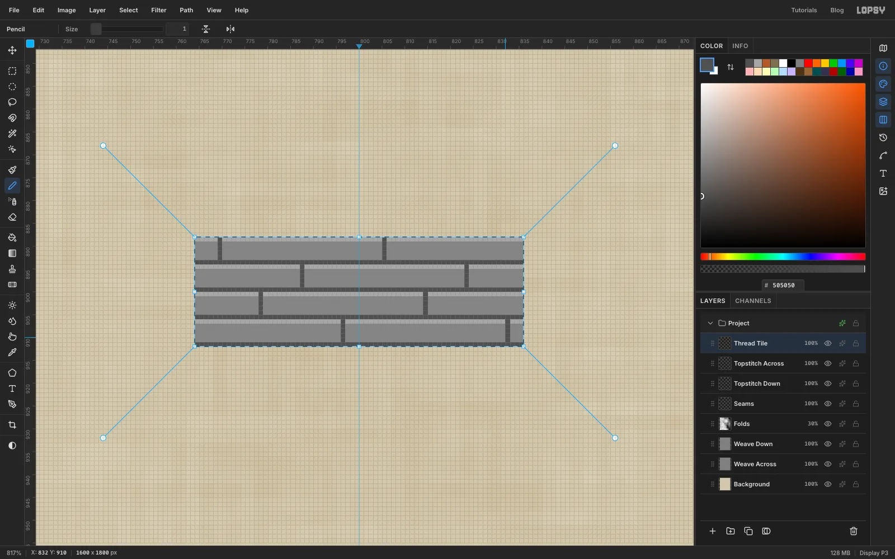

Add a layer called *Thread Tile*. With the **Rectangular Marquee**, click the canvas
and enter corners **764, 888** and **836, 912** to get a 72 × 24 px rectangle in the
middle. Fill it with `#858585`. Leave the selection on, and zoom in to about 800%
with [[Cmd]] and the scroll wheel.

The tile holds four threads, each 6 px tall. Pick the **Pencil** (N) at **Size 1**
and use a click and a [[Shift]]-click to draw straight lines across the full width:

- With `#505050`, the bottom pixel of each thread: rows 6, 12, 18 and 24 of the tile.
- With `#A6A6A6`, the top pixel of each thread: rows 1, 7, 13 and 19.
- With `#505050` again, two short vertical needle holes in each thread, half a tile apart, and at a different place along each row so they stagger like bricks.

> **Tip:** At high zoom, click in the upper-left part of a pixel. A click in its right or bottom half can paint the pixel next to it.

Choose **Edit → Define Pattern**. Press [[Cmd+0]] to fit the view, press [[Cmd+D]],
then delete the *Thread Tile* layer.

## Make the first thread sheet

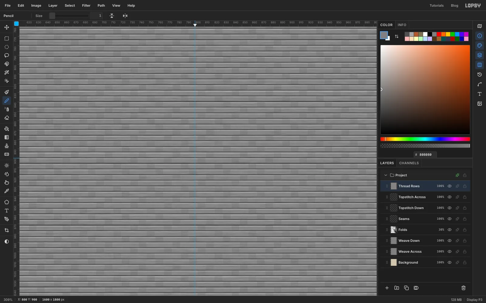

Add a layer called *Thread Rows* and fill it with `#808080`. Choose
**Edit → Fill with Pattern…**, pick your tile and click **Apply**. To roughen it up:

1. **Add Noise** with **Amount 24** and **Mono** on
2. **Motion Blur** with **Angle 0** and **Distance 8**
3. **Gaussian Blur** with **Radius 1**

Hide the layer with the eye icon on its row. You'll only ever copy from it. This
sheet does the water and the panel, where stitches run sideways.

## Make a sheet of radiating thread

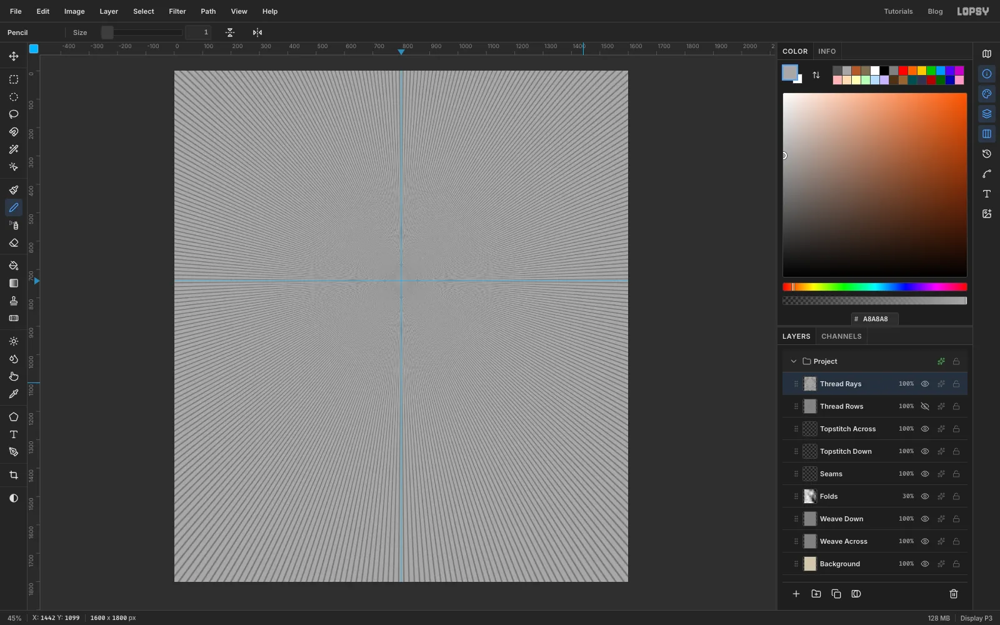

The sun and the ring need stitches that radiate from the centre. Add a layer called
*Thread Rays* and fill it with `#6E6E6E`. Set the foreground to `#A8A8A8` and run
**Filter → Sunburst…** three times, with these settings each time:

- **Rays 120**, **Length 100**, **Width 26**, **Softness 30**, **Opacity 100**
- **Center X 50**, **Center Y 41**, which puts the middle at your guides
- **Rotation** 0 the first time, then 1, then 2

Finish with **Add Noise** at **Amount 16**, **Mono**. Hide this layer too.

## Make a slanted thread sheet

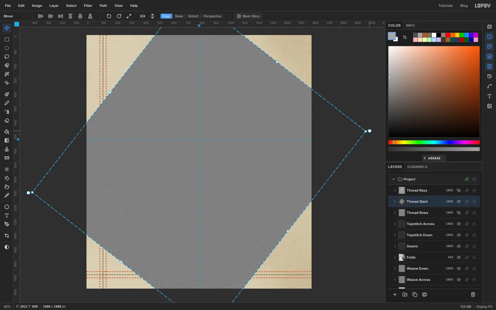

Kelp looks best with diagonal stitches. Click the *Thread Rows* row and click
**Duplicate Layer**. Rename the copy *Thread Slant* and show it with its eye icon.

Choose **Select → All**, press **V** for the **Move** tool, and drag the small round
handle outside the top-right corner of the box to turn the sheet by roughly
**38°**. The corners swing off the canvas, which is fine because the patch sits in
the middle. Press [[Cmd+D]], then hide the layer.

## Draw the patch shape

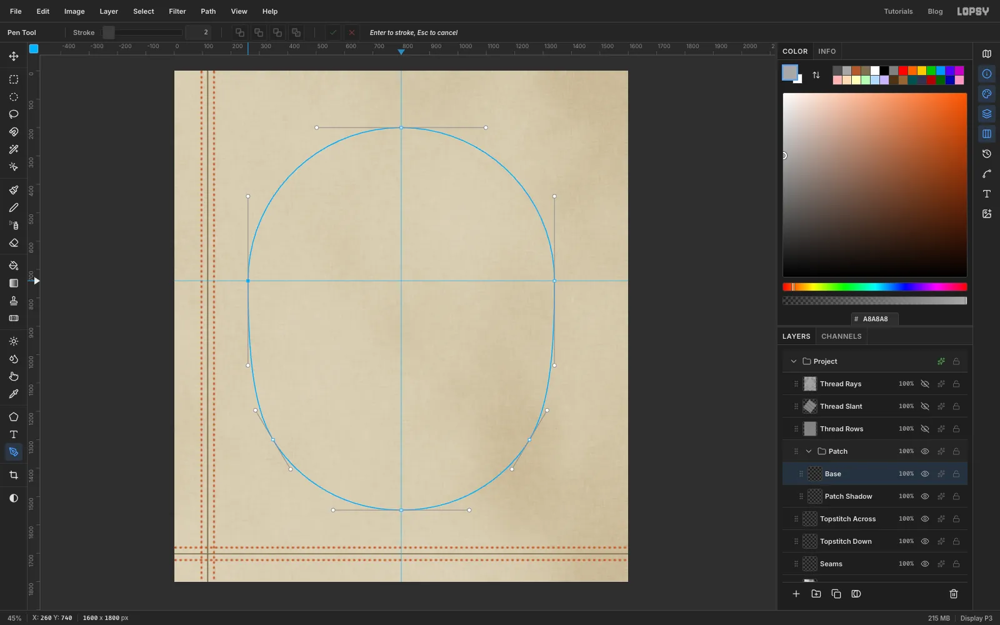

Click *Topstitch Across*, then click **New Group** in the Layers panel and rename the
group *Patch*. Everything from here on goes inside it. Add two layers inside it,
*Patch Shadow* first, then *Base*.

Press **P** for the **Pen**. A press and drag sets an anchor and pulls out its curve
handles. Draw the patch clockwise, starting from the left:

1. Press at **260, 740** and drag straight up about 300 px.
2. Press at **800, 200**, the top, and drag right about 300 px.
3. Press at **1340, 740** and drag straight down about 300 px.
4. Press at **1252, 1300** and drag down and to the left, toward **1190, 1404**.
5. Press at **800, 1548**, the bottom, and drag left about 240 px.
6. Press at **348, 1300** and drag up and to the left, toward **286, 1196**.
7. Click the first anchor to close the path.

The top should be a clean half circle centred on your guides.

## Fill the patch

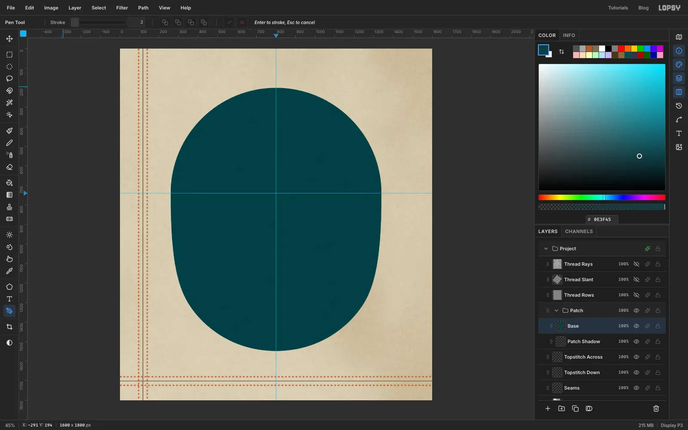

Open the **Paths** panel with its icon on the right-hand strip, then click **Path to
Selection** and **Delete Path**. Close the panel. Fill the selection on *Base* with
deep teal `#0E3F45` and press [[Cmd+D]].

## Lay in the sky and the solar ring

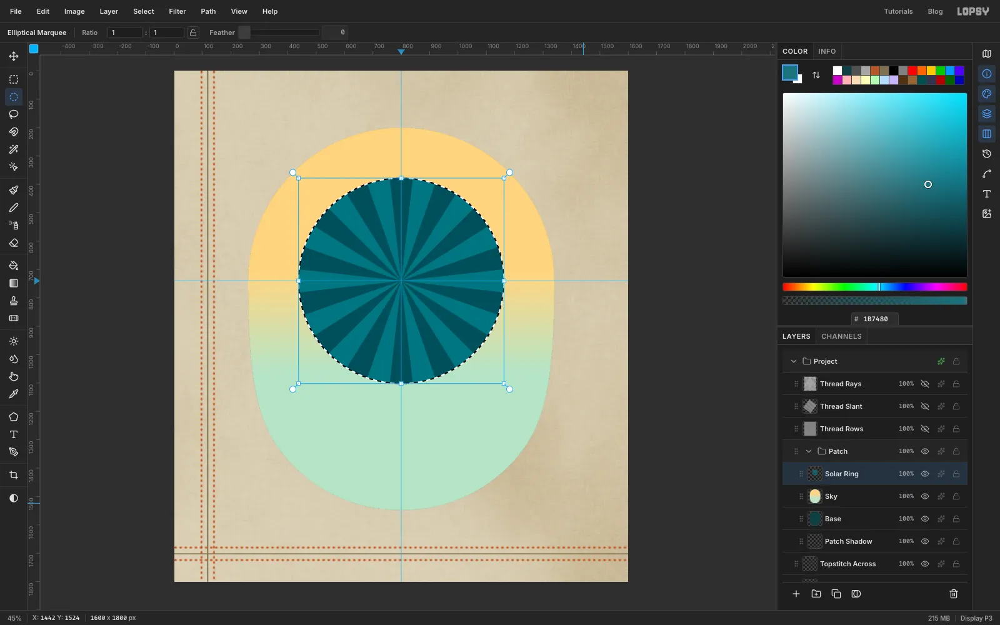

Add a layer called *Sky*. [[Cmd]]-click the *Base* thumbnail to select the patch.
Pick the **Gradient** tool (linear), click **Advanced…**, and set two stops,
`#FBD68A` and `#BFE3C8`. Drag from **800, 700** straight down to **800, 1060**.
Press [[Cmd+D]].

Add a layer called *Solar Ring*. With the **Elliptical Marquee**, click the canvas
and enter **438, 378** and **1162, 1102**, a circle of radius 362. Fill it with
`#124E58`. Set the foreground to `#1B7480` and run **Sunburst** with **Rays 14**,
**Length 100**, **Width 50**, **Taper 0**, **Softness 0**, **Rotation 0**, **Center X
50**, **Center Y 41** and **Opacity 100**. The rays stay inside the selection, so
you get a wheel of light and dark cells. Press [[Cmd+D]].

## Draw the solar grid with Radial Symmetry

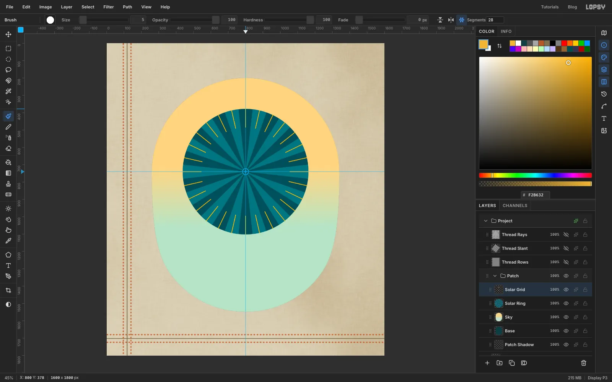

Add a layer called *Solar Grid*. Pick the **Brush** at **Size 5**, **Hardness 100**,
**Spacing 2**, with gold `#F2B632`. In the options bar, click **Radial Symmetry** and
set **Segments** to **28**.

[[Cmd]]-click the point where your guides cross. That moves the symmetry centre
without painting. Now click at **800, 484**, then [[Shift]]-click at **800, 378**. One
line becomes 28 spokes.

Click **Radial Symmetry** again to turn it off, otherwise it keeps taking your
[[Cmd]]-clicks.

Next, add a ring. Marquee a circle of radius **316** (484, 424 to 1116, 1056) and
fill it with the same gold. Choose **Select → Shrink** with **5** and press
**Delete**. Press [[Cmd+D]].

## Add the sun

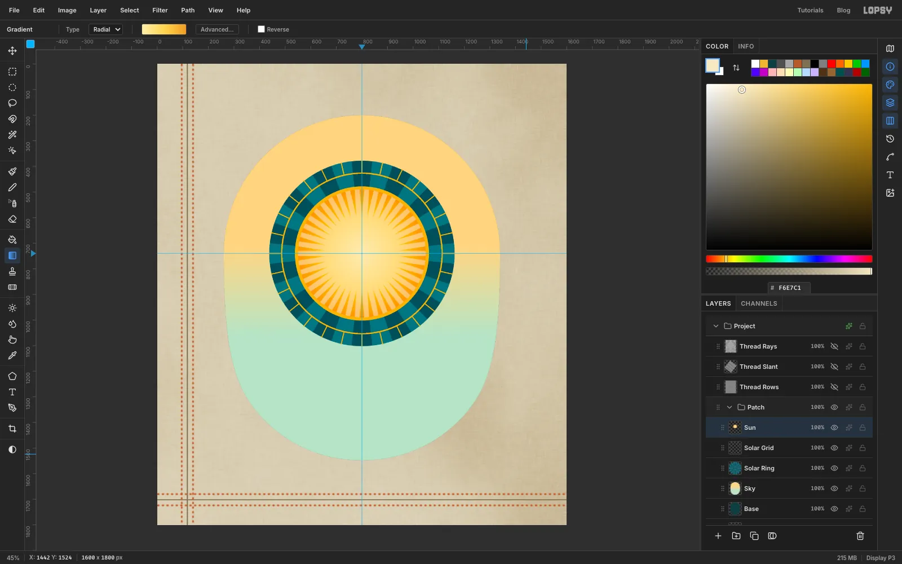

Add a layer called *Sun*. Marquee a circle of radius **262** (538, 478 to 1062, 1002)
and fill it with gold `#F2B632`. **Shrink** the selection by **12**, leaving a gold
rim.

Pick the **Gradient** tool, switch it to **radial**, and in **Advanced…** set three
stops: `#FFF0A8` at the start, `#FFD24A` just past the middle and `#F09A24` at the
end. Drag from the centre, **800, 740**, to the right edge, **1050, 740**.

Set the foreground to cream `#F6E7C1` and run **Sunburst** with **Rays 42**, **Width
12**, **Taper 100**, **Softness 10**, **Fade 30**, **Center X 50**, **Center Y 41** and
**Opacity 55**. Press [[Cmd+D]].

## Add the lettering band

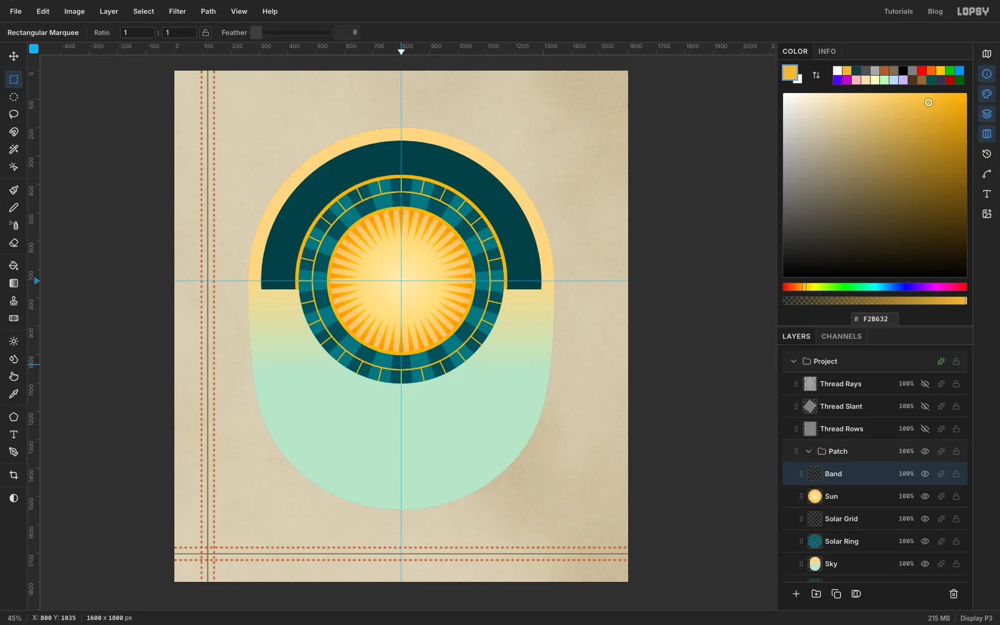

Add a layer called *Band*. Marquee a circle of radius **494** (306, 246 to 1294, 1234)
and fill it with `#0E3F45`.

Press [[Cmd+D]]. Marquee radius **374** (426, 366 to 1174, 1114) and fill it with gold. **Shrink** by
**12** and press **Delete**, which punches a hole down to the sun and leaves a gold
edge.

Only the top half should stay. Press [[Cmd+D]] and marquee a rectangle from **200, 770** to **1400, 1300**
and press **Delete**. Press [[Cmd+D]]. The two flat ends will rest on rooftops.

## Build the garden towers

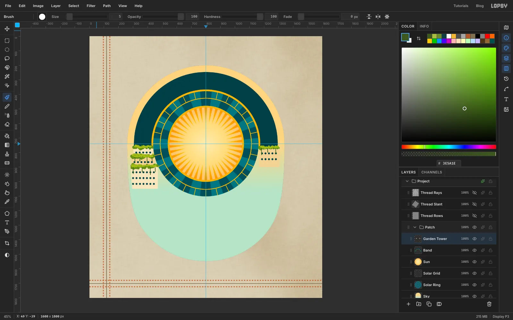

Add a layer called *Garden Tower*. These terraces have slightly rounded corners, and
this is an easy way to get them: marquee the rectangle, **Shrink** by the radius,
**Grow** by the same amount, fill, and press [[Cmd+D]]. Use these corners and colours:

- **280, 900** to **470, 1050**, radius 8, `#F6E7C1`
- **290, 830** to **452, 900**, radius 10, `#EED39A`
- **302, 770** to **436, 830**, radius 10, `#F6E7C1`
- **1166, 770** to **1306, 900**, radius 10, `#EED39A`, the right-hand building

Windows: set the Brush to **Size 14** and **Spacing 170**. With `#0E3F45`, use a click
and [[Shift]]-click to draw rows of dots across each terrace.

Planting: set the Brush to **Size 24**, **Spacing 30**, **Scatter 28** and **Size
Jitter 55** (Scatter and Size Jitter are on the Dynamics tab). With `#6E8E2E`, drag
along the top edge of each terrace. Then, at **Size 14** with `#A9BC3E`, go over them
again a little higher for sunlit leaves.

Vines: set **Scatter** and **Size Jitter** back to **0**, set **Size 5** and **Spacing 2**, and with
`#3E5A1E` draw short lines hanging down from the planting.

## Trim to the patch

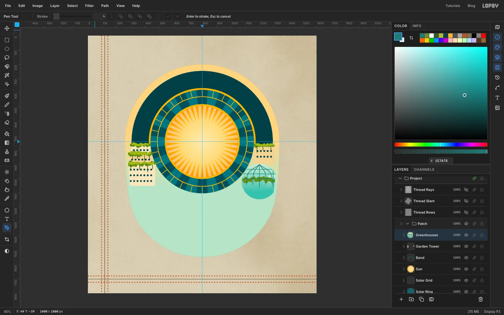

Here's the first of the two recipes. To **trim a layer to the patch**:

1. [[Cmd]]-click the *Base* thumbnail.
2. **Select → Shrink** with **20**, which keeps the art under the edge you'll stitch later.
3. **Select → Inverse**.
4. Click the row of the layer you're trimming, press **Delete**, then [[Cmd+D]].

Trim *Garden Tower*. Then add a layer called *Greenhouses* for some glass:

1. Marquee a circle of radius **124** around **1200, 1020**. Pick the **Gradient** tool and switch it back to **linear**. In **Advanced…**, select the middle stop left over from the sun and delete it, then set the ends to `#CDEBD4` and `#63BFAE`. Drag from the top of the circle to the bottom. Press [[Cmd+D]].
2. Do the same with a circle of radius **58** around **1296, 1030**, and press [[Cmd+D]].
3. [[Cmd]]-click the *Greenhouses* thumbnail. Brush a row of planting inside the domes with `#6E8E2E`, using the leafy settings from before at **Size 22**.
4. Still selected, set the Brush to **Size 4**, **Spacing 2**, with **Scatter** and **Size Jitter** at **0**, and use `#1E7A78` to draw the glazing bars: three level lines and an upright down each dome. For the curved ribs on the big dome, use the **Pen** with **Stroke 4**. Draw four ribs, two each side of the upright: place three anchors from the top of the dome curving down to its base, and press **Enter** to stroke. Delete each path.
5. Press [[Cmd+D]] and trim to the patch.

## Raise the wind turbines

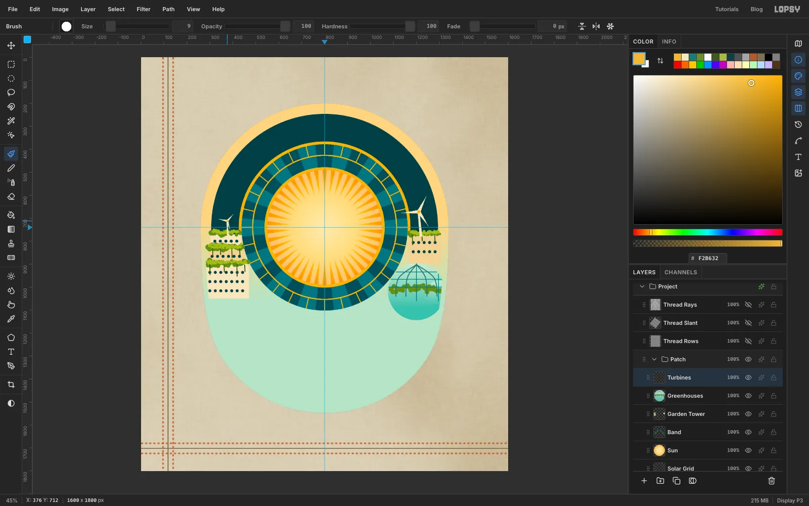

Add a layer called *Turbines*. With the **Pen**, click four corners for each mast,
closing on the first. In the Paths panel click **Path to Selection** and **Delete
Path**, fill with cream `#F6E7C1`, and press [[Cmd+D]]. Make the left
mast 62 px tall on the left-hand tower and the right mast 100 px tall on the
right-hand building, each narrower at the top. The right one tops out at about
**1210, 680** and the left at about **376, 718**.

The blades are the fun part. Pick the **Brush**, turn on **Radial Symmetry** with
**Segments 3**, and in the Brushes panel set **Size 16**, **Spacing 1** and **Taper
76**. Taper shrinks the dab along the stroke, so a stroke comes out as a blade.
[[Cmd]]-click the top of the right mast to centre the symmetry there, then drag one
blade outward, up and to the right, about 76 px. Three identical blades appear.

For the small turbine, use **Size 10** and **Taper 40**, [[Cmd]]-click the top of its
mast, and drag a 40 px blade.

Turn **Radial Symmetry** off, and in the Brushes panel set **Taper** back to **0**.
Add a gold hub to each turbine with one Brush click, **Size 14** and **Size 9**.

## Paint the far water

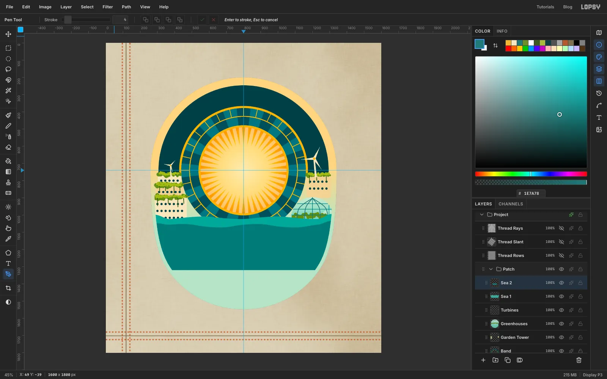

Add a layer called *Sea 1*. With the **Pen**, draw a long closed shape: start at the
left edge of the patch at about y 1016, press and drag across in about ten anchors
so the top rolls gently up and down by about 8 px, click a corner down at **1338,
1320**, click another at **262, 1320**, and close the path on the first anchor. Use
Path to Selection, Delete Path, and fill with `#3FA69A`. Press [[Cmd+D]] and trim to
the patch.

Add *Sea 2* the same way, with its crest about 46 px lower, near y 1062, and filled
with `#1E7A78`. Make the waves out of step with the first band so the crests don't
sit parallel.

## Stitch everything so far

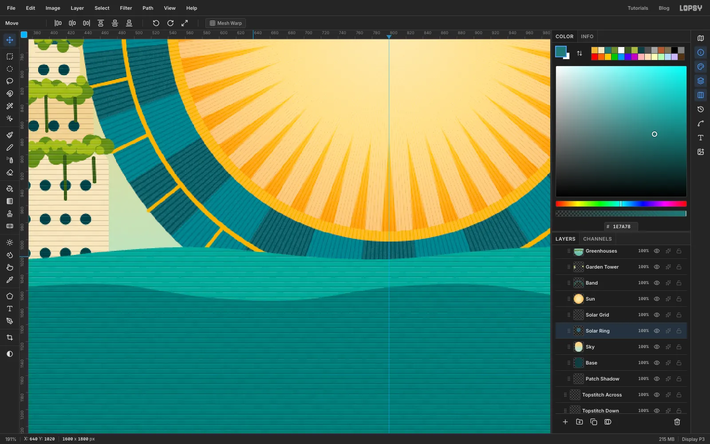

Here's the second recipe, and the one that makes it all look sewn. To **stitch a
layer**:

1. Click the row of the thread sheet you want.
2. [[Cmd]]-click the thumbnail of the layer you're stitching. The outline of that layer is now selected, but the sheet is still the active layer.
3. Press [[Cmd+C]] to copy that shape out of the sheet.
4. Click the row of the layer you're stitching and press [[Cmd+V]]. The copy lands right on top of it, in place.
5. Press [[Cmd+D]]. Open the effects drawer and set the copy to **Hard Light**, then close the drawer.
6. Set the copy's opacity on its row.
7. Choose **Layer → Merge Down**.

Do that for each of these:

- *Sea 1* and *Sea 2*: **Thread Rows** at **40%**
- *Greenhouses*: **Thread Rows** at **30%**
- *Garden Tower*: **Thread Rows** at **35%**
- *Band*: **Thread Rays** at **35%**
- *Sun*: **Thread Rays** at **40%**
- *Solar Ring*: **Thread Rays** at **40%**

Zoom in to see it. At 100% opacity, Hard Light looks engraved, so keep it low.

## Bring in the otter photo

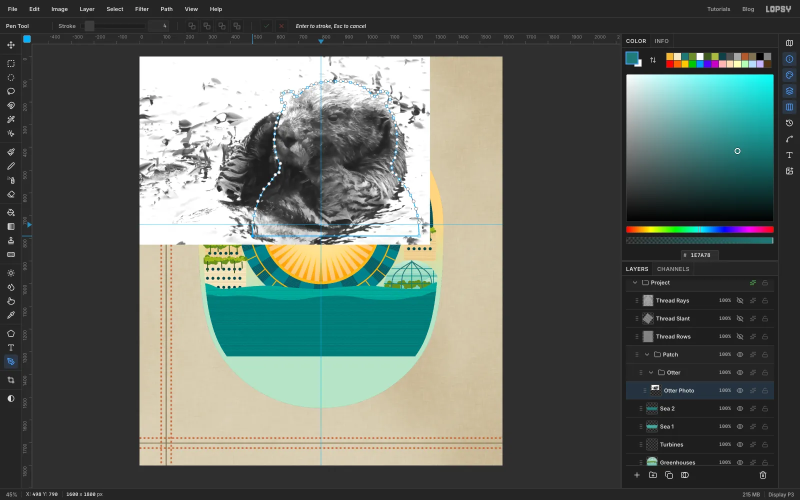

Click *Sea 2* and click **New Group**. Rename the group *Otter*, and add a temporary
layer inside it so the photo lands in the group. Drag the photo file onto the canvas.
It arrives at the top left of the canvas with a selection. Press [[Cmd+D]], rename it
*Otter Photo*, delete the temporary layer, and click the *Otter Photo* row again.

Prepare it while it's still a full rectangle:

1. **Filter → Surface Blur…** with **Radius 8** and **Threshold 40**, which merges the fur into simple shapes
2. **Gaussian Blur** with **Radius 2**
3. **Filter → Desaturate**
4. **Brightness/Contrast** with **Brightness 22** and **Contrast 30**

Press **P** for the **Pen** and trace a simplified otter in about 30 anchors, pressing
and dragging slightly for smooth curves. You're drawing the bust you want, not the
exact outline in the photo, and you'll paint over the raised paws. Keep it symmetrical
about a vertical line at **x 865**, so the anchors on the left mirror the ones on the
right:

- Start at the lower left, around **498, 790**, and go up a sloping shoulder to a neck at about **618, 490**.
- Take a rounded head from there: left side at about x 596, top at about **865, 108**, right side at about x 1134.
- Add a small round ear bump either side of the crown, near **650, 170** and **1078, 170**.
- Come down from the neck at about **1112, 490**, along a shoulder to **1232, 790**.
- Click the first anchor to close, making the two bottom anchors plain corners.

## Cut out the otter

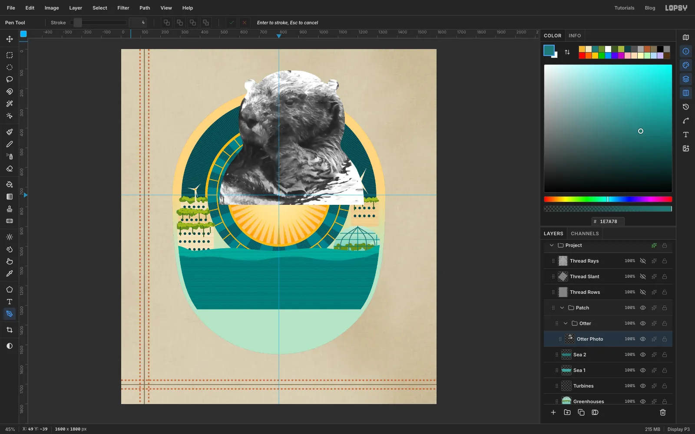

In the Paths panel, click **Path to Selection** and **Delete Path**. Choose
**Select → Inverse**, press **Delete**, then press [[Cmd+D]].

The bottom of the cut-out is a straight line, but the water will hide it.

## Scale the otter

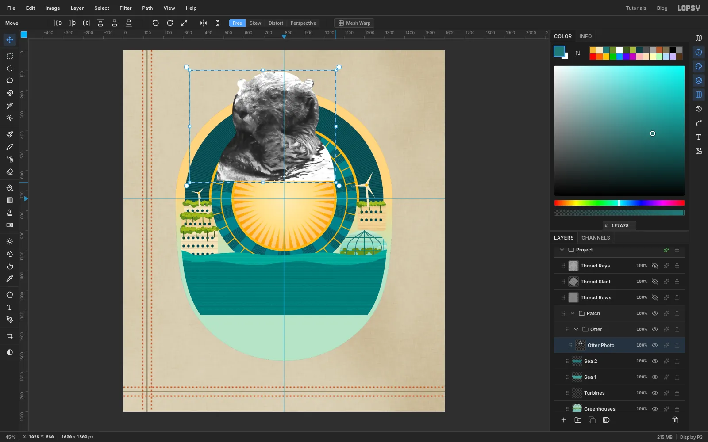

With the **Rectangular Marquee**, click the canvas and enter **330, 100** and **1240,
800**, a box a little larger than the otter. Press **V** for the **Move** tool. Hold
[[Cmd]] to keep the proportions and drag the bottom-right corner handle up and to
the left to about **1058, 660**, which is 80% of the original size. Press [[Cmd+D]]
to commit it.

## Seat the otter in the sun

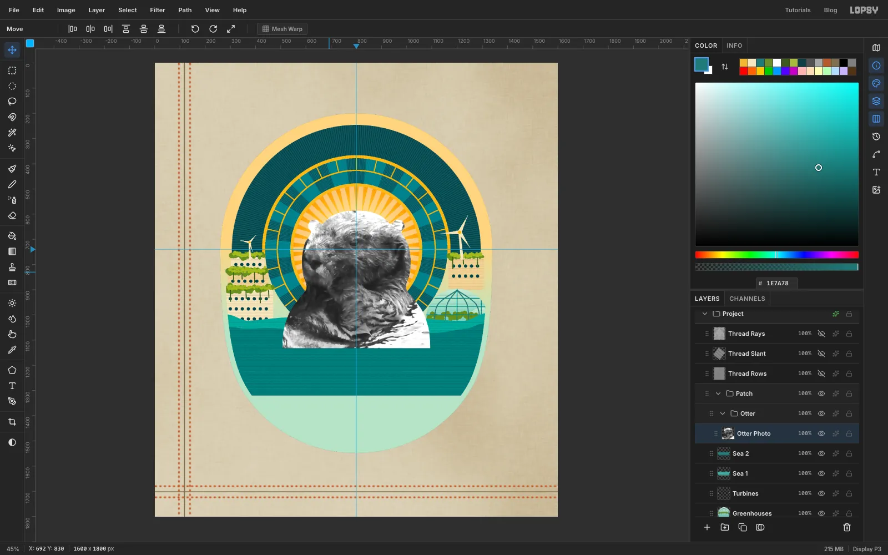

With nothing selected, drag the otter into place with the **Move** tool. Its head should
be centred on your vertical guide, with its crown about 110 px below the top of the sun,
at y 590 or so. The bottom edge should sit around y 1130.

## Map the photo to thread colours

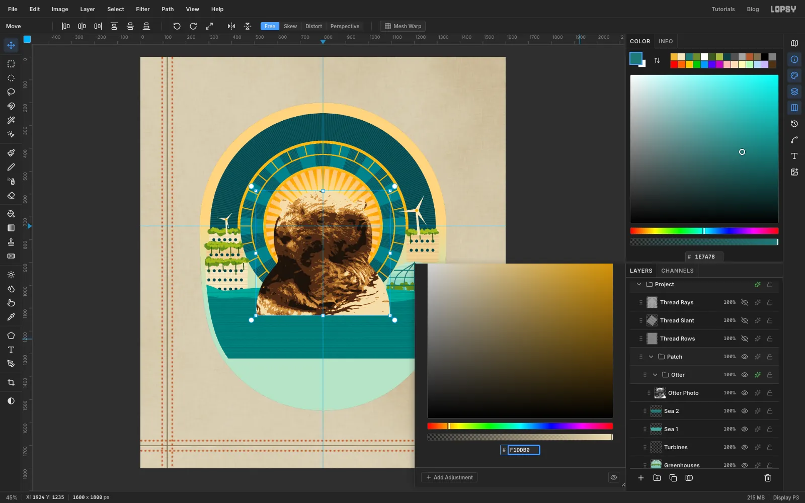

On the row of the *Otter* group, click the ✦ button, then **Add Adjustment →
Gradient Map**. If a *Group Adjustments* message appears, click **Got it**.

The trick is to set pairs of stops close together, so each brown is a flat band with
a hard step to the next, just like separate spools of thread. The bar starts with one
stop at each end. Click each end stop and type `1B120C` and `F1DDB0` into the **Hex**
field. Then click the bar to add each of the other stops, typing its colour straight
away. You can drag a stop's handle to fine-tune it, and it's fine to be a percent or so
out, but don't let two stops land on the same spot.

- 0% and 20%: `#1B120C`
- 22% and 40%: `#4A2D19`
- 42% and 60%: `#8B5A2E`
- 62% and 80%: `#C9954F`
- 82% and 100%: `#F1DDB0`

Close the drawer. From now on, anything you paint on *Otter Photo* in grey shows up in
these browns, and light greys come out cream.

## Paint a pale head and dark body

Sea otters have frosted pale heads on dark bodies, and that split is what makes one
recognisable. Click *Otter Photo* and [[Cmd]]-click its thumbnail, so the paint can't
stray outside the outline.

Pick the **Brush**. In the Brushes panel set **Hardness** to about **30**, **Spacing**
to **2**, and **Taper** to **0**. Use **Opacity** to control how much photo shows
through. Drag each of these strokes from one side of the otter to the other:

- **Size 170, Opacity 80, `#B8B8B8`**: two sweeps across the head, at about y 720 and y 840. These become the tan cheeks.
- **Size 130, Opacity 90, `#DADADA`**: three shorter sweeps at about y 610, y 690 and y 770, leaving the outer cheeks tan. This is the cream face.
- **Size 60, Opacity 90, `#B8B8B8`**: one stroke down each side of the head to clean the edge.
- **Size 190, Opacity 80, `#2A2A2A`**: two wide sweeps across the body, at about y 1050 and y 1130.
- **Size 80, Opacity 70, `#4A4A4A`**: one sweep under the chin, at about y 905, for the neck.
- **Size 130, Opacity 85, `#2E2E2E`**: one sweep across the right of the chest, where the photo's bright fur stands out.

## Break up the tones into fur

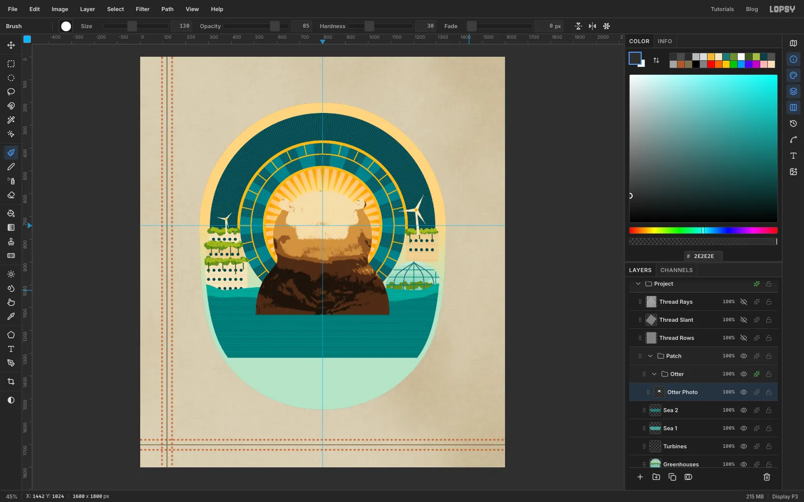

Leave the selection on. Run **Add Noise** with **Amount 22** and **Mono** on, then
**Motion Blur** with **Angle 90** and **Distance 8**.

Because the Gradient Map has hard steps, these tiny grey changes tip pixels from one
brown to the next, and each soft edge turns into a jagged row of stitches. Press
[[Cmd+D]].

## Paint the face

Still on *Otter Photo*, build the face from the centre out. All of this sits on the
vertical guide, so keep it symmetrical. Use **Hardness 100** unless noted, **Opacity
100**, and a single click for each dab.

- **Ears:** [[Cmd]]-click the thumbnail again so the paint stays inside. Click once in each ear bump with **Size 40**, **Hardness 70**, `#8A8A8A`, then again with **Size 20**, **Opacity 80**, **Hardness 50**, `#3A3A3A`. Press [[Cmd+D]].
- **Whisker pads:** two clicks at **Size 84**, **Hardness 70**, `#F6F6F6`, side by side, about 80 px apart at **760, 822** and **840, 822**.
- **Nose:** with the **Pen**, draw a rounded triangle about 64 px wide just above the pads, centred on the guide at about y 776. Use **Path to Selection** and **Delete Path**, fill with `#000000`, and press [[Cmd+D]]. Add one small `#A0A0A0` highlight with the Brush at **Size 8**.
- **Mouth:** with the **Pen** at **Stroke 4** in black, stroke a short line down from the nose, then a curve out to each side along the bottom of the pads. Press **Enter** after each, and delete each path.
- **Eyes:** about 150 px apart at **724, 718** and **876, 718**, with the nose between them: first **Size 50**, **Opacity 60**, **Hardness 40**, `#707070` for a soft socket, then **Size 34**, black, then **Size 10**, white, placed up and to the left.
- **Whiskers:** three Pen curves fanning out from each pad at **Stroke 3** in `#0A0A0A`, running out past the cheeks. Delete each path.
- **Forearms:** set the Brush to **Size 56**, **Hardness 80**, `#646464`, and drag one stroke from about **652, 1090** up to **728, 992**, and a mirrored one from **948, 1090** up to **872, 992**. Add three short toe lines to each paw with **Size 4** in `#101010`.

## Stitch the otter and give it a shell

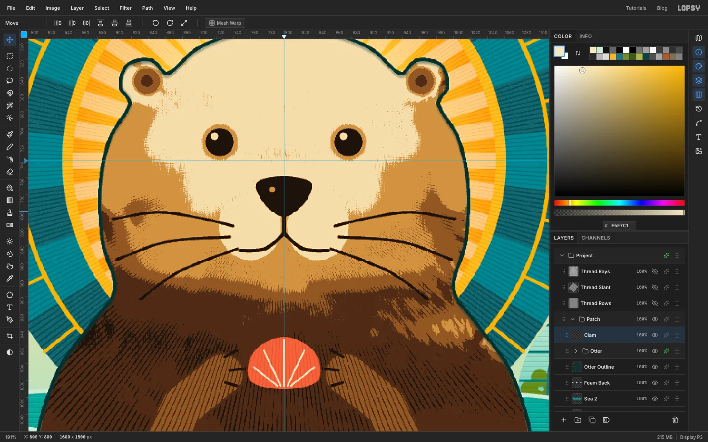

Stitch *Otter Photo* with **Thread Rays** at **24%**. Its centre is near the nose, so
the fur appears to grow outward from the face.

Now the foam behind it. Click *Sea 2*, add a layer called *Foam Back*, and use the
**Pen** at **Stroke 5** in `#CDEBD4` to stroke a line along the crest of *Sea 1* and
another along the crest of *Sea 2*. Delete each path, then trim to the patch.

Next, the outline. [[Cmd]]-click the *Otter Photo* thumbnail, add a new layer called
*Otter Outline* (it lands just above *Foam Back*, under the *Otter* group), choose
**Select → Grow** with **4**, fill with `#12302F`, and press [[Cmd+D]].

Collapse the *Otter* group with its arrow and click its row. Add a layer called
*Clam*. With the **Pen**, draw a fan-shaped shell between the paws, about 80 px wide,
centred at **800, 980**, and fill it with coral `#E2603A`. This is the only coral on
the patch, so your eye goes straight to it. Add five cream ridges fanning up from its
base with a **Size 3** Brush, then stitch *Clam* with **Thread Rays** at **25%**.

## Add the near water

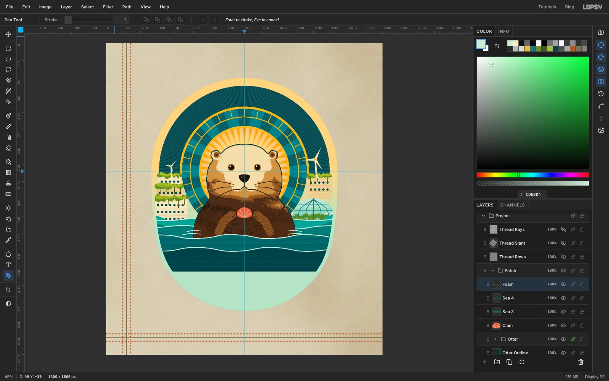

Add *Sea 3* above *Clam* using the same closed Pen shape as before, with its crest
near y 1116 and `#156368`. Add *Sea 4* with its crest near y 1190 and `#0E3F45`. Trim
each to the patch, then stitch each with **Thread Rows** at **40%**. The crest of *Sea
3* needs to cross the otter just above the cut-off line at y 1130, so the otter looks
like it's floating in the water.

Add a layer called *Foam*. With the **Pen** at **Stroke 5**, in `#CDEBD4`, stroke along
both crests. Switch to **Stroke 4** and add two short curved ripples beside each
shoulder, at about y 1085 and y 1105. These show where the body meets the water.
Delete each path, and trim to the patch.

## Add the text panel

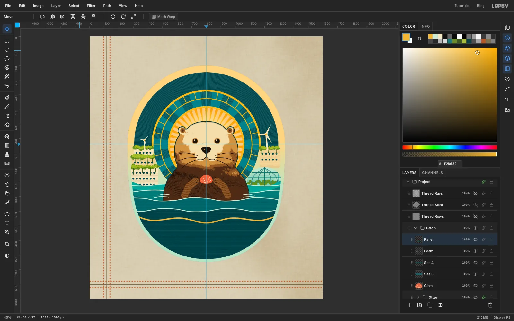

Add a layer called *Panel*. With the **Pen**, draw the top of the panel as a
whiplash curve, an Art Nouveau favourite, through these points: **262, 1205**, **420,
1262**, **620, 1246**, **800, 1280**, **980, 1246**, **1180, 1262**, **1338, 1205**.
Click corners at **1338, 1600** and **262, 1600** and close on the first anchor. Click
**Path to Selection** and **Delete Path**, fill with `#0E3F45`, and press [[Cmd+D]].

Draw the same curve again as an open path, set **Stroke 9** with gold `#F2B632`, and
press **Enter**. Delete the path. Trim to the patch, then stitch *Panel* with **Thread
Rows** at **35%**.

## Grow the left-hand kelp

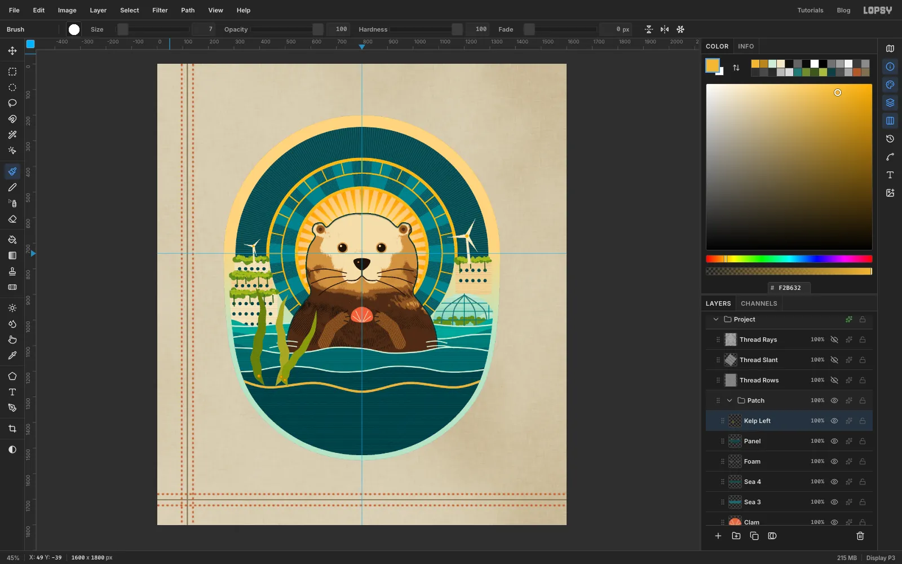

Kelp isn't a leafy plant. It grows as long, narrow, wavy ribbons, with a little gas-filled
bead at the base of each one to float it upward. Add a layer called *Kelp Left*.

With the **Pen**, draw each ribbon as a closed shape. Start at the base with a plain
click, press and drag up one side in about nine anchors, moving slightly in and out
to make a ruffled edge, click a sharp point at the tip, and come back down the other
side the same way. Close on the first anchor, use Path to Selection and Delete Path,
and fill. Press [[Cmd+D]] after each.

- Ribbon 1, `#6C7E24`, about 36 px wide: from **420, 1256**, curving left and then right as it climbs, to a tip at **384, 870**
- Ribbon 2, `#A9A83C`, about 34 px wide: from **462, 1258**, curving right and then left, to **512, 900**
- Ribbon 3, `#8D9A2E`, about 30 px wide: from **512, 1258**, sweeping across the otter's shoulder to **622, 960**

Stitch *Kelp Left* with **Thread Slant** at **40%**.

For the beads, set the Brush to **Size 14**, **Spacing 2** with `#B9851F` and click
once on each ribbon a little above its base. Click again with **Size 7** in gold
`#F2B632`, just up and to the left of centre. Trim to the patch.

## Grow the rest of the kelp

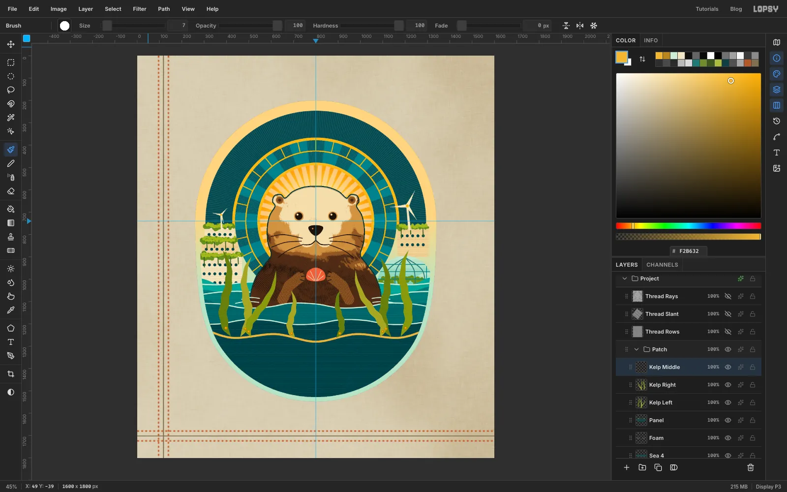

Add *Kelp Right* and mirror the same three ribbons across the guide, so **420, 1256**
becomes **1180, 1256**. Change the colours around: `#8D9A2E`, `#6C7E24` and `#A9A83C`.
Stitch it, add beads and trim to the patch, the same way.

Add *Kelp Middle* with two short ribbons about 26 px wide, one from **708, 1262** to
**690, 1050** in `#A9A83C`, and one from **892, 1262** to **910, 1050** in `#6C7E24`.
Stitch it, add beads and trim to the patch again.

## Set the arched title

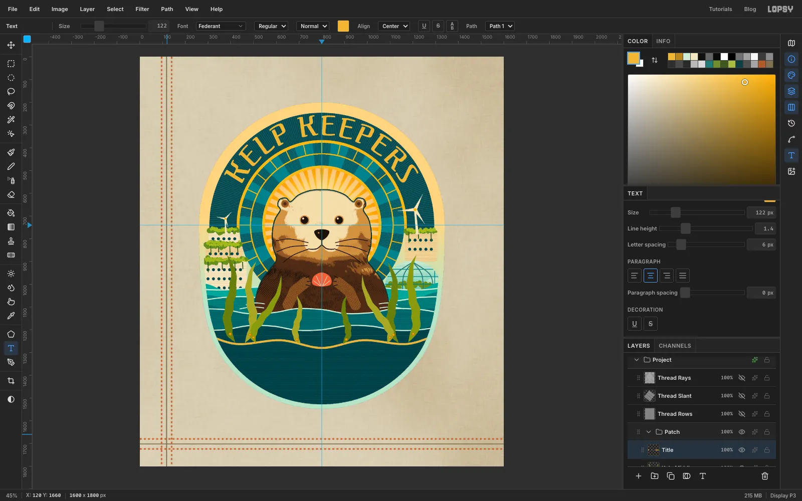

Press **P** for the **Pen** and draw the baseline, a half circle of radius **396**.
Press at **404, 740** and drag up about 219 px, press at **800, 344** and drag right
about 219 px, then press at **1196, 740** and drag down about 219 px. Click the **✓
Commit path** button in the options bar. Don't press Enter, because that would stroke
the path.

Make sure the *Kelp Middle* row is active, so the title lands at the top of the stack. Press
**T** for the **Text** tool. Set **Size 122**, font **Federant** and colour `#F2B632`.
Click in an empty part of the canvas below the patch, and type **KELP KEEPERS**.
Press [[Tab]] to finish, and rename the layer *Title*.

Open the **Text** panel if it's closed. With the layer still active, choose your path in
the **Path** dropdown of the options bar. The text jumps onto the arc. In the Text panel,
click **Align center** and set **Letter spacing** to **6**. Check the title has about the
same gap above and below it in the band.

In the Paths panel, click the selected path's row to deselect it and hide the outline. Keep
the path until the next step, because the text is bound to it.

## Stitch the title and set the panel text

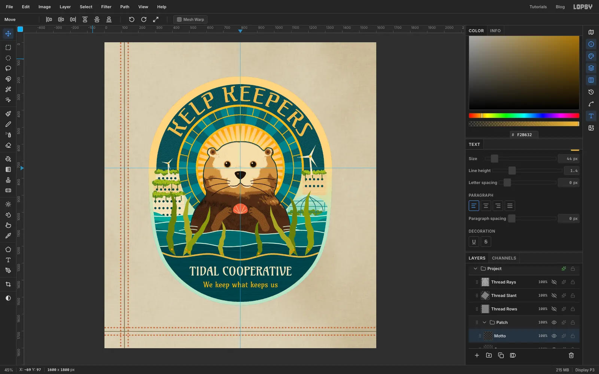

Click **Rasterize Layer** at the bottom of the Layers panel. Now *Title* is ordinary
pixels, so you can delete its path in the Paths panel. Stitch it with **Thread Rays** at
**35%**.

In the Text panel, put **Letter spacing** back to **0** and click **Align left**, because
both settings carry over to the next text.

Now make the panel text, one layer at a time. Finish the first completely before you start
the second, because changing the font or size while a text layer is active restyles that
layer.

Press **T**, set font **Amarante**, **Size 70** and colour `#F6E7C1`. Click in the panel and type
**TIDAL COOPERATIVE**. Press [[Tab]] and rename the layer *Co-op*. Press **V** and drag it so it's
centred on the guide at about y 1346, using the arrow keys to finish. Keep at least 40 px
between the ends of the line and the curved edge. Click **Rasterize Layer** and stitch it with
**Thread Rows** at **35%**.

Do the same with **We keep what keeps us** in **Amarante**, **Size 44**, `#F2B632`, named *Motto*,
centred at about y 1430. Stitch it with **Thread Rows** at **30%**.

## Stitch the edge

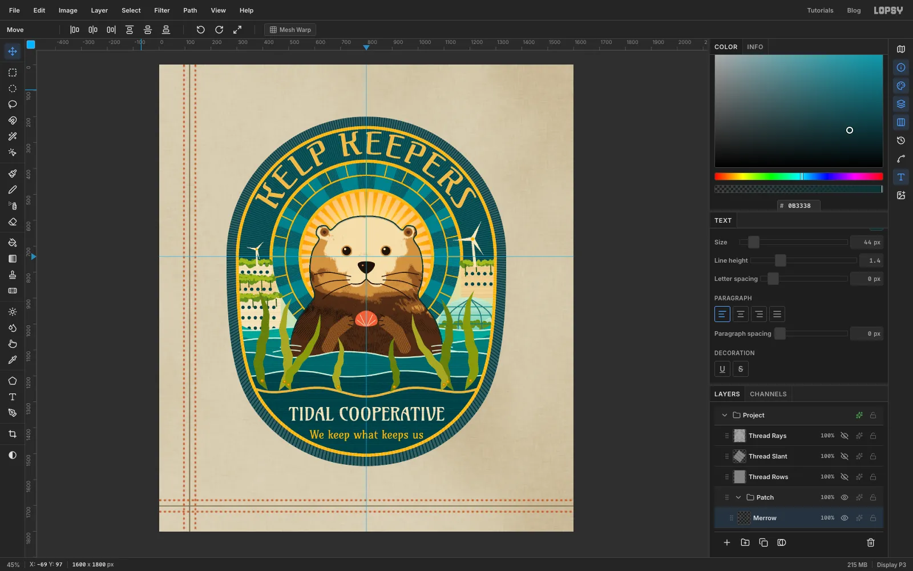

Real patches have an overlocked edge, called a *merrow*, of thick thread wrapped around
the cloth. Add a layer called *Keyline*. [[Cmd]]-click the *Base* thumbnail, **Shrink**
by **36**, and fill with gold `#F2B632`. **Shrink** by **12**, press **Delete**, and
press [[Cmd+D]]. Stitch *Keyline* with **Thread Rays** at **40%**.

Add a layer called *Merrow*. [[Cmd]]-click *Base* again and fill with `#0B3338`. **Shrink**
by **36**, press **Delete**, and press [[Cmd+D]]. Stitch it with **Thread Rays** at
**65%**. The radial threads now run across the border, just like wrapped thread.

## Make a notch cutter

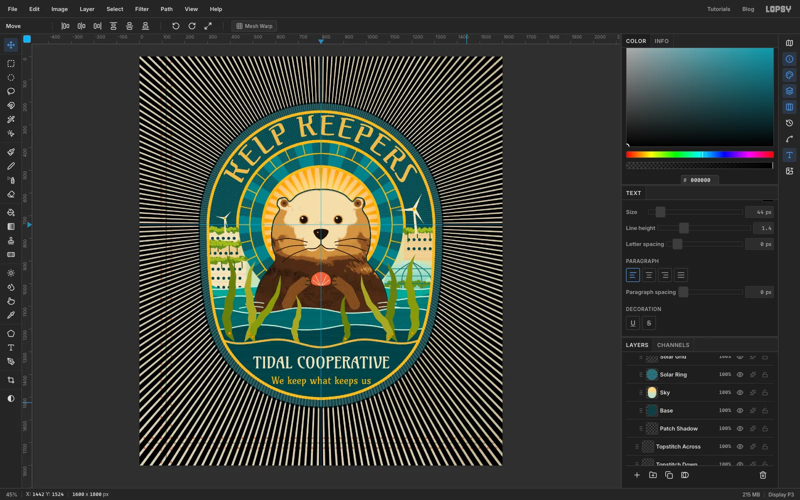

A real merrowed edge isn't a clean line. It has a tiny bump for every stitch. To get
that, add a layer called *Notch Cutter*. [[Cmd]]-click *Base*, **Shrink** by **6**, and
choose **Select → Inverse**. Now only the outer 6 px of the patch and the canvas around
it are selected.

Set the foreground to black and run **Sunburst** with **Rays 120**, **Length 100**,
**Width 34**, **Taper 0**, **Softness 10**, **Rotation 0**, **Center X 50**, **Center Y
41** and **Opacity 100**. Run it again with **Rotation 1.5** to double the count. It
looks alarming, but it's only a stencil. Press [[Cmd+D]].

## Cut the notches

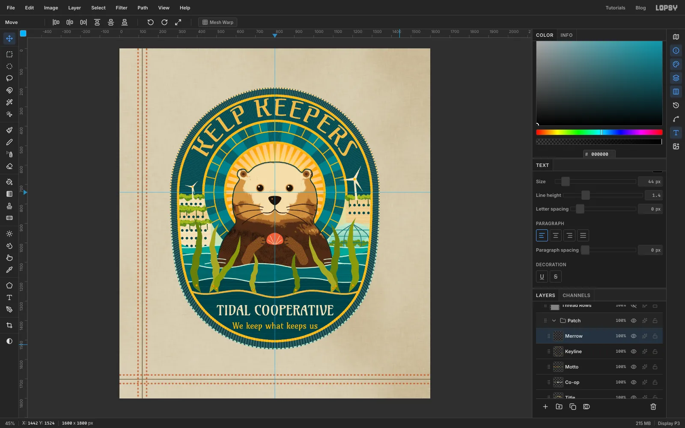

Click the *Merrow* row, [[Cmd]]-click the *Notch Cutter* thumbnail and press **Delete**.
Press [[Cmd+D]], click the *Notch Cutter* row and delete the layer.

## Press it onto the cloth

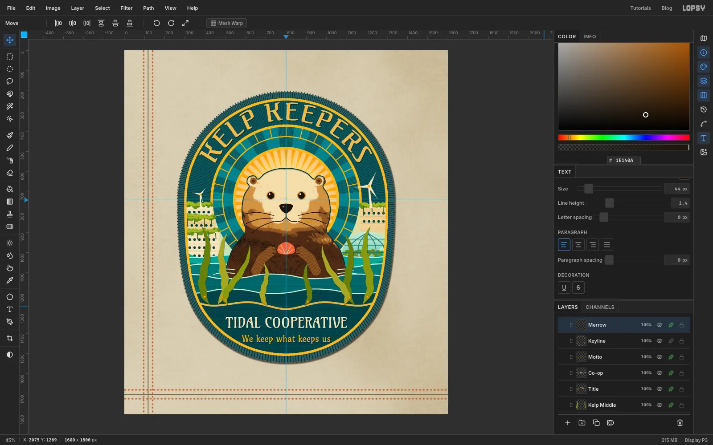

Click the *Patch Shadow* row. [[Cmd]]-click the *Base* thumbnail to select the patch's
outer shape, then fill with `#1E140A`. Press [[Cmd+D]]. Run **Gaussian Blur** with **Radius
6**, press **V** and nudge it **3 px right** and **6 px down** with the arrow keys. Set it
to **Multiply** at **62%**. A tight shadow makes the patch look pressed on, not floating.

*Base* and *Sky* still reach the old edge, and they'd show through the notches you just cut.
[[Cmd]]-click *Base*, **Shrink** by **20** and choose **Select → Inverse**. Keep the selection,
click the *Base* row and press **Delete**, then click the *Sky* row and press **Delete**. Press
[[Cmd+D]].

Finally, give the raised parts some height. Open the effects drawer for each layer, tick the
effect, and click its name to see the settings:

- *Kelp Left*, *Kelp Right* and *Kelp Middle*: **Drop Shadow** with **Offset X 1**, **Offset Y 2**, **Blur 2**, **Opacity 70** and colour `#06211F`
- *Title*, *Co-op* and *Motto*: **Drop Shadow** with **Offset X 2**, **Offset Y 3**, **Blur 2**, **Opacity 80** and colour `#031A1D`
- *Merrow*: **Inner Glow** with **Size 10**, **Opacity 45** and colour `#06211F`, which rounds the edge

Save your work with **File → Save Project**, and export it with **File → Quick Export
PNG**. To make a real patch from this design, send the art without the canvas layers to
a patch maker, and they'll turn each colour area into thread.
