This tutorial makes a street-poster flier for an imaginary mobile sharpening service, **Scissor Queen**. It's 1200 × 1600 px, sprayed through cut stencils onto brown kraft paper in four inks: black, fluorescent pink, cream and off-white.

The centrepiece is a real photograph turned into a stencil. It's a portrait of the Australian writer Dulcie Deamer, the self-styled "Queen of Bohemia", taken around 1915:
[Dulcie (Mary Elizabeth Kathleen Dulcie) Deamer, writer and Queen of Bohemia](https://commons.wikimedia.org/wiki/File:Dulcie_(Mary_Elizabeth_Kathleen_Dulcie)_Deamer,_writer_and_Queen_of_Bohemia_(7947285230).jpg)
from the State Library of Queensland, on Wikimedia Commons with **no known copyright restrictions**. Download the full-size file (698 × 1000).

A spray stencil can only print flat colours, so the photo is split into tone bands with the **Threshold** filter: one layer for the darkest tones, one for the dark-to-mid tones, one for the brightest highlights, and a cream base under everything. Each band gets its own ink. The silhouette is cut once, in a group mask, so all four layers share one clean edge.

Along the way you'll use:

- ruler **guides** and snapping a marquee to them
- **Add Noise**, **Gaussian Blur**, **Clouds**, **Sunburst**, **Desaturate** and **Threshold**
- feathered **Elliptical Marquee** selections
- the **Move** tool's scale and rotate handles, with [[Cmd]] to keep proportions
- **Duplicate Layer**, the **Magic Wand** with **Contiguous** off, and [[Cmd]]-clicking a thumbnail to select a layer's pixels
- **Group Layers**, a **group mask**, the **Lasso**, **Select → Inverse**, and filters run on a mask
- the **Spray** tool, the **Brush**, the **Pencil** with [[Shift]]-click lines and the **Eraser**
- the **Pen** tool and **Path to Selection**
- copy and paste, **Merge Down**, and rotating a whole group
- **Drop Shadow** and **Color Overlay** layer effects
- **Text** in Stardos Stencil, Allerta Stencil and Black Ops One
- the **Gradient** tool and the **Multiply**, **Overlay** and **Screen** blend modes

The palette:

- Kraft paper `#C49B6A`
- Fluoro pink `#FF3D8B`
- Black ink `#151311`
- Off-white ink `#F7F2E8`
- Cream base `#DCC296`
- Fold shadow `#5A4630` → `#FFFFFF` (Multiply)

> **Tip:** Positions are written as `x, y` in document pixels. The status bar at the bottom left always shows the cursor's position. The **Info** tab, next to **Color** at the top of the right-hand panel, shows the selection's size while something is selected. Key names use Mac keys. On Windows and Linux, use Ctrl for Cmd in keyboard shortcuts. For [[Cmd]]-drags on the canvas (keeping proportions, snapping a rotation to 15°), hold the Windows key instead.

> **Tip:** To change a layer's opacity, click the `100%` readout on its row to open a slider. To change its blend mode, open the layer's effects with the ✦ button on its row and pick a **Blend Mode** at the top of the drawer.

> **Tip:** "Select **From** … **To** …" means the exact-corners dialog. Pick the Rectangular (or Elliptical) Marquee, make sure nothing is selected ([[Cmd+D]]), and click once on the canvas without dragging. With a selection active, that click only deselects. "Fill with a colour" means set the foreground colour to it in the Color panel's hex field and choose **Edit → Fill**.

## Make the kraft paper

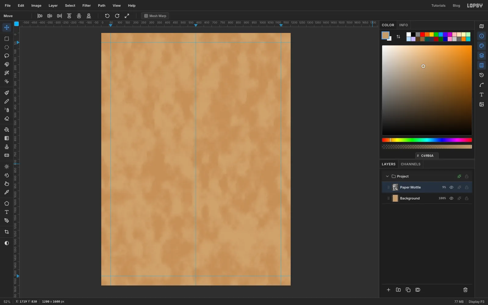

Open [Lopsy](/). In the **New Document** dialog, set **Width** to `1200` and **Height** to `1600` and click **Create**. You get a `Background` and an empty `Layer 1`.

1. Click `Background` and fill it with `#C49B6A`.
2. Choose **Filter → Add Noise…**, set **Amount** to `8`, click **Mono** and **Apply**. Then **Filter → Gaussian Blur…** with **Radius** `1`. This takes the flat digital edge off the colour.
3. Click the top ruler at **60**, **600** and **1140** for three vertical guides, and the left ruler at **60** and **1540** for two horizontal ones. They mark a 60 px margin and the centre line.
4. Click `Layer 1`, double-click its name and rename it `Paper Mottle`. Run **Filter → Clouds…** with **Scale** `20`. Set its blend mode to **Overlay** and its opacity to **9%**.

Kraft paper is blotchy, but only slightly. Keep the clouds faint, or the paper starts to look like leather.

## Spray the sunburst

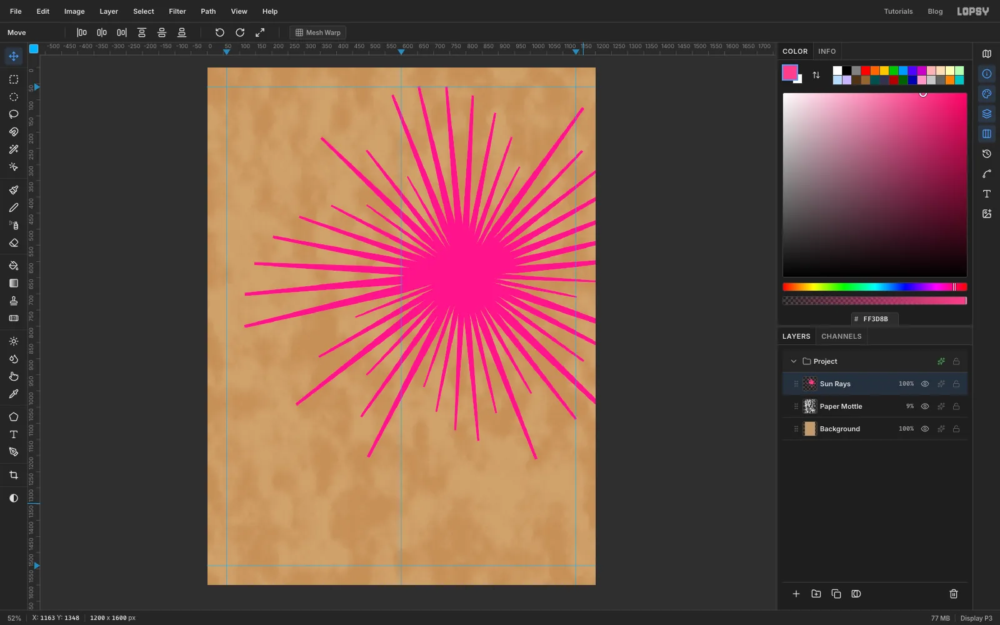

1. Click **Add Layer** at the bottom of the Layers panel and rename the new layer `Sun Rays`.
2. Set the foreground colour to pink `#FF3D8B`. The Sunburst filter paints in the foreground colour.
3. Choose **Filter → Sunburst…** and set **Rays** `44`, **Length** `56`, **Width** `44`, **Taper** `78`, **Jitter** `50`, **Seed** `11`, **Rotation** `3`, **Center X** `66` and **Center Y** `40`. Leave the rest at their defaults and click **Apply**.

Center 66% and 40% puts the burst at 792, 640, behind where the head will go. A high **Taper** turns the wedges into sharp sparks, like a grinding wheel throws. **Jitter** gives them uneven lengths, as if they were cut by hand.

## Feather the halo's overspray

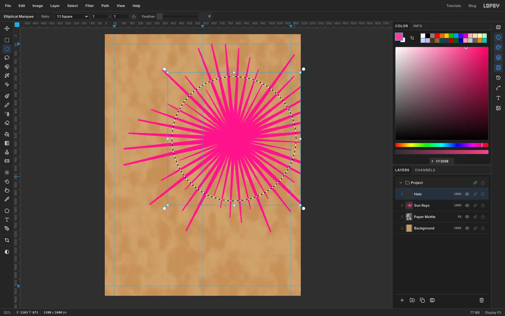

A sprayed disc has a hard edge where the stencil was, plus a soft mist just outside it. Build the mist first.

1. Add a layer and name it `Halo`.
2. Pick the **Elliptical Marquee** and **Select From** `412, 260` **To** `1172, 1020`. That's a circle of radius 380 around the sunburst's centre.
3. Choose **Select → Feather…**, set it to `26` and click **Apply**.
4. Fill with pink `#FF3D8B`.

## Spray the halo's hard core

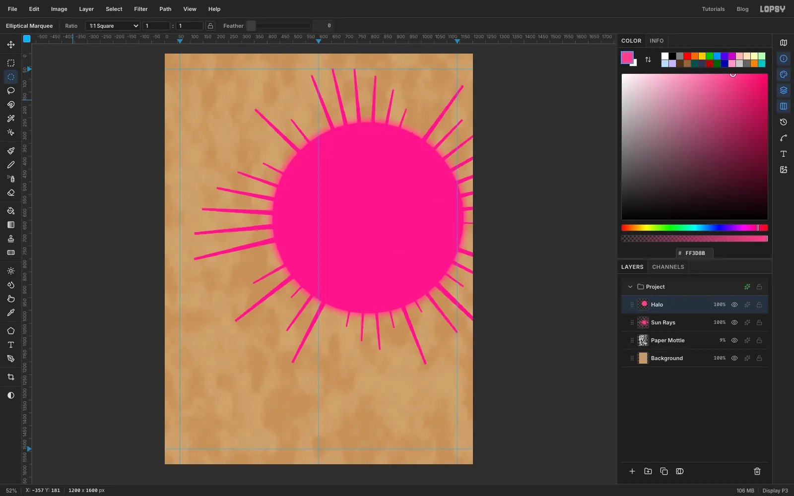

1. Still on `Halo`, press [[Cmd+D]], then **Select From** `420, 268` **To** `1164, 1012` with the Elliptical Marquee. That's radius 372, slightly smaller.
2. Fill with pink again and press [[Cmd+D]].

The soft fringe now sits just outside a crisp edge, like real overspray.

## Drop in the portrait

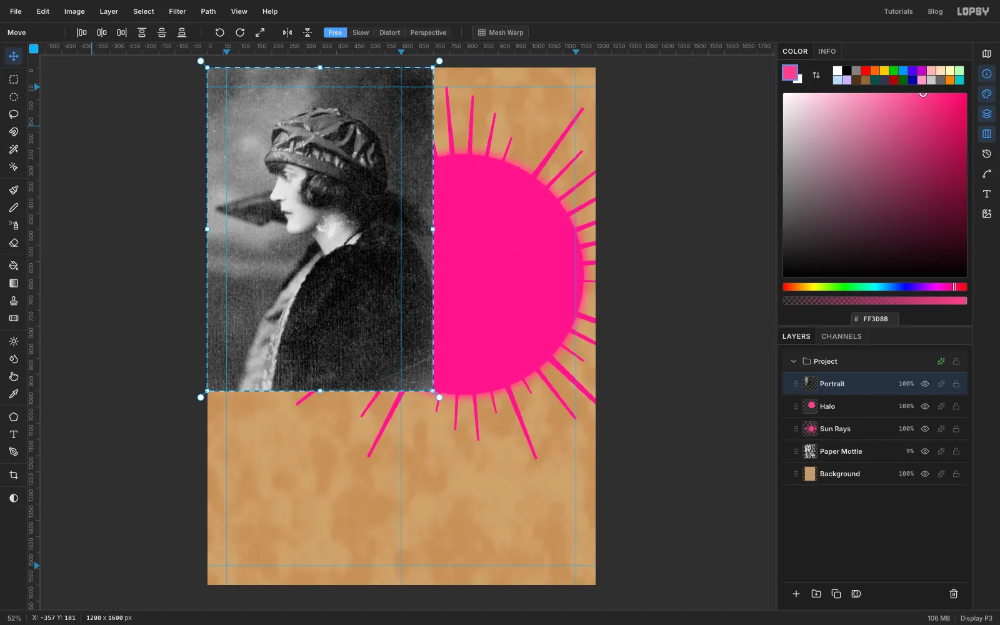

Click the `Halo` row so the photo lands above it. Drag the downloaded JPEG from your file browser onto the canvas. It arrives as a new layer at its own size, 698 × 1000, in the top-left corner, already selected with transform handles. Rename the layer `Portrait`.

## Scale and place the photo

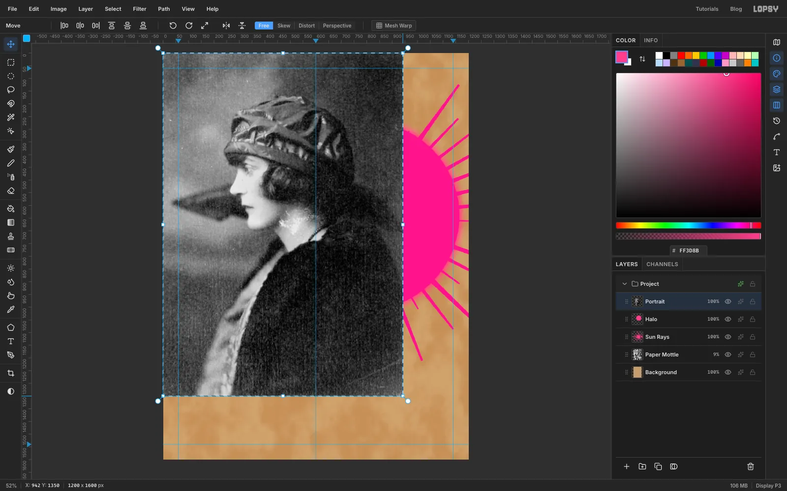

1. With the **Move** tool, hold [[Cmd]] and drag the bottom-right corner handle down and right until the status bar reads about **942, 1350**. That's 135% of the original size. [[Cmd]] keeps the proportions.
2. Press [[Cmd+D]] to commit the scale.
3. Drag the photo until its top-left corner sits at **270, 198**. Use the arrow keys for the last few pixels.

Her nose should now sit at about 535, 735, just inside the left edge of the halo, and the turban's crown at about 783, 360. The photo runs a little off the right edge. That's fine.

## Flatten the photo's grain

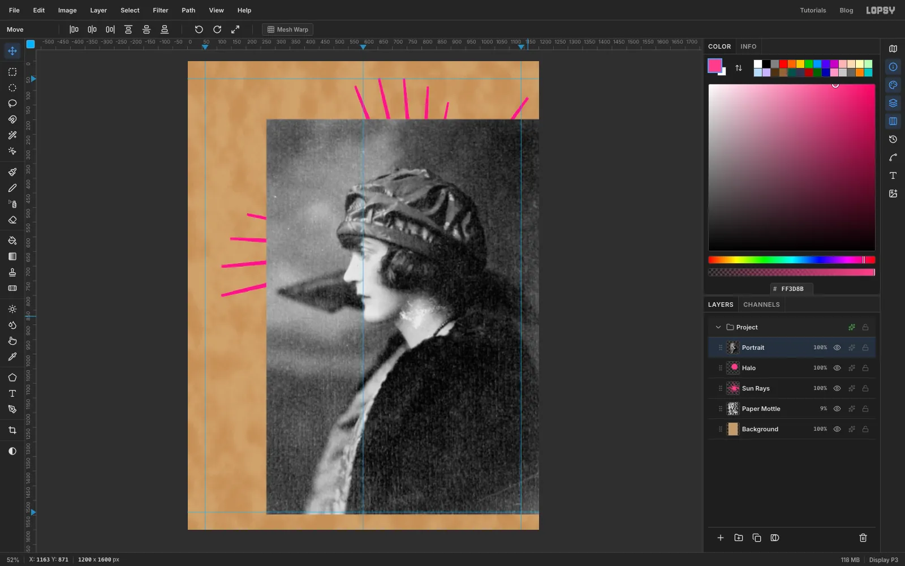

1. Choose **Filter → Desaturate**. The photo is already black and white, but this removes the faint sepia tint.
2. Choose **Filter → Gaussian Blur…** with **Radius** `3`.

Threshold reacts to every speck of film grain. Blurring first gives you smooth shapes that look like they were cut with a knife.

## Make three copies for the tone bands

1. With `Portrait` selected, choose **Layer → Duplicate Layer** and rename the copy `Shadows`.
2. Click `Portrait` again, duplicate it, and rename that copy `Pink`.
3. Click `Shadows`, duplicate it, and rename the copy `Highlights`.

From top to bottom the stack is now `Highlights`, `Shadows`, `Pink`, `Portrait`. Each copy lands exactly on top of its original.

4. Click `Highlights` and run **Filter → Threshold…** with **Level** `205`. Only the very brightest areas stay white: her cheek, neck and the lit edge of the collar.

## Keep only the highlights

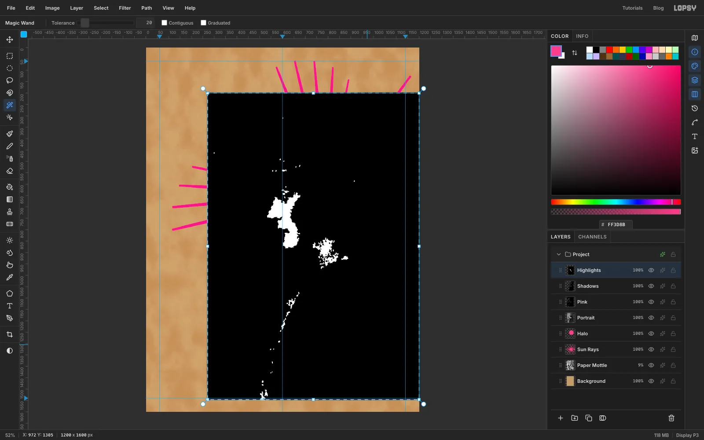

1. Pick the **Magic Wand**. In the options bar set **Tolerance** to `20` and untick **Contiguous**, so one click selects that colour everywhere.
2. Click anywhere on the black coat, for example 972, 1305.
3. Press [[Delete]], then [[Cmd+D]].

Only the white highlight shapes are left. Now do the same for the other two copies, keeping the dark side each time:

4. Click `Shadows`, run **Threshold** at Level `60`, then wand-click a white area such as her cheek (624, 792), press [[Delete]] and [[Cmd+D]].
5. Click `Pink`, run **Threshold** at Level `140`, then wand-click the cheek again, press [[Delete]] and [[Cmd+D]].

## Ink each band

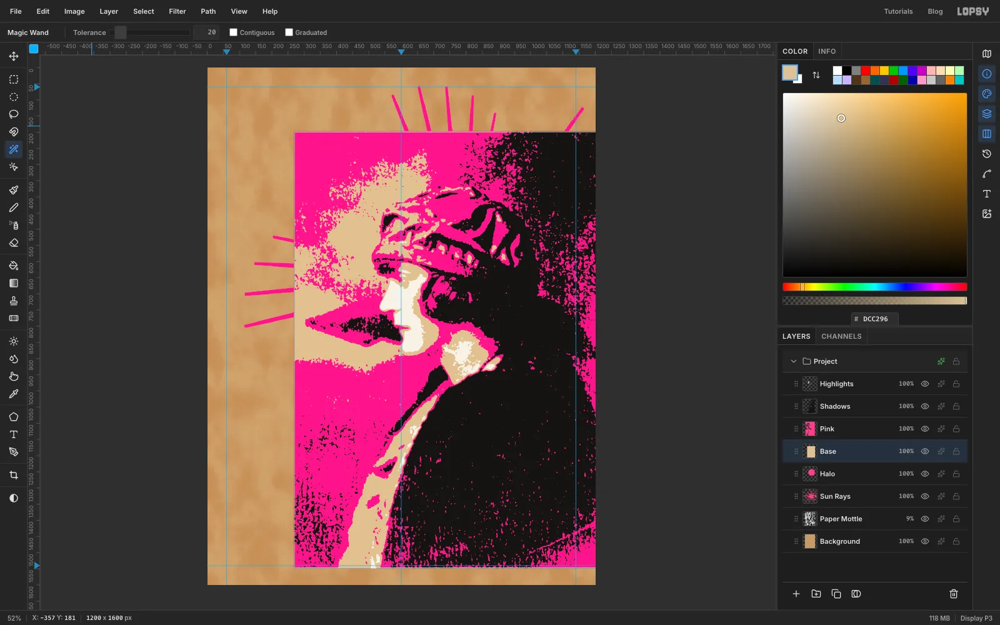

Each layer is still black or white. Give each one its ink:

1. Click the `Pink` row, then [[Cmd]]-click its thumbnail to select its pixels. Fill with `#FF3D8B` and press [[Cmd+D]]. The fill always goes to the active layer, so click the row first each time.
2. Do the same for `Shadows` with `#151311` and for `Highlights` with `#F7F2E8`.
3. Click `Portrait`, rename it `Base`, [[Cmd]]-click its thumbnail and fill it with cream `#DCC296`.

The whole photo rectangle is now a four-colour stencil, background and all. You'll cut out the figure next.

## Mask the figure in one go

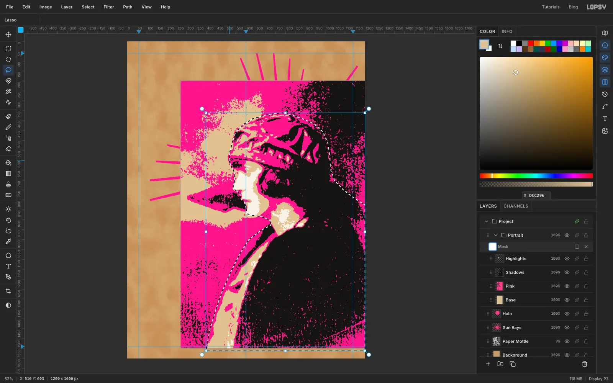

If you cut each layer separately, their soft edges stack up and leave a pale halo around the figure. A group mask cuts all four layers along one edge.

1. Click `Base`, then [[Shift]]-click `Highlights`, and choose **Layer → Group Layers**. Rename the group `Portrait`.
2. Click **Add Mask** at the bottom of the Layers panel, then click the mask's white thumbnail so you're editing the mask.
3. Pick the **Lasso** and trace around her. Start at the front of the turban (about 516, 603). Go up over the top of the turban (783, 360) and down the back of her head to the canvas's right edge at about y 833. Continue down the right edge, across the bottom of the canvas, and up the left edge of her fur collar to the corner of her jaw (726, 927). Then trace her chin (605, 870), lips, nose tip (535, 735) and forehead back to where you started.

Leave out the dark fan-shaped shadow in front of her mouth. As a stencil it would turn into a black blob.

## Fill outside the figure with black

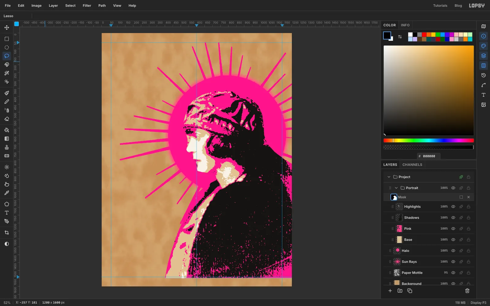

1. Choose **Select → Inverse**.
2. Set the foreground colour to pure black `#000000` and choose **Edit → Fill**. On a mask, black hides.
3. Press [[Cmd+D]].

Use pure black, not the ink colour. A near-black like `#151311` hides only 92%, and the photo would ghost through.

## Cut a ragged edge across the chest

A soft gradient fade looks digital. A spray stencil ends in a hard cut with a speckled edge, where paint misted past the card.

1. Still editing the mask, pick the **Rectangular Marquee** and drag from left of the canvas at y **1050** to past the bottom-right corner.
2. **Select → Feather…** `40`, then fill with black. The coat now fades out softly.
3. Press [[Cmd+D]], then drag a new marquee across the full width from y **980** to **1120**, covering just that soft band.
4. Run **Filter → Add Noise…** with **Amount** `100` and **Mono**, then **Filter → Threshold…** at `128`. Filters run on the mask, so the soft fade breaks up into hard speckles.
5. Press [[Cmd+D]] and click the `Halo` layer's name to leave mask editing.

## Mist the stencil's edges

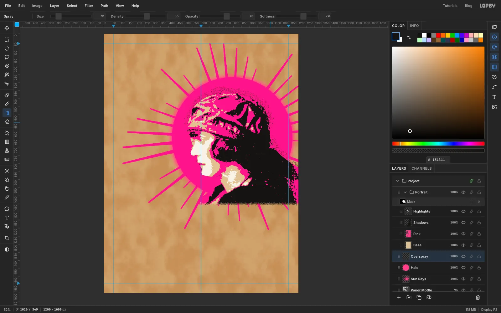

1. With `Halo` selected, click **Add Layer** and rename it `Overspray`. It sits above the halo and below the `Portrait` group, so the mask doesn't hide it.
2. Pick the **Spray** tool and set **Size** `70`, **Density** `55` and **Opacity** `70`. Set the foreground colour to `#151311`.
3. Drag in big, quick sweeps just outside the back of her head and coat, then over the top of the turban.

Small, slow drags only spray at the start, so move the mouse in long strokes.

## Draw one knife blade with the Pen

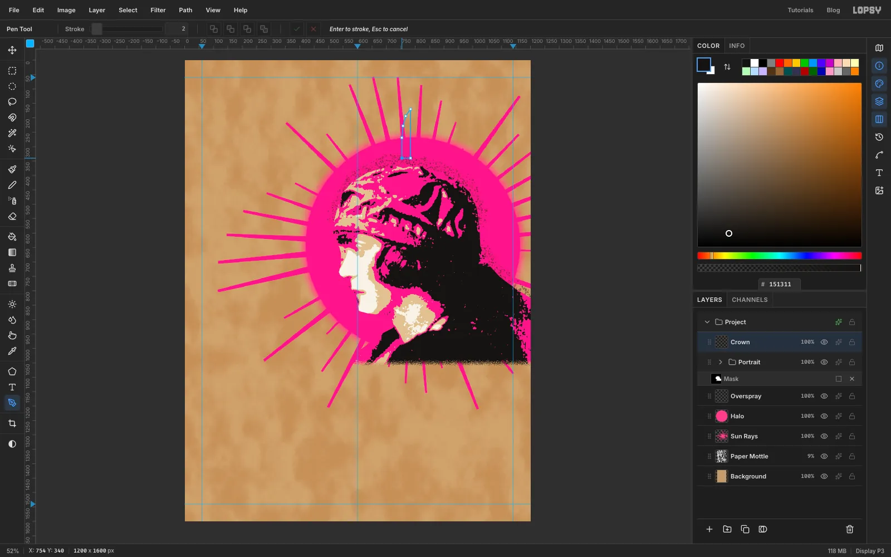

The crown is made of five blades. You draw one, then copy it.

1. Click the arrow on the `Portrait` group to collapse it, then click the group's row and click **Add Layer**. Rename the new layer `Crown`. It sits above the group.
2. Pick the **Pen** tool. Click these corners in order, then click the first one again to close the path: **754, 340** → **754, 269** → **758, 228** → **767, 194** → **784, 170** → **784, 340**.

The right side is the straight spine, and the left side curves up to the point like the edge of a craft-knife blade.

## Fill the blade and cut its bridges

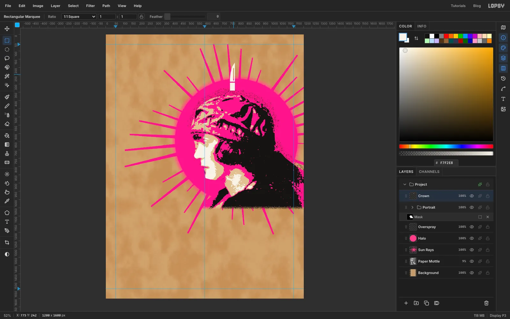

1. In the **Paths** panel, click **Path to Selection**, then **Delete Path**.
2. Fill with off-white `#F7F2E8` and press [[Cmd+D]].
3. Real stencils need bridges, thin strips that hold the cut-out pieces in place. Pick the **Rectangular Marquee**, **Select From** `750, 286` **To** `790, 292`, then press [[Delete]] and [[Cmd+D]]. That's a tie across the hilt.
4. **Select From** `773, 204` **To** `778, 279`, then press [[Delete]] and [[Cmd+D]]. That's a slot up the middle of the blade.

## Copy and shrink a blade

1. Draw a marquee around the blade with a couple of pixels to spare and press [[Cmd+C]], then [[Cmd+V]]. The copy pastes in place on a new layer above `Crown`, already selected, and Lopsy switches to the **Move** tool. Rename the layer `Blade R1`.
2. Hold [[Cmd]] and drag the bottom-right handle up and left until the status bar reads about **779, 313**. The blade is now about 84% of its size, roughly 143 px tall.
3. Press [[Cmd+D]].

## Fan the blade out

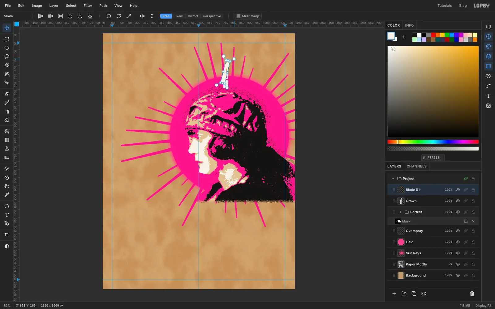

1. With the **Rectangular Marquee**, draw a marquee around `Blade R1` again. Switch to the **Move** tool, hold [[Cmd]] and drag the round rotation handle outside a corner one snap clockwise. That's 15°. Press [[Cmd+D]].
2. Drag the blade so the middle of its base sits at **832, 346**, just right of the first blade.

Now make the other three the same way. Each time, click `Crown`, draw a marquee around its blade, press [[Cmd+C]] and [[Cmd+V]], rename the copy, then shrink it, turn it and move it:

- `Blade L1`: shrink to about 84%, turn one snap anticlockwise, base at **708, 346**
- `Blade R2`: shrink to about 66% (corner at about 775, 285), turn two snaps (30°) clockwise, base at **892, 346**
- `Blade L2`: shrink to about 66%, turn two snaps anticlockwise, base at **648, 346**

## Check the fan of blades

The blades should spread like the points of a crown, with their bases along y 346, the tallest in the middle and the shortest at the ends. If one is off, click its layer and nudge it with the arrow keys before you merge them.

## Add the crown band

1. Click `Blade L2`, add a layer and name it `Band`.
2. Pick the **Rectangular Marquee**, **Select From** `628, 342` **To** `912, 386`, fill with `#F7F2E8` and press [[Cmd+D]].
3. Set the foreground to pink. With the **Elliptical Marquee**, **Select From** `689, 353` **To** `711, 375` and choose **Edit → Fill**, then press [[Cmd+D]]. Do the same for `759, 353` to `781, 375` and `829, 353` to `851, 375`.
4. Switch back to the **Rectangular Marquee** to cut two ties. **Select From** `733, 342` **To** `737, 386` and press [[Delete]] and [[Cmd+D]], then do the same from `803, 342` to `807, 386`.

## Merge and tilt the crown

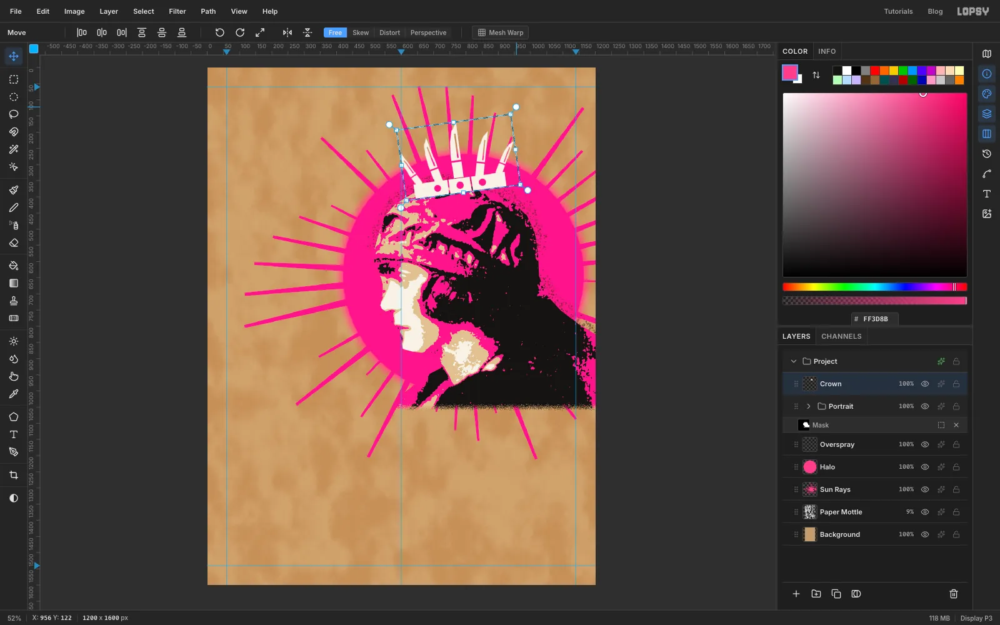

1. Click `Blade R1`, the top blade layer. Choose **Layer → Merge Down** five times, until everything is merged into `Crown`.
2. Draw a marquee around the whole crown. With the **Move** tool, drag the rotation handle anticlockwise without [[Cmd]], about half of one 15° snap, until the band runs parallel to the top of the turban. The turban tilts down to the left, so the crown should too. Press [[Cmd+D]].

## Seat the crown and give it a stencil shadow

1. Drag the crown about **44 px down** and **4 px left**, so the band overlaps the top of the turban instead of floating above it.
2. Open the crown's layer effects, enable **Drop Shadow** and set the colour to `#151311`, **Offset X** `7`, **Offset Y** `7`, **Blur** `0`, **Spread** `0` and **Opacity** `100`.

With no blur, the shadow looks like a second sprayed colour, a little off register.

## Snap the top banner to the guides

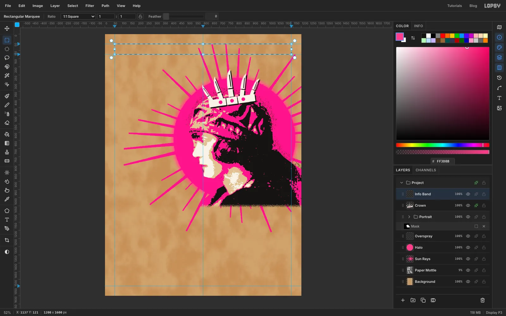

1. Click `Crown`, add a layer and name it `Info Band`.
2. Click the left ruler at **124** for one more horizontal guide.
3. With the **Rectangular Marquee**, drag from just inside the top-left guide crossing (60, 60) to just inside 1140, 124. The marquee snaps to the guides. Click the **Info** tab: the selection should read 1080 × 64.
4. Fill with `#151311` and press [[Cmd+D]].

## Fray the banner's ends

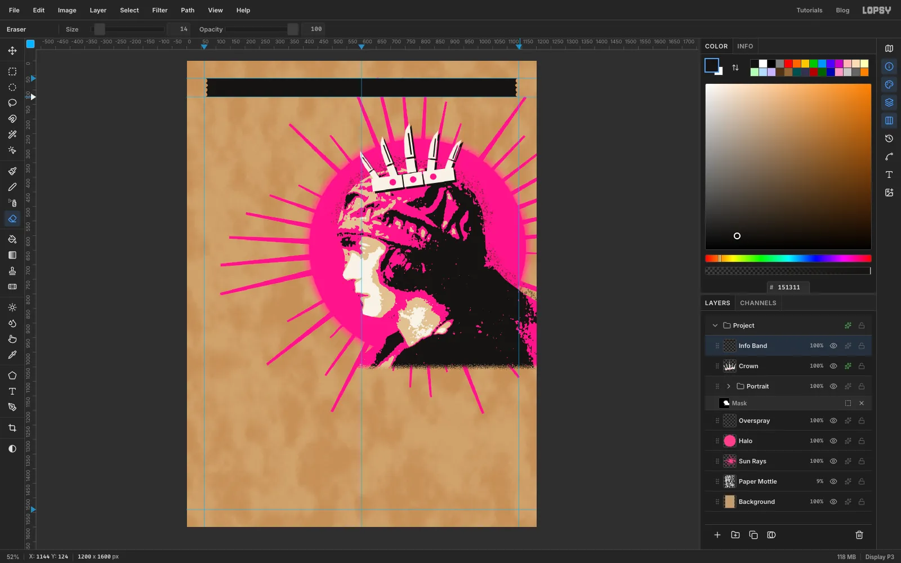

Pick the **Eraser**, set **Size** to `14`, and drag a short zigzag down each end of the banner. Small bites out of the corners make it look like a strip of tape sprayed through a worn stencil.

## Set the headline

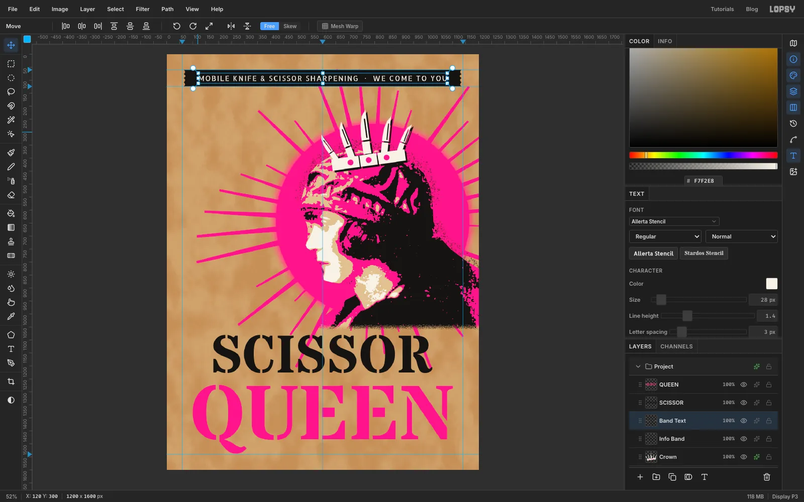

Make the bottom line first, so you never click inside an existing text box.

1. Click `Info Band` so the text lands above it. Pick the **Text** tool and choose **Stardos Stencil**, weight **Bold**, size **296**, colour pink `#FF3D8B`. Click in an empty area, type `QUEEN` and press [[Tab]]. The layer is named after its text, `QUEEN`.
2. Click `Info Band` again. Set **Stardos Stencil Bold**, size **204**, colour `#151311`, click in an empty area above QUEEN and type `SCISSOR`, then [[Tab]].
3. With the **Move** tool and the arrow keys, centre both words. SCISSOR's letters should run from about x 180 to 1021, with their tops at **1080**. QUEEN's should run from about 100 to 1100, with their tops at **1272**, which leaves a 46 px gap between the lines.
4. Click `Info Band` once more. In **Allerta Stencil**, size **28**, letter spacing **3**, colour `#F7F2E8`, type `MOBILE KNIFE & SCISSOR SHARPENING · WE COME TO YOU` and centre it in the banner. The letters should run from about x 124 to 1076 and y 82 to 102. Rename this layer `Band Text`.

## Knock QUEEN off register

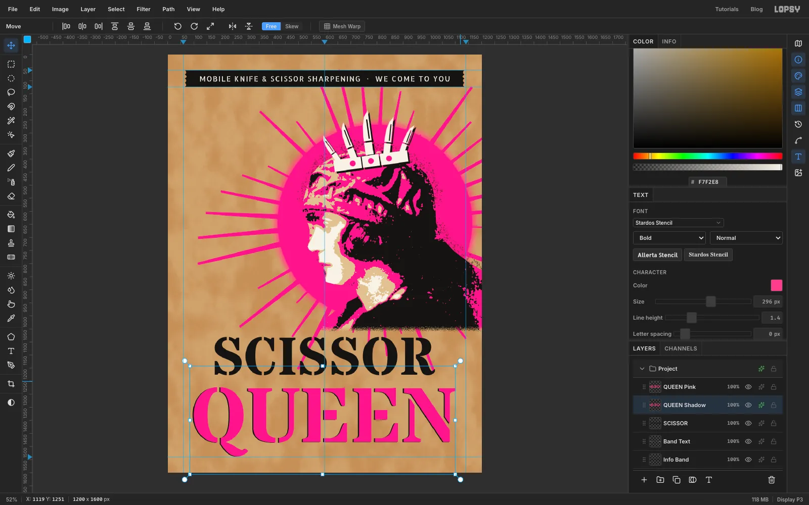

Two-colour stencils never line up perfectly. Fake a black pass that slipped.

1. Click `QUEEN` and choose **Layer → Duplicate Layer**. The copy lands exactly on top. Rename it `QUEEN Pink`.
2. Click the original `QUEEN` and rename it `QUEEN Shadow`. Open its effects, enable **Color Overlay** and set it to `#151311`.
3. With the **Move** tool, nudge it **6 px left** and **4 px up** with the arrow keys.
4. Press [[Cmd+D]] so nothing is selected. With the **Move** tool, drag its corner rotation handle clockwise by a hair, until the black shows about 5 px more at the right end of the word than at the left. That's well under 1°.

The tiny rotation makes the black peek out by different amounts along the word, so it reads as a slipped stencil rather than a drop shadow.

## Drip the pink

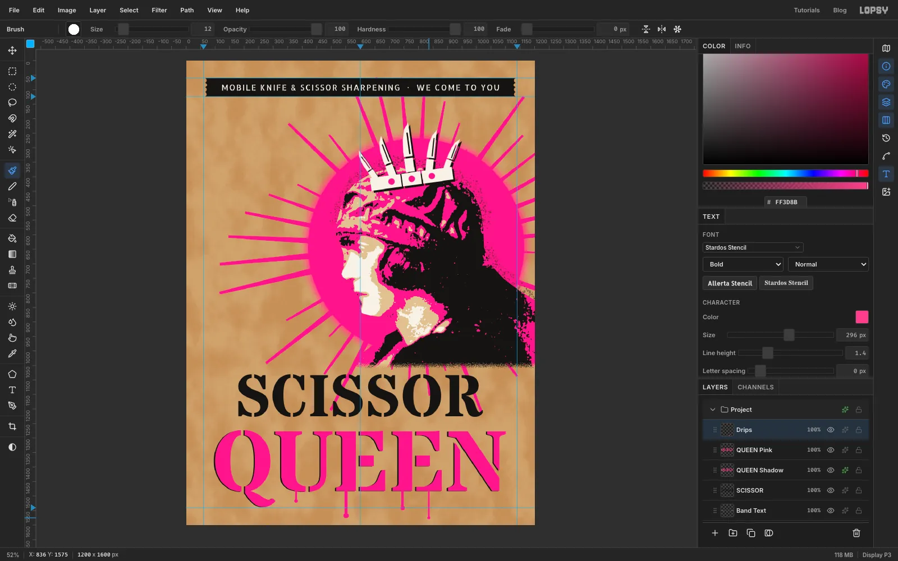

1. Click `QUEEN Pink`, add a layer and name it `Drips`.
2. Set the foreground colour to pink `#FF3D8B`. Pick the **Brush** and set **Hardness** to `100` in the options bar. Open the brush settings with the brush preview at the left of the options bar and check that **Spacing** is `10`.
3. For each drip, click just inside a flat letter foot on the baseline (about y 1460), then [[Shift]]-click straight below it to draw the run. Then raise the size and click once at the bottom for the round blob a real drip leaves:
   - x **379**: size **8**, 34 px long, blob size 14
   - x **551**: size **12**, 84 px long, blob size 20
   - x **745**: size **10**, 58 px long, blob size 17
   - x **836**: size **7**, 92 px long, blob size 12

Keep every drip above about y 1560, so nothing runs off the page.

## Set the phone number and services

Work up the left column from the bottom.

1. Click `Crown`, add a layer and name it `Services Anchor`. Click this layer before each new piece of text, so the type never restyles an earlier text layer.
2. Pick the **Text** tool. In **Allerta Stencil** size **22**, letter spacing **2**, colour `#151311`, click in empty space at the lower left and type `TUES-SAT · CALL OR TEXT`, then [[Tab]]. With the **Move** tool and the arrow keys, nudge it so its letters start at **70, 942**.
3. Click `Services Anchor`. In **Black Ops One** size **64**, colour `#151311`, type `555-0142` and nudge it to **70, 876**. Duplicate it and rename the copy `Phone Black`. Rename the original `Phone Pink`, give it a pink **Color Overlay**, and nudge it **6 px right** and **4 px down**. The ink slips the same way here as on the headline: pink sits down and right of black.
4. In **Allerta Stencil** size **34**, colour `#151311`, type each service on its own layer, from the bottom up, and nudge its letters to start at x **100**: `CHISELS & AXES` at y **766**, `SEWING SCISSORS` at **718**, `GARDEN PRUNERS` at **670**, `SALON SHEARS` at **622** and `KITCHEN KNIVES` at **574**.
5. In **Black Ops One** size **44**, type `WE SHARPEN` and nudge it to **70, 504**.
6. Rename `Services Anchor` to `Bullets`. With the **Lasso**, drag a small wedge pointing right, about 18 px long, just left of each service (from x 70). Hold [[Shift]] for every wedge after the first, to add it to the selection.

## Fill the bullets and rule the heading

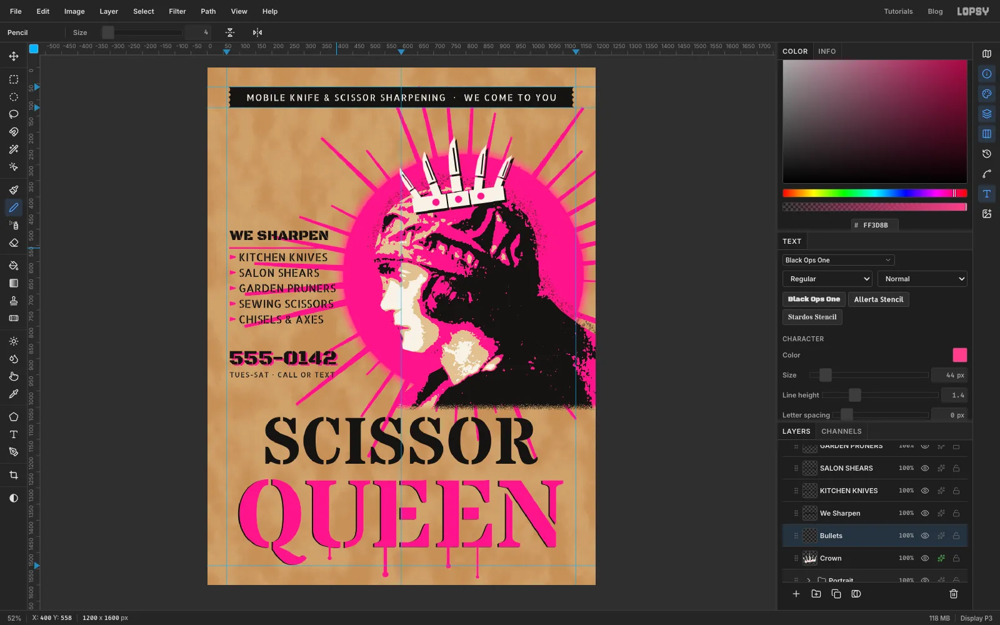

1. Fill the wedges with pink and press [[Cmd+D]].
2. Pick the **Pencil**, set **Size** to `4`, click at **70, 558**, then [[Shift]]-click at **400, 558**. That draws a straight rule under the heading.

## Build the price badge

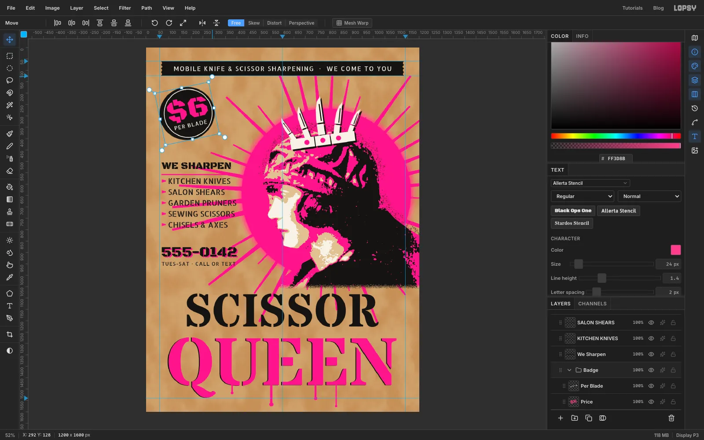

1. Click `Bullets`, add a layer and name it `Badge Disc`.
2. With the **Elliptical Marquee**, **Select From** `70, 174` **To** `302, 406`, fill with `#151311` and press [[Cmd+D]]. Its left edge lines up with the text below it.
3. **Select From** `79, 183` **To** `293, 397`, fill with `#F7F2E8`, then choose **Select → Shrink…** `3` and fill with `#151311`. That leaves a thin off-white ring. Press [[Cmd+D]].
4. Click `Badge Disc`. With the **Text** tool in **Allerta Stencil** size **24**, letter spacing **2**, colour `#F7F2E8`, type `PER BLADE`, rename the layer `Per Blade`, and nudge it so it's centred on x 186 with its top at y 334. Click `Badge Disc` again, type `$6` in **Black Ops One** size **128**, pink, rename it `Price`, and centre it on x 186 with its top at 220.
5. Click `Per Blade` and [[Shift]]-click `Badge Disc`, then choose **Layer → Group Layers** and name the group `Badge`.
6. Press [[Cmd+D]]. With the group selected and the **Move** tool, a box frames the whole badge. Drag its rotation handle anticlockwise, a little less than one 15° snap. The type turns with the disc and stays editable.

## Clear the rays from the type

1. Click `Sun Rays`. With the **Rectangular Marquee**, drag from left of the canvas at y **1000** to past the bottom-right corner, then **Select → Feather…** `50` and press [[Delete]].
2. Press [[Cmd+D]]. Drag another marquee from left of the canvas at y **440** to **440, 1060**, feather it `30` and press [[Delete]]. Press [[Cmd+D]].

The rays now stop short of the headline and leave the services list clean, but still fan out around the head and the badge.

## Fold the flier

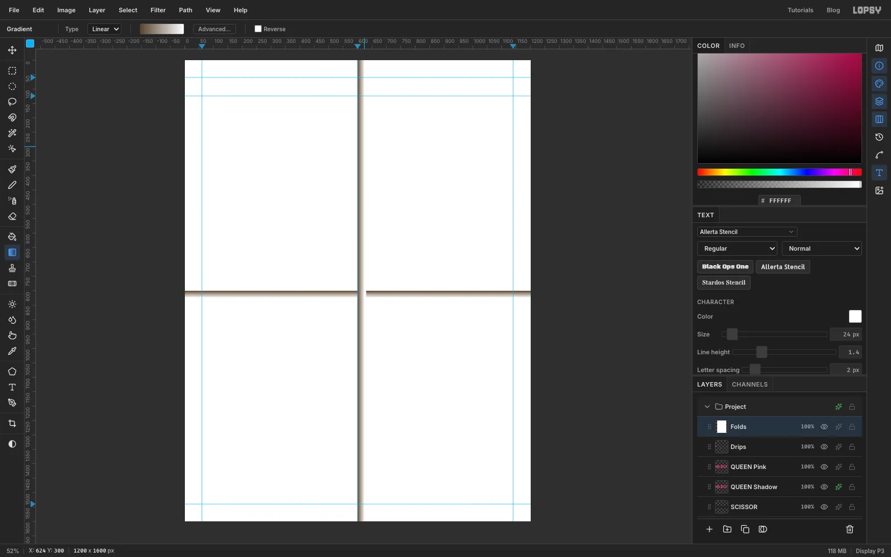

A flier that's been folded into quarters for a pocket has a soft shadow on one side of each crease and a bright edge on the other.

1. Click `Drips`, add a layer and name it `Folds`. Fill it with white.
2. Pick the **Rectangular Marquee** and **Select From** `0, 800` **To** `1200, 830`. Pick the **Gradient** tool, set **Type** to **Linear**, click **Advanced…** and set the stops to `#5A4630` and `#FFFFFF`. Drag from **600, 800** down to **600, 824**.
3. Press [[Cmd+D]]. With the **Rectangular Marquee**, **Select From** `600, 0` **To** `630, 1600`. Switch back to the **Gradient** tool and drag from **600, 300** to **624, 300**. Press [[Cmd+D]]. Where the two folds cross, the vertical shadow paints over the horizontal one.
4. Set the layer to **Multiply** at **70%**. White disappears in Multiply, so only the shadows show.
5. Add a layer named `Fold Light`. With the **Pencil** at size **3** in white, click **0, 798** and [[Shift]]-click **1199, 798**, then click **598, 0** and [[Shift]]-click **598, 1599**. Set it to **Screen** at **60%**.

## Add grain and paper dropout

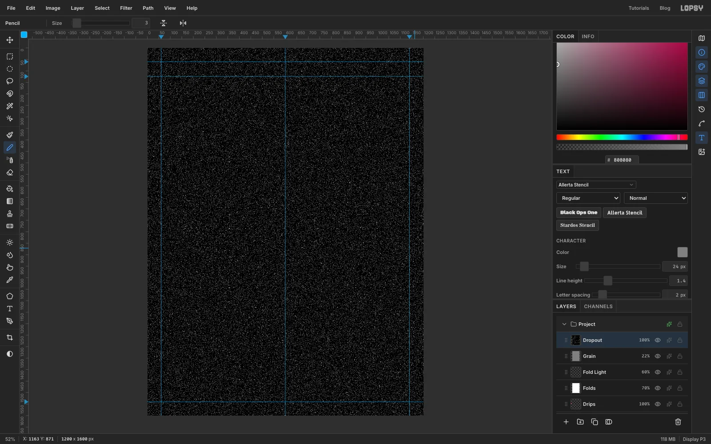

Real spray paint never covers perfectly. Tiny gaps let the paper show through.

1. Add a layer named `Grain`, fill it with `#808080`, run **Add Noise** at `28` **Mono**, and set it to **Overlay** at **22%**.
2. Add a layer named `Dropout` and fill it with `#808080`. Run **Add Noise** at `100` **Mono**, then **Threshold** at `172`. Only about 4% of the pixels come out white.

## Let the paper show through

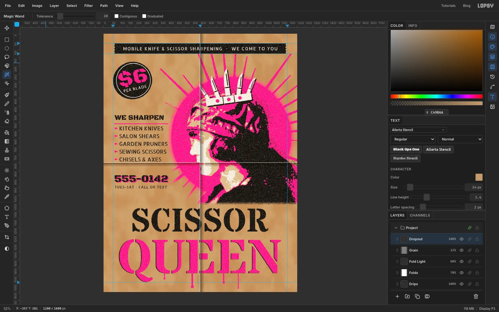

1. Pick the **Magic Wand** (Tolerance `20`, **Contiguous** off) and click a black area of `Dropout`. Press [[Delete]], then [[Cmd+D]].
2. [[Cmd]]-click the `Dropout` thumbnail and fill the specks with the paper colour `#C49B6A`. Press [[Cmd+D]].

Kraft-coloured specks disappear on the paper itself but break up every ink above it, like paint that didn't quite cover. Save the project with **File → Save Project** and export it with **File → Quick Export PNG**.
