Film art departments sell a moment with a **key frame**: one painted still
that fixes the light, the palette and the story beat before anything is
built. It's presented letterboxed at the film's aspect ratio, with a slate
line in the bars so everyone knows which shot it is.

In this tutorial you'll paint **Brass Yacht**, key frame 12 of an imaginary
steampunk film. A brass-hulled sky yacht casts off from a docking gantry
and climbs out of Coalhaven, a smog-bound industrial city, at sunset. The
canvas is 1920 × 1080, with 2.39 : 1 bars at the top and bottom.

Nothing here is a photo. The sky, clouds and smog come from Lopsy's
**Clouds**, **Smoke** and **Sunburst** filters, faded with layer masks. The
city is built from Shift-added marquees and Pencil lines. The yacht is drawn
with marquees, the Lasso and the **Pen** tool, then lit as a *backlit*
object, because the sun is behind it. You'll tilt the whole yacht as a
group, duplicate it into a hazy escort, and finish with a **Color Grading**
pass and the slate type.

The airship design was sketched from Albert Robida's *Cures d'air dans la
montagne* (about 1883), a public-domain drawing on Wikimedia Commons, kept
open in the **Reference** drawer. Any old airship illustration will do.
There are about 60 layers, so name each one as you make it.

The palette:

- Sky `#0F2433` → `#2C5560` → `#B8622C` → `#F0AE55`
- Sun `#FFE7B0`, sun glow `#FFE2A0` / `#B5531F`, rays `#FFD9A0`
- Cloud shade `#3E5A60`, cloud light `#E39A52`, rim `#F6B46A`
- Far city `#4E4448` → `#D2925E`, near city `#26191A`, roofs `#2A2230`
- Window light `#FFC46A`, glow `#FF9A3A`
- Brass `#F6C870` → `#D08A30` → `#5A3010`, copper `#9E4E2A`
- Envelope `#F2C27A` → `#B98A4E` → `#5E4C3A` → `#262A30`
- Gantry ink `#140E0C`, letterbox `#050404`
- Title brass `#FFE6A0` → `#D29A45` → `#7A4E1E`, slate type `#D8C7A2` / `#B39C76`

## Set up the canvas, guides and reference

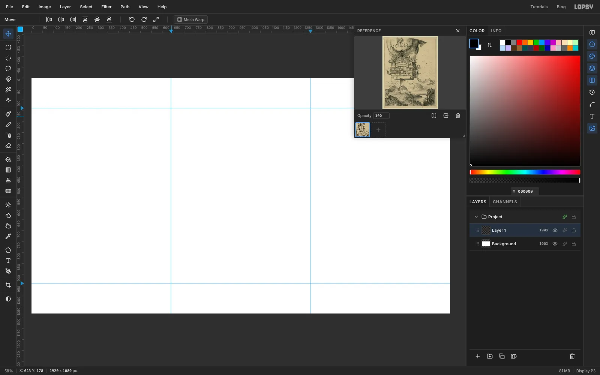

Choose **File → New**, make a **1920 × 1080** document and click **Create**.

Click the left ruler at **138** and **942** to drop horizontal guides. These
are the edges of the 2.39 : 1 picture; everything outside them will become
black bars. Click the top ruler at **640** and **1280** for vertical
guides on the thirds. You'll be drawing many selections near these lines,
so open **View** and untick **Snap to Guides**.

Open the **Reference** drawer from the panel toolbar on the right and drop
in your airship drawing. Glance at it for the shape of the envelope, the
balustraded gondola and the tail fins, then close the drawer.

## Paint the sunset sky

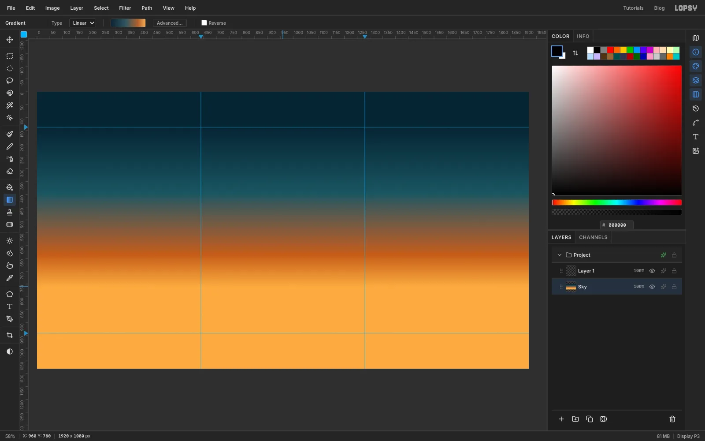

Rename **Background** to **Sky**. Pick the **Gradient** tool (it has no
shortcut), set **Type** to **Linear**, and open **Advanced…**. Make four
stops: `#0F2433` at the left, `#2C5560` at about 42%, `#B8622C` at 80% and
`#F0AE55` at the right. Click **Done**.

Drag straight down from the top guide to about **y 760**. Hold [[Shift]]
if your hand isn't steady. Everything below 760 stays amber, which is fine
because the city will cover it.

## Add the sun's glow on Screen

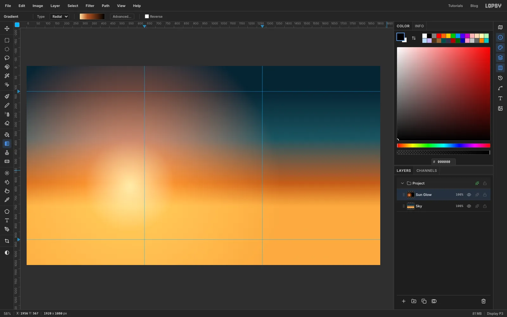

The sun sits low on the left third, at about **(560, 648)**, just behind
where the clouds will be.

Rename **Layer 1** to **Sun Glow**. Switch the gradient to **Radial**,
open **Advanced…**, and set three stops: `#FFE2A0`, `#B5531F` at 30%, and
pure black `#000000`. Drag from the sun point about 820 px to the right.

Open the layer's effects drawer and set the blend mode to **Screen**. On
Screen, black does nothing, so only the warm centre shows. That's why the
outer stop is black.

## Place the sun, its bloom and the rays

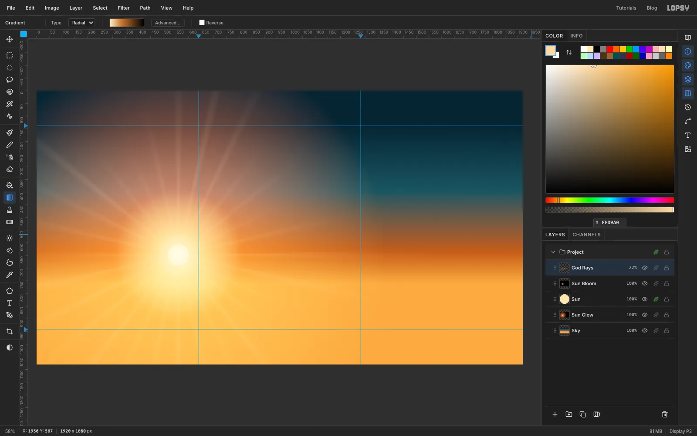

Add a layer called **Sun**. Pick the **Elliptical Marquee**. With nothing
selected, click once on the canvas without dragging to open the selection
dialog, and enter From **518, 606** To **602, 690**. That's an 84 px
circle. Set the foreground to `#FFE7B0` and choose **Edit → Fill**. Press
[[Cmd+D]] to deselect. In the effects drawer, add an **Outer Glow**: Size
**120**, Spread **0**, Opacity **85**, colour `#FFB45C`.

Add a layer called **Sun Bloom**. Draw a radial gradient from the sun
outward about 260 px, using `#FFF1C8`, `#C8742E` at 35% and `#000000`, and
set it to **Screen**.

Add a layer called **God Rays** and set the foreground to `#FFD9A0`.
Choose **Filter → Sunburst…** and enter **Rays 28**, **Length 80**,
**Width 20**, **Taper 0**, **Fade 100**, **Softness 60**, **Center X 29**,
**Center Y 60**, **Jitter 60**, **Seed 7** and **Opacity 60**. Center X
and Y are percentages of the canvas, so 29 / 60 puts the burst on the sun.
Apply it.

Then run **Filter → Gaussian Blur…** at **8**. Set the layer to **Screen**
and drop its opacity to **22%**.

## Streak in high cirrus and fade it with a mask

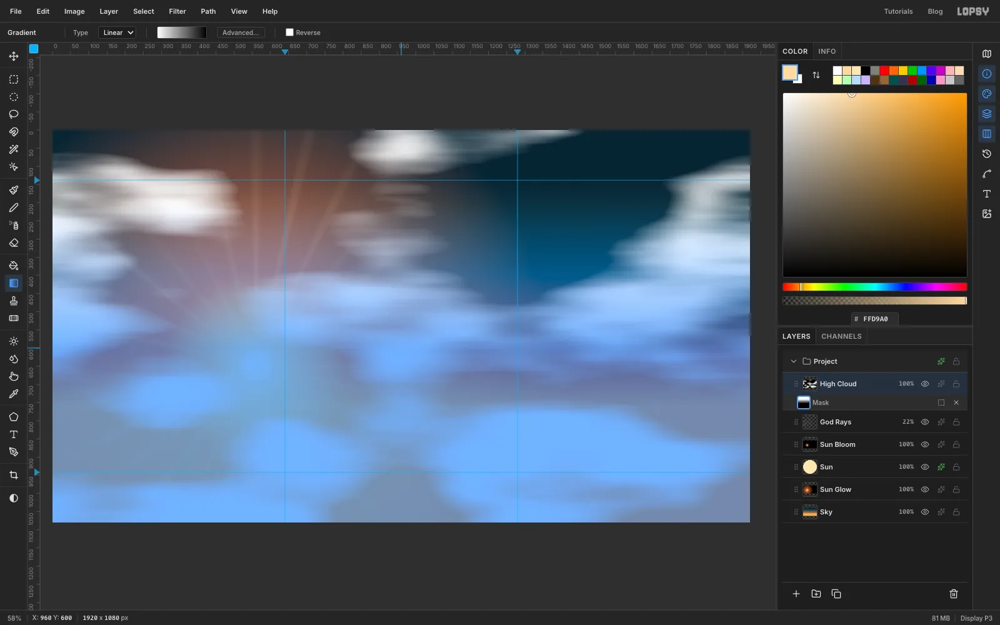

Add a layer called **High Cloud** and apply three filters in a row:

1. **Filter → Clouds…**, Scale **6**.
2. **Filter → Motion Blur…**, Angle **0**, Distance **140**. This
   stretches the puffs into wind-blown streaks.
3. **Filter → Brightness/Contrast…**, Brightness **−35**, Contrast **70**,
   so only the brightest wisps survive.

Set the layer to **Screen**.

Click **Add Mask** at the bottom of the Layers panel, then click the new
mask thumbnail to edit it. With a linear white-to-black gradient, drag
from **y 200** down to **y 600**. The streaks now stay in the upper sky.
Click the layer's name to leave mask editing, then set its opacity to
**45%**.

## Build the cloud bank from ellipses

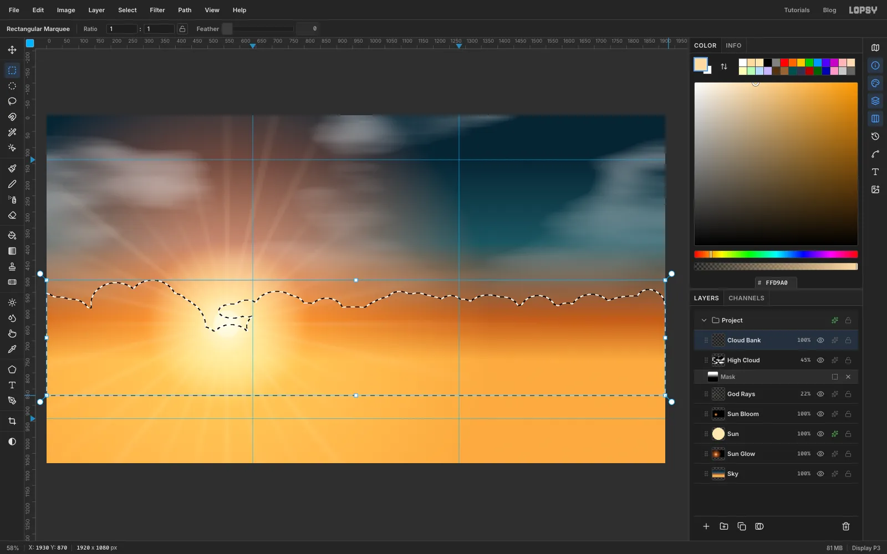

Add a layer called **Cloud Bank**. With the **Elliptical Marquee**, drag one
big ellipse along the horizon, about 250–400 px wide and 100–200 px tall,
centred near **y 670**. Then hold [[Shift]] *before* you press, and drag
more overlapping ellipses across the whole width. [[Shift]] adds to the
selection.

- Put two smaller billows (70–160 px across) on top of each big one, so
  the top edge isn't a row of identical scallops.
- Leave a dip under the sun so the disc sits in a valley.
- Add three small, flat puffs just over the sun's top edge.
- Finish with a Shift-dragged rectangle from the left edge to the right
  edge, between **y 670** and **870**, to close the bottom.

> **Tip:** Start each drag on the canvas. A press over the ruler drags out a
> new guide instead of a selection.

## Fill the bank and warm its tops

Set the foreground to `#3E5A60` and **Edit → Fill**. Keep the selection.

Pick the **Brush** (B). Open the brush settings and set **Size 260**,
**Hardness 0**, **Spacing 8**, **Opacity 25** and **Taper 0**. Set the
foreground to `#E39A52`. Paint short horizontal strokes across the tops of
the big billows within about 700 px of the sun. The live selection keeps
the paint inside the clouds. Press [[Cmd+D]].

## Give the clouds a rim light near the sun

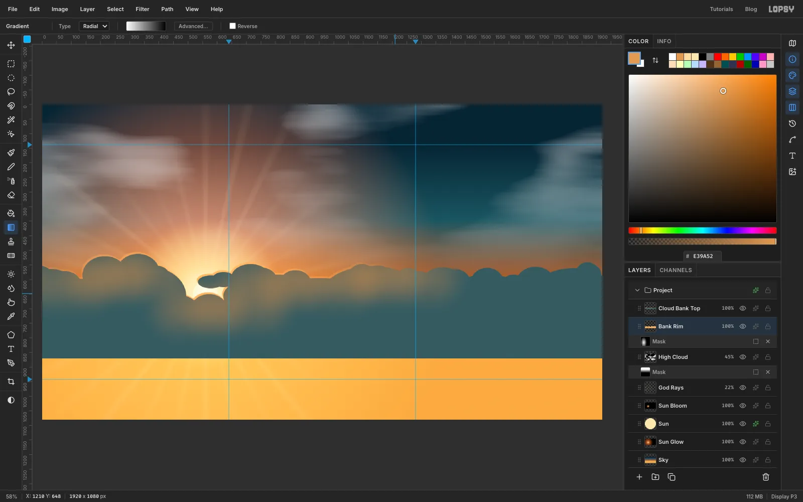

The rim is a lighter copy of the bank peeking out from behind it.

1. Choose **Layer → Duplicate Layer**. Rename the copy (the top one)
   **Cloud Bank Top** for now, so the two names don't clash, and rename
   the original below it **Bank Rim**.
2. Select **Bank Rim**. Add a **Color Overlay** in `#F6B46A`, then click
   **Rasterize Layer Style** so the colour becomes real pixels.
3. Pick the **Move** tool (V). Press [[Left]] four times and [[Up]] six
   times. Those nudges push the rim toward the sun.
4. Run **Gaussian Blur** at **2**.
5. Click **Add Mask**, then the mask thumbnail. Drag a radial
   white-to-black gradient from the sun about 650 px out, so the rim only
   catches light near the sun. Click the layer name to leave the mask.

Rename **Cloud Bank Top** back to **Cloud Bank**.

## Texture and smudge the bank

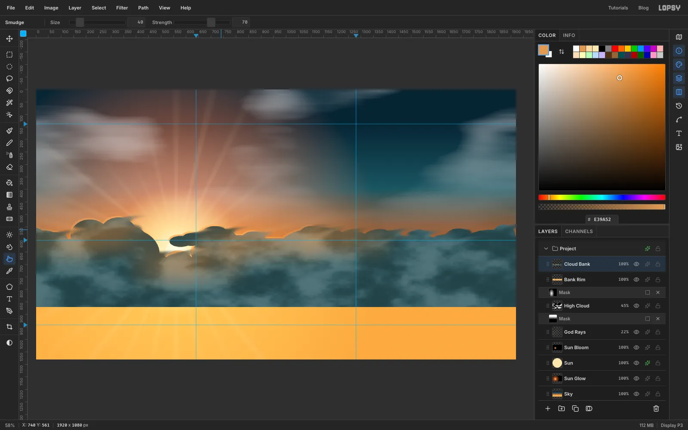

[[Cmd]]-click the **Cloud Bank** thumbnail to select its shape. Add a
layer called **Bank Texture** and run **Filter → Clouds…** at Scale
**14**. It only fills the selection. Deselect, set the layer to **Soft
Light** at **40%**, and choose **Layer → Merge Down** to bake it into the
bank.

Now pick the **Smudge** tool (R) with **Size 40** and **Strength 70**.
From just inside the top of a billow, drag up and to the right, about
130 px. The wind blows that way, so the wisps all lean the same direction.
Do it on every second billow.

## Block in the far city

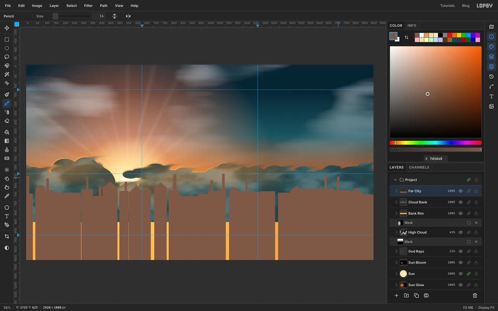

Add a layer called **Far City**. With the **Rectangular Marquee**, drag one
block from the horizon line at about **y 742** down past the bottom of the
canvas. Then Shift-drag more blocks along the whole width: 40–110 px wide,
rising 12–60 px above the line, overlapping or with small gaps. Shift-drag a
few ellipses for domes on the wider blocks. Fill with `#7A5A48` and
deselect.

For pitched roofs, use the **Lasso** (L) to draw a triangle over a block
and **Edit → Fill** it. Repeat on a few blocks.

For chimneys, pick the **Pencil** (N) at Size **10–18**. Click on a roof,
then [[Shift]]-click 40–110 px straight above it. Shift-click draws a
straight line, and the Pencil's square tip gives a flat-topped stack.

## Fade the far city into haze

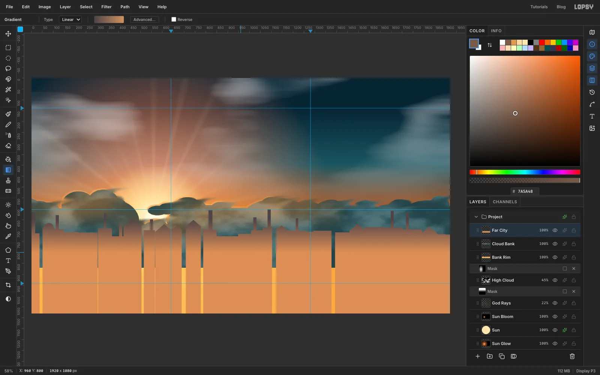

Distance should look like haze. [[Cmd]]-click the **Far City** thumbnail.
Pick the **Gradient** tool, set **Linear** with `#4E4448` at the left and
`#D2925E` at the right, and drag from **y 650** down to **y 800**. The
rooftops stay dark against the sky, and the bases dissolve into warm smog.
Deselect.

## Roll in the smog

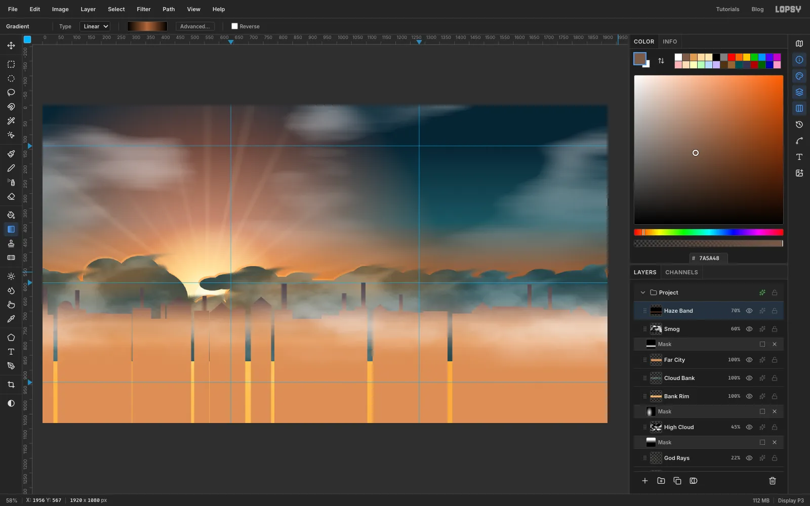

Add a layer called **Smog**. Run **Filter → Smoke…** with Scale **5** and
Turbulence **65**. Set it to **Screen**.

Click **Add Mask**, then the mask thumbnail. Make a three-stop gradient
(black, white at 55%, black) and drag it from **y 600** to **y 900**. That
keeps the smoke in a band across the city. Leave the mask and set the
layer to **60%**.

Add a layer called **Haze Band**. Drag a **Linear** gradient with the same
three-stop shape, this time `#000000`, `#B4683A` at 50%, `#000000`, from **y 660** to **y 830**. Set it to
**Screen** at **70%**.

## Build the near city and the clock tower

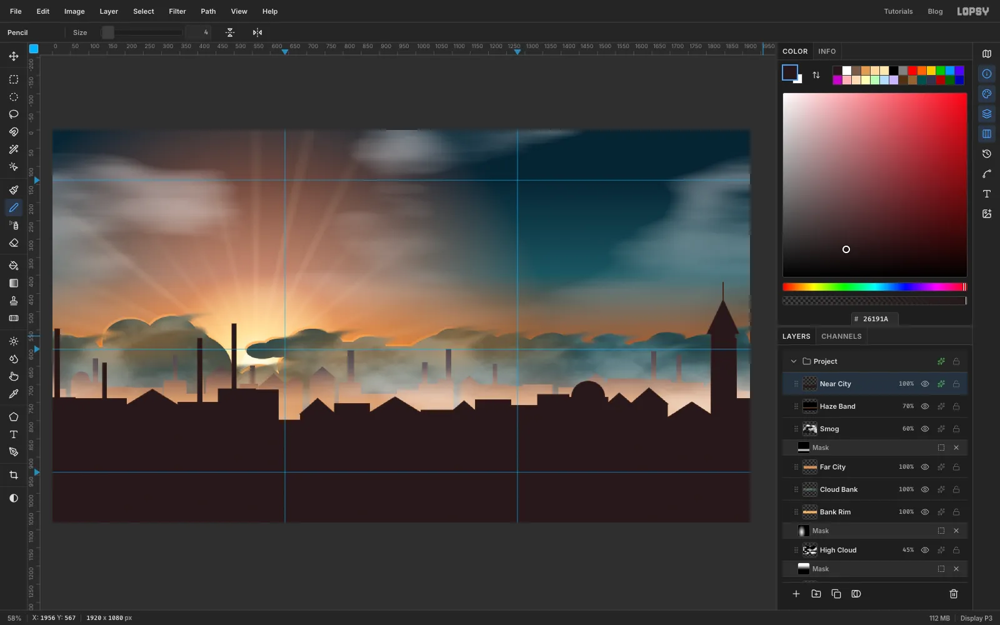

Add a layer called **Near City** and repeat the skyline method a little
closer to us. Drag the first block from **y 820** down past the bottom of
the canvas, as before. The blocks are 60–150 px wide and rise up to 110 px
above that line, with no gaps between them. Add a few gables and
one dome. Fill with `#26191A`.

Chimneys are 90–220 px tall here, but keep the ones under where the yacht
will fly (x 940–1680) shorter than 60 px.

For the clock tower, draw a rectangle from **(1812, 560)** to **(1880,
830)** and fill it. Lasso a spire triangle on top (base 1800–1892, point at
y 464) and fill that. Then Pencil a 4 px line straight up to **y 420**.

Give **Near City** an **Inner Glow** in `#E0884A`, Size **4**, Opacity
**55**. Every edge now has a thin warm rim, as if the sunset is behind the
rooftops.

On a **Clock Face** layer, fill a 48 px circle centred at **(1846, 610)**
with `#C98E4E`. Pencil two hands at Size 3 in `#26191A`. Add a small
**Outer Glow** (Size 12, Opacity 50, `#D9802E`). Keep it dim: it mustn't
compete with the sun.

## Light the windows

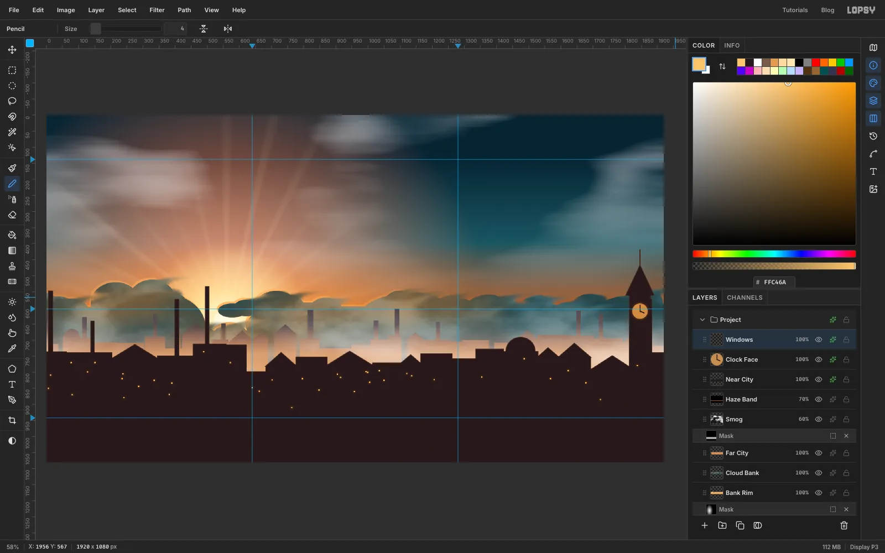

Add a layer called **Windows**. Pick the **Pencil** at Size **4** with
`#FFC46A`, and click a few dozen single pixels on the building faces. Skip
some floors, and cluster a few windows together. Give the layer an **Outer
Glow**: Size **10**, Opacity **60**, `#FF9A3A`.

## Paint the chimney smoke

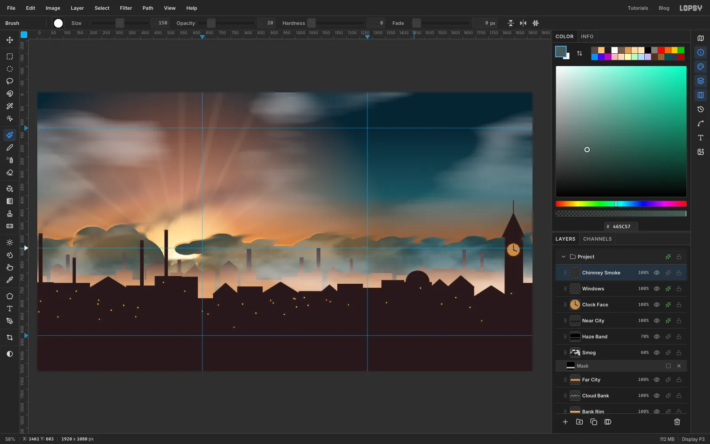

Add a layer called **Chimney Smoke** and set the foreground to `#5C4846`.
Every plume is a few soft strokes that get wider as they rise. On the
**Brush**, set **Hardness 0** and **Opacity 20**, then:

1. At Size **30**, draw a short stroke up from each chimney top.
2. At Size **60**, continue each one higher, curving to the right.
3. At Sizes **100** and **150**, continue again.

Each stroke should overlap the end of the one before. Then run **Gaussian
Blur** at **10**. Single dabs come out as a dotted line, so use strokes.

## Draw the docking gantry

Add a layer called **Gantry**, set the foreground to `#140E0C` and pick the
**Pencil**. All of this is click, then [[Shift]]-click.

- At Size **16**, draw two uprights at **x 36** and **x 150**, from above
  the top guide to below the bottom one.
- At Size **6**, add a rung every 90 px between them, with an X of
  diagonals in each bay.
- For the crane arm, draw a top chord at Size **10** from the right upright
  to **x 430** at **y 360**. Draw a lower chord at **y 392** that stops 30
  px short.
- At Size **4**, zigzag a web between the two chords every 40 px. Add a
  stay from the upright at **y 250** to the arm's tip, and a hanger from
  the tip down to **y 440**.

On a **Gantry Lamp** layer, fill a small ellipse (From **408, 440** To
**432, 470**) with `#FFD48A`. Add an **Outer Glow**: Size **40**, Spread
**5**, Opacity **80**, `#FF9A3A`.

## Start the yacht: fins and envelope

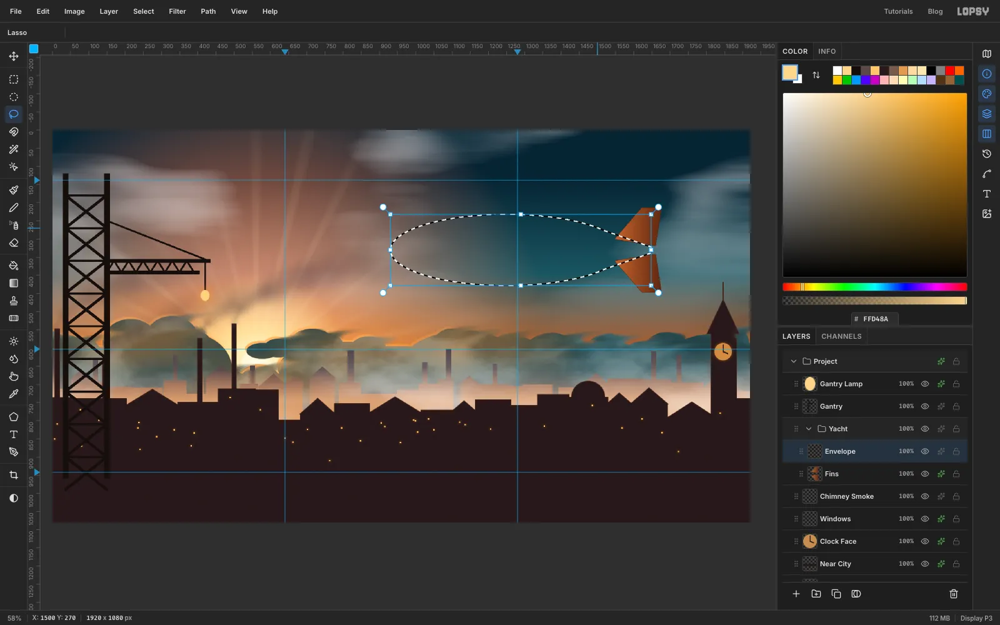

Select **Chimney Smoke** and click **New Group** in the Layers panel.
Rename the group **Yacht**. New layers now go inside it, stacked above the
active one.

Add a layer called **Fins**. The envelope will run from x 930 to a tail
point at **(1648, 330)**, so the fins sit on its last 100 px. With the
**Lasso**, draw the top fin as a four-sided shape: from the tail's top
edge at **(1548, 300)** sweep up and back to **(1622, 214)**, across to
**(1676, 214)**, and down to **(1660, 318)**. Hold [[Shift]] and draw the
bottom fin as its mirror below **y 330** (down to y 446). Fill both with a linear gradient from `#B8693A`
(left) to `#5A2A16` (right), dragged across the fins. Deselect and add a
**Stroke**: Width **1**, `#4A2616`.

Add a layer called **Envelope**. Make an elliptical selection from **(930,
232)** to **(1570, 428)**. Then hold [[Shift]] and lasso a tail cone from
about **x 1500** out to a point at **(1648, 330)**.

## Shade the envelope for backlight

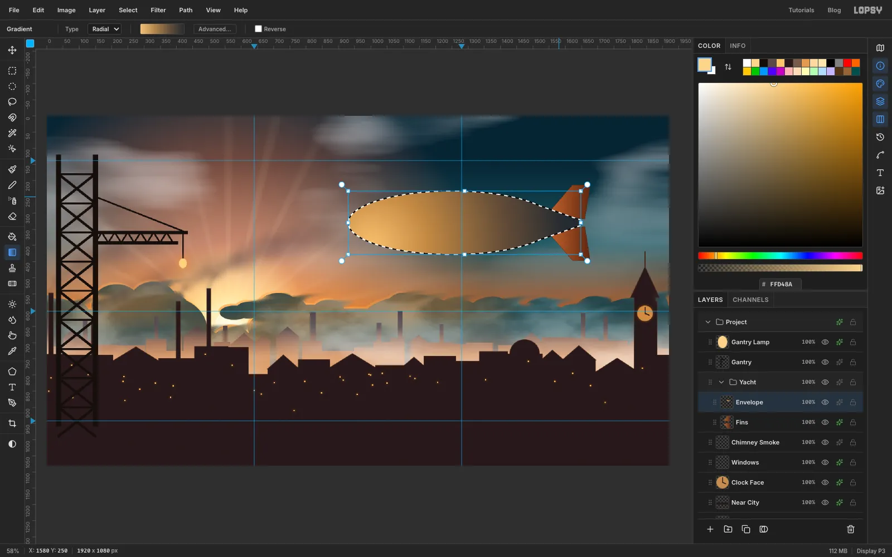

The sun is low and behind the ship, so the envelope is lit from below on
the left and falls into shadow toward the upper right. Set a **Radial**
gradient with four stops: `#F2C27A`, `#B98A4E` at 30%, `#5E4C3A` at 70%,
and `#262A30`. Drag from **(1000, 400)**, low on the nose, to **(1580,
250)** near the tail. Keep the selection.

## Draw the gores and copper bands

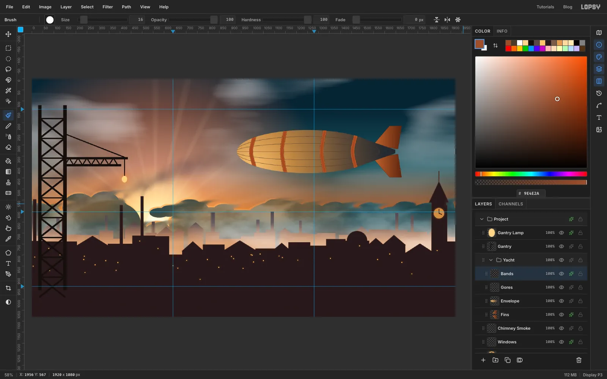

Add a layer called **Gores**. On the **Brush**, set **Size 3**,
**Hardness 100**, **Spacing 5** and **Opacity 55**, with foreground
`#4A3A2A`. Draw five seams from the nose to the tail: one along the middle
and two above and two below it, curving so they meet at both ends. The
envelope selection trims them.

Add a layer called **Bands**. Set the brush to **Size 16** and **Opacity
100**, with foreground `#9E4E2A`. Draw four rings from the top edge to the
bottom edge, at about **x 1010, 1150, 1330 and 1470**. Bow each one about
16 px toward the nose, so they read as rings around a curved surface.

Deselect. Give **Bands** an **Inner Glow** (Size **5**, Opacity **70**,
`#F0B47A`) and a **Stroke** (Width **1**, `#5A2C14`). A dark local colour
reads as painted; black would look like clip art.

## Add the gear emblem

Add a layer called **Emblem** and zoom in to about 200% on the middle of
the envelope. Build the gear centred at **(1240, 322)**:

1. With the **Elliptical Marquee**, hold [[Cmd]] for a circle and drag
   the body, about 80 px across.
2. With the **Lasso**, hold [[Shift]] and draw one tooth: a small
   trapezoid about 10 px tall, sticking out of the rim. Repeat all the way
   round for 14 evenly spaced teeth. Each Shift-lasso adds one.
3. Hold [[Alt]] and drag an ellipse about 32 px across in the middle to
   cut the hole. Fill with
`#C9973F` and deselect.

Add an **Inner Glow** (Size **6**, Opacity **80**, `#FFE6A6`) for a bevel
and a **Stroke** (Width **1**, `#6B4A1E`).

## Rig the deckhouse and trace the hull with the Pen

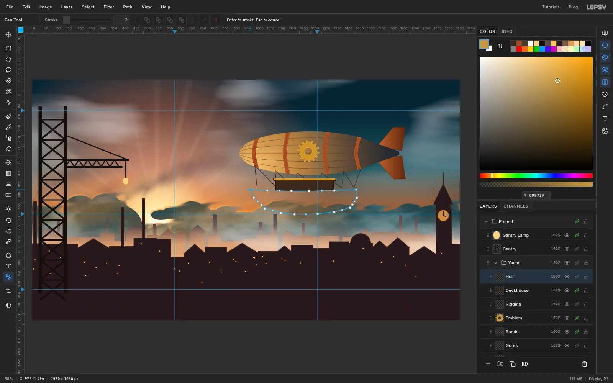

The gondola hangs about 70 px below the envelope, its deck at about **y
495**, running from **x 978** (bow) to **x 1454** (stern).

Add a layer called **Rigging**. With the **Pencil** at Size **2** in
`#3A2A20`, run six cables from evenly spaced points along the envelope's
underside, between x 1000 and 1480, down to just above the deck (**y
488**). Add a diagonal from each top point to the next cable's foot.

Add a layer called **Deckhouse**: a dark cabin `#3B2A1E` about 260 × 48 px
sitting on the deck under the gear (it starts at **x 1094**), with an 8 px
brass roof strip `#C9973F` that overhangs 10 px each side. Give the layer a
2 px **Stroke** in `#1E120A`.

Add a layer called **Hull** and pick the **Pen** tool (P). Click (don't
drag) a corner point at the bow tip **(978, 494)**, then two points along
the deck at y 499, then a corner at the stern **(1454, 494)**. Now
click-drag five smooth points: down the stern, under it, along the keel
(lowest at about **y 604**), and back up toward the bow. Click the first
point to close the path. Don't press [[Enter]]: on an open path that
strokes it.

## Fill the hull with brass

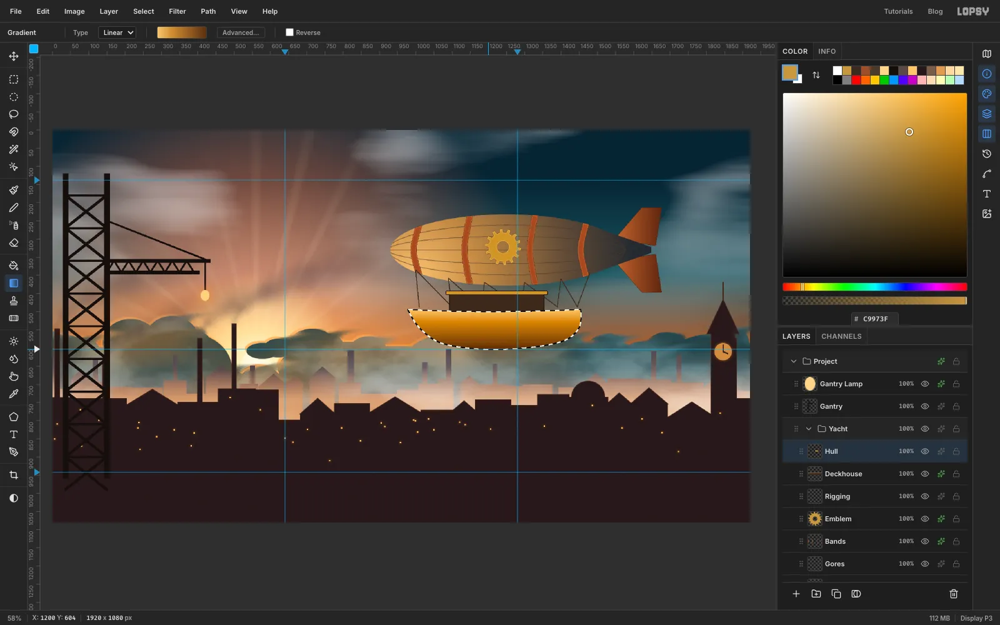

Open the **Paths** panel, click **Path to Selection**, then **Delete
Path**. Set a linear gradient: `#F6C870`, `#D08A30` at 30%, and `#5A3010`.
Drag from the deck straight down to the keel. Keep the selection.

## Rule the plating and rivets

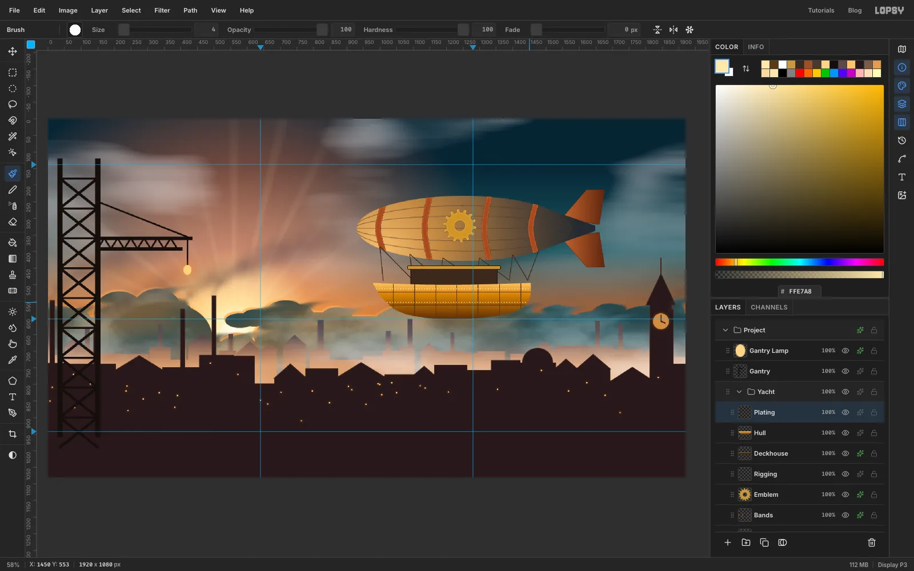

Add a layer called **Plating**. With the **Pencil** at Size **2** in
`#5A3A16`, Shift-click two long seams across the hull at **y 522** and
**y 562**, and vertical seams every 64 px. The hull selection trims the
ends.

For rivets, switch to the **Brush** and set **Size 4**, **Hardness 100**
and **Spacing 200** (the maximum). Spacing over 100% leaves gaps between
dabs, so each dab becomes a rivet. In `#FFE7A8`, Shift-click two lines just above the
seams, at **y 512** and **y 553**. Deselect.

## Add the railing and lit windows

Add a layer called **Railing**. With the **Pencil** at Size **3** in
`#3A2410`, draw a top rail along **y 480** from bow to stern. At Size
**2**, add a baluster every 12 px down to the deck, leaving out the stretch
behind the deckhouse.

Add a layer called **Lights**. Hold [[Shift]] and drag eight 20 px circles
along the hull at **y 540**, 48 px apart, starting at **x 1060**. For each arched window in the
deckhouse, Shift-drag a narrow rectangle, then Shift-drag an ellipse over
its top. Fill the whole selection with `#FFC46A` and deselect.

Add a **Stroke** (Width **2**, `#4A2E12`) and an **Outer Glow** (Size
**14**, Opacity **70**, `#FF9A3A`).

## Add the propeller, stack and bow lantern

Add each of these on its own layer, named as shown:

- **Propeller:** Pencil a 6 px shaft in `#2A1A0E` sticking 20 px out of
  the stern at **y 530**. Fill a tall, narrow ellipse just behind it
  (about 24 × 124 px, centred at **(1474, 530)**) with `#E8D3A2`. Run
  **Motion Blur** at Angle **90**, Distance **24**. That blurs the shaft
  as well, which reads as vibration. Set the layer to **60%**.
- **Prop Hub:** a 16 px dark disc (`#3A2412`) on the centre of the blur.
- **Stack:** on the stern deck at **x 1430**, Pencil a copper (`#9E4E2A`)
  stack at Size **14**, 26 px tall. Add a 4 px cap at Size **18** in
  `#2A1A0E`.
- **Bow Lantern:** fill an 18 px circle at the bow tip with `#FFE2A0` and
  give it an **Outer Glow** (Size **34**, Spread **5**, Opacity **85**,
  `#FFA54A`).

## Select the whole yacht for the backlight

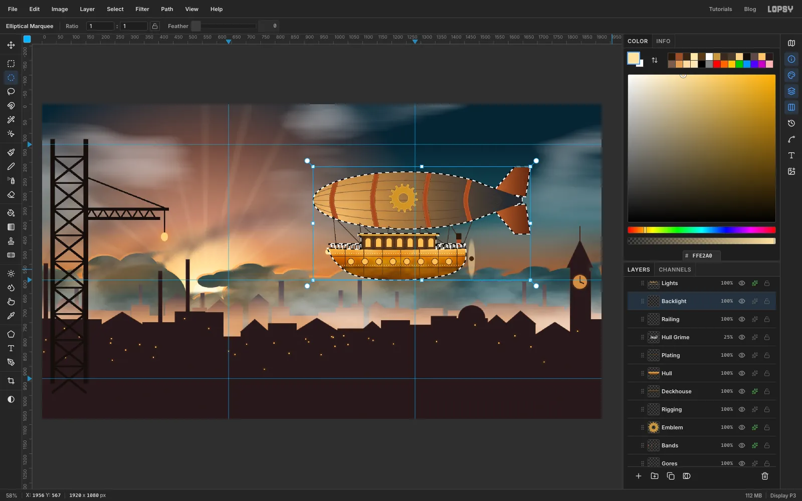

Two things sell a backlit object: the side facing us goes dark, and the
edges toward the sun burn bright. First, add some grime:

1. [[Cmd]]-click the **Hull** thumbnail.
2. Select **Plating** and add a layer called **Hull Grime**.
3. Run **Clouds** at Scale **18**, deselect, and set the layer to
   **Overlay** at **25%**.

Next, select **Railing** and add a layer called **Backlight**. Putting it
there keeps it under the lit windows. [[Cmd]]-click the **Envelope**
thumbnail. Then [[Cmd+Shift]]-click the **Fins**, **Hull**, **Deckhouse**,
**Bands**, **Emblem** and **Railing** thumbnails. [[Cmd+Shift]]-click adds
each layer's shape to the selection.

## Darken the yacht and burn in the rim

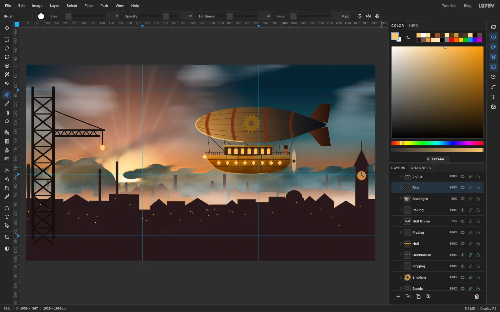

In the selection, drag a linear gradient from `#E6D2B4` to `#3A4458`, from
the lower left of the hull **(980, 560)** up to the top of the tail
**(1560, 230)**. Set **Backlight** to **Multiply** at **80%**. On Multiply,
the light stop barely changes anything, and the slate-blue end sinks the
far side into shadow.

Add a layer called **Rim**. Keep the selection. Set the **Brush** to
**Size 9**, **Hardness 30**, **Opacity 70** and **Spacing 5** (the rivets
left it at 200, which would paint dots), with foreground `#FFC46A`.
Stroke along three edges:

- the envelope's edge from its underside round to the nose,
- the curve of the hull from the bow to under the middle of the keel,
- the deckhouse roof's left end.

The selection clips each stroke to a crisp inner edge. Deselect, run
**Gaussian Blur** at **2**, and set the layer to **Screen**.

## Tilt the yacht as one group

Press [[Cmd+D]] so nothing is selected. Click the **Yacht** group's row
and press **V** for the Move tool. The handles now frame everything in the
group.

Drag the **top-right rotation handle** (the circle just outside the
corner) a little clockwise, about **4°**, so the bow lifts as if the ship
is climbing away. Press [[Enter]]. Every layer in the group turns about
one shared centre.

## Duplicate it into a hazy escort

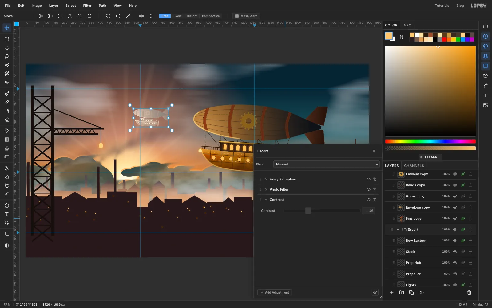

Choose **Layer → Duplicate Layer**. Rename the copy (on top) **Yacht
Hero**, and rename the original underneath **Escort**. The escort stays
below the hero.

With **Escort** active and the Move tool on, hold [[Cmd]] and drag the
bottom-right corner handle up and left until the box is about 190 px wide,
roughly a quarter of its width. Press [[Enter]]. Then drag it to sit near the sun, at about
**(700, 300)**.

Groups take adjustments rather than layer effects. Open the group's
drawer, and with **Add Adjustment**, add:

- **Hue / Saturation**: Saturation **−60**, Lightness **+28**.
- **Photo Filter**: colour `#A8907C`, Density **55**.
- **Contrast**: **−40**.

Set the group to **80%**. Low contrast and low saturation push it far into
the haze.

## Tie the mooring line and vent the steam

Select **Yacht Hero** and add a layer called **Steam** (it goes inside the
group). In `#F4E8D2`, use the soft-stroke method from the chimneys: Brush
**Hardness 0**, **Spacing 8**, **Opacity 30**, at Sizes **16, 30, 52 and
80**. Trail it back from the
stack, passing under the bottom fin. Blur it at **5** and set it to
**Screen**.

Add a layer called **Mooring Lines**. On the **Brush** at **Size 3**,
**Hardness 100**, **Spacing 5** and **Opacity 100**, in `#2E2018`, drag one slow curve
from the crane-arm tip **(432, 364)** to the bow, sagging about 70 px in
the middle. This single line is the story: the ship is casting off.

On a **Gantry Steam** layer, add a small puff drifting right from the
crane tip (Sizes 14–56, Opacity 26), blurred at **4** and set to
**Screen**.

## Sweep a searchlight over the docks

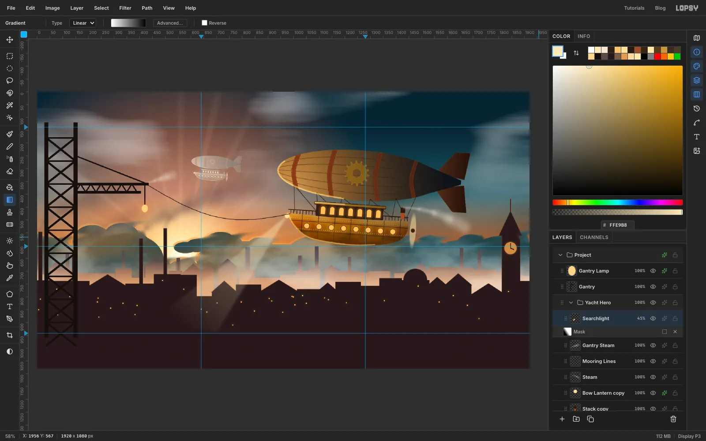

Add a layer called **Searchlight**. **Lasso** a long triangle from the bow
lantern down to two points over the rooftops, **(700, 940)** and **(440,
900)**. Fill it with `#FFE9B8`, deselect, and blur at **14**.

Add a mask, then drag a **Linear** white-to-black gradient on it from the lantern
toward **(600, 930)**. The beam is now brightest at its source. Set the
layer to **Screen** at **45%**.

## Fill the foreground with roofs, smog and lit dormers

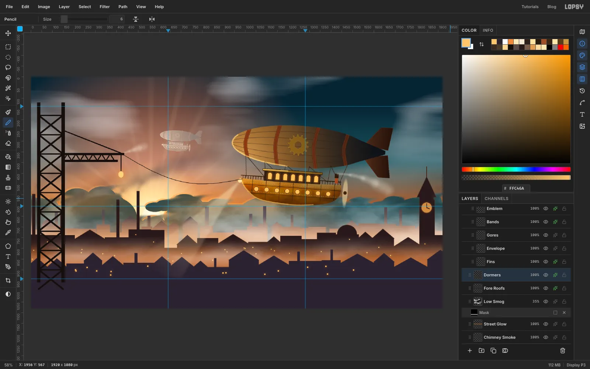

Select **Chimney Smoke** so the next layers go under the yacht.

1. **Street Glow:** Brush at Size **220**, Hardness **0**, Spacing **8**,
   Opacity **45**, in `#F08A3C`. Paint two long strokes across the canvas near **y 860–880**,
   and set the layer to **Screen**.
2. **Low Smog:** run **Smoke** at Scale **7**, Turbulence **50**. Set it
   to **Screen** and add a mask. Rebuild the three-stop **Linear** gradient
   (`#000000`, `#FFFFFF` at 60%, `#000000`) and drag it on the mask from
   **y 740** to **900**. Set the layer to **35%**.
3. **Fore Roofs:** the closest skyline. The base line is **y 900**, and
   the blocks are 70–170 px wide and only 10–50 px tall. Make most of them
   gables, with a few short chimney pots. Fill with `#2A2230`, which is
   lighter than the bars so the frame edge stays visible. Add an **Inner
   Glow** (Size **3**, Opacity **60**, `#D9874A`) for ridge light.
4. **Dormers:** Pencil Size **6** clicks in `#FFC46A` near the roof peaks,
   plus a few lower down. Add an **Outer Glow** (Size **14**, Opacity
   **70**, `#FF9A3A`).

## Grade the frame with the Color Grading wheels

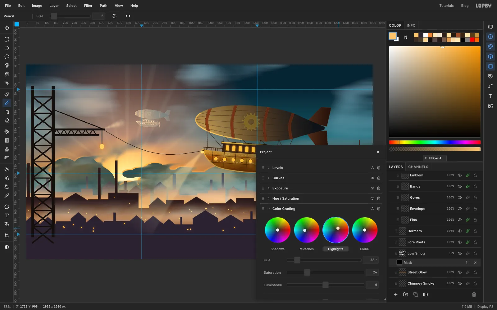

Choose **Layer → Adjustment Layer…** and click **Got it**. This opens the
root **Project** group's adjustment stack, which affects the whole picture.
Expand **Color Grading**.

Levels, Curves, Exposure and Hue / Saturation are already in the stack as
neutral defaults. Leave them alone.

- Click the **Midtones** wheel (or its tab) and set **Hue 195** and
  **Saturation 15** in the sliders below. That nudges the puck slightly
  toward teal.
- Click **Highlights** and set **Hue 38**, **Saturation 24**, which is
  amber.

You can drag the pucks instead: the angle is the hue and the distance from
the centre is the saturation. Either way you get the classic
teal-and-orange split.

> **Tip:** Don't tint the **Shadows** wheel here. A wheel tint shifts every
> pixel in its range, so pure black would turn navy, and the letterbox
> bars would no longer be black.

## Add contrast and a vignette

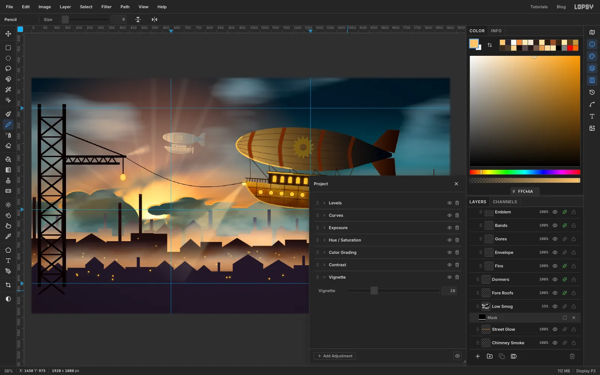

Click **Add Adjustment** and add **Contrast** at **12**, then **Vignette** at
**28**. Close the drawer.

## Add film grain and the letterbox bars

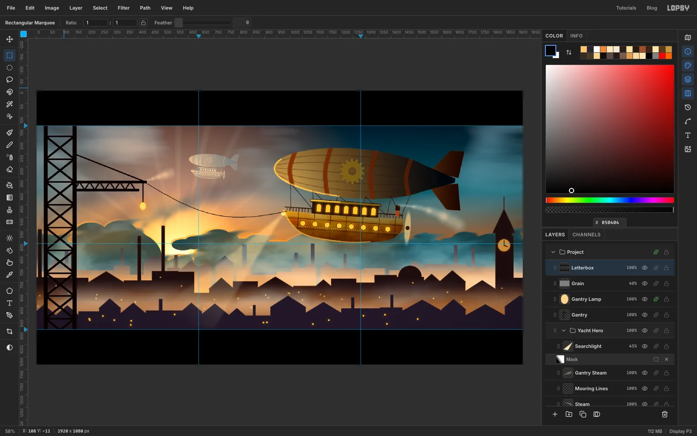

Select **Gantry Lamp** and add a layer called **Grain**. Fill it with
`#808080` and run **Filter → Add Noise…**: Amount **14**, **Mono**,
**Gaussian**. Set it to **Overlay** at **40%**. On Overlay, middle grey
disappears and only the noise shows.

Add a layer called **Letterbox**. With the **Rectangular Marquee**, drag
from above the canvas's top-left corner across to the top guide. Hold
[[Shift]] and drag a second rectangle from the bottom guide to below the
canvas. Fill with `#050404` and deselect.

## Set the brass title

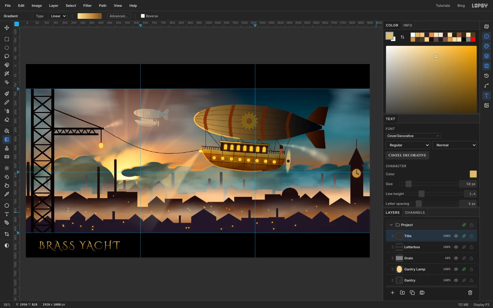

Pick the **Text** tool (T). Set the font to **Cinzel Decorative**, Size
**58**, colour `#E2B865`, and in the Text panel set **Letter spacing** to
**6**. Click in the bottom bar, type **BRASS YACHT**, and press [[Tab]] to
commit. Click **Rasterize Layer** at the bottom of the Layers panel, and
rename the layer **Title**.

With the **Move** tool, place it 72 px from the left edge. Centre its
capitals, not its swash tails, in the bar. In this frame the caps run from
**y 991** to **y 1032**, so **1032** is the baseline every other label
will sit on.

[[Cmd]]-click the **Title** thumbnail and drag a linear gradient down the
letters: `#FFE6A0`, `#D29A45` at 50%, and `#7A4E1E`. That's brass. Deselect
and add a **Drop Shadow**: Offset **0 / 3**, Blur **2**, Opacity **70**,
black.

## Finish the slate line

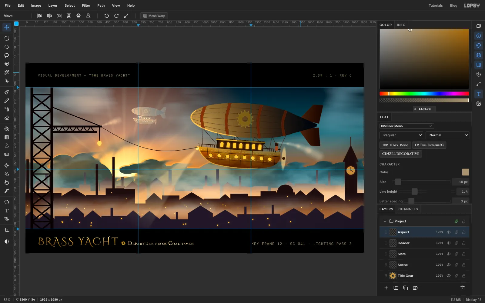

1. **Scene:** select the **Title** layer first, so the new text doesn't
   restyle anything. Set **IM Fell English SC**, Size **30**, `#D8C7A2`,
   Letter spacing **1**. Type **Departure from Coalhaven** in empty space,
   press [[Tab]] and rasterize. Move it about 60 px right of the title,
   with the bottom of its **D** on the baseline (y 1032).
2. **Title Gear:** add a layer and, zoomed in to about 400%, build a tiny
   10-toothed gear about 24 px across, the same way as the emblem. Fill it
   with `#C9973F` and place it midway between the title and the scene
   line, centred on the scene line's small caps (about 10 px above the
   baseline).
3. **Slate:** set **IBM Plex Mono**, Size **21**, `#B39C76`, Letter
   spacing **2**. Type **KEY FRAME 12 · SC 041 · LIGHTING PASS 3**,
   rasterize, and move it so it ends 72 px from the right edge on the same
   baseline.
4. **Header** and **Aspect:** IBM Plex Mono, Size **18**, `#AA9470`,
   Letter spacing **3**. In the top bar, type **VISUAL DEVELOPMENT —
   “THE BRASS YACHT”** 72 px from the left, and **2.39 : 1 · REV C** ending
   72 px from the right. Centre both vertically in the bar and give them
   the same baseline.

Create each text in empty canvas, away from existing type, and check the
Text panel's Letter spacing each time, because it carries over from the
last text layer.

Choose **File → Quick Export PNG** for the image, and **File → Save
Project** to keep every layer.
