Victorian handbills sold everything from patent medicines to electric belts with the same few tricks. Big wooden display type stacks up the page, an engraved picture sits in a frame, there's a ribbon of claims, and the small print is set in neat columns. Steampunk borrows that look and adds brass, rivets and stormy electricity.

This flier advertises a made-up firm, **Messrs. Vane & Underhill**, and their lightning-proof umbrellas. Everything is drawn in Lopsy. There are no photos.

Along the way you'll use:

- **Add Noise**, **Clouds**, **Sunburst** and a **layer mask** with a radial gradient for aged paper
- ruler **guides**, exact marquees from the **Rectangular** and **Elliptical Selection** dialogs, and **Select → Shrink** for rules and rings
- rotating a selection with [[Cmd]] for 45° diamonds, and copy and paste to repeat them
- selections combined with [[Shift]] and [[Alt]], **Feather**, and **Threshold** plus **Motion Blur** for rain
- the **Lasso** for a London skyline and an umbrella canopy painted back to front
- the **Pen** tool, stroked with [[Enter]], for the handle and the ribs
- **Define Pattern** and **Fill with Pattern** for engraved hatching
- rotating a whole **group** at once with the Move tool
- **Shift-click** brush lines, **Bloom** and **Outer Glow** for lightning
- live text in **Diplomata SC**, **Holtwood One SC**, **IM Fell English SC**, **IM Fell DW Pica** and **Alfa Slab One**, the **Text** panel's **Letter spacing** and **Line height**, and the options bar's **Align** dropdown
- **text on a path** for the arched line and a round rubber stamp
- the **Magic Wand** with Contiguous off for worn ink, and a **Levels** adjustment on a group

The palette is aged paper and brown ink, oxblood red, brass and copper, with a teal storm:

- Paper `#E9DBBA`, burnt edges `#7A5530`, rays `#A9824E`
- Ink `#2A1E16`, oxblood `#7E2A20`, ribbon shadow `#5A1C15` / `#3A100C`
- Brass `#F2D488` → `#C99A3E` → `#6E4A1C`, rivets `#8A6328`, ribs `#D9A441`
- Canopy copper `#B5653A` / `#955330` / `#91502F` / `#713E24`, oxblood panels `#5A251F` / `#59241E` / `#461D18` / `#451D17`
- Walnut handle `#8A5A32`, coil copper `#B5653A` / `#5A2A16`
- Storm `#0F212B` → `#2A5560` → `#8EC4C6`, clouds `#0A1820`, city `#13201F`
- Lightning `#E9FBFF`, glow `#62D2F0`, lamplight `#F2C36B`

> **Tip:** Positions are in document pixels, written `x, y`. The status bar at the bottom shows where the pointer is. When a step says to fill, that's **Edit → Fill**. It fills the selection (or the whole layer if nothing is selected) with the foreground colour. [[Cmd+D]] deselects.

> **Tip:** With nothing selected, a single click (no drag) with the **Rectangular** or **Elliptical Marquee** opens a dialog where you type the **From** and **To** corners. Use it whenever a step gives exact corners. It's also the easiest way to get a perfect circle.

> **Tip:** Blend modes live in the **Blend** dropdown at the top of a layer's effects drawer (the sparkle icon on its row). The layer effects (Drop Shadow, Outer Glow, Stroke and so on) are in the same drawer. To change a layer's opacity, click the `100%` readout on its row and drag the slider.

> **Tip:** The page fits the screen at about 60%. For the small parts (the pattern tile, the umbrella, the rivets and the stamp), zoom in to 200–400% with [[Cmd]] and the scroll wheel, then choose **View → Fit to Screen** to come back.

## Start with a sheet of paper

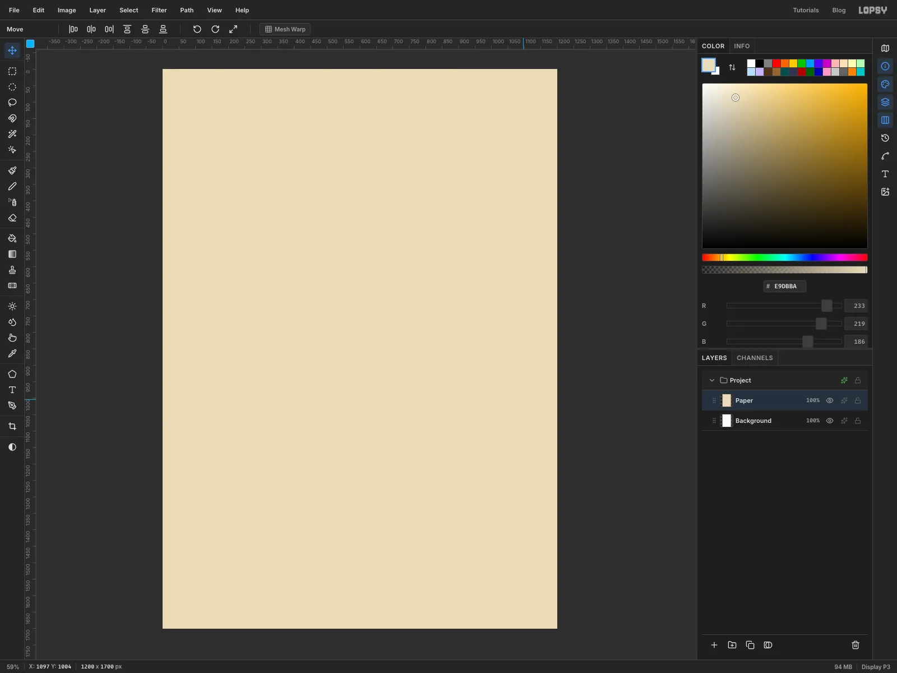

1. In the **New Document** dialog set **Width** to `1200` and **Height** to `1700`, leave the background white, and click **Create**.
2. Double-click **Layer 1** and rename it `Paper`.
3. Set the foreground colour to `#E9DBBA`, press [[Cmd+A]] and choose **Edit → Fill**. Press [[Cmd+D]].
4. Choose **Filter → Add Noise…**, set **Amount** to `7`, choose **Mono**, and click **Apply**. A little grain stops the paper looking like a flat screen colour.

## Mottle the paper

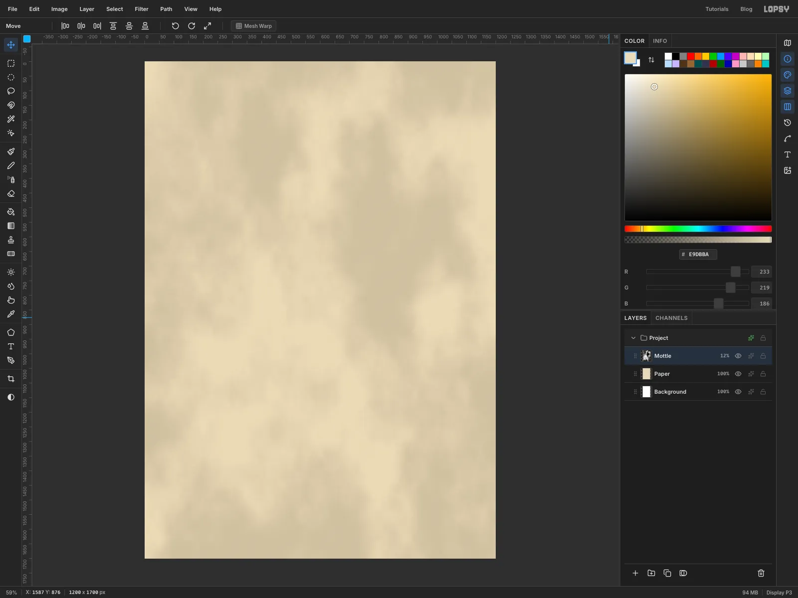

1. Click **Add Layer** in the Layers panel and name the new layer `Mottle`.
2. Choose **Filter → Clouds…**, set **Scale** to `6` and click **Apply**. The layer fills with grey clouds.
3. Set the layer to **Multiply** at `12%`. The clouds now read as uneven age in the paper. Keep this subtle: any stronger and it looks like dirt.

## Fan rays out from the centre

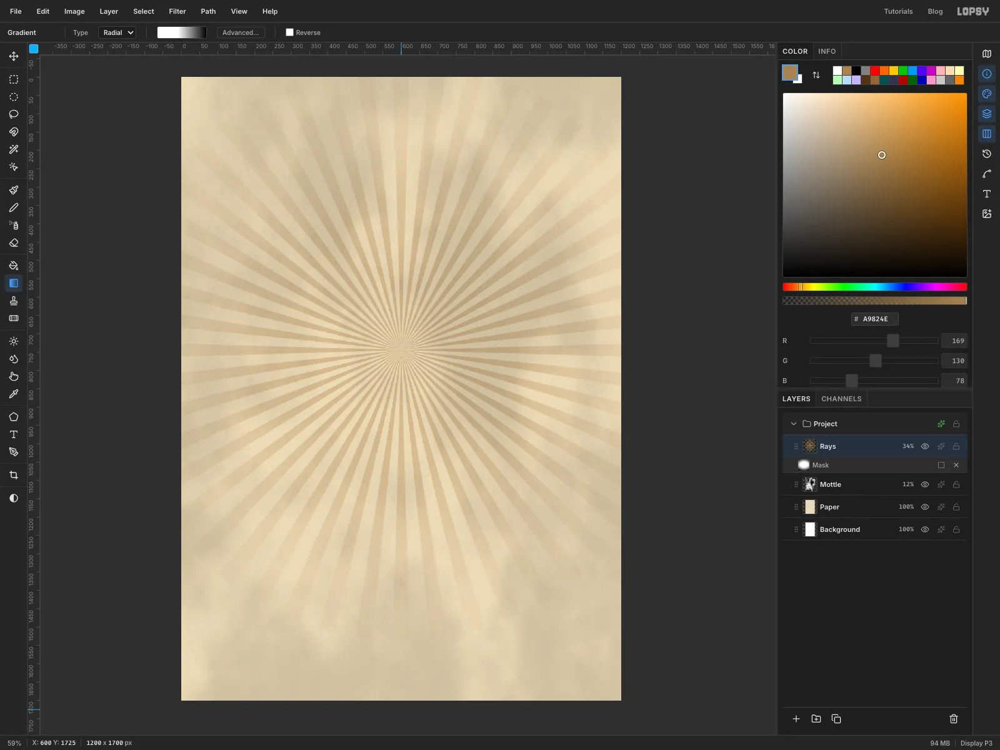

Victorian posters often put a burst of rays behind the main picture. Ours fan out from where the porthole will go.

1. Add a layer called `Rays` and set the foreground colour to `#A9824E`.
2. Choose **Filter → Sunburst…** and set **Rays** `48`, **Length** `70`, **Width** `45`, **Taper** `0`, **Fade** `70` and **Softness** `10`. Set **Center X** to `50`, and type `43.8` into the **Center Y** box: that's 745 px down, the centre of the porthole. Click **Apply**.
3. Set the layer to **Multiply** at `34%`.
4. Click **Add Mask** in the Layers panel, then click the new **mask thumbnail** on the row below `Rays` so you're painting on the mask.
5. Pick the **Gradient** tool and set its **Type** to **Radial** in the options bar. Click **Advanced…** and make three stops: white at the left, white at about 42%, and black at the right. Click **Done**.
6. Drag from the centre of the rays (`600, 745`) straight down about 980 px. The rays stay strong in the middle and fade before they reach the corners and the small print.

## Burn the edges

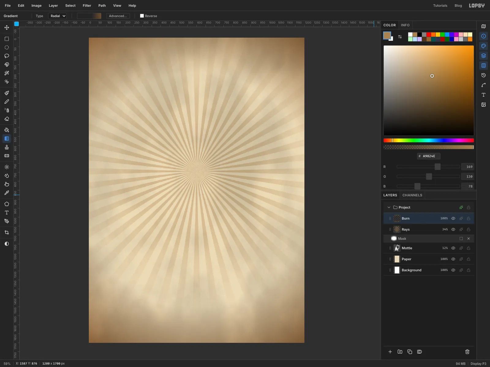

1. Click the `Rays` layer name to leave mask editing, then add a layer called `Burn`.
2. With the **Gradient** tool still on **Radial**, open **Advanced…** and set three stops, all `#7A5530`: fully transparent at the left, still transparent at about 62%, and about 85% opaque at the right. To set a stop's opacity, click the stop and drag the **Opacity** bar under its colour picker.
3. Drag from `600, 850` down about 1060 px, then set the layer to **Multiply**.

## Add guides

1. Click the ruler along the top at `600` to drop a vertical guide down the middle. Holding [[Cmd]] while you click snaps it to exactly half the width.
2. Click the top ruler again at `90` and at `1110` for the text margins.
3. Click the left ruler at `745` for a horizontal guide through the porthole's centre.

## Cut a double-rule frame

1. Add a layer called `Frame` and set the foreground colour to `#2A1E16`.
2. Click once on the canvas with the **Rectangular Marquee**. In the dialog, enter **From** `36, 36` and **To** `1164, 1664`, and fill the selection.
3. Choose **Select → Shrink…**, enter `7`, click **Apply**, and press [[Delete]]. That leaves a 7 px dark border.

## Add the thin inner rule

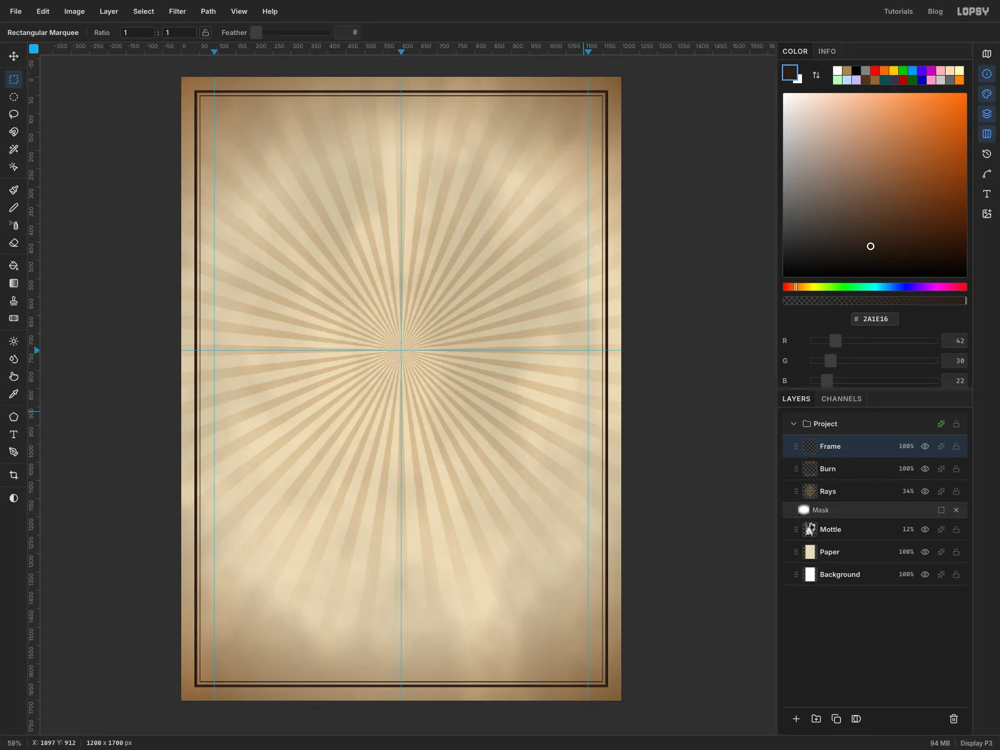

1. Press [[Cmd+D]], click once with the **Rectangular Marquee** again and enter **From** `50, 50`, **To** `1150, 1650`. Fill it.
2. **Shrink** it by `2`, press [[Delete]] and press [[Cmd+D]].

## Rotate a brass diamond

1. Add a layer called `Corners` and set the foreground colour to `#C99A3E`.
2. With the marquee dialog, select **From** `32, 32` **To** `54, 54`, a 22 px square centred on the frame's top-left corner, and fill it.
3. Leave it selected and switch to the **Move** tool. Transform handles appear round the selection. Drag the round rotation handle just outside the top-left corner, holding [[Cmd]] so it snaps in 15° steps, and stop at 45°. Press [[Cmd+D]] to commit.

## Copy the diamond to every corner

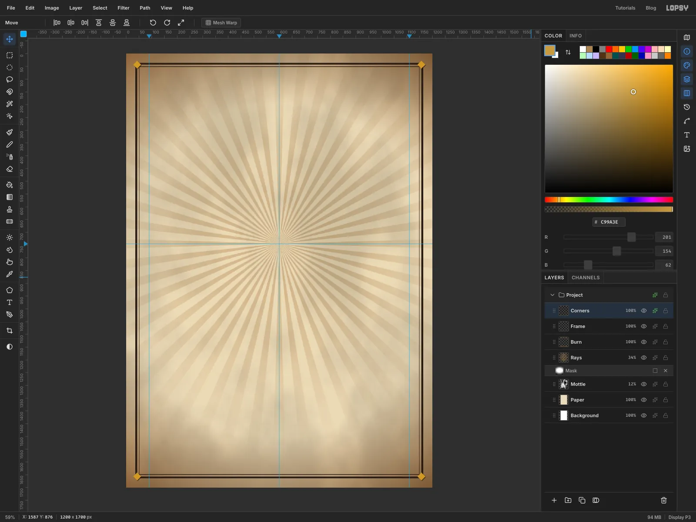

1. Marquee round the diamond and press [[Cmd+C]].
2. Press [[Cmd+V]]. The copy lands on a new layer, in the same place, above `Corners`. With the **Move** tool, drag it until it's centred on the top-right corner of the frame at `1157, 43`. A pink alignment line shows when it's level with the first diamond. Press [[Cmd+D]], then [[Cmd+E]] to merge it down into `Corners`.
3. Repeat for the bottom corners, at `43, 1657` and `1157, 1657`.
4. Give `Corners` a **Drop Shadow** with **Offset X** `2`, **Offset Y** `2`, **Blur** `3` and **Opacity** `60`.

## Paint a storm sky in a circle

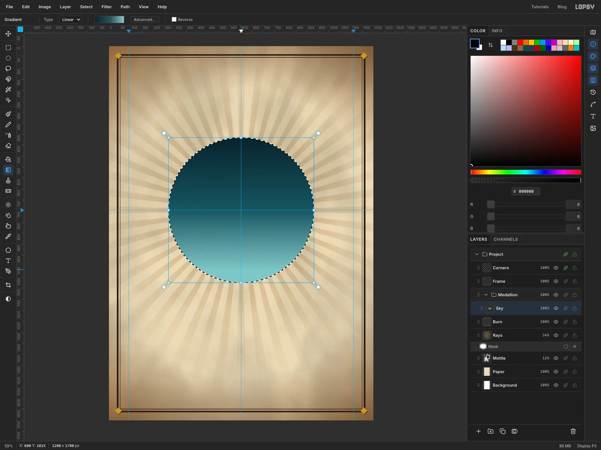

1. Click `Burn`, then click **New Group** and name the group `Medallion`. Add a layer inside it called `Sky`.
2. Click once with the **Elliptical Marquee** and enter **From** `270, 415`, **To** `930, 1075`. That's a 660 px circle centred where the guides cross.
3. Pick the **Gradient** tool, set **Type** to **Linear**, and make three stops: `#0F212B`, `#2A5560` at about 55%, and `#8EC4C6`. Drag from the top of the circle down to about `600, 1015`. The sky lightens toward the horizon.

> **Tip:** Any time you need this circle again, [[Cmd]]-click the `Sky` layer's thumbnail. That loads its pixels as a selection.

## Add cloud texture

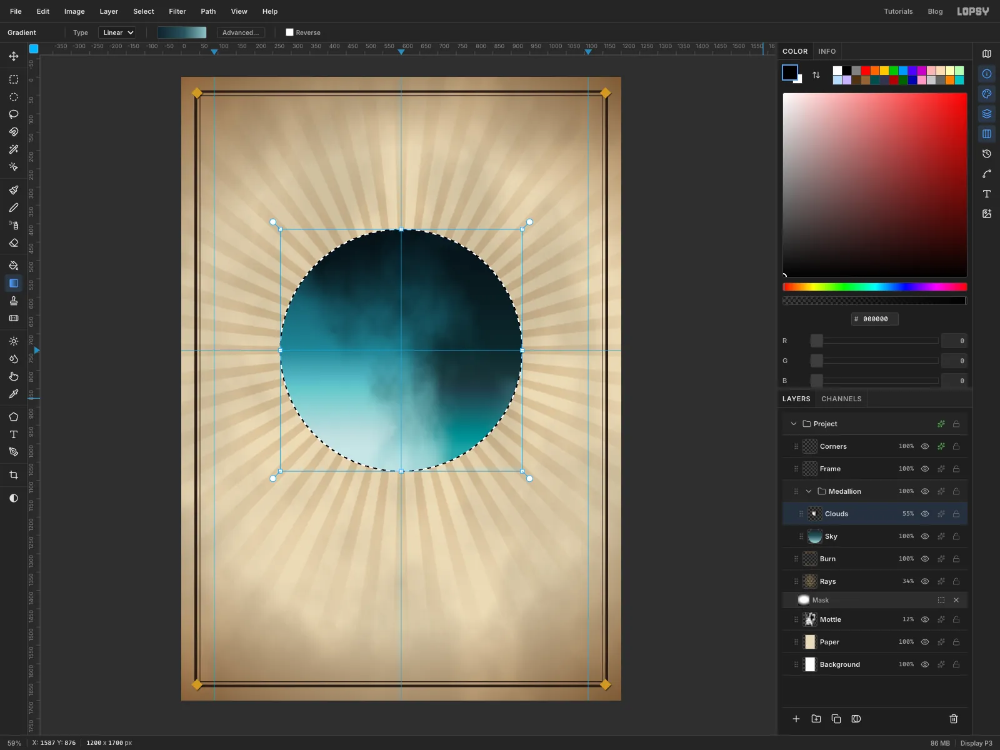

1. Keep the circle selected and add a layer called `Clouds`.
2. Run **Filter → Clouds…** at **Scale** `4`. It only fills the selection.
3. Set the layer to **Overlay** at `55%`.

## Select storm clouds

1. Add a layer called `Storm`.
2. With the **Lasso**, draw a long, lumpy cloud band across the top of the circle. Hold [[Shift]] and draw a smaller cloud a little lower on the left edge, then another on the right edge.
3. Hold [[Shift]]+[[Alt]] and drag the **Elliptical Marquee** over the same circle again (`270, 415` to `930, 1075`). That intersects the selection, so nothing spills outside the sky.
4. Choose **Select → Feather…** and enter `16`.

## Fill the storm clouds

Set the foreground to `#0A1820`, fill, press [[Cmd+D]] and set the layer's opacity to `80%`. The feathered edges blend the clouds into the sky.

## Make rain

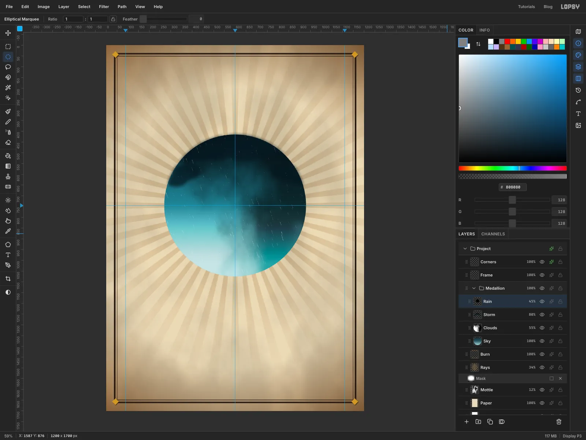

1. Add a layer called `Rain`. [[Cmd]]-click the `Sky` thumbnail and fill the circle with `#808080`.
2. Run **Add Noise** at **Amount** `100`, **Mono**.
3. Run **Filter → Threshold…** at **Level** `176`. Only the brightest specks survive, as white dots on black.
4. Run **Filter → Motion Blur…** with **Angle** `70` and **Distance** `28`. Then run **Threshold** again at `26` to turn the blurry streaks into crisp rain.
5. Press [[Cmd+D]] and set the layer to **Screen** at `45%`. Screen drops out the black, so only the rain is left.

## Trace a London skyline

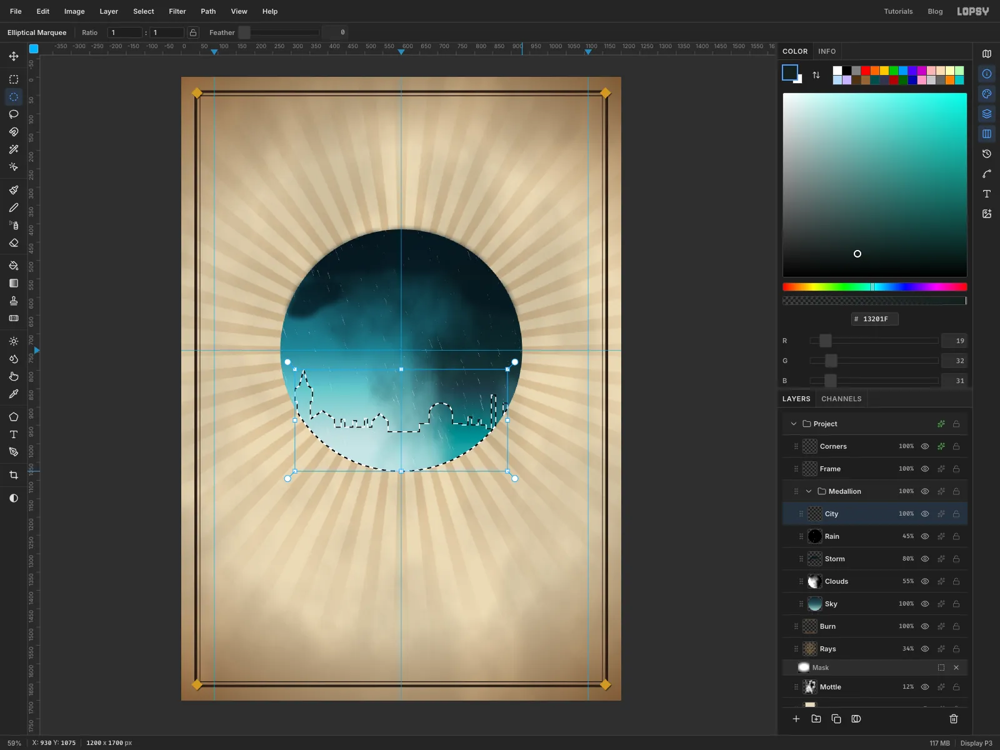

1. Add a layer called `City` and set the foreground to `#13201F`.
2. With the **Lasso**, trace the rooftops from the left edge of the circle to the right:
   - a terrace with a chimney pot, around `y 945`;
   - a gable;
   - a clock tower at about `x 334`, with its spire reaching up to `y 800`;
   - more chimney pots and another gable;
   - a dome at about `x 708`;
   - two tall factory chimneys near `x 850` and `x 880`.

   Then go down and close the shape well below the circle.
3. [[Shift]]+[[Alt]]-drag the circle with the **Elliptical Marquee** to clip it, then fill.

## Light the city

1. Add a layer called `Windows`. With the **Pencil** at **Size** `5` in `#F2C36B`, click a dozen lit windows across the buildings. Give the layer an **Outer Glow** with **Size** `8`, **Opacity** `70` and colour `#FFB347`.
2. Add a layer called `Clock`. Select a 24 px circle on the tower, centred on `334, 870` (**From** `322, 858`, **To** `346, 882`), and fill it with `#E8D9A8`. Add an **Outer Glow** of **Size** `10`, **Opacity** `60` in `#FFC870`.
3. Add a layer called `Street`. Marquee a strip from `200, 1013` across to the right edge and down below the circle, then [[Shift]]+[[Alt]]-drag the circle to clip it. Fill it with a short **Linear** gradient from `#2C3D3C` at the top to `#121B1B`.
4. While it's still selected, use the **Pencil** at size `2` in `#4F6461`: click at the left end of the kerb (`y 1014`), then [[Shift]]-click at the right end. The selection trims the line to the circle. Press [[Cmd+D]].

The street gives the bottom of the picture somewhere to stand, so it isn't one black slab.

## Puff smoke from the chimneys

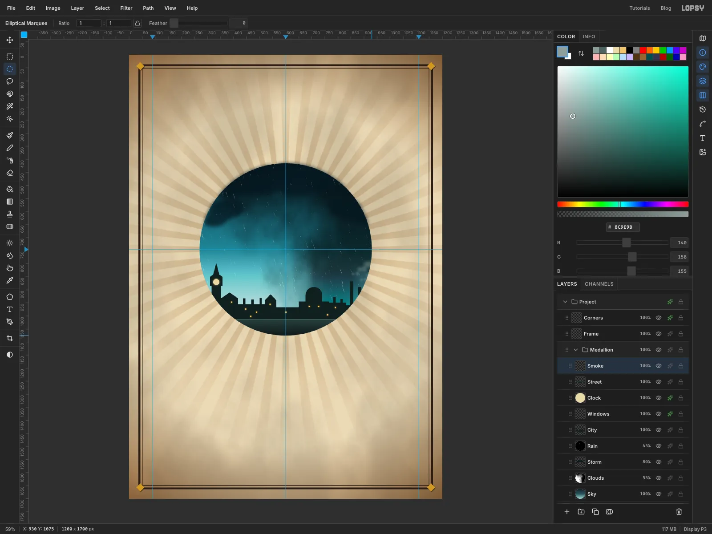

1. Add a layer called `Smoke`. Pick the **Brush** with **Hardness** `0` and **Opacity** `40`, in `#8C9E9B`.
2. Above each chimney, click a trail of six puffs drifting up and to the right. Start at size `18` and make each puff a little bigger, up to about `48`.
3. Run **Gaussian Blur** at **Radius** `6`. [[Cmd]]-click the `Sky` thumbnail, choose **Select → Inverse**, press [[Delete]] to trim anything outside the circle, and press [[Cmd+D]].

## Build the brass ring

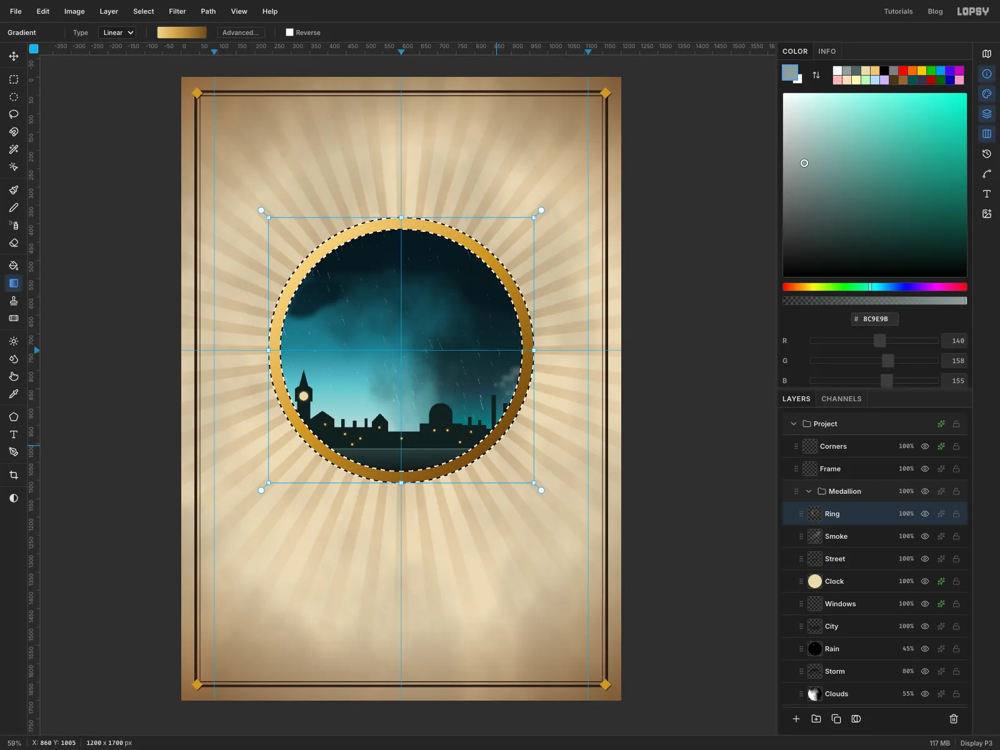

1. Add a layer called `Ring`. Click once with the **Elliptical Marquee** and enter **From** `238, 383`, **To** `962, 1107`, a 724 px circle round the sky.
2. Make a **Linear** gradient with three stops, `#F2D488`, `#C99A3E` at about 45%, and `#6E4A1C`, and drag it diagonally across the circle from the top-left to the bottom-right.
3. Choose **Select → Shrink…** `32` and press [[Delete]]. The middle is cut out, leaving a 32 px brass ring that sits just outside the sky.

## Engrave and shade the ring

1. For the inner groove, select **From** `264, 409` **To** `936, 1081` with the marquee dialog, fill it with `#6E4A1C` on the `Ring` layer, **Shrink** it by `2` and press [[Delete]]. Only a 2 px ring is left.
2. Do the same for the outer groove with **From** `242, 387` **To** `958, 1103`, then press [[Cmd+D]].
3. Add a **Stroke** of **Width** `2` in `#2A1E16`, a **Drop Shadow** with **Offset Y** `8`, **Blur** `18` and **Opacity** `50`, and an **Inner Glow** with **Size** `4`, **Opacity** `55` in `#FFF1BE`.

## Rivet it

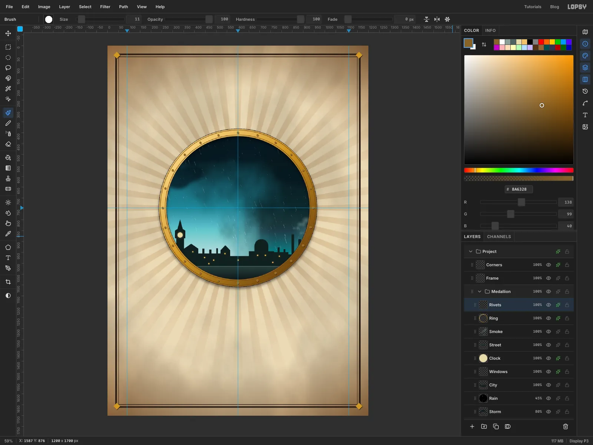

1. Add a layer called `Rivets`. Pick the **Brush** at **Size** `11`, **Hardness** `100`, **Opacity** `100`, in `#8A6328`.
2. Click the four rivets where the guides cross the middle of the ring: at 12, 3, 6 and 9 o'clock. Then click five more, evenly spaced, between each pair. That's 24 rivets, one every 15°.
3. Give the layer an **Inner Glow** (**Size** `4`, **Opacity** `80`, `#FFE7A6`) and a small **Drop Shadow** (**Offset X** `1`, **Offset Y** `2`, **Blur** `2`, **Opacity** `70`). Each dab now looks like a domed rivet.

## Start the umbrella: shaft and coil

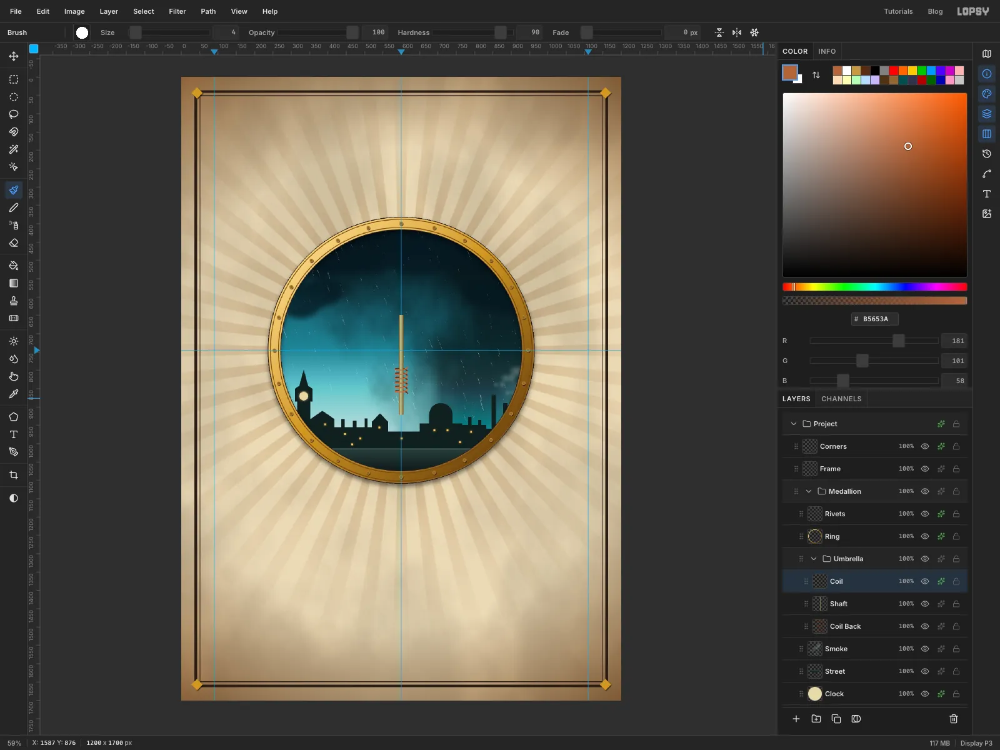

The umbrella is drawn upright in its own group and tilted at the end. Zoom in for this part.

1. Click `Smoke`, click **New Group** and name it `Umbrella`.
2. Add a layer called `Coil Back`. With the **Brush** at size `4` in `#5A2A16`, draw six short curved strokes across `x 600`, each 34 px wide, from about `y 791` down to `851`. Bow each one upward and let it rise slightly from left to right. These are the parts of the coil behind the shaft.
3. Add a layer called `Shaft`. With the **Pencil** at size `12` in `#C99A3E`, click at `600, 655` and [[Shift]]-click at `600, 915`. [[Cmd]]-click the `Shaft` thumbnail to select it, and drag a **Linear** gradient straight across it, from `#6E4A1C` through `#F2D488` (at about 40%) to `#6E4A1C`. Press [[Cmd+D]].
4. Add a layer called `Coil` and draw the front of each turn in copper `#B5653A`: six strokes bowing downward and falling from left to right, joining the back strokes at the edges of the shaft. Together they make a helix rather than a stack of rings. Give it an **Inner Glow** (**Size** `2`, **Opacity** `70`, `#F7B07A`).

## Draw the handle with the Pen

1. Add a layer called `Handle` and set the foreground to walnut `#8A5A32`.
2. Pick the **Pen** tool and set **Stroke** to `14`.
3. Click at `600, 913` where the wood starts. Press at `600, 965` and drag a little straight down. Press at `630, 1005` and drag to the right. Press at `660, 969` and drag up. Each drag pulls out handles that curve the hook.
4. Press [[Enter]]. The path is stroked with the foreground colour. Press [[Escape]].
5. In brass `#C99A3E`, use the **Pencil** at size `12` to click and [[Shift]]-click a short band across the join at `y 911` (the ferrule). Then use the **Brush** at size `16` to click a cap on the end of the hook.
6. Give the handle an **Inner Glow** (**Size** `5`, **Opacity** `85`, `#E8B47E`) and a 1 px **Stroke** in `#3A1E12` so it reads as a rounded tube.

The path stays outlined on screen until you click its row in the **Paths** panel to deselect it. That's harmless: the outline isn't part of the picture.

## Paint the back of the canopy

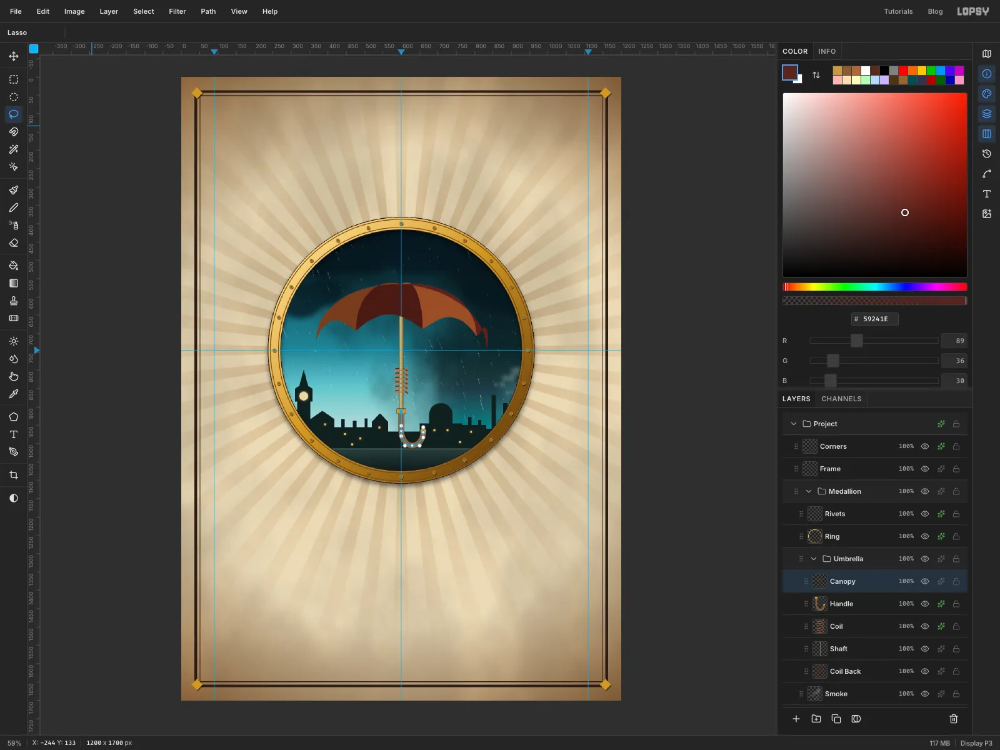

The canopy is a dome of eight panels seen from a little above. All eight ribs meet at the apex, `600, 565`. Their tips sit on a flattened ellipse round the shaft. Going clockwise from the front, the tips are at:

`542, 773` · `394, 753` · `367, 719` · `476, 692` · `658, 687` · `806, 707` · `833, 741` · `724, 768`

Draw each panel as a fan-shaped wedge with the **Lasso**:

- start at the apex;
- bow outward down one rib to its tip;
- run along the hem to the next tip, rising about 25 px toward the apex in the middle so the hem scallops;
- bow back up the next rib to the apex.

1. Add a layer called `Canopy`.
2. Fill the panels at the back first, so the nearer panels cover them later. The panels alternate copper and oxblood silk, and each is darker the more it faces away from the light on the right:
   - the far back panel, between the two back ribs: deep oxblood `#451D17`;
   - back right: lit copper `#91502F`;
   - back left: shaded copper `#713E24`;
   - the narrow panel on the far right edge: oxblood `#59241E`.

## Finish the canopy

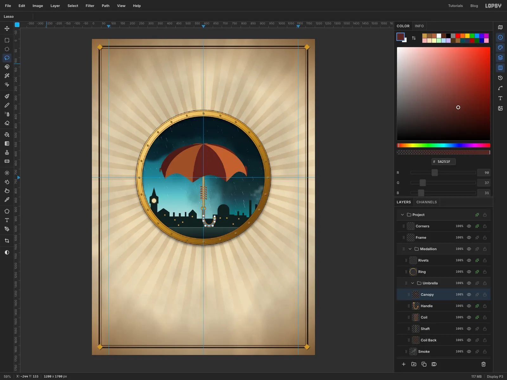

Fill the four front panels the same way:

- left edge: dark oxblood `#461D18`;
- front right, facing the light: bright copper `#B5653A`;
- front left: copper `#955330`;
- the panel nearest to you: oxblood `#5A251F`.

## Engrave hatching with a pattern

1. Zoom right in on the top-left corner of the canvas. Add a temporary layer called `Tile`, and with the **Pencil** at size `2` in `#1A0D08`, click at `0, 15` and [[Shift]]-click at `15, 0`.
2. Click once with the **Rectangular Marquee** and enter **From** `0, 0` **To** `16, 16`. Choose **Edit → Define Pattern**, press [[Cmd+D]], and delete the `Tile` layer.
3. Click `Canopy` and add a layer called `Hatching`. [[Cmd]]-click the `Canopy` thumbnail, choose **Edit → Fill with Pattern…**, pick the 16 × 16 tile and click **Apply**. The diagonal lines join up from tile to tile. Press [[Cmd+D]].
4. Set it to **Multiply**. Click **Add Mask** and click the mask thumbnail. With the **Gradient** tool on **Linear**, open **Advanced…** and set two stops, black at the left and white at the right. Drag from the lit right side (`760, 595`) to the shaded left (`470, 675`).
5. Set the layer's opacity to `30%`. The hatching now only shades the side away from the light, like an engraving.

## Add sheen and brass ribs

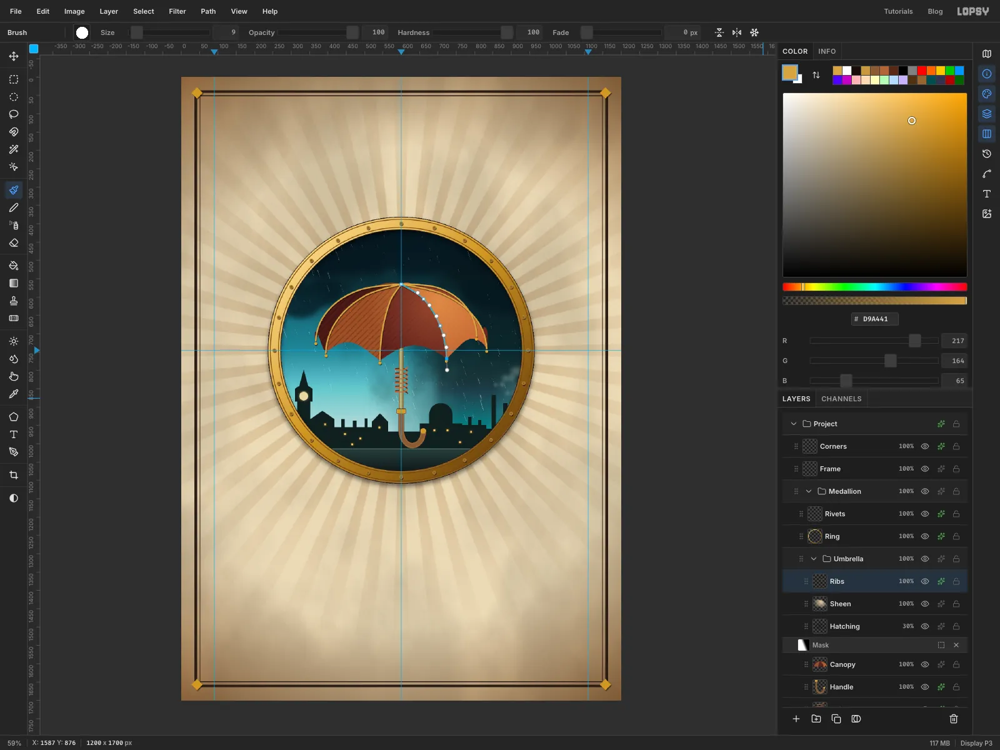

1. Click the `Hatching` layer name, add a layer called `Sheen`, and [[Cmd]]-click the `Canopy` thumbnail. Drag a **Radial** gradient from `#FFE2B8` at 90% opacity to transparent, starting at `700, 615` and about 190 px long. Press [[Cmd+D]] and set the layer to **Soft Light**.
2. Add a layer called `Ribs` and set the foreground to `#D9A441`. Pick the **Pen** with **Stroke** `4`.
3. Draw every rib except the two at the very back (from `476, 692` and `658, 687`):
   - press on the rib's tip and drag about 30 px toward the apex;
   - press a third of the way up the rib and drag another 30 px along it;
   - do the same two thirds of the way up, keeping the line bowed outward;
   - click the apex;
   - press [[Enter]] to stroke it, then [[Escape]].

   Starting each rib at its tip keeps your first click well away from the last path, so you start a new one.
4. With the **Brush** at size `9`, click a brass tip just past the end of each rib. Give the layer a small **Drop Shadow** (**Offset X** `1`, **Offset Y** `2`, **Blur** `2`, **Opacity** `60`).

## Top it with a lightning rod

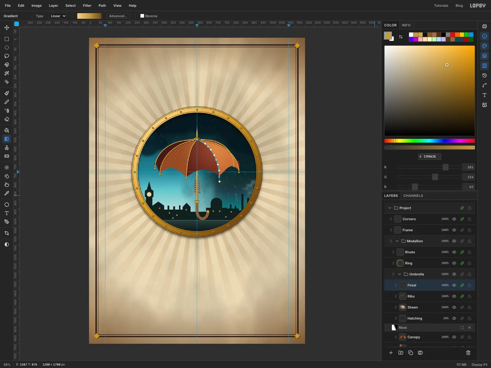

1. Add a layer called `Finial` and set the foreground to brass.
2. Select a cap with the Elliptical Selection dialog: **From** `580, 555`, **To** `620, 571`. Then hold [[Shift]] and **Lasso** a thin spike: from just inside the left of the cap, up to a point at `600, 489`, and back down to the right of the cap.
3. Fill the whole selection with a **Linear** brass gradient (`#F2D488`, `#C99A3E`, `#6E4A1C`) dragged across it diagonally. Press [[Cmd+D]] and add a 1 px **Stroke** in `#2A1E16`.

## Tilt the whole umbrella

1. Click the `Umbrella` group's row and press [[Cmd+D]]. If anything were selected, the Move tool would transform just that selection on one layer. With nothing selected, it transforms the whole group.
2. Pick the **Move** tool. Handles appear round everything in the group.
3. Drag the round rotation handle outside the top-left corner a short way anticlockwise, about 9°.

## Commit the tilt

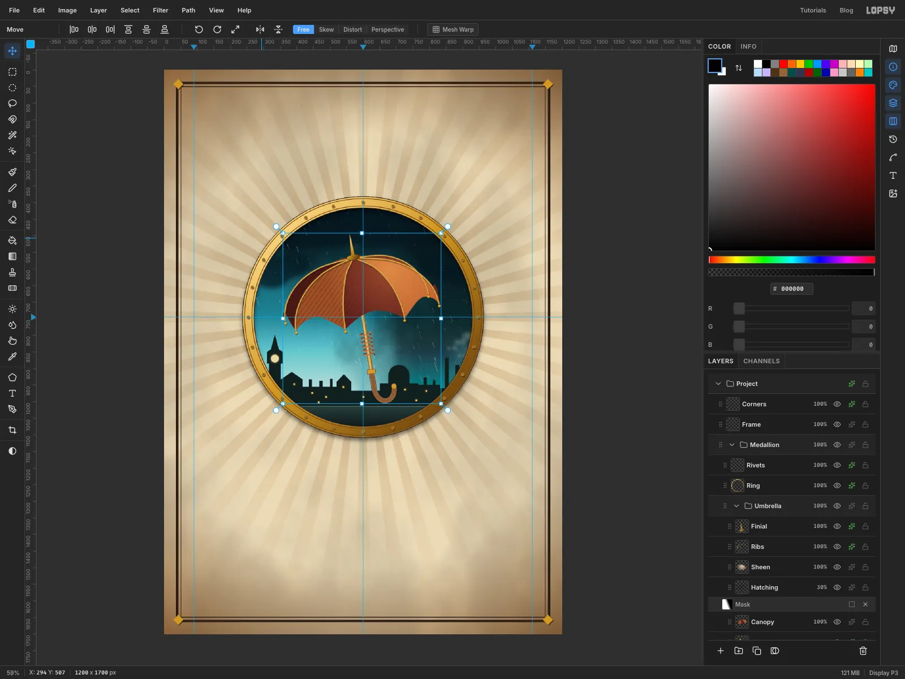

Press [[Cmd+D]] to commit. The shaft, coil, handle, canopy and ribs all turn together about the same centre, so the umbrella leans as one piece.

## Light the storm behind the rod

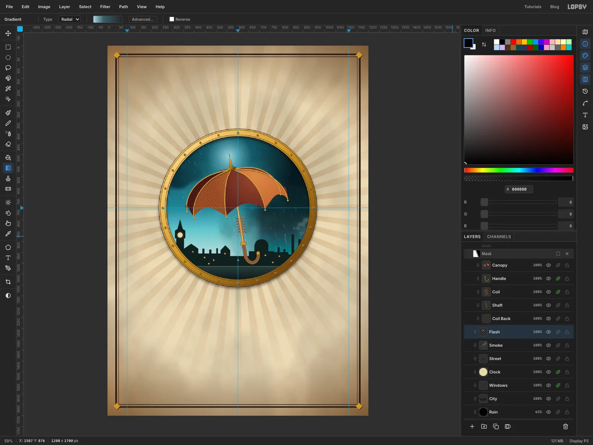

1. Click the `Smoke` layer and add a layer called `Flash`. It sits below the `Umbrella` group.
2. [[Cmd]]-click the `Sky` thumbnail. Make a **Radial** gradient with three stops: `#BFF3FF` at 85% opacity, `#5FC9E6` at 35% opacity about a third of the way along, and transparent at the end.
3. Drag from just below the rod's tip about 300 px out. Press [[Cmd+D]] and set the layer to **Screen**.

## Strike it with lightning

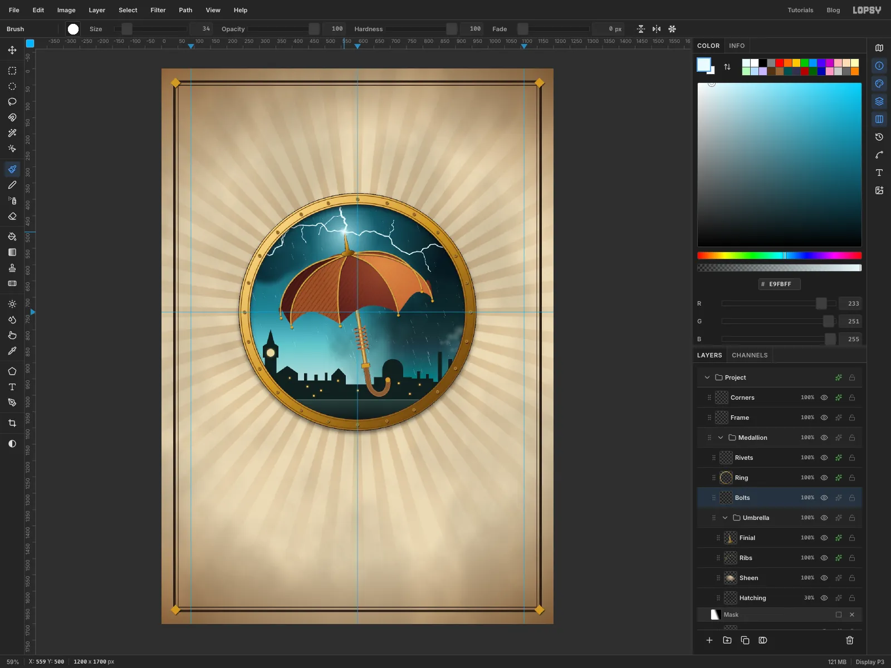

1. Click the `Umbrella` group, collapse it with its arrow, and click **Add Layer**. Name the layer `Bolts`. Collapsing the group first puts the new layer above the group rather than inside it. Expand `Umbrella` again afterwards.
2. Pick the **Brush** at **Hardness** `100` in `#E9FBFF`.
3. At size `6`, click in the clouds near the top of the porthole. Then [[Shift]]-click a zigzag of short, uneven segments down to the rod's tip. Each [[Shift]]-click draws a straight line from the last point.
4. Make two more bolts at size `4`: one from the rivet at about 10 o'clock and one from the rivet at about 2 o'clock, each zigzagging in to the same tip. The charged ring is arcing to the rod. Start each new bolt with a plain click, not a [[Shift]]-click, or it will join on to the end of the last one.
5. Add a few short size `2` forks off each bolt. Again, start each fork with a plain click on the bolt.
6. Set **Hardness** to `0` and **Size** to `34`, and click once on the tip for a white-hot contact flash. Set **Hardness** back to `100`.

## Make the bolts glow

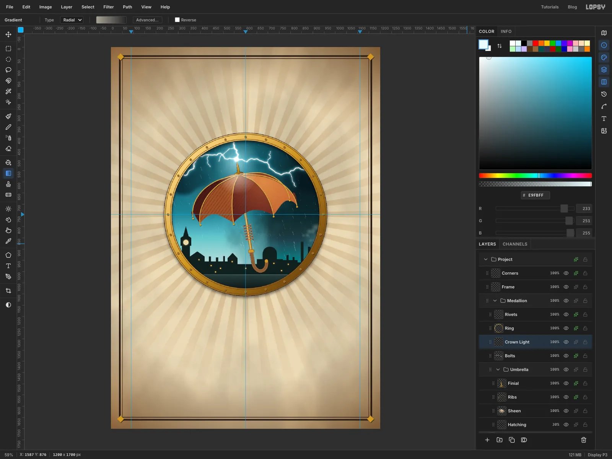

1. Run **Filter → Bloom…** with **Threshold** `40`, **Radius** `10` and **Intensity** `140`.
2. Add an **Outer Glow** with **Size** `22`, **Opacity** `85` and colour `#62D2F0`.
3. With `Bolts` active, add a layer called `Crown Light`. [[Cmd]]-click the `Canopy` thumbnail inside `Umbrella`, then drag a **Radial** gradient from `#FFF6E0` at 60% opacity to transparent. Start about 70 px below the rod's tip and drag about 90 px. Press [[Cmd+D]] and set it to **Screen**. The top of the canopy now catches the flash.

## Add St. Elmo's fire

1. Add a layer called `St Elmo` and use the **Brush** at size `2` in `#E9FBFF`.
2. For each of the four ribs facing you, click near the apex, then [[Shift]]-click ten or twelve short, slightly wobbly segments down beside the rib to its tip.
3. At each tip, draw five short sparks fanning downward, each a plain click on the tip followed by a [[Shift]]-click.
4. Add an **Outer Glow** with **Size** `12`, **Opacity** `80` in `#62D2F0`.

## Earth it with a chain

1. Add a layer called `Chain`. With the **Pencil** at size `5` in `#B98A3A`, click at `702, 999` and [[Shift]]-click at `702, 1023` for an earth stake in the street. Switch to size `3` and [[Shift]]-click 8 px further down for a point.
2. Switch to the **Brush** at size `6` and click a bead every 7 px from the tip of the handle's hook down to the top of the stake, letting the line sag slightly to the right.
3. Give it an **Inner Glow** (**Size** `2`, **Opacity** `80`, `#FFE7A6`) and a small **Drop Shadow**.
4. Add a layer called `Ground Spark` and draw nine short sparks radiating from the top of the stake, each a click and a [[Shift]]-click. Add an **Outer Glow** of **Size** `16`, **Opacity** `90` in `#62D2F0`.
5. Make sure `Umbrella` is expanded. Give its `Handle` layer an **Outer Glow** (**Size** `7`, **Opacity** `55`, `#62D2F0`) and its `Coil` layer one at **Size** `6`, **Opacity** `50`. The whole umbrella now looks charged, and the hook stands out from the dark city.

## Rule the page for type

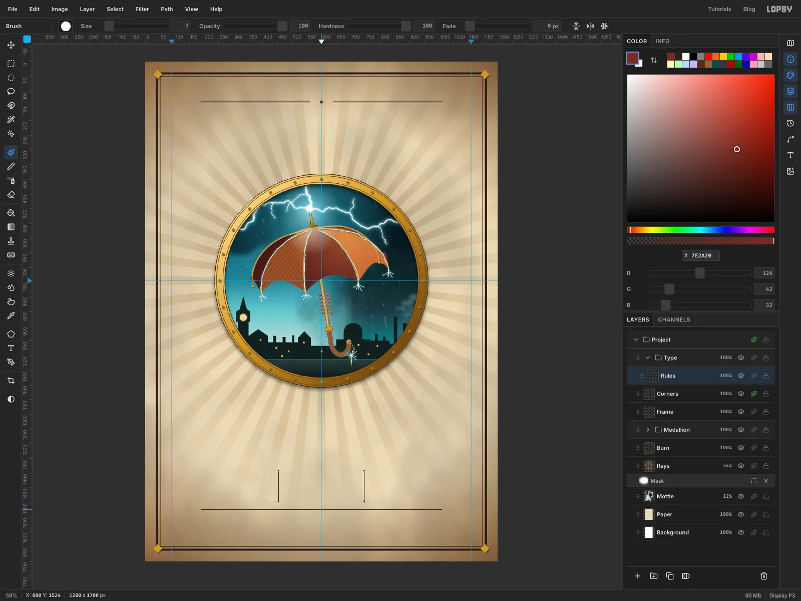

1. Collapse `Medallion`, click `Corners`, click **New Group** and name it `Type`. Add a layer inside it called `Rules`.
2. With the **Pencil** at size `2` in `#2A1E16`, draw each of these with a click and a [[Shift]]-click:
   - a double rule near the top, at `y 134` and `y 140`, running from `x 190` to `560` and from `640` to `1010`;
   - two column dividers at `x 454` and `x 746`, from `y 1398` to `1490`;
   - a footer rule at `y 1524` from `x 190` to `1010`.
3. With the **Brush** in oxblood `#7E2A20`, click a size `12` dot in the gap between the top rules. Click size `7` dots at both ends of each divider and in the middle of the footer rule.

## Set the small print first

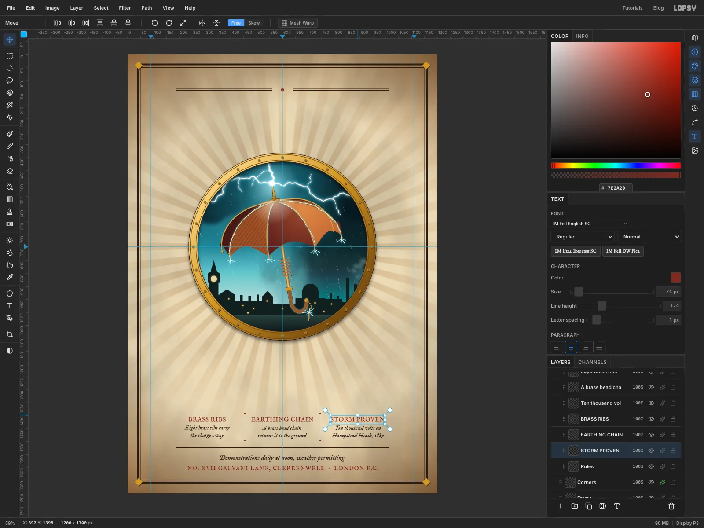

Set the type from the bottom of the page upwards. A text click just below an existing line can land inside it and edit it, so going up keeps every click on empty paper.

> **Tip:** Before you change the font, size or spacing for a new line, click the `Rules` layer. If a text layer is active, those settings restyle *that* layer instead of setting up the next one. This applies to every text step from here on.

1. Pick the **Text** tool and set the options bar's **Align** dropdown to **Center**. With center alignment, the spot you click becomes the middle of the line.
2. Choose **IM Fell English SC** at size `22`. Open the **Text** panel and set **Letter spacing** to `2`. In oxblood, click at `600, 1594` and type `NO. XVII GALVANI LANE, CLERKENWELL  ·  LONDON E.C.` Press [[Tab]] to commit.
3. Click `Rules`. Switch to **IM Fell DW Pica**, style **Italic**, size `26`, letter spacing `0`, in ink. Click at `600, 1548` and type `Demonstrations daily at noon, weather permitting.`
4. Click `Rules`. For the column text, keep **IM Fell DW Pica** **Italic**, set size `22` and **Line height** `1.3`. Click at the centre of each column at `y 1440` and press [[Enter]] between lines. The outer columns are centred at `x 308` and `892`, halfway between the UMBRELLAS line you'll set later and the dividers; the middle one is at `600`.
   - `Eight brass ribs carry` / `the charge away`
   - `A brass bead chain` / `returns it to the ground`
   - `Ten thousand volts on` / `Hampstead Heath, 1887`
5. Click `Rules`. For the headings, choose **IM Fell English SC** at size `24` with letter spacing `1`, in oxblood. Click at `y 1400` above each column and type `BRASS RIBS`, `EARTHING CHAIN` and `STORM PROVEN`.
6. Check the spacing with the **Move** tool and the arrow keys ([[Shift]]+arrow moves 10 px). Aim for the middle of each heading at about `y 1414`, the middle of the column text at `1464`, the italic line at `1565` and the address at `1606`.

The numbers in IM Fell are old-style figures, which bounce above and below the line in all-caps text. That's why the address uses Roman numerals and the volts are spelled out. In italic body text, "1887" looks fine.

## Hang a ribbon

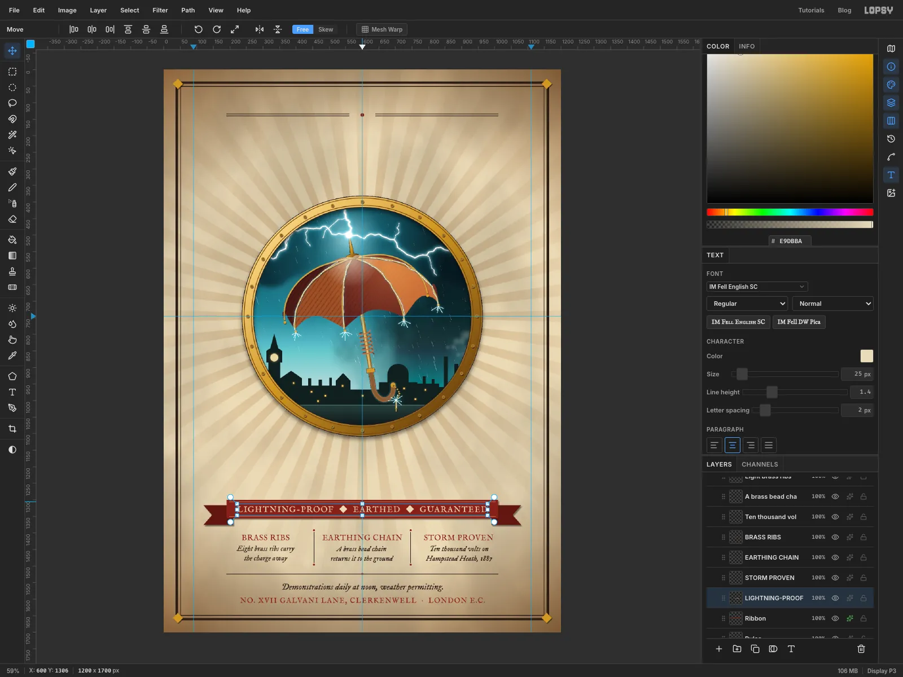

1. Click `Rules` and add a layer called `Ribbon`.
2. Marquee the right tail from `990, 1316` to `1080, 1376` and fill it with `#5A1C15`. Hold [[Alt]] and lasso a V-shaped notch out of its outer end, then press [[Delete]]. Do the same for the left tail at `120, 1316` to `210, 1376`.
3. Lasso a small triangle where each tail folds behind the band, at its bottom inner corner, and fill it with `#3A100C`.
4. Select the band from `190, 1300` to `1010, 1356` and fill it with `#7E2A20`.
5. With the **Pencil** at size `1` in `#D9B98C`, click and [[Shift]]-click a stitching line 6 px inside the top and bottom edges. Add a **Drop Shadow** (**Offset X** `3`, **Offset Y** `4`, **Blur** `4`, **Opacity** `45`).
6. With `Ribbon` active, so the text lands above it, type `LIGHTNING-PROOF  ◆  EARTHED  ◆  GUARANTEED` in **IM Fell English SC** at size `25`, letter spacing `2`, colour `#E9DBBA`. Nudge it until the caps sit halfway between the stitching lines.

## Set UMBRELLAS

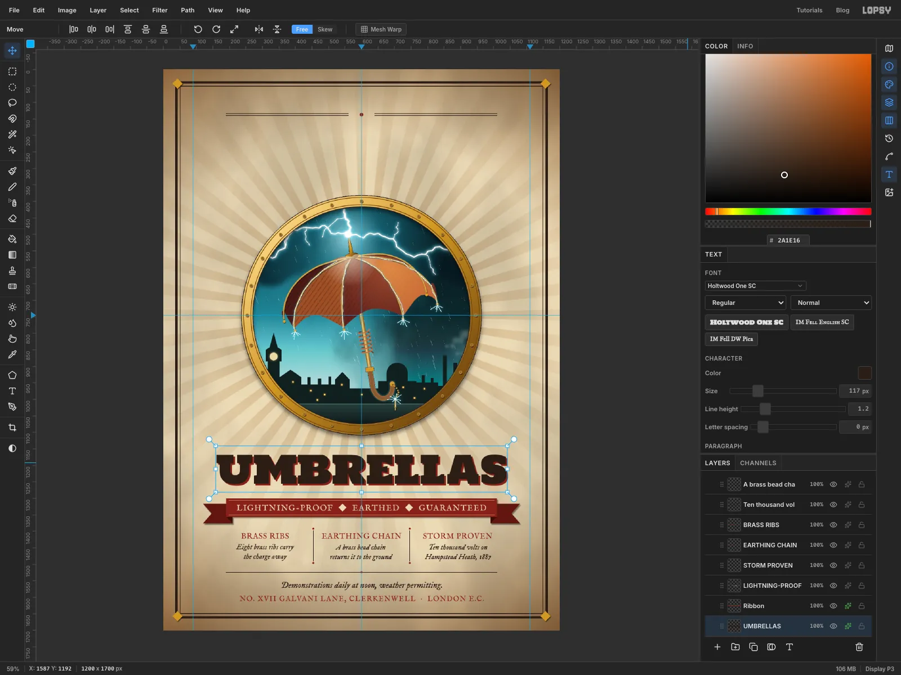

1. Click `Rules` first, so choosing the new font doesn't restyle the ribbon text. Then choose **Holtwood One SC** and type `UMBRELLAS` in ink, centred above the ribbon.
2. With the new layer active, raise the size until the word is about 880 px wide, a little wider than the ribbon's band. That's size `117`.
3. Pick the **Move** tool and click **Align center horizontally** in its options bar. Nudge the word so its top sits at about `y 1167`.
4. Add a **Drop Shadow** in oxblood `#7E2A20` with **Offset X** `5`, **Offset Y** `5`, **Blur** `0` and **Opacity** `100`. The hard offset looks like a second ink colour printed slightly out of register.

## Draw an arc for the maker's name

1. Click `Rules` and pick the **Pen**.
2. Press at `252, 544` (left of the porthole) and drag up and to the right. Press at the top, `600, 343`, and drag to the right. Press at `948, 544` and drag down and to the right. Each drag is about 140 px. Together they make a smooth arc 402 px from the porthole's centre.
3. Click the **✓** (**Commit path**) button in the options bar. This saves the path without stroking it.

## Put text on the arc

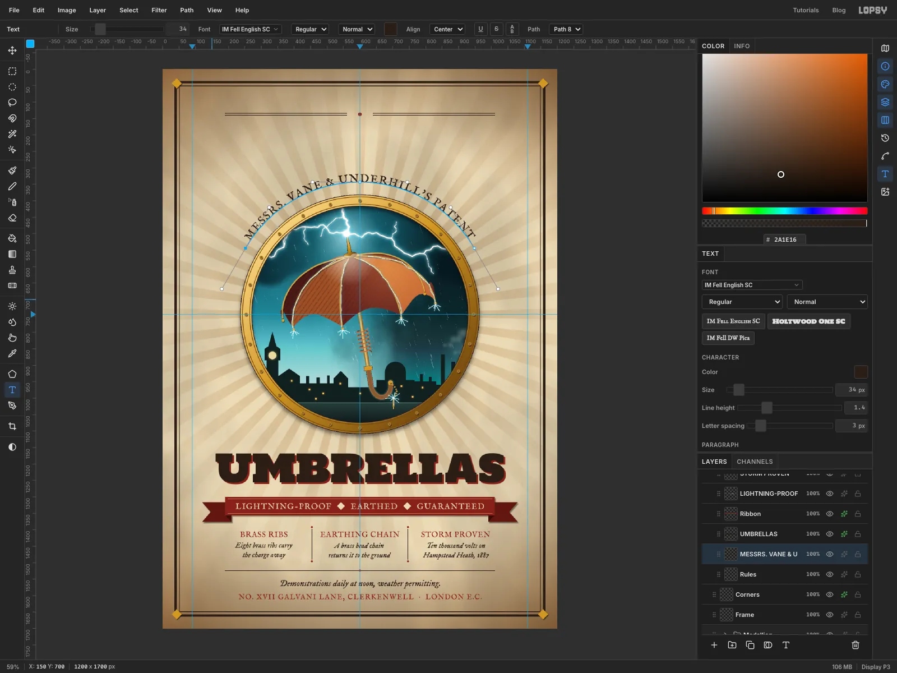

1. Click `Rules` again. Choose **IM Fell English SC** at size `34`, letter spacing `3`, in ink. Click on empty paper to the left of the porthole and type `MESSRS. VANE & UNDERHILL'S PATENT`. Press [[Tab]].
2. In the text options bar, open the **Path** dropdown and choose the arc you just drew. It's the last entry in the list (`Path 8` if you followed along exactly). The letters jump onto the curve.
3. Set **Align** to **Center**. The line centres on the arc, with equal space at both ends.

## Crown it with VOLTAIC

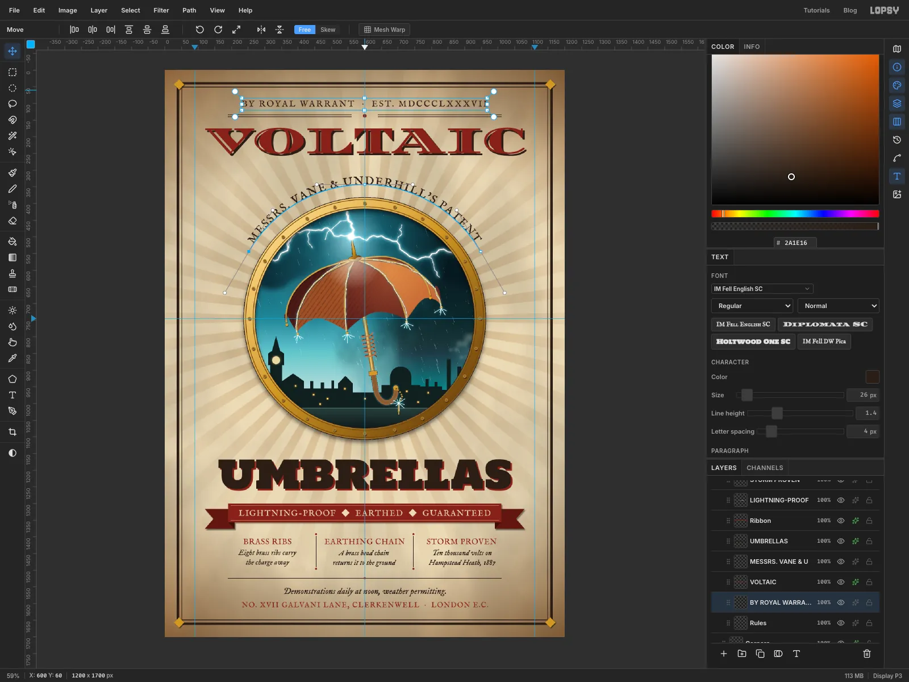

1. Click `Rules`, choose **Diplomata SC**, a wide engraved inline face, and type `VOLTAIC` in oxblood under the top rules.
2. Size it so it spans about 960 px (size `114`). Pick the **Move** tool, click **Align center horizontally**, and nudge its top to about `y 172`.
3. Add a **Drop Shadow** in `#2A1E16` with **Offset X** and **Offset Y** `6`, **Blur** `0` and **Opacity** `100`.
4. Click `Rules` again. Above the double rule, type `BY ROYAL WARRANT  ·  EST. MDCCCLXXXVII` in **IM Fell English SC**, size `26`, letter spacing `4`, in ink. Centre it about 35 px above the rules.

## Start a rubber stamp

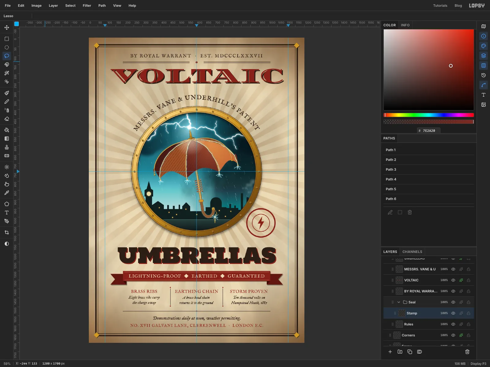

1. Click `Rules`, click **New Group** and name it `Seal`. Add a layer called `Stamp` and set the foreground to oxblood.
2. Select a 164 px circle centred on `958, 1032` (**From** `876, 950`, **To** `1040, 1114`). Fill it, **Shrink** by `7` and press [[Delete]].
3. Select a 100 px circle on the same centre (**From** `908, 982`, **To** `1008, 1082`). Fill it, **Shrink** by `3` and press [[Delete]].
4. Lasso a lightning bolt in the middle, about 76 px tall, and fill it. Press [[Cmd+D]].

## Draw the stamp's top arc

With the **Pen**, draw an arc 56 px from the stamp's centre, clockwise over the top:

1. Press at 9 o'clock, `902, 1032`, and drag about 30 px straight up.
2. Press at 12 o'clock, `958, 976`, and drag about 30 px to the right.
3. Press at 3 o'clock, `1014, 1032`, and drag about 30 px straight down.
4. Click **✓**.

The path runs between the outer and inner rings.

## Set the stamp text

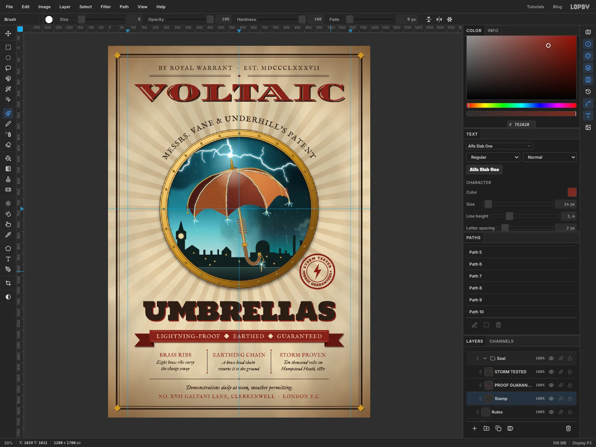

1. Click `Stamp`. Choose **Alfa Slab One** at size `14`, letter spacing `2`, **Align Center**, in oxblood. Type `STORM TESTED` on empty paper, press [[Tab]] and choose the new arc (the last entry, `Path 9`) in the **Path** dropdown.
2. Open the **Paths** panel and click the selected path's row to deselect it. Otherwise your next Pen click near it would edit that path instead of starting a new one.
3. With the **Pen**, draw the bottom arc the other way round, 67 px from the centre:
   - press at `891, 1032` and drag about 37 px down;
   - press at `958, 1099` and drag about 37 px right;
   - press at `1025, 1032` and drag about 37 px up;
   - click **✓**.
4. Click `Stamp`, type `PROOF GUARANTEED` the same way and choose the bottom arc (`Path 10`).
5. Click `Stamp` again. With the **Brush** at size `8`, click a dot at 9 o'clock and at 3 o'clock, between the two words.

Text on a path stands on the side to its left as it travels. The top arc, drawn clockwise, puts its letters outside the curve. The bottom arc, drawn the other way, puts them inside the curve and the right way up.

## Bake and tilt the stamp

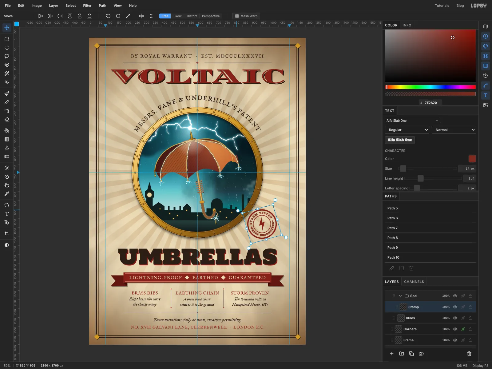

1. Click each text layer and click **Rasterize Layer**. Then click the upper one and press [[Cmd+E]] twice to merge both into `Stamp`.
2. Marquee a box round the stamp, pick the **Move** tool and drag the rotation handle about 16° anticlockwise. A single pixel layer needs a selection before it shows transform handles. Press [[Cmd+D]].

## Make a speckle mask

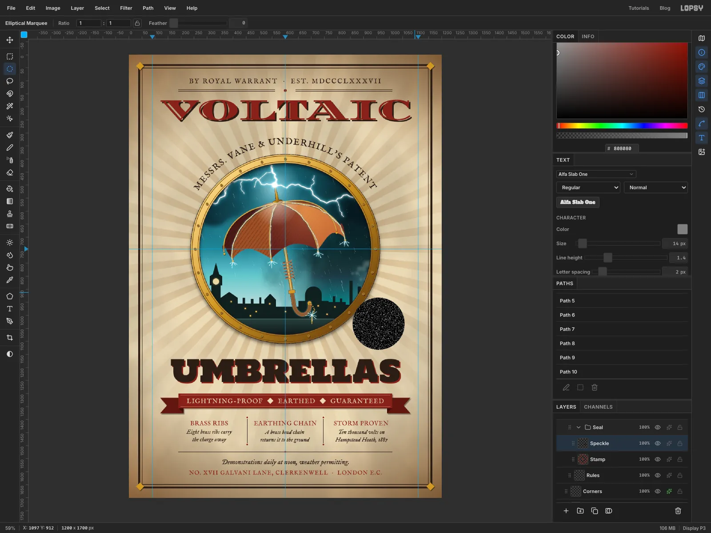

Rubber stamps never print solid. To wear this one down:

1. Add a layer called `Speckle`. Select a 200 px circle over the stamp (**From** `858, 932`, **To** `1058, 1132`) and fill it with `#808080`.
2. Run **Add Noise** at `100` **Mono**, then **Threshold** at `168`. You get scattered white specks on black. Press [[Cmd+D]].
3. Pick the **Magic Wand**, set **Tolerance** to `10` and untick **Contiguous**. Click on a black part of the disc. Every black pixel is selected.
4. Choose **Select → Inverse** so only the white specks (and the empty area outside) are selected.

## Wear the ink

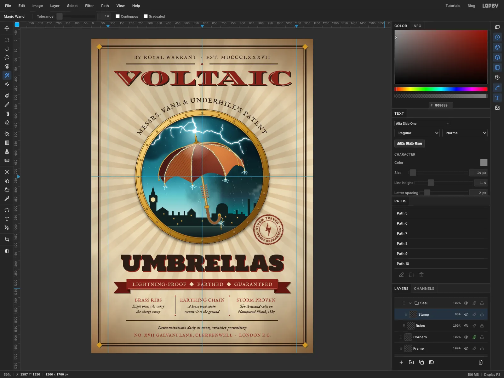

1. Delete the `Speckle` layer. The selection stays.
2. Click `Stamp` and press [[Delete]]. The specks are knocked out of the ink. Press [[Cmd+D]].
3. Set `Stamp` to **Multiply** at `88%` so the paper's grain and rays show through the ink.

## Add contrast with Levels

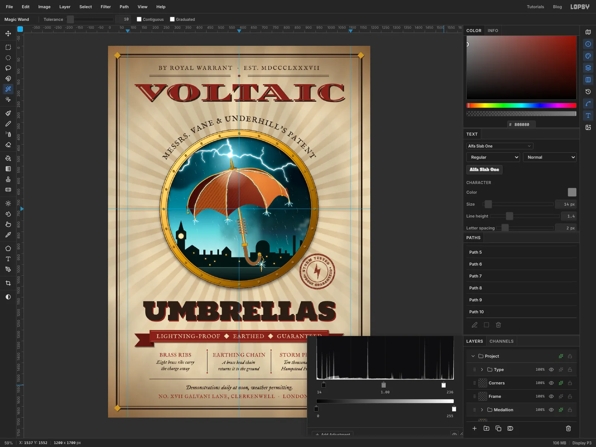

1. Collapse `Type`, click the `Medallion` group and open its drawer with the sparkle icon. For a group, the drawer shows **Adjustments**.
2. Click **Add Adjustment** and choose **Levels**.
3. Drag the black input handle under the histogram to `14` and the white handle to `236`. If the drawer runs off the bottom of the window, scroll inside it to reach the handles. The storm gets darker and the lightning brighter. Only the porthole changes, because the adjustment belongs to the group.

## Finish with grain

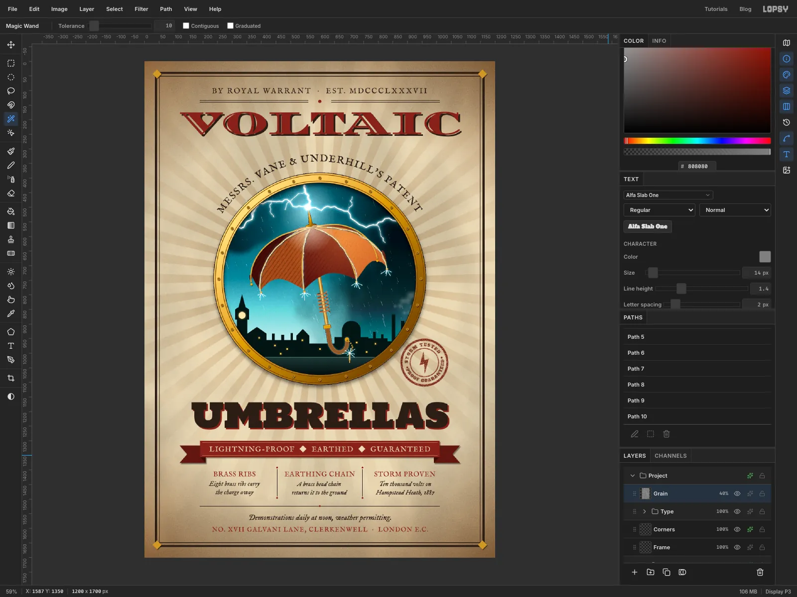

1. Click the `Type` group's row and add a layer called `Grain`. With `Type` collapsed, it lands above everything.
2. Fill it with `#808080`, run **Add Noise** at `60` **Mono**, and set it to **Overlay** at `40%`.
3. Press [[Cmd+;]] to hide the guides.

The grain sits over the ink, the brass and the storm alike, so the whole sheet looks printed on the same paper.

Save your work with **File → Save Project**, and use **File → Quick Export PNG** for the finished flier.
