A spray stencil with more than one colour is cut as a set of *plates*, one
per ink. You spray the first colour through the first plate, lay the next
plate down in exactly the same place, and spray again. A real plate can't
have floating pieces, so every enclosed shape is held in place by thin strips
of uncut metal called *bridges*. The test prints you make along the way are
*proofs*, and a print that adds one colour at a time is a set of
*progressive proofs*.

In this tutorial you'll make **Walrus Bathysphere Works**, an 1800 × 1200 px
steampunk contact sheet for an imaginary stencil set:

- **The plates.** Three brass plates hang along the top: a verdigris *hull*
  plate for the diving bell, a copper *beast* plate for the walrus, and an
  iron-black *key* plate for the porthole frame, rivets, gears and shadows.
- **The proofs.** Below them, three pinned paper proofs show the print being
  built one plate at a time.
- **The final print.** On the right is a signed proof with a stencil-lettered
  title and a rubber stamp.
- **The bench.** Everything sits on a walnut workbench under an engraved brass
  nameplate, with a brass rule and an ink swatch card along the bottom.

The walrus comes from a photo:
[Pacific Walrus - Bull](https://commons.wikimedia.org/wiki/File:Pacific_Walrus_-_Bull_(8247646168).jpg)
by Joel Garlich-Miller of the U.S. Fish and Wildlife Service, on Wikimedia
Commons. It is in the **public domain**. Download the 3072 × 2048 original.
The bull is dark against bright snow and sky, so it separates cleanly into
tones.

Three ideas keep the set in register:

- **You design the art once, big, on the final proof.** The plates and the
  small proofs are all shrunken copies of those same three ink layers.
- **Each ink is its own layer.** Copying a layer's pixels gives you a
  *cutter*. [[Cmd]]-click a cutter's thumbnail and press [[Backspace]] on the
  brass, and the plate is cut.
- **Cells repeat every 380 px across.** A copy for the next proof moves by
  exactly one cell, and a cutter moves straight up into its plate.

Along the way you'll use:

- **Threshold** and the **Magic Wand** to split a photo into ink separations
- **marquees and the Lasso** with [[Shift]], [[Alt]] and [[Shift]]+[[Alt]] to add, subtract and intersect, which is how every bridge is cut
- the Brush's **Radial Symmetry** for rivets and the **Sunburst** filter for gear teeth
- **copy, paste in place** and **[[Alt]]-drag duplicates**, with the Move tool's scale and rotate handles on layers, live text and whole groups
- **Define Pattern** and **Fill with Pattern** for a ruler's ticks
- **layer effects**, **blend modes** and **layer masks** edited with filters, for brass, spray halos and a worn rubber stamp

The palette:

- Walnut `#3A2416`, plank seams `#140B05`
- Plate brass `#5C4826` → `#BFA266` → `#8E7440` → `#CDB67E` → `#86693A` → `#4E3D1F`
- Nameplate brass `#5C4826` → `#C9AE72` → `#97804A` → `#D8C48F` → `#665030`
- Proof card `#EFE4CA`, proof paper `#E8DCC0`
- Verdigris `#2F7F74`, copper `#A4502A`, iron black `#1E1A17`
- Nameplate lettering `#2E1F08`, plate engraving `#2A1C06`, engraving highlight `#F8E7B0`
- Stamp red `#9C2A1F`, pencil `#4F4B45`
- Lamp `#FFC46B`, vignette `#1A0E06`

## Set up the sheet, guides and wood grain

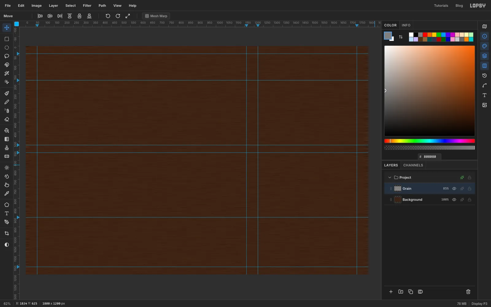

1. Choose **File → New**, set **Width** `1800` and **Height** `1200` with a **White** background, and click **Create**.
2. Click the top ruler at `60`, `1160`, `1220` and `1740` to drop four vertical guides.
3. Click the left ruler at `40`, `180`, `520`, `560`, `900` and `1160` to drop six horizontal guides.
4. Click the **Background** row, set the foreground colour to walnut `#3A2416` and choose **Edit → Fill**.
5. Click **Layer 1** and rename it `Grain`. Fill it with `#808080`.
6. Make the grain:
   - **Filter → Add Noise…**, **Mono**, **Amount** `100`.
   - **Filter → Motion Blur…**, **Angle** `0`, **Distance** `60`.
   - **Filter → Brightness/Contrast…**, **Contrast** `90`.
7. Open the layer's effects (the sparkle button on its row) and set the blend mode to **Overlay**. Close the drawer, click the row's opacity and set it to `85%`.

The guides split the sheet into a 1100 px working column on the left and a 520 px column on the right for the final proof.

## Add plank seams and a patina

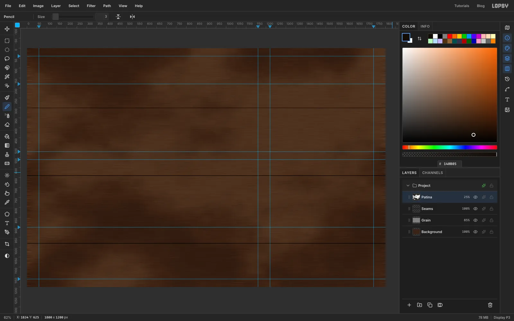

1. Click **Add Layer** and name it `Seams`.
2. Pick the **Pencil**, set **Size** to `3` and the colour to `#140B05`.
3. Click at the left edge of the canvas at y `300`, then [[Shift]]-click the right edge at the same height. Shift-click draws a straight line between the two clicks.
4. Draw two more seams the same way at y `640` and `980`.
5. Add a layer called `Patina` and apply **Filter → Clouds…** with **Scale** `4`.
6. Set its blend mode to **Soft Light** and its opacity to `25%`.

## Draw the brass nameplate

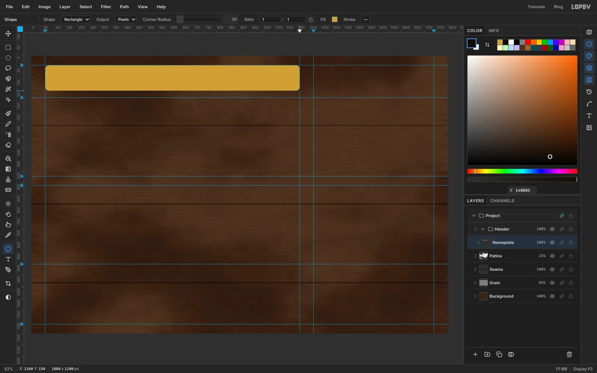

1. Click **New Group** at the bottom of the Layers panel and rename the group `Header`.
2. With the group selected, click **Add Layer**. The new layer goes inside the group. Name it `Nameplate`.
3. Pick the **Shape** tool. In the options bar choose **Rectangle**, set **Corner Radius** to `16`, set the fill to `#C9A04A`, and remove any stroke.
4. Shapes grow from their centre. Press at the middle of the top band (610, 95) and drag to where the right guide meets y `150`. The plate fills 60–1160 across and 40–150 down, snapping to the guides.

## Brush the brass

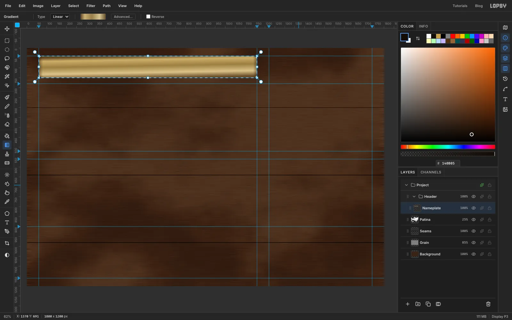

1. [[Cmd]]-click the **Nameplate** thumbnail to select its pixels.
2. Pick the **Gradient** tool, choose **Linear** and click **Advanced…**. Set up five stops by clicking the bar and typing each hex: `#5C4826` at 0%, `#C9AE72` at 16%, `#97804A` at 45%, `#D8C48F` at 76% and `#665030` at 100%. Click **Done**.
3. Drag straight down from the top edge of the plate to its bottom edge.
4. Apply **Add Noise…** (**Mono**, Amount `18`), then **Motion Blur…** (Angle `0`, Distance `40`). The selection keeps both filters on the plate. They streak the noise sideways like brushed metal.

## Give the nameplate depth

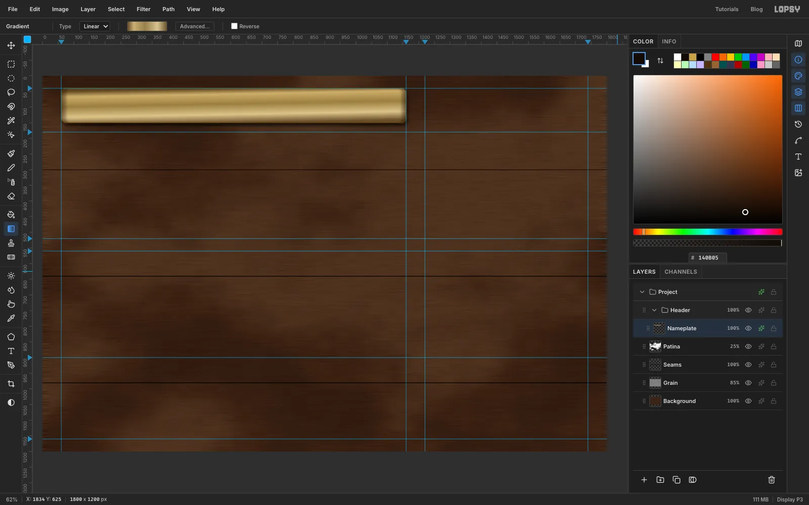

Press [[Cmd+D]] and open the **Nameplate** layer's effects:

- **Stroke**: Width `2`, colour `#4A3210`
- **Inner Glow**: Size `10`, Opacity `55`, colour `#3B2608`
- **Drop Shadow**: Offset Y `8`, Blur `14`, Opacity `65`

## Lay down the proof card

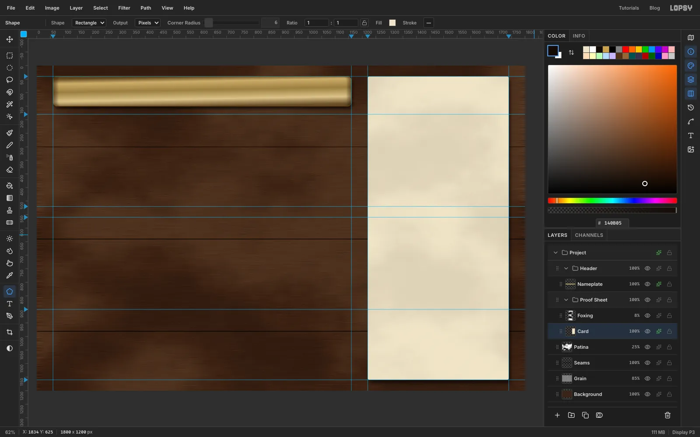

1. Click **Patina**, then **New Group**, and name it `Proof Sheet`. A new group goes above the row you have selected, so starting from Patina keeps it out of the Header group.
2. Add a layer called `Card`. With the **Shape** tool (Rectangle, Corner Radius `6`, fill `#EFE4CA`), press at the middle of the right column (1480, 600) and drag to its bottom-right guide corner (1740, 1160).
3. [[Cmd]]-click the **Card** thumbnail and apply **Add Noise…** with **Mono**, **Gaussian** and Amount `10`.
4. Add a layer called `Foxing`. Apply **Clouds…** at Scale `6`. The selection is still the card, so choose **Select → Inverse** and press [[Backspace]] to clear the rest. Press [[Cmd+D]].
5. Set Foxing to **Multiply** at `8%`.
6. Click **Card** and give it a **Drop Shadow**: Offset X `6`, Offset Y `12`, Blur `20`, Opacity `60`.

## Drop in the walrus

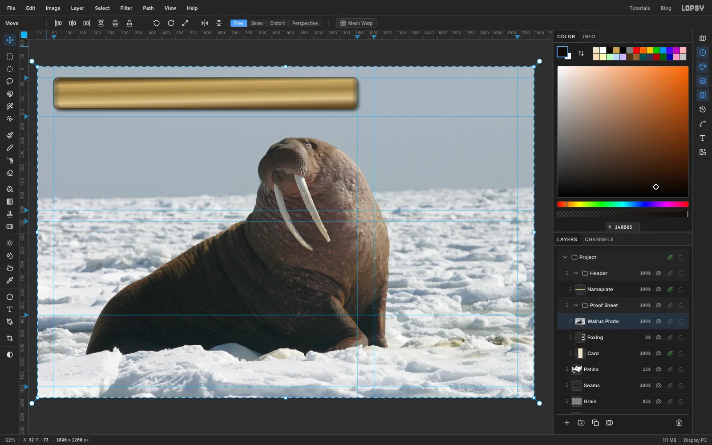

Drag the downloaded photo from your desktop onto the canvas. It lands on a new layer, fitted to the canvas and already selected. Double-click the layer's name and rename it `Walrus Photo`.

## Scale the photo down

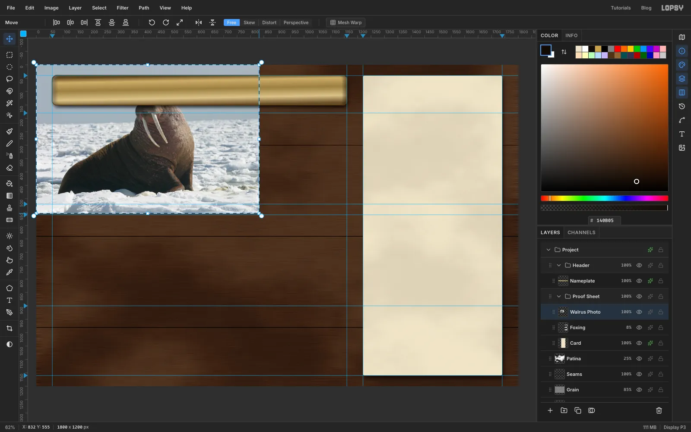

With the **Move** tool, hold [[Cmd]] and drag the photo's bottom-right corner handle up and to the left until it's about **830 px** wide. [[Cmd]] keeps the proportions.

## Move the walrus onto the card

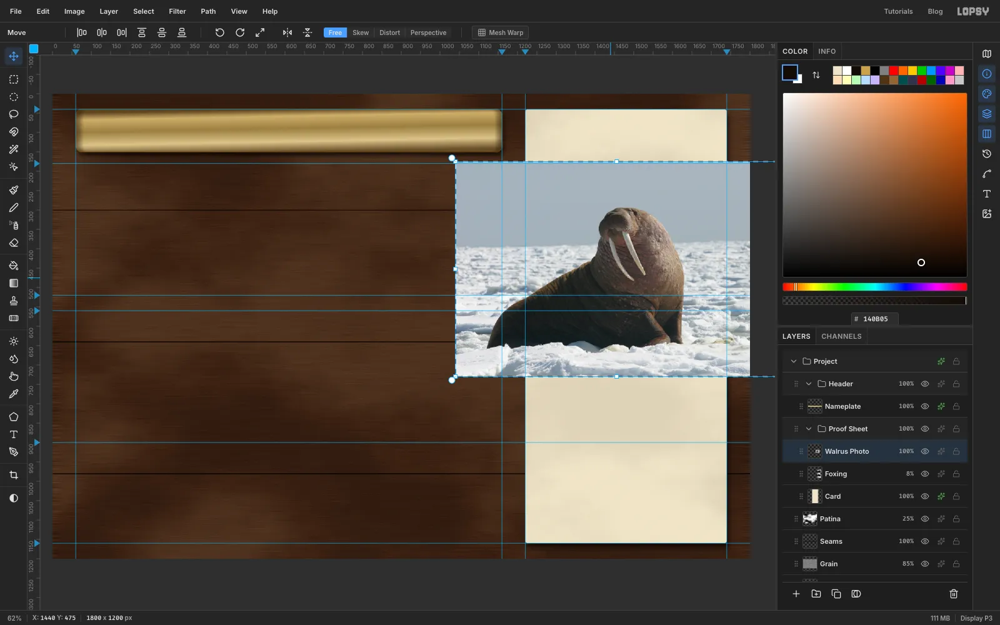

Drag from inside the photo to the right and slightly down, until the walrus's head is centred on x `1480`, at about y `320`, just above the middle of the porthole you'll cut next. The rest of the photo hangs off the right edge of the canvas, and that's fine.

## Cut out a porthole

1. Press [[Cmd+D]].
2. Pick the **Elliptical Marquee** and drag from (1330, 265) to (1630, 565). That's a 300 px circle centred on (1480, 415).
3. Choose **Select → Inverse**, press [[Backspace]], then choose **Select → Inverse** again so the circle is selected.
4. Press [[Cmd+C]], then [[Cmd+V]]. The paste lands in place on a new layer. Rename it `Walrus Dark`.
5. Click **Walrus Photo** and press [[Cmd+V]] again. Rename this copy `Walrus Mid`. Press [[Cmd+D]].

## Find the shadows with Threshold

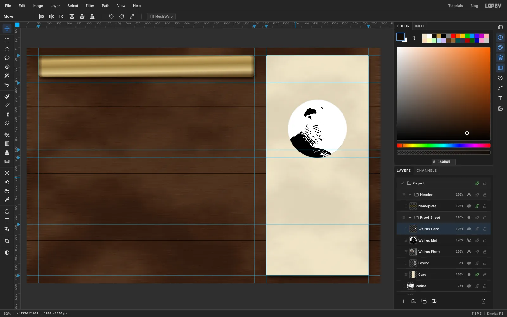

Click **Walrus Dark** and apply:

- **Gaussian Blur…** at `3`. Blurring first gives chunkier shapes that are easier to cut.
- **Threshold…** at `52`. Only the darkest shadows turn black. These become the iron plate's walrus details.

## Find the silhouette with Threshold

Click **Walrus Mid** and apply **Gaussian Blur…** at `3` and **Threshold…** at `165`. Now the whole walrus is black and the snow and sky are white. This is the copper plate. The tusks only come through as a thin sliver, so you'll cut them out by hand in the next step.

(To compare the two, click the eye on **Walrus Dark** to hide it, then show it again.)

## Select the copper shape and carve out bridges

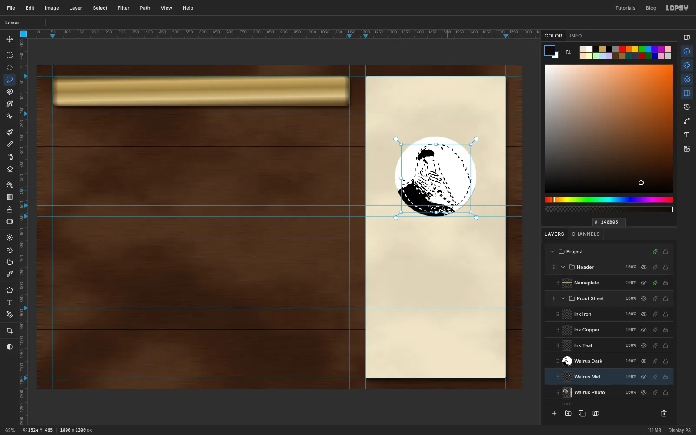

1. Click **Walrus Dark**, then **Add Layer** three times to make `Ink Teal`, `Ink Copper` and `Ink Iron`, in that order. Set each one to **Multiply**.
2. Click **Walrus Mid**. Pick the **Magic Wand**, set **Tolerance** to `40`, untick **Contiguous**, and click the black body.
3. Choose **Select → Grow…** `4`, then **Select → Shrink…** `4`. This closes up little white specks inside the shape. Specks like that would be loose pieces in a real plate.
4. With the **Elliptical Marquee**, hold [[Shift]]+[[Alt]] and drag from (1350, 285) to (1610, 545). That keeps only the part inside a 130 px-radius window, and leaves a 4 px bridge between the walrus and the porthole frame you'll add later.
5. Pick the **Lasso**, hold [[Alt]] and draw around each tusk to subtract it. The tusks stay as bare paper.
6. Each tusk is now an island of uncut metal inside the cut. Give it a bridge: with [[Alt]] held, lasso a 4 px strip that carries on from the tusk tip, in the tusk's direction, out to the window edge.

## Fill the copper and iron

1. Click **Ink Copper**, set the foreground to `#A4502A` and choose **Edit → Fill**.
2. Look for stray copper outside the walrus. A fleck of shadow on the ice gets caught just left of the head. Marquee it and press [[Backspace]].
3. Now the iron. Click **Walrus Dark** and build its selection the same way: Magic Wand on the black, **Grow** `6` and **Shrink** `6`, intersect with the same window circle, then [[Alt]]-lasso out the tusks and their bridges.
4. Click **Ink Iron**, set the foreground to `#1E1A17` and choose **Edit → Fill**.
5. Press [[Cmd+D]] and hide **Walrus Dark**, **Walrus Mid** and **Walrus Photo**.

## Select the diving bell's hull

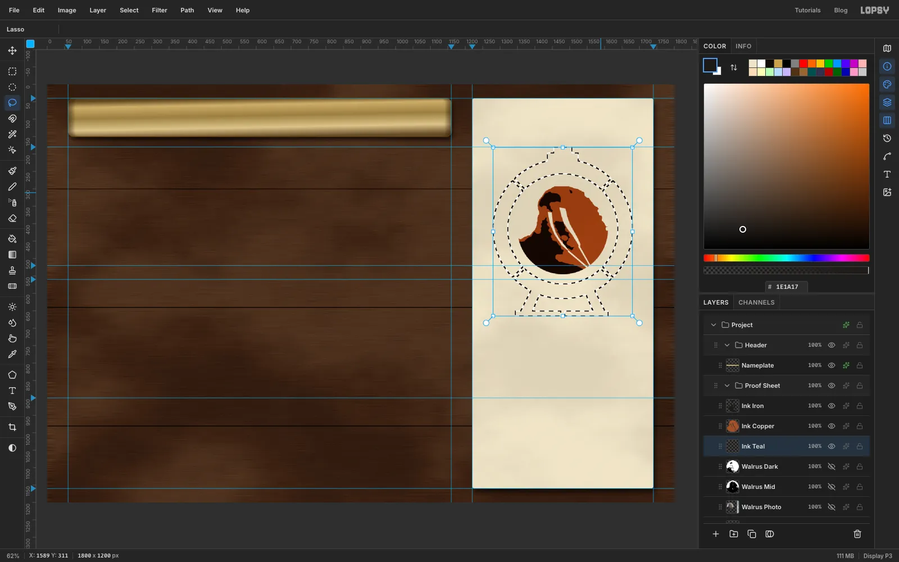

Choose **View → Snap to Guides** to untick it, or the guides will pull these small shapes out of place. Click **Ink Teal**. Everything here is centred on the porthole at x `1480`.

1. **The ring.** Drag an **Elliptical Marquee** from (1280, 215) to (1680, 615) for a 400 px circle. Hold [[Alt]] and take out a 316 px circle on the same centre, from (1322, 257) to (1638, 573).
2. **The hatch.** With [[Shift]] and the **Rectangular Marquee**, add a box 88 px wide and 26 px tall on top of the ring, with its top-left at (1436, 197). Then add a narrower 52 × 18 cap above it at (1454, 181). Together they make a stepped hatch.
3. **The stand.** With [[Shift]] and the **Lasso**, add two legs about 20 px thick. They leave the bottom of the ring near x 1405 and x 1555 and splay out to about x 1375 and x 1585 at y `651`. [[Shift]]-add a foot bar under them with the Rectangular Marquee, from (1344, 651) to (1610, 665).
4. **The bridges.** Hold [[Alt]] and cut a 12 px gap in the middle of the foot bar. Without it, the triangle between the legs would fall out of the plate. Still with [[Alt]], lasso four thin 7 px strips across the ring at the diagonals (top-left, top-right, bottom-left, bottom-right). These hold the middle of the plate.

## Fill the verdigris hull

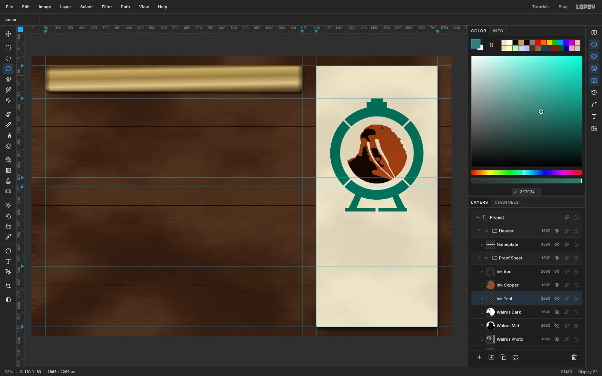

Set the foreground to `#2F7F74`, choose **Edit → Fill**, and press [[Cmd+D]].

## Add the porthole frame

Click **Ink Iron** and set the foreground to `#1E1A17`.

1. Drag an elliptical marquee for a 316 px circle on the hull's centre.
2. With [[Alt]], subtract a 268 px circle on the same centre.
3. With [[Alt]] and the Rectangular Marquee, cut a 6 px gap through the ring at 12, 3, 6 and 9 o'clock.
4. Fill and deselect.

## Rivet the hull with Radial Symmetry

1. Pick the **Brush** with **Size** `13`, **Hardness** `100` and **Opacity** `100`.
2. Click **Radial Symmetry** in the options bar and set **Segments** to `16`.
3. [[Cmd]]-click the centre of the porthole (1480, 415) to move the symmetry centre there.
4. Click once in the middle of the green band, just right of 12 o'clock. Lopsy stamps sixteen rivets at once. Starting slightly off the top keeps them clear of the diagonal bridges.
5. Click **Radial Symmetry** again to turn it off.
6. Click two hatch bolts at (1448, 210) and (1512, 210).

## Open up the muzzle

Iron that covers the whole snout makes the walrus read as a hooded blob. Still on **Ink Iron**:

1. Lasso around the dark mass above the tusk roots and press [[Backspace]]. The copper underneath shows through.
2. Marquee the stray drips near the eye, and any loose specks, and delete them.
3. One rivet, low on the left (1377, 562), will sit under a gear. Marquee it and delete it so the two don't merge into a blob.

## Add whiskers and an eye

1. With the **Brush** at **Size** `5`, click three short rows of dots on each side of the muzzle. These are the whisker pads. In the plate they're just small holes, so they hold up fine.
2. With the **Pencil** at Size `3`, click above the tusk roots and [[Shift]]-click just below it to draw the short groove between the pads.
3. With the **Brush** at Size `10`, click one round eye up and to the right of the muzzle.

## Cut gear teeth with Sunburst

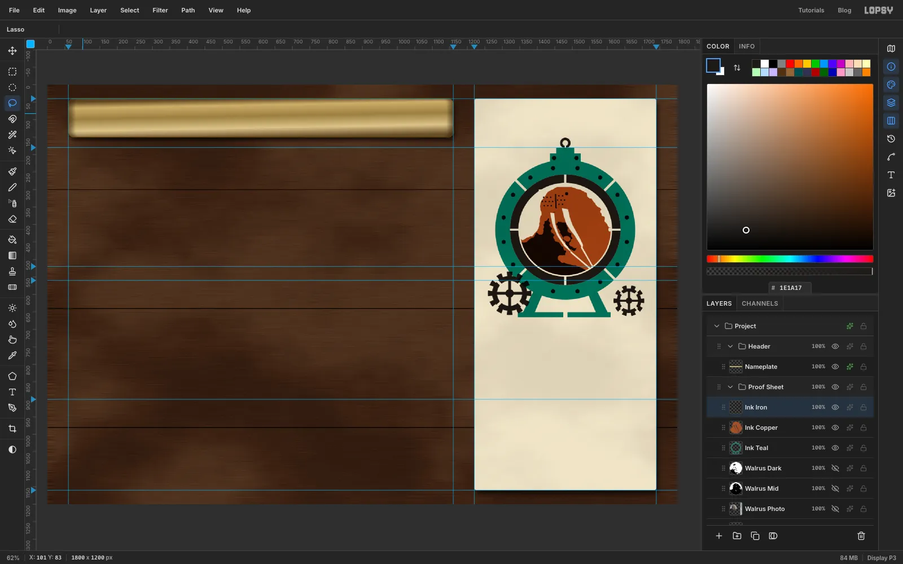

1. **The bail.** Marquee a 30 px circle on top of the hatch, centred on (1480, 167). Subtract a 16 px circle and a 4 px slot down the bottom, then fill.
2. **The teeth.** For the big gear, select a ring with a 124 px circle centred on (1321, 597) and subtract a 96 px circle. Choose **Filter → Sunburst…** and set:
   - **Rays** `12`, **Width** `50`, **Taper** `0`, **Length** `20`
   - **Center X** `73.4`, **Center Y** `49.75`, the gear's centre as a percentage of the canvas

   The rays are painted only inside the selection, so you get twelve square teeth.
3. **The rim, spokes and hub.** Select a 100 px circle and subtract a 72 px circle. Add a horizontal and a vertical 8 px spoke across the middle, and a 24 px hub. Then subtract four 7 px strips across the rim at the diagonals. Those breaks are the bridges that hold the four openings between the spokes. Fill and deselect.
4. **The small gear.** Do the same for a 10-tooth gear centred on (1662, 618), using **Rays** `10`, **Center X** `92.3` and **Center Y** `51.5`. The sizes are a tooth ring of 88 px minus 66 px, a rim of 70 px minus 52 px, 6 px spokes, an 18 px hub and 7 px diagonal bridges.

## Letter the title in stencil type

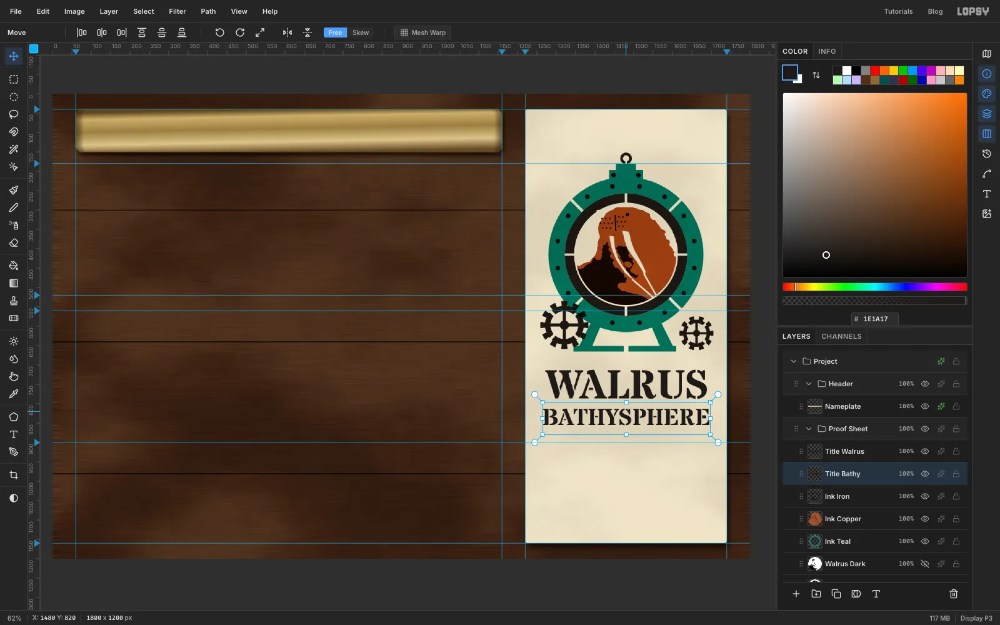

1. With **Ink Iron** selected, pick the **Text** tool. Choose **Stardos Stencil**, **Bold**, **Size** `104`, **Align** center and colour `#1E1A17`.
2. Click under the diving bell at x `1480` and type `WALRUS`. Press [[Tab]] to commit.
3. Click **Ink Iron** again and set the size to `60`. Click below the first line and type `BATHYSPHERE`.
4. With the **Move** tool, nudge both lines with the arrow keys:
   - WALRUS's cap tops sit about 50 px below the foot bar.
   - BATHYSPHERE sits 26 px under WALRUS.
   - Both are centred on x `1480`.

Stardos Stencil already has bridges in its letters, so the title needs no extra cutting.

> **Tip:** Lopsy names a text layer after its first 16 characters. Double-click a name to rename it, for example to `Title Walrus` and `Title Bathy`, if you want tidier rows.

## Add a caption and registration marks

1. Click **Ink Iron**. In **Courier Prime**, **Bold**, Size `18`, type `PROOF No. 3  ·  PLATES I + II + III` and centre it about 38 px under BATHYSPHERE.
2. Click **Ink Iron** again. With the **Pencil** at Size `2`, draw a 34 px cross about 44 px in from each corner of the card, using click then [[Shift]]-click.
3. Pick the **Shape** tool. Choose **Ellipse**, remove the fill, set the stroke to `#1E1A17` and **Width** to `2`.
4. Drag an 18 px circle on each cross. Printers line plates up on these marks.

## Give the inks a spray grain

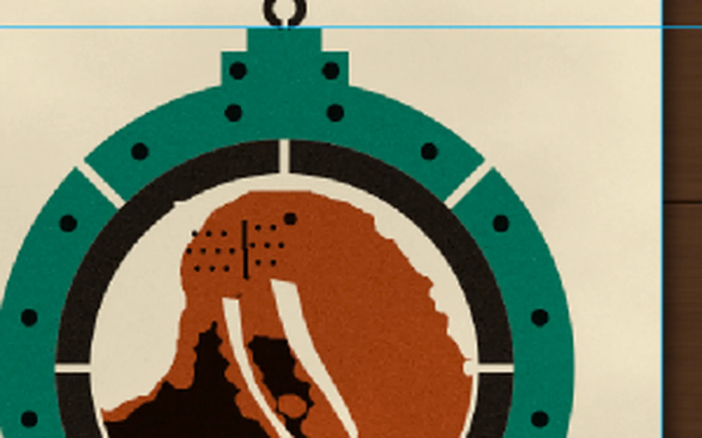

For each of **Ink Teal**, **Ink Copper** and **Ink Iron**:

1. [[Cmd]]-click the thumbnail.
2. Apply **Gaussian Blur…** at `1` for a soft spray edge.
3. Apply **Add Noise…** (**Mono**, **Gaussian**) at `38`.
4. Deselect.

## Make a rubber stamp

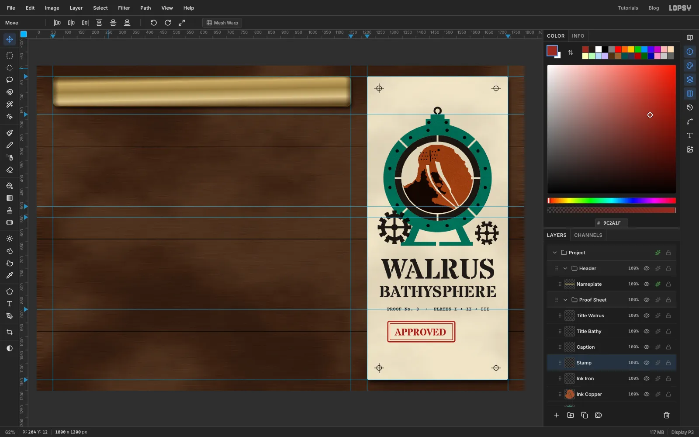

1. Click **Ink Iron** and add a layer called `Stamp`.
2. With the **Shape** tool, draw a stroke-only **Rectangle** in `#9C2A1F` (Width `4`, Corner Radius `6`) about 248 × 76 px, left of centre under the caption.
3. Draw a second one 8 px inside it, at Width `2` and Corner Radius `3`.
4. With **Stamp** selected, type `APPROVED` in **Stardos Stencil Bold** at `36` in the same red. Centre it in the inner box.
5. Choose **Layer → Merge Down** to merge the text into the stamp.

## Turn the stamp

Marquee around the stamp. With the **Move** tool, drag the round handle just outside the top-right corner up and to the left until the stamp tilts about 9° anticlockwise. Press [[Cmd+D]] to commit.

## Wear the stamp with a layer mask

1. Click **Add Mask** at the bottom of the Layers panel, then click the new mask thumbnail to edit the mask.
2. Set the foreground to `#808080` and choose **Edit → Fill**. In mask edit mode, Fill writes the mask.
3. Apply **Add Noise…** (**Mono**) at `100`, **Gaussian Blur…** at `1`, and **Threshold…** at `96`. The black specks in the mask knock holes in the ink.
4. Click the layer's name to leave mask editing. Set the Stamp to **Multiply** at `85%`.

> **Tip:** Clicking the mask thumbnail a second time doesn't leave mask editing. Click the layer's name instead. Any marquee move or transform you do while still in mask mode acts on the mask, so it's worth leaving mask mode as soon as you're done.

## Sign the proof

1. Click **Stamp**. In **Homemade Apple** at Size `24`, colour `#4F4B45`, type `W. Brassbottom` near the bottom right of the card. Keep it well clear of the corner mark.
2. With the **Move** tool, drag the text's top-right rotation handle up a little to tilt it about 5° anticlockwise. The text stays live and editable.
3. Click **Stamp** again and type `A/P` (artist's proof). Line its left edge up with the caption, on the same baseline as the signature.

## Rough out the three brass plates

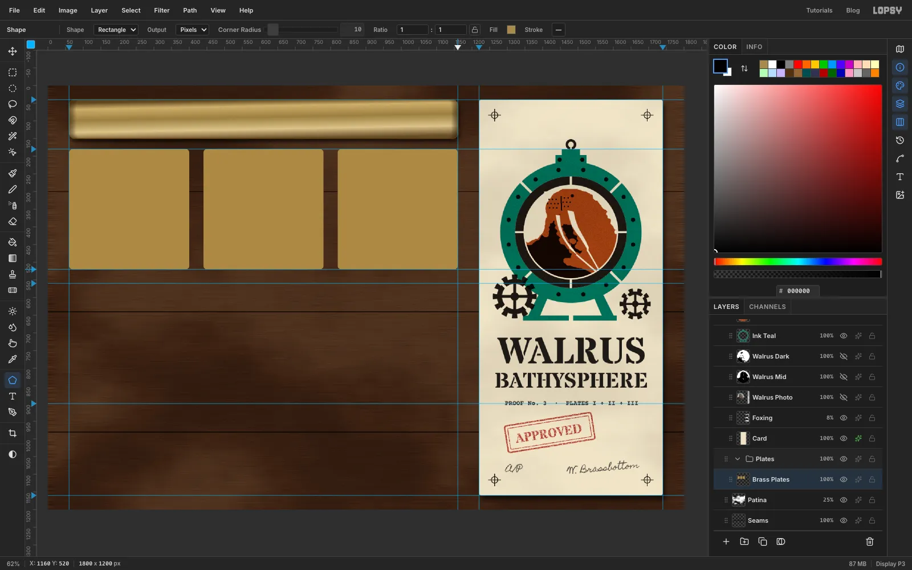

1. Turn **View → Snap to Guides** back on.
2. Click **Patina**, click **New Group**, and name it `Plates`. Add a layer called `Brass Plates`.
3. With the **Shape** tool (Rectangle, Corner Radius `10`, fill `#A88A4E`), draw three 340 px squares in the band between the guides at y `180` and `520`. They sit at x 60, 440 and 820, with 40 px gaps. Drag each one from its centre (230, 610 and 990 across, 350 down).

## Age the brass and add screws

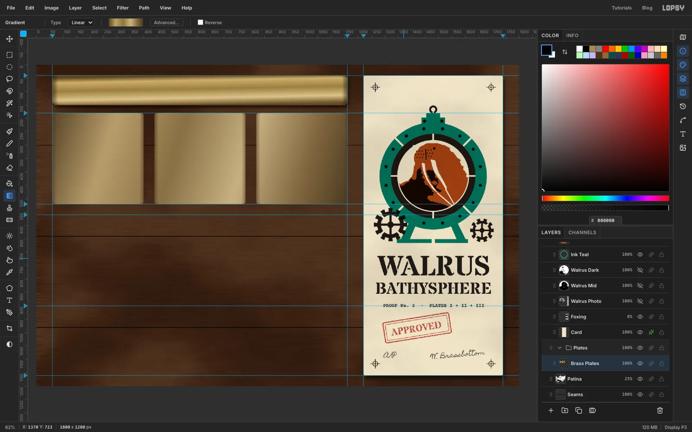

1. [[Cmd]]-click **Brass Plates**. Set a **Linear** gradient with the six plate-brass stops from the palette, at 0, 20, 42, 64, 84 and 100%.
2. Drag from the top-left corner of the first plate to the bottom-right corner of the third, so each plate catches a different part of the light.
3. Apply **Add Noise…** (**Mono**, `14`), **Motion Blur…** (`0°`, `30`) and **Hue/Saturation…** with **Saturation** `−25`. Old brass is less yellow than new. Press [[Cmd+D]].
4. Untick **Snap to Guides** again. Click **Nameplate** and add a layer called `Nameplate Screws`.
5. For each screw, marquee a 16 px circle near the plate's end. Drag a **Radial** gradient (`#F2DFA6` → `#A88A4E` → `#4E3D1F`) from its upper left, then press [[Cmd+D]]. With the **Pencil** at Size `2`, draw a straight slot across it.
6. Give the layer a small **Drop Shadow** (X `1`, Y `2`, Blur `2`).

## Engrave the nameplate

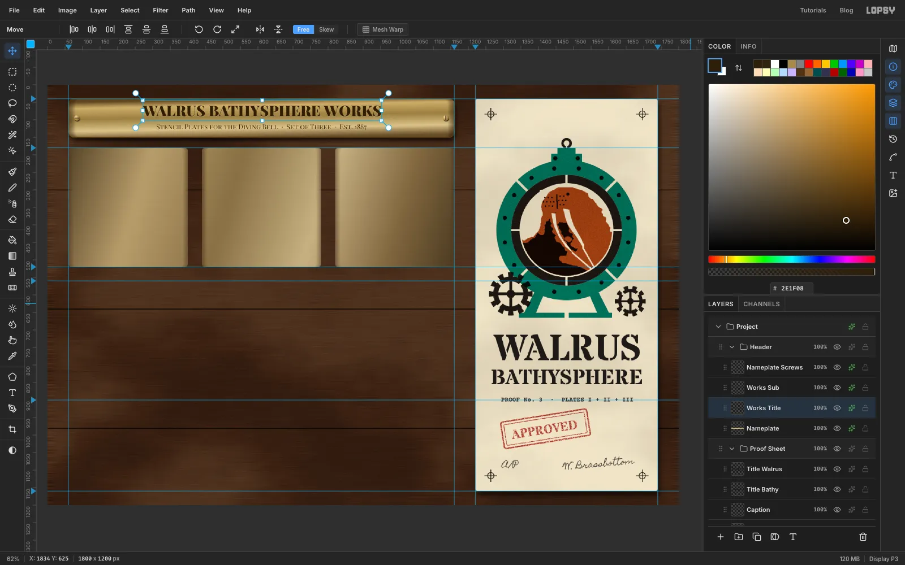

Type the subtitle first. A Text-tool click inside an existing text box edits that text instead of starting a new one.

1. Click **Nameplate**. In **Playfair Display SC** at Size `19`, colour `#2E1F08`, centred on x `610`, type `Stencil Plates for the Diving Bell  ·  Set of Three  ·  Est. 1887`. Seat it so its tops are at y `113`.
2. Click **Nameplate** again and type `WALRUS BATHYSPHERE WORKS` in **Playfair Display SC**, **Black**, Size `42`. Seat its cap tops at y `60`. That leaves about 20 px of brass above the title and below the subtitle.
3. Engrave both layers with a **Drop Shadow** in `#F8E7B0`: Offset X `0`, Offset Y `1`, Blur `0`, Opacity `75`. The light edge under each letter makes it look cut into the metal.

## Pin up three proof papers

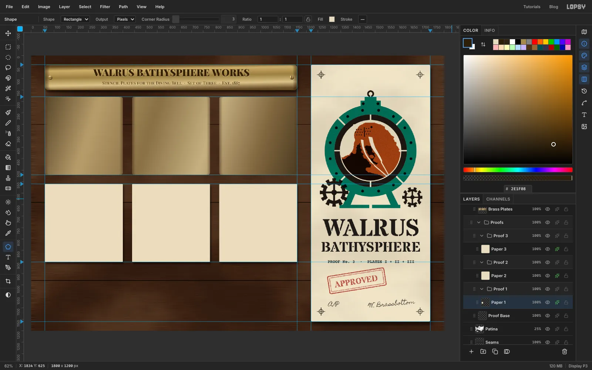

1. Choose **View → Snap to Layers** to untick it, so moved copies don't jump to other layers' edges.
2. Click **Patina**, click **New Group**, and name it `Proofs`. Inside it, add a layer called `Proof Base`. It's only a placeholder. **New Group** puts the new group above whichever row is selected, so clicking Proof Base before each New Group keeps Proof 1, 2 and 3 side by side instead of nesting them inside each other. You'll delete it at the end.
3. With **Proof Base** selected, click **New Group** and name it `Proof 3`. Add a layer called `Paper 3`.
4. Draw a 340 px square with the Shape tool (fill `#E8DCC0`, Corner Radius `3`) in the third cell of the row between y `560` and `900`.
5. [[Cmd]]-click it, apply **Add Noise…** (**Mono**, **Gaussian**, `10`), deselect, and give it a **Drop Shadow** (X `4`, Y `8`, Blur `12`, Opacity `60`).
6. Click **Proof Base** again and repeat steps 3–5 for **Proof 2**/**Paper 2** in the middle cell, then **Proof 1**/**Paper 1** in the first.

## Shrink copies of the art into proof 3

1. Click **Ink Teal**. With nothing selected, click once with the **Rectangular Marquee** to open the **Rectangular Selection** dialog. Enter **From** `1220`, `145` and **To** `1740`, `665`. That's a 520 px square around the art. Press [[Cmd+C]].
2. Click **Paper 3** and press [[Cmd+V]]. The copy pastes in place inside the Proof 3 group, with the marching ants still round it. Rename it `P3 Teal`. Don't deselect yet: the ants are the only thing that shows you the square.
3. With the **Move** tool, drag inside the ants until the square's top-left corner sits at (855, 595), 35 px in from the paper's corner. Watch the cursor position in the status bar, and finish with the arrow keys.
4. With the ants still showing, [[Cmd]]-drag the bottom-right handle up and left until the square is **270 px** wide. Its corner lands at (1125, 865), 35 px in from the paper's bottom-right corner. Press [[Cmd+D]].
5. Do the same for **Ink Copper** (pasted above P3 Teal, named `P3 Copper`) and **Ink Iron** (`P3 Iron`), with the same square and the same corner.

## Build proofs 1 and 2 from the copies

1. Click **P3 Teal**, marquee its square, and press [[Cmd+C]].
2. Click **Paper 2** and press [[Cmd+V]]. Rename it `P2 Teal` and drag it exactly 380 px left. Do the same with **P3 Copper** to make `P2 Copper`.
3. Paste one more teal copy above **Paper 1** as `P1 Teal`, and move it 760 px left.
4. Set all six small ink layers to **Multiply**.

The row now reads plate I, then I + II, then I + II + III. Because every copy came from the same three squares, the proofs are in register.

## Cut the plates

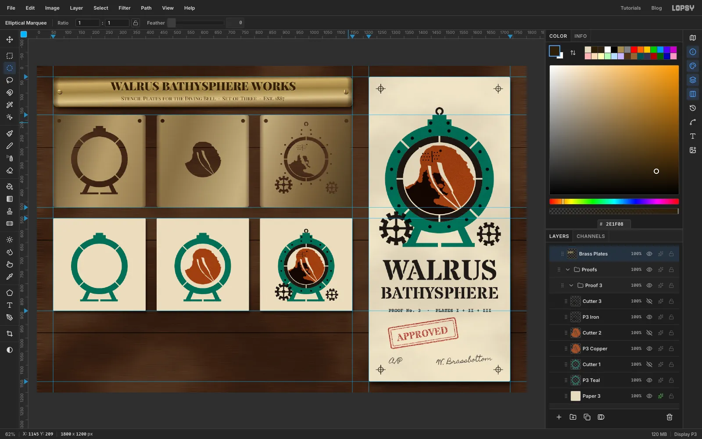

1. **Make the cutters.** Press [[Cmd+D]] first. With a marquee active, an Alt-drag copies only the selected pixels instead of duplicating the layer. Click **P3 Teal** and pick the **Move** tool. Hold [[Alt]] and drag up and to the left until the copy has moved 760 px left and 393 px up, into plate I's cell. Use the status-bar readout, and finish with arrow keys. Moving 393 px up puts the art 22 px below the plate's top edge, which leaves room for a label underneath. Alt-drag duplicates the layer as you move it. Rename the copy `Cutter 1`.
   - Do the same from **P3 Copper**, 380 px left and 393 px up, for `Cutter 2`.
   - Do the same from **P3 Iron**, straight up 393 px, for `Cutter 3`.

   The cutters sit under the brass, so you won't see them yet.
2. **Punch the holes.** [[Cmd]]-click the **Cutter 1** thumbnail, click the **Brass Plates** row and press [[Backspace]]. Plate I is cut. Press [[Cmd+D]] and hide the cutter. Repeat with Cutters 2 and 3.
3. **Registration holes.** Marquee a 14 px circle 22 px in from each plate's top corners. [[Shift]] adds the others to the selection. Press [[Backspace]].
4. **Plate effects.** Give **Brass Plates**:
   - **Drop Shadow**: X `5`, Y `9`, Blur `10`, Opacity `70`. It falls through the holes onto the bench.
   - **Inner Glow**: Size `5`, Opacity `60`, colour `#3B2608`. It darkens the cut edges.
   - **Stroke**: Width `1`, colour `#4A3210`.

## Tarnish the plates and add ink build-up

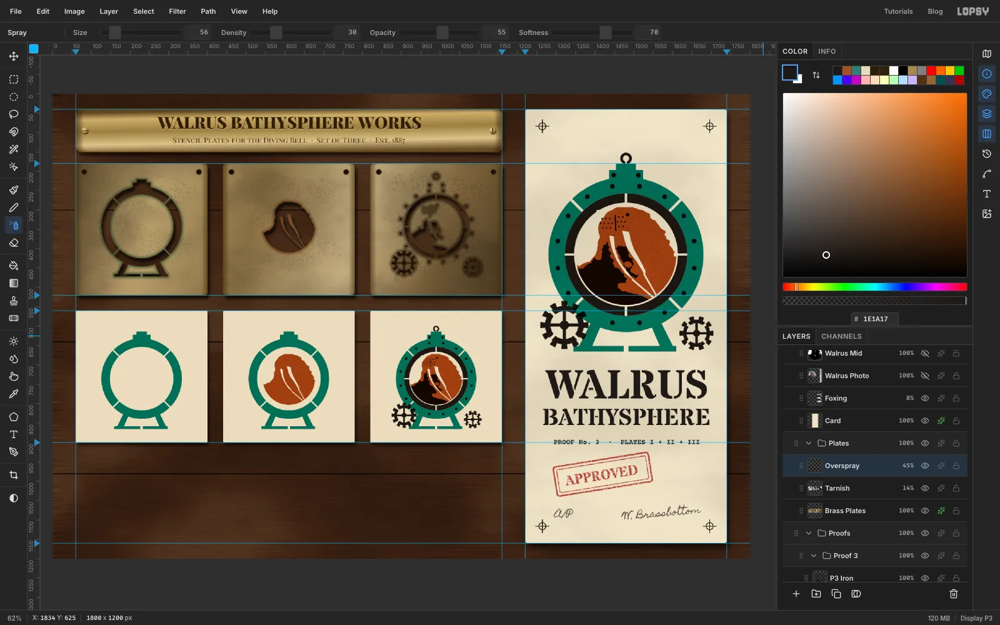

1. **Tarnish.** Add a layer called `Tarnish`. [[Cmd]]-click **Brass Plates**, click **Tarnish**, and apply **Clouds…** (Scale `14`) and **Add Noise…** (**Mono**, `40`). Press [[Cmd+D]] and set it to **Multiply** at `14%`.
2. **Build-up.** Add a layer called `Overspray`. Then for each cutter:
   - [[Cmd]]-click its thumbnail, **Grow…** `5` and **Feather…** `4`.
   - Click **Overspray** and fill with that plate's ink colour.
3. [[Cmd]]-click **Brass Plates**, choose **Select → Inverse**, and press [[Backspace]] on **Overspray**. That clears paint out of the holes. Choose **Select → Inverse** again.
4. **Specks.** With the **Spray** tool (**Size** `56`, **Density** `30`, **Opacity** `55`), zigzag a few passes over each plate in its own ink.
5. Press [[Cmd+D]] and set **Overspray** to **Multiply** at `45%`.
6. The cutters have done their job. Click each **Cutter** row and click **Delete Layer**. A hidden layer still counts toward its group's transform box, so leaving them in would make the Proofs group awkward to move later.

## Label the plates

1. Click **Overspray**. In **Courier Prime Bold** at `15`, colour `#2A1C06`, type `I  ·  HULL  ·  VERDIGRIS` centred under the first plate's art, about 22 px above the plate's bottom edge.
2. Make `II  ·  BEAST  ·  COPPER` and `III  ·  KEY  ·  IRON` the same way, clicking **Overspray** before each one.
3. Engrave all three with the same light Drop Shadow you used on the nameplate.

## Add spray halos and uneven density

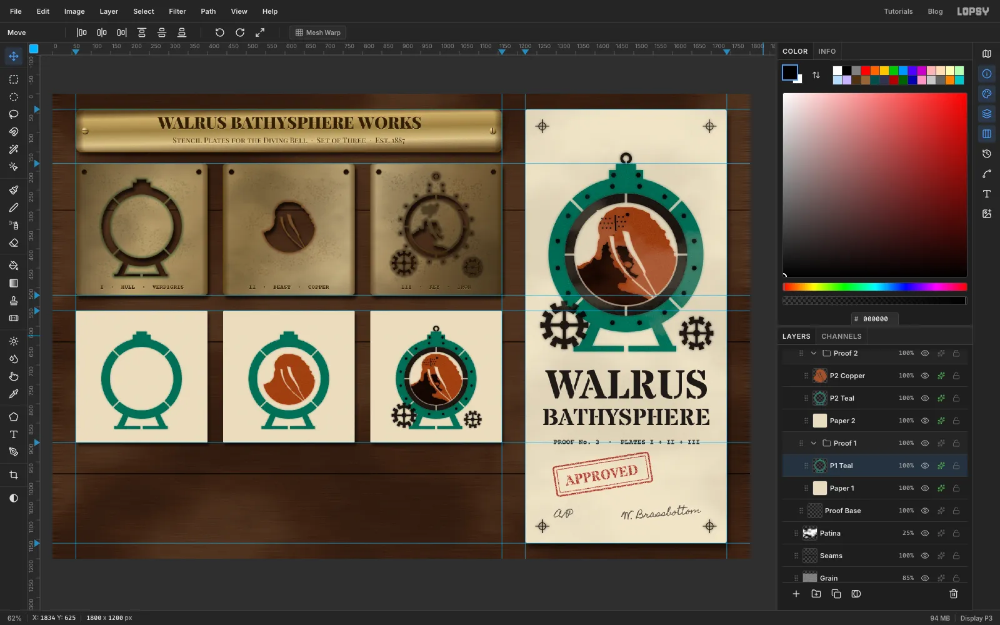

1. **Halos.** Give each ink layer an **Outer Glow** in its own colour at Opacity `70`. Use Size `10` on the three big Ink layers and `6` on the six small proof copies. That's the soft fuzz of paint that drifts under the stencil's edge.
2. **Mottling.** For **Ink Teal**, **Ink Copper** and **Ink Iron**:
   - Click **Add Mask**, then the mask thumbnail.
   - Apply **Clouds…** at Scale `8`, then **Brightness/Contrast…** with Brightness `55` and Contrast `−45`. The mask is now light grey to white, so the ink's density varies across the print, thinner in places like a light pass of spray, but it never drops out completely.
   - Click the layer's name to leave mask editing.

## Tilt the proofs

1. Press [[Cmd+D]] and click the **Proof 1** group row.
2. With the **Move** tool, the handles frame the whole group. Drag the round handle off its top-right corner a couple of degrees anticlockwise. The paper and its print turn together.
3. Turn **Proof 2** a little less the other way, and **Proof 3** barely at all.

## Pin them to the bench

1. Click **P3 Iron** and add a layer called `Pins`.
2. Marquee a 20 px circle centred in the first proof's top margin (230, 576). Fill it with a **Radial** gradient (`#FFF0B8` → `#C9A458` → `#5E4416`) dragged from its upper left.
3. Marquee around the pin. With the **Move** tool, hold [[Alt]] and drag right 380 px to drop a copy on proof 2. [[Alt]]-drag that copy another 380 px for proof 3.
4. Press [[Cmd+D]] and give **Pins** a small **Drop Shadow** (X `3`, Y `5`, Blur `4`).

## Label the proofs

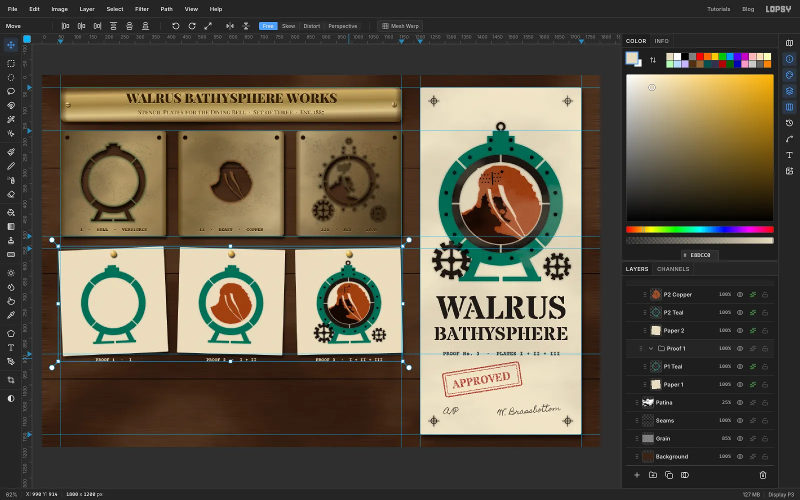

1. Click **Pins**. In **Courier Prime Bold** at `15`, colour `#E8DCC0`, type each label centred under its proof, about 14 px below the paper. Click **Pins** before each one.
2. Delete the empty **Proof Base** layer.

## Define a tick pattern

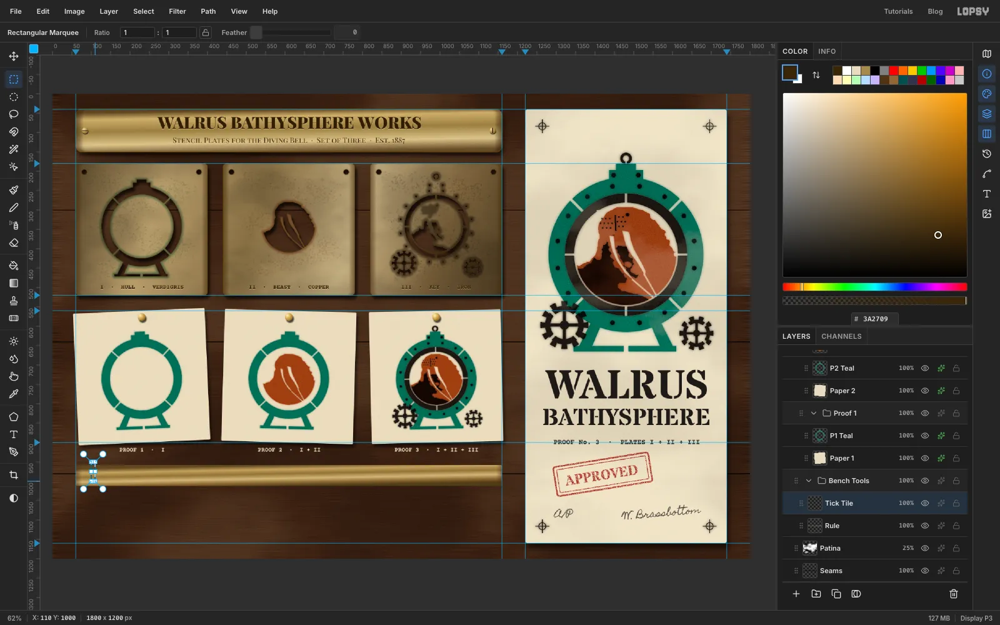

1. Click **Patina**, click **New Group**, and name it `Bench Tools`. Add a layer called `Rule`.
2. Draw a rounded rectangle (Corner Radius `4`): press at (610, 985) and drag to (1160, 1012), so the rule spans 60–1160 across and 958–1012 down. [[Cmd]]-click it and give it the plate-brass gradient top to bottom, plus **Add Noise…** (**Mono**, `12`) and **Motion Blur…** (`0°`, `30`). Deselect.
3. Add a layer called `Tick Tile`. With the **Pencil** at Size `1` in `#3A2709`, draw a 10 px tick down from the rule's top edge at x `100`.
4. Marquee a 10 × 50 px box from (100, 950) and choose **Edit → Define Pattern**. Patterns tile from the canvas's top-left corner, so starting the box on a multiple of 10 across and 50 down keeps every tick lined up with the rule.
5. Press [[Cmd+D]] and click **Delete Layer** to throw the tile layer away.

## Rule it

1. Click **Rule**. Marquee from (96, 958) to (1106, 998). That's inside a single 50 px pattern row, so the ticks don't repeat lower down. Choose **Edit → Fill with Pattern…**. Pick the 10×50 pattern and click **Apply**.
2. With the **Pencil** at Size `2`, Shift-click longer ticks every 50 px, and longer still every 100 px.
3. Give the rule a **Drop Shadow** (X `3`, Y `6`, Blur `8`) and a 1 px **Stroke** in `#4A3210`.
4. Add a `Rule Screws` layer with a screw at each end.

## Number the rule

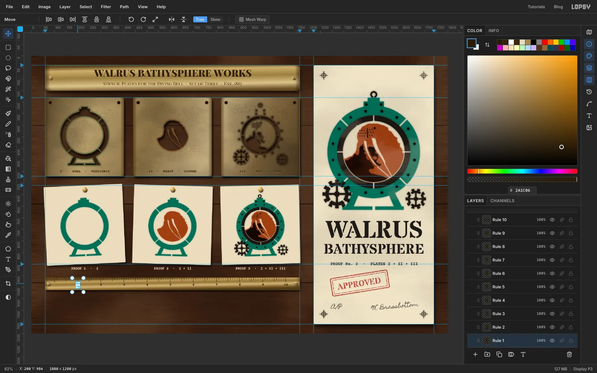

Type `10` under the last long tick in **Courier Prime Bold** at `15`, colour `#2A1C06`, then work right to left down to `1`. Click **Rule Screws** before each number. Working right to left means a new click never lands inside a number you've already typed.

## Add an ink swatch card

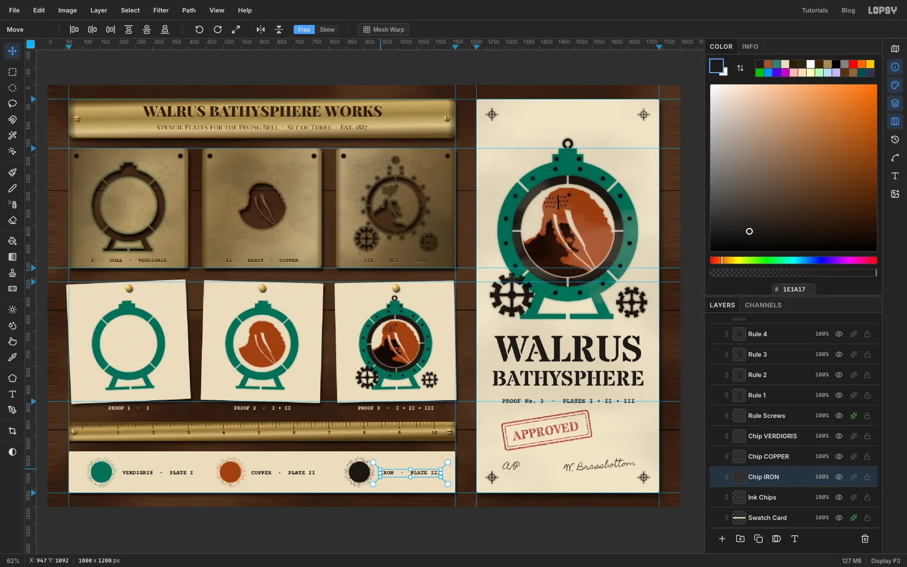

1. Click **Rule** and add a layer called `Swatch Card`. Draw a cream rounded rectangle by pressing at (610, 1101) and dragging to (1160, 1160). That spans 60–1160 across and 1042–1160 down, so its bottom lines up with the proof card's. Add noise and a drop shadow as you did for the proof papers.
2. Add a layer called `Ink Chips`. Fill three 60 px circles on the card's centre line in the three inks, spaced evenly (centres at x 153, 520 and 887), then add **Mono Gaussian** noise at `38`.
3. With the **Spray** at **Size** `26`, run a ring of specks round each chip in its own colour. Set the layer to **Multiply** so the chips match the prints.
4. Label each chip in **Courier Prime Bold** at `16`, `#1E1A17`: `VERDIGRIS  ·  PLATE I`, `COPPER  ·  PLATE II`, `IRON  ·  PLATE III`. Put each label 60 px right of its chip's centre.

## Nudge the proofs as one

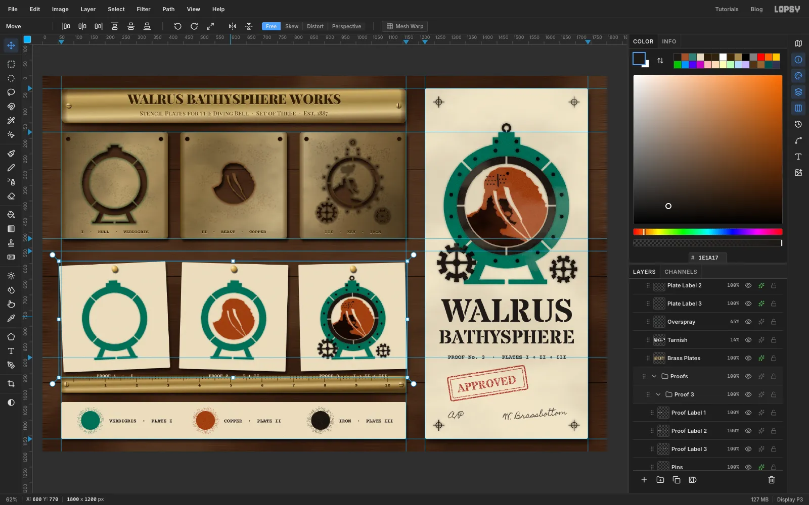

Click the **Proofs** group row. With the **Move** tool, the papers, prints, pins and labels all move together, so if the row looks crowded you can shift it in one drag. Try dragging it down a little, then press [[Cmd+Z]] to put it back. [[Cmd+Shift+Z]] brings the move back if you liked it better.

## Light the bench and export

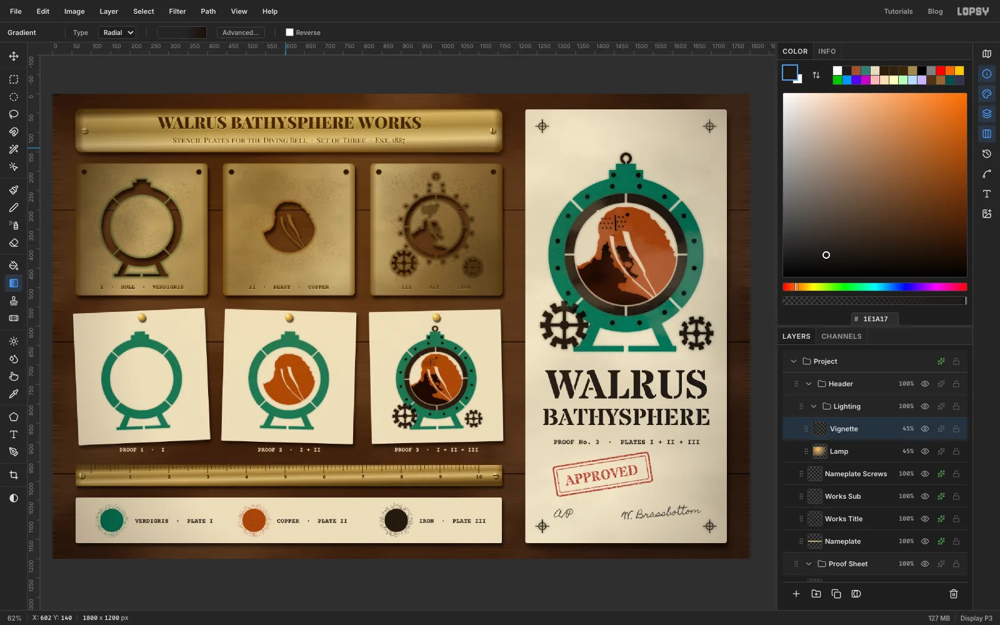

1. Click **Header**, then **New Group**, and name it `Lighting`.
2. Add a layer called `Lamp`. In the gradient editor, make both stops `#FFC46B`, then select the right-hand stop and drag its opacity bar to 0. Drag a **Radial** gradient from about (640, 330) out to the lower right. Set it to **Soft Light** at `45%`.
3. Add a layer called `Vignette`. Set up three `#1A0E06` stops at 0%, 55% and 100%, and drag the opacity of the first two down to 0. Drag the **Radial** gradient from the centre of the canvas to just past the bottom-right corner. Set it to **Multiply** at `45%`.
4. Choose **View → Show Guides** to hide the guides. Then choose **File → Quick Export PNG** and **File → Save Project**.
