On 15 August 1934, William Beebe and Otis Barton were lowered into the Atlantic off Bermuda inside a steel ball not much wider than a bathtub. They reached 3,028 feet, deeper than anyone had been, and watched animals nobody had seen alive through a window of fused quartz. This tutorial turns that dive into the cover of an imaginary novel, *Bathysphere* by Margot Alban.

The cover is designed like a spray-paint stencil print. A stencil can't do smooth gradients. Every shade is a separate cut-out sheet, called a *plate*, sprayed in one flat colour. So the sphere gets three flat plates (base, shadow and highlight), the water is cut into flat bands that get darker with depth, and the anglerfish is cut from an old lithograph into two plates. Stencil type has *bridges*, the little gaps that hold the middle of an O or an A to the rest of the card. You'll copy that idea in the porthole rim. Overspray, grain and a little misregistration make it look sprayed rather than printed.

The canvas is 1200 × 1800 px, the 2:3 shape of a paperback front cover.

The anglerfish comes from G. H. Ford's 1864 lithograph of a humpback anglerfish, [MelanocetusJohnsoniiFord.jpg](https://commons.wikimedia.org/wiki/File:MelanocetusJohnsoniiFord.jpg) on Wikimedia Commons. It's in the public domain. Download the 1280 px wide version.

Along the way you'll use:

- ruler **guides**, **groups**, and a whole group scaled and rotated with the **Move** tool's handles
- the **Lasso**, **Rectangular** and **Elliptical Marquee**, adding, subtracting and intersecting selections, and [[Cmd]]-clicking a layer thumbnail to load its shape
- **Select → Inverse** and **Shrink**, and the **Magic Wand** with **Contiguous** on and off
- **Copy** and **Paste** (which pastes in place), and transform handles to squash the copy
- the **Brush**, **Pencil** and **Spray** tools, with [[Shift]]-click for straight lines
- a **layer mask** faded with the **Gradient** tool
- **Gaussian Blur**, **Threshold**, **Add Noise** and **Clouds**
- live text in **Big Shoulders Stencil**, **Stardos Stencil** and **Martian Mono**, one word recoloured and one label turned on its side
- **Outer Glow** and **Drop Shadow**, **Rasterize Layer Style**, the **Screen**, **Overlay** and **Soft Light** blend modes, and a **Vignette** adjustment

The palette is a handful of spray colours over a navy ground:

- Water `#2A7178` → `#1B5562` → `#133D4A` → `#0C2632` → `#07131B`
- Hull orange `#E8572A`, rust `#9A3216`, highlight `#F59466`
- Bone `#EFE4CC`
- Glow cyan `#7FF2D0`, glass glint `#D9FFF4`
- Anglerfish teal `#5E9E9B`, ink `#03080C` (cable, fish shadows, pupil)
- Title offset `#0A1C26`

> **Note:** Shortcuts are written for a Mac. On Windows and Linux use [[Ctrl]] wherever it says [[Cmd]].

> **Tip:** Positions are in document pixels from the top-left corner. Hover over the canvas and the status bar shows the pointer's **X** and **Y**. "Fill" means: set the foreground colour in the Color panel's hex field, then choose **Edit → Fill**.

> **Tip:** **Add Layer**, **Duplicate Layer**, **Add Mask** and **Delete Layer** are buttons at the bottom of the Layers panel. A new layer appears just above the active one. Double-click a layer's name to rename it. The sparkle button on a row opens its effects drawer, which is also where you set the blend mode.

> **Tip:** Press [[Cmd+D]] to drop a selection before you draw a new one. Otherwise a drag that starts inside the old outline moves the outline instead of drawing a new one.

## Set up the canvas and guides

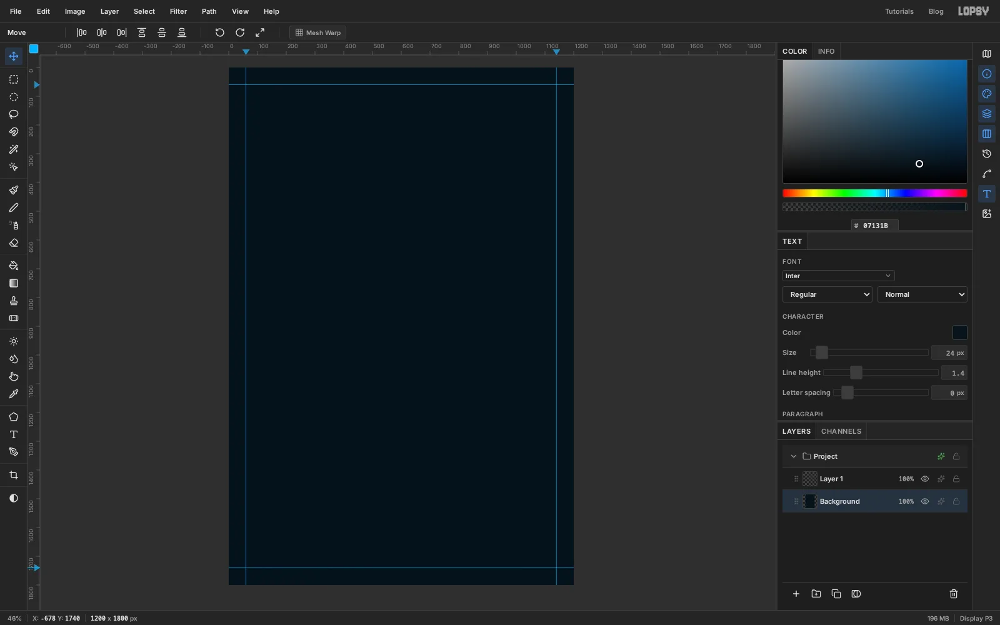

Choose **File → New**, set the size to `1200` × `1800` px and click **Create**.

Click the `Background` row, set the foreground colour to `#07131B` and choose **Edit → Fill**. That's the deepest water, at the bottom of the cover.

Now drop four margin guides. Click the top ruler at x `60` and x `1140`, and the left ruler at y `60` and y `1740`. Keep titles and text inside them.

## Cut the water into depth bands

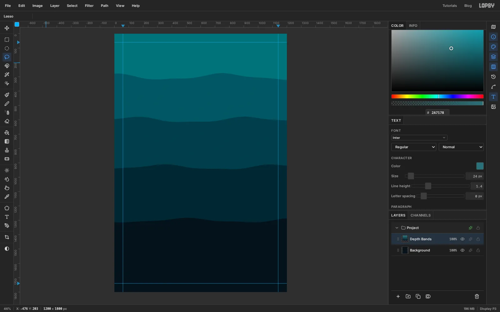

Light fades fast underwater, so the water gets darker the deeper you look. Instead of a gradient, cut it into flat bands like stencil plates.

1. Double-click `Layer 1` and rename it `Depth Bands`.
2. Pick the **Lasso** ([[L]]). Starting above the top-left corner of the canvas, drag across the top to the right, down the right edge to about y `1300`, then back to the left along a slow, wavy line, and up to where you started. Fill it with `#0C2632`.
3. Repeat with a slightly different wave each time, working upward. Draw to about y `930` and fill with `#133D4A`, to about y `600` and fill with `#1B5562`, then to about y `300` and fill with `#2A7178`.

Draw the deepest band first. Each lighter band covers the top of the one before, and the background shows through at the very bottom as the fifth band.

## Draw the light shafts

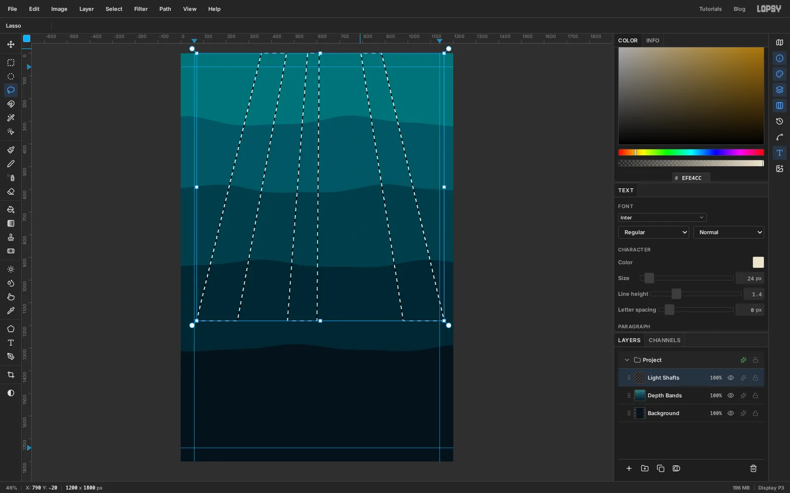

Click **Add Layer** and name it `Light Shafts`.

With the **Lasso**, draw a long, thin wedge that starts narrow at the top edge, left of centre, and widens as it slants down-left to about y `1180`. Hold [[Shift]] and draw two more: a thin one just left of the middle, and a wider one on the right that slants down-right. Holding [[Shift]] adds each new shape to the selection.

Fill the selection with `#EFE4CC` and press [[Cmd+D]]. The shafts will sit above the sphere you draw later, so a little light falls across it too.

## Fade the shafts out with a mask

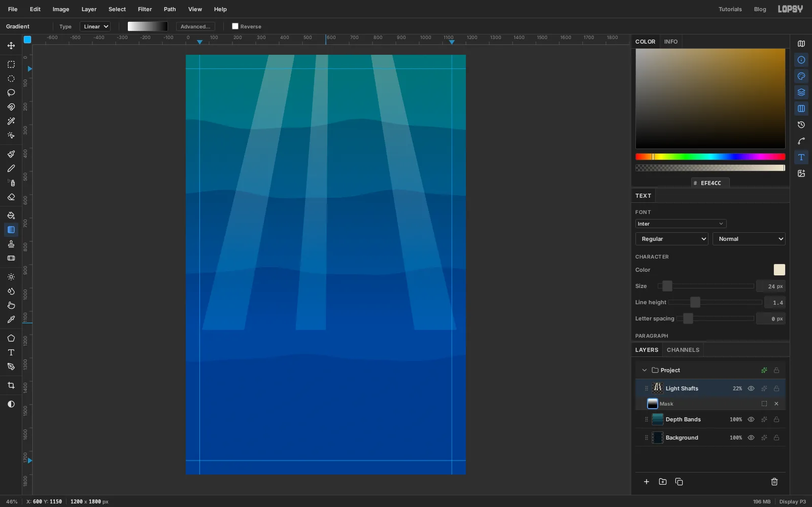

Open the layer's effects drawer, set **Blend** to **Screen**, then click the `100%` on the row and drag the opacity slider down to `22%`.

Real light shafts die out in the deep, so fade them with a mask:

1. Click **Add Mask**, then click the new mask thumbnail under the layer so you're painting on the mask.
2. Pick the **Gradient** tool and open **Advanced…**. Set the left stop to white `#FFFFFF` and the right stop to black `#000000`.
3. Drag from near the top of the canvas (y `80`) straight down to y `1150`.

White keeps the shafts and black hides them. The canvas turns blue while you edit a mask. That's normal and goes away when you click a different layer.

## Spray the marine snow

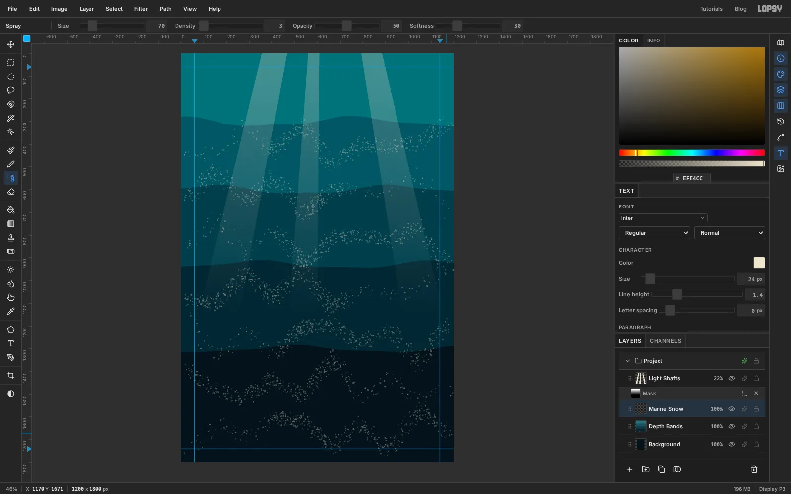

*Marine snow* is the drifting flakes of dead plankton that divers see in their lights.

Click the `Depth Bands` row (this also takes you out of mask editing), click **Add Layer** and name it `Marine Snow`. Pick the **Spray** tool ([[J]]) and set **Size** `70`, **Density** `3`, **Opacity** `50` and **Softness** `30`. Use `#EFE4CC` as the foreground colour.

Drag about seven loose passes across the canvas, from y `400` down to the bottom. Wander up and down as you go, and change the wave each time so the specks don't line up in stripes.

Keep Size small. Spray's Size also sets how big each dot is, and at large sizes the specks turn into bubbles.

## Hang the cable

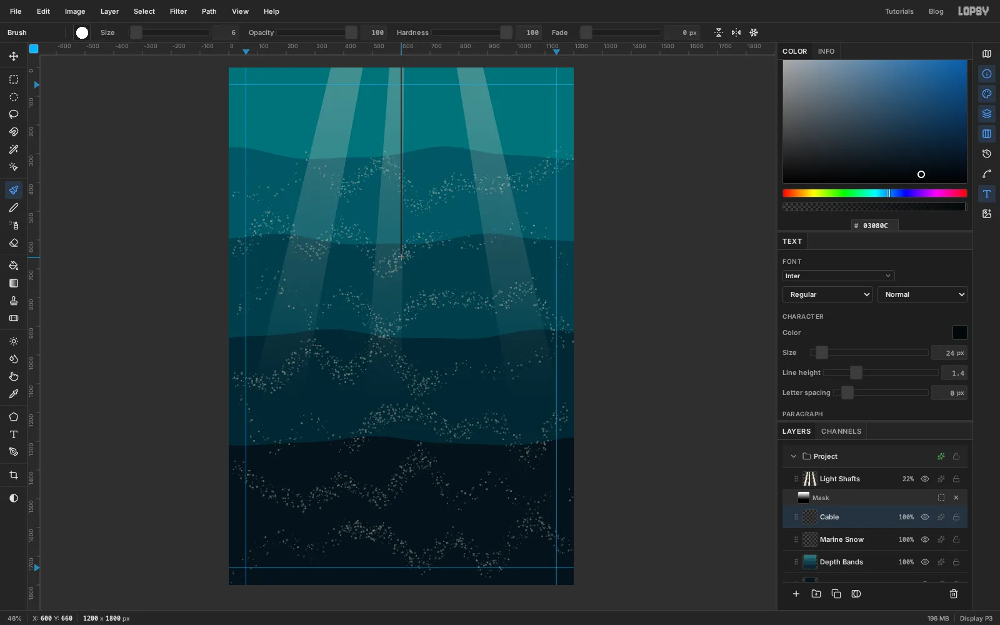

Click **Add Layer** and name it `Cable`. Pick the **Brush** ([[B]]) and set **Size** `6`, **Hardness** `100` and **Opacity** `100`, with the colour `#03080C`.

Click once above the top edge at x `600`, then hold [[Shift]] and click at `600, 660`. [[Shift]]-click joins the two points with a dead-straight line.

## Spray the hull

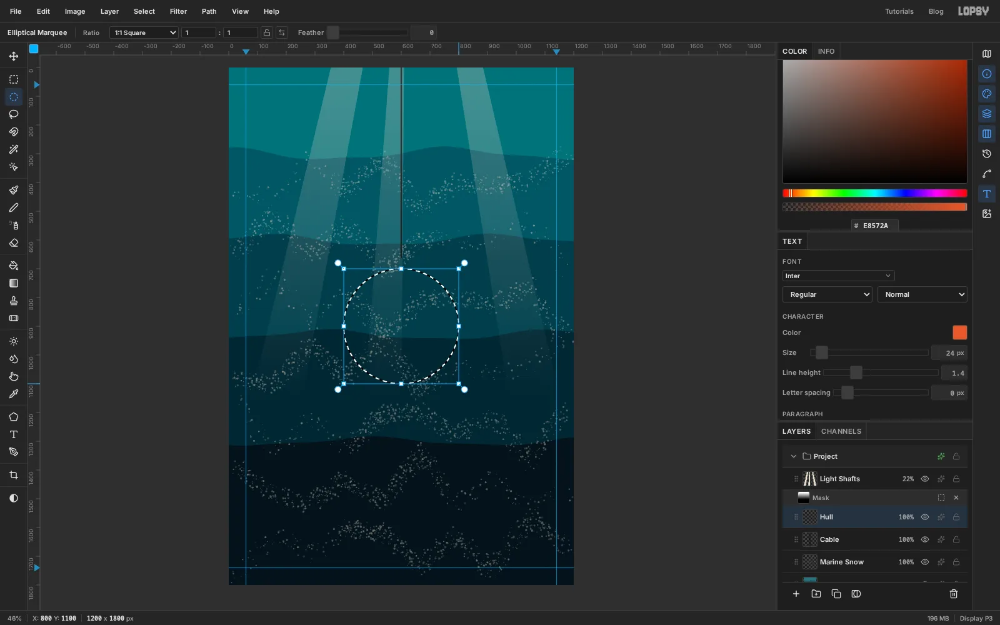

Click **Add Layer** and name it `Hull`. Pick the **Elliptical Marquee** and drag from `400, 700` to `800, 1100`. That's a 400 px circle centred on `600, 900`, which hangs just below the end of the cable.

Fill it with `#E8572A` and press [[Cmd+D]].

## Cut the shadow plate

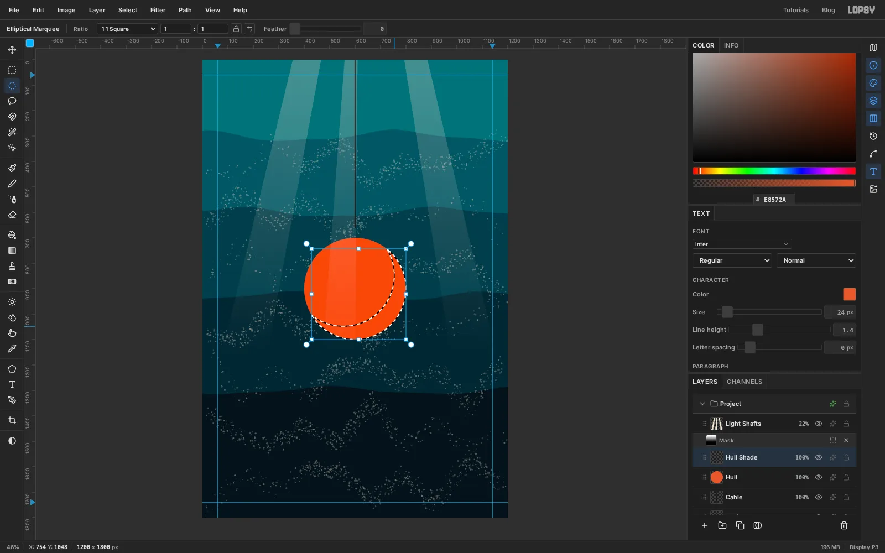

The light comes from the top-left, so the shadow is a crescent on the lower right. Instead of drawing it, cut it from the hull's own shape:

1. Click **Add Layer** and name it `Hull Shade`.
2. [[Cmd]]-click the `Hull` thumbnail in the Layers panel. That selects the circle.
3. With the **Elliptical Marquee**, hold [[Option]] and drag a circle of the same size, shifted up and to the left by about 50 px: from about `354, 648` to `754, 1048`. Holding [[Option]] subtracts it, which leaves a crescent.
4. Fill with `#9A3216` and press [[Cmd+D]].

## Add the highlight plate

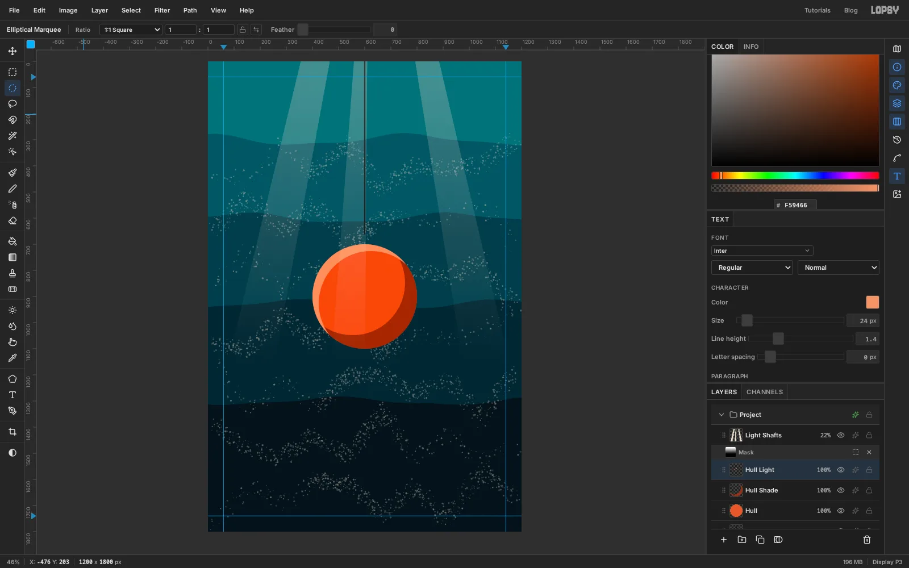

Do the same again for the highlight, but push the second circle the other way:

1. **Add Layer**, name it `Hull Light`, and [[Cmd]]-click the `Hull` thumbnail.
2. [[Option]]-drag a circle from about `424, 726` to `824, 1126`. That's the same size, nudged down and to the right by about 25 px.
3. Fill with `#F59466` and press [[Cmd+D]].

What's left is a thin bright crescent along the upper-left edge. Three flat colours now read as a round ball.

## Curve the equator seam

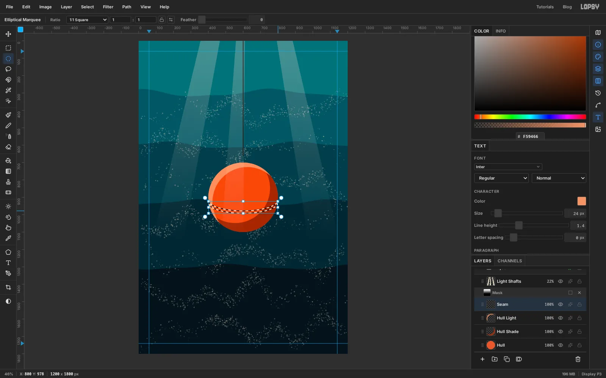

A straight line across the sphere would look flat. A seam that curves down tells you you're looking at it from slightly above.

1. **Add Layer**, name it `Seam`, and [[Cmd]]-click the `Hull` thumbnail.
2. With the **Elliptical Marquee**, hold [[Shift]] and [[Option]] together and drag a wide, flat ellipse from `400, 868` to `800, 992`. [[Shift]]+[[Option]] keeps only the overlap, the lower part of that ellipse inside the hull.
3. Hold [[Option]] alone and drag the same ellipse 14 px higher, from `400, 854` to `800, 978`. That cuts away everything but a thin curved strip.
4. Fill with `#9A3216` and press [[Cmd+D]].

## Add the hatch and lifting eye

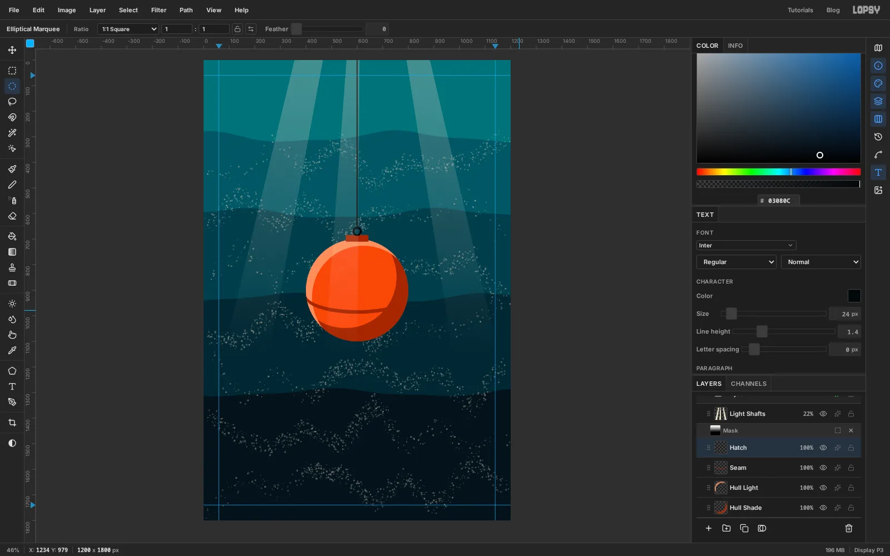

1. **Add Layer** and name it `Hatch`.
2. With the **Rectangular Marquee** ([[M]]), drag from `556, 684` to `644, 710` and fill with `#9A3216`. This is the hatch cover.
3. With the **Elliptical Marquee**, drag a small circle from `582, 652` to `618, 688` and fill it with `#03080C`.
4. Choose **Select → Shrink…**, enter `7` and click **Apply**. Press [[Delete]] to clear the middle, leaving a ring where the cable is shackled on.

## Cut the porthole with stencil bridges

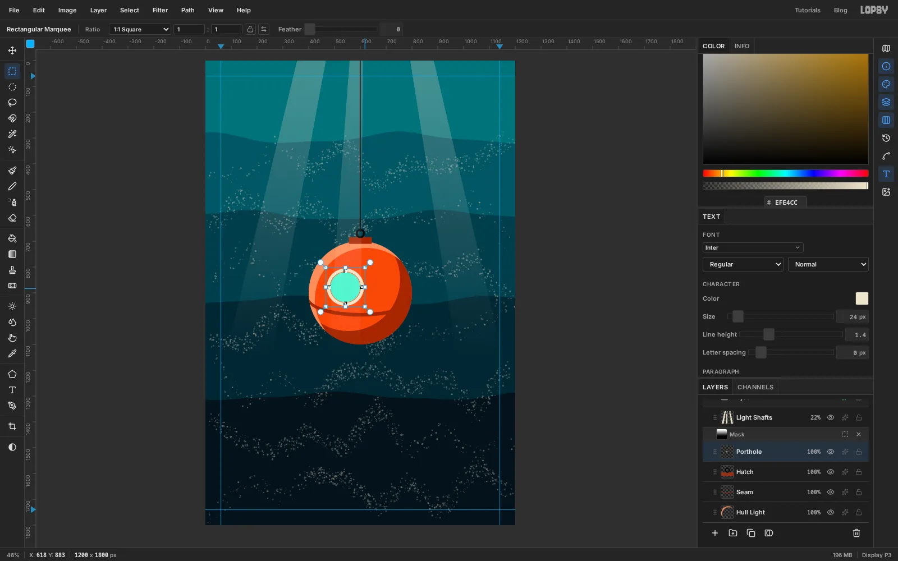

1. **Add Layer** and name it `Porthole`.
2. With the **Elliptical Marquee**, drag a circle from `484, 820` to `600, 936` and fill with `#7FF2D0`. That's the glass.
3. Drag a bigger circle from `470, 806` to `614, 950`, then [[Option]]-drag a circle from `482, 818` to `602, 938` to hollow it into a ring. Fill with `#EFE4CC`.
4. With the **Rectangular Marquee**, drag a small 10 px wide box across the top of the ring. Hold [[Shift]] and add three more across the bottom, left and right of the ring.
5. Press [[Delete]], then [[Cmd+D]].

Those four gaps are the stencil bridges. On a real stencil card they're what keeps the middle of the cut-out from falling away.

## Add a glint to the glass

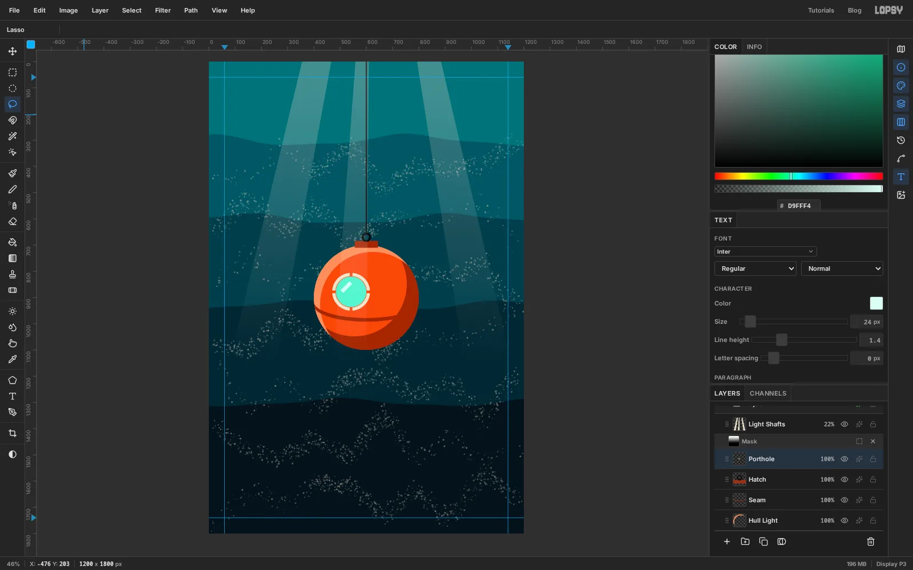

Still on `Porthole`, pick the **Lasso** and draw a thin slash across the upper left of the glass: a narrow parallelogram about 45 px long and 12 px wide, angled up to the right. Fill with `#D9FFF4` and press [[Cmd+D]]. It's the reflection of the light outside, and it's what makes the disc read as glass.

## Paste a second porthole and squash it

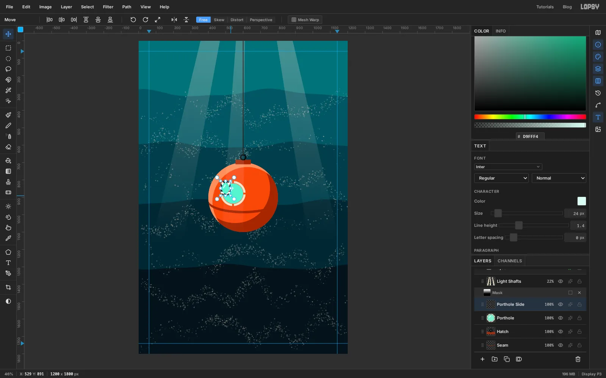

The sphere also has a side window. It's the same porthole, foreshortened because it faces away from you.

1. With the **Rectangular Marquee**, draw a box around the whole porthole, from `466, 802` to `618, 954`.
2. Press [[Cmd+C]], then [[Cmd+V]]. The copy pastes in place as a new layer, and Lopsy switches to the **Move** tool with handles around it. Rename the new layer `Porthole Side`.
3. Drag the bottom-right corner handle up and to the left, about 85 px left and 60 px up. Without a modifier key the corner moves freely, so the copy becomes a narrow upright oval.

## Move the side porthole and add bolts

Drag the squashed copy from its middle (keep well clear of the handles) to the right shoulder of the sphere, so it's centred at about `712, 828`. Press [[Enter]] to apply the transform, then [[Cmd+D]].

For the bolts, click **Add Layer** and name it `Bolts`. Pick the **Brush**, set **Size** `11` with `#9A3216`, and click a ring of ten bolt heads just outside the porthole rim, about 85 px from its centre. Start with four at roughly 12, 3, 6 and 9 o'clock (the 3 o'clock one lands near `627, 878`), then add the rest in the gaps, two in each quarter, avoiding the bridges.

## Light the portholes and group the sphere

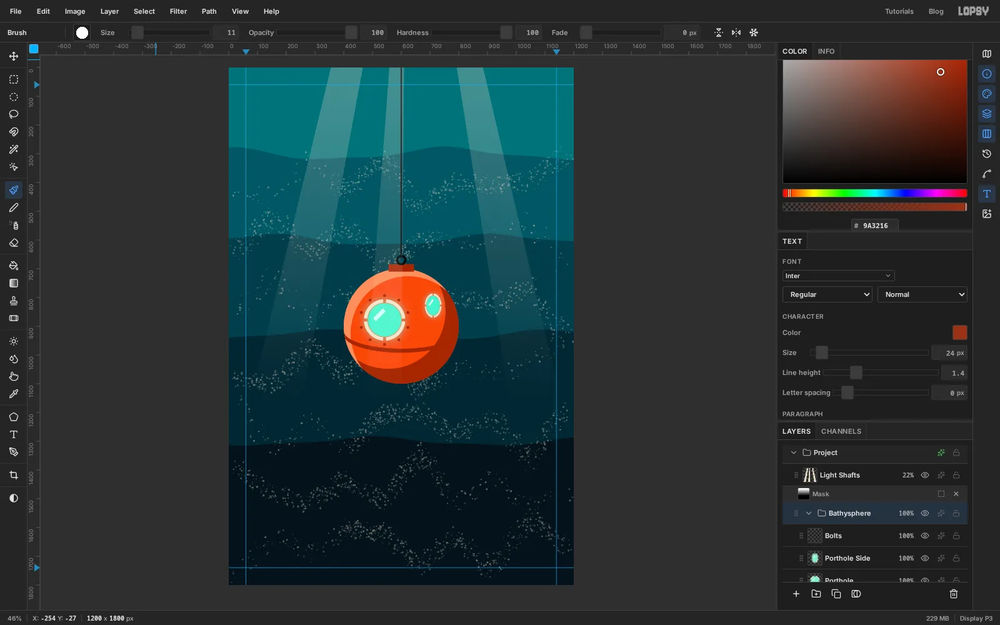

Something is alive in there, so the windows should glow.

1. Open the effects drawer on `Porthole`, turn on **Outer Glow**, and set **Size** `40`, **Spread** `0` and **Opacity** `55`, with the **Glow color** `#7FF2D0`.
2. Click **Rasterize Layer Style** to bake the glow into the pixels.
3. Do the same on `Porthole Side`, with **Size** `26`.
4. Click the `Hull` row, [[Shift]]-click the `Bolts` row, and choose **Layer → Group Layers**. Rename the group `Bathysphere`.

Rasterizing as you go keeps the file quick to work with. Every live effect is redrawn whenever anything on the canvas changes.

## Blow bubbles up the cable

Click the `Cable` row, click **Add Layer** and name it `Bubbles`.

With the **Elliptical Marquee**, drag a small circle just above the hatch, about 16 px across. Hold [[Shift]] and add seven more going up the cable to about y `350`. Make them between 10 and 30 px across, and zigzag them from one side of the cable to the other.

Then hold [[Option]] and drag a slightly smaller circle inside each one, leaving a thin rim of 2 or 3 px. That turns every bubble into a ring. They don't need to be perfect; real bubbles wobble. Fill with `#EFE4CC`, press [[Cmd+D]], and set the layer's opacity to `75%`.

## Bring in the anglerfish lithograph

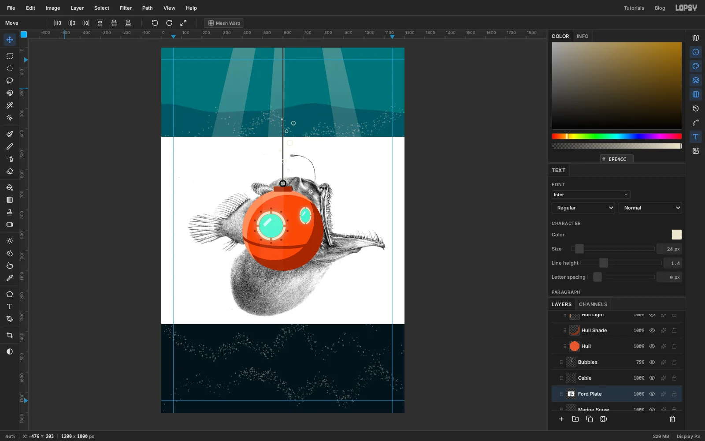

Click the `Marine Snow` row so the picture lands low in the stack. Drag the downloaded `MelanocetusJohnsoniiFord.jpg` from your desktop onto the canvas. It's wider than the cover, so Lopsy shrinks it to fit the width and centres it. Rename the layer `Ford Plate`.

A dropped image arrives selected, with the Move tool active. Press [[Cmd+D]] to drop that selection, so the filters in the next step work on the whole layer.

Click **Duplicate Layer** and rename the copy `Ford Plate Shadows`. Click its eye icon to hide it for now. You'll use it for the second plate.

## Blur and threshold the fish into a silhouette

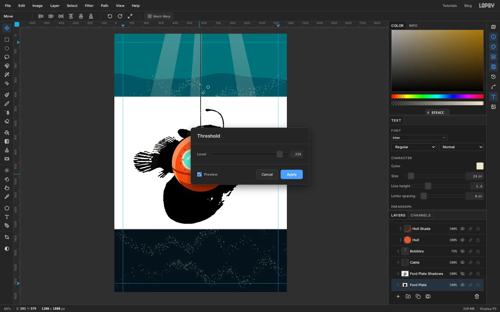

Click the `Ford Plate` row.

A threshold on its own would turn the stippled lithograph into scattered black dots. Blur it first, so the dots melt into solid tone:

1. Choose **Filter → Gaussian Blur…**, set **Radius** `6` and click **Apply**.
2. Choose **Filter → Threshold…**, turn **Preview** on, set **Level** `236` and click **Apply**.

At 236 everything darker than the paper turns black. The whole fish becomes one clean shape, fins and lure included.

## Select the fish with the Magic Wand

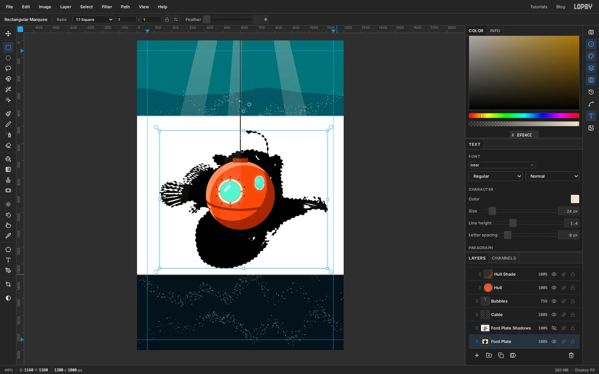

1. Pick the **Magic Wand** ([[W]]). Leave **Tolerance** at `32` and make sure **Contiguous** is on.
2. Click the white paper near the top-left corner of the picture, at about `40, 500`.
3. Press [[Shift+Cmd+I]] to invert the selection. Now everything that isn't paper is selected, including the empty strips above and below the photo.
4. Pick the **Rectangular Marquee**, hold [[Shift]] and [[Option]], and drag a box around the fish from `100, 480` to `1160, 1360`. Only the overlap is kept, which is just the fish.

Click **Add Layer**, name it `Angler`, fill with `#5E9E9B` and press [[Cmd+D]].

## Cut the shadow plate from the lithograph

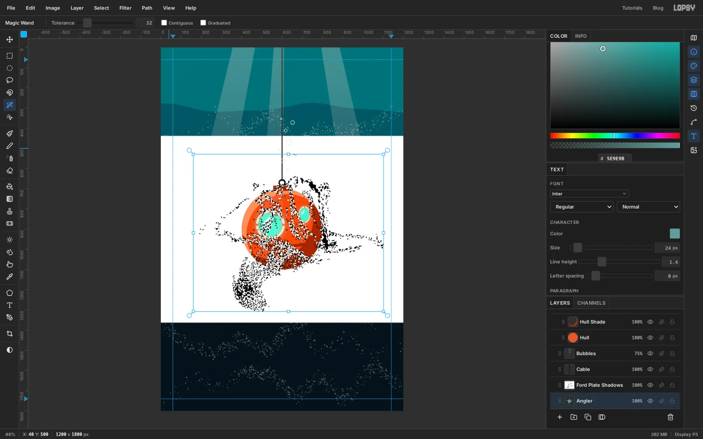

The second plate holds only the darkest parts of the lithograph.

1. Click the `Ford Plate Shadows` row and click its eye to show it.
2. Run **Gaussian Blur** with **Radius** `3`, then **Threshold** with **Level** `96`. Only the deepest shadows stay black.
3. With the **Magic Wand**, turn **Contiguous** off and click the white paper. Now every white area is selected, inside the fish as well as out. Press [[Shift+Cmd+I]] to invert.
4. Hold [[Cmd]], [[Shift]] and [[Option]] and click the `Angler` thumbnail. That intersects the selection with the fish's shape, so nothing spills outside it.

## Fill the shadow plate and clear the lithograph

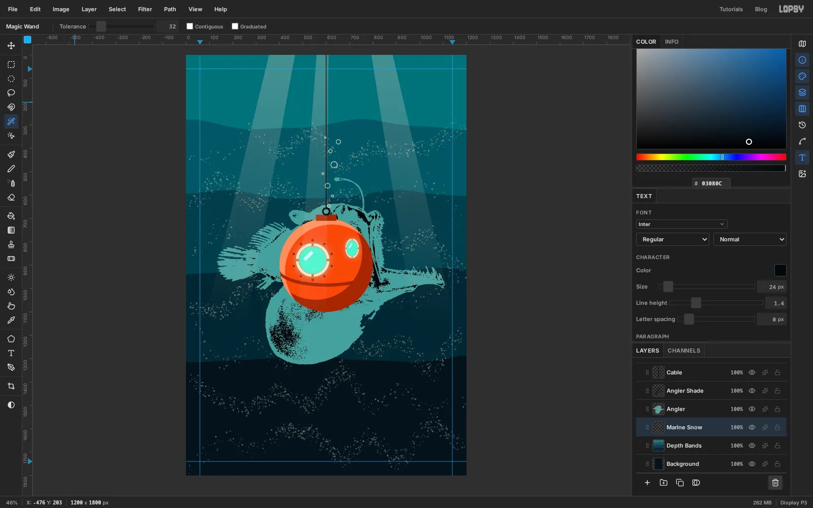

Click **Add Layer**, name it `Angler Shade`, fill with `#03080C` and press [[Cmd+D]].

You don't need the lithograph any more. Click `Ford Plate Shadows` and click **Delete Layer**, then do the same for `Ford Plate`.

## Group the fish and scale it down

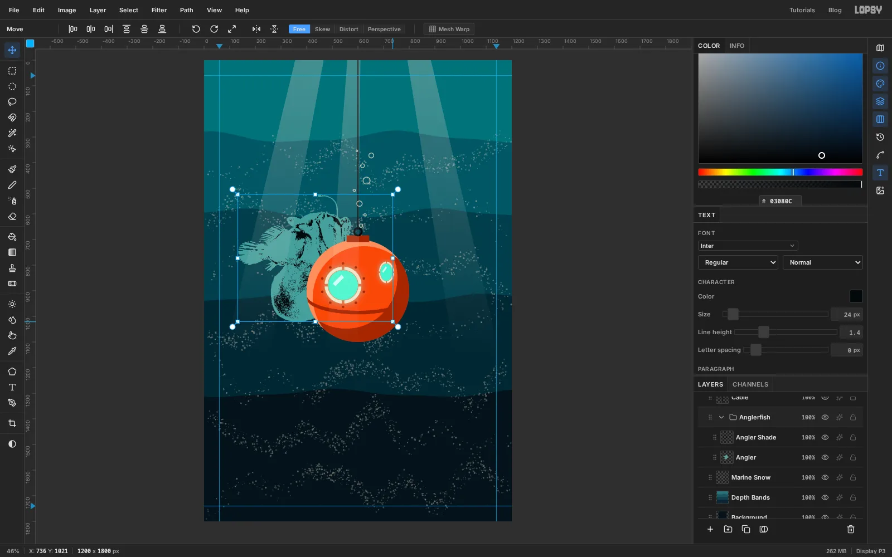

Click the `Angler` row, [[Shift]]-click `Angler Shade`, choose **Layer → Group Layers**, and rename the group `Anglerfish`.

With the group selected and nothing else selected (press [[Cmd+D]] to make sure), pick the **Move** tool ([[V]]). Handles appear around both fish layers at once. Hold [[Cmd]] and drag the bottom-right corner handle up and to the left until the fish is about 60% of its size, roughly 600 px wide. [[Cmd]] keeps the proportions.

## Tilt the fish toward the sphere

Move the pointer just outside the top-right corner of the box until it becomes a crosshair, then drag it anticlockwise about 12°. The open mouth now points up toward the sphere.

## Move the fish into the deep

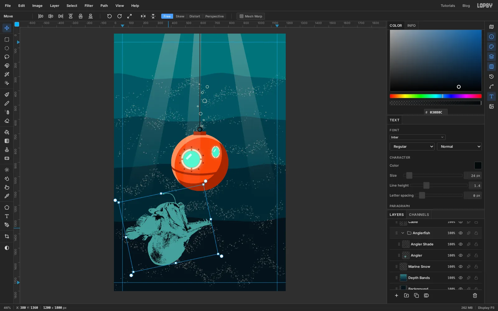

Drag from the middle of the fish down into the lower left of the cover, so its body is centred at about `380, 1360` and the lure sits a little below and left of the sphere. Press [[Enter]] to apply.

## Add teeth and an eye

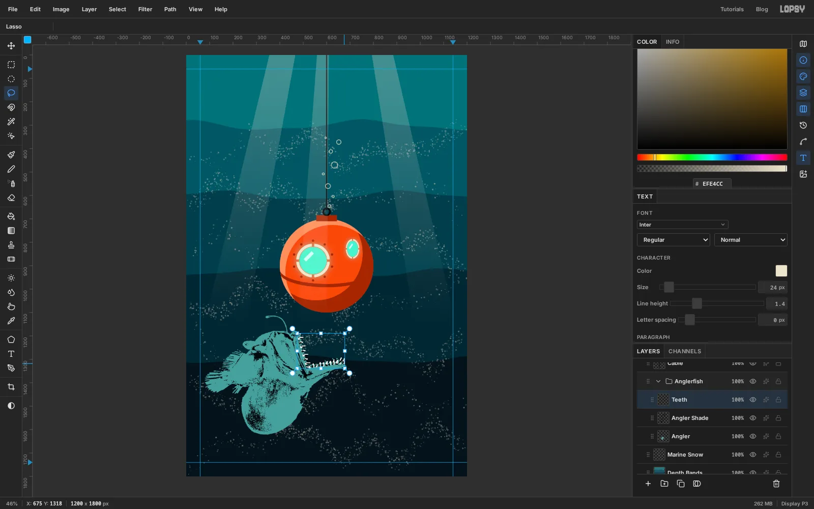

Click the `Angler Shade` row (inside the group), click **Add Layer** and name it `Teeth`.

With the **Lasso**, draw a thin triangle along the upper jaw, pointing into the mouth. Hold [[Shift]] and add about eight more down that jaw, then about eleven along the lower jaw pointing up. Make them longer toward the tip of the lower jaw. Fill with `#EFE4CC` and press [[Cmd+D]].

For the eye, drag a 14 px circle with the **Elliptical Marquee** on the head behind the upper jaw and fill it with `#EFE4CC`. Then fill a 6 px circle inside it with `#03080C`.

## Light the lure

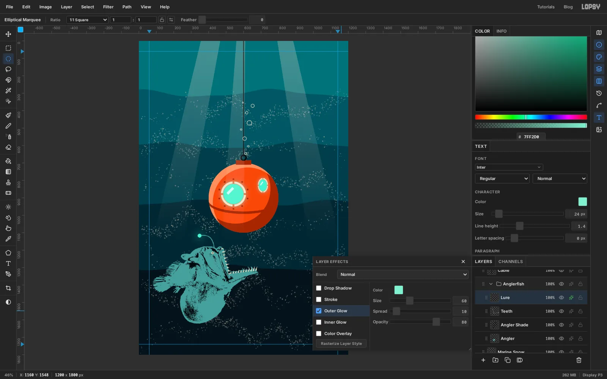

Click **Add Layer** and name it `Lure`. Drag a 22 px circle over the bulb at the end of the fish's lure and fill it with `#7FF2D0`.

In the effects drawer turn on **Outer Glow** with **Size** `60`, **Spread** `10`, **Opacity** `80` and colour `#7FF2D0`. Then click **Rasterize Layer Style**. The sphere's windows and the fish's lure are now the same cyan, which ties the two together.

## Rule the depth gauge

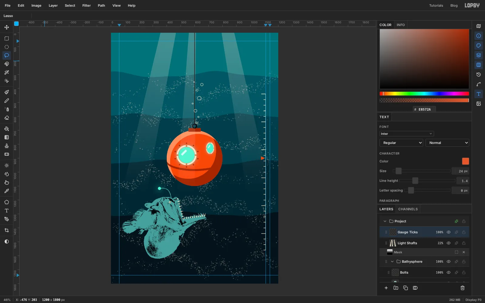

Click the top ruler at x `1110` for a guide. Then click the `Light Shafts` row, click **Add Layer** and name it `Gauge Ticks`.

1. Pick the **Pencil** ([[N]]), set **Size** `3`, and use `#EFE4CC`.
2. Click at `1110, 440` and [[Shift]]-click at `1110, 1560` for the rule.
3. For the ticks, click on the rule and [[Shift]]-click to the left of it, every 40 px from y `440` down to `1560`. Make most ticks 14 px long and every fifth one 30 px.
4. With the **Lasso**, draw a small triangle pointing right at the rule at y `900`, the sphere's centre, and fill it with `#E8572A`.

## Label the gauge

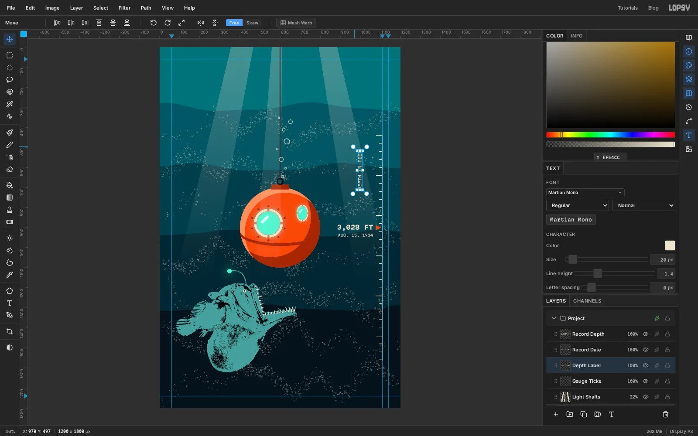

Pick the **Text** tool ([[T]]) and choose **Martian Mono**.

1. At **Bold** `30` px, click in empty water and type `3,028 FT`. Press [[Tab]] to finish and rename the layer `Record Depth`. Switch to the **Move** tool and nudge it with the arrow keys ([[Shift]] moves 10 px at a time) until it sits just left of the orange pointer and lined up with it.
2. Click a raster layer such as `Gauge Ticks` first, so the Text tool starts a new layer instead of editing the last one. Then set **Regular** `18`. Click in clear water about 100 px below the first label. If you click right under it, the click lands inside the `3,028 FT` text box and adds to that line instead. Type `AUG. 15, 1934`, press [[Tab]], rename it `Record Date`, then nudge it up under `3,028 FT` with their right edges lined up.
3. Again from `Gauge Ticks`, type `DEPTH IN FEET` at `20` px, press [[Tab]] and rename it `Depth Label`. With the **Move** tool, drag the rotation handle at the top-right corner anticlockwise to stand it on end at -90°. Press [[Enter]] and nudge it beside the top of the rule.

## Set the title

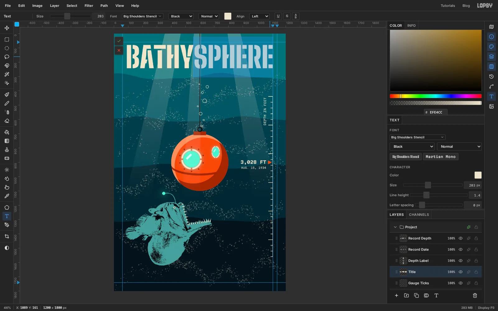

Click `Gauge Ticks` again. Pick the **Text** tool, choose **Big Shoulders Stencil** at **Black**, and use `#EFE4CC`. Click near the top left and type `BATHYSPHERE`, then press [[Tab]]. Rename the layer `Title`. A text layer is named after its words until you rename it, and shorter names make the later steps easier to follow.

The title should run from about x `90` to `1110`, inside the margins. With the text layer selected, change the **Size** in the options bar until it fits. Here it was `203` px. Then nudge it with the **Move** tool until it's centred and its top sits at y `78`.

To make SPHERE orange, pick the **Text** tool and click inside the word. Press [[End]], then hold [[Shift]] and press [[Left]] six times to select `SPHERE`.

## Recolour SPHERE and add the offset plate

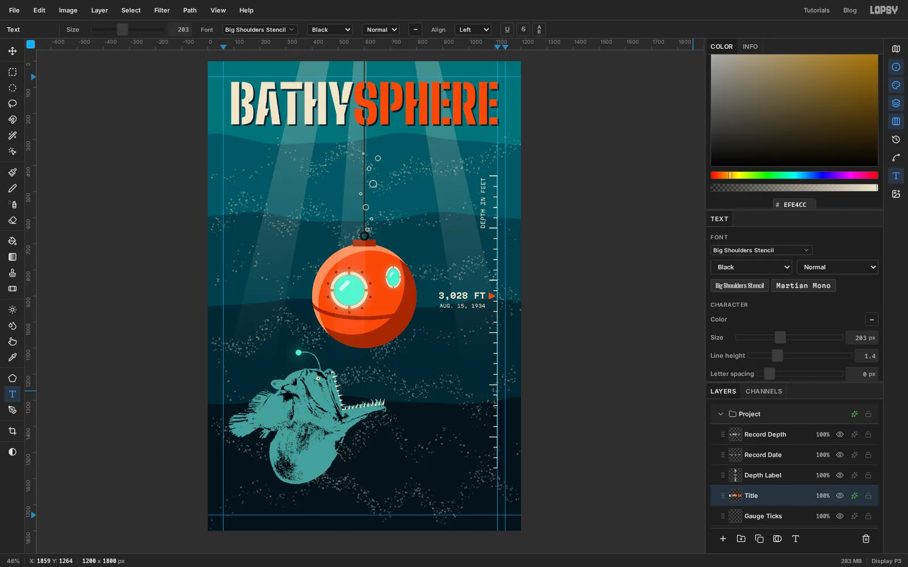

With `SPHERE` still selected, click the **Text color** swatch in the options bar and type `E8572A` in its hex field. Only the selected letters change. Press [[Tab]] to finish.

Use the Text color swatch for this, not the Color panel. While you're typing, the Color panel sets the colour of the whole text.

Open the title's effects drawer and turn on **Drop Shadow**: **Offset X** `6`, **Offset Y** `6`, **Blur** `0`, **Spread** `0`, **Opacity** `100`, and colour `#0A1C26`. With no blur it reads as a second stencil plate sprayed slightly off register, not as a soft digital shadow.

## Set the tagline, A NOVEL and the author

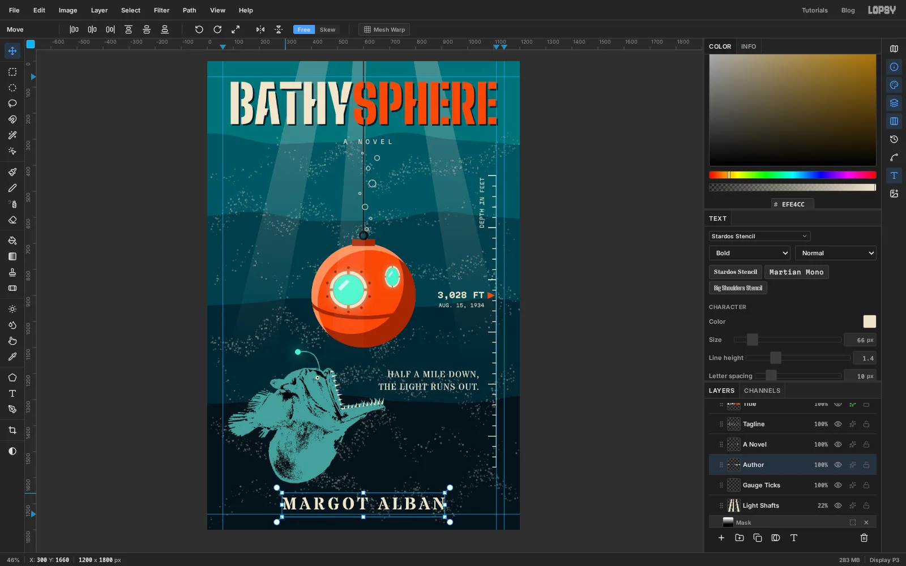

Start each line from `Gauge Ticks` so you get a fresh text layer each time.

1. **Tagline.** Choose **Stardos Stencil** **Regular** at `34` px and set **Align** to **Right**. With right alignment the click point is the right end of each line. Click at `1040, 1190` and type `HALF A MILE DOWN,`, press [[Enter]], and type `THE LIGHT RUNS OUT.`. Press [[Tab]] and rename the layer `Tagline`. In the **Text** panel set **Letter spacing** to `2`. That leaves a clean 40 px gap between the text and the long gauge ticks.
2. **A NOVEL.** Set **Align** back to **Left**. In **Martian Mono** **Regular** `22`, click at about `520, 296`, just under the middle of the title, and type `A NOVEL`. Press [[Tab]], rename it `A Novel`, and set **Letter spacing** to `12`. Nudge it with the arrow keys until its top sits at y `300` and the cable drops through the gap after the A rather than through a letter.
3. **Author.** In **Stardos Stencil** **Bold** `66`, click near the bottom left at about `300, 1660`, type `MARGOT ALBAN`, press [[Tab]] and rename it `Author`. Set **Letter spacing** to `10`. Then nudge it with the arrow keys until it's centred, with its left edge at about x `290` and its right edge at about `910`, and the bottom of the letters at y `1722`. That gives it the same 78 px margin as the title has at the top.

Letter spacing carries over to the next text you type, so set it on every line.

## Spray the overspray

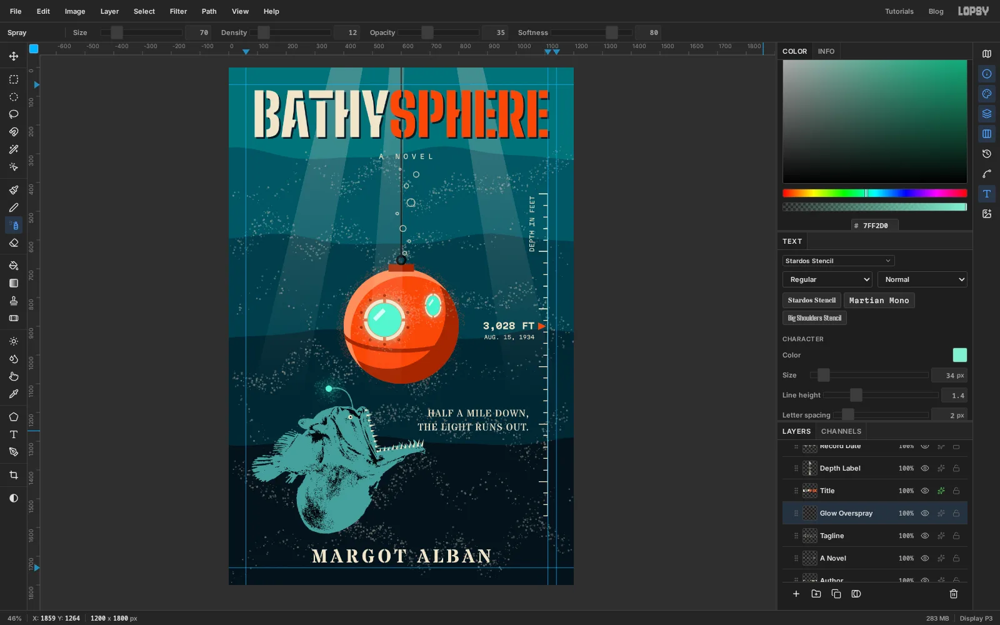

Overspray is the paint that mists past the edge of the stencil card. A little of it makes the art look sprayed.

1. Click `Marine Snow`, click **Add Layer** and name it `Hull Overspray`. Pick the **Spray** tool and set **Size** `44`, **Density** `12`, **Opacity** `40` and **Softness** `60`, with `#E8572A`. Drag once all the way around the hull, just outside its edge. This layer sits under the sphere, so only the mist outside the edge shows.
2. Click `Tagline`, click **Add Layer** and name it `Glow Overspray`. Set **Size** `70`, keep **Density** at `12`, and set **Opacity** `35` and **Softness** `80`, with `#7FF2D0`. Circle the lure twice, then go once around each porthole. Set the layer's blend mode to **Screen**.

## Add paper grain and spray mottle

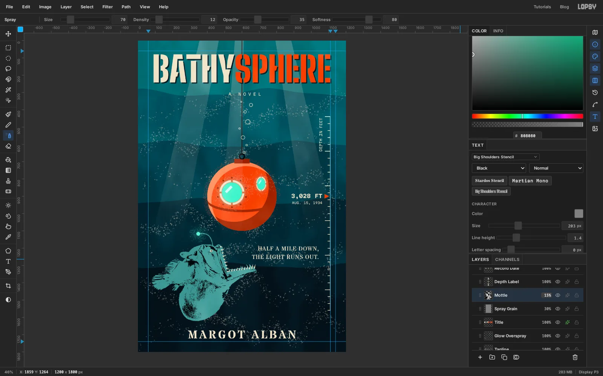

Click the `Title` row so the texture goes above the title and everything under it. The small gauge labels stay crisp above it, which keeps them readable.

1. **Add Layer**, name it `Spray Grain` and fill it with `#808080`. Choose **Filter → Add Noise…**, set **Amount** `28`, pick **Mono** and **Gaussian**, and click **Apply**. Set the blend mode to **Overlay** and the opacity to `30%`. Mid-grey disappears in Overlay, so only the grain shows.
2. **Add Layer**, name it `Mottle`, and choose **Filter → Clouds…** with **Scale** `8`. Set it to **Soft Light** at `15%`. Real spray paint never goes on perfectly evenly.

Keep the mottle subtle. Much past 20% and the whole cover looks dirty.

## Finish with a vignette

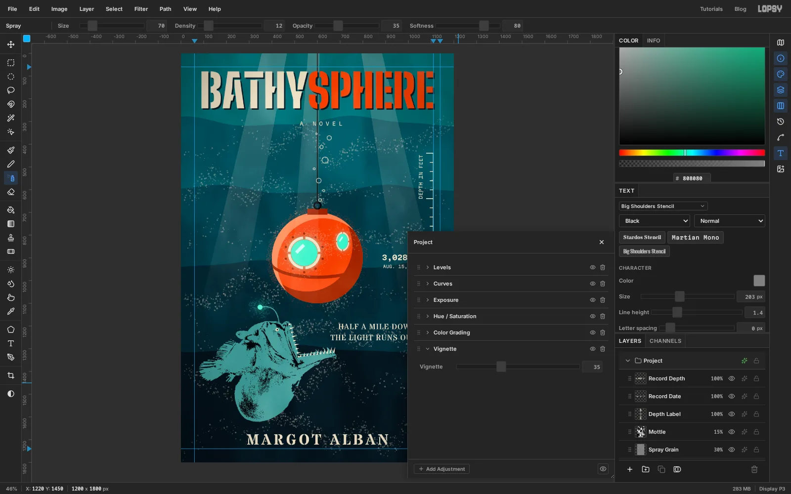

Click the `Project` row at the top of the Layers panel and open its drawer. On a group it shows adjustments instead of effects. Click **Add Adjustment**, choose **Vignette** and set it to `35`. The corners darken a little and pull the eye in toward the sphere.

Choose **File → Save Project** to keep the layers, and **File → Quick Export PNG** for the finished cover.
