A spray-paint stencil is cut from card. Anything that floats inside a cut
hole, such as the middle of an O or a dog's eye patch, has to be held in place
by thin strips of card called **bridges**. When you spray, the paint drifts
past the edges and leaves a soft speckle called **overspray**. Two-colour
stencils almost never line up exactly. Those three marks, plus porous paper,
are what make a stencil look made by hand.

In this tutorial you'll use them on a small-business flier for **Daily
Walks**, an imaginary dog walker. A whippet from a 1900s lantern-slide
photograph becomes a three-plate stencil, sprayed onto kraft paper with a
safety-orange sun behind it. A row of pull-off phone-number tabs runs along
the bottom. The flier is **1280 × 1656 px**, US-letter proportions.

Along the way you'll use:

- **Add Noise**, **Motion Blur**, **Clouds** and **Threshold** to make kraft paper, with the **Overlay**, **Soft Light** and **Multiply** blend modes
- a dropped-in photo, the **Pen** tool, **Path to Selection**, and copy and paste
- ⌘-dragging a corner handle to scale, and arrow-key nudges to place things
- **Desaturate**, **Gaussian Blur** and **Posterize** to make a tone study
- the **Magic Wand** with Contiguous off, **Grow**, and ⌘⇧⌥-click to intersect with a layer's shape
- the **Eraser** for stencil bridges and the **Spray** tool for overspray, inside and outside selections
- exact-corner marquees for circles and bars
- **Big Shoulders Stencil** and **Saira Stencil** type, **Line height** and **Letter spacing**, and a **Color Overlay** effect
- **Define Brush** for a paw-print stamp, and **Spacing** for a dotted cut line
- rotating several layers at once, **Duplicate Layer**, groups, guides and the grid
- undo and redo, to check work before moving on

The palette:

- Kraft `#B48F64`, mottle `#6E4E2E` / `#E0C49C`
- Ink `#1D1B19`, safety orange `#E8692A`
- Cream plate `#EEE4CC`, brown plate `#7A5A3C`
- Overspray `#3A3026`, detail brown `#2B1A0E`, grey `#808080`

The photo is *Whippet (Peterborough)* by William Weaver Baker, a glass
lantern slide in the Royal Albert Memorial Museum, Exeter. It's in the public
domain and on Wikimedia Commons. Any side-on photo of a dog against a plain
background will work.

> **Tip:** Positions are in document pixels, written `x, y`. The status bar
> shows where the pointer is. **Edit → Fill** fills the selection with the
> foreground colour, and [[Cmd+D]] deselects. New layers appear just above
> the selected layer. If that layer is inside an expanded group, the new layer
> goes inside the group too.

> **Tip:** For an exact rectangle or circle, pick the **Rectangular** or
> **Elliptical Marquee**, press [[Cmd+D]] so nothing is selected, and click
> the canvas once without dragging. A dialog asks for the **From X / Y** and
> **To X / Y** corners. If a selection is still active, that click only
> deselects, so always deselect first. Every "select from … to …" below uses
> this dialog. Each layer's **Blend** dropdown and effects are in its effects drawer
> (the sparkle icon on its row).

## Lay down the kraft colour

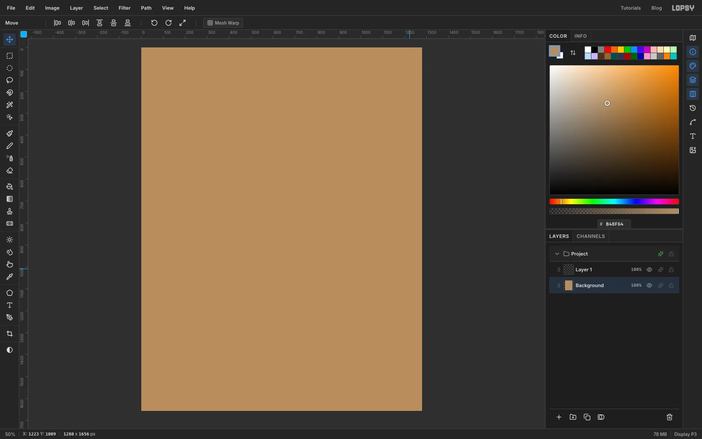

Choose **File → New**, enter **1280 × 1656** and click **Create**. Click the
*Background* row, set the foreground to kraft `#B48F64` and choose
**Edit → Fill**.

Choose **Filter → Add Noise…**. Set **Amount** to `9`, **Mode** to **Mono**
and **Distribution** to **Gaussian**, then click **Apply**. This adds a fine,
even grain.

New documents also come with an empty *Layer 1* at the top. Leave it there;
it becomes the leash later.

## Make short paper fibres

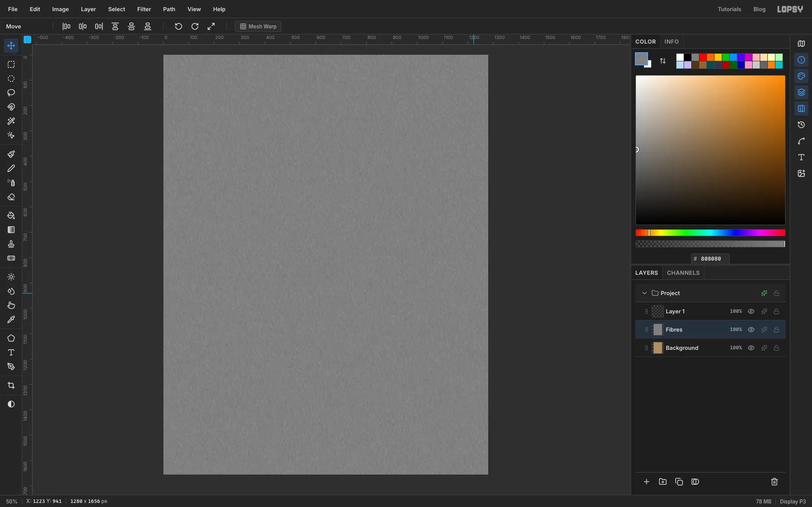

Add a layer and name it *Fibres*. Fill it with grey `#808080`, then run
**Filter → Add Noise…** with **Amount** `100`, **Mono** and **Gaussian**.

Choose **Filter → Motion Blur…** and set **Angle** to `70` and **Distance**
to `9`. Each speck smears into a short streak, like the fibres in brown
paper. Open the layer's effects drawer, set **Blend** to **Overlay**, and drop
the layer's opacity to **40%**. Overlay hides the mid grey, so only the
streaks show.

## Mottle the paper

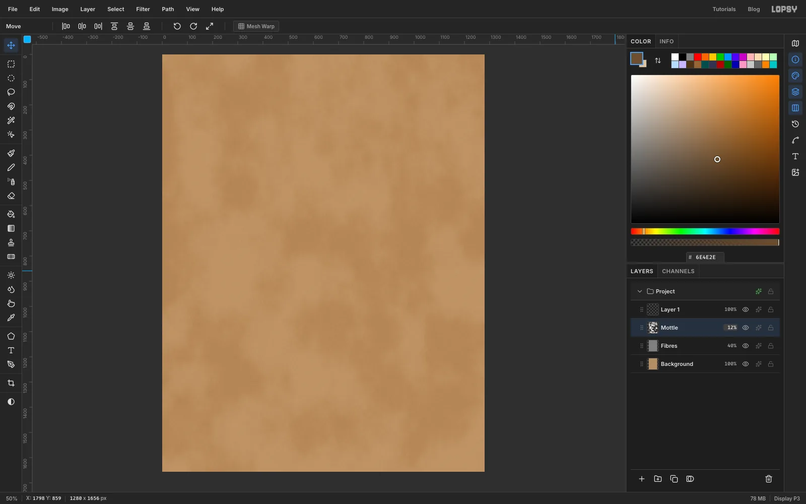

Kraft paper is never one flat colour. Add a layer named *Mottle*. Set the
foreground to light kraft `#E0C49C`, press [[X]] to swap it into the
background colour, then set the foreground to dark brown `#6E4E2E`.

Choose **Filter → Clouds…**, set **Scale** to `9` and click **Apply**. Set
the layer's **Blend** to **Soft Light** and its opacity to **12%**. Keep it
low; at 30% it starts to look like leather.

## Drop in the photo

Click the *Mottle* row so the photo lands above it. Drag the photo file from
your computer onto the canvas. Lopsy makes a new layer called *Pasted Layer*
and shrinks the photo to fit the page. Double-click the name, rename it
*Lantern Slide*, and press [[Cmd+D]].

## Trace the dog with the Pen

Pick the **Pen** tool. Click anchor points all the way round the dog: up the
muzzle, over the ear and down the back of the neck, along the back, round the
tail, down the back leg, round each foot, up between the legs, along the belly
and up the chest to the throat. Put an anchor wherever the outline changes
direction. You'll need about 90 of them. Tight spots like the toes need
anchors close together.

Zoom in with [[Cmd+=]] for the feet and hold [[Space]] and drag to pan; the
path stays open while you move around. If you misplace an anchor, press
[[Cmd+Z]] to take it back. Click the first anchor again to close the path.

## Turn the path into a selection

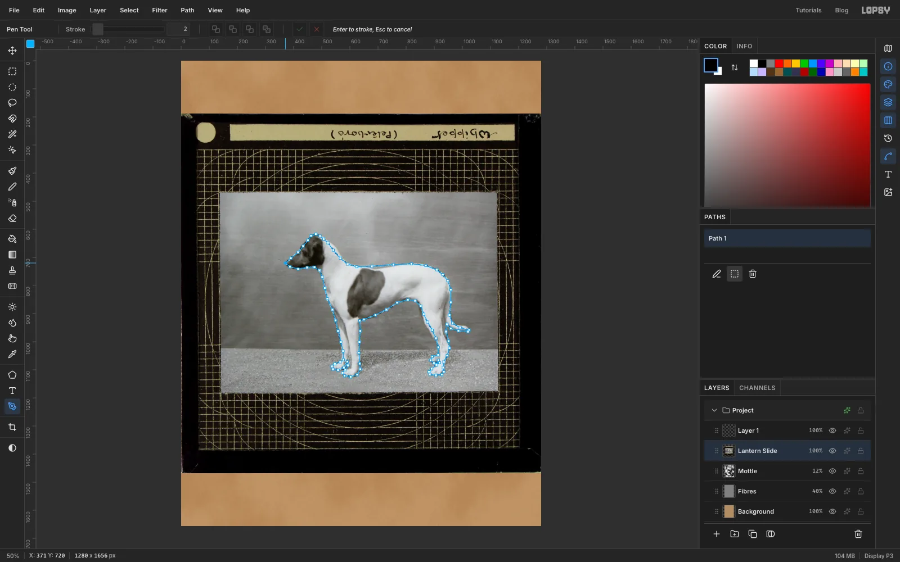

Open the **Paths** panel from the right-hand toolbar. *Path 1* is selected.
Click the **Path to Selection** button (the dotted square) under the list.
Marching ants now follow your outline.

## Lift the dog onto its own layer

With *Lantern Slide* still selected, press [[Cmd+C]] then [[Cmd+V]]. The
paste lands in exactly the same place on a new layer. Name it *Whippet
Photo*.

Close the Paths panel, then click the eye on *Lantern Slide* to hide it.
Keep it hidden rather than deleting it, in case you want to retrace.

## Scale the dog up

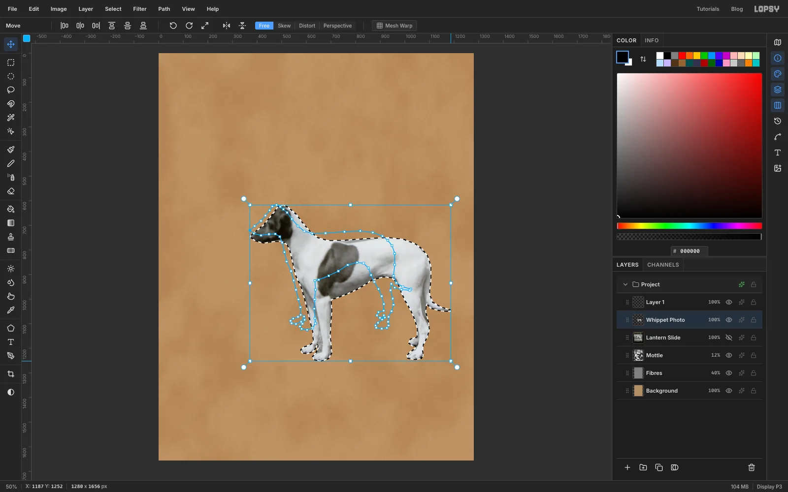

⌘-click the *Whippet Photo* thumbnail to select its pixels, and pick the
**Move** tool. Hold [[Cmd]] and drag the bottom-right corner handle down and
to the right until the dog is about a quarter bigger, roughly 815 px from
nose to tail. Holding ⌘ keeps the proportions. Press [[Cmd+D]].

## Stand the dog on its ground line

With the Move tool still active, use the arrow keys to nudge the dog until
the tip of its nose is at about `x 380` and its front feet touch `y 1235`.
[[Shift]]+arrow moves 10 px at a time. The ground line will go at 1240.

Back in the Paths panel, click *Path 1* and then the trash-can **Delete
Path** button under the list; you won't need the outline again.

## Make a tone study

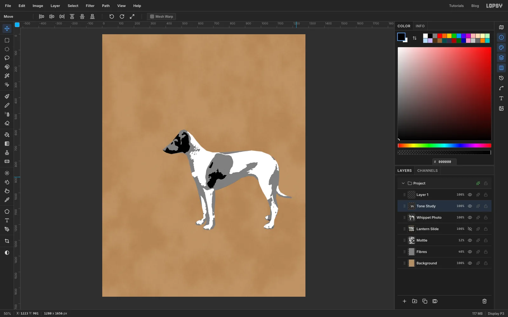

Click *Whippet Photo* and click **Duplicate Layer** at the bottom of the
Layers panel. Name the copy *Tone Study*.

Run **Filter → Desaturate**, then **Filter → Gaussian Blur…** with
**Radius** `3`, then **Filter → Posterize…** with **Levels** `3`. The blur
smooths the photo first, so posterizing gives smooth shapes instead of
noise. You now have three flat tones: black for the head and patch, grey for
the shading, and white for the coat. Each tone becomes one stencil plate.

## Fill the cream base plate

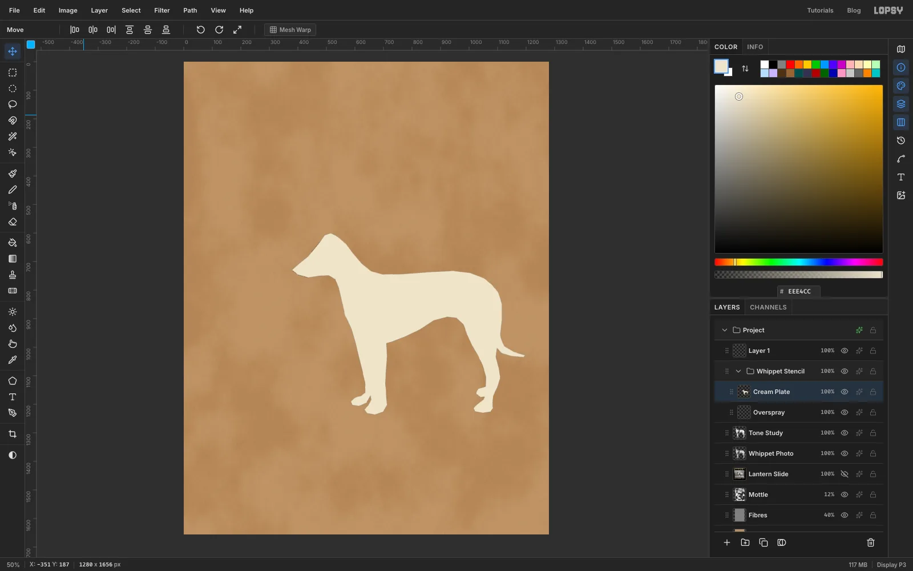

With *Tone Study* selected, click **New Group** and name it *Whippet Stencil*.
Inside it, add a layer named *Overspray*. Leave it empty for now.

⌘-click the *Whippet Photo* thumbnail, add a layer named *Cream Plate*, and
fill the selection with cream `#EEE4CC`. Deselect.

## Select the brown plate

Click *Tone Study*, then pick the **Magic Wand**. Set **Tolerance** to `12`
and uncheck **Contiguous**, so one click picks up every patch of that tone.

Click inside the black of the head, then [[Shift]]-click a grey area of the
body to add every grey patch. The brown plate covers both the grey and the
black areas, and the black plate is sprayed on top of it.

Choose **Select → Grow…** `3`, then [[Cmd+Shift+Option]]-click the *Whippet
Photo* thumbnail. That keeps only the part of the selection that overlaps the
dog. Growing first pushes the plate right out to the dog's edge, so no thin
cream rim shows round the outline.

## Spray the brown and black plates

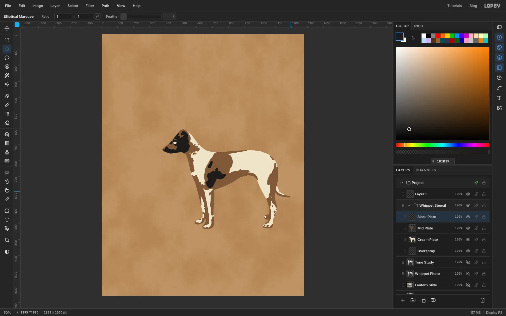

Click *Cream Plate* and add a layer named *Mid Plate*. Fill the selection
with brown `#7A5A3C` and press [[Cmd+D]]. Then clean it up while the layer is
selected:

- a flank shadow above the back leg looks like a floating extra leg. With the
  **Rectangular Marquee**, select from `880, 795` to `992, 862` and press
  [[Delete]].
- open the eye: deselect, then with the **Elliptical Marquee** select from
  `452, 676` to `480, 696` and press [[Delete]].

Deselect. Click *Tone Study* again and use the wand to click only the black
of the head. Grow by `3` and ⌘⇧⌥-click the *Whippet Photo* thumbnail as
before. Click *Mid Plate*, add a layer named *Black Plate*, and fill it with
ink `#1D1B19` and deselect. Then, deselecting before each one:

- delete two stray specks by the back foot: with the **Rectangular Marquee**,
  select from `1034, 1156` to `1074, 1188` and press [[Delete]], then do the
  same from `1060, 1208` to `1088, 1236`.
- with the **Elliptical Marquee**, select from `453, 681` to `473, 695` and
  press [[Delete]]. This makes the eye hole in the black plate.

Deselect, then hide *Tone Study* and *Whippet Photo*.

## Cut the stencil bridges

The black head patch and the body patch would fall out of a real stencil, so
give them bridges. Click *Black Plate*, pick the **Eraser** and set **Size**
to `6`.

Click at `516, 619` near the top of the ear, then [[Shift]]-click at
`493, 754` below the jaw. This erases a straight line through the head. Click
at `747, 749` on the top edge of the body patch and [[Shift]]-click at
`691, 980` below it.

Press [[Cmd+Z]] four times to watch the bridges disappear, then
[[Cmd+Shift+Z]] four times to bring them back. Each line is two history steps:
the click and the Shift-click.

## Knock the black plate out of register

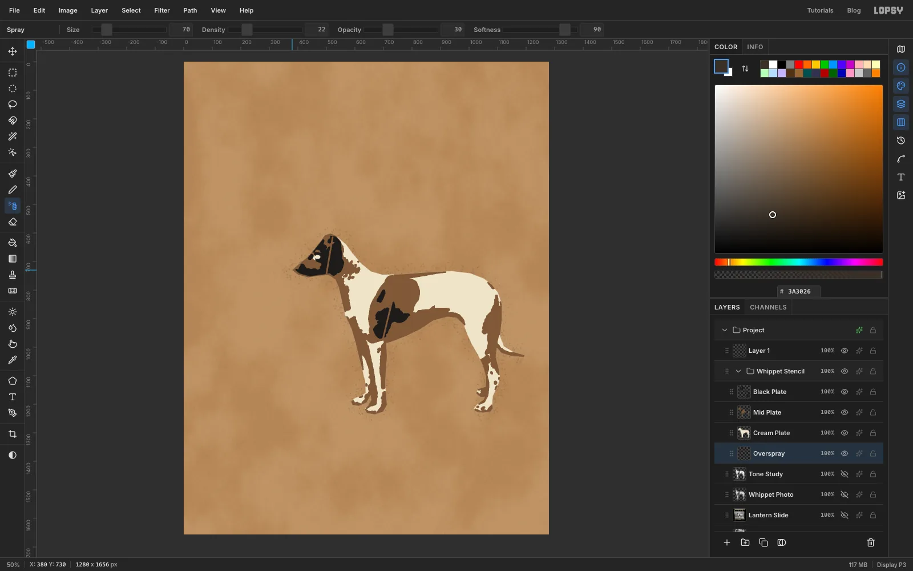

With *Black Plate* selected and the **Move** tool active, press the right
arrow `6` times and the up arrow `4` times. A sliver of brown now shows along
one side of every black shape, as if the second stencil went down a little
crooked.

Now the overspray. Click the empty *Overspray* layer and pick the **Spray**
tool. Set **Size** `70`, **Density** `22`, **Opacity** `30` and
**Softness** `90`, and set the foreground to `#3A3026`. In one long, loose
stroke, trace round the dog's outline. The half of each dab that lands on
the dog is hidden under the plates, so only a soft speckled halo shows
outside.

## Fill the sun disc

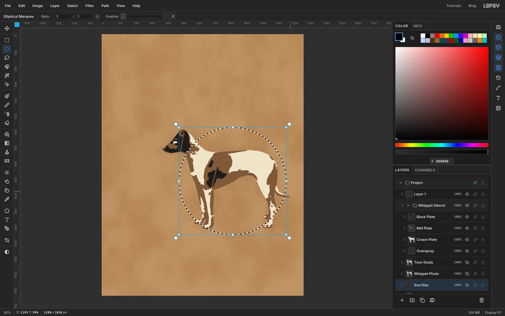

Click *Lantern Slide* (the disc goes below the stencil group) and add a layer
named *Sun Disc*. With the **Elliptical Marquee**, select from `490, 590` to
`1170, 1270`. That's a circle with a radius of 340 px, centred on
`830, 930`. Fill it with orange `#E8692A`, deselect, and run **Filter → Add
Noise…** with **Amount** `7`, **Mono**, **Gaussian** for some spray grain.

## Add overspray round the disc

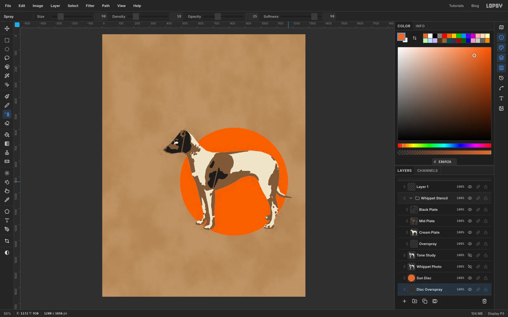

Click *Lantern Slide* again and add a layer named *Disc Overspray*, just under
the disc. Pick the **Spray** tool with **Size** `90`, **Density** `18`,
**Opacity** `35`, **Softness** `90` and the foreground set to orange. Drag
right round the rim of the disc in one circle.

## Paint the ground and a sprayed shadow

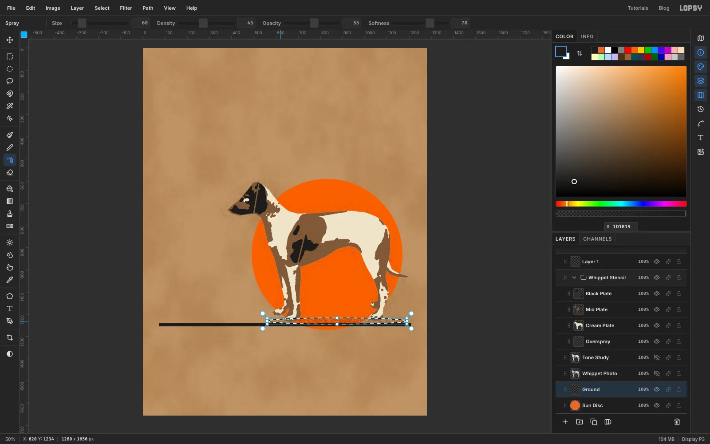

Click *Sun Disc* and add a layer named *Ground*. Select from `72, 1240` to
`1208, 1254` with the **Rectangular Marquee**, fill it with ink, and
deselect. The bar crosses the disc about 30 px above
its bottom edge. Don't line the bar up with the disc's lowest point; the two
edges would just touch and look like an accident.

For the cast shadow, use the **Elliptical Marquee** to select from
`560, 1216` to `1190, 1244`. With the **Spray** tool at **Size** `60`,
**Density** `45`, **Opacity** `55` and **Softness** `70`, zigzag back and forth
inside the selection. The spray can't leave it, so the shadow gets a clean
oval outer shape with a grainy inside. Deselect.

Finally, set **Size** to `26`, **Density** `20` and **Opacity** `35`, and
zigzag lightly along the top and bottom edges of the bar to roughen it.

## Draw the collar and leash

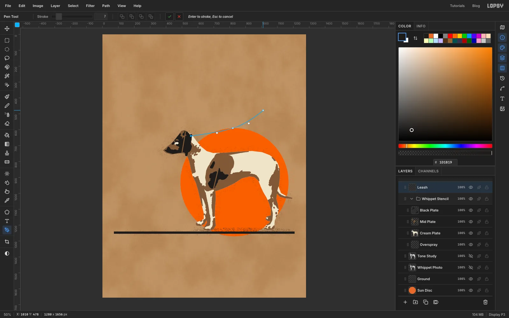

Click *Layer 1* (still empty, at the top) and rename it *Leash*. Pick the
**Brush**, set **Size** `16`, **Hardness** `100` and **Opacity** `100` with
ink as the foreground. Click at `557, 635` behind the ear and [[Shift]]-click
at `527, 759` under the jaw to paint the collar.

Pick the **Pen**. Click at `556, 639` on the collar. Then press at
`820, 590` and drag towards `920, 560`; dragging pulls out curve handles, so
the leash sags. Click at `1010, 478` for the end. Set **Stroke** to `7` in
the options bar and press [[Enter]]. The path is stroked in the foreground
colour.

## Add a hand loop

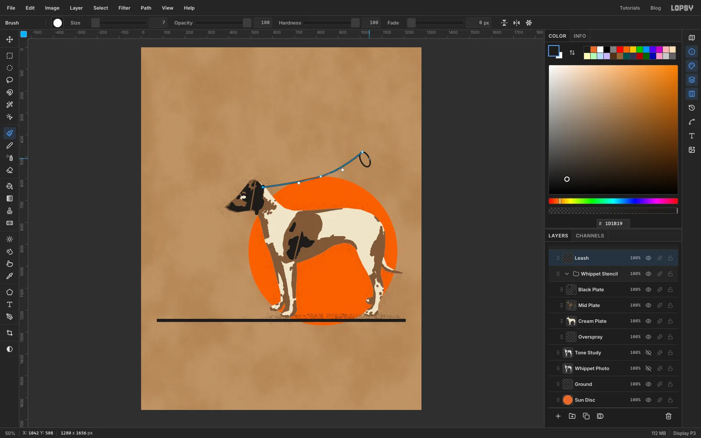

A leash that runs off the page leads the eye out of the flier. End it with a
loop instead, waiting for someone to pick it up. Pick the **Brush**, set
**Size** to `7`, and draw a small oval, about 40 × 70 px and tilted to the left. Start its top
at the leash end, `1010, 478`, so the loop hangs below it with its centre at
about `1022, 512`.

## Set the stencil headline

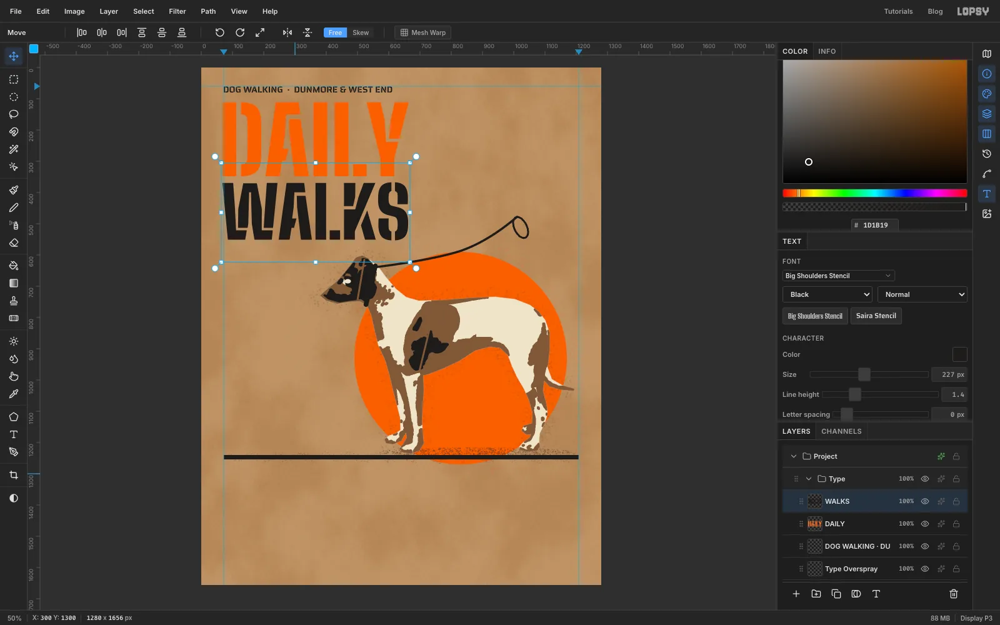

Click the top ruler at `72` and `1208` and the left ruler at `60` for margin
guides. Click *Leash*, click **New Group**, and name it *Type*. Inside it, add
an empty layer named *Type Overspray*.

With the Type group selected and ink as the foreground, pick the **Text** tool
and choose **Saira Stencil**, **SemiBold**, size `28`. Open the **Text** panel
and set **Letter spacing** to `6`. Click in an empty part of the canvas and
type `DOG WALKING  ·  DUNMORE & WEST END`, then press [[Tab]] to commit it.
Set the letter spacing back to `0`. With the **Move** tool, nudge the line
until its left edge is on the `72` guide and its top is on `60`.

Click the Type group again, set the foreground to orange and the font to
**Big Shoulders Stencil**, **Black**, size `296`. Type `DAILY` and move it so
its top sits 32 px under the kicker, about `y 112`, with its left edge at
`68`. Click the group, switch to ink and size `227`, and type `WALKS`. Place
it 20 px under DAILY. At these two sizes both words are the same width, so
they make a flush block.

## Misregister the second word

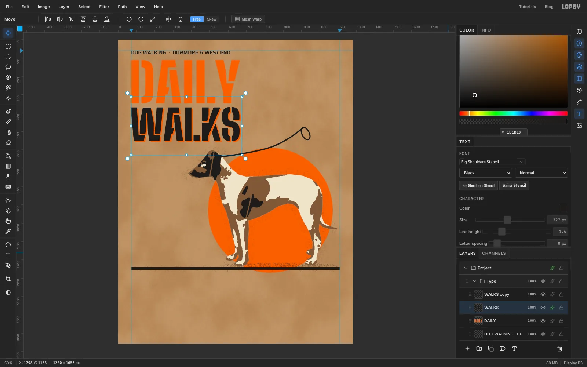

Click *WALKS* and click **Duplicate Layer**. Select the original *WALKS* (the
lower one), open its effects drawer, tick **Color Overlay** and set the colour
to orange `#E8692A`. With the **Move** tool, nudge it `7` px right and `6` px
down. The black copy on top hides most of it, so only an orange edge shows
along two sides of each letter.

## Make the price badge

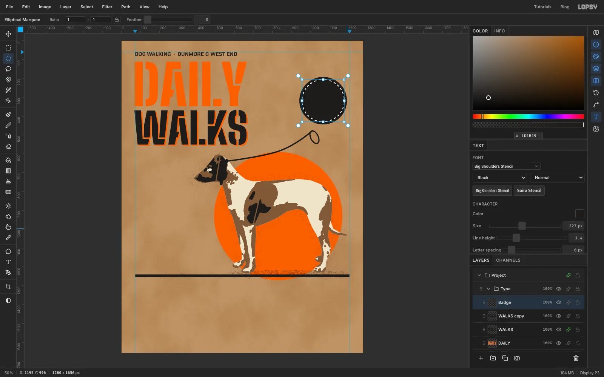

Click the Type group and add a layer named *Badge*. With the **Elliptical
Marquee**, select a circle from `942, 192` to `1194, 444` and fill it with
ink. Deselect before each new circle: select from `956, 206` to `1180, 430`
and fill it with orange, then select from `962, 212` to `1174, 424` and fill
it with ink again. That leaves a 6 px orange ring inside
the black rim. Deselect.

## Seat the price inside the ring

With orange as the foreground and *Badge* selected, set the font to **Big
Shoulders Stencil Black** at `116` and type `$18`. Click *Badge* again, switch
to cream `#EEE4CC`, **Saira Stencil SemiBold** at `24`, set **Letter spacing**
to `4`, and type `PER WALK`. Reset the letter spacing to `0`.

Nudge `$18` until it's centred on `1068` across and sits a little above the
badge's middle, centred at about `y 304`. Put `PER WALK` 10 px below it, also
centred. Check the corners of PER WALK: they should be at least 12 px clear
of the orange ring.

## Add overspray round the type

So far only the dog looks sprayed. ⌘-click the *DAILY* thumbnail, choose
**Select → Grow…** `14` then **Select → Feather…** `6`, and click the *Type
Overspray* layer. Pick the **Spray** tool with **Size** `80`, **Density**
`18`, **Opacity** `32` and **Softness** `85`, set the foreground to orange,
and zigzag across the word three times. The selection keeps the spray close
to the letters. Deselect.

Then ⌘-click the *WALKS copy* thumbnail, **Grow** `12`, **Feather** `6`,
click *Type Overspray* and spray in ink. Repeat for *Badge*: ⌘-click its
thumbnail, Grow `12`, Feather `6`, and spray in ink.

## Tilt the badge

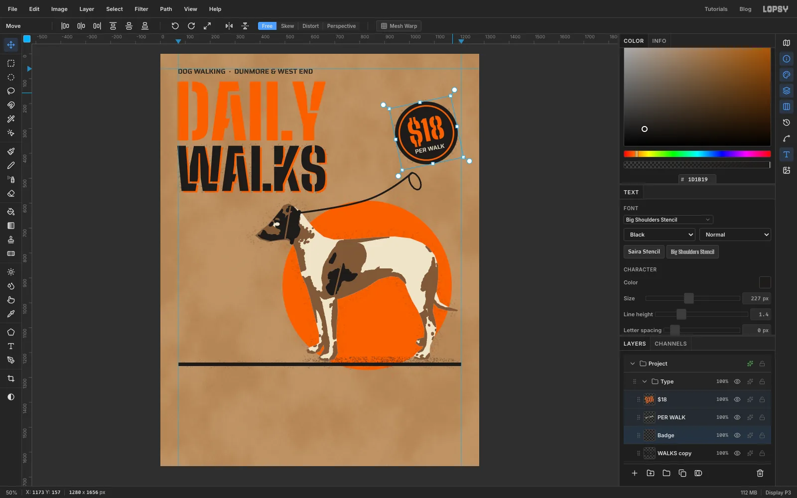

Click *Badge*, then [[Cmd]]-click the *$18* and *PER WALK* rows so all three
are selected. With the **Move** tool, drag the round rotation handle just
outside the box's top-right corner anticlockwise by about 12°. All three turn
together around the badge's centre. Deselect.

Press [[Cmd+Z]] and the badge stands straight again; [[Cmd+Shift+Z]] tilts it
back.

## Set the services list

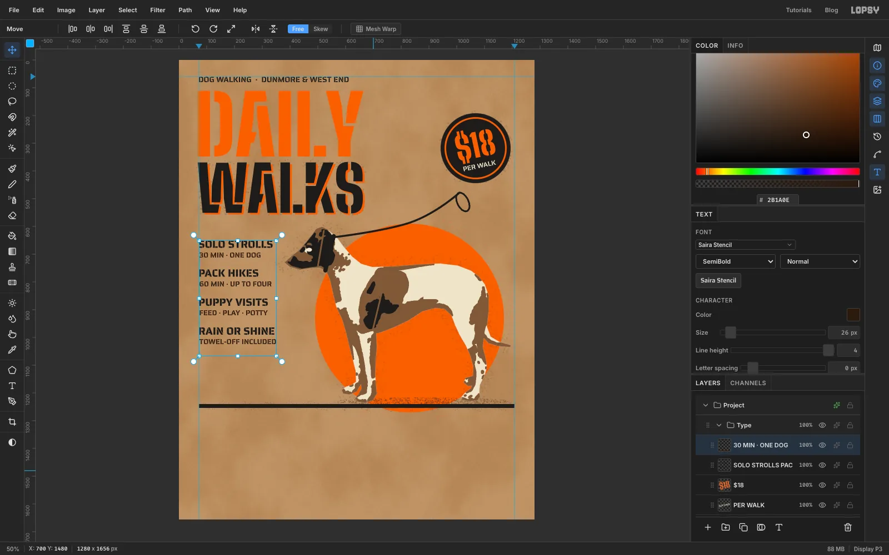

The list is two text layers, one for the headings and one for the details,
set on the same line pitch so they interleave.

Click the Type group. In ink, choose **Saira Stencil Bold** at `38` and set
**Line height** to `2.75` in the Text panel. Type these four lines, pressing
[[Enter]] between them: `SOLO STROLLS`, `PACK HIKES`, `PUPPY VISITS`,
`RAIN OR SHINE`. Click an empty area of the canvas to start each new text
layer, away from existing type, then move it into place afterwards.

Click the group again. Switch to detail brown `#2B1A0E`, **SemiBold** at `26`,
**Line height** `4`, and type the four detail lines: `30 MIN · ONE DOG`,
`60 MIN · UP TO FOUR`, `FEED · PLAY · POTTY`, `TOWEL-OFF INCLUDED`.
38 × 2.75 and 26 × 4 both come to about 104 px, so the lines stay in step.

Move the headings so their left edge is on the `72` guide and their top is at
`650`. Put the details 44 px below the top of the first heading, so each
detail line sits under its heading.

## Add the call to action and footer

The space under the list needs a reason to call. Click the Type group, set
orange, **Saira Stencil ExtraBold** at `46` and **Line height** `1.15`, click
an empty area and type `FIRST MEET`, [[Enter]], `& GREET FREE`. Line its left edge up with the
guide and its bottom at `1200`, 40 px above the ground.

Click the group again. In ink, choose **SemiBold** at `24`, **Line height**
`1.4` and **Letter spacing** `2`. Type `INSURED · VETTED · DOG FIRST AID` and
place it at `72, 1290`, under the ground bar. Reset the letter spacing.

## Make a paw-print brush

Click *Leash* and add a layer named *Paw Sketch*. Using the Elliptical
Marquee and **Edit → Fill** in ink, deselecting between shapes, draw a paw
pointing left:

- the pad: `197, 1503` to `223, 1537`
- four toes in an arc on the pad's left: `183, 1493` to `196, 1508`,
  `174, 1504` to `187, 1519`, `174, 1521` to `187, 1536`, and `183, 1533` to
  `196, 1548`

Select a square round it from `164, 1484` to `236, 1556`, choose **Edit →
Define Brush…**, and name it *Paw Print*. Deselect, then delete the *Paw
Sketch* layer. The brush stays saved for this session.

## Stamp the paw trail

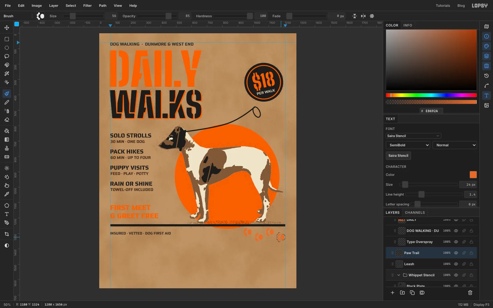

Click *Leash*, add a layer named *Paw Trail*, and set the foreground to
orange. Pick the **Brush**; it's now using the paw tip. Set **Size** to `56` and
**Opacity** to `85`.

Single-click four prints, one at a time: `964, 1290`, `1036, 1324`,
`1108, 1290` and `1180, 1324`. They lead in from the right edge, the way the
dog came. They start right of the disc, so the orange prints don't touch the
orange arc under the ground bar.

## Set up a dotted brush

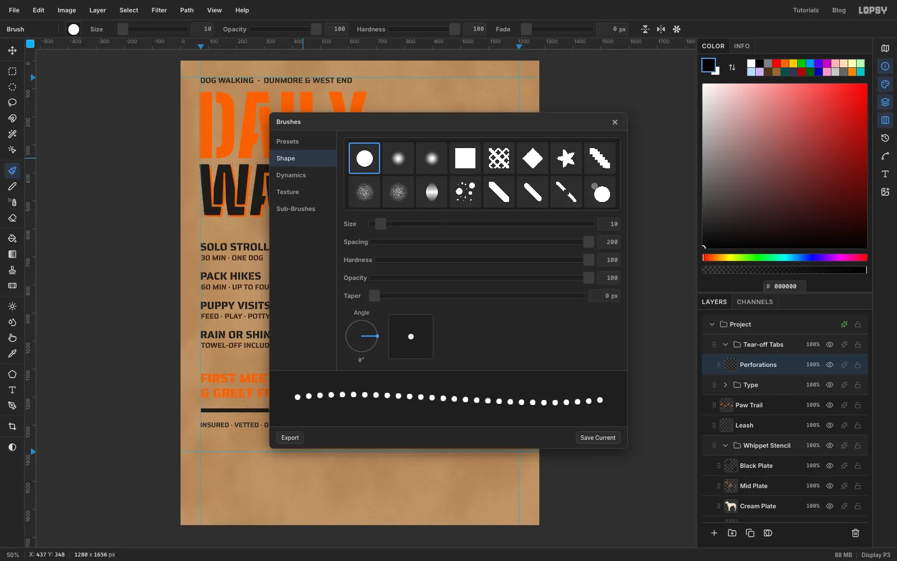

Click the left ruler at `1394` to add a guide for the cut line. Collapse the
*Type* group, click it, click **New Group** and name it *Tear-off Tabs*. Add a
layer inside it named *Perforations*.

Pick the **Brush** and click the brush-tip thumbnail at the left of the
options bar to open the **Brushes** window. On the **Presets** tab, choose
**Hard Round**. On the **Shape** tab, set **Spacing** to `200`. Each dab now
leaves a gap as wide as itself, so a stroke becomes a row of dots. Close the
window.

## Draw the perforations

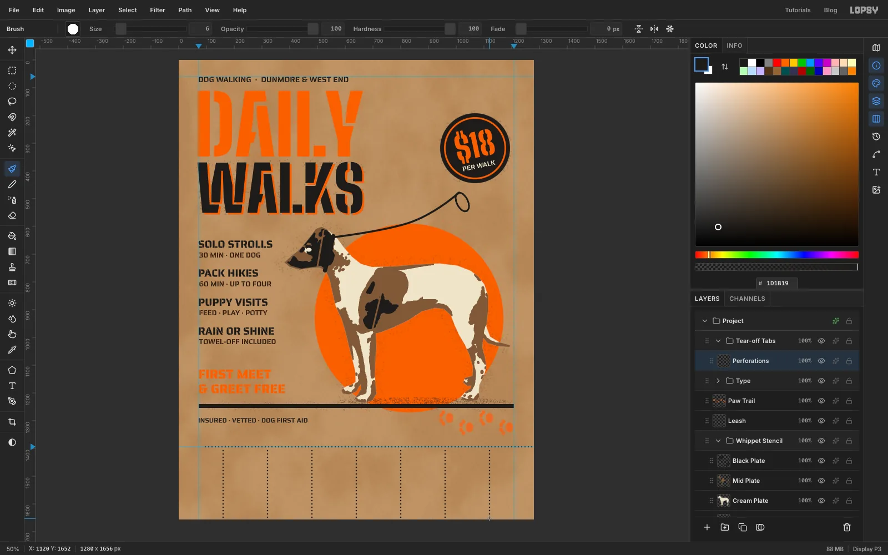

Set the brush **Size** to `6` and **Opacity** to `100`, in ink. Click at
`96, 1394` and [[Shift]]-click at `1276, 1394` for the cut line.

The tabs are 160 px wide, so draw a vertical dotted line at every multiple of
160: click at `160, 1408` and [[Shift]]-click at `160, 1652`, then repeat at
`x 320, 480, 640, 800, 960 and 1120`.

With the **Text** tool in **Saira Stencil Bold** at `40`, click an empty
spot and paste a ✂ (copy it from this page, or use the emoji picker,
[[Ctrl+Cmd+Space]]). Commit it and place it at the left end of the cut line,
centred on it. Lopsy draws symbols the font lacks from its own symbol face.

## Turn the first tab sideways

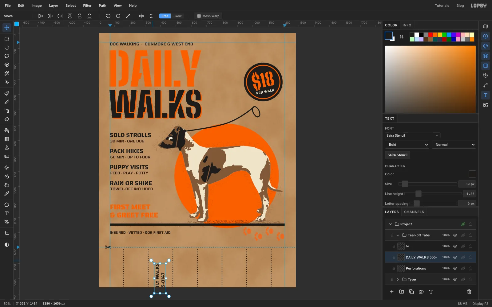

Click *Perforations*. Pick the **Text** tool and click an empty spot below the
cut line. With **Saira Stencil Bold** at `30` and **Line height**
`1.25`, type `DAILY WALKS`, [[Enter]], `555-0147`.

With the **Move** tool, hold [[Cmd]] and drag the top-right rotation handle
anticlockwise. Holding ⌘ snaps the turn to 15° steps, so stop at exactly
90°. The text now reads from the bottom up, like a real pull-off tab. Nudge it
to the middle of the first tab, centred on `80, 1525`, so it has about 36 px
of paper above and below.

## Make the other seven tabs

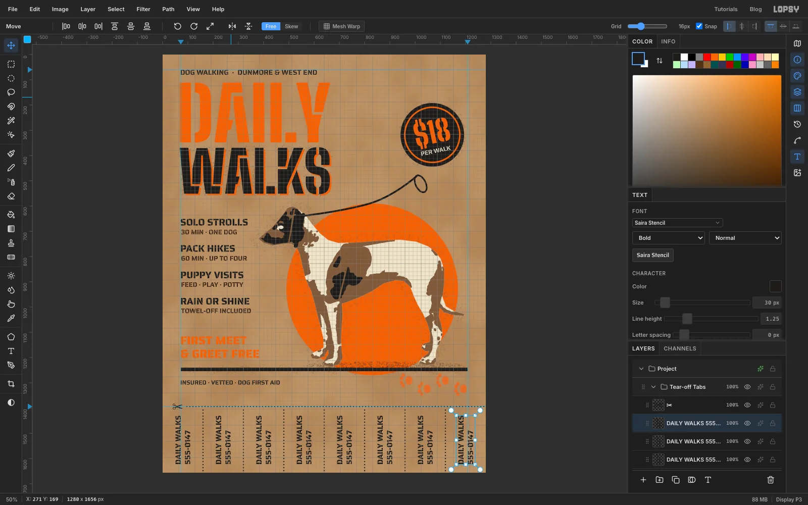

With the tab text selected, click **Duplicate Layer**. The copy appears in
the same place. Select the copy and, with the **Move** tool, press [[Shift]]+[[Right]] 16 times to
move it one tab (160 px) to the right. Repeat from each new copy until all
eight tabs are filled.

Turn on **View → Show Grid** to check that every tab sits the same distance
from its dotted lines, then turn the grid off again.

To check the group, click *Tear-off Tabs* and press the down arrow a few
times: every tab and dotted line moves together. Press [[Cmd+Z]] the same
number of times to put it back.

## Add paper flecks

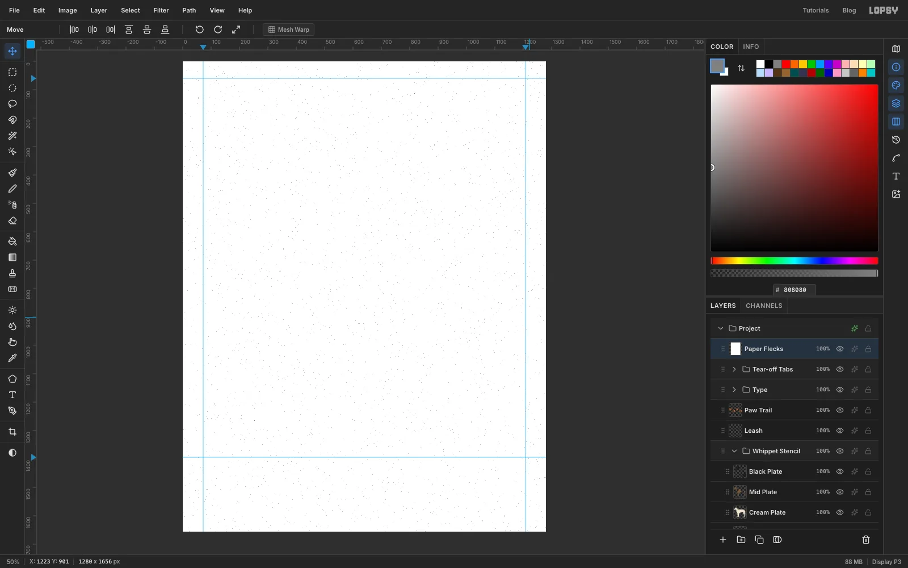

Collapse the groups, click *Tear-off Tabs*, and add a layer named *Paper
Flecks*. It will sit above everything. Fill it with grey `#808080`, run
**Filter → Add Noise…** with **Amount** `100`, **Mono** and **Gaussian**, then
**Filter → Threshold…** with **Level** `78`. Everything turns white except a
scatter of dark specks.

## Finish with Multiply

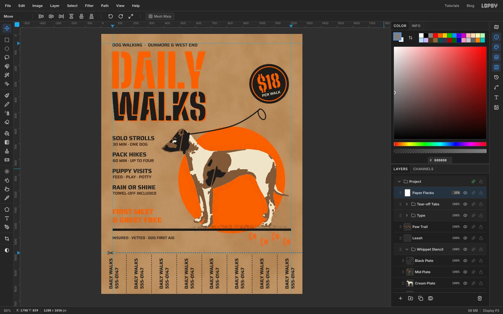

Set the layer's **Blend** to **Multiply** and its opacity to **35%**. In
Multiply, white disappears, so only the specks show. They land on the ink as
well as the paper, so the paint looks sprayed onto the kraft rather than
floating above it.

Export with **File → Quick Export PNG** and save the project with **File →
Save Project**, so you can change the phone number on the tabs later.
