Stencil graffiti is built for getting a message across fast: one colour per stencil, heavy letters with bridges holding the counters in place, and a haze of overspray around every edge. That makes it a good fit for a chart. The limits of the technique force you to keep the data simple.

In this tutorial you'll make **Noise Exposure**, a 1600 × 2000 px infographic that shows how long you can safely listen at different volumes. The numbers come from the NIOSH recommended exposure limit: 85 dBA for 8 hours, and half the time for every 3 dB above that. Each bar is cut into blocks of 3 dB, so every block past the red line halves the time on the label.

Along the way you'll use:

- **Texture**, **Clouds** and a radial **Gradient** for the concrete wall
- guides, an **8 px grid** with **Snap**, and the marquees with add, subtract and intersect
- text in **Big Shoulders Stencil**, including a multi-line block with its own **Line height**, per-word colour, and text knocked out of a shape
- the **Lasso**, the **Shape** tool, copy and paste, and **Merge Down**
- a **layer mask** painted with straight brush lines, and a **group mask** textured with a filter
- scaling and rotating whole groups with the **Move** tool
- the **Spray** tool, the Brush's **Fade**, the **Outer Glow** effect and a **Contrast** adjustment

The palette:

- Wall `#3B3D40`
- Bone white `#ECE7DA`
- Hazard yellow `#F4C21F`
- Signal orange `#F26A1B`
- Alarm red `#E8402A`

> **Tip:** Positions are written as `x, y` in document pixels. The status bar at the bottom of the window shows where the cursor is, so you can hover to find a spot. Key names are Mac keys. On Windows and Linux, use Ctrl for Cmd. One rule to remember with text: if a text layer is selected, changing the font or size in the options bar restyles that layer. Before you set up a new piece of text, click a layer that isn't text.

## Paint the concrete wall

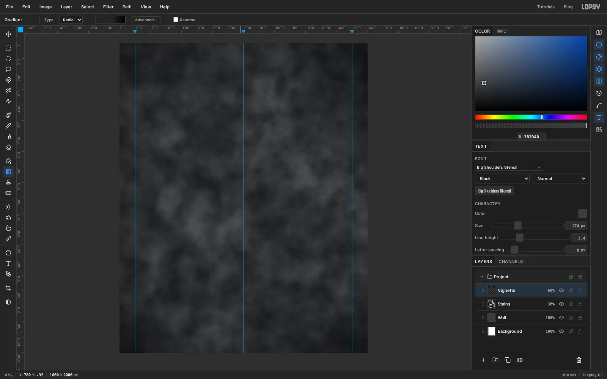

Choose **File → New**, set the size to **1600 × 2000** px and click **Create**. Rename `Layer 1` to `Wall` (double-click its name), set the foreground to `#3B3D40` and choose **Edit → Fill**.

Concrete has big soft blotches and fine grit, so run **Filter → Texture…** twice. Both times leave **Type** on **Grain**. First use **Amount** `12`, **Size** `140`, **Detail** `90`, **Seed** `3` for the blotches. Then use **Amount** `10`, **Size** `2`, **Detail** `40`, **Seed** `7` for the grit.

Click **Add Layer** and name it `Stains`. Choose **Filter → Clouds…** and click **Apply**, then **Filter → Gaussian Blur…** with **Radius** `30`. Open the layer's effects drawer (the **✦** button on its row), set the blend mode to **Multiply**, and lower the layer's opacity to `30%`.

Add a layer called `Vignette`. Pick the **Gradient** tool, choose **Radial**, and click **Advanced…**. Make every stop black `#000000`: fully transparent at the left end and at about 55%, fully opaque at the right end. Drag from the centre of the canvas straight down to a little past the bottom edge. Set the layer to **Multiply** at `60%`.

Now the guides. Click the top ruler at `100` and again at `1500` for the side margins. Then hold [[Cmd]] and click the ruler near the middle: the guide jumps to exactly half the width, `800`.

## Set the headline

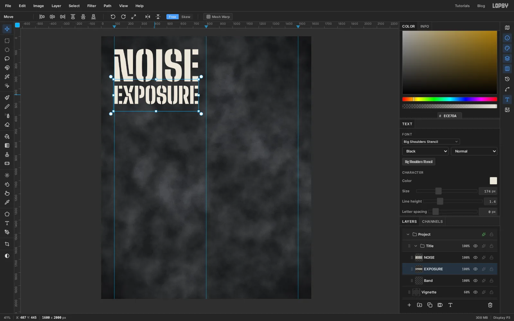

Click **New Group** in the Layers panel and name the group `Title`. With the group selected, click **Add Layer** and name the new layer `Band`. You'll fill it in the next step. For now it gives you a layer that isn't text to click before each new piece of type.

Set the foreground to bone white `#ECE7DA` and pick the **Text** tool. In the options bar choose the font **Big Shoulders Stencil**, weight **Black**, and **Size** `306`. Click on the wall, type `NOISE`, and press [[Tab]] to commit.

Switch to the **Move** tool and drag the word until the left edge of the N sits on the left guide and the tops of the letters are about 95 px down from the top of the canvas. Drag from the middle of a letter. The small squares around the text are scale handles, and dragging one of those stretches the word instead of moving it.

Click `Band`, pick the Text tool again, set **Size** `174`, click an empty part of the wall and type `EXPOSURE`. Move it under the first word, with its left edge on the guide and its top about 30 px below the bottom of NOISE. At these two sizes both words come out the same width, which gives the headline a solid block shape.

## Lay down the hazard band

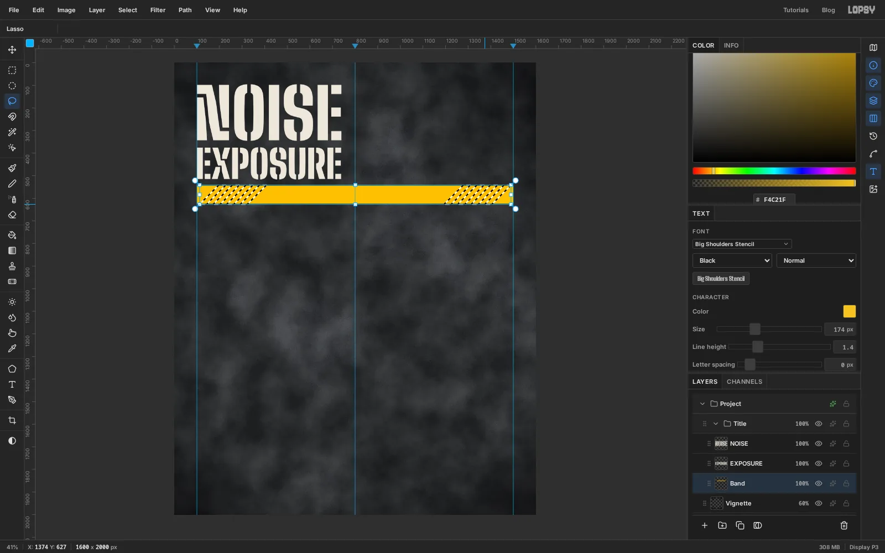

Click `Band`. With the **Rectangular Marquee**, drag from the left guide to the right guide just under the headline, 80 px tall (`100, 544` to `1500, 624`). Set the foreground to `#F4C21F` and choose **Edit → Fill**, then press [[Cmd+D]] to deselect.

The stripes are cut out of the band, so the wall shows through them. Pick the **Lasso**. Near the left end of the band, click and drag round a slanted parallelogram about 30 px wide that leans to the right at 45°, starting a little below the band and ending a little above it. Hold [[Shift]] and draw three more beside it, then four more at the right end, so there are four cuts at each end of the band. Each one you draw with Shift held is added to the selection.

The Lasso is freehand, so go slowly along the long edges. Small wobbles are fine here: stencils are cut by hand, and the worn-paint pass at the end roughens every edge anyway. If you want ruler-straight sides, click the four corners with the **Pen** tool instead and use **Path to Selection** in the Paths panel.

Press [[Delete]] to clear all eight at once, then [[Cmd+D]].

## Knock the tagline out of the band

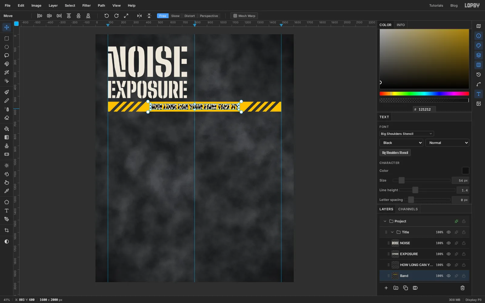

With `Band` still active, pick the Text tool, set **Size** `54`, click an empty patch of wall and type `HOW LONG CAN YOUR EARS TAKE IT?`. The colour doesn't matter, because this layer is only a cutter.

Move the line into the band. Centre it on the middle guide and leave the same amount of yellow above and below the letters. At this size that's about 18 px each side, which keeps the letters well clear of the band's edges.

Now hold [[Cmd]] and click the text layer's thumbnail in the Layers panel. That loads the letters as a selection. Click the `Band` layer, press [[Delete]], then [[Cmd+D]]. Hide the text layer with its eye button. The tagline is now a set of holes in the yellow paint, just as a real stencil would leave it.

## Cut the megaphone from simple shapes

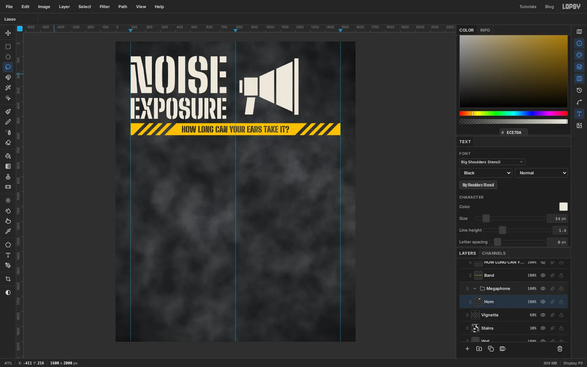

Click the `Vignette` layer, then **New Group**, and name the group `Megaphone`. A new group goes directly above the layer you had selected, so starting from `Vignette` keeps each group at the top level. Add a layer inside it called `Horn` and set the foreground back to `#ECE7DA`.

A stencil can't hold a shape with a hole in it, so stencil artwork is made of separate islands with gaps (bridges) between them. Build the megaphone the same way, as six pieces with gaps of about 12 px. For each piece, make the selection, choose **Edit → Fill**, and deselect.

1. The body: a rectangle with the **Rectangular Marquee**, 90 px wide and 120 px tall, with its top-left corner at about `858, 240`. That puts it to the right of the headline, level with the middle of NOISE.
2. The end cap: a narrow rectangle, 20 × 84 px, 12 px to the left of the body and centred on its height.
3. The cone, in two parts, with the **Lasso**. Start 12 px to the right of the body and draw a four-sided shape about 100 px wide whose left side is a little taller than the body (about 136 px) and whose right side is about 226 px tall, flaring evenly above and below. Leave a 12 px gap and draw a second piece about 108 px wide that carries on the same flare, from about 238 px tall on its left to 336 px on its right.
4. The rim: a tall thin rectangle, 28 × 376 px, 12 px past the wide end of the cone and centred on it.
5. The handle: with the Lasso, a four-sided shape about 54 px wide and 114 px tall hanging 12 px below the body, leaning slightly to the left at the bottom.

## Add the sound arcs

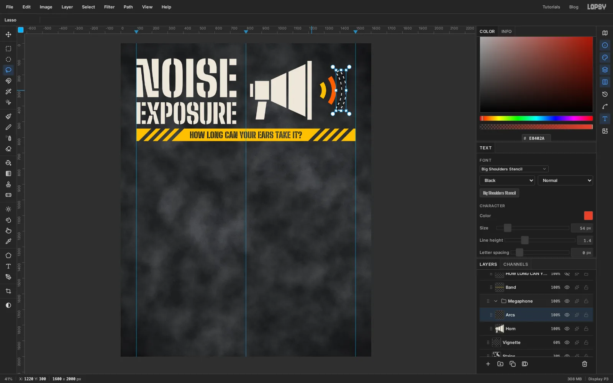

Add a layer called `Arcs` above `Horn`. Each arc is a slice of a ring, and you can make one from three selections.

1. With the **Elliptical Marquee**, drag a circle 184 px across whose centre is the middle of the rim, `1220, 300`. The marquee is drawn corner to corner, so drag from `1128, 208` to `1312, 392`. Hold [[Cmd]] to keep it round.
2. Hold [[Alt]] and drag a second circle inside the first, 28 px in from it on every side (`1156, 236` to `1284, 364`). Alt subtracts, so you're left with a ring.
3. Pick the **Lasso**, hold [[Shift+Alt]] and draw a wedge that starts at the centre of the circles and fans out to the right, about 36° above and below the horizontal. Shift+Alt keeps only the overlap, so the ring is cut down to an arc.

Fill it with `#F4C21F` and deselect. Repeat twice with bigger circles round the same centre, each with a hole 28 px in from its edge: one 312 px across (`1064, 144` to `1376, 456`) filled with `#F26A1B`, and one 440 px across (`1000, 80` to `1440, 520`) filled with `#E8402A`.

## Shrink the megaphone as a group

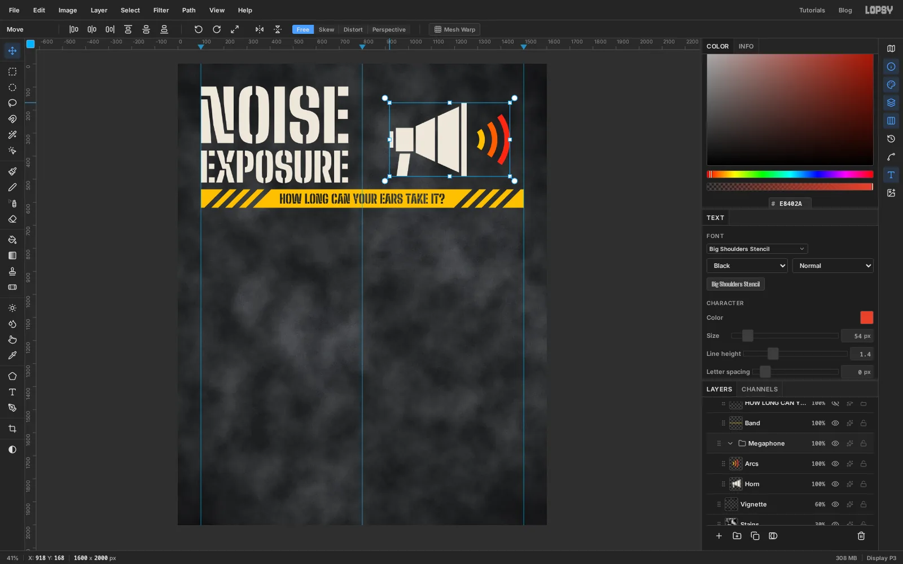

The megaphone is a bit too big next to the headline. Press [[Cmd+D]] so nothing is selected, click the `Megaphone` group in the Layers panel and pick the **Move** tool. With a group selected and no selection on the canvas, the handles frame everything in the group.

Hold [[Cmd]] and drag the top-left corner handle down and to the right until the megaphone is about 85% of its size. Cmd keeps the proportions, and both layers scale together. Press [[Cmd+D]] to commit.

## Tilt it and put it in place

Click the `Megaphone` group again. Move the cursor just outside a corner of the box, where the round rotation handles are, and drag anticlockwise by about 12° so the megaphone points up at the corner of the sheet. Press [[Cmd+D]] to commit.

With the group still selected, drag from the middle of the cone to move the megaphone and its arcs together. Park it so the red arc stops just short of the right guide and the megaphone is centred on the height of the headline.

## Marquee the bars on a grid

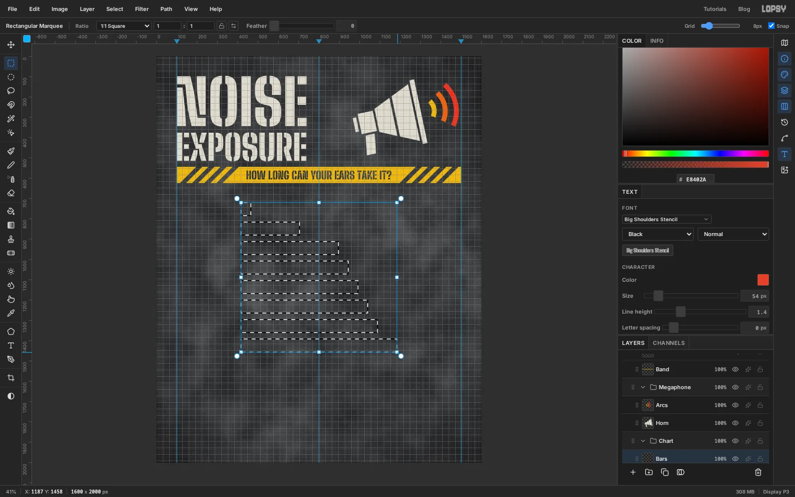

Click `Vignette`, add a group called `Chart`, and add two layers inside it: `Threshold` first, then `Bars` above it.

The chart is laid out on an 8 px grid. Guides pull harder than the grid does, so first untick **View → Snap to Guides**. Then choose **View → Show Grid** and, in the options bar, drag **Grid** down to `8px`. **Snap** turns on with the grid.

Each block in a bar is 24 px wide and stands for 3 dB. Counting from 25 dB, the eight sounds get this many blocks:

- Whisper, 30 dB: 2 blocks
- Conversation, 60 dB: 12 blocks
- City traffic, 85 dB: 20 blocks
- Lawn mower, 91 dB: 22 blocks
- Motorcycle, 97 dB: 24 blocks
- Nightclub, 103 dB: 26 blocks
- Rock concert, 109 dB: 28 blocks
- Siren, 121 dB: 32 blocks

30 and 60 dB don't land on a 3 dB step, so those two bars round up to the next whole block.

With the **Rectangular Marquee**, drag the first bar from `416, 720`, 64 px tall and 48 px long. Hold [[Shift]] and drag the next one 96 px lower, 288 px long, and carry on down the list. Every bar starts at x = `416`, and the grid makes the drags land cleanly. Set the foreground to `#ECE7DA` and choose **Edit → Fill** with `Bars` active, then deselect.

## Colour the danger zones

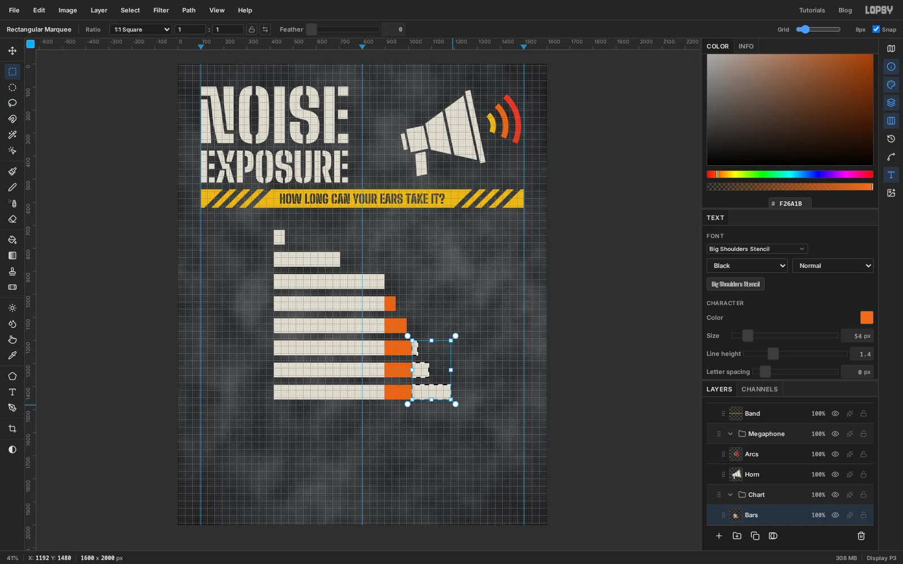

Everything to the right of 85 dB is where hearing damage starts, so that part of the bars changes colour. 85 dB is 20 blocks in, at x = `896`.

Hold [[Cmd]] and click the `Bars` thumbnail to select the bars. Then, with the Rectangular Marquee, hold [[Shift+Alt]] and drag a tall box from x = `896` to x = `1016` that covers all eight rows. Only the overlap stays selected. Fill it with `#F26A1B` and deselect.

Do the same again from x = `1016` to past the end of the longest bar and fill with `#E8402A`. That's the zone from 100 dB up.

Choose **View → Show Grid** again to hide the grid.

## Cut the blocks with a layer mask

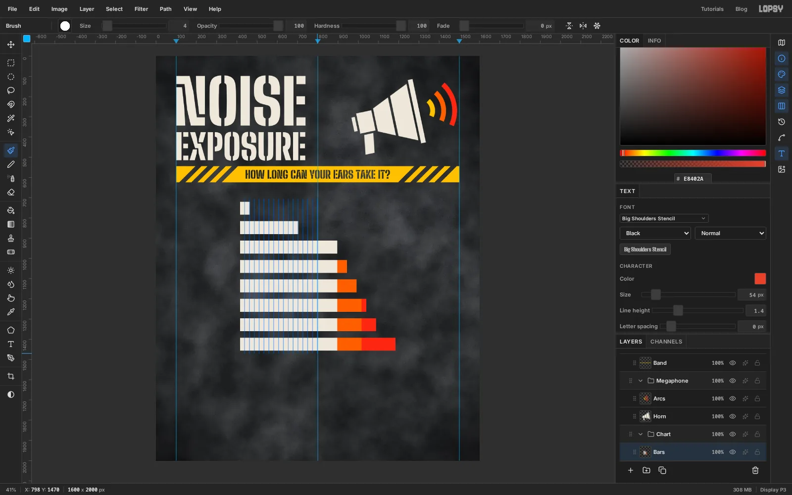

The gaps between blocks are the stencil's bridges. Cut them on a mask so the bars underneath stay whole and you can redo a line that goes wrong.

With `Bars` active, click **Add Mask** in the Layers panel. You're now painting on the mask, where the Brush hides. Pick the **Brush** and set **Size** `4`, **Hardness** `100` and **Opacity** `100`.

Click just above the top bar at x = `438`, then hold [[Shift]] and click just below the bottom bar at the same x. Shift-click draws a straight line from the last click, and one line cuts all eight bars. Repeat every 24 px: `462`, `486`, and so on to `1158`, which is 31 lines. Each one hides the last 4 px of a block.

Click the `Bars` row to leave mask edit mode.

> **Tip:** Each line is two undo steps, the click and the Shift-click. If a cut lands in the wrong place, press [[Cmd+Z]] twice and draw it again.

## Draw the damage line, flag and axis ticks

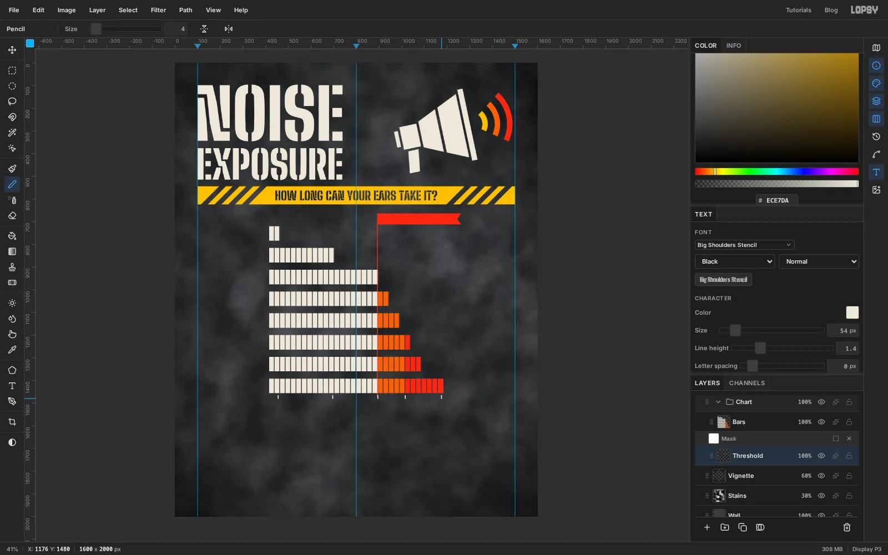

Click the `Threshold` layer. It sits under `Bars`, so a line drawn here shows through the gap at 85 dB without covering any blocks.

Set the foreground to `#E8402A`, pick the **Pencil** and set **Size** `4`. Click at `894, 712`, then [[Shift]]-click at `894, 1470`. The line runs straight down the gap at 85 dB.

For the flag, use the **Lasso** to draw a banner that sits on top of the line and points right. Make it about 370 px long and 48 px tall, with its bottom edge where the line begins and a V notch cut into its right end. Fill it with the same red and deselect.

Switch the foreground to `#ECE7DA` and, still with the Pencil, add five short ticks under the bars for the axis. Click at y = `1468` and Shift-click at y = `1480` at each of these x positions: `456`, `696`, `896`, `1016` and `1176`. They mark 30, 60, 85, 100 and 120 dB.

## Label each bar with its safe time

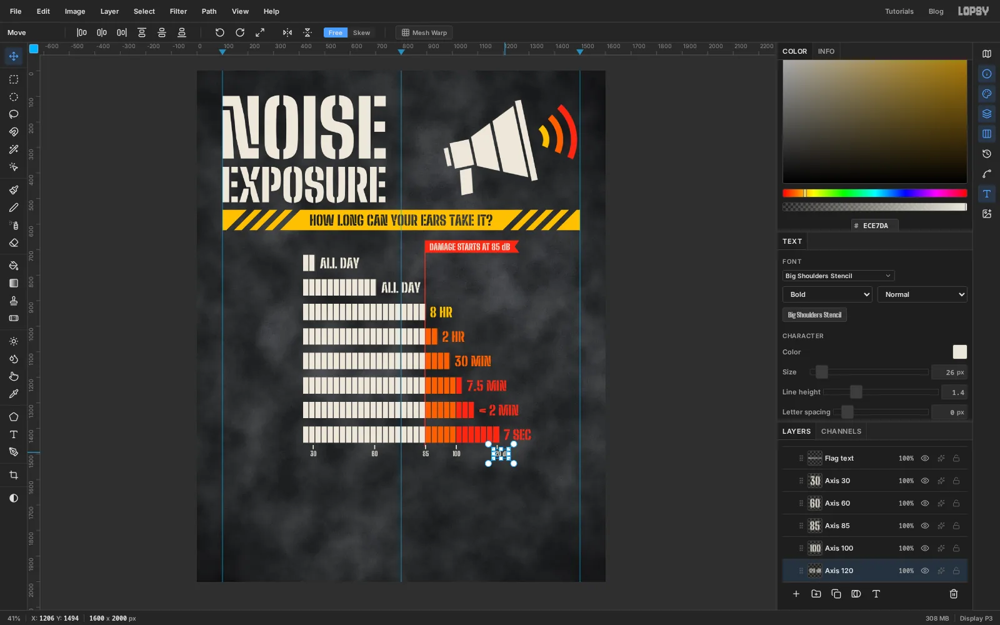

The time is the number people came for, so it gets the biggest type in the chart. Click `Bars` before each one so you don't restyle the last label, pick the Text tool, and use weight **Black** at **Size** `52`. Type each label on an empty patch of wall, press [[Tab]], and move it with the Move tool so it starts 18 px after the end of its bar and sits centred on the bar's height.

- `ALL DAY` twice, in bone white `#ECE7DA`
- `8 HR` in `#F4C21F`
- `2 HR` and `30 MIN` in `#F26A1B`
- `7.5 MIN`, `< 2 MIN` and `7 SEC` in `#E8402A`

The times follow from the rule: 8 hours at 85 dB, halved for every 3 dB. For the flag, type `DAMAGE STARTS AT 85 dB` in bone white at **Size** `34`, weight **ExtraBold**, and move it into the red banner. Start it about 20 px in from the left end and centre it top to bottom, so there are 10 px of red above and below the letters.

Last, the axis numbers: `30`, `60`, `85`, `100` and `120 dB` at **Size** `26`, weight **Bold**, each centred under its tick. For the last one, centre the `120` under the tick and let the unit hang off to the right.

## Type the row names as one block

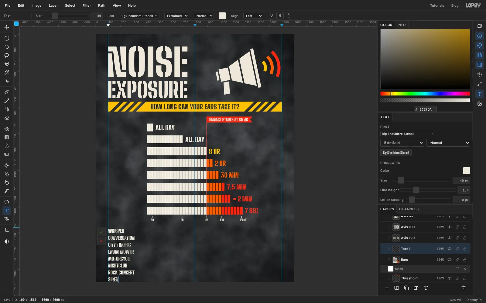

The eight names line up with eight evenly spaced bars, so they can be one text layer. Click `Bars`, pick the Text tool, set **Size** `40` and weight **ExtraBold**, and click an empty area at the bottom left of the canvas. Type the names with [[Enter]] between them:

`WHISPER`, `CONVERSATION`, `CITY TRAFFIC`, `LAWN MOWER`, `MOTORCYCLE`, `NIGHTCLUB`, `ROCK CONCERT`, `SIREN`

Press [[Tab]] to commit. The lines are packed tightly for now. The next step spreads them out to match the bars.

## Space the names and add the dB column

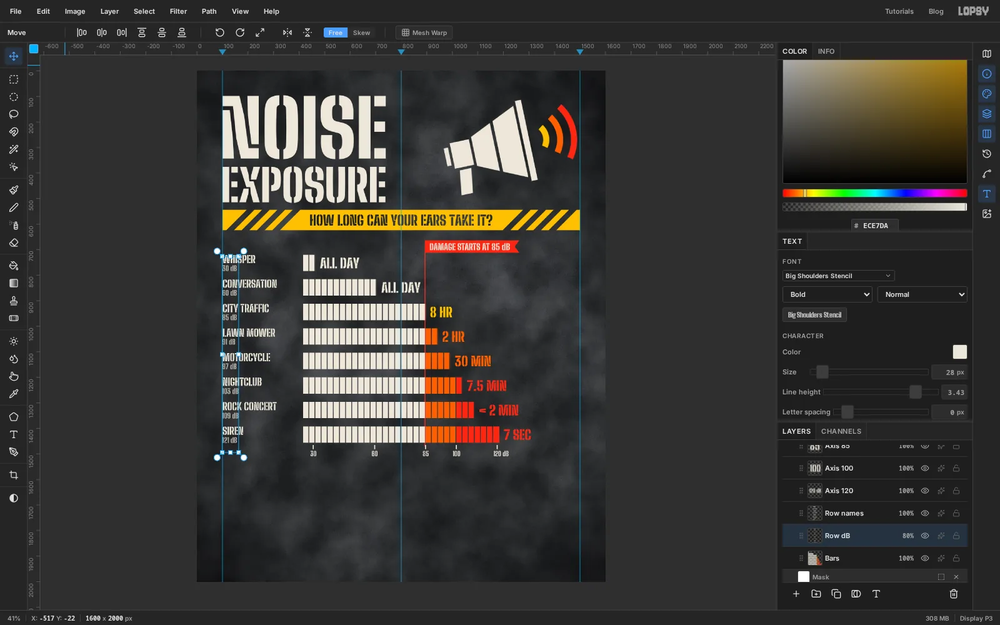

Open the **Text** panel from the panel toolbar on the right. With the names layer selected, set **Line height** to `2.4`. At 40 px that makes each line 96 px tall, the same as the spacing of the bars.

Move the block up with the Move tool so its left edge is on the left guide and the top of `WHISPER` is level with the top of the first bar. Every other name falls into place.

Make the dB column the same way. Click `Bars`, set **Size** `28` and weight **Bold**, and type `30 dB`, `60 dB`, `85 dB`, `91 dB`, `97 dB`, `103 dB`, `109 dB` and `121 dB` on eight lines. Set **Line height** to `3.43`, which is 96 ÷ 28. Drag it so `30 dB` sits 8 px under `WHISPER`, and lower the layer's opacity to `80%` so the names stay in front. If the block reaches past the bottom of the canvas, grab it by its first line.

> **Tip:** Selecting a text layer loads its settings into the Text panel, and new text starts from whatever the panel shows. After these two blocks, the next piece of text you type will come out with a very tall box, so set its **Line height** back to `1.4` straight away.

## Frame a warning stamp

The space to the right of the middle bars is empty, and it's a good spot for the one piece of advice on the poster. Click `Vignette`, add a group called `Stamp` and a layer inside it called `Stamp box`.

Pick the **Shape** tool and set **Shape** to **Rectangle**. Click the fill swatch and choose **Remove fill**. Click **Add stroke color**, type `F4C21F`, and set **Width** `8` and **Corner Radius** `20`. Draw a frame about 340 px wide and 152 px tall in the gap to the right of the `8 HR`, `2 HR` and `30 MIN` labels, ending just inside the right guide. A shape grows from its centre, so press in the middle of that gap (`1320, 1006`) and drag out to the bottom-right corner (`1490, 1082`).

Cut two bridges into the frame. With the Rectangular Marquee, drag a small box 12 px wide across the top edge, hold [[Shift]] and drag another across the bottom edge, and press [[Delete]].

Click `Stamp box` and type `WEAR PLUGS` in `#F4C21F` at **Size** `58`, weight **Black**. Set its **Line height** back to `1.4` in the Text panel. Click `Stamp box` again and type `THEY TAKE 20 dB OFF` in `#ECE7DA` at **Size** `34`, weight **ExtraBold**. Centre both lines in the frame with 16 px between them. Check the margins: about 30 px from the letters to the frame on every side, and nothing touching the outline.

## Rotate the stamp

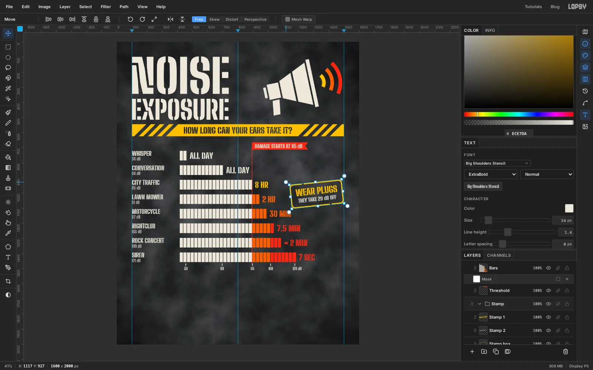

Press [[Cmd+D]], click the `Stamp` group and pick the Move tool. Drag a rotation handle anticlockwise by about 6°. The frame and both text layers turn together, and the text stays editable. Press [[Cmd+D]] to commit.

Check the corners afterwards. The bottom-left corner of the frame should clear the `30 MIN` label, and the right side should stay inside the margin. If it doesn't, drag the group a little.

## Draw one dial ring

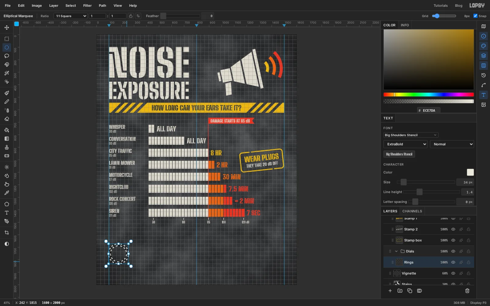

The bottom row shows the halving rule on its own, as six clock-style dials. Click `Vignette`, add a group called `Dials` and a layer inside it called `Rings`. Turn the grid back on with **View → Show Grid**.

With the **Elliptical Marquee**, drag a circle 160 px across from `96, 1672` to `256, 1832`. Hold [[Alt]] and drag a second circle inside it, 16 px smaller on every side (`112, 1688` to `240, 1816`). The grid snaps both, so the ring comes out even all the way round. Fill it with `#ECE7DA` and deselect.

Now the bridges. With the Rectangular Marquee, drag a strip one grid square (8 px) wide straight down the middle of the ring, then hold [[Shift]] and drag a second strip one square tall across the middle. Press [[Delete]] and deselect. The ring is left in four quarters, with gaps at 12, 3, 6 and 9 o'clock.

## Copy the ring five times

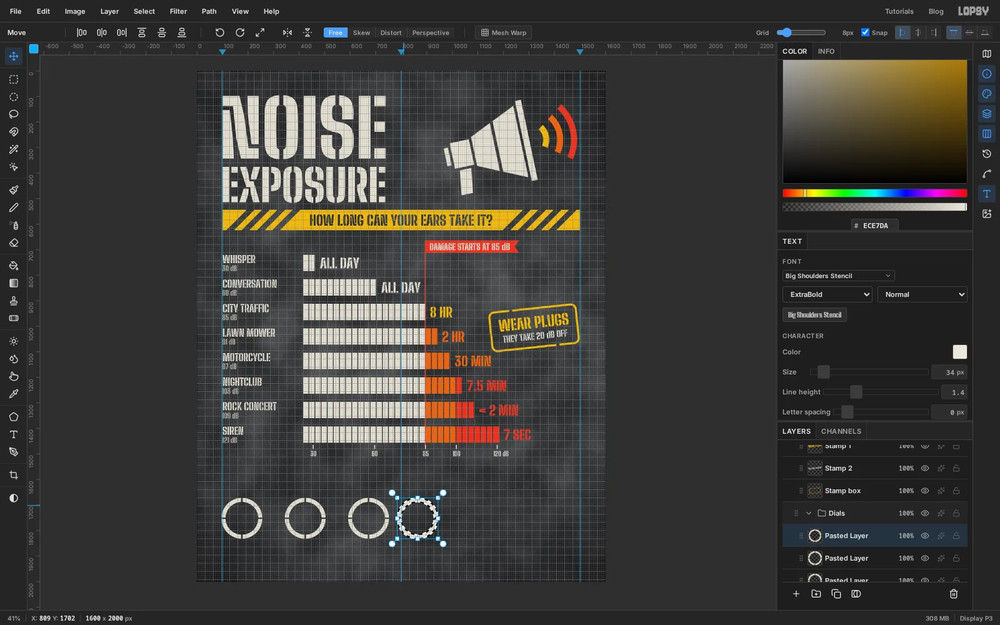

Drag a marquee round the whole ring and press [[Cmd+C]], then [[Cmd+V]]. The copy lands exactly on top of the original, on a new layer, with the Move tool ready.

Drag the copy to the right by 248 px, which is 31 grid squares. Grab it by the ring itself, away from the handles. The grid keeps it level with the first one. Press [[Cmd+D]].

Paste again and drag the next copy 496 px, then 744, 992 and 1240, so the six rings are evenly spaced across the sheet. Then click the top `Pasted Layer` in the Layers panel and press [[Cmd+E]] five times to merge them all down into `Rings`.

## Fill the pie wedges

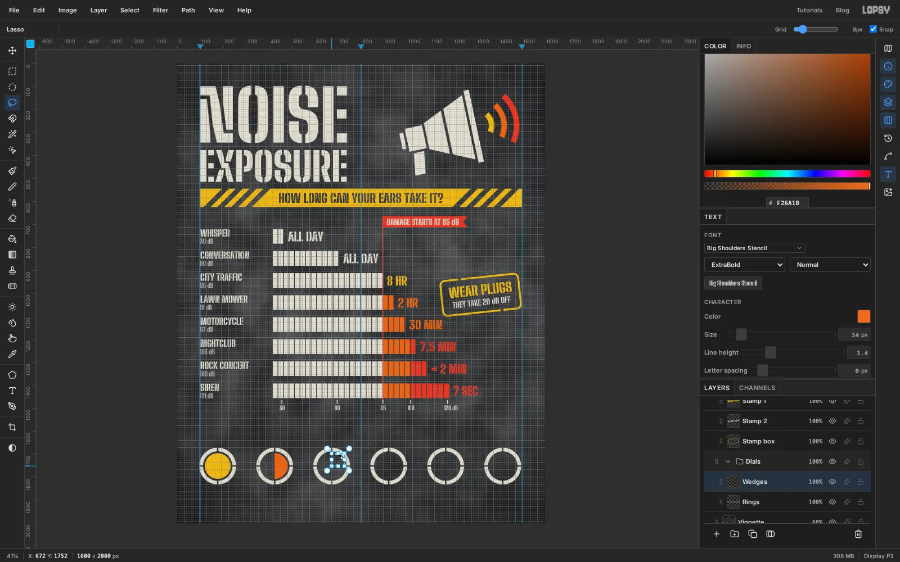

Add a layer called `Wedges`. Each dial shows how much of an 8-hour day is left.

In the first ring, drag a circle 112 px across with the Elliptical Marquee, centred in the ring. The grid leaves an even 8 px gap inside the ring. Fill it with `#F4C21F`. That's a full 8 hours at 85 dB.

For the second dial, drag the same circle, then pick the **Lasso**, hold [[Shift+Alt]] and draw round the right half of the dial, starting and ending on the centre line. Fill the half disc with `#F26A1B`. Only the two straight edges that meet at the centre need care, because the circle supplies the curved edge. Draw the lasso well outside the ring on that side.

Carry on along the row, starting each wedge at 12 o'clock and going clockwise: a quarter, an eighth and a sixteenth in orange, and a thin thirty-second in `#E8402A`. Deselect and hide the grid.

## Colour part of the heading

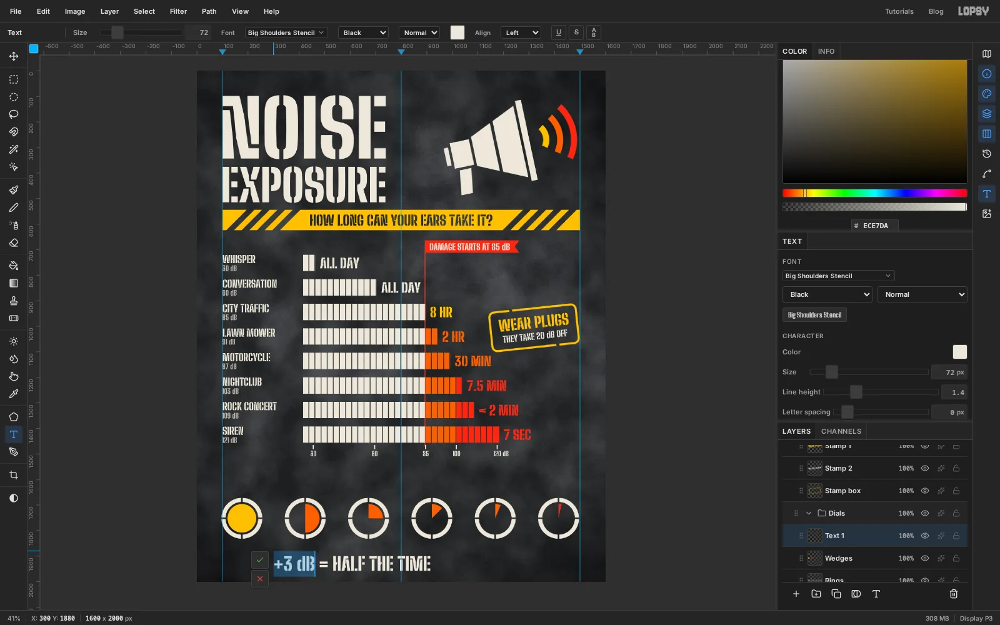

Click `Wedges`, pick the Text tool, set **Size** `72` and weight **Black**, and type `+3 dB = HALF THE TIME` in `#ECE7DA` on an empty patch of wall.

Before you commit, press [[Home]] and then [[Shift+→]] five times to select `+3 dB`. Click the **Text color** swatch in the options bar and type `F4C21F`. Only the selected characters change. Press [[Tab]].

Move the heading above the dials, with its left edge on the left guide and about 50 px of wall between it and the tops of the rings.

## Finish the dial labels and the source line

Type the rest of the small text, clicking `Wedges` before each new piece.

- A note at the right, `ONE BLOCK ON THE CHART = 3 dB`, at **Size** `30`, weight **Bold**. Move it so it ends on the right guide and sits on the same baseline as the heading.
- A label centred under each dial at **Size** `30`, weight **ExtraBold**: `85 dB = 8 HR` in yellow, `88 dB = 4 HR`, `91 dB = 2 HR`, `94 dB = 1 HR` and `97 dB = 30 MIN` in orange, and `100 dB = 15 MIN` in red. Leave 20 px between ring and label. The last label is wider than its dial, so nudge it left until it ends on the right guide.
- The source, centred at the bottom at **Size** `26`, weight **SemiBold**: `SOURCE: NIOSH RECOMMENDED EXPOSURE LIMIT, 85 dBA OVER 8 HOURS, 3 dB EXCHANGE RATE. SOUND LEVELS ARE TYPICAL.` Lower its opacity to `85%`.

Choose **File → Save Project** here. The flat design is finished and the rest is paint.

## Mist the wall with overspray

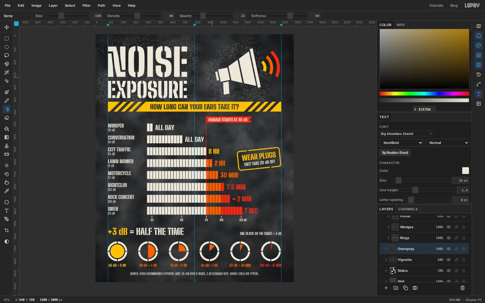

Real stencils leak. Paint drifts past the card and leaves a speckled haze around every shape. Click `Vignette` and add a layer called `Overspray`, so it sits under all the groups.

Pick the **Spray** tool and set **Size** `140`, **Density** `40`, **Opacity** `22` and **Softness** `60`. With the foreground on `#ECE7DA`, drag slowly round the outside of the headline and the megaphone in a couple of loose loops. The dots that land under the letters are hidden. You only see the ones that fall outside.

Drop **Size** to `110` and raise **Opacity** to `25`, then do the same in each colour next to its own paint: yellow along both edges of the band, round the stamp and the first dial; orange beside the orange blocks, the middle dials and the orange arc; red round the flag, the ends of the longest bars, the last dial and the red arc. Finish with a light pass of bone white down the left ends of the bars and round the row of dials.

## Let the paint drip

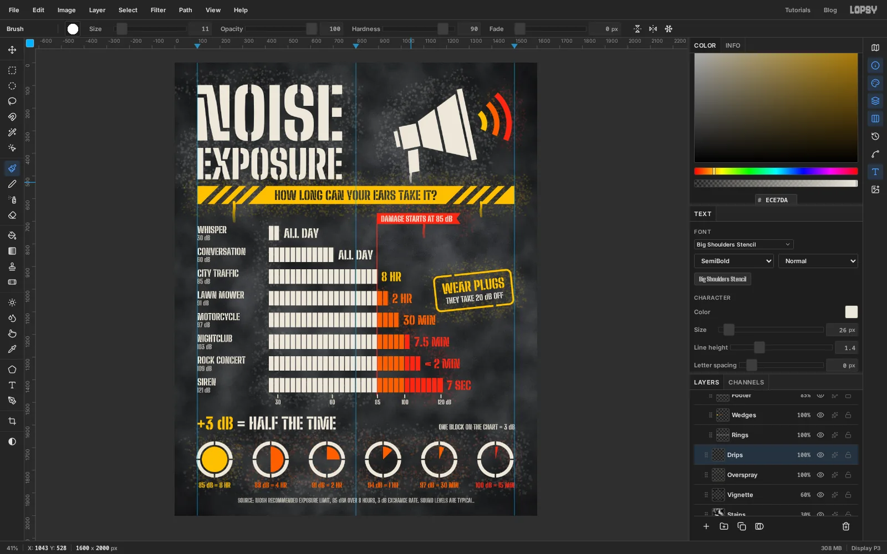

Add a layer called `Drips` above `Overspray`. Pick the **Brush** with **Hardness** `90` and **Opacity** `100`.

The **Fade** setting makes a stroke thin out over a set distance, which is what a run of paint does. For the first drip set **Size** `13` and **Fade** `95`, pick yellow, and drag about 85 px straight down from the bottom edge of the band near its left end. Let your hand wobble a little.

Add three more, each with Fade set slightly longer than the stroke: a shorter yellow one near the right end of the band, a red one from the bottom of the flag at Size `11`, and a bone white one from the bottom of the megaphone's handle that stops before it reaches the band. Four is plenty. Set **Fade** back to `0` when you're done.

## Wear the paint with a group mask

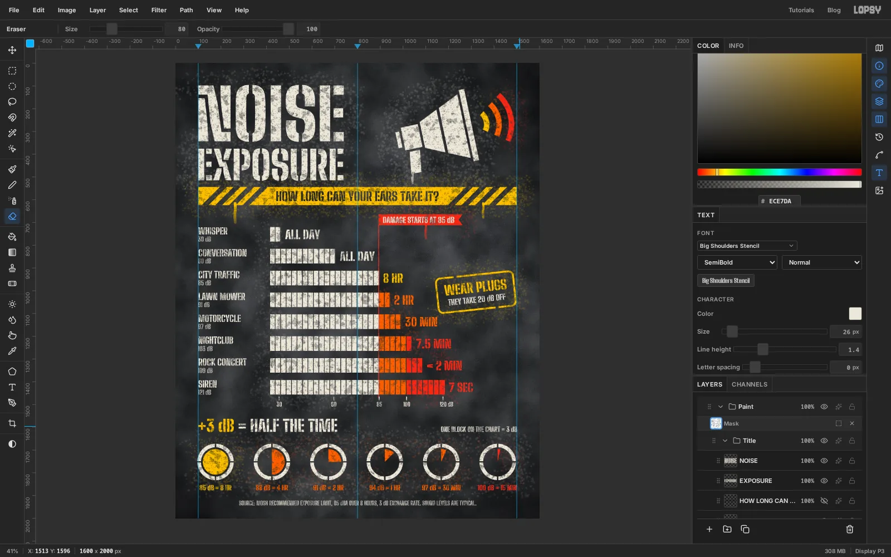

Fresh stencil paint is never solid. It goes on thin where the can was moving, and it flakes. One mask over all the paint does this in a single pass, and because it's a mask the wall that shows through is the real wall, with its own shading.

Click the `Title` group, then hold [[Cmd]] and click `Megaphone`, `Chart`, `Stamp`, `Dials`, `Drips` and `Overspray`. Choose **Layer → Group Layers** and rename the new group `Paint`.

With `Paint` selected, click **Add Mask**. Now run **Filter → Texture…** on the mask twice:

1. **Type** **Rough**, **Mode** **Darken**, **Amount** `60`, **Size** `34`, **Detail** `80`, **Contrast** `85`, **Seed** `21`. This makes the big thin patches.
2. **Rough** and **Darken** again, **Amount** `45`, **Size** `9`, **Detail** `60`, **Contrast** `90`, **Seed** `5`. This adds the fine flecks.

Darken only ever pushes the mask toward black, so paint is taken away and never added. If the chart gets hard to read, undo and lower the first **Amount**.

## Bring the small type back

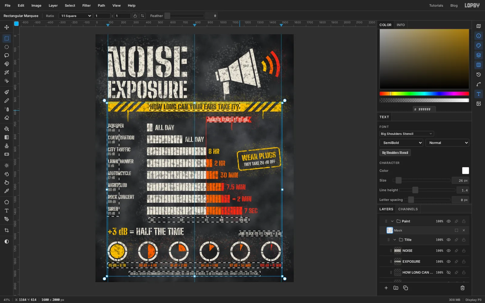

Chipped paint is fine on a 300 px headline. It makes 26 px text unreadable. Paint tools don't work on a group's mask, but **Edit → Fill** does, so restore the small type with selections.

While you're still editing the mask, pick the Rectangular Marquee and drag one tall, narrow box down the dB column, starting under `WHISPER`. It takes in the first couple of letters of the names below, which does no harm. Hold [[Shift]] and add boxes round the axis numbers, the note beside the heading, the row of dial labels, the source line, the text in the flag and the tagline in the band.

Set the foreground to white `#FFFFFF` and choose **Edit → Fill**. White on a mask means fully visible, so those areas go back to solid paint. Deselect and click the `Paint` row to leave the mask.

## Soften the edges with a glow

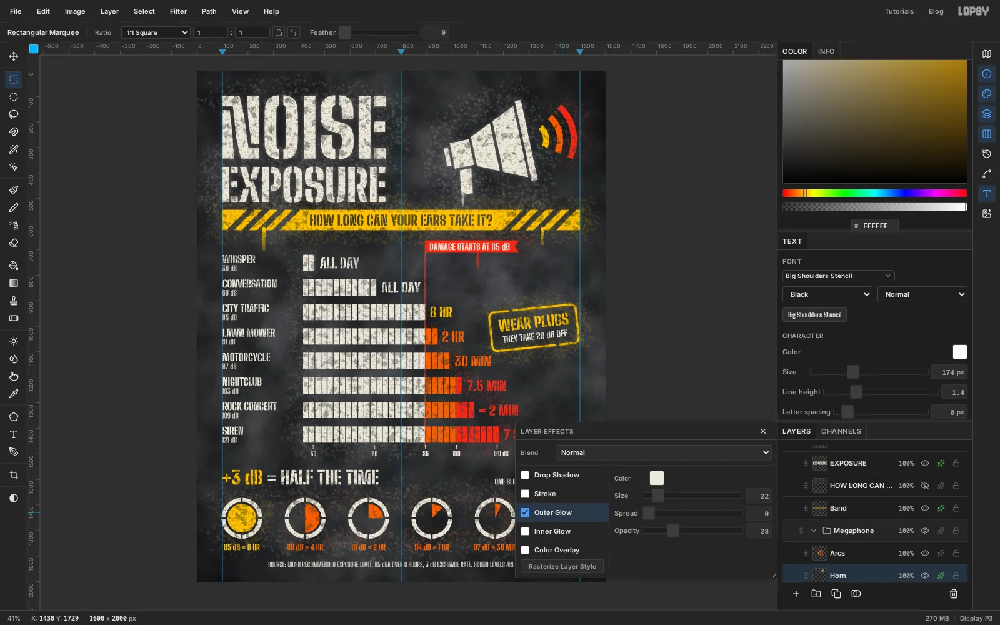

Sprayed edges have a faint halo where the finest mist settles. An **Outer Glow** in the paint's own colour fakes it.

Open the effects drawer on `NOISE` (the **✦** button on its row), tick **Outer Glow**, and set **Size** `22`, **Opacity** `28` and the glow colour to `#ECE7DA`. Do the same on `EXPOSURE` and `Horn`.

On `Band` and `Stamp box`, use a yellow glow, `#F4C21F`, at **Size** `18`, with **Opacity** `30` on `Band` and `35` on `Stamp box`. Keep it faint. The glow should only show when you look for it.

## Add contrast and export

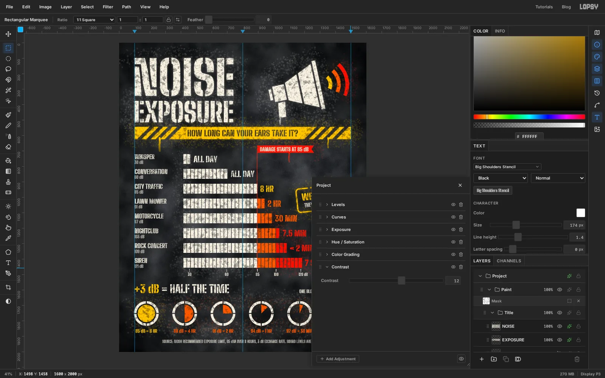

One last adjustment over the whole piece. Click the **✦** button on the `Project` row at the top of the Layers panel, click **Add Adjustment** and choose **Contrast**. Set it to `12`. The wall gets a little darker, the paint a little brighter, and nothing is changed permanently.

Choose **File → Save Project** to keep the layered file, then **File → Quick Export PNG**.

To reuse the layout with your own numbers, change the bar lengths (one block per 3 dB), retype the labels, and redraw the wedges. The wall, the overspray and the wear mask will work for any chart you put on top of them.
