Street artists spray stencils in layers. Each colour has its own cut-out sheet, called a *plate*. The lightest plate goes on first and the darkest last. The plates never land in exactly the same place twice, and the paint mists past the edges of the card and runs where it pools. Those accidents make a stencil look sprayed rather than printed, so in this tutorial you'll add them on purpose.

The poster is a one-sheet for *Xanthic Noon*, an imaginary neo-western. (*Xanthic* means yellowish.) It's 1200 × 1800 px, the 2:3 shape of a cinema poster. It's built from:

- a corrugated tin wall with a sun-bleached base coat, rust streaks and nail heads
- a stencilled sun: rust rays, a ring with stencil bridges, and a yellow disc
- a cowboy on horseback, cut from a real photo and split into three plates
- a black hill with grass, two saguaros and three vultures
- a stencil title with overspray and drips, plus the tagline, release line and billing block

The rider is from [Cowboy on horse in Field BC.jpg](https://commons.wikimedia.org/wiki/File:Cowboy_on_horse_in_Field_BC.jpg) on Wikimedia Commons. It's a public-domain photo from about 1900 of a man in a bowler hat on a dark horse, 733 × 566 px. Download the original size.

The tools you'll use:

- **Define Pattern** and **Fill with Pattern**, **Clouds**, **Add Noise**, **Sunburst**, **Gaussian Blur**, **Motion Blur**, **Threshold** and **Desaturate**
- the **Pen** tool with **Path to Selection**, the **Magic Wand** with **Contiguous** off, and the **Rectangular** and **Elliptical Marquee**'s exact-corners dialog
- **Select → Inverse, Grow and Feather**, and [[Cmd]]-click on a layer thumbnail to load a layer's shape
- scaling, moving and rotating with the **Move** tool's handles, **Image → Flip Horizontal**, and **Copy** / **Paste**
- the **Brush**, **Spray** and **Eraser**, with [[Shift]]-click for straight strokes
- live text in **Saira Stencil** and **Saira Extra Condensed**, turned with the rotation handle
- **Outer Glow** and **Color Overlay** effects, and the **Overlay** and **Multiply** blend modes
- groups, which you move as one piece

The palette is four spray colours on an old base coat, plus a few accents:

- Wall base coat `#E6D7B5`
- Xanthic yellow `#F4B019`, orange spray `#E2541B`
- Rust `#B1361A`
- Ink `#1C1612`
- Stencil cream `#EFE3C6`, billing grey `#BFB298`
- Rust streaks `#7B3A1A`, nail heads `#3A2D25`, grain grey `#808080`

> **Note:** Shortcuts are written for a Mac. On Windows use [[Ctrl]] wherever it says [[Cmd]].

> **Tip:** Positions are in document pixels, measured from the top-left corner. Hover over the canvas and the status bar at the bottom shows the pointer's **X** and **Y**. **Add Layer**, **New Group** and **Duplicate Layer** are the buttons at the bottom of the Layers panel, and the sparkle button on each layer's row opens its effects drawer, where you also set the blend mode.

## Paint the base coat

Choose **File → New**, keep **Pixels**, and make the document **1200** wide and **1800** high with a white background.

Click the `Background` layer, set the foreground colour to `#E6D7B5` in the Color panel and choose **Edit → Fill**. This is the tired paint that was on the tin before anyone sprayed a stencil over it.

## Make one corrugation as a tile

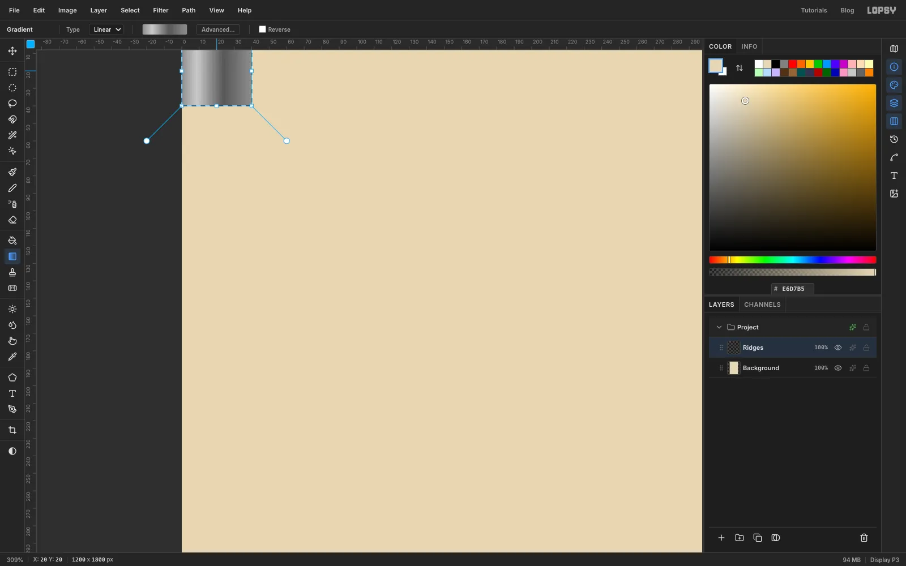

Corrugated tin is a row of identical ridges, so you only need to make one and repeat it.

1. Click `Layer 1` and rename it `Ridges` (double-click its name).
2. Pick the **Rectangular Marquee** and click once on the canvas without dragging. In the dialog, type **From** `0`, `0` and **To** `40`, `40`, then click **Select**.
3. Pick the **Gradient** tool, set **Type** to **Linear** and click **Advanced…**. Make four stops: `#8E8E8E` at the left end, `#C9C9C9` at about **22%**, `#565656` at about **60%**, and `#8E8E8E` at the right end. Click **Done**.
4. Drag from the left edge of the square to its right edge.

The two ends share the same grey, so the tiles will join without a seam.

## Fill the wall with ridges

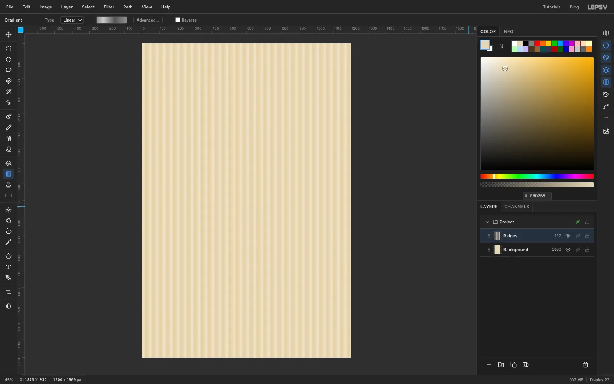

1. With the square still selected, choose **Edit → Define Pattern**, then deselect with [[Cmd+D]].
2. Choose **Edit → Fill with Pattern…**. Your new tile is selected in the dialog, so click **Apply**. It repeats across the whole layer.
3. Open the layer's effects with the sparkle button on its row, set **Blend** to **Overlay**, and close the drawer. Click the `Ridges` opacity and set it to **55%**.

On **Overlay**, the mid grey disappears and only the light and dark parts of each ridge show. Keep `Ridges` at the top of the stack for the rest of the tutorial, so every coat of paint you spray picks up the ridges too.

> **Tip:** Press [[Cmd+Z]] after the pattern fill, then [[Cmd+Shift+Z]]. The tile comes back exactly as it was. It's a quick way to check a step before you build on it.

## Weather the paint

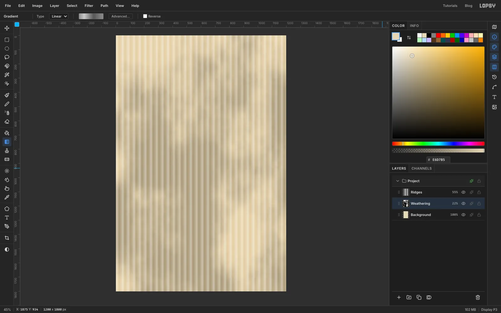

Click `Background` and click **Add Layer**. Name the new layer `Weathering`; it sits between the paint and the ridges.

1. Choose **Filter → Clouds…** with **Scale** `4`.
2. Choose **Filter → Add Noise…**, pick **Mono**, set **Amount** to `18`, and click **Apply**.
3. Set the layer's blend to **Multiply** and its opacity to **22%**.

## Spray the sun's rays

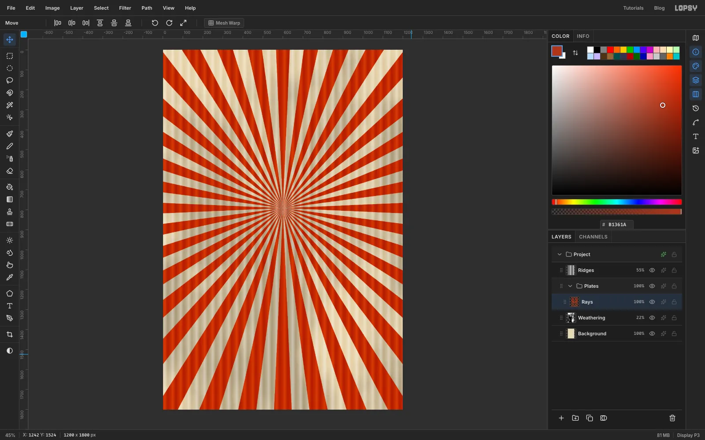

Every stencil plate goes in one group, so it's easy to keep it under the ridges.

1. Click `Weathering`, then click **New Group** at the bottom of the Layers panel and name the group `Plates`.
2. Click **Add Layer** and name it `Rays`. It goes inside the group.
3. Set the foreground to rust `#B1361A`.
4. Choose **Filter → Sunburst…** and set **Rays** `36`, **Length** `150`, **Width** `50`, **Center X** `50` and **Center Y** `44`. Click **Apply**.

Center Y at 44% puts the middle of the sun at 792 px down, a little above the middle of the poster.

## Trim the rays to a band

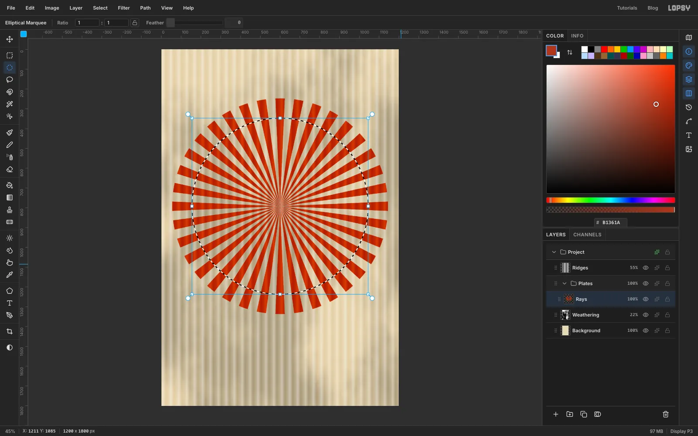

1. Pick the **Elliptical Marquee** and click once. Enter **From** `55`, `247` and **To** `1145`, `1337`. That's a circle 1090 px across around the sun's centre.
2. Choose **Select → Inverse** and press [[Delete]]. The ray tips outside the circle are gone.
3. Click once again with the Elliptical Marquee and enter **From** `155`, `347`, **To** `1045`, `1237`. Press [[Delete]], then [[Cmd+D]].

What's left is a ring of short rust bars about 55 px in from the edges of the poster.

## Cut a ring with stencil bridges

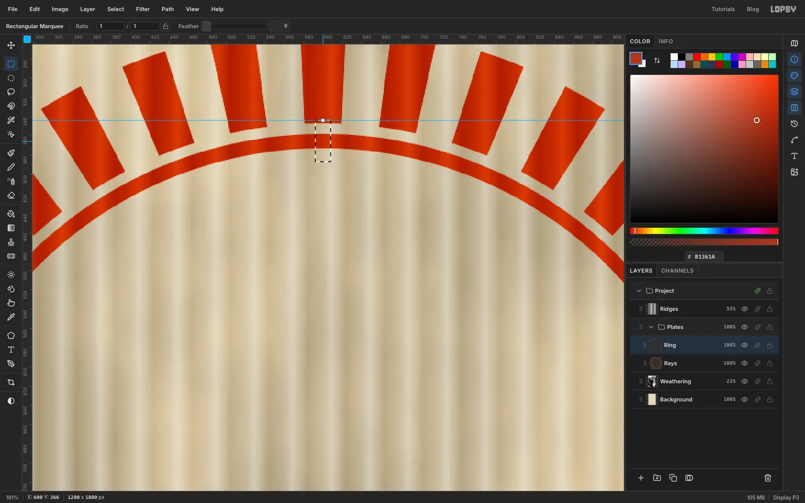

A real stencil can't have a free-floating ring: the middle would fall out of the card. Stencil cutters leave little *bridges* to hold it in, and you'll copy them.

1. Add a layer called `Ring`. Make an elliptical selection **From** `166`, `358` **To** `1034`, `1226`, fill it with rust and deselect.
2. Make a second one **From** `181`, `373` **To** `1019`, `1211` and press [[Delete]]. That leaves a ring 15 px thick.
3. Pick the **Rectangular Marquee** and click once. Enter **From** `592`, `344` **To** `608`, `387`, a small box across the top of the ring.
4. Zoom in so the ring is easy to see, hold [[Shift]] and drag three more boxes across the ring, each about 16 px wide: one at the bottom (592, 1197 to 608, 1240), one on the left (152, 784 to 195, 800) and one on the right (1005, 784 to 1048, 800). [[Shift]] adds each one to the selection, and the marching ants show every box.
5. Press [[Delete]] and deselect.

## Spray the yellow disc

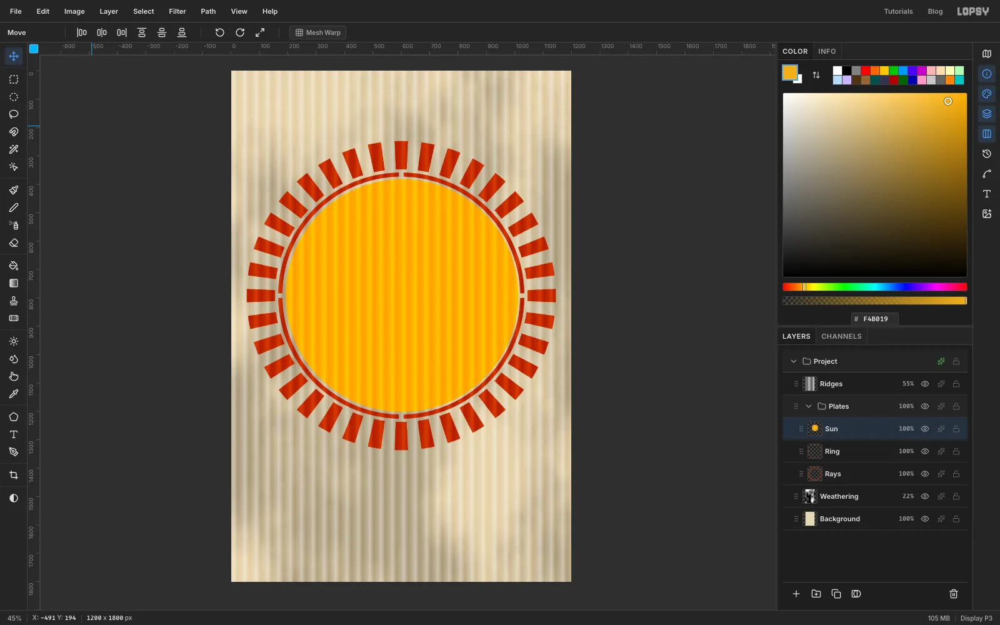

Add a layer called `Sun`. Make an elliptical selection **From** `190`, `382` **To** `1010`, `1202`, fill it with yellow `#F4B019` and deselect.

Now knock it off register: pick the **Move** tool and press [[Right]] three times. A hand-held stencil never lands exactly where the last one did, and this little offset gives that away.

## Add overspray to the sun

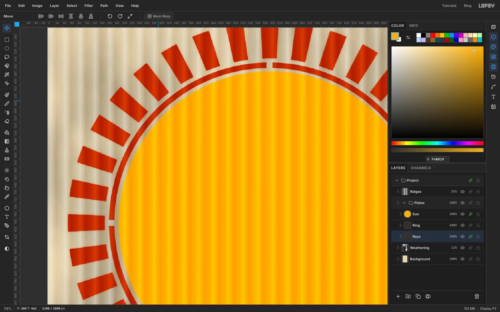

Spray paint mists past the edge of the card. An **Outer Glow** in the plate's own colour does the same.

1. Open the effects for `Sun`, tick **Outer Glow** and set **Size** `16`, **Spread** `0` and **Opacity** `45`. Set the glow colour to `#F4B019`.
2. Do the same on `Rays` with **Size** `8`, **Opacity** `40` and the colour `#B1361A`.

## Drop in the reference photo

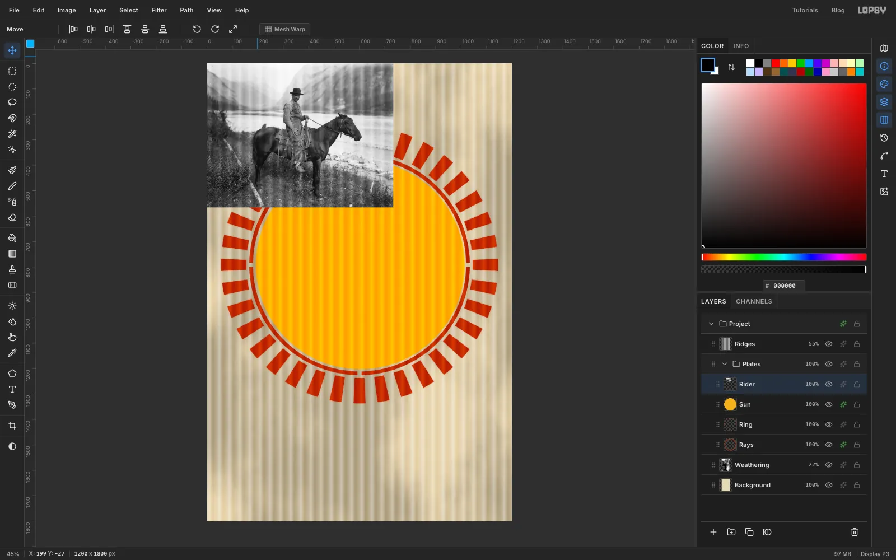

Click `Sun` so the photo lands above it, then drag **Cowboy on horse in Field BC.jpg** from your computer onto the canvas. It drops in at its own size in the top-left corner. Rename the layer `Rider` and press [[Cmd+D]] to clear the selection the drop makes.

## Trace the rider with the Pen

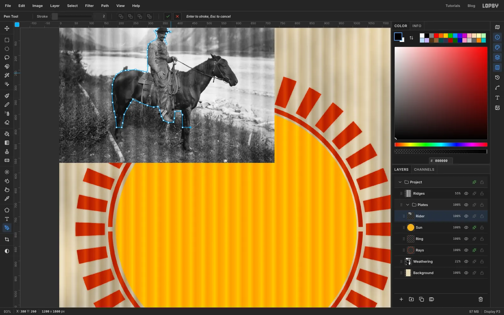

You'll cut the horse and rider out with a path. The Pen lets you place points precisely, and you can zoom in while you work.

Pick the **Pen** tool and click your way around the silhouette. Start at the foot of the horse's front leg and work backwards along the bottom: the back of the front leg, the cowboy's boot, the belly and the hind leg. Go up the back of the hind leg and the tail, which hangs beside it, over the rump and along the back to the cantle of the saddle. Then go up the cowboy's back, round the hat brim and crown, down his face and chest, and along his arm to his hand. From the saddle horn, follow the horse's mane up the neck to the ears, then go round the forehead and muzzle, under the jaw and down the chest back to the start.

Cut straight across the legs just above the hooves, because grass will hide them. Leave out the reins where they cross open sky. You'll paint them back later.

Click about every 10–20 px, closer on the hat and the muzzle. Finish by clicking the first point to close the path.

## Turn the path into a selection

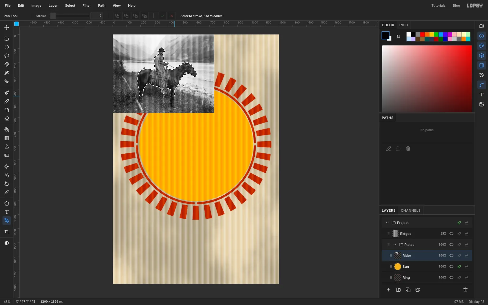

Open the **Paths** panel from the right-hand toolbar. Click **Path to Selection**, then **Delete Path** (the path has done its job).

## Cut the rider out

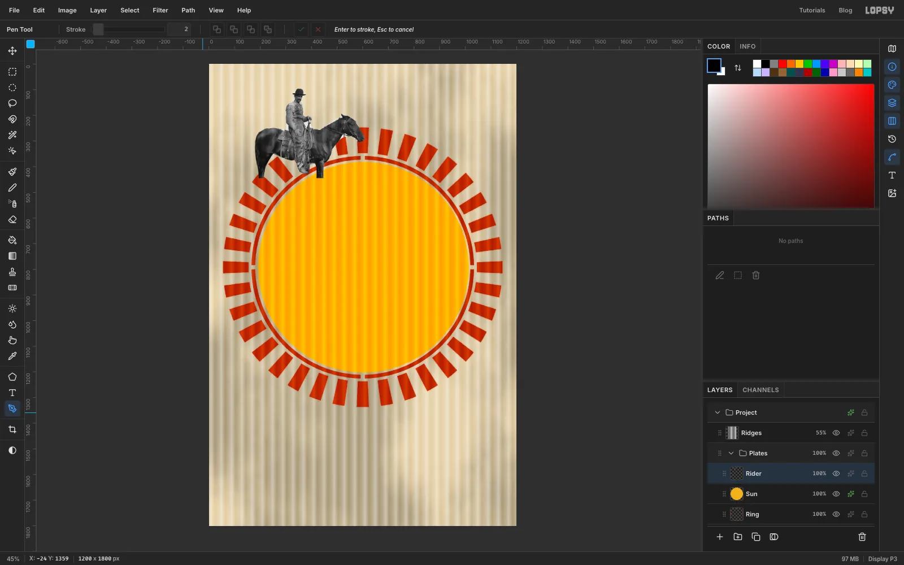

1. Choose **Select → Inverse** and press [[Delete]] to clear everything around the rider. Deselect.
2. Choose **Filter → Desaturate**, so the photo holds nothing but grey tones for the plates.

## Scale the rider up

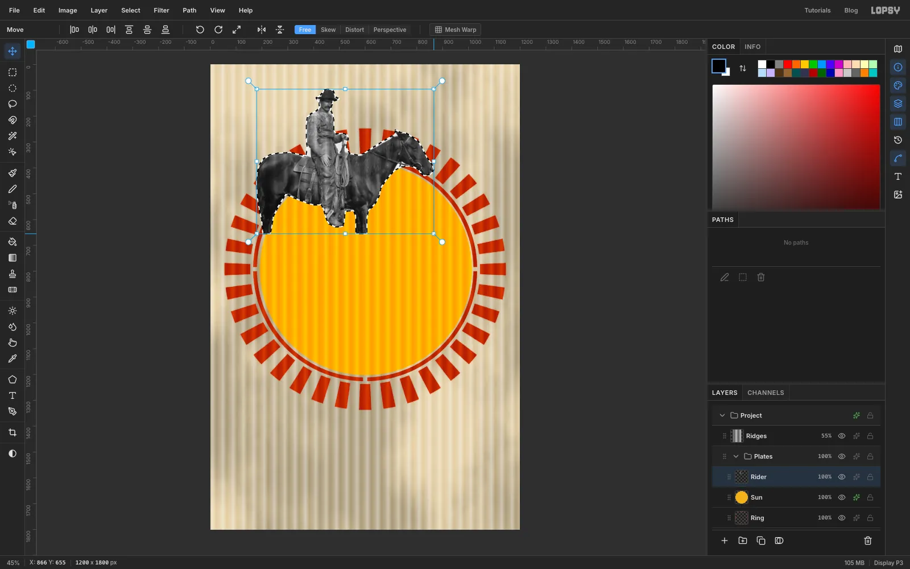

1. [[Cmd]]-click the `Rider` thumbnail to select his shape.
2. Pick the **Move** tool, hold [[Cmd]], and drag the bottom-right handle down and to the right. [[Cmd]] keeps the proportions. Stop when he's about 160% of his size, roughly 690 px wide.
3. Press [[Cmd+D]] to apply the scale.

> **Note:** Use [[Cmd+D]], not [[Enter]], to finish a Move-tool transform.

## Stand him in front of the sun

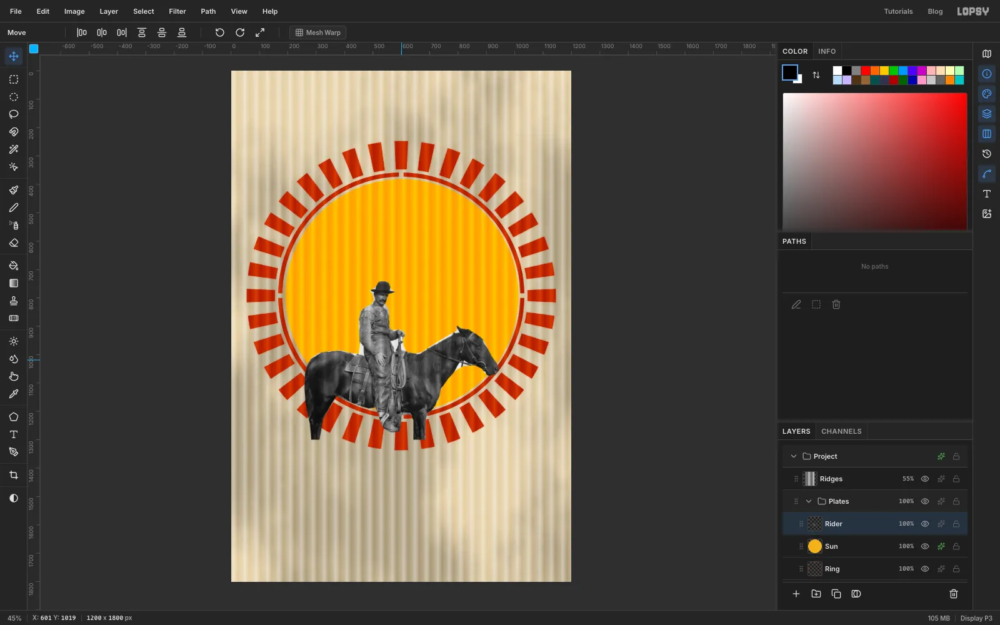

[[Cmd]]-click the thumbnail again and drag the rider down into the sun. Line him up so the top of his hat sits just above the sun's centre, about 740 px down, and the cut across the legs sits around 1300 px. Watch the status bar's **X** and **Y** readout. The horse should span from about 260 to 945 px across, nose pointing right. Deselect.

Run **Filter → Gaussian Blur…** with **Radius** `2`. A slight blur turns the enlarged photo's jagged edges into the smooth blobs a stencil knife would cut.

## Threshold the middle tones

One photo makes three plates: cream for the whole silhouette, rust for the middle tones, ink for the shadows.

1. With `Rider` selected, click **Duplicate Layer** twice. Rename the top copy `Dark plate` and the one below it `Mid plate`. Rename `Rider` to `Base plate`.
2. Click `Base plate`, then [[Cmd]]-click its thumbnail. Fill the selection with cream `#EFE3C6` and deselect. That's the bottom plate.
3. Hide `Dark plate` with its eye button, click `Mid plate`, and run **Filter → Threshold…** at **Level** `130`.

## Select the white with the Magic Wand

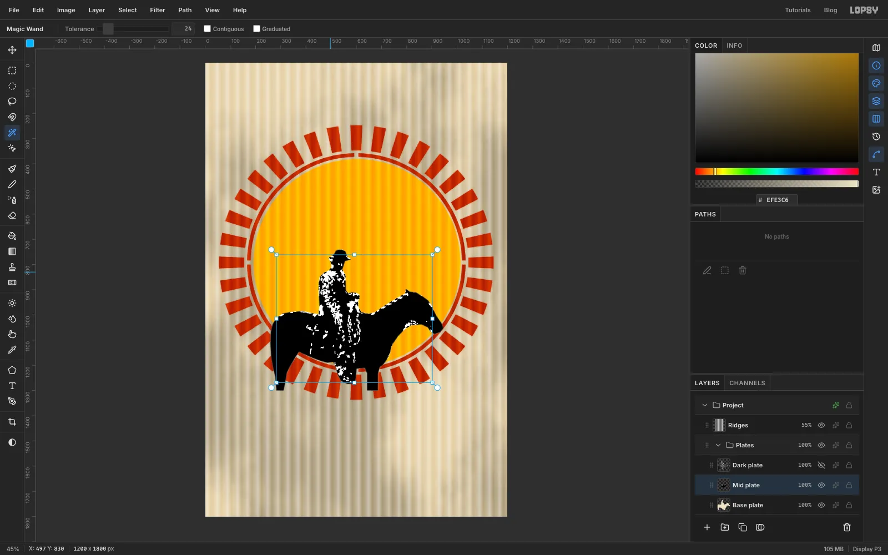

Pick the **Magic Wand**, set **Tolerance** to `24` and untick **Contiguous**. Click any white patch inside the rider, such as his shirt. One click selects every white pixel on the layer.

## Turn the black into the rust plate

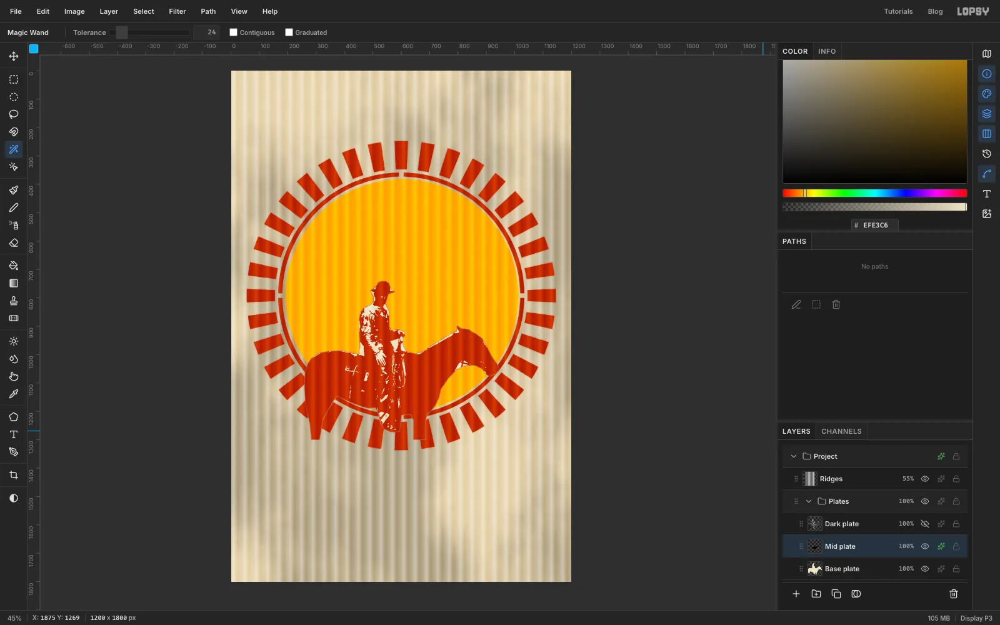

1. Press [[Delete]] to throw the white away, then deselect. Only the black shapes are left.
2. Open the effects for `Mid plate`, tick **Color Overlay** and set the colour to rust `#B1361A`.

A Color Overlay recolours the whole layer without touching its pixels, so you can still change your mind about the colour.

## Make the ink plate

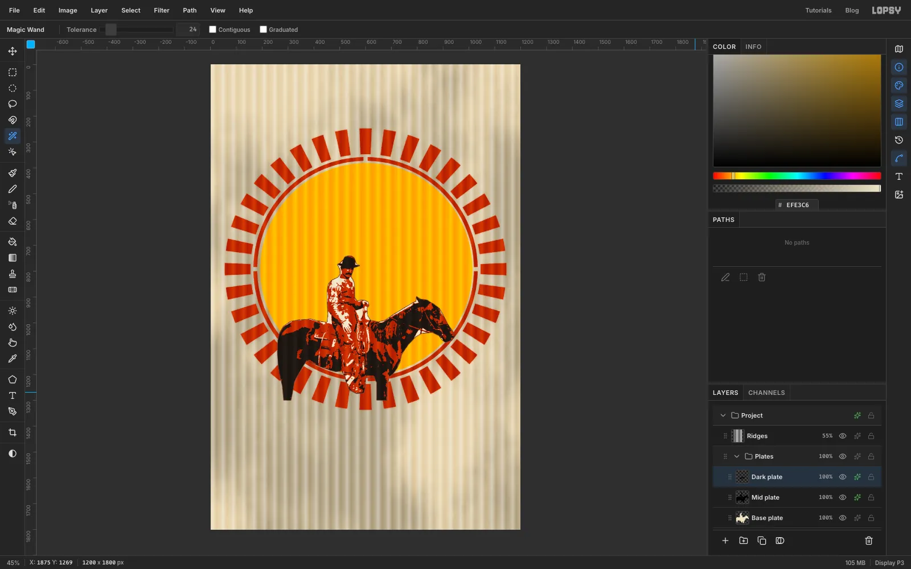

Show `Dark plate` and click it. Repeat what you did for `Mid plate`, with a darker cut:

1. Run **Threshold** at **Level** `68`.
2. Magic-wand a white area, press [[Delete]] and deselect.
3. Add a **Color Overlay** in ink `#1C1612`.

## Even out the cream and knock the plates off register

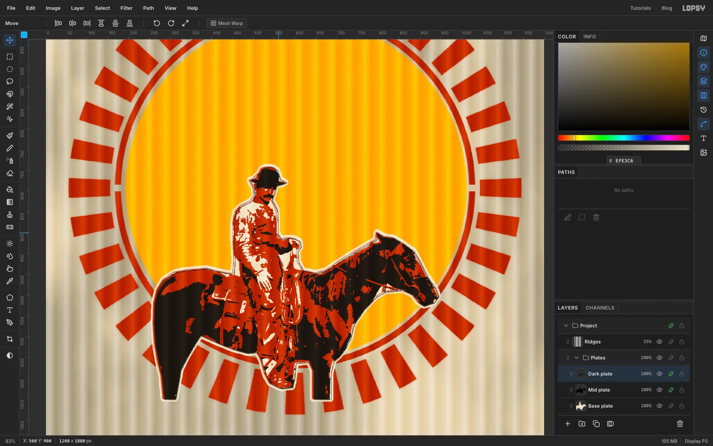

1. [[Cmd]]-click the `Base plate` thumbnail, choose **Select → Grow…** and grow it by `6`. Click `Base plate`, fill with cream again and deselect. Now the cream border runs evenly all the way round, like the first coat sprayed through a slightly bigger cut.
2. Click `Mid plate`, pick the **Move** tool, and press [[Left]] twice.
3. Click `Dark plate` and press [[Right]] twice and [[Down]] twice.

## Brush in the rein

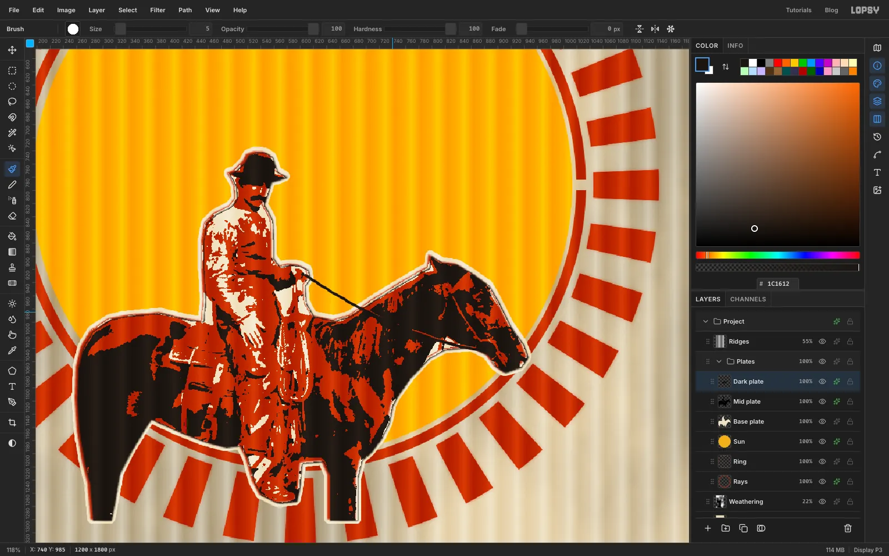

The Pen trace left out the rein where it crossed sky. With `Dark plate` still selected, pick the **Brush**, set **Size** `5`, **Hardness** `100` and **Opacity** `100`. Drag one smooth stroke from the cowboy's hand to the ring of the bit beside the horse's mouth, letting it sag a little in the middle. If it wobbles, press [[Cmd+Z]] and try again, or zoom in so the stroke is longer on screen. Anything you paint on this layer turns ink because of the Color Overlay.

## Draw the hill and grass with the Pen

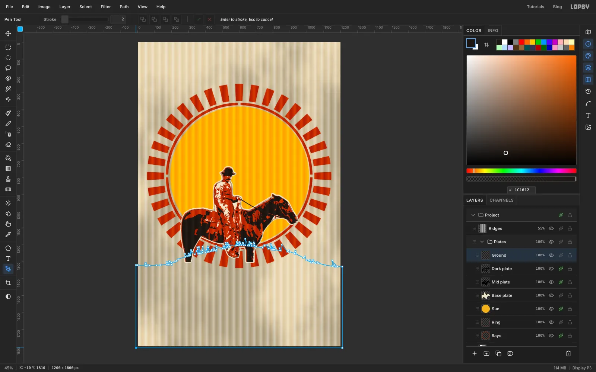

Add a layer called `Ground`. Pick the **Pen** and draw the horizon as one closed shape:

1. Start below the bottom-left corner, off the canvas, and click up to the left edge at about 1310 px.
2. Click across the poster, rising into a low hill about 100 px higher under the horse. Come back down to about 1310 px at the right edge.
3. Every so often, zig-zag up and down for a tuft of dry grass. Make the tufts uneven, some tall, some short, some leaning, with bare stretches in between. Put plenty along the top of the hill so the horse stands knee-deep in grass.
4. Click below the bottom-right corner, then back to the first point to close.

## Fill the ground

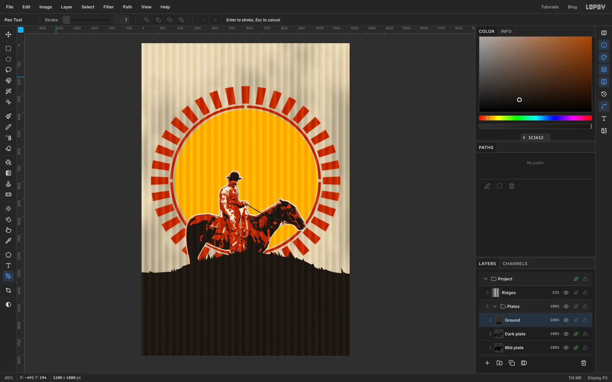

In the Paths panel, click **Path to Selection** and then **Delete Path**. Fill with ink and deselect. The grass covers the straight cut across the horse's legs.

## Add two saguaros

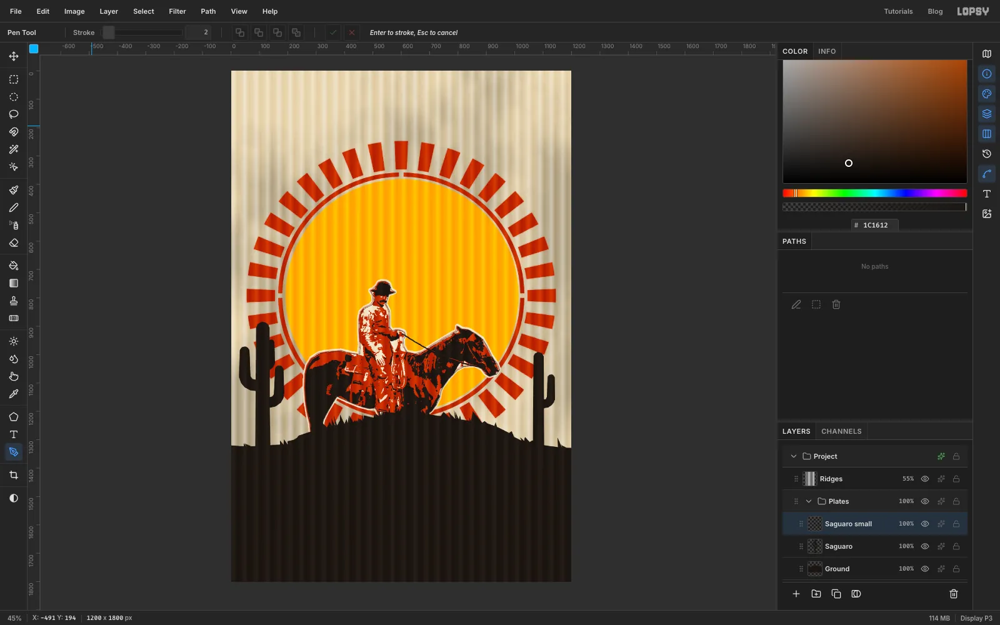

Draw each cactus the same way: add a layer, draw the outline with the Pen, then **Path to Selection**, **Delete Path**, fill with ink and deselect.

- `Saguaro`, at the left, about 112 px in from the edge: a trunk about 54 px wide that rises from the ground to about 880 px and tapers slightly. Give it two arms, one on each side, at different heights. Each arm leaves the trunk sideways, bends upward in a curve, and rises as a column about 40 px wide; the left one starts lower and climbs higher.
- `Saguaro small`, at the right, about 1084 px across: a trunk about 40 px wide whose top is at about 1000 px, with a single arm on its right that bends up from about 1080 px.

Round the tops of the trunks and arms and the inside of each bend with short clicks 6–8 px apart. Long clicks there give you a faceted, polygonal cactus.

## Draw a vulture large

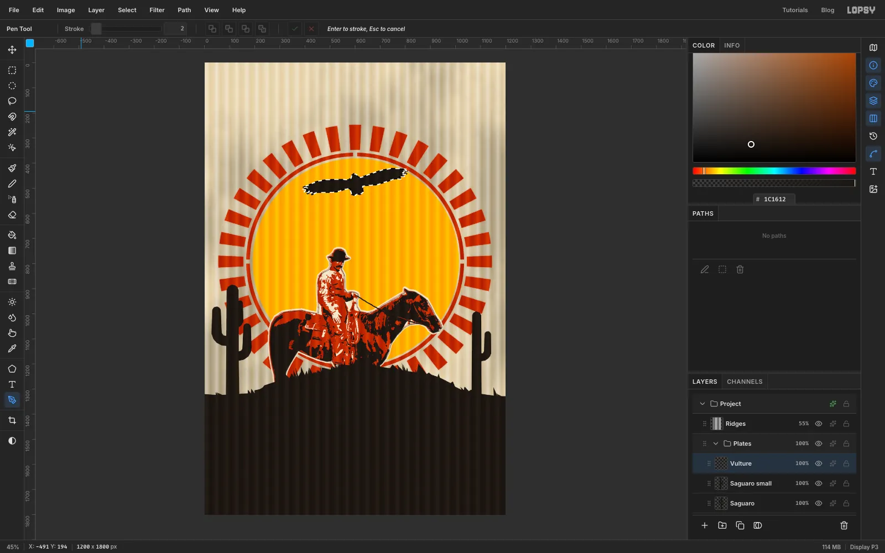

Add a layer called `Vulture` and draw a soaring vulture seen from below with the Pen, big, about 420 px from wing tip to wing tip. Start at the small head. Click along the straight front edge of one wing out to the tip, zig-zag in and out five times for the "finger" feathers, then come back along the slightly curved back edge to a short fanned tail. Mirror the other wing back to the head and close the path.

In the Paths panel, click **Path to Selection** and **Delete Path**, then fill with ink.

> **Tip:** The Pen closes the path whenever you click within 8 px of your first point, even zoomed in. Draw small, detailed shapes large and scale them down afterwards.

## Shrink it into the sky

Deselect, then [[Cmd]]-click the `Vulture` thumbnail. With the **Move** tool, [[Cmd]]-drag the bottom-right handle in until the bird is about 270 px across. Drag it to the upper left of the sun, over the edge of the ring, and press [[Cmd+D]].

## Paste a second vulture and turn it

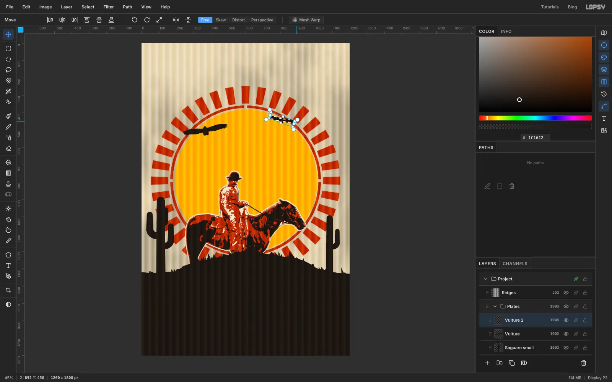

1. [[Cmd]]-click the `Vulture` thumbnail, press [[Cmd+C]], deselect, and press [[Cmd+V]]. The paste lands on its own layer in the same spot, already selected. Rename it `Vulture 2`.
2. [[Cmd]]-drag the bottom-right handle in to about half the size.
3. Drag it to the upper right of the sun.
4. Move the pointer just outside the top-right corner until it turns into the rotate cursor. Drag down about 20° to tip it clockwise.
5. Press [[Cmd+D]], then choose **Image → Flip Horizontal** so it banks the other way.

## Draw a third bird banking

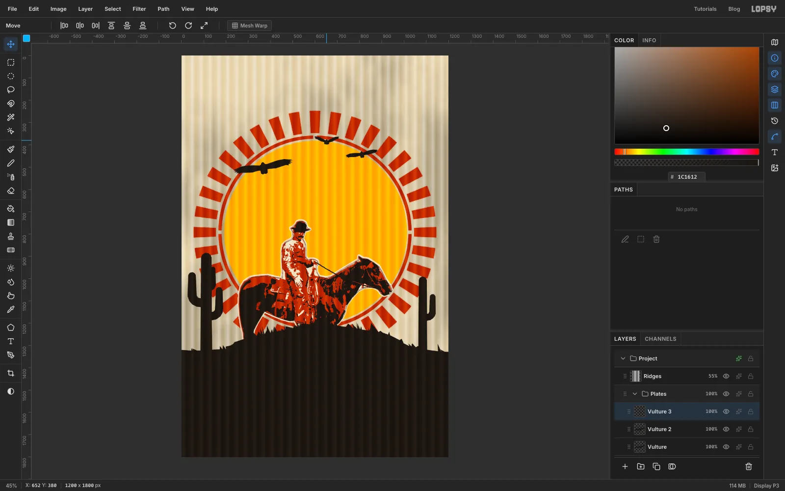

Three copies of one silhouette look like clip art, so draw the last bird in a different pose. Add a layer called `Vulture 3`. Draw the same bird large, in the same order, but sweep both wings up in a shallow V and tip one wing higher than the other, as if it's banking into a turn. Turn the path into a selection and fill it with ink.

Shrink it to about 130 px across, put it near the top of the sun just inside the ring, and press [[Cmd+D]].

## Group the flock and move it as one

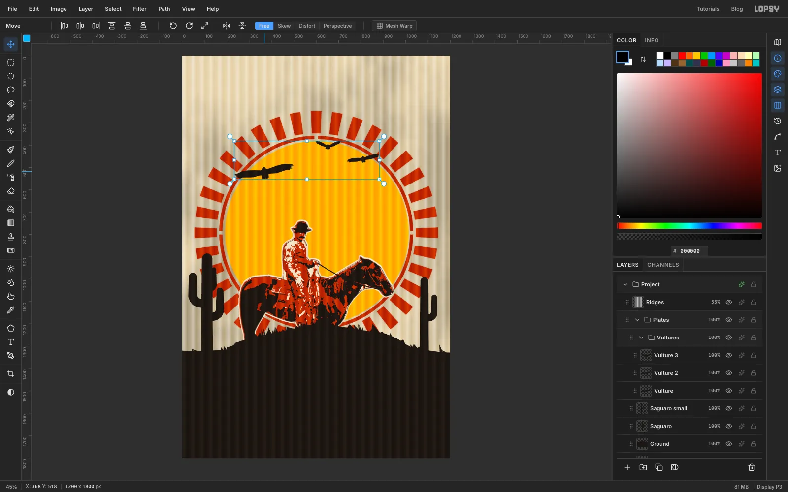

Click `Vulture`, then [[Shift]]-click `Vulture 3` to select all three layers. Choose **Layer → Group Layers** and rename the group `Vultures`.

With the group selected, pick the **Move** tool and drag the flock down about 20 px. All three birds move together and keep their spacing.

## Mist the ink plate

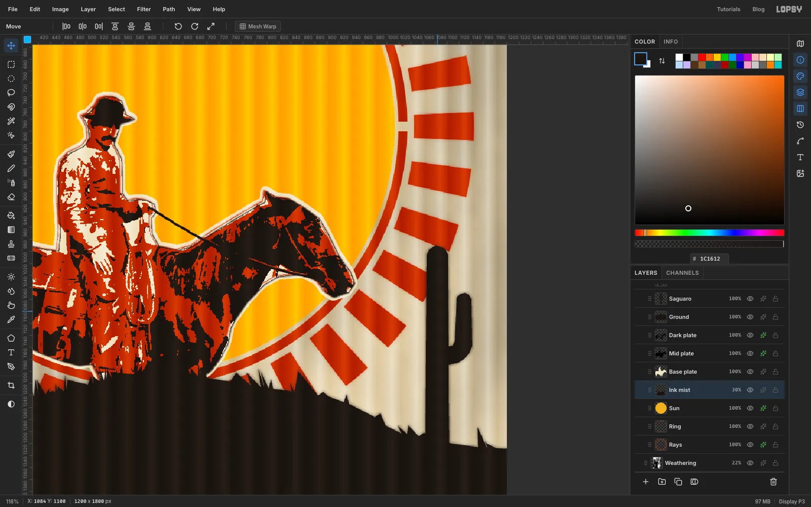

The black shapes need overspray too.

1. [[Cmd]]-click the `Ground` thumbnail. Then [[Cmd+Shift]]-click the thumbnails of both saguaros and all three vultures to add them.
2. Choose **Select → Grow…** with `2`.
3. Click `Sun` and add a layer called `Ink mist`, so it sits under the rider. Fill it with ink and deselect.
4. Run **Gaussian Blur** at `5`, then **Add Noise** at `40` (**Mono**), and set the layer's opacity to **30%**.

Leave the rider out of the mist. A dark haze around him reads as a drop shadow, and that makes him look like a sticker.

## Set the credits block

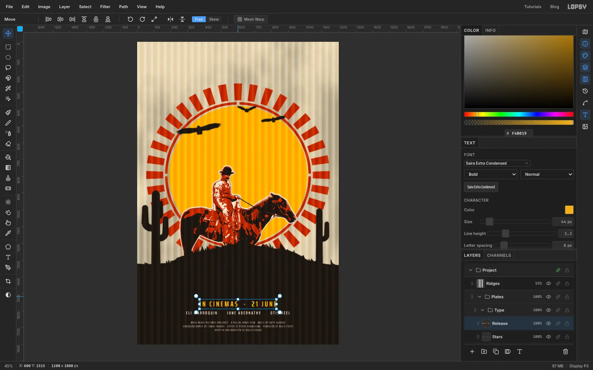

Collapse the `Vultures` group, click it, and click **New Group**. Name the new group `Type`. Build the text from the bottom up. A click with the Text tool near existing text edits that text instead of making new text.

1. **Billing block.** Set the foreground to `#BFB298`. Pick the **Text** tool and set **Size** `17`, font **Saira Extra Condensed**, weight **Medium** and **Align** to **Center**. Click near the bottom middle of the poster and type three lines, pressing [[Enter]] between them:
   - `MESA VERDE PICTURES PRESENTS   A HOLLIS DRAKE FILM   MUSIC BY RUTH ALVAREZ`
   - `CINEMATOGRAPHY BY TOMAS IBARRA   EDITED BY PERRY NAKASHIMA   PRODUCED BY DELIA FROST`
   - `WRITTEN AND DIRECTED BY HOLLIS DRAKE`

   Press [[Tab]] to finish. In the **Text** panel, set **Letter spacing** to `2` and **Line height** to `1.3`. Rename the layer `Billing`. With the **Move** tool, drag it so it's centred and its top sits at about 1664 px, which leaves an 80 px margin below.
2. **Stars.** Click `Type` so the next text doesn't restyle the billing. Set the colour to cream `#EFE3C6`, **Size** `26`, weight **SemiBold**. Click above the billing and type `ELI MARROQUIN      JUNE ABERNATHY      OTIS KEEL` with six spaces between names. Set **Letter spacing** to `5`, rename it `Stars`, and place it with its top at about 1604 px.
3. **Release line.** Click `Type` again. Use yellow, **Size** `44`, weight **Bold**, and type `IN CINEMAS  ·  21 JUNE`. Set **Letter spacing** to `8`, rename it `Release`, and place its top at about 1544 px.

The sizes step down from the release line to the billing block, so the eye reads them in that order.

## Set the title in a stencil face

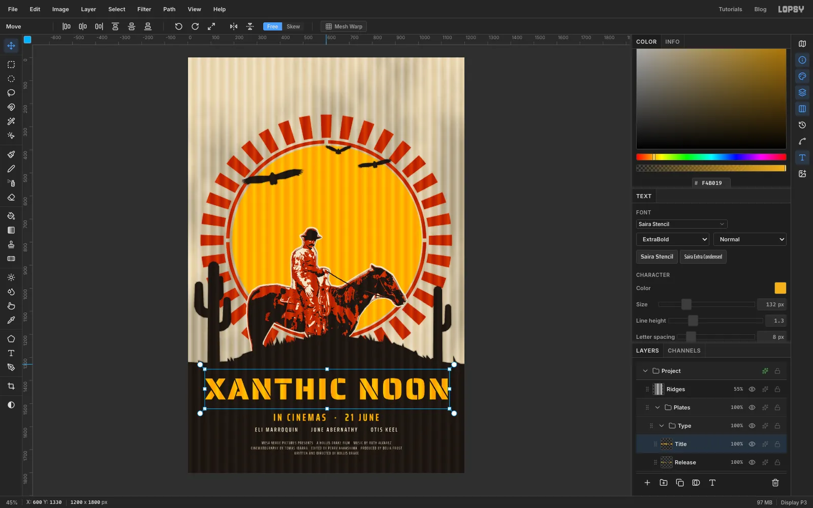

Click `Type`. Keep yellow, pick **Saira Stencil** at weight **ExtraBold**, set **Size** to about `132`, and type `XANTHIC NOON` in an empty part of the ground. Press [[Tab]] and rename the layer `Title`.

Saira Stencil already has bridges cut through its letters. At this size the title is about 1050 px wide, which leaves a margin of about 75 px on each side. Move it so it's centred, with the tops of the capitals at about 1390 px. That's comfortably below the grass and about 55 px above the release line.

## Spray mist around the title

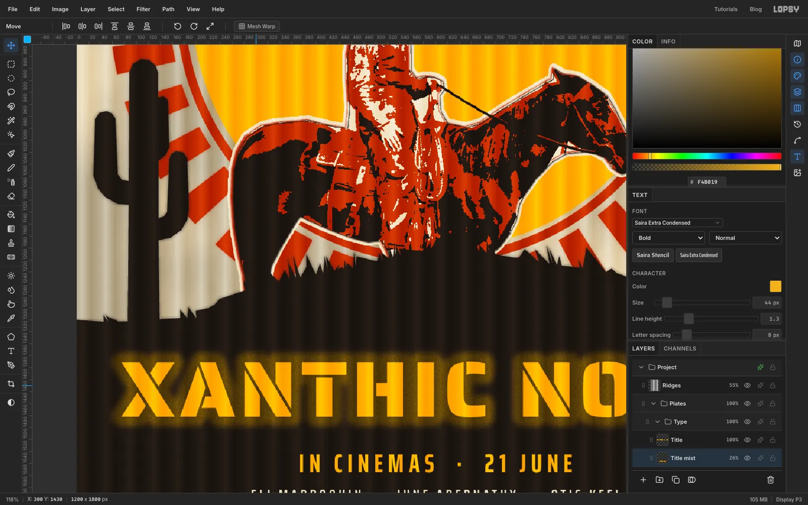

1. [[Cmd]]-click the `Title` thumbnail. Choose **Select → Grow…** with `16`, then **Select → Feather…** with `10`.
2. Click `Release` and add a layer called `Title mist`, so it sits just under the title.
3. Fill it with yellow, deselect, and run **Add Noise** at `70` (**Mono**). Set the layer's opacity to **26%**.

The noise breaks the soft halo into grain, so it reads as paint mist rather than a glow.

## Fade the letters with orange spray

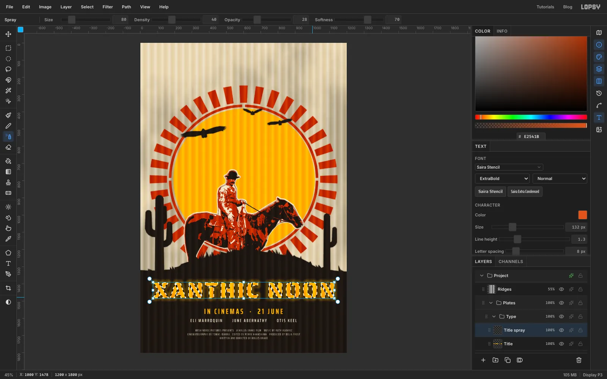

1. Click `Title`, then [[Cmd]]-click its thumbnail, and add a layer called `Title spray` above it.
2. Pick the **Spray** tool and set the foreground to `#E2541B`. Set **Size** `110`, **Density** `40` and **Opacity** `28`.
3. Drag along the feet of the letters from left to right. Make a second, smaller pass (**Size** `80`) over the left-hand letters, and a third under the second word. The selection keeps the spray inside the letters.

Deselect when you're done.

## Add the tagline

Click `Title spray`. Set the colour to ink, **Size** `40`, **Saira Extra Condensed** **Bold**, and type `ONE TOWN.   ONE SUN.   NO SHADE.` near the top of the poster. Set **Letter spacing** to `8`, rename it `Tagline`, and centre it with the tops of the letters about 92 px down.

## Turn a credit on its side

1. Click `Title spray` again. Keep ink and **Saira Extra Condensed**, set **Size** `26` and weight **SemiBold**, and type `OFFICIAL SELECTION` in an empty patch of the sun, away from other text. Set **Letter spacing** to `10` and rename it `Credit left`.
2. With the **Move** tool, the text shows its handles without a selection. Hold [[Cmd]] and drag from just outside a corner to turn it a quarter turn anticlockwise. [[Cmd]] snaps the angle in 15° steps, so it stops exactly at 90°. Press [[Cmd+D]].

The text is still live, so you can fix a typo later.

## Seat the side credits in the margins

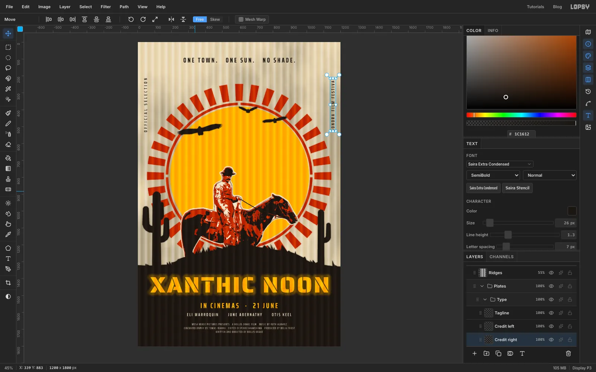

1. Drag `Credit left` to the left margin, about 38 px in from the edge, with its top end at about 214 px.
2. Make a second credit the same way: `SONORA FILM FESTIVAL`, renamed `Credit right`. Turn it the same direction, so both read from bottom to top.
3. Adjust its **Letter spacing** until it's the same length as the left one (`7` works). Then slide it into the right margin at the same height.

Matching lengths and directions makes the two credits read as a pair.

## Let the title drip

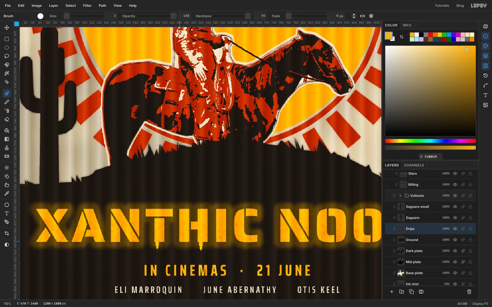

Expand `Plates`, click `Ground` and add a layer called `Drips`. Pick the **Brush** with **Hardness** `95`, and set the colour to yellow `#F4B019`, the colour of the letters.

A drip is widest where it leaves the letter and thins to a point. Draw each one as three short straight strokes:

1. At **Size** `10`, click at the bottom of a letter stem, then [[Shift]]-click a few pixels lower.
2. Drop to **Size** `7` and [[Shift]]-click lower again.
3. Finish at **Size** `3` with the last [[Shift]]-click.

Make three drips of different lengths, between about 12 and 30 px. Hang them from straight stems like the T, the H and the final N. A drip under a curve, such as the C, looks like a cedilla. Keep every tip at least 40 px above the release line.

## Overspray the hilltop

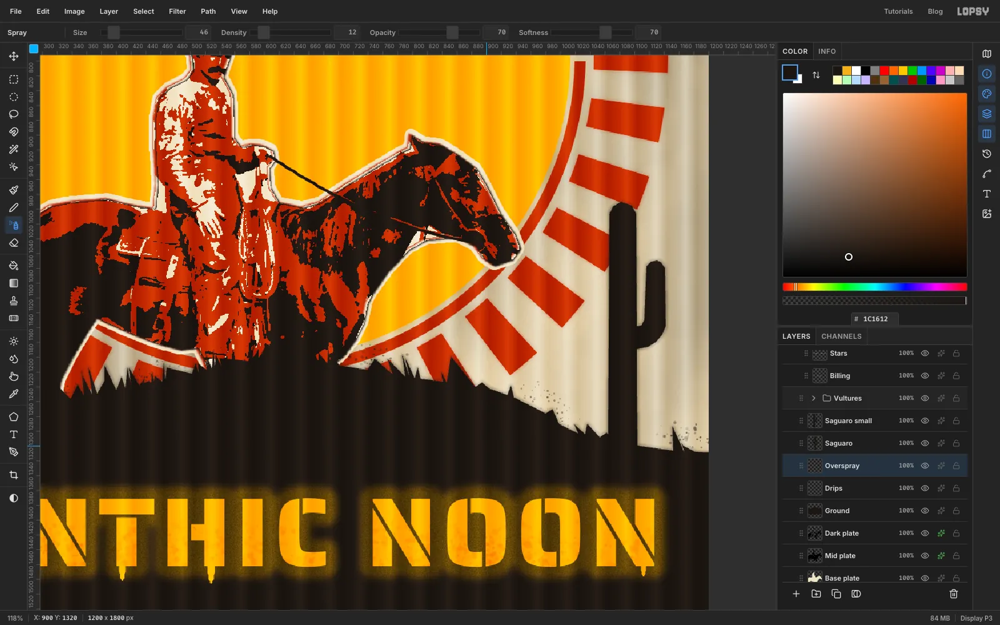

With `Drips` selected, add a layer called `Overspray` and pick the **Spray** tool with ink as the colour and **Opacity** `70`. Make short passes along the top of the hill, just above the grass, changing **Size** between `30` and `56` and **Density** between `8` and `16`. Leave gaps between them. Patches look sprayed; one long even band looks like a filter.

## Fade the mist with the Eraser

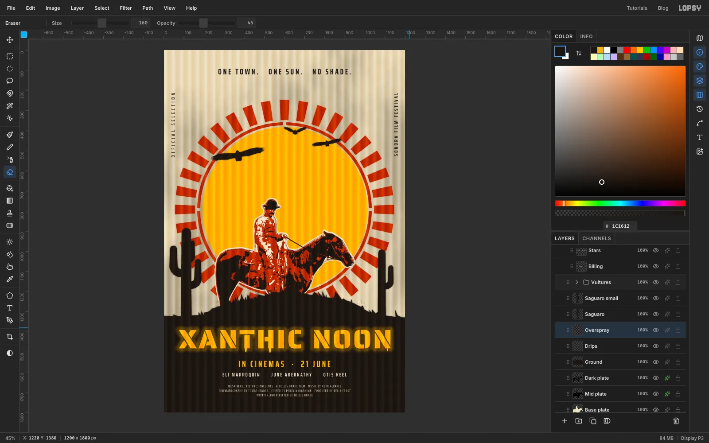

Keep `Overspray` selected. Pick the **Eraser**, set **Size** `160` and **Opacity** `45`, and wipe once or twice over each end of the hill. The mist fades out instead of stopping at the poster edge.

## Nail the tin to the wall

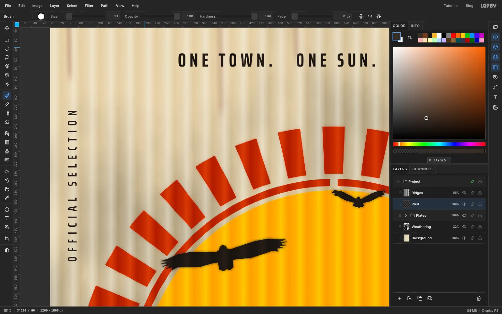

1. Collapse `Plates`, click it, and add a layer called `Rust`. It lands above the plates but under `Ridges`.
2. The nails go 22 px down from the top edge, starting 40 px in from the left and then every 160 px, eight in all. Rust only runs from some of them: pick the **Brush** with **Hardness** `0` and the colour `#7B3A1A`, and under the nails at 40, 360, 520, 1000 and 1160 px click at 24 px and [[Shift]]-click straight below. Vary the length between 60 and 210 px, the **Size** between 18 and 32, and the **Opacity** between 18 and 48.
3. Run **Filter → Motion Blur…** with **Angle** `90` and **Distance** `30` to smear the streaks downward.
4. Set the brush to **Hardness** `100`, **Opacity** `100`, **Size** `11` and colour `#3A2D25`, and click once at each of the eight nail positions.
5. Set the layer's blend to **Multiply**.

## Finish with spray grain

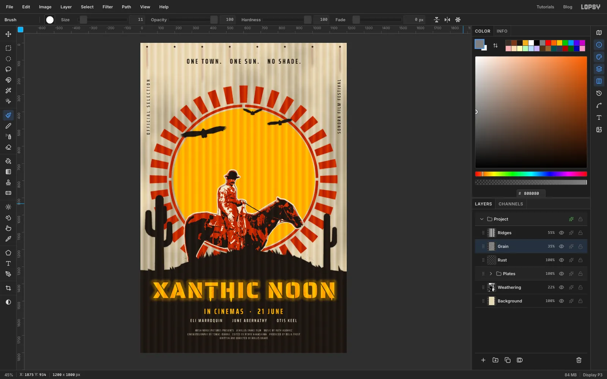

Add a layer called `Grain` and fill it with mid-grey `#808080`. Run **Add Noise** with **Amount** `60`, **Mono** and **Gaussian**. Set its blend to **Overlay** and its opacity to **35%**.

On Overlay the grey vanishes and only the speckle stays. It gives every flat colour the slightly gritty finish of sprayed paint. Export with **File → Quick Export PNG**, and save the project with **File → Save Project** so you can come back to the live text.
