Sticker bombing means covering a surface, such as a laptop, a guitar case or a skateboard, with so many stickers that they overlap and almost hide it. The stickers stay readable because each one has a thick white die-cut border and simple, bold shapes.

This painting puts that look on an old boombox. The room is painted loosely with soft brushes. The boombox is built from clean shapes and shaded with gradients. The stickers are flat graphics with a border and a shadow. A last pass of window light, cast shadows and brush texture ties the three styles together.

Along the way you'll use:

- the **Brush** and **Smudge** tools for a loose painted wall and a wooden table, with **Add Noise** and **Motion Blur** for grain
- **ruler guides**, the **Lasso** (with [[Shift]] to add), **Feather** and blend modes for window light
- the **Shape** tool's rounded rectangles and ellipses, the **Pen** tool for a curved handle, and **Select → Shrink** for chrome rings
- **Define Pattern** and **Fill with Pattern** for speaker perforations and a checkerboard
- **Stroke** and **Drop Shadow** layer effects as die-cut sticker borders
- live text in **Shrikhand**, **Monoton**, **Rubik Mono One**, **Titan One**, **Lilita One**, **Permanent Marker** and **Silkscreen**
- copy and paste, rotating and scaling several layers at once, **Perspective** mode, and moving a whole group
- **Rasterize Layer Style**, a peeled corner, and **Photo Filter**, **Saturation & Vibrance** and **Vignette** adjustments

The palette is warm apricot and walnut around a teal boombox, with candy-coloured stickers:

- Wall `#E2A07D`, wall light `#F4C29A`, wall warm `#E99070`, wall shade `#C27A62` / `#A3604F`
- Window light `#FFE6B8`, wall shadow `#5E2A1E`
- Table `#7B4B30`, seams `#4A2A1A`, lip `#B47A50`, sheen `#FFB070`
- Boombox teal `#2F7E7B`, top `#5FAEA7`, edge `#9AD6CE`, brand plate `#163F3D`
- Chrome `#CDD3D6`, grille `#1C2124`, holes `#56626A`, deck `#1B1F22`, deck window `#34474C`, handle `#25292C`
- Cassette cream `#EFE3C6`, cassette stripe `#E85D3A`, tag red `#D6312F`, ring yellow `#F6C744`
- Sticker pink `#F25C8C` / `#B8336A`, lemon `#FFD23F`, tangerine `#FF8A3D`, sky `#9FD3F2`
- Cherry `#E2343F`, leaf `#3E9A47`, cobalt `#2B4FD8`, ink `#161616`, cream `#FFF4DE`
- Sticker shadow `#3A1E14`

> **Tip:** Positions are in document pixels, written `x, y`. The status bar at the bottom shows where the pointer is. **Edit → Fill** fills the selection (or the whole layer if nothing is selected) with the foreground colour, and [[Cmd+D]] deselects. To load a layer's shape as a selection, [[Cmd]]-click its thumbnail in the Layers panel.

> **Tip:** The **Shape** tool draws from the centre out: press at the centre of the shape and drag to a corner. For an exact size, click without dragging and type the width and height into the **Shape Size** dialog. Sizes below are full widths and heights, not radii.

> **Tip:** Blend modes live in the **Blend** dropdown at the top of a layer's effects drawer (the sparkle icon on its row). To change a layer's opacity, click the `100%` readout on its row and drag the slider.

## Set up the wall and guides

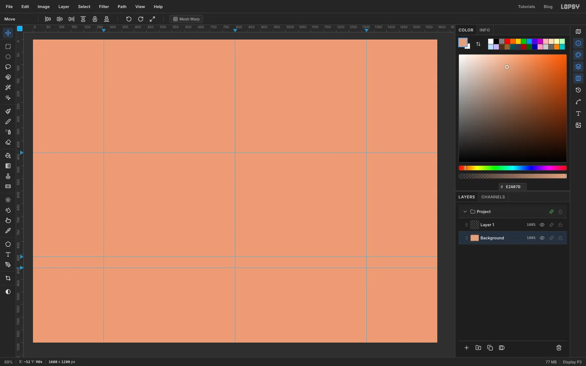

1. Create a new document **1600** × **1200** px.
2. Click the **Background** layer, set the foreground colour to `#E2A07D` and choose **Edit → Fill**.
3. Click the top ruler at `280`, `800` and `1320` for three vertical guides: the boombox's left end, its centre and its right end.
4. Click the left ruler at `448`, `860` and `904` for three horizontal guides: the top of the boombox, the back edge of the table, and the bottom of the boombox.

## Paint the wall with big soft strokes

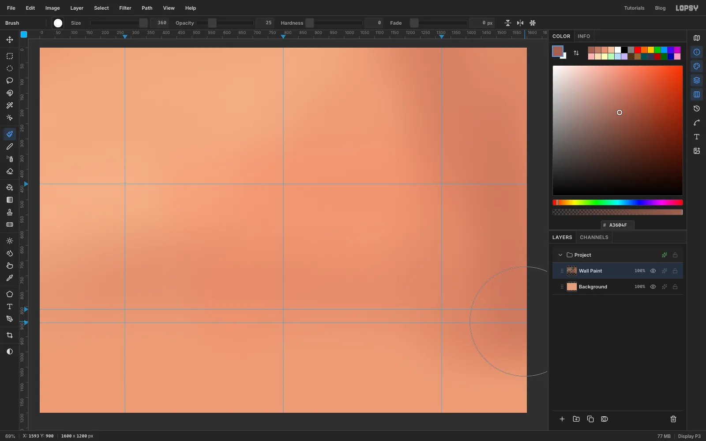

Rename **Layer 1** to `Wall Paint`. Pick the **Brush** with **Size** `420`, **Opacity** `22` and **Hardness** `0`.

1. The window will be at the upper left, so start there. In `#F4C29A`, paint six long strokes that rise from the left edge towards the top, each a little lower than the last.
2. In `#E99070`, paint five strokes across the middle of the wall, from the centre out past the right edge.
3. Raise **Size** to `480` and **Opacity** to `30`. In `#C27A62`, paint four strokes down the right side, then one long stroke across the wall just above the table line.
4. Drop to **Size** `360`, **Opacity** `25`, and run one stroke of `#A3604F` down the far right edge.

> **Tip:** Not sure about a stroke? Undo it with [[Cmd+Z]], and bring it back with [[Cmd+Shift+Z]] if you change your mind.

## Blend the strokes with Smudge

Choose the **Smudge** tool with **Size** `220` and **Strength** `55`. Drag five slightly curving strokes from the top of the wall down to the middle, spaced across the width. The tones melt into each other, but you can still see the direction of the brushwork.

## Add plaster grain

1. Add a layer called `Plaster` and fill it with `#808080`.
2. Run **Filter → Add Noise…** with **Amount** `22`, **Mono** and **Gaussian**.
3. Run **Filter → Gaussian Blur…** with a **Radius** of `1`.
4. Set the layer to **Overlay** at `45%`.

## Lay the wooden table

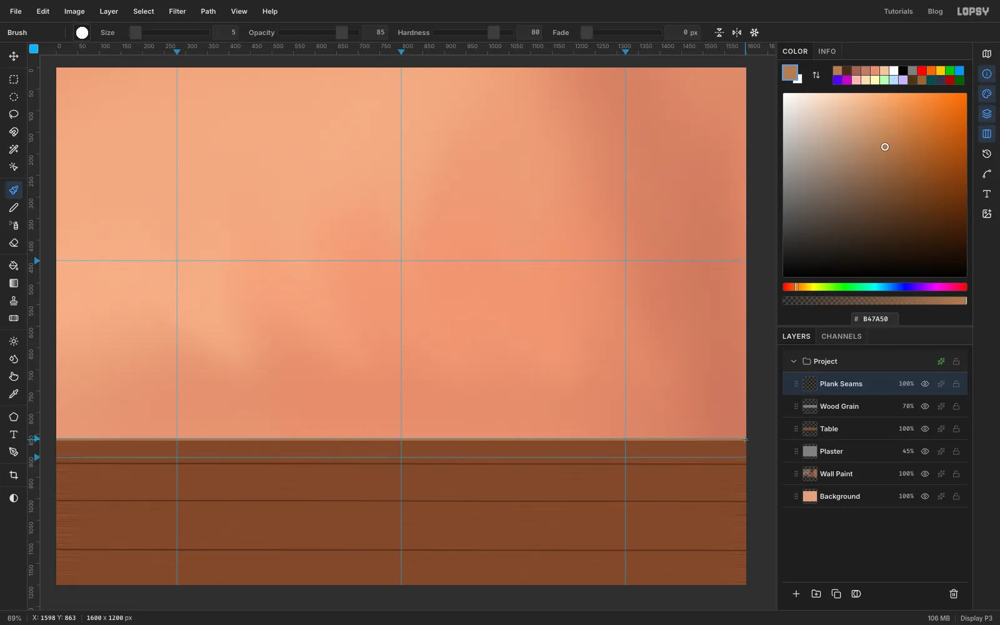

1. Add a layer called `Table`. With the **Rectangular Marquee**, drag from the `860` guide at the left edge to the bottom-right corner, and fill it with `#7B4B30`.
2. Keep the selection. Add a layer called `Wood Grain`, fill it with `#808080`, and run **Add Noise** at **Amount** `70` with **Mono** and **Uniform**.
3. Run **Filter → Motion Blur…** with **Angle** `0` and **Distance** `140`. Deselect, then set the layer to **Overlay** at `70%`.
4. Add a layer called `Plank Seams`. With the **Brush** at **Size** `4`, **Opacity** `85` and **Hardness** `80`, use `#4A2A1A` to draw three straight lines across the table at about `y 918`, `1004` and `1118`. Click at the left edge, then [[Shift]]-click at the right edge for each one. The seams get further apart as they come towards you.
5. Switch to `#B47A50`, set **Size** to `5`, and draw one more line just under the table's back edge for a lip catching the light.

## Select four window panes

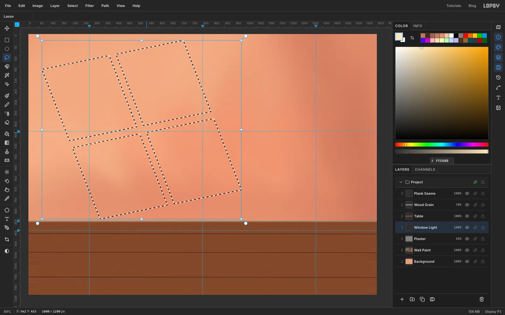

1. Click `Plaster` and add a layer called `Window Light`. It lands under the table.
2. With the **Lasso**, draw the first pane as a tilted four-sided shape. Its top-left corner is near `60, 165`, its top edge rises to the right, and its sides slope down to the right.
3. Hold [[Shift]] and draw the other three panes the same way, leaving a narrow gap between them like a window's frame. Together the four panes make a skewed window. Its outer corners sit at about `60, 165` (top left), `710, 30` (top right), `980, 715` (bottom right) and `330, 850` (bottom left).

## Fill the window light

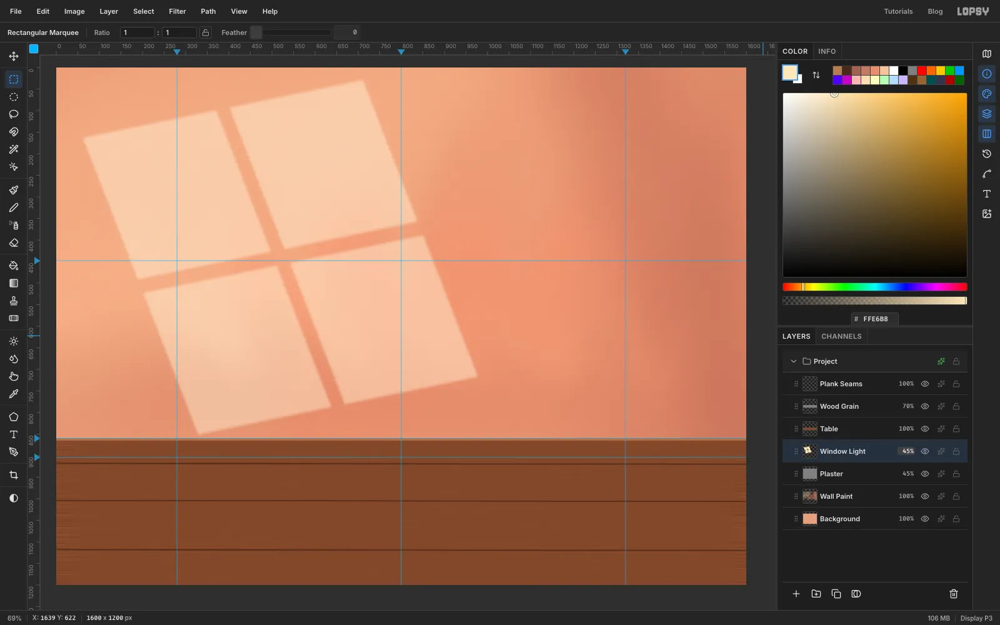

1. Choose **Select → Feather…** with `6` px and fill with `#FFE6B8`. Deselect.
2. The light shouldn't land on the table, so marquee the table area from the `860` guide down and press [[Delete]].
3. Set `Window Light` to **Screen** at `45%`.

## Build the boombox body

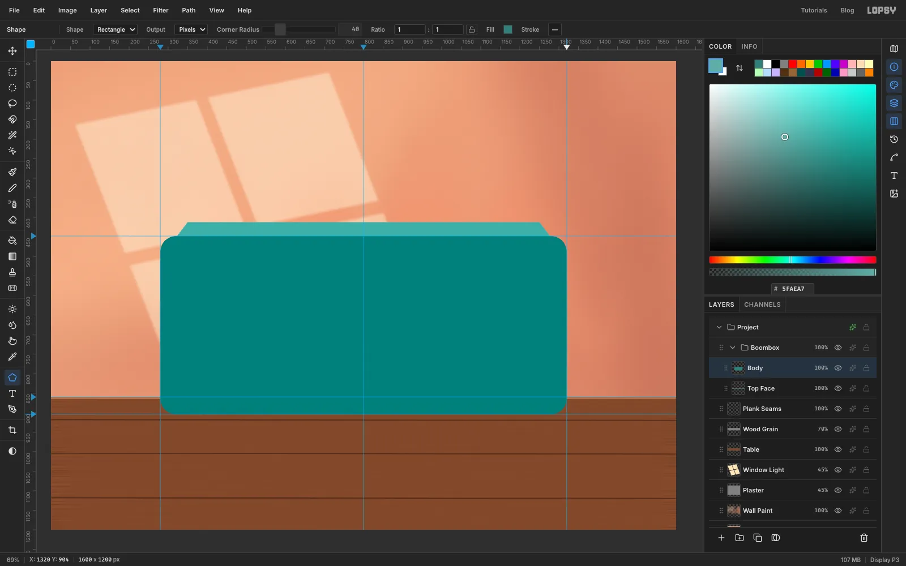

1. Click `Plank Seams`, click **New Group** and name the group `Boombox`.
2. Add a layer called `Top Face`. With the **Lasso**, draw a shallow strip on top of the box, from `318, 454` and `1282, 454` back to `1250, 412` and `350, 412`, and fill it with `#5FAEA7`.
3. Add a layer called `Body`. Choose the **Shape** tool with **Shape** set to **Rectangle**, **Output** **Pixels**, **Corner Radius** `40`, fill `#2F7E7B` and no stroke.
4. Shapes grow from the centre, so press at `800, 676` where the guides cross and drag out to the bottom-right guide corner at `1320, 904`. The guides snap the box into place.

## Light the body with a gradient

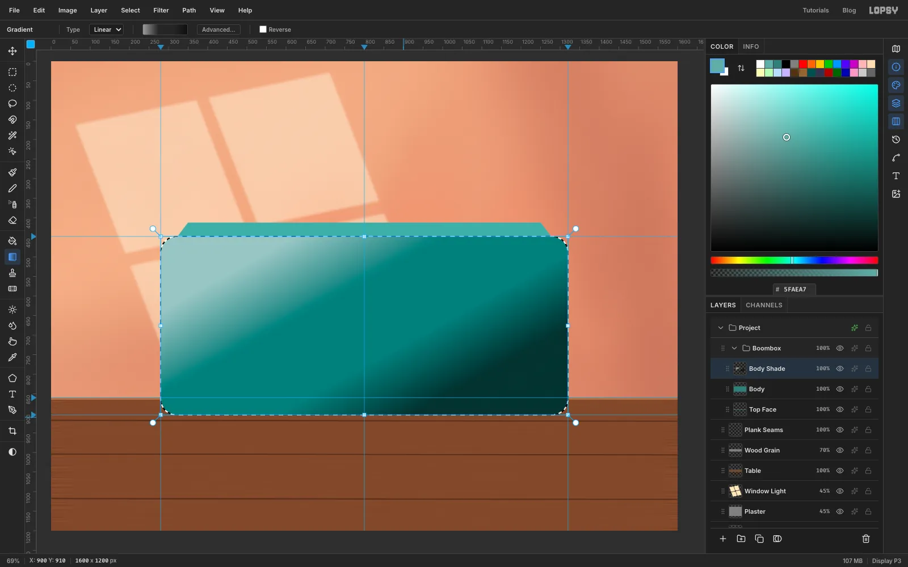

1. Add a layer called `Body Shade` and [[Cmd]]-click the `Body` thumbnail.
2. In the **Gradient** tool's **Advanced…** editor, set four stops: white at `55%` opacity at the start, white at `0%` about a third of the way, black at `0%` about two thirds of the way, and black at `60%` at the end.
3. Drag from just above the box's top centre (`640, 440`) down to just below its bottom (`900, 910`). Deselect.
4. Set the layer to **Soft Light**.
5. Add a layer called `Body Edge`. With the **Brush** at **Size** `4`, **Opacity** `80`, **Hardness** `90`, draw a straight `#9AD6CE` line along the body's top edge (click, then [[Shift]]-click).

## Draw the handle with the Pen

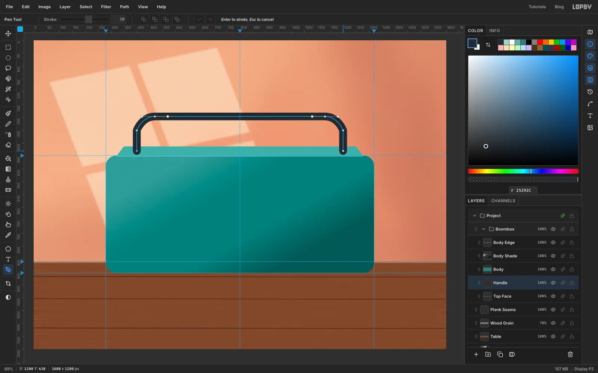

1. Click `Top Face` and add a layer called `Handle`. It sits under the body.
2. Set the foreground to `#25292C`, choose the **Pen** tool and set **Stroke** to `30`.
3. Click at `400, 430` and `400, 350` for the left post.
4. Press at `470, 296` and drag right to `520, 296`. That pulls out a curve handle and rounds the corner.
5. Press at `1130, 296` and drag right to `1180, 296` for the other corner.
6. Click `1200, 350` and `1200, 430` for the right post, then press [[Enter]]. The path is stroked 30 px wide.

## Add shine, mounts and an antenna

1. Add a layer called `Handle Shine` and [[Cmd]]-click the `Handle` thumbnail. Make a gradient from transparent white, to white at `40%` in the middle, to transparent white. Drag it straight down across the top bar, from `y 280` to `300`. Deselect and set the layer to **Screen**.
2. Add a layer called `Handle Mounts`. With the **Shape** tool (Rectangle, **Corner Radius** `6`, fill `#CDD3D6`, stroke `#7D868B` at **Width** `2`), draw a 56 × 44 px block centred on the foot of each post, at `400, 414` and `1200, 414`.
3. Click `Handle` and add a layer called `Antenna`. With the **Pen** at **Stroke** `8` and foreground `#D6DBDE`, click `1262, 424`, then click `1486, 96` and press [[Enter]]. Draw a second line 3 px to the right with **Stroke** `3` in `#8B9499` for its shadow side.
4. Add the tip and the swivel with the **Shape** tool set to **Ellipse**. Make an 18 px ball (`#E3E7E9`, stroke `#7D868B`) at the top of the rod, and a flat 22 × 16 px oval (`#C3C9CC`, stroke `#5D676C`) where it meets the box.

## Mark out the speakers

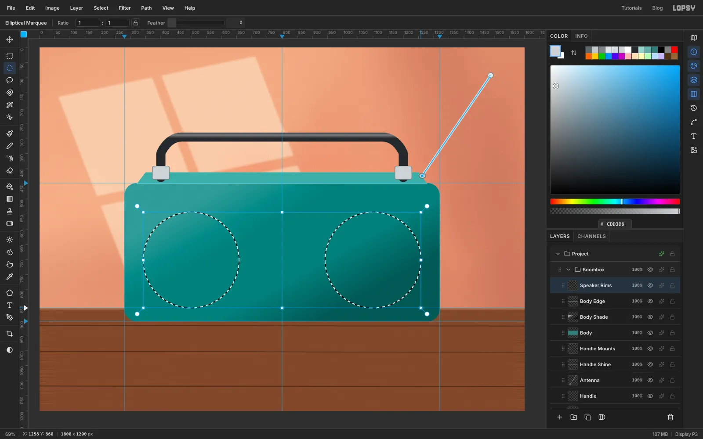

1. Click `Body Edge` and add a layer called `Speaker Rims`.
2. With the **Elliptical Marquee**, drag a circle from `342, 544` to `658, 860`.
3. Hold [[Shift]] and drag a second circle from `942, 544` to `1258, 860`. Both are now selected.

## Turn the circles into chrome rings

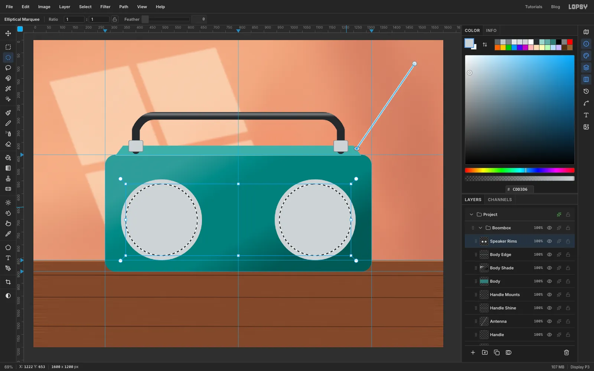

1. Fill the selection with `#CDD3D6`.
2. Choose **Select → Shrink…** with `18` px.
3. Press [[Delete]] to cut out the middles and leave two rings. Deselect.
4. In the effects drawer, add an **Inner Glow** (**Size** `6`, **Opacity** `55`, colour `#4A5357`) and a **Stroke** (**Width** `2`, colour `#5C666B`).
5. Add a layer called `Grilles`. With the **Elliptical Marquee**, select a 280 px circle on each speaker centre (`500, 702` and `1100, 702`) and fill both with `#1C2124`.

## Make a perforation tile

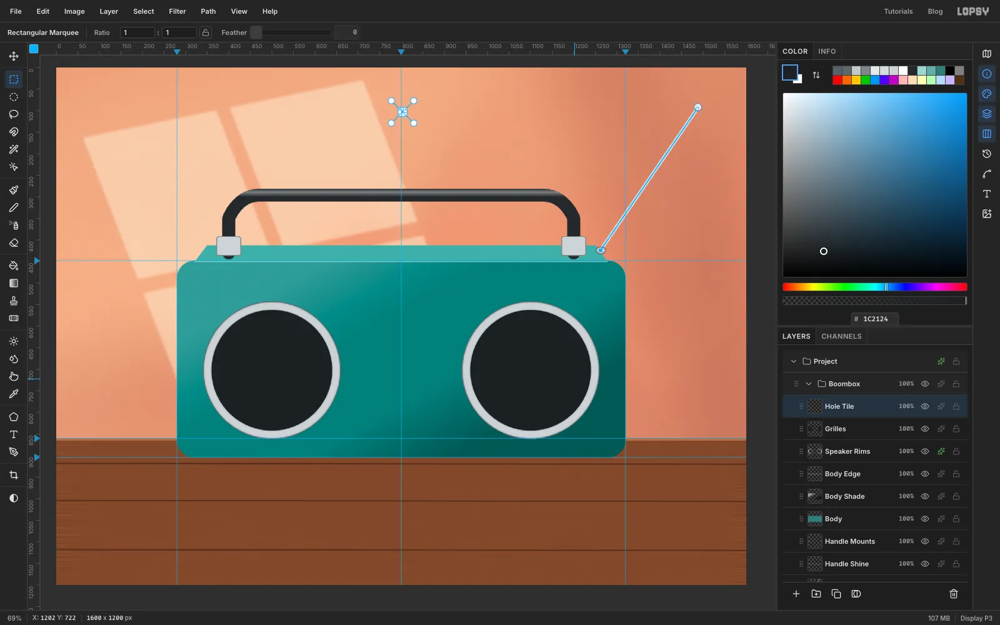

1. Add a scratch layer called `Hole Tile`.
2. Choose the **Shape** tool, set it to **Ellipse** with fill `#56626A`, and **click** (don't drag) anywhere in empty wall space. In the **Shape Size** dialog enter `7` × `7`.
3. Switch to the **Rectangular Marquee** and click once on the dot without dragging. In the **Rectangular Selection** dialog, enter a 12 × 12 square centred on the dot. Here that was **From** `797, 97` and **To** `809, 109`.
4. Choose **Edit → Define Pattern**, deselect, and delete the `Hole Tile` layer.

## Finish the speakers

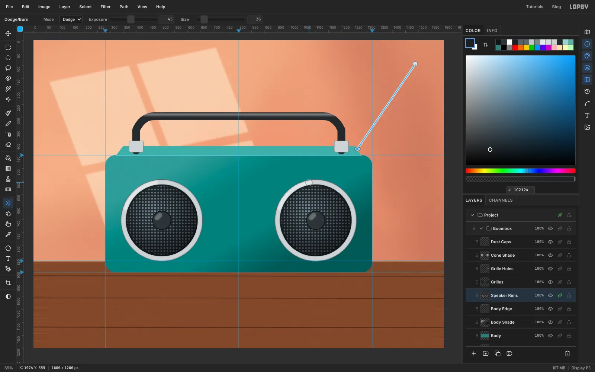

1. Click `Grilles`, add a layer called `Grille Holes`, and [[Cmd]]-click the `Grilles` thumbnail.
2. **Select → Shrink…** by `6`, then choose **Edit → Fill with Pattern…** and click **Apply**. Deselect.
3. Add a layer called `Cone Shade`. Set up a **Radial** gradient from `#C8C8C8` through `#6A6A6A` to `#2E2E2E`. With the **Elliptical Marquee**, select the left grille's circle and drag the gradient from a little above-left of its centre out to its lower-right edge. Then select the right grille and do the same. Each drag lands on top of the last, so the first one stays. Set the layer to **Overlay**.
4. Add a layer called `Dust Caps`. With the **Shape** tool (Ellipse, fill `#2D3438`, stroke `#101315` at `3`), draw a 72 px cap on each speaker centre.
5. Pick **Dodge** with **Exposure** `30` and **Size** `22`, and dab a small highlight on the upper left of each cap. Then click `Speaker Rims` and, at **Exposure** `45` and **Size** `26`, run a short arc along the upper-left of each ring.

## Build the cassette deck

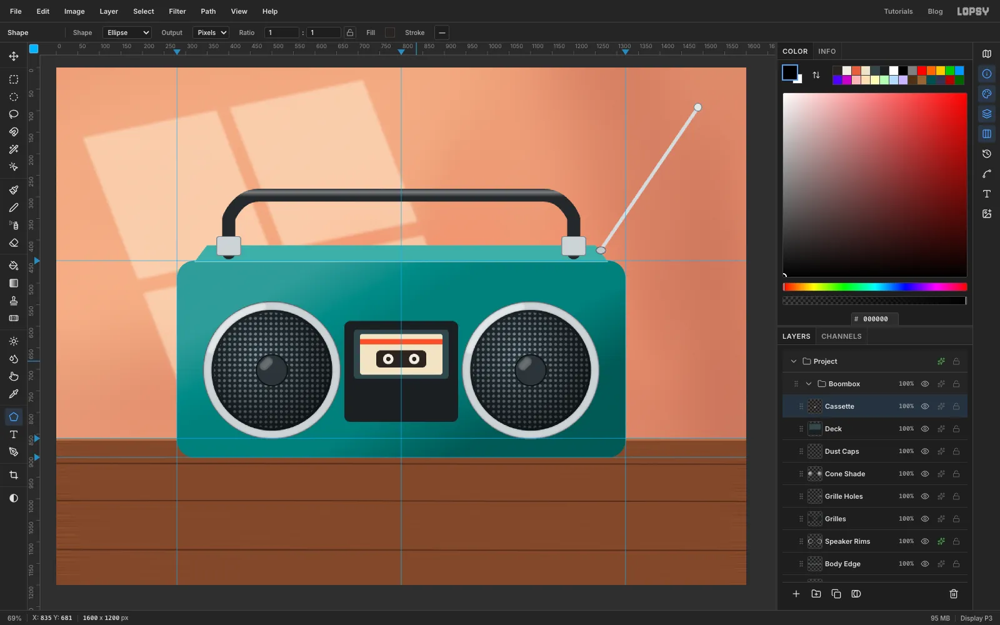

1. Click `Dust Caps` and add a layer called `Deck`. With the **Shape** tool's Rectangle, draw a 264 × 234 px `#1B1F22` panel with **Corner Radius** `14` between the speakers, centred on `800, 705`. Inside it, draw a 220 × 114 px `#34474C` window with radius `8`, centred on `800, 665`.
2. Add a layer called `Cassette` and draw the tape on it:
   - a cream `#EFE3C6` label with radius `6`, just inside the window
   - a `#E85D3A` stripe across its top with radius `0`
   - a dark `#2A2320` tape window with radius `10` in the middle
   - two 26 px `#F3EDE2` reels with a dark stroke, each with a 10 px dark hub

## Add glass and transport keys

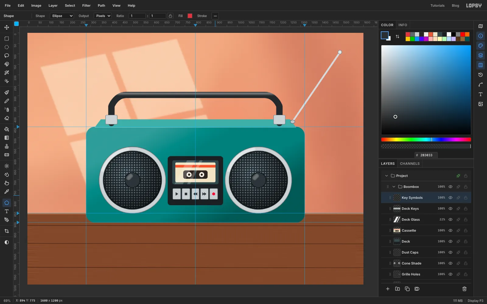

1. Add a layer called `Deck Glass`. Lasso two thin slanted strips across the window, fill them with white, and set the layer to **Screen** at `22%`.
2. Add a layer called `Deck Keys`. Draw five grey `#C9CFD2` keys (38 × 52 px, radius `4`, stroke `#5D676C`) in a row under the window.
3. Add a layer called `Key Symbols`. Lasso small `#2B3033` triangles and a square for play, stop, rewind and fast-forward, and finish with a 14 px red `#E2343F` dot for record.

## Add the tuning dial

1. Add a layer called `Dial` and draw a 320 × 66 px `#EDE5CC` rectangle with radius `10` and a 3 px `#1B1F22` stroke, centred on `480, 501`.
2. Add a layer called `Dial Ticks`. With the **Pencil** at **Size** `2` in `#3A3A3A`, draw 25 short vertical ticks evenly spaced from `x 340` to `x 618`, about 12 px apart (click the top of each, then [[Shift]]-click its bottom). Make every fourth tick longer, starting with the first. That gives seven long ticks.
3. Type the numbers `88`, `92`, `96`, `100`, `104` and `108` in **Silkscreen** at **Size** `15` in `#2E2E2E`, one text layer each, centred above the first six long ticks. The last long tick stays unlabelled. Work from right to left: clicking on existing text edits it instead of starting a new layer, so keep each new click clear of the label you just made. Rename each layer `Dial 88`, `Dial 92` and so on.
4. Add a layer called `Dial Needle` and, with the **Brush** at **Size** `3`, draw a red `#E2343F` needle across the dial at `x 548`. Give it an **Outer Glow** (**Size** `8`, **Opacity** `60`, `#FF6A4D`).

## Add the preset keys

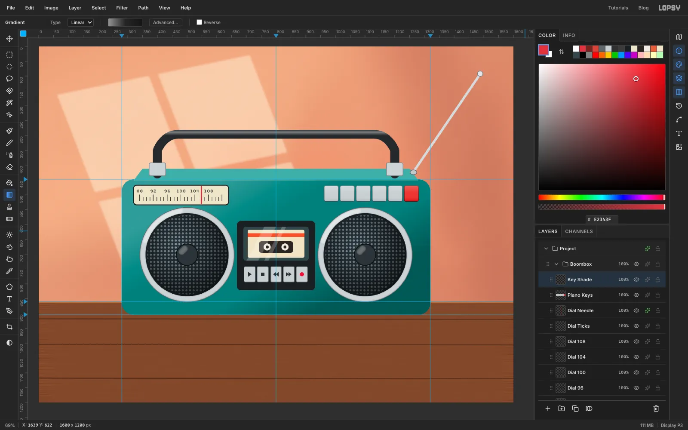

1. Add a layer called `Piano Keys`. Draw five `#C9CFD2` keys (48 × 52 px, radius `5`, stroke `#5D676C`) at the top right, 6 px apart, then a sixth in red `#D9443A` with a `#7A231D` stroke.
2. Add a layer called `Key Shade`, [[Cmd]]-click the `Piano Keys` thumbnail, and drag a gradient from the top of the keys to the bottom: white at `50%`, clear in the middle, black at `45%` at the bottom. Set it to **Soft Light**.

## Set the brand

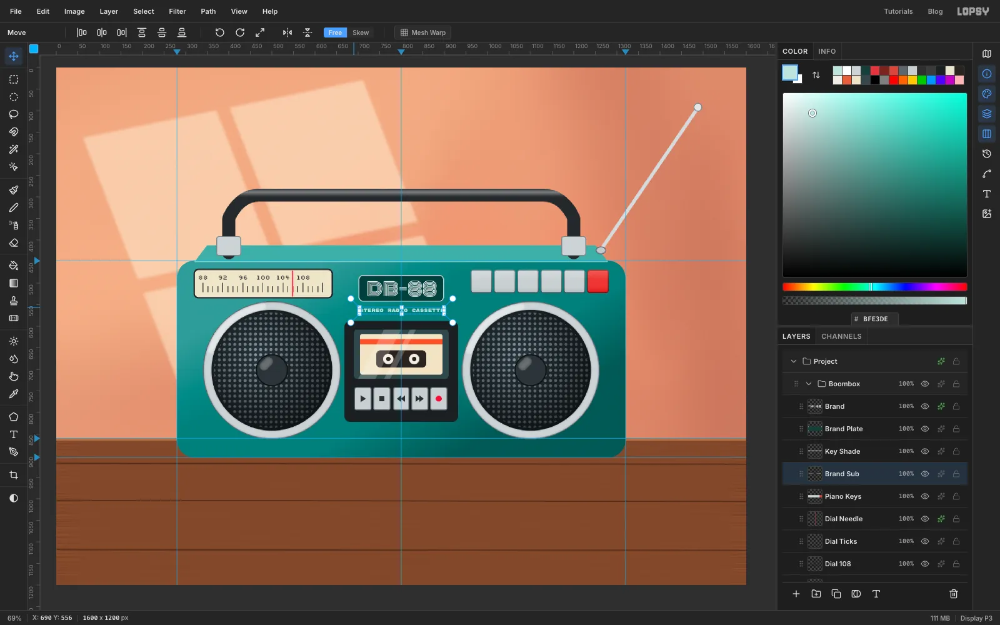

1. Click `Key Shade` and add a layer called `Brand Plate`. Draw a 194 × 60 px `#163F3D` badge with radius `10` and a 2 px `#C9D3D4` stroke, centred on `801, 512`.
2. Type `DB-88` in **Monoton** at **Size** `42.5` in white and rename the layer `Brand`. Centre it on the badge with the **Move** tool's arrow keys. Give it a small **Drop Shadow** (**Offset X** `1`, **Offset Y** `2`, **Blur** `2`, **Opacity** `45`, `#0E3B39`).
3. Click `Piano Keys` and type `STEREO RADIO CASSETTE` in **Rubik Mono One** at **Size** `11` in `#BFE3DE`. Rename it `Brand Sub` and centre it under the badge.

## Start the stickers with a die-cut pill

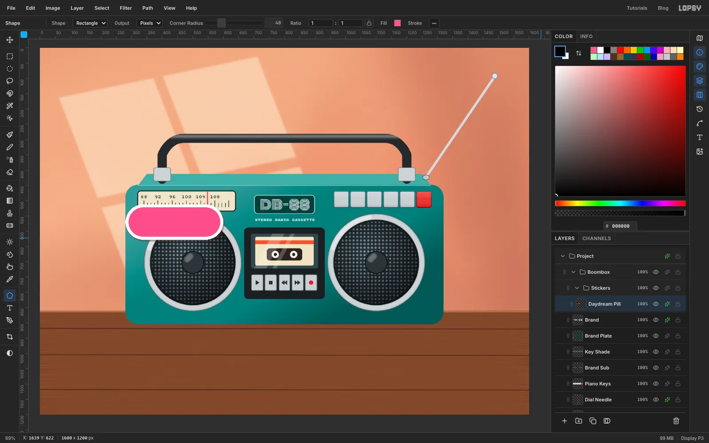

1. Choose **Edit → Clear Guides**, so the guides don't snap your stickers.
2. Click `Brand`, click **New Group** and name it `Stickers`.
3. Add a layer called `Daydream Pill`. With the Rectangle shape at **Corner Radius** `48`, draw a 300 × 96 px `#F25C8C` pill centred on `440, 570`.
4. In the effects drawer, turn on **Stroke** at **Width** `10` in white and set its position to **Outside**. That's the die-cut border. Add a **Drop Shadow** with **Offset X** `3`, **Offset Y** `5`, **Blur** `6`, **Opacity** `45` in `#3A1E14`.

You'll give every sticker this same border and shadow.

## Letter the pill

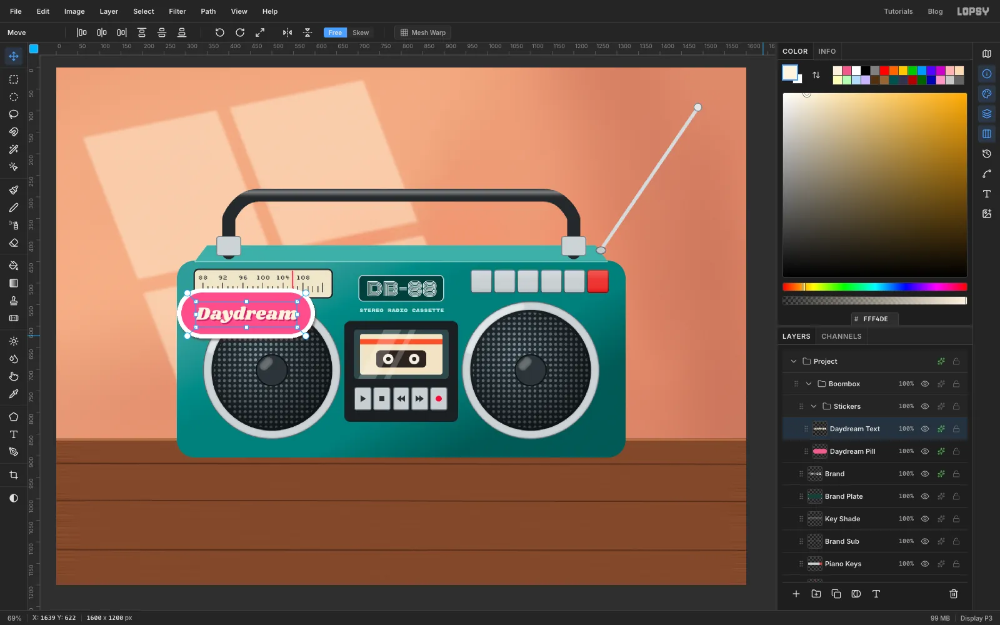

1. Type `Daydream` in **Shrikhand** at **Size** `42.5` in `#FFF4DE`, and rename the layer `Daydream Text`.
2. Centre it on the pill with the arrow keys, then nudge it 3 px lower. The tail of the **y** hangs below the other letters, so the word looks centred when it sits slightly low.
3. Give the text a hard **Drop Shadow** in `#B8336A`: **Offset X** `3`, **Offset Y** `3`, **Blur** `1`, **Opacity** `100`.

## Tilt the pill and its text together

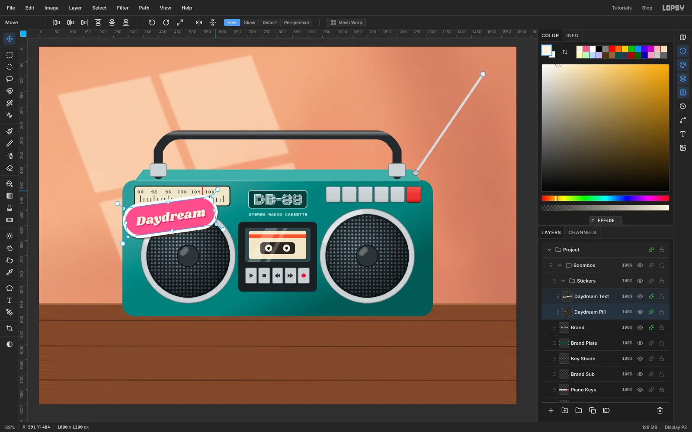

1. Click the `Daydream Pill` row and [[Shift]]-click the `Daydream Text` row.
2. With the **Move** tool, both layers share one transform box. Drag its top-right rotate handle (just outside the corner) up and to the left until the pill tilts about 8°.
3. Press [[Cmd+D]] to finish. The text stays live and is still editable.

## Add a heart and a cloud

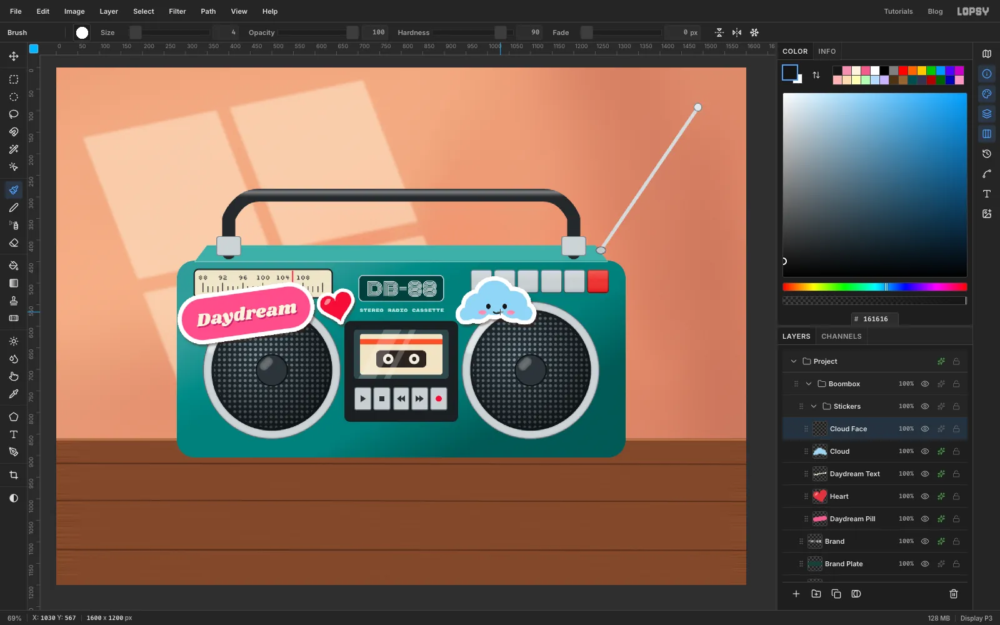

1. Click `Daydream Pill` and add a layer called `Heart`. Lasso a heart about 75 px wide, tilted 15° to the left, between the pill and the brand, and fill it with `#E2343F`. Lasso a small oval highlight on its left lobe in `#FF8C97`. Give it the sticker **Stroke** (**Width** `8`) and **Drop Shadow**.
2. Click `Daydream Text` and add a layer called `Cloud`. Lasso a puffy cloud about 150 × 90 px with a flat bottom, centred near `1022, 548`, and fill it with `#9FD3F2`. Give it the sticker border and shadow.
3. Add a layer called `Cloud Face`. Draw two small `#161616` ellipses for eyes and two `#F48FB1` ovals for cheeks, then add a smile with a few [[Shift]]-clicks of a 4 px brush.

## Add a badge and cherries

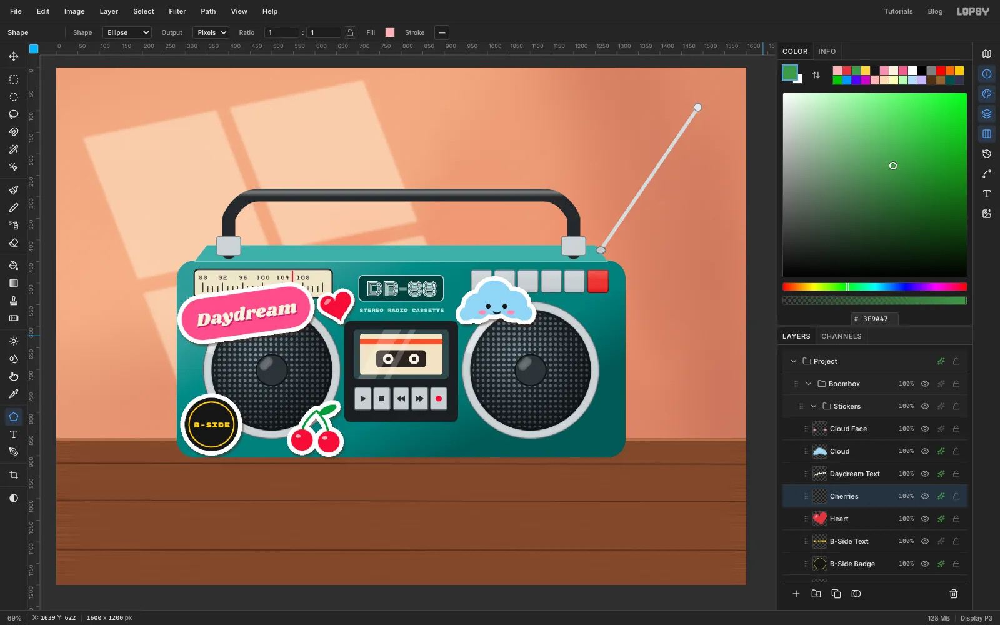

1. Click `Daydream Pill` so the badge sits lowest in the pile. Add a layer called `B-Side Badge`.
2. Draw a 124 px `#161616` circle centred on `360, 828`. Then set the Ellipse to no fill and a 3 px `#FFD23F` stroke, and draw a 104 px ring inside it. Add the sticker border and shadow.
3. Type `B-SIDE` in **Rubik Mono One** at **Size** `16.5` in `#FFD23F`, rename it `B-Side Text` and centre it in the badge.
4. Click `Heart` and add a layer called `Cherries`. With a 6 px `#3E9A47` brush, draw two curved stems that meet at the top, and lasso a leaf beside them. Draw two 50 px `#E2343F` cherries at the bottoms of the stems, with small `#FFB3B8` highlights. Add the sticker border and shadow.

## Copy a star

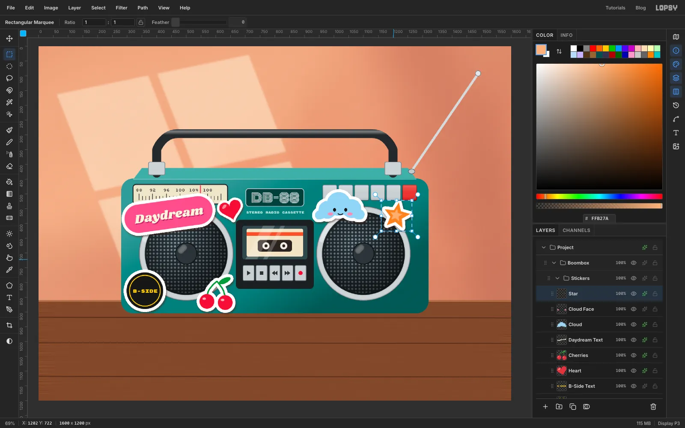

1. Click `Cloud Face` and add a layer called `Star`. Lasso a five-pointed star about 92 px across, centred near `1212, 574`, and fill it with `#FF8A3D`. Lasso a smaller star inside it in `#FFB27A`, then add the sticker border and shadow.
2. Marquee a square around the star and press [[Cmd+C]].
3. Deselect and press [[Cmd+V]]. The copy lands in place on a new layer. Rename it `Small Star`.

## Move and shrink the copy

1. [[Cmd]]-click the `Small Star` thumbnail to select it.
2. With the **Move** tool, drag it to the top-left edge of the boombox, above the dial.
3. Hold [[Cmd]], which keeps the proportions, and drag the bottom-right corner handle in until the star is a bit over half its size.

## Turn the small star

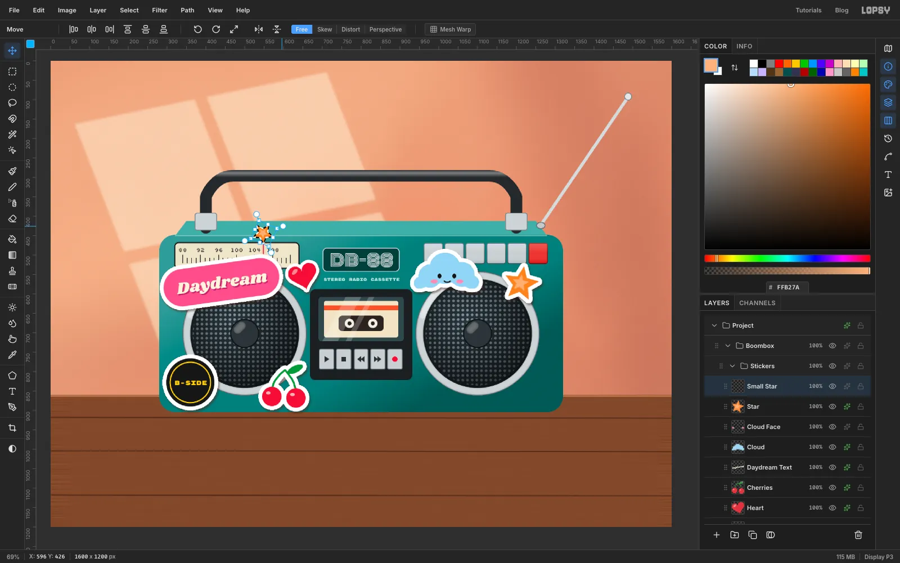

Drag the rotate handle at the top-right corner of the box about 24° clockwise, then press [[Cmd+D]]. Pasting copies pixels only, not effects, so add the sticker border (**Width** `7`) and shadow again.

## Add a lightning bolt

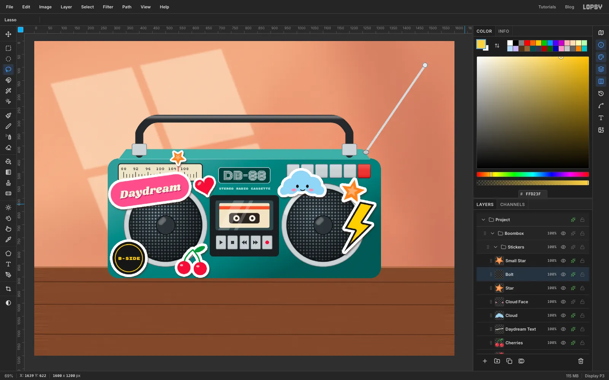

1. Click `Star` and add a layer called `Bolt`. Lasso a zig-zag bolt about 100 × 200 px, tilted 12°, and fill it with `#161616`. Keep it fully on the body, at the right end.
2. [[Cmd]]-click the `Bolt` thumbnail, choose **Select → Shrink…** by `6`, and fill with `#FFD23F`. A black outline is left around the yellow.
3. Add the sticker border and shadow.

## Add a VOL 11 disc

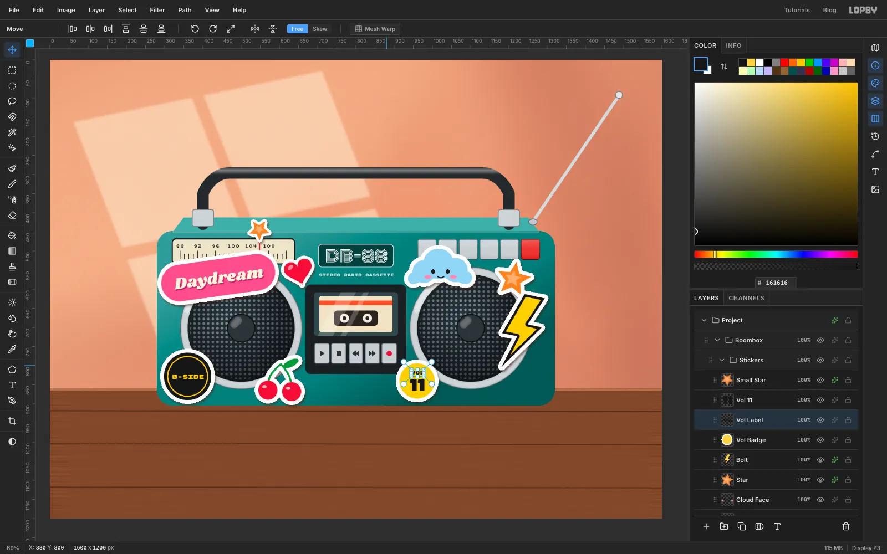

1. Click `Bolt` and add a layer called `Vol Badge`. Draw a 92 px `#FFD23F` circle centred on `960, 840` and give it the sticker border and shadow.
2. Type `11` in **Titan One** at **Size** `44` in `#161616` and rename it `Vol 11`. Then type `VOL` in **Rubik Mono One** at **Size** `13` and rename it `Vol Label`. Centre `Vol 11` slightly below the disc's middle and `Vol Label` above it, leaving about 20 px of yellow above and below.

> **Tip:** To trim a sticker that hangs past the body's edge, click **Rasterize Layer Style** in its effects drawer, [[Cmd]]-click the `Body` thumbnail, choose **Select → Inverse**, click the sticker's row and press [[Delete]].

## Make a HELLO name tag

1. Click `Vol 11` and add a layer called `Hello Tag`. Draw a 168 × 100 px `#D6312F` rectangle with radius `10`, centred on `1175, 836`. On the same layer, draw a 152 × 42 px white panel with radius `4`, centred on `1175, 857`. Add the sticker's **Drop Shadow** only. The red edge is already a border.
2. Type the bottom line first: `june` in **Permanent Marker** at **Size** `34` in `#161616`, centred on the white panel. Clicking on existing text edits it, so starting at the bottom keeps the later clicks clear. Rename it `Hello Name`.
3. Click `Hello Tag` again and type `HELLO` in **Lilita One** at **Size** `28` in white. Rename it `Hello Word` and centre it 20 px below the top of the tag.
4. Type `my name is` in **Rubik Mono One** at **Size** `10` in white. Rename it `Hello Small` and centre it 38 px below the top, which leaves a gap above the white panel.

## Tilt the tag as one piece

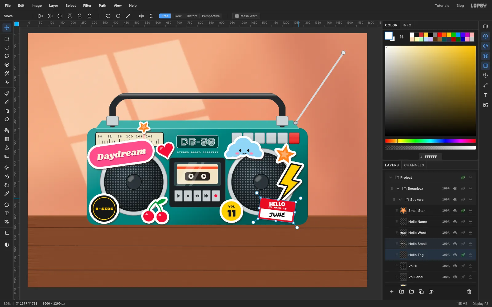

Click `Hello Tag`, then [[Shift]]-click the three text rows. With the **Move** tool, drag the rotate handle about 7° clockwise and press [[Cmd+D]].

## Peel back a corner

1. Click `Hello Tag` and click **Rasterize Layer Style** in its effects drawer, so the shadow becomes pixels you can cut.
2. With the **Lasso**, draw a triangle over the top-right corner. It should cross the top edge and the right edge about 30 px from the corner, along the tag's tilted edges. Press [[Delete]].

## Fold the flap over

1. Add a layer called `Hello Curl`. Lasso the triangle you just cut, flipped over its fold line so the tip points back into the tag, and fill it with `#F3EFE6`. That's the sticker's paper backing.
2. [[Cmd]]-click its thumbnail and drag a gradient from the fold line to the tip, from clear to `#B9B2A4` at `90%`.
3. Give it a **Drop Shadow** with **Offset X** `-2`, **Offset Y** `4`, **Blur** `5`, **Opacity** `45`.

## Tape the handle

1. Add a layer called `Tape` and draw a 200 × 34 px `#1A1A1A` strip with radius `3`, centred on the handle's top bar at `800, 296`. It's a little thicker than the tube, so it reads as wrapped round it. Add a small black **Drop Shadow** with **Offset X** `1`, **Offset Y** `3`, **Blur** `3` and **Opacity** `50`.
2. Type `PLAY LOUD` in **Rubik Mono One** at **Size** `22.5` in `#F4F4F4`, rename it `Tape Text` and centre it on the strip. Add a **Drop Shadow** of **Offset Y** `-1`, **Blur** `1` for a pressed-in look.
3. Select `Tape` and its text and rotate them together about 3° anticlockwise.

## Define a checkerboard

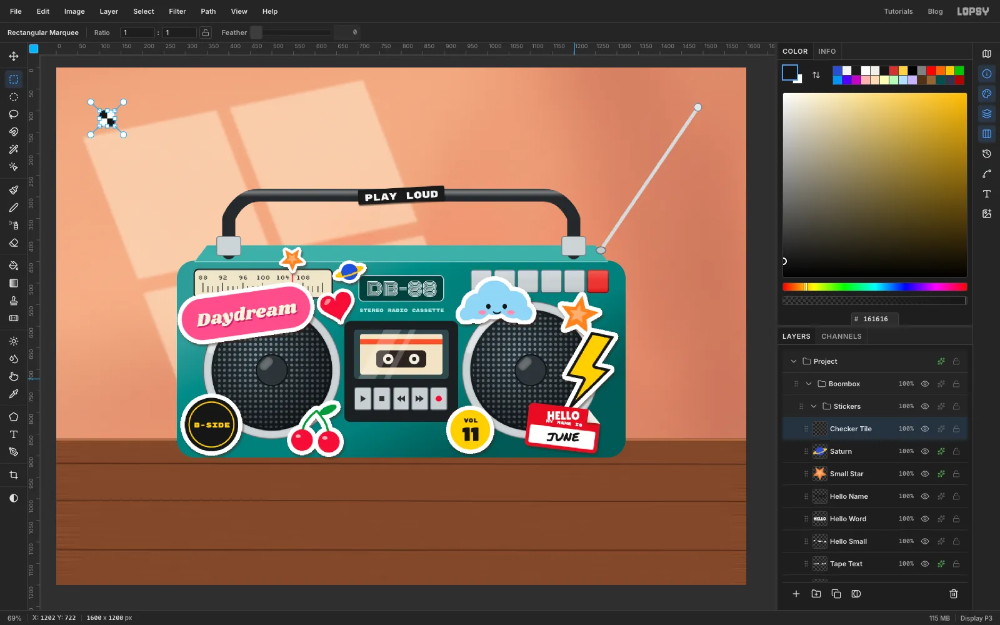

1. Add a scratch layer called `Checker Tile`.
2. Click once with the **Rectangular Marquee** to open its dialog and select `100, 100` to `136, 136`. Fill it with white.
3. Select `100, 100` to `118, 118` and fill it with `#161616`, then `118, 118` to `136, 136` and fill that too.
4. Select the whole 36 px square again, choose **Edit → Define Pattern**, then delete the scratch layer.

## Add Saturn, a checker strip and a rainbow

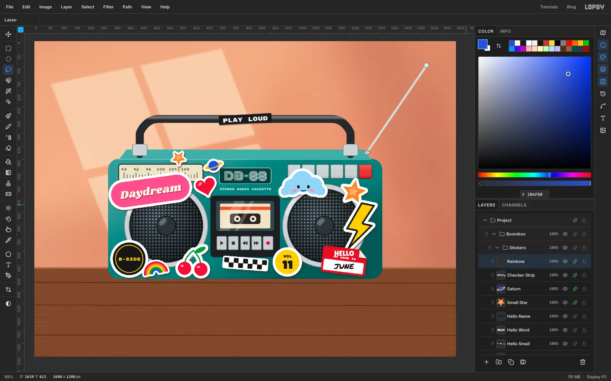

1. Click `Small Star` and add a layer called `Saturn`. Lasso a thin yellow `#F6C744` ellipse tilted about 18° for the ring, draw a 38 px cobalt `#2B4FD8` planet over it, then lasso the lower half of the ring again and fill it with `#F6C744` so the ring passes in front of the planet. Add the sticker border (**Width** `8`) and shadow.
2. Add a layer called `Checker Strip`. Select `720, 828` to `882, 864` with the marquee dialog and choose **Edit → Fill with Pattern…** → **Apply**. Because the strip starts on a multiple of the tile size, the checks line up with its edges. Rotate it about 4° with the **Move** tool's rotate handle and press [[Cmd+D]]. Add the border (**Width** `6`) and shadow.
3. Add a layer called `Rainbow`. With the **Lasso**, draw five half-rings 7 px thick, each nested inside the last, starting with a 92 px wide outer arc. Fill them, from the outside in, in `#E2343F`, `#FF8A3D`, `#FFD23F`, `#3E9A47` and `#2B4FD8`, beside the B-SIDE badge. Add the border (`7`) and shadow.

## Move the whole boombox

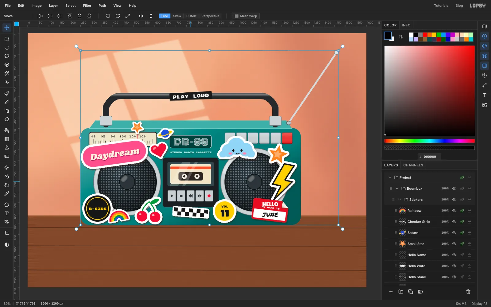

The antenna leans out to the right, so shift the whole boombox a little left to balance it. Click the `Boombox` group's row and, with the **Move** tool, drag it 30 px to the left. Every layer inside it moves together, including the stickers in the nested group. If its edges or centre line up with other content on the way, pink alignment lines appear.

## Put a cassette on the table

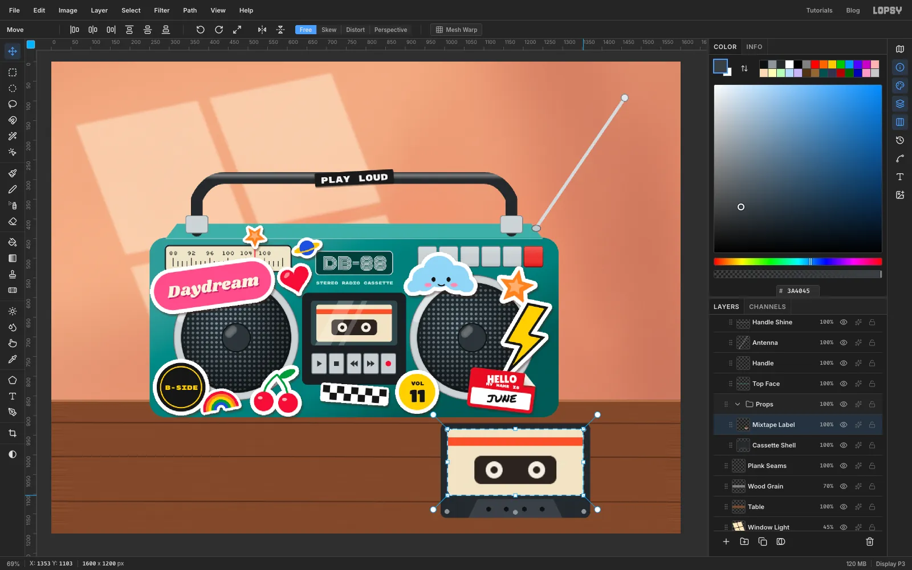

1. Click `Plank Seams`, click **New Group** and name it `Props`. Add a layer called `Cassette Shell`.
2. Draw a 380 × 240 px `#25292D` shell with radius `14`, centred near `1180, 1040`. Lasso a `#3A4045` trapezoid across its bottom edge, and add small `#8E969B` screws at the corners and four dark holes along the bottom.
3. Reuse the label from the deck. Click the `Cassette` layer, [[Cmd]]-click its thumbnail, press [[Cmd+C]] and deselect. Then click `Cassette Shell` and press [[Cmd+V]]. Rename the new layer `Mixtape Label`.
4. [[Cmd]]-click `Mixtape Label`, drag it onto the shell's top-left area with the **Move** tool, and [[Cmd]]-drag its bottom-right handle (keeping the proportions) until it's 180% of its size. Press [[Cmd+D]].

## Write on the label

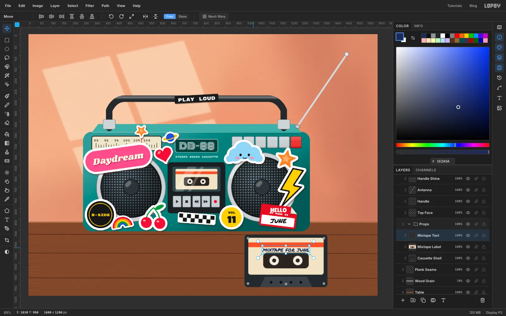

1. Type `mixtape for june` in **Permanent Marker** at **Size** `22.5` in `#1E2A5A`, and rename it `Mixtape Text`. Centre it in the cream band between the stripe and the window, with a few pixels clear of each.
2. Click **Rasterize Layer** at the bottom of the Layers panel. The next step uses **Perspective**, which can't bend live text.

## Lay the cassette flat

1. Click `Cassette Shell` and [[Shift]]-click `Mixtape Label` and `Mixtape Text`.
2. Rotate the three about 16° clockwise and press [[Cmd+D]].
3. Drag the top-middle handle down by nearly half the box's height and press [[Cmd+D]]. Turning first and squashing second makes the shape lean like an object on the table, not a card standing up.

## Add perspective

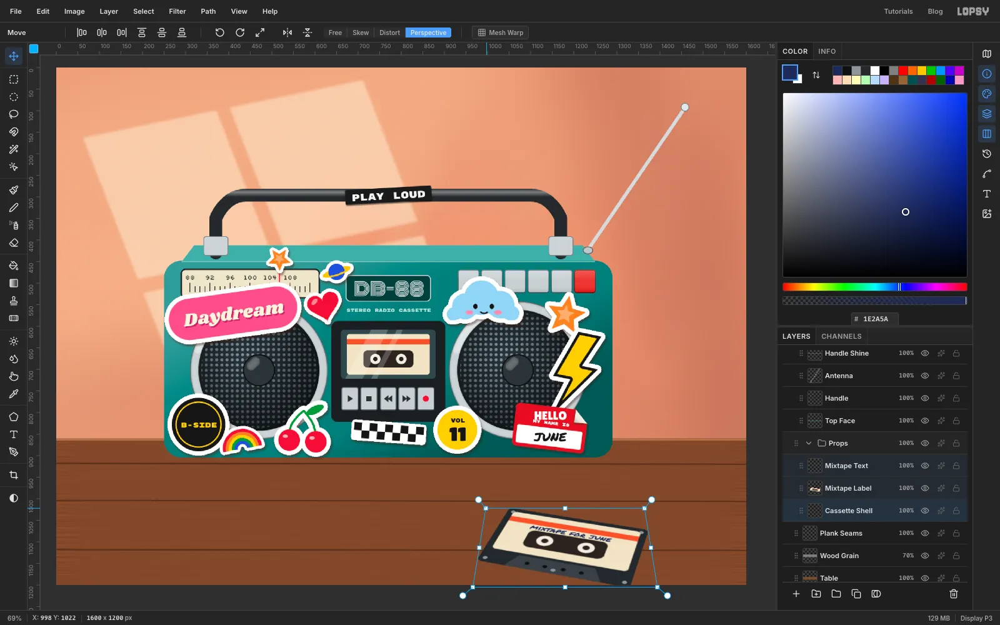

1. In the **Move** tool's options bar, click **Perspective**.
2. Drag the top-left corner handle about 25 px to the right. The top-right corner mirrors it, so the far edge narrows.
3. Press [[Cmd+D]], click **Free**, and drag the cassette into the lower right of the table.
4. Give `Cassette Shell` a tight contact shadow: **Drop Shadow** with **Offset X** `2`, **Offset Y** `3`, **Blur** `2`, **Opacity** `85` in `#1C0C06`.

## Add a peeled sticker sheet

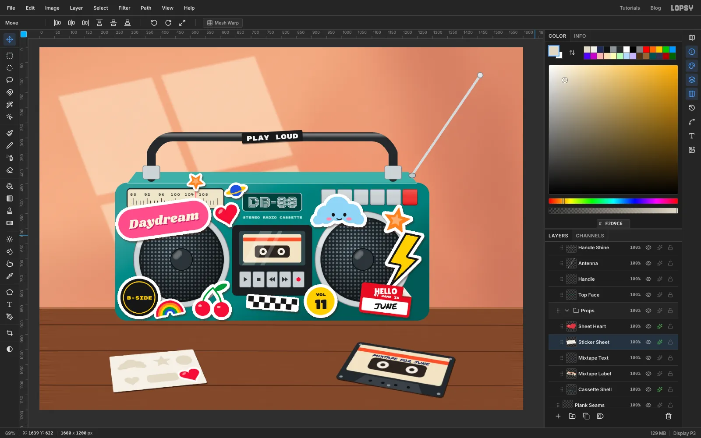

1. Add a layer called `Sticker Sheet` and draw a 320 × 210 px `#F4F0E7` sheet with radius `6`, centred on `400, 1050`.
2. In `#E2D9C6`, draw the ghost shapes of stickers that have been peeled off: a cloud, a star, a heart, a circle and a rounded bar.
3. Copy the `Heart` layer and paste it as before, and rename the copy `Sheet Heart`. Drag it onto the sheet's lower-right corner and give it a white **Stroke** of `6`.
4. Select the sheet and its heart, then lay them flat the same way: turn them about 9° anticlockwise, squash the top down by nearly half, pull the far corners in with **Perspective**, and drag the pair into the lower left.
5. Add the same tight **Drop Shadow** at **Opacity** `75`.

## Cast the boombox's shadow on the wall

1. Click `Plank Seams` and add a layer called `Wall Shadow`.
2. Set the foreground to `#5E2A1E`. [[Cmd]]-click the thumbnail of `Body` and fill, then do the same for `Top Face`, `Handle`, `Handle Mounts` and `Antenna`. Deselect.
3. With the **Move** tool, nudge the layer 64 px right and 26 px down. Use [[Shift]]+arrow keys for 10 px steps.
4. Run **Gaussian Blur** with a **Radius** of `14`.
5. Marquee the table area and press [[Delete]], so the shadow only falls on the wall.
6. Set the layer to **Multiply** at `38%`.

## Ground it with a contact shadow

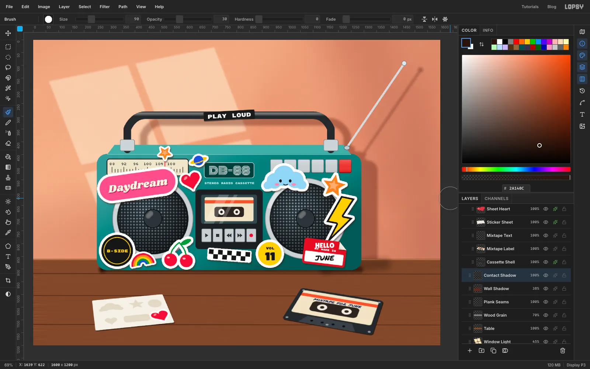

Add a layer called `Contact Shadow`. With a soft **Brush** (**Size** `46`, **Opacity** `55`, **Hardness** `0`) in `#2A140C`, click under the boombox's bottom-left corner and [[Shift]]-click under its bottom-right corner. Then, at **Size** `90` and **Opacity** `30`, add a short stroke off the right end where the light pushes the shadow. Set the layer to **Multiply**.

## Paint the wood

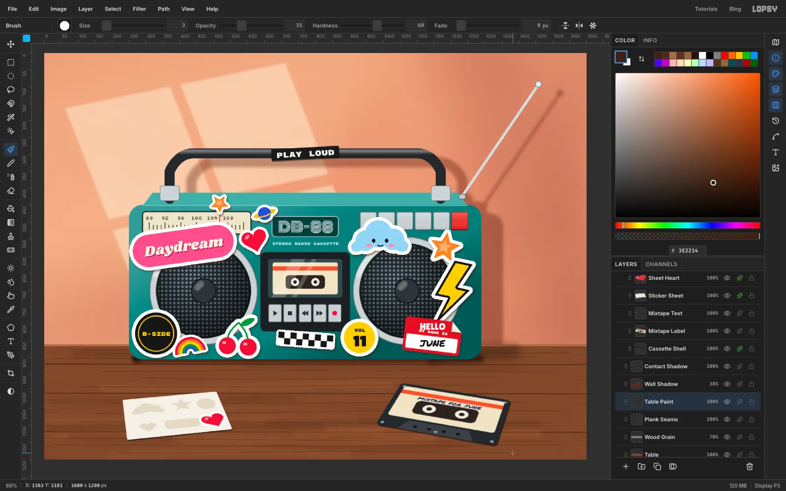

1. Click `Plank Seams` and add a layer called `Table Paint`.
2. With the **Brush** at **Size** `40`, **Opacity** `22` and **Hardness** `20`, paint long, slightly wavering strokes along the planks. Do four each in `#9C623E`, `#5A3320`, `#A86C44` and `#4E2C1C`, starting and stopping at different places.
3. Run **Smudge** (**Size** `60`, **Strength** `45`) once along each plank.
4. With the **Brush** at **Size** `3`, **Opacity** `35`, **Hardness** `60`, draw two or three thin `#3E2214` grain lines along every plank.

## Let the sun reach the table

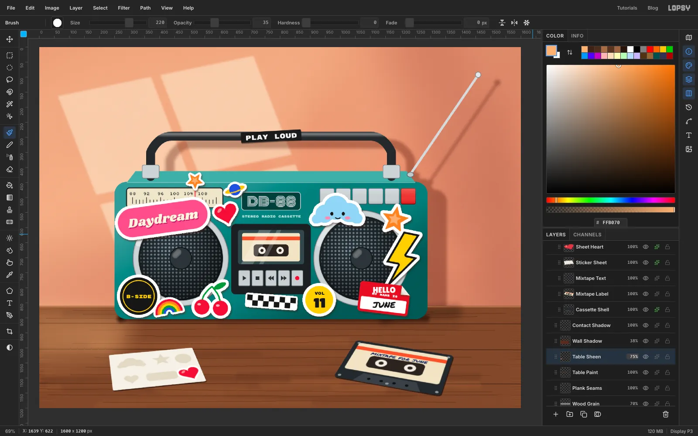

Add a layer called `Table Sheen`. With a soft **Brush** (**Size** `220`, **Opacity** `35`) in `#FFB070`, paint two strokes across the left end of the table, just in front of the wall. Set the layer to **Screen** at `75%`.

## Throw the window light across the boombox

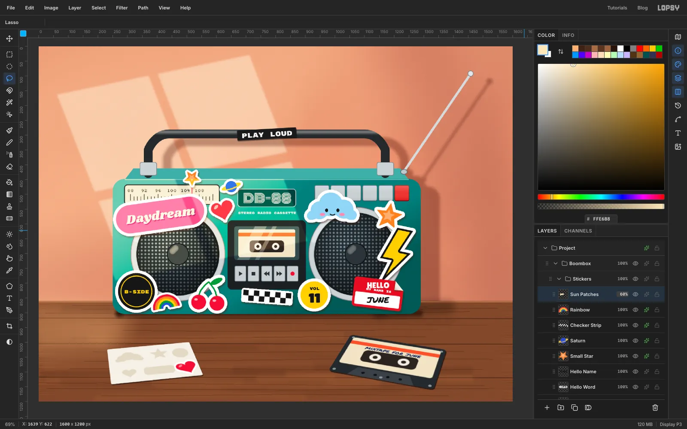

1. Click `Rainbow` (the top of the `Stickers` group) and add a layer called `Sun Patches`.
2. Select the same four window panes, about 70 px further left and 60 px higher, because the boombox stands nearer the window than the wall does. The quickest way is to [[Cmd]]-click the `Window Light` thumbnail, switch to the **Lasso**, and nudge the selection with [[Shift]]+[[Left]] seven times and [[Shift]]+[[Up]] six times. You can also lasso the panes again with [[Shift]].
3. Fill with `#FFE6B8` and deselect.
4. [[Cmd]]-click the `Body` thumbnail, choose **Select → Inverse**, click `Sun Patches` and press [[Delete]]. The light now only falls on the front of the boombox.
5. Set the layer to **Overlay** at `60%`.

## Darken the shadow side

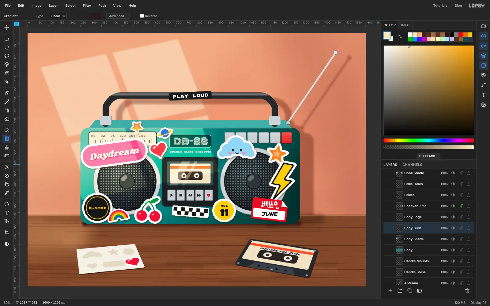

Click `Body Shade` and add a layer called `Body Burn`. [[Cmd]]-click the `Body` thumbnail and drag a gradient from clear `#2A0F08` at about `x 850` to `#2A0F08` at `50%` at the right end. Deselect and set the layer to **Multiply**.

## Select the sunbeams

Click `Sun Patches` and add a layer called `Dust`. Select the four window panes on the wall again: [[Cmd]]-click the `Window Light` thumbnail, or lasso them with [[Shift]] to add.

## Spray dust into the beams

1. Choose the **Spray** tool with **Size** `260`, **Density** `6`, **Opacity** `70` and **Softness** `60`, in `#FFF6DE`.
2. Drag two slow sweeps through the upper part of the beams, above and left of the boombox. The selection keeps the specks inside the light.
3. Deselect, set the layer to **Screen**, and add an **Outer Glow** (**Size** `6`, **Opacity** `70`, `#FFE2A6`).

## Add a light shaft and brush texture

1. Add a layer called `Light Shaft`. Lasso a wide band from the top-left corner down across the boombox's left half, **Feather** it by `60`, fill it with `#FFE6B8`, and set it to **Screen** at `16%`.
2. Add a layer called `Brush Texture`, fill it with `#808080`, and run **Add Noise** (**Amount** `45`, **Mono**, **Uniform**) followed by **Motion Blur** (**Angle** `35`, **Distance** `16`).
3. Set it to **Overlay** at `22%`. The streaks sit over the flat sticker colours and make them look painted.

## Warm the whole picture

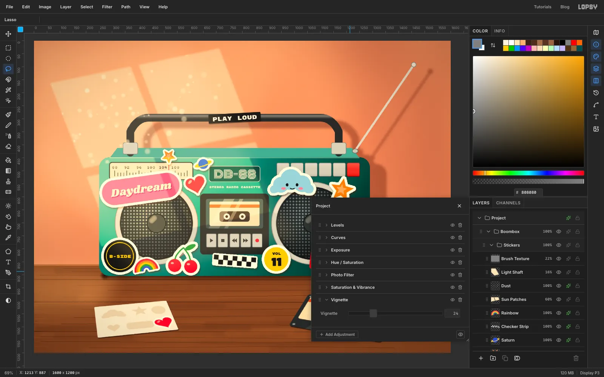

1. Click the `Project` group's row and open its effects drawer.
2. Click **Add Adjustment** and add a **Photo Filter** with **Density** `18`, then **Saturation & Vibrance** with **Vibrance** `12`, then a **Vignette** of `24`. Leave the other adjustments in the list untouched.

Save your work with **File → Save Project**, and use **File → Quick Export PNG** to export the finished painting.
