A **sticker bomb** is what happens to a laptop lid, a skateboard or a guitar case after a few years of collecting stickers: dozens of die-cut vinyl stickers slapped on at odd angles, overlapping each other and running off the edges until hardly any of the surface shows. Every sticker has a thick white border from the die cutter, a little shadow where it lifts off the surface, and its own little world of colour and type.

This tutorial uses that look for a Hanukkah card called **Toasty Latkes**. You'll make each sticker as flat art on its own layer, then "die-cut" it: load its outline as a selection, grow it, fill a white backing underneath and merge the two. After that you tilt it, give it a shadow and move on to the next one. The stickers are a mix of drawn and photographic:

- a real latke photo, cut out with the **Magic Wand** and a **Lasso** intersect
- a holographic Star of David built from two Shape-tool triangles
- a dreidel with a Hebrew letter nun, and a **חג שמח** (Chag Sameach) pill
- a SIZZLE! starburst made with the **Sunburst** filter
- a sufganiyah (jelly doughnut) shaded with the **Dodge** tool and powdered with the **Spray** tool
- a menorah badge, an OY! speech bubble, embossed gelt coins, an applesauce jar and more
- a title sticker with a **peeled-back corner**

The card is 1400 × 1000 px. The latke photo is [00 Potato Latkes.jpg](https://commons.wikimedia.org/wiki/File:00_Potato_Latkes.jpg) by Mark Mitchell on Wikimedia Commons (CC BY 2.0). Open its 1920 px-wide preview in your browser.

The tools you'll use:

- the **Shape** tool (polygons and rounded rectangles), the **Pen** tool with **Path to Selection**, the **Lasso**, the **Elliptical Marquee** and the **Magic Wand**, with [[Shift]] to add and [[Shift]]+[[Alt]] to intersect
- [[Cmd]]-click on a layer thumbnail, **Select → Grow**, **Shrink**, **Feather** and **Inverse**, and **Edit → Fill**
- the **Gradient** tool (linear and radial) and its **Advanced…** stop editor
- the **Brush** with [[Shift]]-click straight lines, the **Spray** tool and the **Dodge** tool
- **Sunburst**, **Emboss**, **Desaturate**, **Hue/Saturation**, **Unsharp Mask** and **Add Noise**
- the Move tool's rotate and scale handles and **Flip Vertical / Horizontal**
- **Copy** and **Paste**, **Duplicate Layer**, **Merge Down**, dragging rows in the Layers panel, and **Group Layers**
- live text in Luckiest Guy, Bungee and Suez One (which has Hebrew letters)
- the **Drop Shadow**, **Stroke**, **Inner Glow** and **Outer Glow** layer effects, the **Hard Light** and **Overlay** blend modes, and a **Vignette** adjustment

The palette:

- Card `#0E1A4F` → `#1E3D99`
- Die-cut white `#FFFFFF`, cream `#FFF3D6`, ink `#13215E`
- Gold `#FFE48F` → `#FFC531` → `#D98E04`
- Latke orange `#F2711C`, red `#E0283A`, ribbon tails `#A3162A`, jelly `#B0122B`
- Bubble pink `#FF8FB1`, sky `#8FC4FF`, blue `#2F6FE0`, plum `#5A2D8C`
- Foil `#FF7AD9` → `#7AF0FF` → `#FFF27A` → `#B58CFF` → `#7AF0FF`
- Doughnut `#D98A3D`, crust shadow `#6B3410`, belt `#F6D29A`
- Applesauce `#E9B66C`, oil `#FFE9A0` → `#F2B632` → `#B9850C`

Positions are given in document pixels. Hover over the canvas and watch the **X** and **Y** readout at the bottom left of the window.

## Set up the card and the backdrop

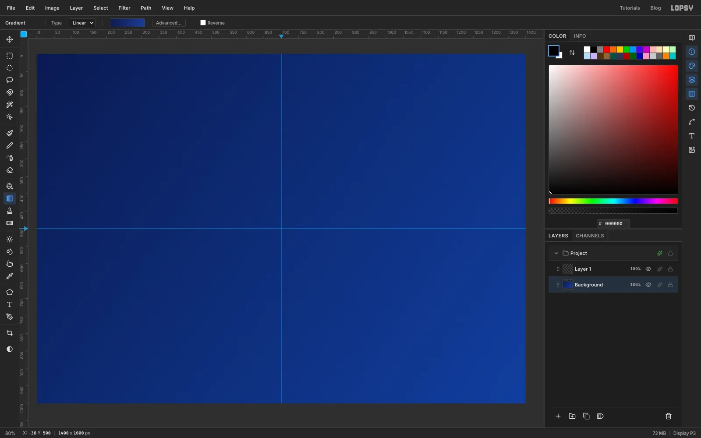

Choose **File → New**, pick **Pixels**, and make a **1400 × 1000** document. Click the **Background** row in the Layers panel.

Pick the **Gradient** tool, set it to **Linear** and open **Advanced…**. Click a stop and type its colour in the **Hex** field: `#0E1A4F` for the left stop and `#1E3D99` for the right one. Drag from the top-left corner of the card to the bottom-right corner.

Choose **Filter → Add Noise…**, set Amount to **6**, click **Mono** and apply. It gives the card a faint printed grain.

Click the top ruler at x 700 and the left ruler at y 500 to drop two guides through the centre. They help you balance the layout as the stickers pile up. Then rename **Layer 1** to **Star** (double-click its name).

> **Tip:** Almost every sticker in this card is made the same way. You draw the art flat on its own layer, then **die-cut** it: [[Cmd]]-click the layer's thumbnail, **Select → Grow…** by about 10 px, fill that grown shape with white on a new layer, drag the white layer under the art, and **Merge Down**. Then you add a drop shadow and tilt the sticker. The first sticker walks through all of it. After that, "die-cut it" means those same steps.
>
> Two more conventions. "Fill with `#xxxxxx`" means set the foreground colour to that hex, then choose **Edit → Fill**. With the **Shape** tool, where you press is the shape's centre, and the drag distance is half its width and height. So "drag out 94 px each way" gives a 188 px square.

## Build a Star of David from two triangles

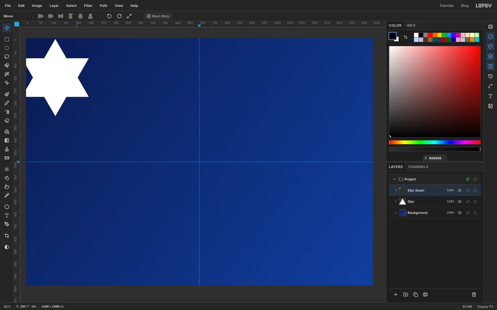

With **Star** selected, pick the **Shape** tool ([[U]]). In the options bar set **Shape** to **Polygon**, **Sides** to **3**, **Output** to **Pixels** and **Corner Radius** to **0**. Click the **Fill** swatch and type `FFFFFF`, and remove any stroke.

Press at **(118, 120)** and drag to about (253, 255). The triangle hangs a little off the left edge, which is what you want: stickers on a sticker bomb run off the edges.

Choose **Layer → Duplicate Layer** and rename the copy **Star down**. [[Cmd]]-click its thumbnail, press [[V]] for the Move tool, click **Flip Vertical** in the options bar, and press [[Cmd+D]].

The flipped triangle now points down but sits too high. A triangle's centre is a third of the way up from its base, so it has to move down by a third of its height. Drag it straight down with the Move tool, watching the Y readout, until the points line up into a six-pointed star. That's about 78 px, a third of the triangle's height. Use the arrow keys for the last few pixels. Choose **Layer → Merge Down** and rename the result **Star**.

## Give the star a holographic foil

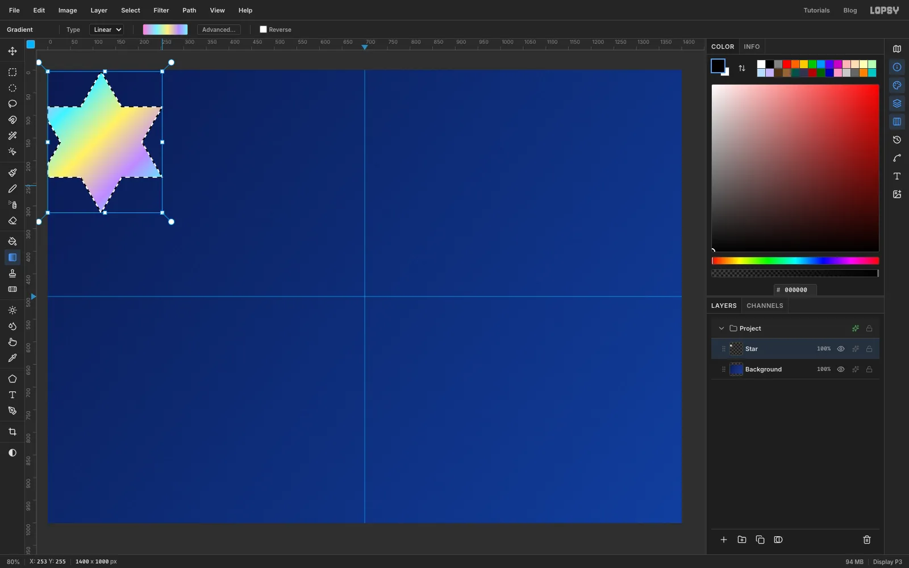

[[Cmd]]-click the **Star** thumbnail to select its shape. Pick the **Gradient** tool (Linear), open **Advanced…** and set five stops. Click the bar to add a stop where you click.

- `#FF7AD9` at 0%
- `#7AF0FF` at 30%
- `#FFF27A` at 55%
- `#B58CFF` at 80%
- `#7AF0FF` at 100%

Drag from the star's top-left corner to its bottom-right corner.

For the foil glint, add a layer called **Glint**. Keep the star selected. Pick the **Lasso**, hold [[Shift]]+[[Alt]] and drag a diagonal band across the star's upper left. [[Shift]]+[[Alt]] keeps only the part of the band that lies inside the star. Choose **Select → Feather…** at **6**, fill with white, and press [[Cmd+D]]. Set the layer's opacity to **45%** and **Merge Down** into **Star**.

Open the star's effects drawer (the sparkle icon on its row) and turn on **Inner Glow**: white, Size **16**, Spread **0**, Opacity **85**. It gives the foil a bright, bevelled edge.

## Die-cut, shadow and tilt the star

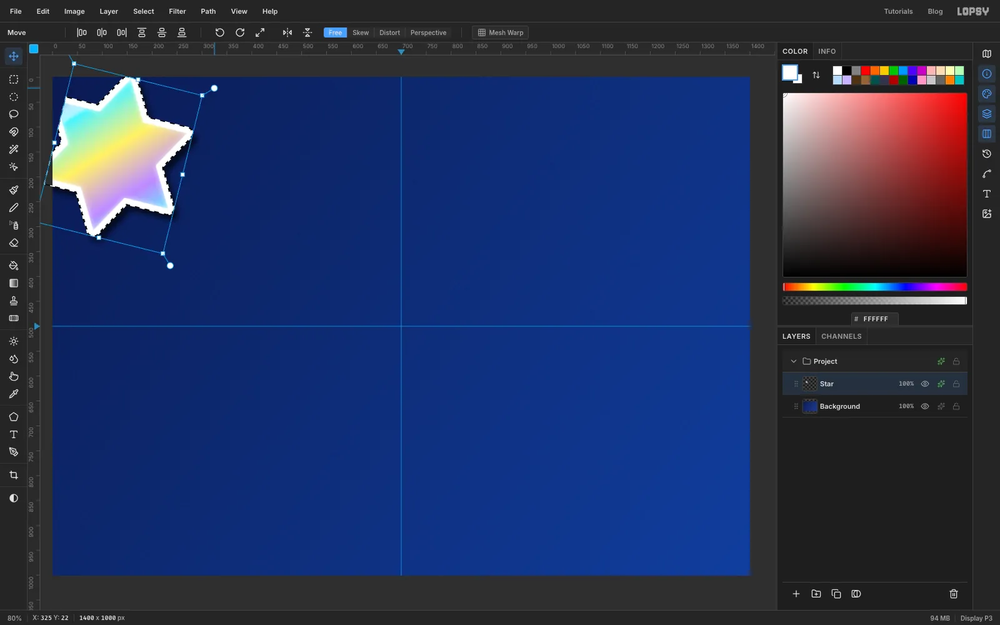

Now the die-cut:

1. [[Cmd]]-click the **Star** thumbnail and choose **Select → Grow…** with **12**.
2. Click **Add Layer**, name it **Star backing**, set the foreground colour to white and choose **Edit → Fill**. Press [[Cmd+D]].
3. Drag the **Star backing** row by its grip (the dotted handle on the left) and drop it just below **Star**.
4. Click the **Star** row and choose **Layer → Merge Down**. The star merges onto its white backing, and the Inner Glow is baked in. Rename the merged layer **Star**.

Open the effects drawer again and turn on **Drop Shadow**: colour `#000000`, Offset X **9**, Offset Y **12**, Blur **16**, Spread **0**, Opacity **65**. This is the sticker shadow. Use it on every sticker from here on.

To tilt the sticker, [[Cmd]]-click its thumbnail, press [[V]], and drag the round rotation handle just outside the top-right corner about **14°** clockwise. Press [[Cmd+D]] to commit.

## Make a starburst with the Sunburst filter

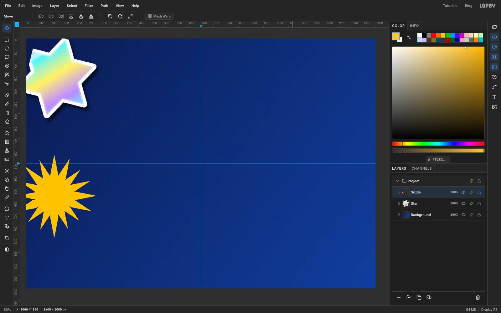

With **Star** selected, add a layer called **Sizzle**. Set the foreground colour to `#FFC531` and choose **Filter → Sunburst…**:

- Rays **16**, Length **12**, Width **100**, Taper **100**
- Center X **8**, Center Y **63**
- Jitter **20**, Seed **7**

Center X and Y are percentages of the card, so the burst is centred at about **(112, 632)**. With Taper at 100 every ray comes to a point and their bases overlap into a solid core. Jitter shortens some rays at random, so the burst looks hand-cut.

## Add the red disc and the SIZZLE! type

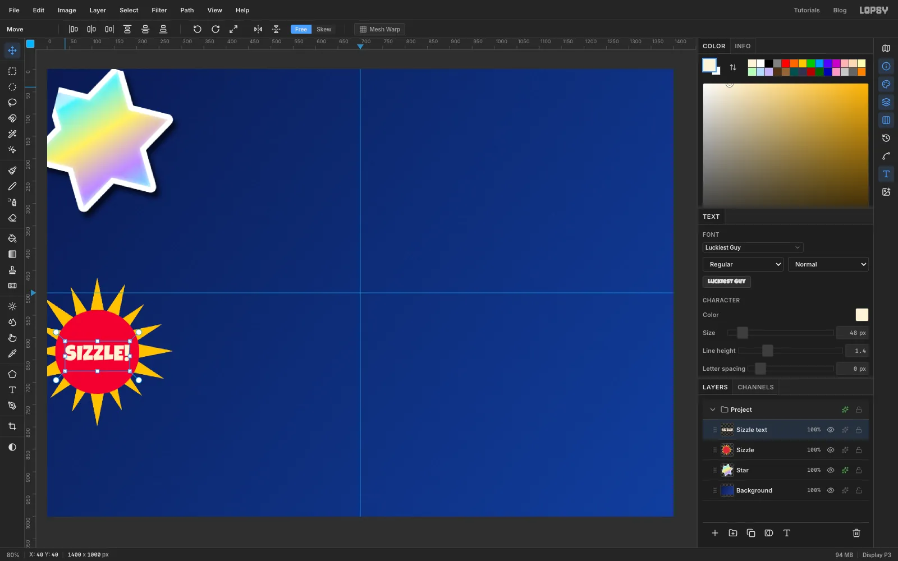

Pick the **Elliptical Marquee** and drag a 188 px circle centred on the burst, from (18, 538) to (206, 726). Fill it with `#E0283A` and press [[Cmd+D]].

Pick the **Text** tool ([[T]]). Before you click, set the font to **Luckiest Guy**, the size to **48 px** and the colour to `#FFF3D6`, and check that **Letter spacing** in the Text panel is **0**. Click in an empty part of the card, type `SIZZLE!` and press [[Tab]] to commit. Press [[V]] and nudge the text with the arrow keys until it sits in the middle of the disc.

Choose **Layer → Merge Down** to merge the text into **Sizzle**.

## Die-cut the burst

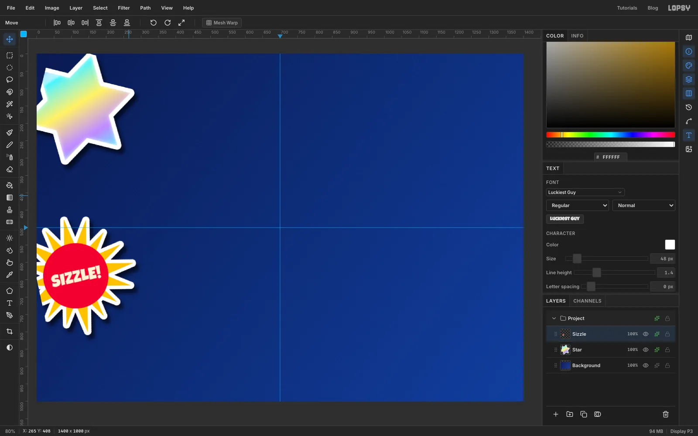

Die-cut **Sizzle** with **Grow 10**: [[Cmd]]-click its thumbnail, grow the selection, fill a new **Sizzle backing** layer with white, drag it under **Sizzle** and **Merge Down**. The grown border fills in between the rays, which is how a real die cutter treats spiky art.

Add the sticker Drop Shadow, then tilt the sticker about **12°** counter-clockwise with its rotation handle and press [[Cmd+D]].

## Shape the sufganiyah

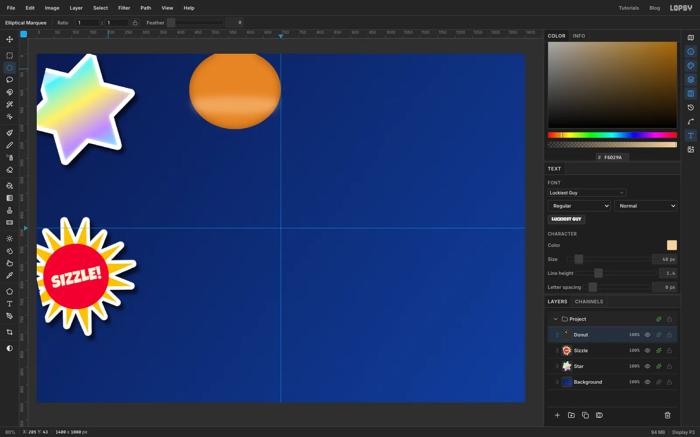

Add a layer called **Donut**. With the **Elliptical Marquee**, drag an oval from just above the canvas at (437, −12) to (693, 216). Start the drag on the grey pasteboard so the doughnut runs off the top edge. Fill it with `#D98A3D` and deselect.

In the effects drawer, turn on **Inner Glow**: colour `#6B3410`, Size **34**, Spread **0**, Opacity **70**. That browns the edges like fried dough. Click **Rasterize Layer Style** at the foot of the effects list to bake it in.

A sufganiyah has a pale belt where it floated in the oil. Add a layer called **Belt** and [[Cmd]]-click the **Donut** thumbnail. With the Elliptical Marquee, hold [[Shift]]+[[Alt]] and drag a wide, flat oval across the lower part of the doughnut, from (405, 122) to (725, 172). Only the overlap stays selected. Choose **Select → Feather…** at **20**, fill with `#F6D29A`, deselect, set the layer to **45%** and **Merge Down**.

## Add a highlight and powdered sugar

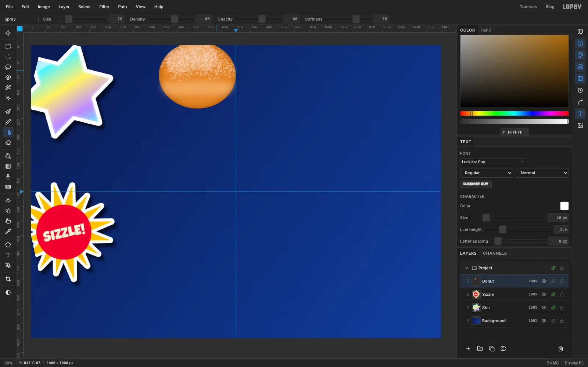

Pick the **Dodge** tool ([[O]]), set **Mode** to **Dodge**, **Exposure** to **35** and **Size** to **90**. Sweep it once across the top of the dome.

[[Cmd]]-click the **Donut** thumbnail so the sugar stays on the doughnut. Pick the **Spray** tool ([[J]]), set the foreground colour to white, **Size** to **70** and **Density** to **60**. Make two long sweeps across the top half, then press [[Cmd+D]].

## Squeeze out the jelly

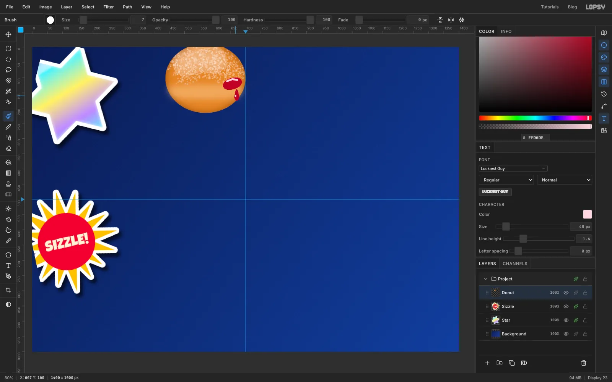

Pick the **Lasso** and draw a fat, slightly tilted oval about 64 × 38 px on the doughnut's right side, centred near (657, 120). Fill it with `#B0122B`. Then lasso a teardrop hanging from its lower right, from about y 136 down to y 176, and fill that with the same red.

Pick the **Brush** ([[B]]). Click the brush-tip thumbnail at the left of the options bar to open the Brushes panel, and on its **Shape** tab set **Size** to **7**, **Hardness** to **100**, **Spacing** to **10** and **Taper** to **0**. Set the colour to `#FFD6DE`. Click at the top left of the jelly and [[Shift]]-click twice along its top edge for a curved highlight, then click once on the drip for a glint.

Die-cut **Donut** with **Grow 11** and give it the sticker Drop Shadow. Leave it upright.

## Build the dreidel

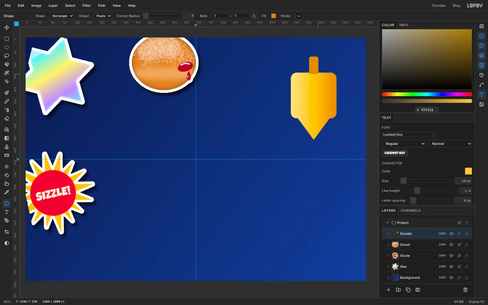

Add a layer called **Dreidel**. Pick the **Shape** tool, set **Shape** to **Rectangle**, **Corner Radius** to **24** and the fill to `#FFC531`. Press at **(1185, 238)** and drag out 94 px each way.

For the point, pick the **Pen** tool ([[P]]) and click three corners: (1091, 293), (1279, 293) and (1185, 420). Click the first point again to close the path. In the **Paths** panel click **Path to Selection**, then fill with `#FFC531` and deselect.

[[Cmd]]-click the **Dreidel** thumbnail. With the **Gradient** tool (Linear), open **Advanced…**, select the extra stops left over from the foil and delete them, then set three: `#FFE48F` at 0%, `#FFC531` at 55% and `#D98E04` at 100%. Drag from the body's left edge to its right edge. Deselect.

Draw the handle with the **Shape** tool: Rectangle, Corner Radius **8**, fill `#D98E04`. Press at (1185, 114) and drag out 19 px across and 36 px down.

## Add the nun and an ink outline

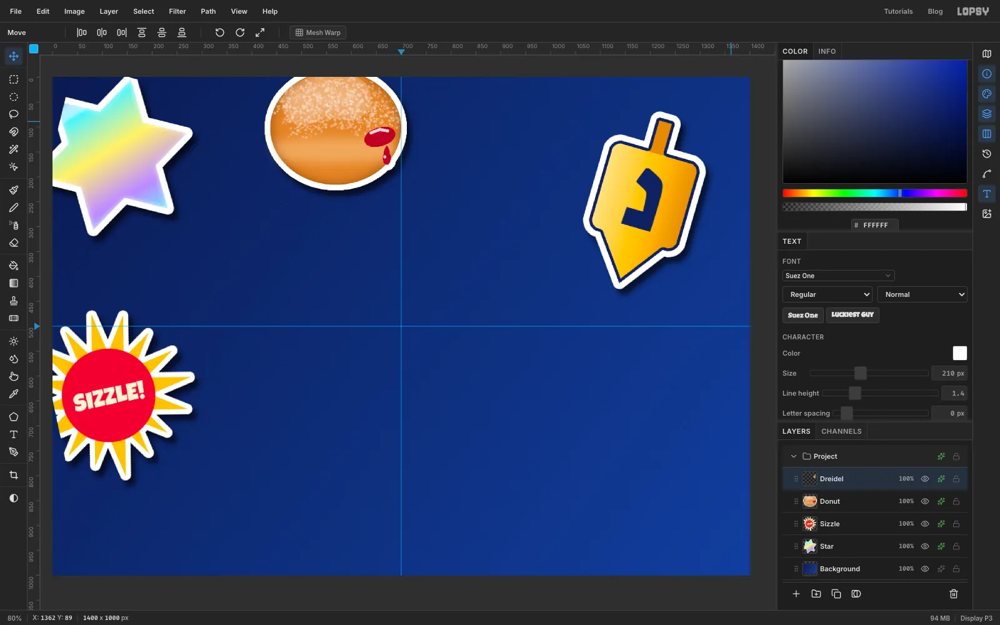

Click the **Dreidel** row so the new text lands just above it. Pick the **Text** tool and set the font to **Suez One**, **210 px**, `#13215E`. Click in empty space and type **נ** (nun, one of the four letters on a dreidel). If you don't have a Hebrew keyboard, copy the letter and paste it with [[Cmd+V]]. Press [[Tab]], then nudge it onto the middle of the body.

**Merge Down** into **Dreidel**. Turn on **Stroke**: `#13215E`, Width **6**, position **inside**. Die-cut with **Grow 12**, add the sticker shadow, and tilt the dreidel about **16°** clockwise.

## Paste the latke photo and select the plate

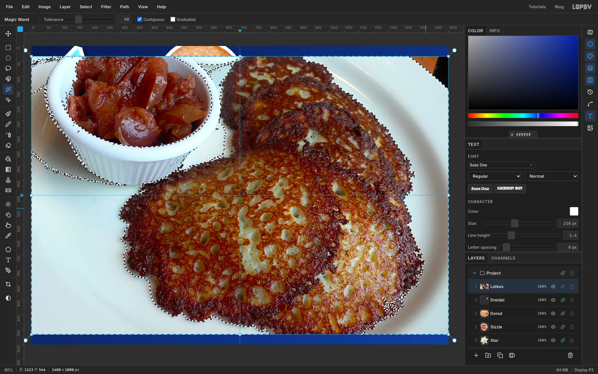

Open *00 Potato Latkes.jpg* in your browser, right-click it and choose **Copy Image**. In Lopsy, click the **Dreidel** row and press [[Cmd+V]]. The photo is too big for the card, so Lopsy shrinks it to fit. Rename the new layer **Latkes** and press [[Cmd+D]].

Pick the **Magic Wand** ([[W]]), set **Tolerance** to **60** and leave **Contiguous** on. Click the white plate at the lower left. Then [[Shift]]-click every other patch of plate you can see:

- the bright rim at the right and top right
- the plate along the bottom edge
- the gap between the bowl and the front latke
- the bowl's white ribbed side

The bowl is white too, so it gets selected with the plate.

## Keep only the latke stack

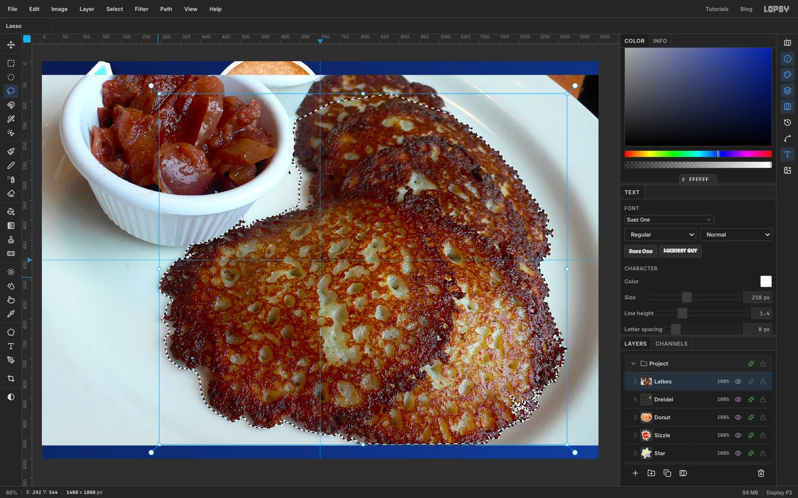

Choose **Select → Inverse**. Now everything that isn't plate is selected: the latkes, but also the applesauce and the dark corner of the photo.

Pick the **Lasso**, hold [[Shift]]+[[Alt]] and draw a loose loop around the latke stack. Stay a little outside the crispy edges, and cut smoothly across the top latke where the photo crops it. Only the latkes stay selected.

Choose **Select → Shrink…** with **2**. That pulls the edge in a couple of pixels so no white plate fringe survives.

## Delete the background

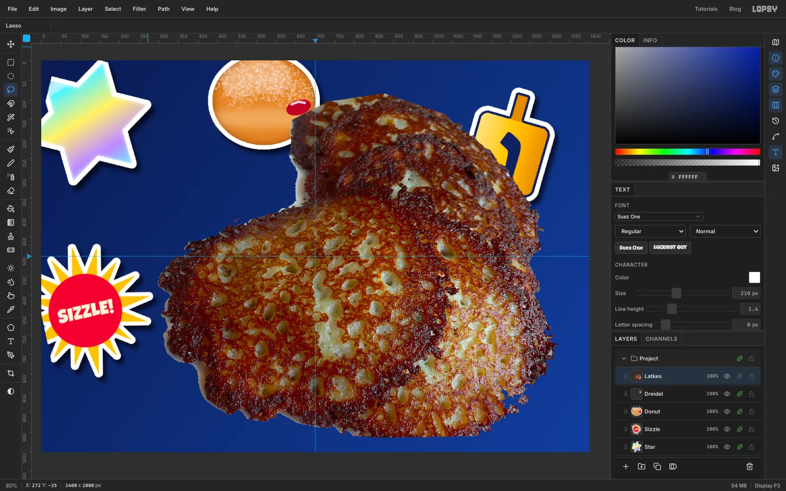

Choose **Select → Inverse** again and press [[Delete]]. Press [[Cmd+D]].

Make the photo pop a little to match the drawn stickers. Choose **Filter → Hue/Saturation…** with Saturation **18** and Lightness **4**, then **Filter → Unsharp Mask…** with Radius **2** and Amount **0.8**.

## Scale the latkes down

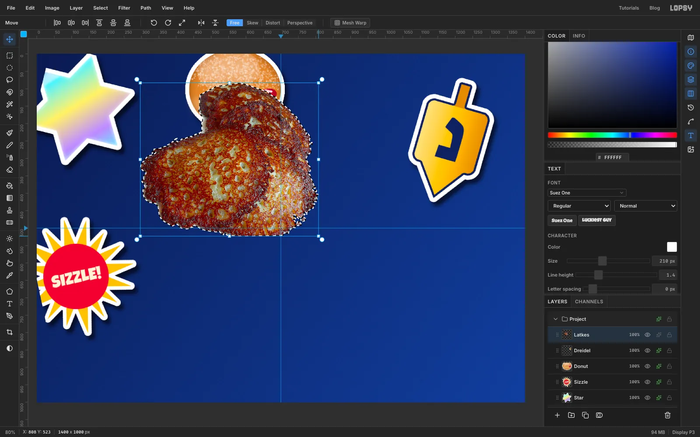

[[Cmd]]-click the **Latkes** thumbnail and press [[V]]. Hold [[Cmd]] and drag the bottom-right corner handle up and to the left until the box is half its width. [[Cmd]] keeps the proportions. Press [[Cmd+D]].

## Die-cut the latke sticker

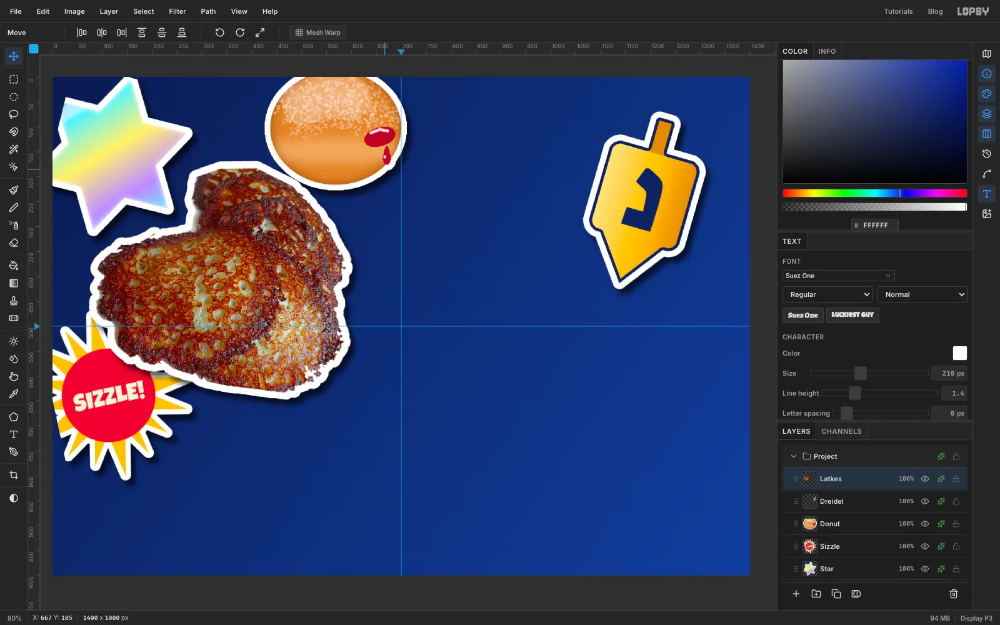

Drag the latkes with the Move tool until they're centred near **(345, 395)**, overlapping the star, the burst and the doughnut. Overlap is what makes a sticker bomb.

Die-cut with **Grow 14**. The bigger grow smooths the crispy outline into a clean die-cut line. Add the sticker shadow and tilt it about **8°** clockwise.

## Draw the menorah badge

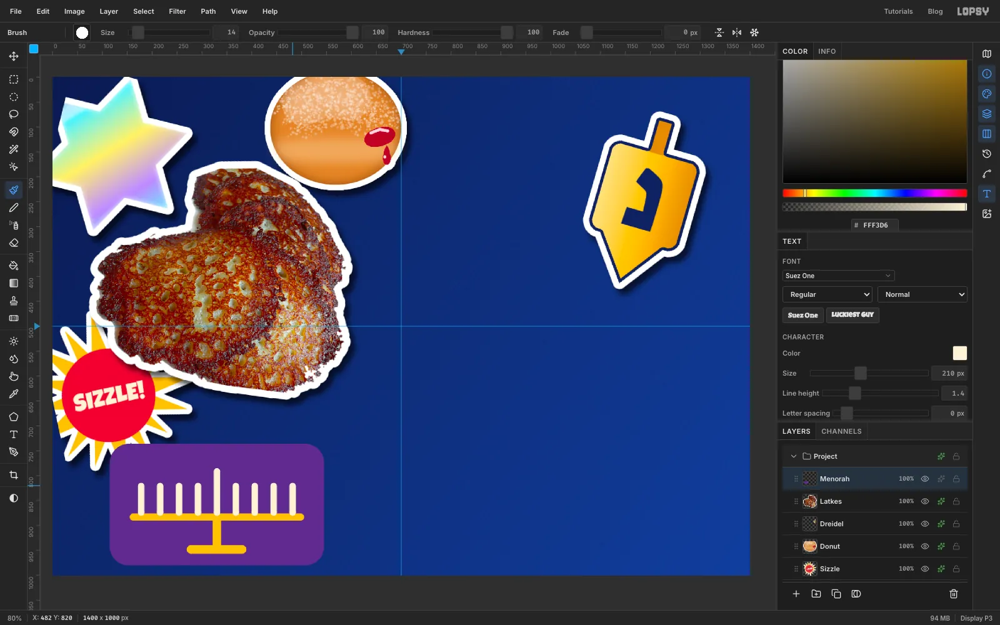

Add a layer called **Menorah**. With the **Shape** tool (Rectangle, Corner Radius **38**, fill `#5A2D8C`), press at **(330, 858)** and drag out 215 px across and 122 px down.

Pick the **Brush**. In the Brushes panel set **Size** to **15**, **Hardness** to **100**, **Spacing** to **10** and **Taper** to **0**. Set the colour to `#FFC531`. Click at (162, 883) and [[Shift]]-click at (498, 883) for the arm. At **Size 18**, draw the stem from (330, 883) down to (330, 943), and the base from (278, 948) to (382, 948).

Switch the colour to `#FFF3D6` and the size to **14**. Draw nine candles as vertical [[Shift]]-click lines, about 38 px apart from x 178 to x 482. Each one runs from the arm at y 874 up to y 820. The middle one, the shamash, goes up to y 791.

## Light the candles

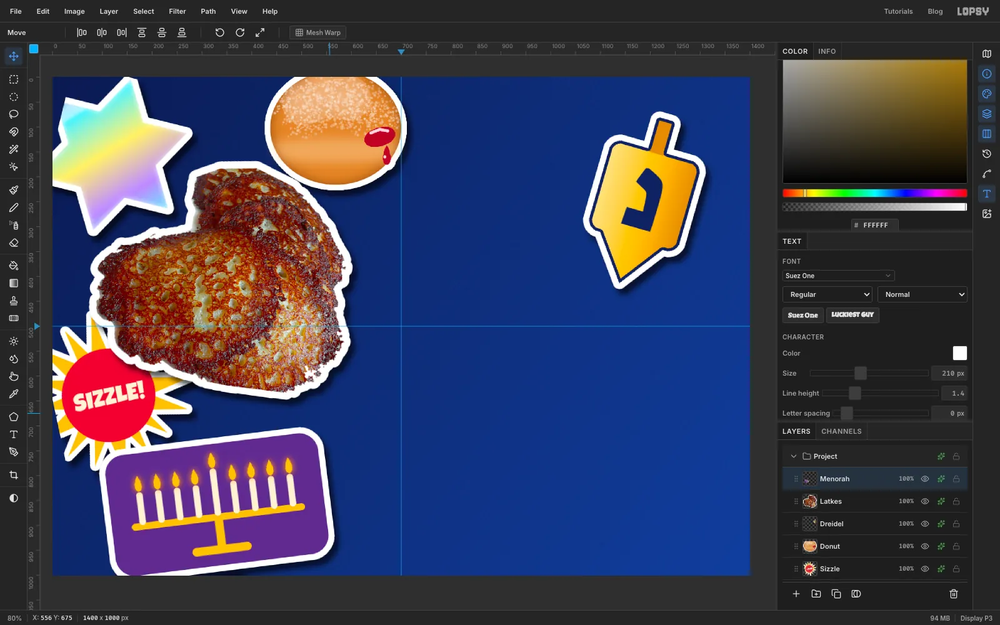

Add a layer called **Flames**. With the **Lasso**, draw a small teardrop about 14 px wide and 32 px tall above each candle, with the point at the top, and fill each with `#FFC531`. Turn on **Outer Glow**: `#FF9A1F`, Size **18**, Spread **15**, Opacity **95**.

**Merge Down** into **Menorah**. The glow is baked onto the plum badge. Die-cut with **Grow 12**, add the sticker shadow, and tilt the badge about **7°** counter-clockwise.

## Make the OY! speech bubble

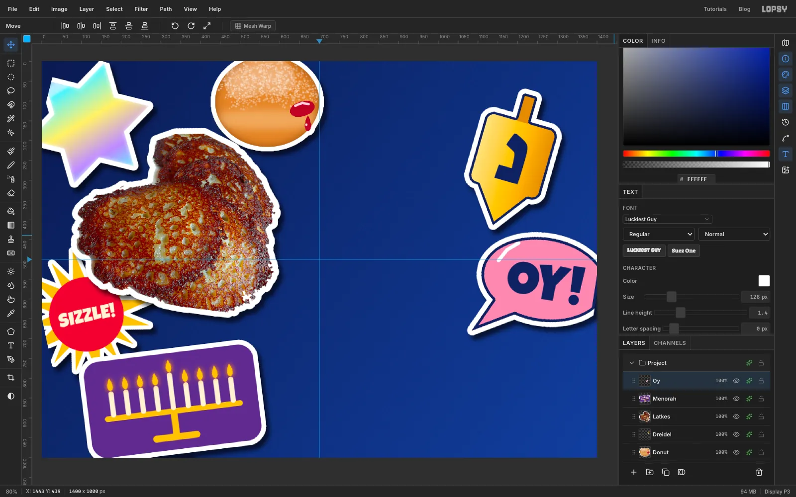

Add a layer called **Oy**. With the Elliptical Marquee, drag an oval from (1104, 442) to (1420, 654). It runs a little off the right edge. Fill it with `#FF8FB1`. Use the Pen tool to add a tail from (1152, 600) to (1214, 640) to (1102, 704), make it a selection, and fill it pink too.

Set **OY!** in **Luckiest Guy**, **128 px**, `#13215E`, centred in the bubble, and **Merge Down**. With a hard **10 px** white brush, click and [[Shift]]-click a short arc near the bubble's top left for a shine.

Turn on **Stroke**: `#13215E`, Width **7**, **inside**. Die-cut with **Grow 12**, add the sticker shadow, and tilt the bubble **9°** clockwise.

## Mint a gelt coin

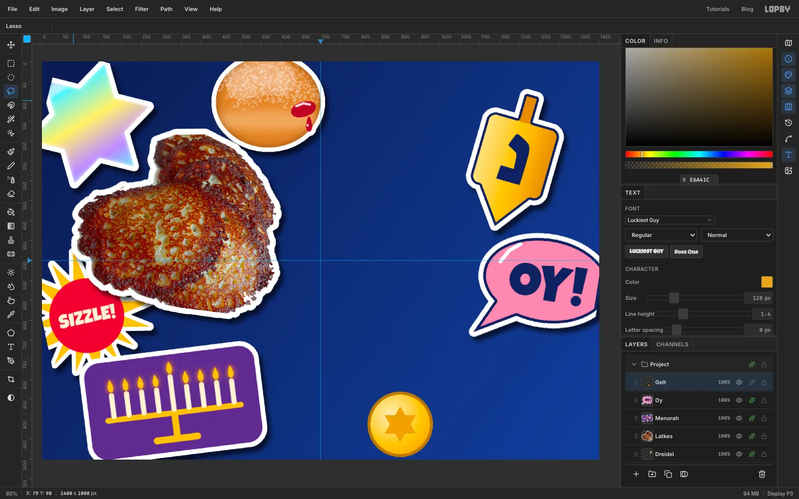

Add a layer called **Gelt**. Make a circle selection with a 164 px diameter centred on **(900, 912)**. Pick the **Gradient** tool, set it to **Radial**, and set stops `#FFF0B8` at 0%, `#FFC531` at 55% and `#C98A0A` at 100%. Drag from (878, 888), just up and left of centre, out to (982, 994). Deselect.

For the rim, add a layer, [[Cmd]]-click the **Gelt** thumbnail, fill with `#B57A06`, choose **Select → Shrink…** with **7** and press [[Delete]]. That leaves a 7 px ring. Deselect and **Merge Down**.

With the Pen tool, click a small six-pointed star: six points 45 px from the centre (one straight up, then every 60°), with an inner corner about 26 px out between each pair. Close the path. Choose **Path to Selection** and fill with `#E6A41C`.

## Emboss the coin

Choose **Layer → Duplicate Layer** and rename the copy **Gelt relief**. Choose **Filter → Emboss…** with Angle **135** and Strength **6**, then **Filter → Desaturate**. Set its blend mode to **Hard Light** in the effects drawer and its opacity to **80%**.

The grey relief now lightens and darkens the gold underneath it, like stamped metal. Desaturating the relief keeps the gold from turning orange. **Merge Down**, die-cut with **Grow 9** and add the sticker shadow.

## Copy and paste two more coins

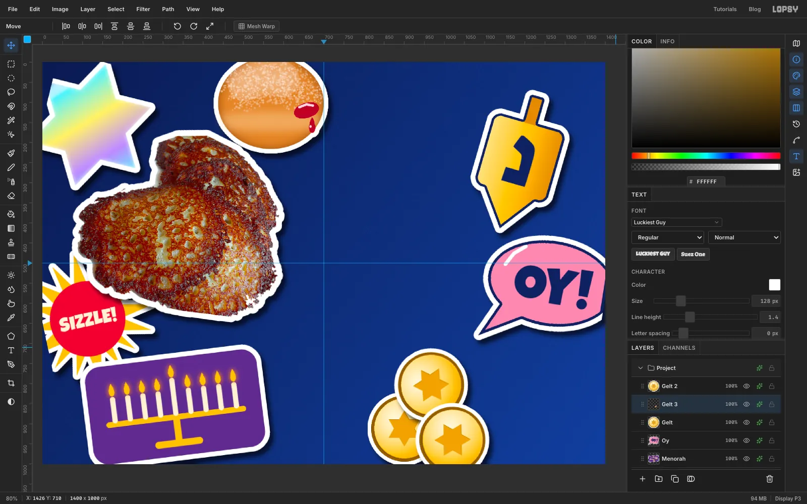

[[Cmd]]-click the **Gelt** thumbnail, then choose **Edit → Copy** and **Edit → Paste**. The copy pastes in place on a new layer. Rename it **Gelt 2** and press [[Cmd+D]]. With the Move tool, drag it about 128 px right and 30 px down. Then tilt it **28°** clockwise with its rotation handle and give it the sticker shadow.

Do it again for **Gelt 3**: paste, drag it about 66 px right and 108 px up, and tilt it **34°** counter-clockwise. Pasted copies don't carry the shadow, so add it to each one.

## Group the pile and move it as one

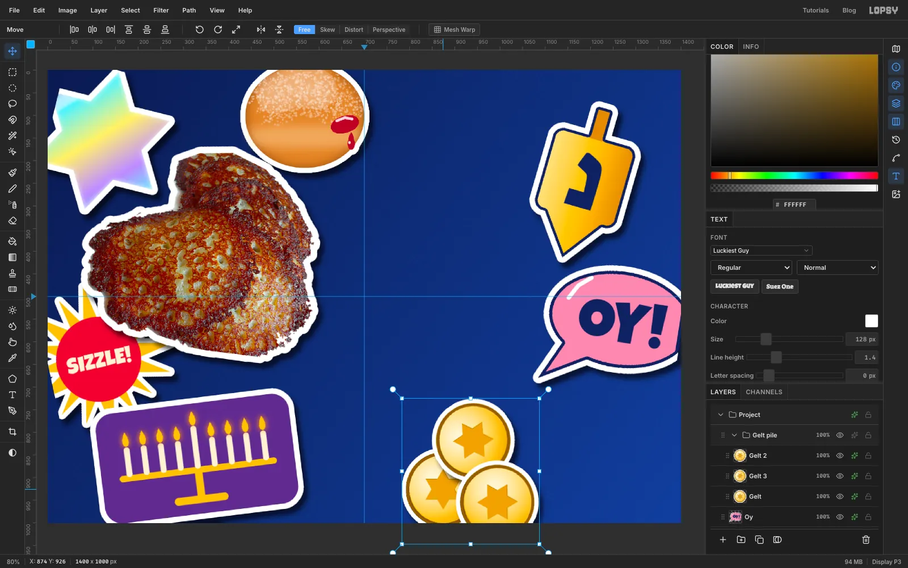

Click **Gelt**, then [[Cmd]]-click the names of **Gelt 2** and **Gelt 3** (not their thumbnails, which would load a selection instead) so all three are selected. Choose **Layer → Group Layers** and rename the group **Gelt pile**.

With the group row selected, the Move tool frames the whole pile. Drag it about 26 px left and 14 px down to tuck it into place. Press [[Cmd+Z]] and [[Shift+Cmd+Z]] to compare before and after. All three coins move together.

Collapse the group with its chevron before you add the next layer. Otherwise the new layer lands inside the group.

## Make the CRISPY 8 NIGHTS badge

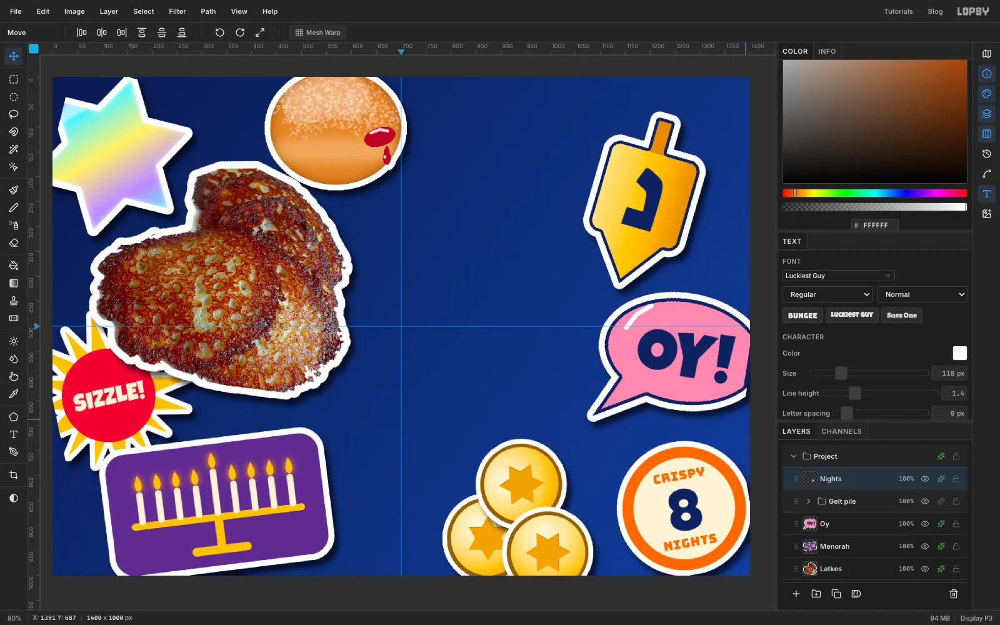

With **Gelt pile** selected and collapsed, add a layer called **Nights**. Fill a 248 px orange circle (`#F2711C`) centred on **(1268, 866)**, then a 204 px cream circle (`#FFF3D6`) on the same centre.

Set three pieces of text, clicking the **Nights** row before each one:

- **8** in Luckiest Guy, **118 px**, `#13215E`, centred on the badge
- **CRISPY** in Bungee, **25 px**, `#F2711C`, Letter spacing **1**, centred 68 px above the middle
- **NIGHTS**, the same, centred 68 px below the middle

Check that each word clears the orange ring evenly. Click **NIGHTS** and choose **Merge Down**, then do the same for **CRISPY** and **8**. Each one sits directly above **Nights**, so each merges straight into it. Die-cut with **Grow 11**, add the shadow, and tilt the badge about **10°** counter-clockwise.

## Lay out the title card

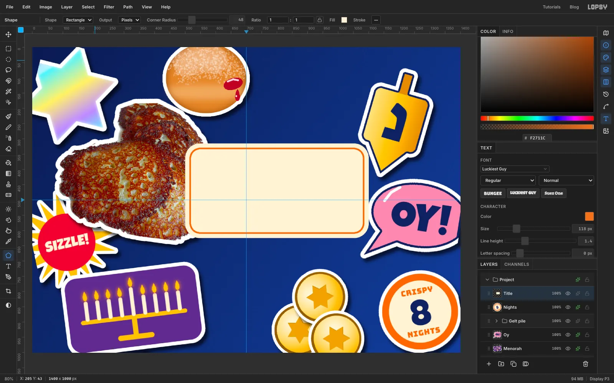

The title goes on near the end so it sits over the earlier stickers. Add a layer called **Title**. With the **Shape** tool (Rectangle, Corner Radius **48**, fill `#FFF3D6`), press at **(800, 470)** and drag out 300 px across and 155 px down.

For the inset frame, add a layer, [[Cmd]]-click the **Title** thumbnail, choose **Select → Shrink…** with **14** and fill with `#F2711C`. Then **Shrink** by **5** and press [[Delete]]. That leaves a 5 px orange line 14 px in from the edge. Deselect and **Merge Down**.

## Set TOASTY LATKES

Click the **Title** row. Set **TOASTY** in **Luckiest Guy**, **112 px**, `#F2711C`, Letter spacing **4**. Give it a **Stroke** (`#13215E`, Width **6**, **outside**) and a hard **Drop Shadow** (`#13215E`, Offset X **6**, Offset Y **7**, Blur **0**, Spread **0**, Opacity **100**).

Click the **Title** row again and set **LATKES** in **Luckiest Guy**, **136 px**, `#13215E`, Letter spacing **4**. Give it a hard Drop Shadow in `#FFC531` with the same numbers.

Centre both words on x 800. Then [[Cmd]]-click both text rows' names and nudge them up or down together with the arrow keys until the space between the top of TOASTY and the orange frame matches the space between LATKES' gold shadow and the bottom of the frame. In this layout that's about 26 px each. Click the **LATKES** row and choose **Merge Down**, then click **TOASTY** and **Merge Down** again, so each word merges straight into **Title** with its own effects baked in.

## Die-cut the title and cut the corner

Die-cut **Title** with **Grow 14**.

To peel back a corner, first cut it off. With the Pen tool, click a triangle over the top-right corner: start on the top edge 85 px left of the corner, go out past the corner, and finish on the right edge 85 px below it. Make it a selection, press [[Delete]], and deselect.

## Fold the corner back

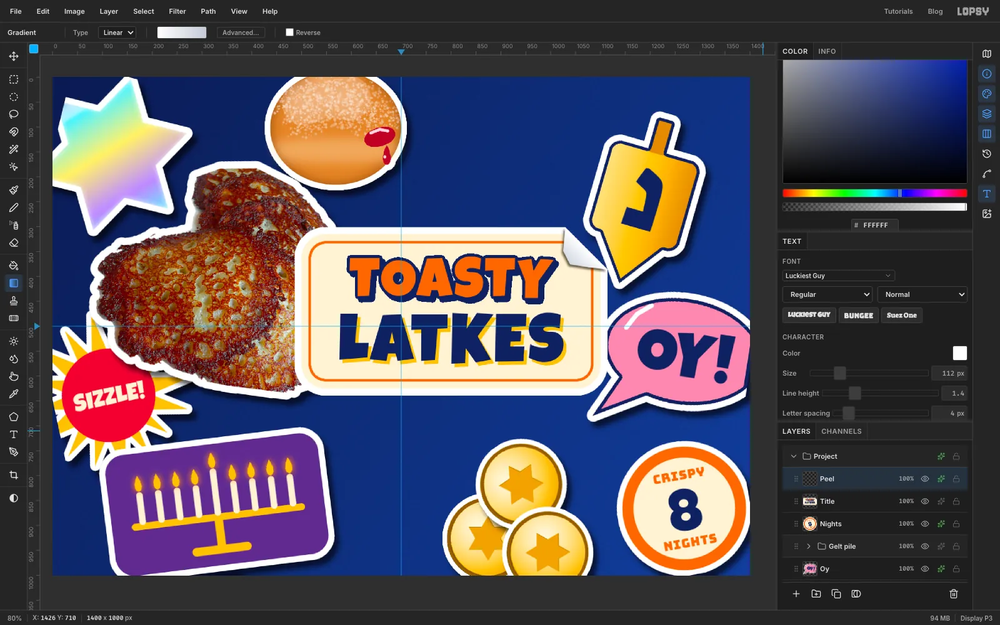

The flap is the cut-off corner folded back over the fold line. Add a layer called **Peel**. With the Lasso, draw it as a triangle from the two ends of the cut, with its tip pointing down-left into the sticker (the mirror image of the corner you removed). Bow its two long sides outward a little so it looks curled.

Set the Gradient to **Linear** with two stops, `#FFFFFF` at 0% and `#C3CAD6` at 100%, and drag from the fold to the tip. That's the grey back of the vinyl. Give **Peel** a **Drop Shadow** of `#2A2010`, Offset X **−3**, Offset Y **4**, Blur **6**, Opacity **70**, so the flap lifts off the sticker face. **Merge Down** into **Title**.

## Tilt the title

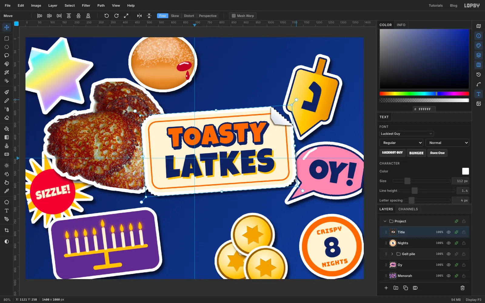

Give **Title** the sticker Drop Shadow, but a little tighter so the big title sits flatter on the card: Offset X **5**, Offset Y **9**, Blur **14**, Opacity **60**. Then tilt it about **4°** counter-clockwise and press [[Cmd+D]].

## Hang the HAPPY HANUKKAH ribbon

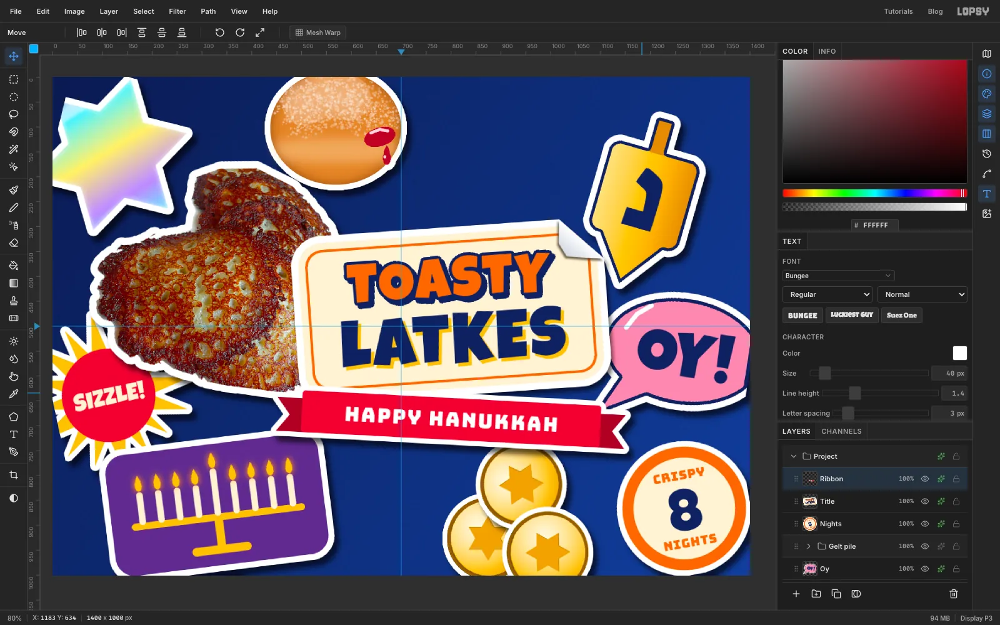

Add a layer called **Ribbon**. With the Pen tool, draw a notched tail at each end: a 80 × 68 px shape with a V cut into its outer end, spanning x 450–530 on the left and x 1070–1150 on the right, from y 660 to y 728. Fill both with `#A3162A`.

Add a layer called **Ribbon band**. With the Shape tool (Rectangle, Corner Radius **6**, fill `#E0283A`), draw a 600 × 84 px band centred on (800, 686). Set **HAPPY HANUKKAH** in **Bungee**, **40 px**, white, Letter spacing **3**, centred on the band.

**Merge Down** the text into the band, then the band into **Ribbon**. Die-cut with **Grow 10**, add the shadow, and tilt the ribbon **3°** clockwise so it overlaps the bottom of the title.

## Add a Chag Sameach pill

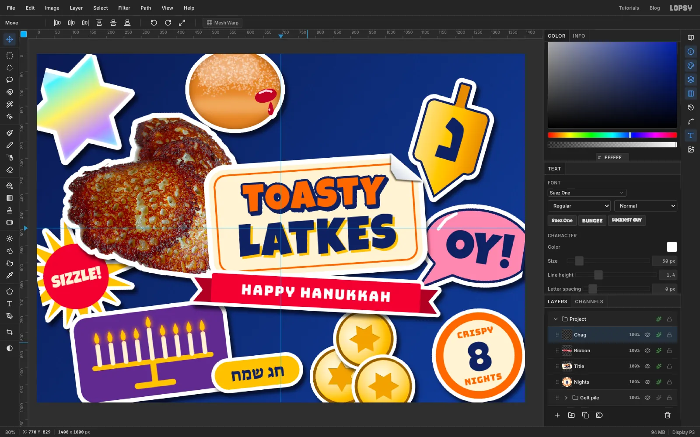

Add a layer called **Chag**. With the Shape tool (Rectangle, Corner Radius **40**, fill `#FFC531`), draw a 244 × 80 px pill centred on **(632, 915)**.

Set **חג שמח** (Chag Sameach, "happy holiday") in **Suez One**, **50 px**, `#13215E`, Letter spacing **0**. Paste it if you can't type Hebrew. Lopsy lays it out right to left, so the first word ends up on the right. Centre it in the pill and **Merge Down**. Die-cut with **Grow 10**, add the shadow and tilt it **6°** counter-clockwise.

## Paste a second, smaller latke sticker

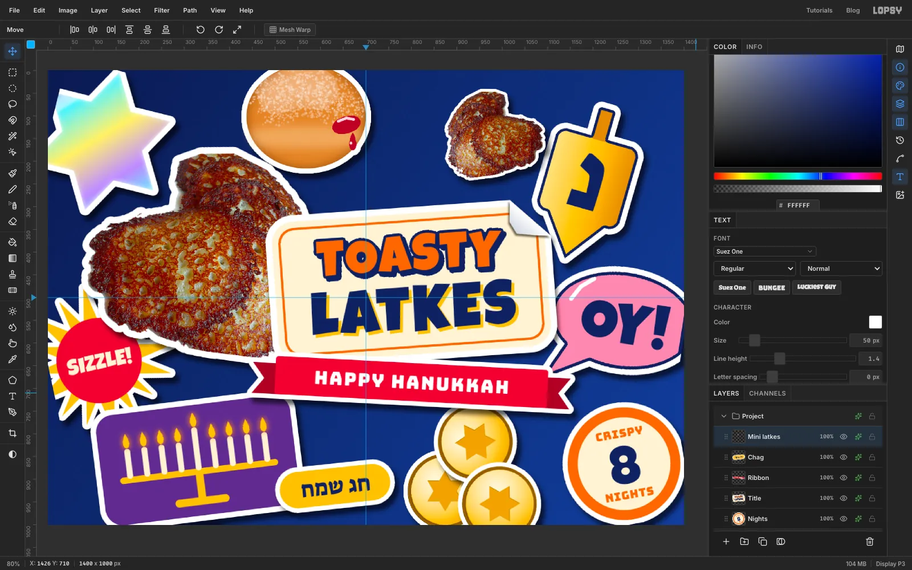

Real sticker bombs often repeat a favourite sticker. [[Cmd]]-click the **Latkes** thumbnail and choose **Edit → Copy**. Click the **Chag** row and choose **Edit → Paste**. Rename the paste **Mini latkes**.

[[Cmd]]-click its thumbnail, press [[V]] and click **Flip Horizontal** in the options bar so it doesn't look like a clone. Press [[Cmd+D]]. Then [[Cmd]]-click its thumbnail and [[Cmd]]-drag a corner to scale it to about **42%**. Press [[Cmd+D]].

Drag it up near **(950, 88)** so it tucks in near the top edge, between the doughnut and the dreidel. Tilt it **20°** clockwise and add the sticker shadow.

> **Tip:** Flip before you scale or rotate, and press [[Cmd+D]] in between. Flipping a box that still has a pending scale throws the scale away (a known bug).

## Make an applesauce jar

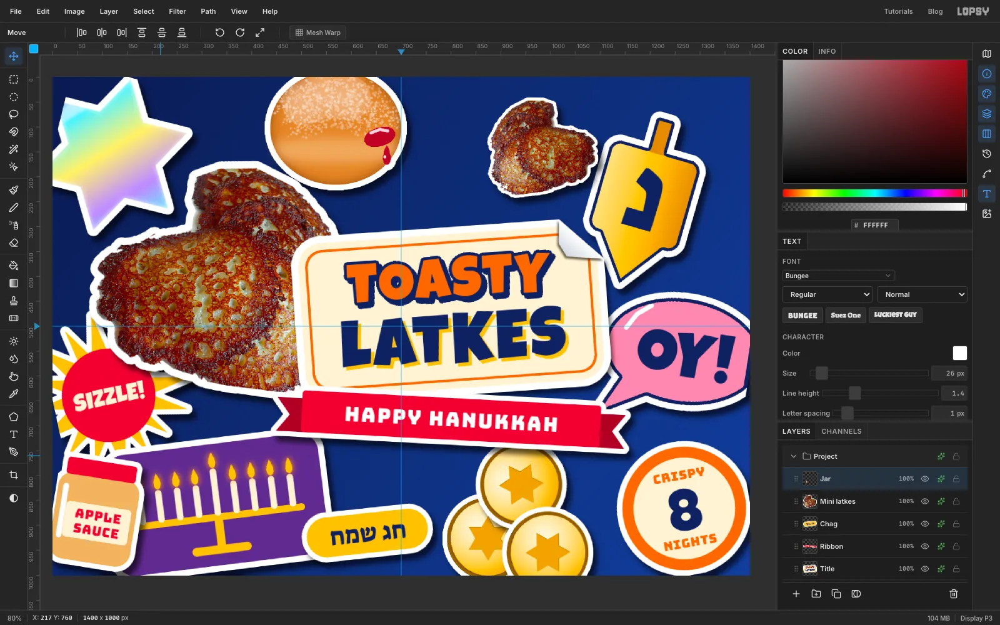

Applesauce or sour cream is the great latke argument, so the card takes both sides. Add a layer called **Jar** and use the Shape tool (Rectangle):

- the jar: Corner Radius **30**, `#E9B66C`, 164 × 176 px centred on **(86, 888)**
- the lid: Corner Radius **6**, `#E0283A`, 140 × 34 px centred on (86, 788)
- the label: Corner Radius **8**, `#FFF3D6`, 132 × 72 px centred on (92, 895)

Before the label, draw a 12 px white brush line down the jar's left side, from (20, 830) to (20, 930), for the glass highlight.

Set **APPLE** and **SAUCE** in **Bungee**, **26 px**, `#E0283A`, Letter spacing **1**, centred on the label at y 880 and y 910. Set SAUCE first and APPLE second, clicking the **Jar** row before each. Then click **APPLE** and **Merge Down**, then **SAUCE** and **Merge Down**. Die-cut with **Grow 10**, add the shadow and tilt it **9°** clockwise.

## Add a two-tone star and a drop of oil

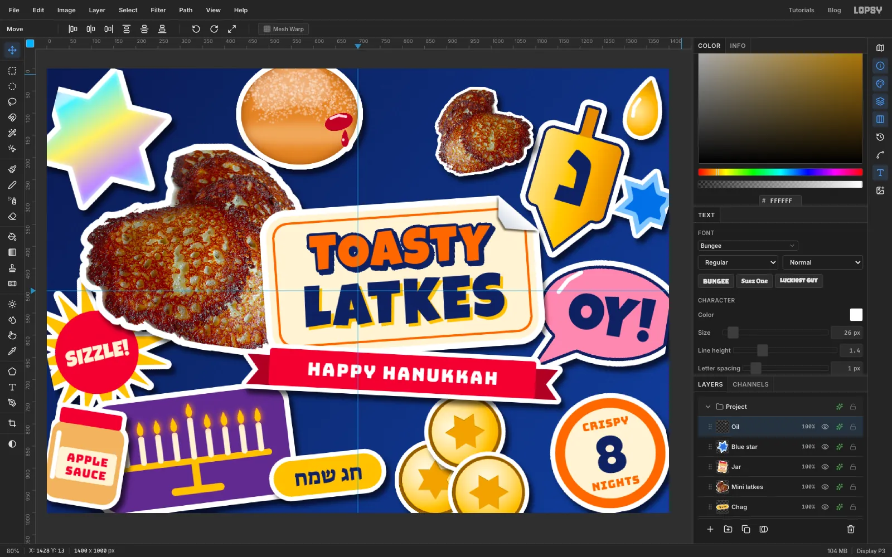

Add a layer called **Blue star**. Pen a six-pointed star centred on **(1350, 300)**, with points 74 px out and inner corners about 43 px out, make it a selection, and fill it with `#8FC4FF`. [[Cmd]]-click its thumbnail, **Shrink** by **11** and fill with `#2F6FE0`. Die-cut with **Grow 9**, add the shadow and tilt it **18°** clockwise.

The oil is a nod to the Hanukkah story. Add a layer called **Oil** and lasso a drop with its point at the top, about 70 px wide and 128 px tall, centred near **(1345, 88)**. Fill it with `#F2B632`. [[Cmd]]-click it and drag a **Radial** gradient (`#FFE9A0` at 0%, `#F2B632` at 60%, `#B9850C` at 100%) from just left of its middle down to its bottom right. Add a white 9 px brush curve on its left side for the shine. Die-cut with **Grow 9**, add the shadow and tilt it **14°** clockwise.

## Fill the gaps with Team Sour Cream, a candle and a star

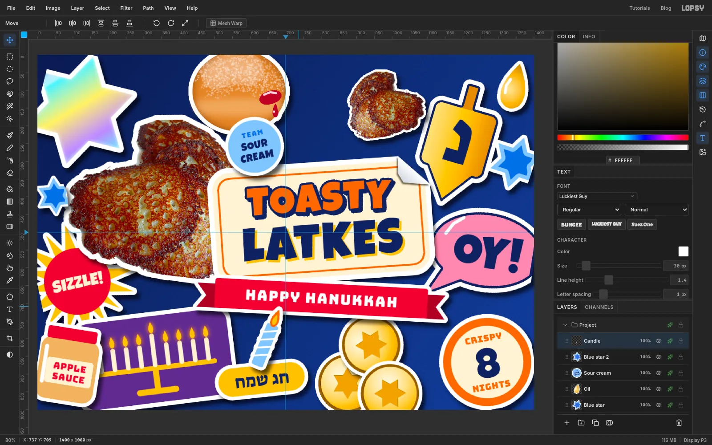

Add a layer called **Sour cream** and fill a 148 px sky-blue circle (`#8FC4FF`) centred on **(612, 258)**, so it tucks against the edge of the latkes. Set three lines, clicking the **Sour cream** row before each:

- **CREAM** in Luckiest Guy, 30 px, `#13215E`, Letter spacing 1, 27 px below the centre
- **SOUR**, the same, 5 px above the centre
- **TEAM** in Bungee, 19 px, `#2F6FE0`, Letter spacing 2, 37 px above the centre

Click **TEAM**, **SOUR** and **CREAM** in that order, choosing **Merge Down** after each. Die-cut with **Grow 9**, add the shadow and tilt it **12°** counter-clockwise.

Copy and paste the **Blue star**, rename the copy **Blue star 2**, scale it to **70%**, move it to the left edge at about **(38, 400)**, tilt it **22°** counter-clockwise and add the shadow.

For the candle, add a layer called **Candle** and draw a 34 × 124 px sky-blue rectangle (Corner Radius **6**) centred on **(650, 820)**. With a 6 px white brush, [[Shift]]-click four diagonal stripes across it. Lasso a flame on top in `#F2711C` with a smaller `#FFC531` core inside it. Die-cut with **Grow 9**, add the shadow and tilt it **22°** clockwise.

## Scatter the sparkles

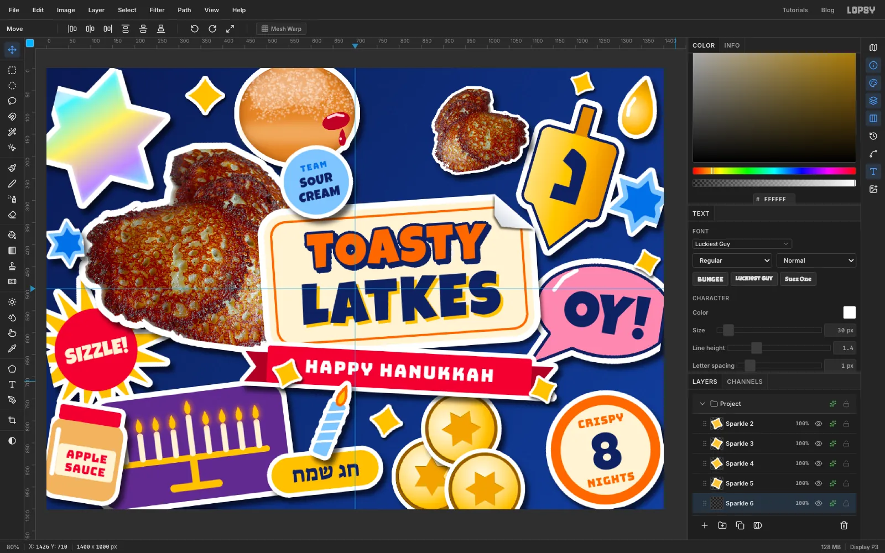

Add a layer called **Sparkle** and lasso a four-point sparkle, a star with curved, pinched sides, about 80 px across at **(360, 62)**. Fill it with `#FFC531`. Die-cut with **Grow 7** and give it a smaller shadow: Offset **3** / **5**, Blur **8**, Opacity **70**.

Copy and paste it five times, renaming as you go. Click the original **Sparkle** row before each paste. Scale each paste down from a corner with [[Cmd]] held, drag it into a gap, and tilt it. Pasted copies don't carry the shadow, so give each one the small sparkle shadow too.

- **Sparkle 2**: 80%, on the ribbon's left end near (545, 692), tilted 20° clockwise
- **Sparkle 3**: 70%, near (1362, 440), 15° counter-clockwise
- **Sparkle 4**: 85%, near (770, 800), 10° clockwise
- **Sparkle 5**: 75%, on the ribbon's right end near (1125, 728), 20° counter-clockwise
- **Sparkle 6**: 65%, near (1215, 34), 25° clockwise

## Add print grain

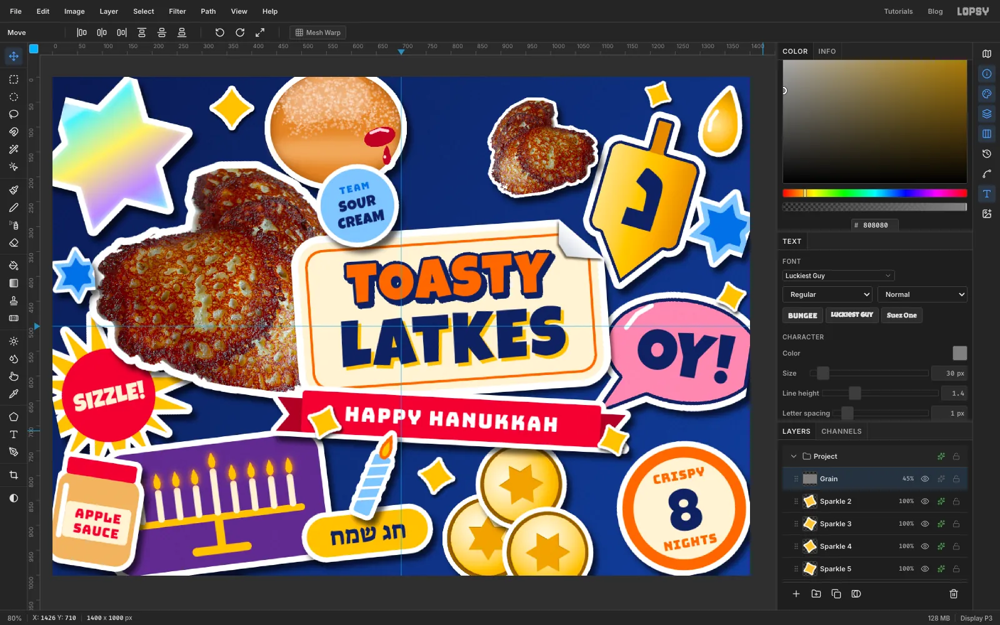

Click the top layer in the Layers panel (one of the sparkles) and add a layer called **Grain**. Fill it with `#808080` and choose **Filter → Add Noise…** with Amount **40**, **Mono** and **Gaussian**. Set its blend mode to **Overlay** and its opacity to **45%**. Mid grey disappears in Overlay, so only the speckle remains. It roughs up the flat colours and the white borders so they read as printed vinyl.

## Darken the edges with a vignette

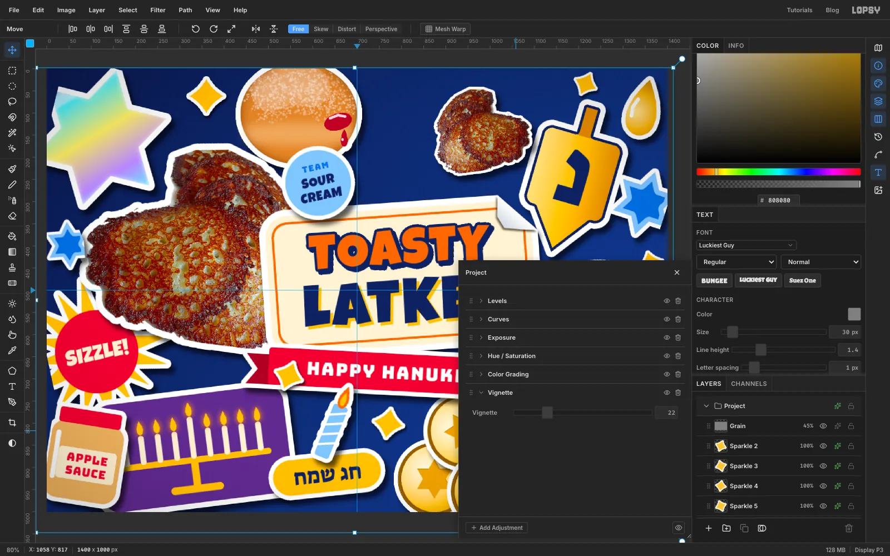

Choose **Layer → Adjustment Layer…** and close the info box. Lopsy opens the adjustment list for the whole document. Click **Add Adjustment**, choose **Vignette**, and set it to **22**. The corners settle back and the title pops forward.

Close the drawer. Choose **File → Quick Export PNG** to export the card, and **File → Save Project** to keep a `.lopsy` copy with every sticker on its own layer.
