Sticker bombing grew out of skate and graffiti culture: you keep adding
stickers to a surface until almost none of it shows. On a laptop lid it
looks random, but the good ones are planned. They use a small palette,
put big stickers down first and fill the gaps with small ones, and trim
the stickers clean at the edge of the lid.

In this tutorial you'll use that look for an editorial magazine cover:
issue 42 of **PING**, an imaginary quarterly about net culture, whose cover
story is the comeback of the internet café. You'll make a pack of fourteen
die-cut stickers and turn it into a dense, dimmed backdrop. On top of that
go bright foreground stickers: the masthead, a coffee-mug disc whose steam
is a Wi-Fi symbol, cover lines, and a label with a peeled corner. The
cover is **1200 × 1560 px**.

Along the way you'll use:

- the **Shape** tool's click-to-size dialog for most of the shapes
- the **Pen** tool with **Path to Selection** for cursors, bolts and tags
- **Stroke** and **Drop Shadow** to turn any layer into a die-cut sticker
- the **grid** with **Snap** for pixel art
- rotation handles, including on several layers at once
- **Copy Merged**, **Duplicate Layer** and **Rotate 90°** to multiply the sticker pack
- **Hue / Saturation** and **Exposure** adjustments on a group
- text on a circular path, in **IBM Plex Mono**, **Titan One** and **Permanent Marker**
- **Grow**, **Shrink** and **Select → Inverse**
- the **Screen**, **Multiply** and **Overlay** blend modes
- the **Eraser**, **Add Noise** and **Motion Blur**

The palette:

- Walnut table `#3B2A1F`, lid fill `#1F2228`, lid graphite `#363A43` → `#17191E`, lid rim `#868C97`
- Tomato `#FF5A36`, mint `#3DDBA6`, periwinkle `#6F7BFF`
- Butter `#FFD447` / `#E9AE1E` (colour and shade)
- Cream `#FFF3DC`, keycap `#D9CBB0`, metal `#D5DAE3`
- Espresso `#4A2A1C`, crema `#8A5A3C`, bean crease `#C98E5A`, mug shade `#CDB48C`
- Ink `#16181D`, sticker shadow `#0B0C10`, disc shadow `#2B2F8A`
- Holo foil `#9FF3FF` → `#C8A8FF` → `#FFB0DA` → `#FFF2A6` → `#A6FFD6`

> **Tip:** Positions are in document pixels, written `x, y`. The status bar
> at the bottom shows where the pointer is. **Edit → Fill** fills the
> selection with the foreground colour, and [[Cmd+D]] deselects. New layers
> appear above the selected layer, so click the row you want to build on
> first.

> **Tip:** Three dialogs save a lot of fiddling. With the **Shape** tool, a
> click without dragging opens **Shape Size**: type a width and height and
> the shape is centred on the click. With the **Rectangular** or
> **Elliptical Marquee**, a click with nothing selected asks for the
> **From X / Y** and **To X / Y** corners. And in the Pen tool, once you've
> clicked a closed outline, the **Paths** panel's **Path to Selection**
> button turns it into a selection. Click **Delete Path** after each one so
> the paths don't pile up.

## Set up the table and the laptop lid

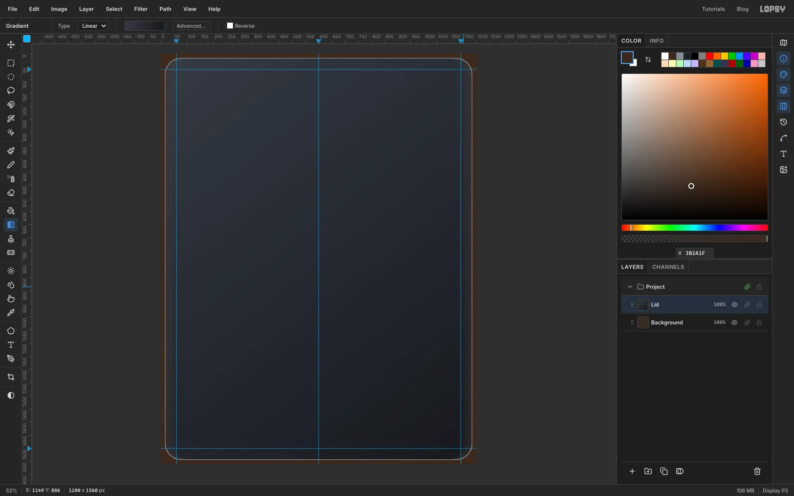

Choose **File → New**, enter **1200 × 1560** and click **Create**. Click
the top ruler at `60`, `600` and `1140` for vertical guides, and the left
ruler at `60` and `1500` for horizontal ones.

Click *Background*, set the foreground to walnut `#3B2A1F` and fill it.
Choose **Filter → Add Noise…** with **Amount** `30`, **Mono** and
**Gaussian**, then **Filter → Motion Blur…** with **Angle** `0` and
**Distance** `90`. The noise stretches into a wood grain.

Rename *Layer 1* to *Lid*. Pick the **Shape** tool, set **Shape** to
**Rectangle**, **Corner Radius** to `60`, **Fill** to graphite `#1F2228`,
**Stroke** to `#868C97` and **Width** to `3`. Click the middle of the page
(`600, 780`) and create a **1164 × 1524** shape. That leaves an 18 px strip
of table round the lid.

[[Cmd]]-click the *Lid* thumbnail to select it, then choose
**Select → Shrink…** `3` so the rim is left out of the selection. Pick the
**Gradient** tool, open **Advanced…**, set the stops to `#363A43` and
`#17191E`, and drag from the top-left corner to the bottom-right one. Add
noise (`14`, Mono, Gaussian) and a **Motion Blur** of `60` for a
brushed-metal finish. Deselect.

## Draw a smiley sticker

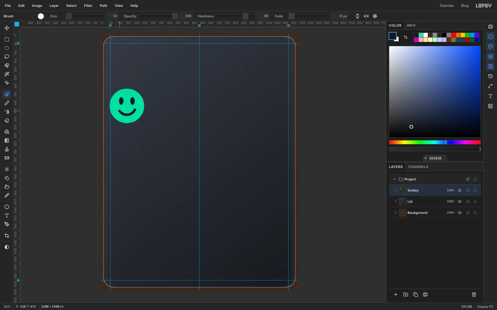

Add a layer named *Smiley*. With the **Shape** tool set to **Ellipse**,
mint `#3DDBA6` fill and no stroke (click the stroke swatch and choose
**Remove stroke**), click at `160, 440` and create a **210 × 210** circle.

Change the fill to ink `#16181D` and make the eyes: a **26 × 46** ellipse
at `126, 410` and another at `194, 410`. Then pick the **Brush**, set
**Size** to `16` and the foreground to ink, and drag a smile under the eyes:
a shallow arc from about `209, 463` down through `160, 494` and up to
about `116, 471`.

## Make it a die-cut sticker and tilt it

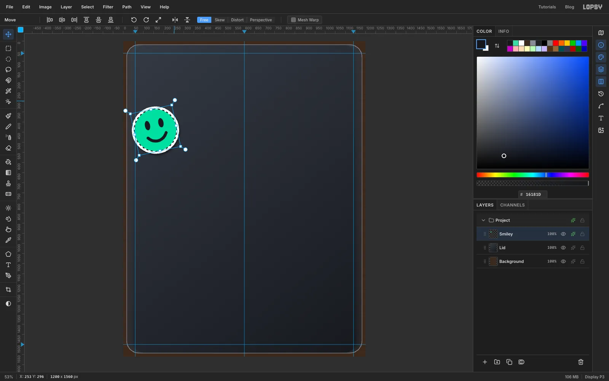

This is the recipe for every sticker on the cover. Open the layer's effects
drawer (the sparkle button on its row):

- **Stroke**: white, **Width** `12`, **Position** **Outside**. This is the vinyl's white border.
- **Drop Shadow**: colour `#0B0C10`, **Offset X** `5`, **Offset Y** `8`, **Blur** `10`, **Opacity** `55%`.

Now tilt it. [[Cmd]]-click the *Smiley* thumbnail, pick the **Move** tool and
drag just outside the top-right corner handle, where the pointer turns into
a curved arrow. Turn it about 12° anticlockwise and press [[Cmd+D]] to
commit and deselect. Real sticker bombs never sit square, so you'll tilt
most stickers by a different small amount.

## Mark out a pixel heart on the grid

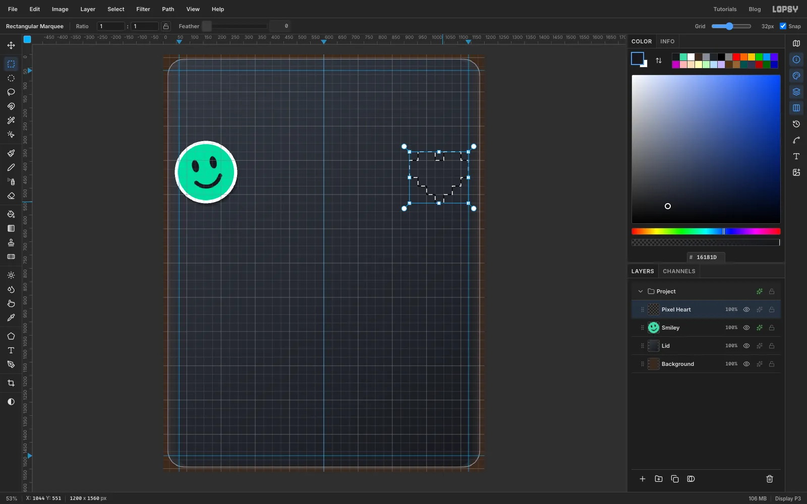

Add a layer named *Pixel Heart*. Choose **View → Show Grid** and drag the
**Grid** slider in the options bar to **32px**. **Snap** turns on with the
grid.

The grid is centred on the page, so its lines fall at `x = 920, 952, 984…`
and `y = 364, 396, 428…`. With the **Rectangular Marquee**, drag from
`920, 396` to `1144, 460`: two full rows of seven cells. Hold [[Shift]] and
add five more rectangles. Each drag snaps to the cell corners, so you
only need to start inside the right cell.

- the two bumps on top: `952, 364` to `1016, 396` and `1048, 364` to `1112, 396`
- the narrowing rows: `952, 460` to `1112, 492`, `984, 492` to `1080, 524`, and the tip `1016, 524` to `1048, 556`

## Fill the heart and add a highlight

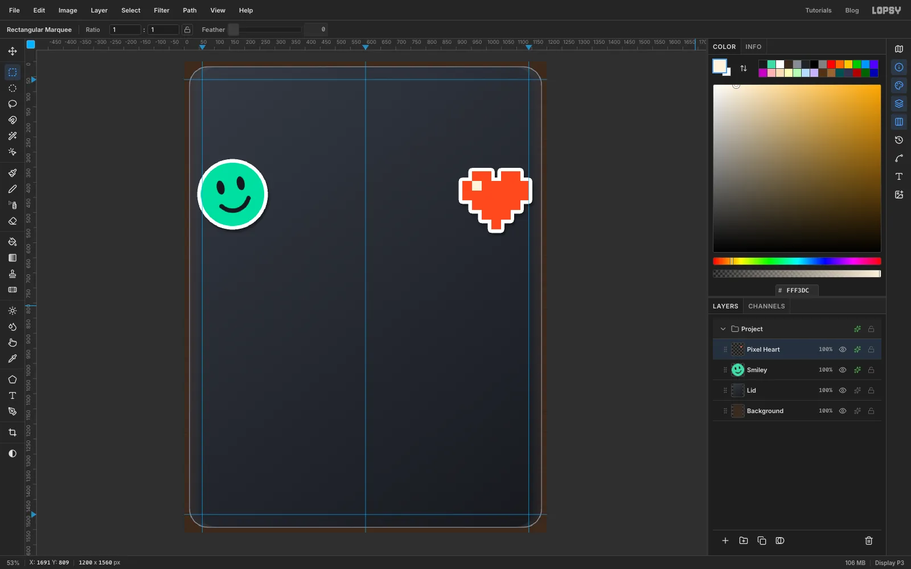

Fill the selection with tomato `#FF5A36` and deselect. Select the single
cell from `952, 396` to `984, 428` and fill it with cream `#FFF3DC` for a
highlight. Deselect, choose **View → Show Grid** again to hide the grid, and
give the layer the die-cut **Stroke** and **Drop Shadow**. The white border
follows the stepped edge, which is exactly how a pixel-art sticker is cut.

## Build a floppy disk from shapes

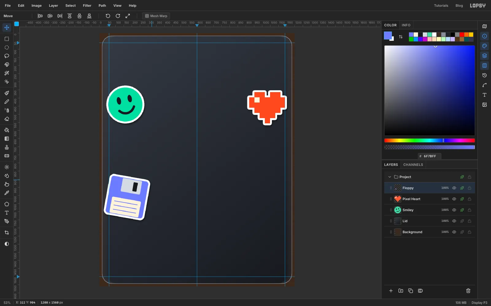

Add a layer named *Floppy*. With the **Shape** tool on **Rectangle**:

- **Corner Radius** `16`, fill periwinkle `#6F7BFF`: **230 × 230** at `170, 1010`
- **Corner Radius** `6`, fill metal `#D5DAE3`: **120 × 84** at `185, 940` for the shutter
- **Corner Radius** `4`, fill ink: **26 × 56** at `208, 940` for the slot
- **Corner Radius** `8`, fill cream: **180 × 100** at `170, 1072` for the label

Pick the **Pencil**, set **Size** to `4` and the foreground to periwinkle.
Click at the left end of each label line and [[Shift]]-click the right
end: three lines from `100` to `240` across, at `y = 1046`, `1072` and
`1098`. Add the die-cut effects and tilt the disk about 10° clockwise.

## Click a cursor arrow with the Pen

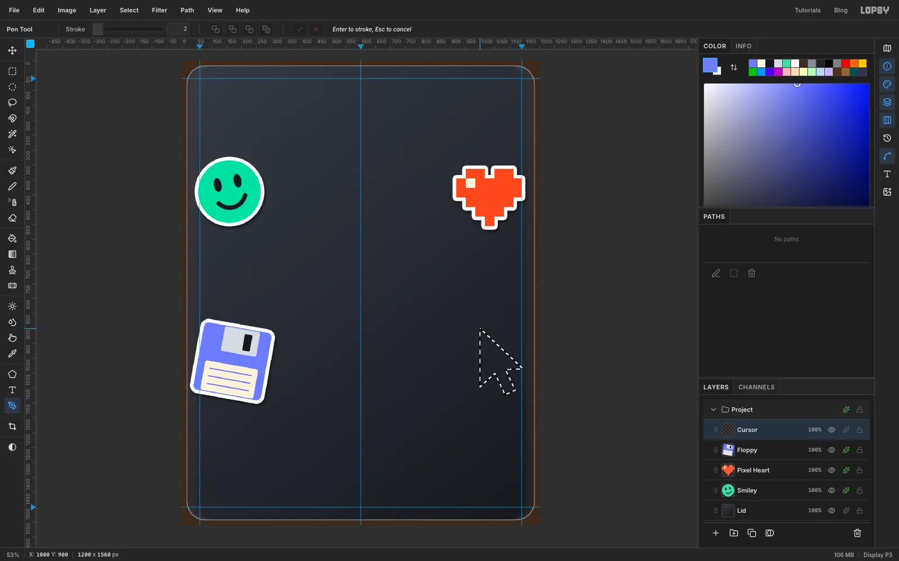

Add a layer named *Cursor*. Pick the **Pen** tool and click these seven
corners in order, then click the first one again to close the shape:
`1000, 900`, `1000, 1096`, `1050, 1050`, `1084, 1122`, `1118, 1107`,
`1085, 1037`, `1144, 1035`. In the **Paths** panel, click
**Path to Selection**, then **Delete Path**.

## Turn the cursor into an outlined arrow

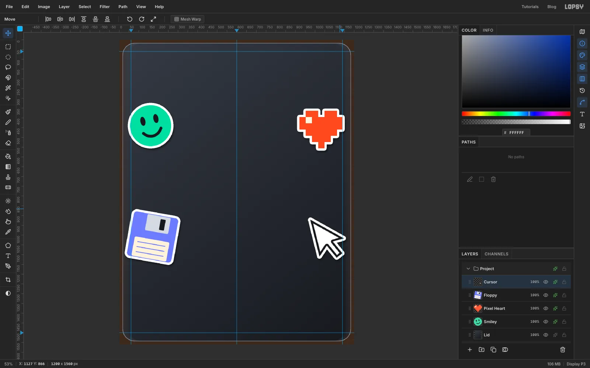

Fill the selection with ink. Choose **Select → Shrink…** `10` and fill the
smaller selection with white. That leaves a 10 px black outline, the classic
pointer. Deselect, add the die-cut effects, and tilt the arrow about 14°
anticlockwise.

## Draw a lightning bolt

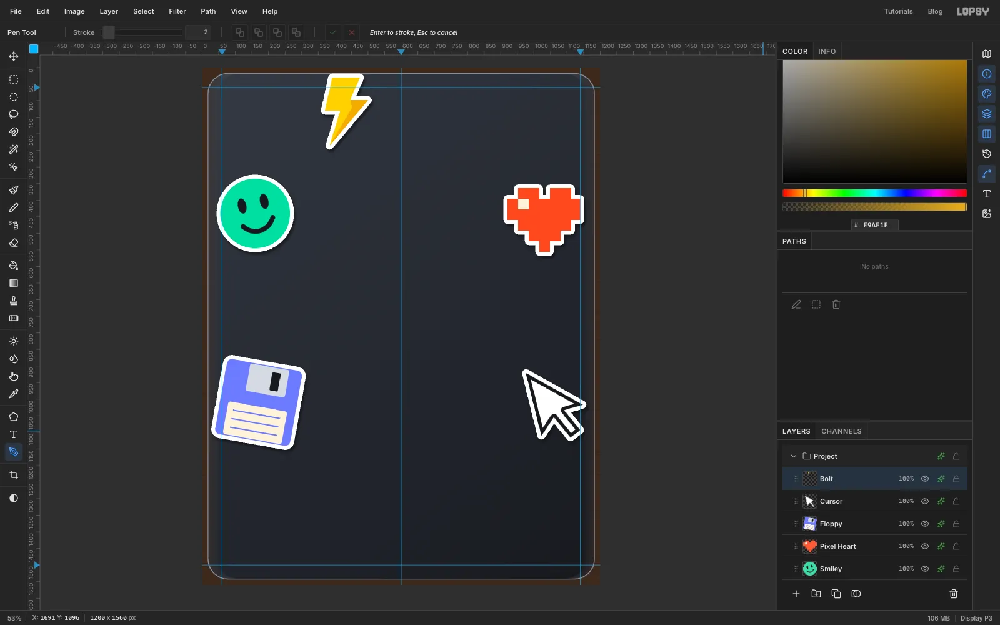

Add a layer named *Bolt*. With the **Pen**, click `370, 130`, `392, 30`,
`476, 30`, `446, 98`, `500, 98`, `384, 236`, `416, 130` and close it.
Choose **Path to Selection** and fill with butter `#FFD447`.

For the shading, click a second Pen outline over the right half: `446, 98`,
`500, 98`, `384, 236`, `452, 120`. Turn it into a selection, fill with
`#E9AE1E` and deselect. Add the die-cut effects.

## Set an @ sticker in type

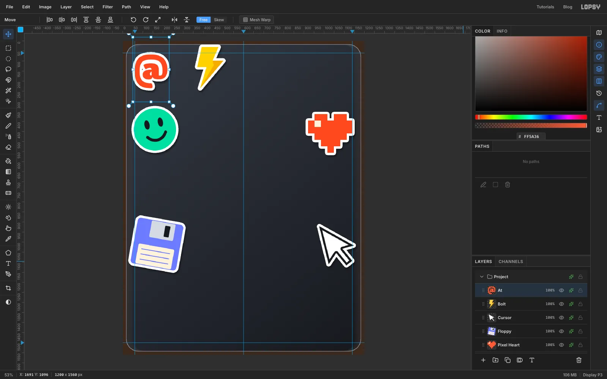

Pick the **Text** tool. Set the font to **Titan One**, **Size** `230` and
the colour to tomato. Click near the top-left corner, type `@`, and press
[[Tab]] to commit. Rename the layer *At* and use the arrow keys with the
**Move** tool to centre it on about `140, 150`.

Effects work on live text too, so add the same die-cut **Stroke** and
**Drop Shadow**.

## Add a coffee bean

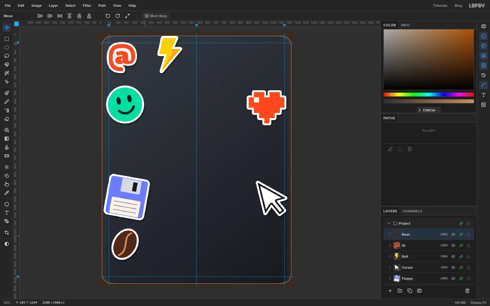

Add a layer named *Bean*. Create an espresso `#4A2A1C` ellipse,
**130 × 180** at `160, 1300`. Pick the **Brush** with **Size** `12` and the
colour `#C98E5A`, and drag an S-shaped crease down the middle: from
`160, 1222`, bowing left, then right, to `160, 1378`. Add the die-cut
effects and tilt the bean about 30° clockwise.

## Draw a globe with stroke-only shapes

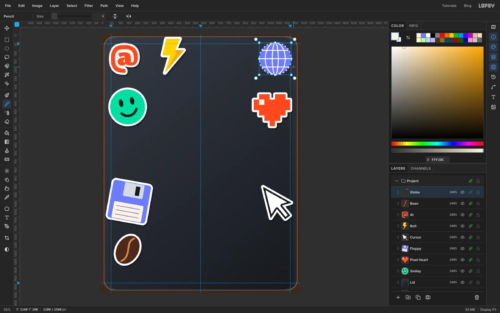

Add a layer named *Globe*. Create a periwinkle **200 × 200** ellipse at
`1050, 150`. Now remove the shape fill and set the **Stroke** to cream with
**Width** `6`. Click the same centre twice more for two meridians:
**120 × 194** and **36 × 194**.

For the latitude lines, select a circle with the exact-corners dialog from
`953, 53` to `1147, 247`. Pick the **Pencil** (**Size** `6`, cream) and
[[Shift]]-click straight lines right across the globe at `y = 100`, `150`
and `200`. The selection clips them to the circle. Deselect, add the
die-cut effects, and tilt it about 14° clockwise.

## Make an esc keycap

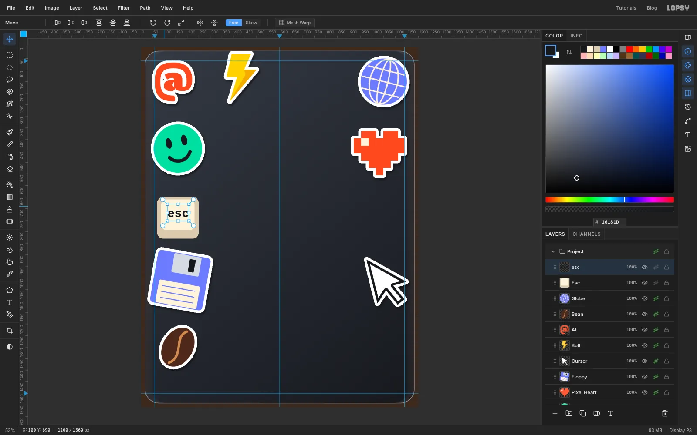

Add a layer named *Esc*. Make two rounded rectangles: keycap `#D9CBB0`,
**Corner Radius** `26`, **180 × 180** at `160, 740`, then cream,
**Corner Radius** `20`, **144 × 132** at `160, 726`. The top face sits a
little high, so the darker rim shows more at the bottom.

With *Esc* selected, pick the **Text** tool. Set **IBM Plex Mono**,
**Bold**, **Size** `52`, ink. Click on the keycap, type `esc` and press
[[Tab]]. Nudge it onto the top face at about `160, 722`. Then choose
**Layer → Merge Down**, so the text becomes part of the sticker. Add the
die-cut effects and tilt it about 8° clockwise.

> **Tip:** Changing the font, size or colour with a text layer selected
> restyles that layer. Click a raster layer's row before you set up the next
> piece of text.

## Add a play button and a price tag

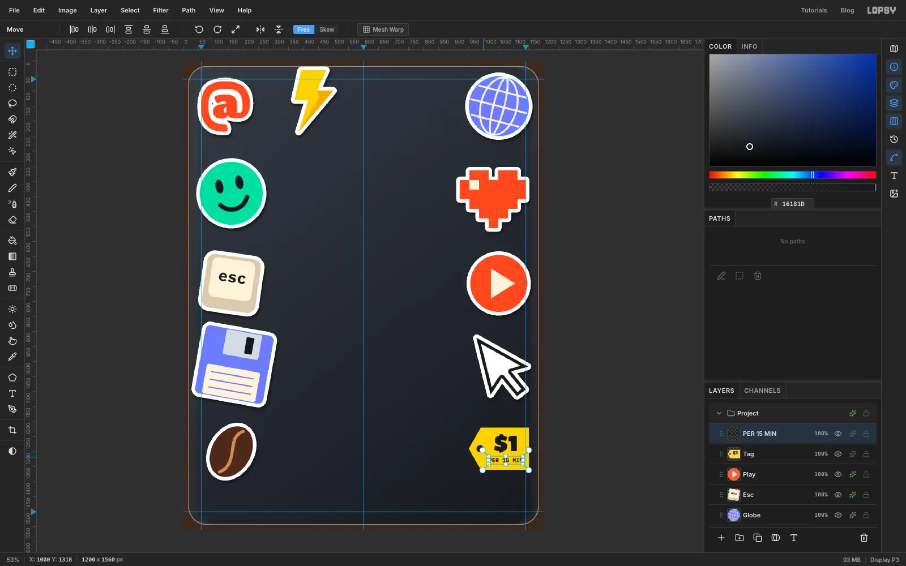

**Play button.** On a new layer *Play*, create a **190 × 190** tomato
circle at `1050, 740`. Click a Pen triangle at `1024, 690`, `1104, 740`,
`1024, 790`, turn it into a selection and fill it with cream. Add the
die-cut effects.

**Price tag.** On a new layer *Tag*, click a Pen pentagon pointing left:
`950, 1290`, `990, 1220`, `1150, 1220`, `1150, 1360`, `990, 1360`. Fill it
with butter. Press [[Cmd+D]], select a circle from `976, 1278` to
`1000, 1302` and press [[Delete]] to punch the hole. Then add `$1` in ink **Titan One** `72`, centred on `1072, 1272`, and
`PER 15 MIN` in ink **IBM Plex Mono Bold** `19`, centred on `1072, 1328`,
merging each one down. Add the die-cut effects and tilt the tag about 10°
anticlockwise.

## Finish the pack with 404, BRB and a holographic star

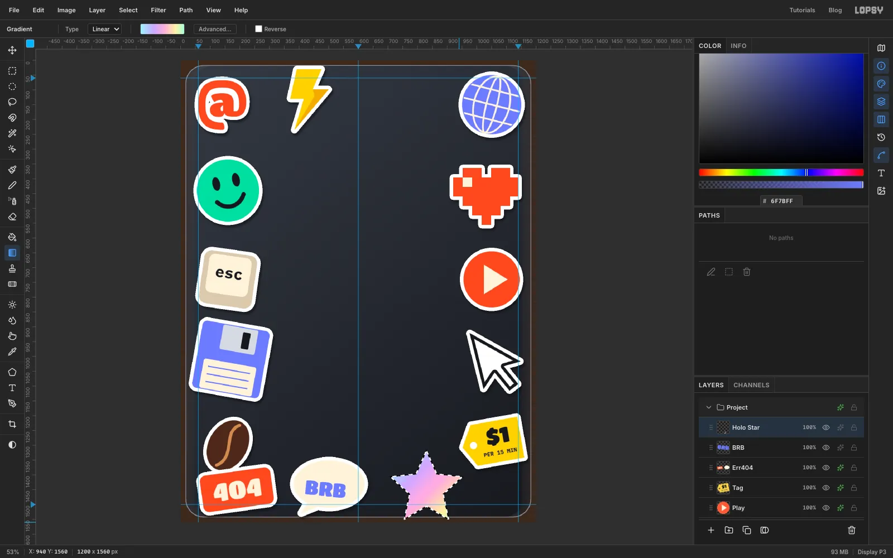

**404.** A tomato rounded rectangle (**Corner Radius** `20`,
**240 × 124** at `190, 1450`) with `404` in cream **Titan One** `84`,
merged down. Tilt it about 8° anticlockwise.

**BRB.** A cream **240 × 160** ellipse at `500, 1440`, plus a Pen tail at
`404, 1540`, `440, 1480`, `490, 1505` filled cream. Add `BRB` in
periwinkle **Titan One** `66`, merge it down, and tilt it about 6°
clockwise.

**Holo star.** On a new layer *Holo Star*, click a five-point star with the
Pen, ten clicks round from the top: `830, 1318`, `865, 1397`, `952, 1406`,
`887, 1465`, `905, 1550`, `830, 1506`, `755, 1550`, `773, 1465`,
`708, 1406`, `795, 1397`, then the first point again. Turn it into a
selection. In the **Gradient** editor, set five
stops: `#9FF3FF`, `#C8A8FF` at 30%, `#FFB0DA` at 55%, `#FFF2A6` at 80% and
`#A6FFD6`. Drag diagonally across the star from top left to bottom right.
Pastel stops next to each other look like holographic foil.

Give every one of them the die-cut effects, and tilt the star about 12°
clockwise.

## Group the pack

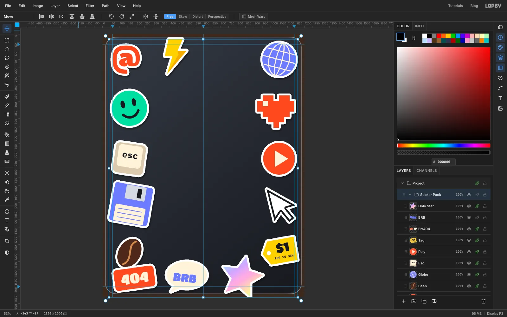

Click the top sticker layer (*Holo Star*), [[Shift]]-click the bottom one
(*Smiley*) and choose **Layer → Group Layers**. Rename the group
*Sticker Pack* and click its arrow to collapse it.

## Copy the whole pack as one picture

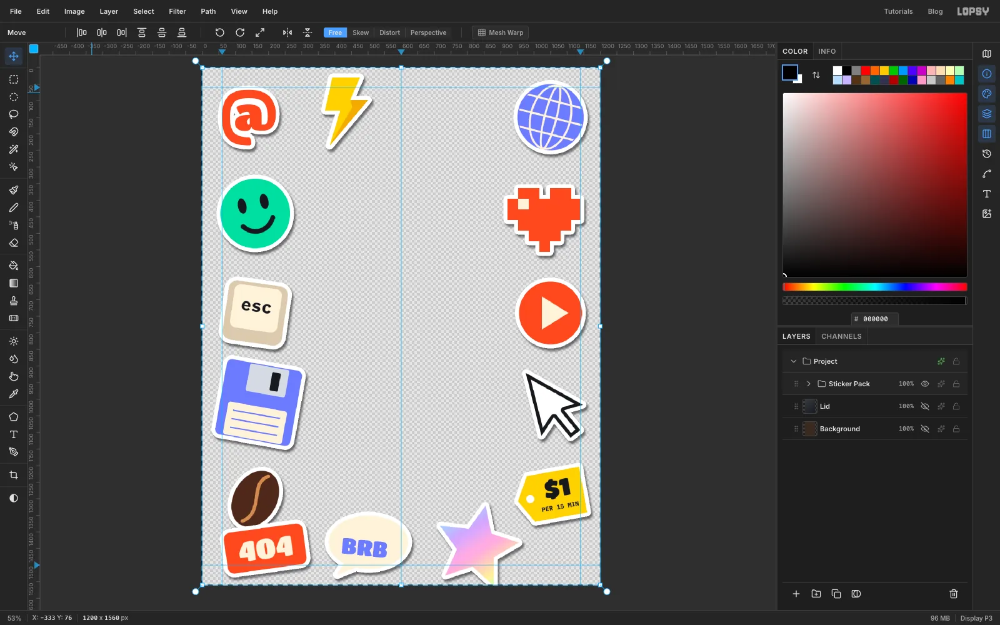

Hide *Background* and *Lid* with their eye buttons, so that only the
stickers are visible. Choose **Select → All**, then **Edit → Copy Merged**.
Copy Merged copies what you see, effects and all, as one flat picture.

Deselect and show *Background* and *Lid* again. Click the *Lid* row and
choose **Edit → Paste**. The pasted stickers land in place above the lid.
Deselect, and rename the pasted layer *Pack 3*.

The merged copy has everything, so delete the *Sticker Pack* group: select
it and click the trash button.

## Duplicate the pack and turn a copy upside down

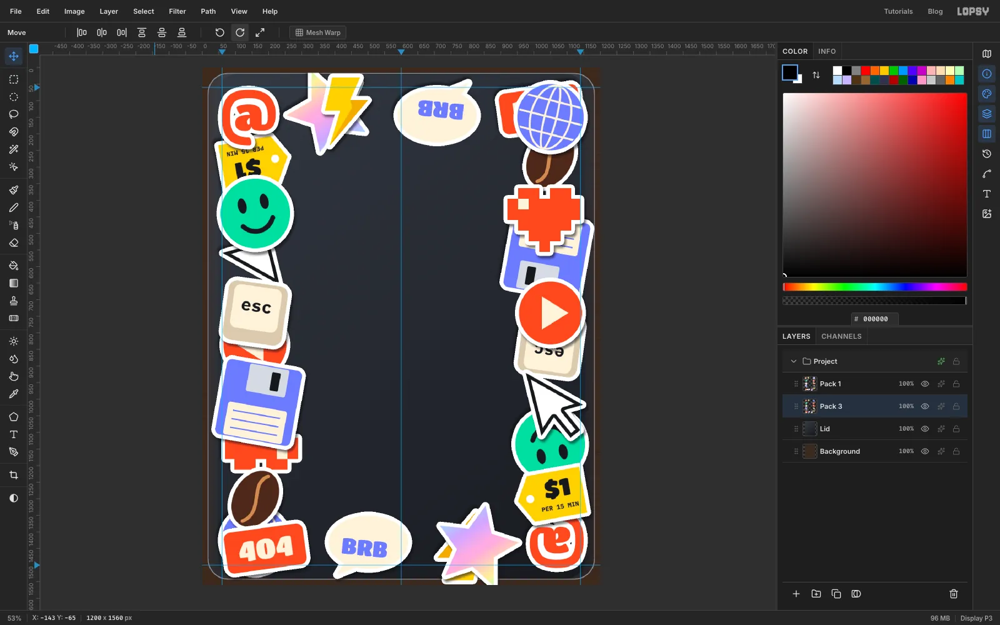

Choose **Layer → Duplicate Layer** and rename the copy *Pack 1*. It stays
as it is.

Click *Pack 3*, pick the **Move** tool and click **Rotate 90° CW** in the
options bar twice. The lower copy turns upside down, so its stickers fall
in the gaps between the ones above. Upside-down text is fine: real sticker
bombs are full of it.

## Add a third copy turned on its side

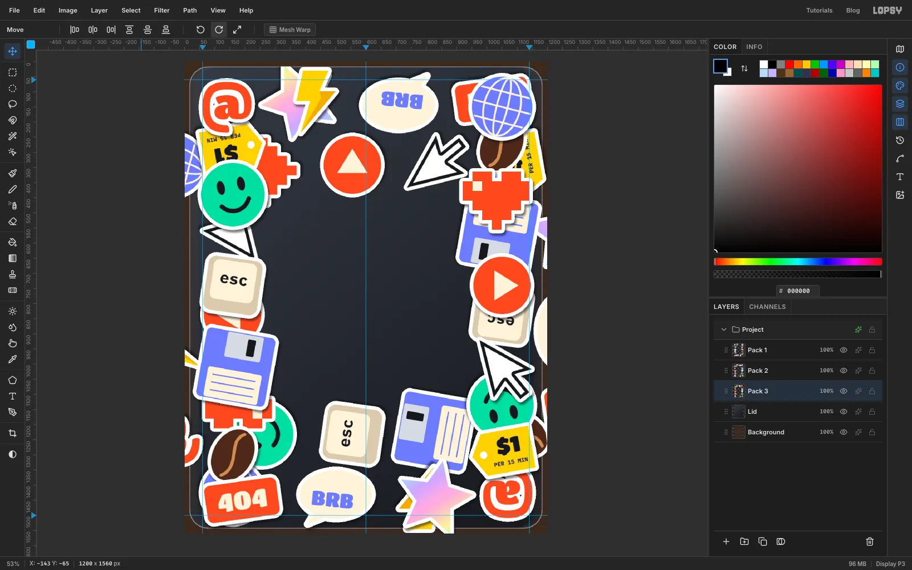

With *Pack 3* still selected, duplicate it again and rename the copy
*Pack 2*. Then click *Pack 3* and click **Rotate 90° CW** once more. The
page isn't square, so this copy pushes stickers into new spots along the
top and bottom.

## Turn a fourth copy to an odd angle

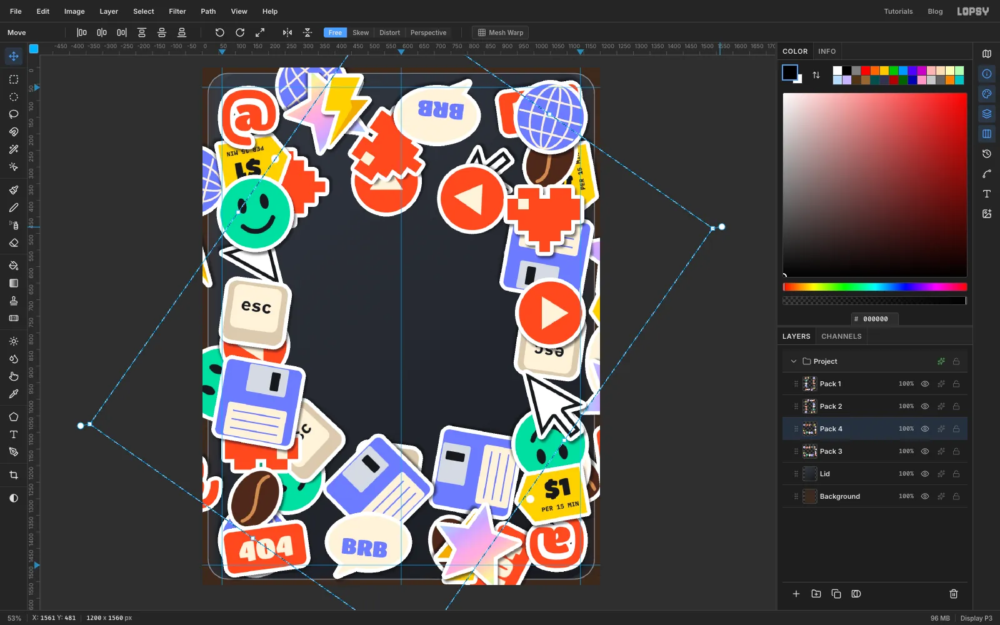

Duplicate *Pack 3* one last time and name the copy *Pack 4*. Choose
**Select → All**, then drag the rotation zone outside the top-right corner
of the canvas about 35° clockwise. Odd angles break up the repetition.
Press [[Cmd+D]] to commit.

Click *Pack 1*, [[Shift]]-click *Pack 3* and group the four copies as
*Backdrop*.

## Trim the stickers at the lid edge

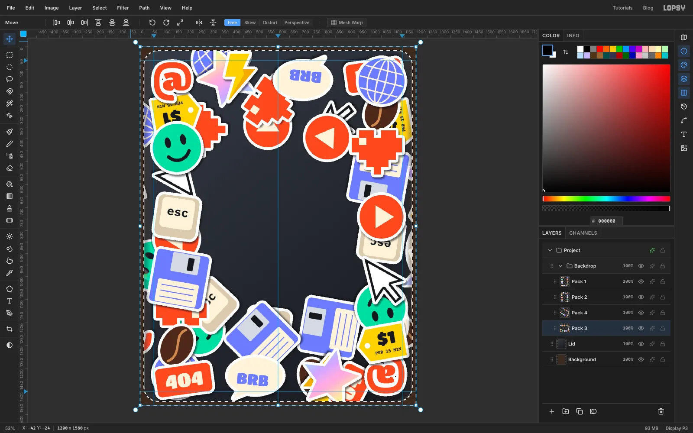

On a real laptop, you trim stickers that hang over the edge with a knife.
Here, [[Cmd]]-click the *Lid* thumbnail, then choose **Select → Inverse**.
Now everything except the lid is selected. Click each *Pack* layer in turn
and press [[Delete]]. The selection stays put while you switch layers.
Deselect when you're done.

## Push the backdrop back with adjustments

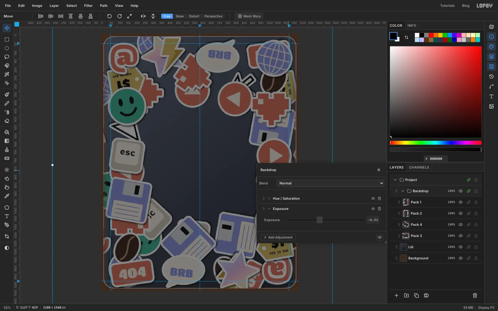

The foreground stickers need room to pop, so make the backdrop recede.
Click *Backdrop* and open its effects drawer. For a group, the drawer shows
**Adjustments**. Click **Add Adjustment → Hue / Saturation** and set
**Saturation** to `-50`. Then **Add Adjustment → Exposure** and set it to
`-0.95`.

The group's stickers turn dusty and dark but keep their shapes and colours.
Collapse the group.

## Cut the hero disc

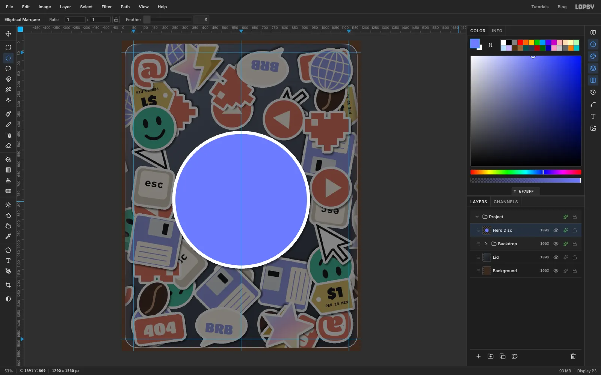

Click *Backdrop* and add a layer named *Hero Disc*. With the
**Elliptical Marquee**, select from `270, 470` to `930, 1130`, a circle of
radius 330 centred on `600, 800`. Fill it with periwinkle and deselect.

The foreground stickers share one slightly stronger look. Give the disc a
white **Stroke** of `16` (Outside) and a **Drop Shadow** of **Offset X** `6`,
**Offset Y** `9`, **Blur** `12` and **Opacity** `50%`. Use those shadow values
for every foreground sticker from now on.

## Build the mug from shapes

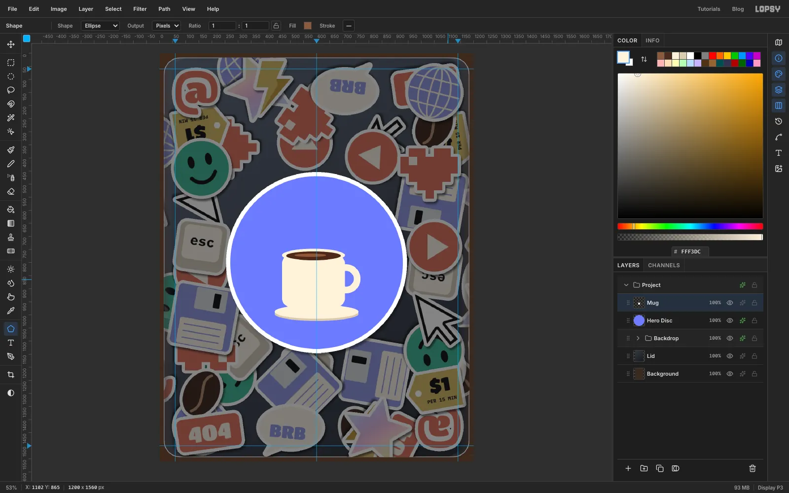

Add a layer named *Mug*. Start with the handle: select a circle from
`656, 806` to `768, 918` and fill it with cream. Press [[Cmd+D]], select
`682, 832` to `742, 892` and press [[Delete]] to leave a ring.

Now stack these shapes with the **Shape** tool, in this order, so each one
covers the last:

1. Keycap-tone ellipse **320 × 54** at `600, 996`: the saucer's shadow edge
2. Cream ellipse **320 × 54** at `600, 988`: the saucer
3. Cream rectangle, **Corner Radius** `34`, **240 × 200** at `588, 870`: the cup. It hides the left half of the ring.
4. Cream ellipse **240 × 50** at `588, 772`: the rim
5. Espresso ellipse **208 × 34** at `588, 774`: the coffee
6. Crema `#8A5A3C` ellipse **120 × 12** at `576, 772`: a highlight on the coffee

Give *Mug* a **Drop Shadow** in `#2B2F8A`: **Offset X** `0`, **Offset Y**
`10`, **Blur** `14`, **Opacity** `45%`.

## Shade the mug with Multiply

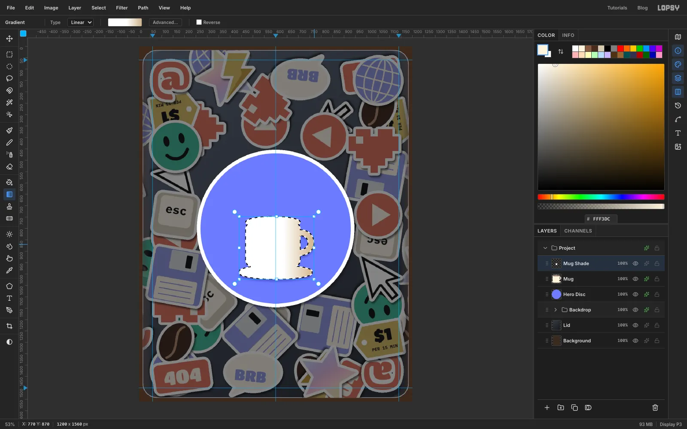

Add a layer named *Mug Shade* and [[Cmd]]-click the *Mug* thumbnail. Set a
gradient of white, white at 55% and tan `#CDB48C`, and drag it straight
across from `470, 870` to `770, 870`. Deselect and set the layer's
**Blend** to **Multiply**. White disappears in Multiply, so only the right
side of the mug darkens, as if lit from the left.

## Put an @ on the mug

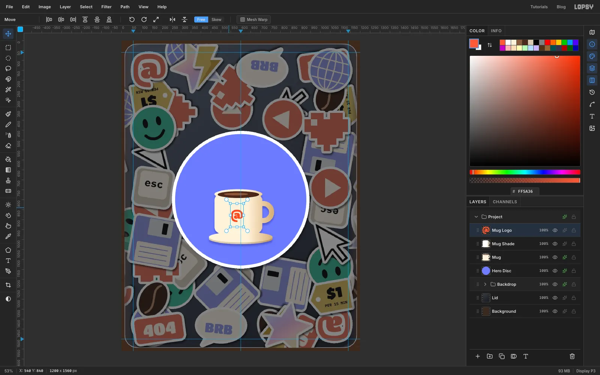

Click *Mug Shade*, pick the **Text** tool and set **Titan One**, **Size**
`84`, tomato. Click on the mug, type `@` and press [[Tab]]. Rename the
layer *Mug Logo* and nudge it to about `580, 880`.

## Draw three rings for the Wi-Fi steam

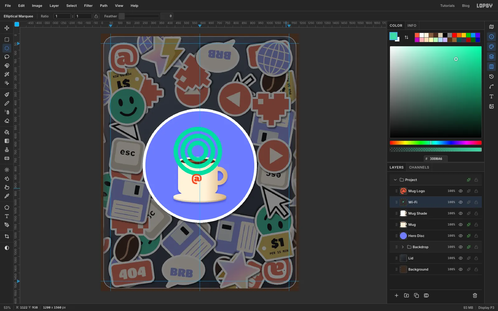

Click *Mug Shade* and add a layer named *Wi-Fi*. All the rings are centred
on `588, 712`. For each ring, select a circle and fill it with mint, press
[[Cmd+D]], then select a smaller circle with the same centre and press
[[Delete]]. Deselect again before the next ring:

- fill radius `147` (`441, 565` to `735, 859`), delete radius `121` (`467, 591` to `709, 833`)
- fill radius `105` (`483, 607` to `693, 817`), delete radius `79` (`509, 633` to `667, 791`)
- fill radius `63` (`525, 649` to `651, 775`), delete radius `37` (`551, 675` to `625, 749`)

## Trim the rings into a fan

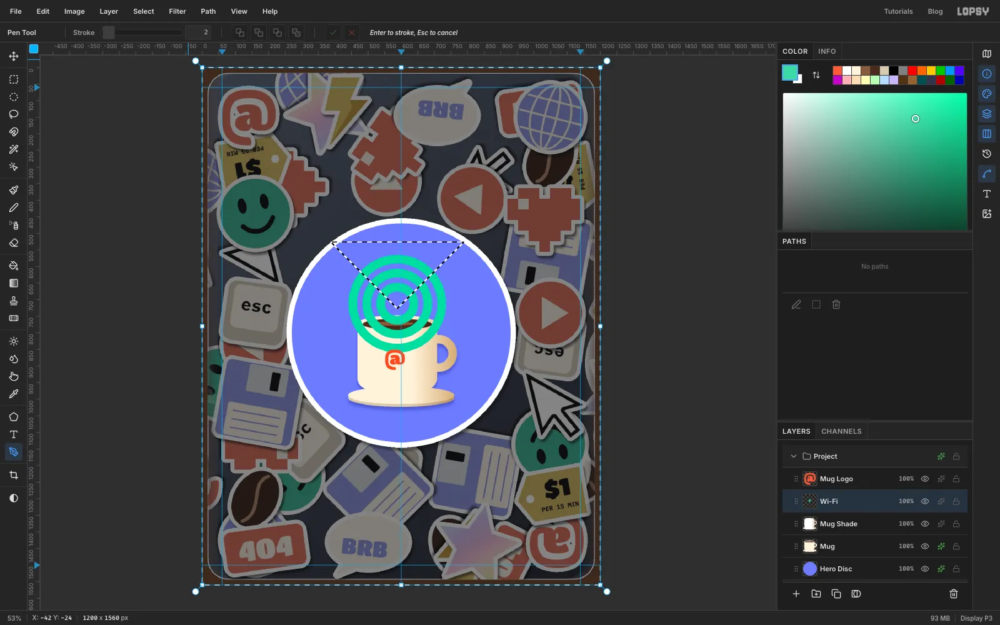

With the **Pen**, click a wide V: `388, 526`, `588, 726`, `788, 526`, and
close it. **Path to Selection**, then **Select → Inverse**, and press
[[Delete]]. Only the top quarter of each ring survives: the Wi-Fi fan.

## Add the dot

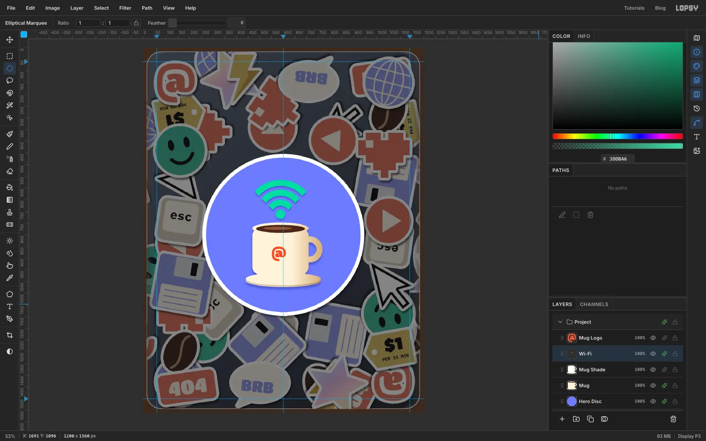

Select a small circle from `568, 692` to `608, 732` and fill it with mint.
Deselect, and give *Wi-Fi* the same disc-coloured **Drop Shadow** as the
mug (**Offset Y** `6`, **Blur** `8`, **Opacity** `45%`).

## Make a circular path for the ring text

Pick the **Shape** tool, set **Shape** to **Ellipse** and **Output** to
**Path**. Shape drags start from the centre, so press at the centre of the
disc, `600, 800`, and drag out to `872, 1072`. That gives a circle of radius
272, about 60 px inside the rim.

## Run the text round the disc

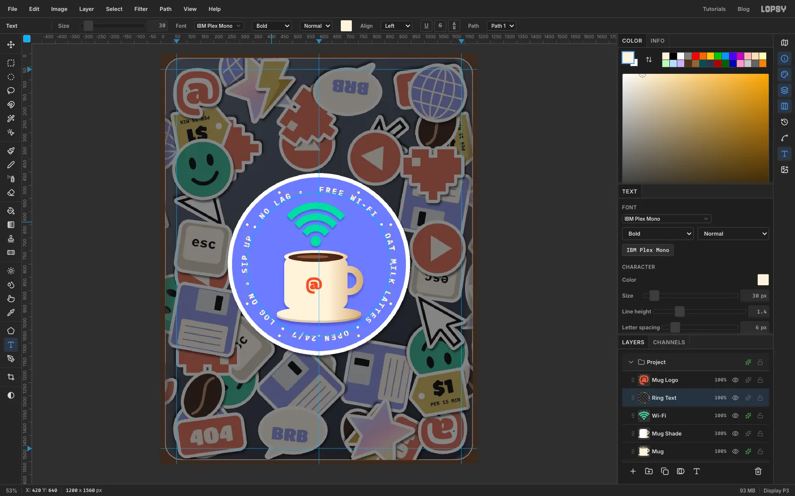

Pick the **Text** tool and set **IBM Plex Mono**, **Bold**, **Size** `30`,
cream, **Align** **Left**. Open the **Text** panel and check that
**Letter spacing** is `0`. Click an empty part of the disc and type:

`FREE WI-FI • OAT MILK LATTES • OPEN 24/7 • LOG ON • SIP UP • NO LAG • `

While the text is still active, choose **Path 1** from the **Path**
dropdown in the options bar. The text jumps onto the circle. Press [[Tab]],
then set **Letter spacing** to `6`. At that spacing the line goes exactly
once round, so the gap where it starts and ends looks like every other gap.
Rename the layer *Ring Text*.

> **Tip:** Letter spacing stays at `6` for every text you type after this.
> That's fine: it suits all the labels on this cover.

## Add a gloss with Screen

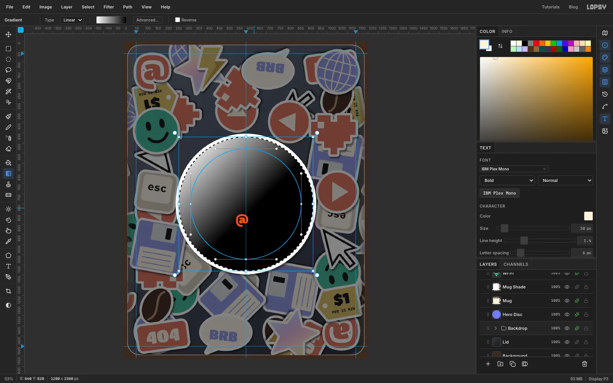

Add a layer named *Gloss* and [[Cmd]]-click the *Hero Disc* thumbnail. Set a
white-to-black gradient and drag from `330, 500` to `640, 820`. Deselect,
set **Blend** to **Screen** and the layer opacity to **30%**. Black
vanishes in Screen, so only a soft sheen remains on the top-left of the
vinyl.

## Erase the gloss off the mug

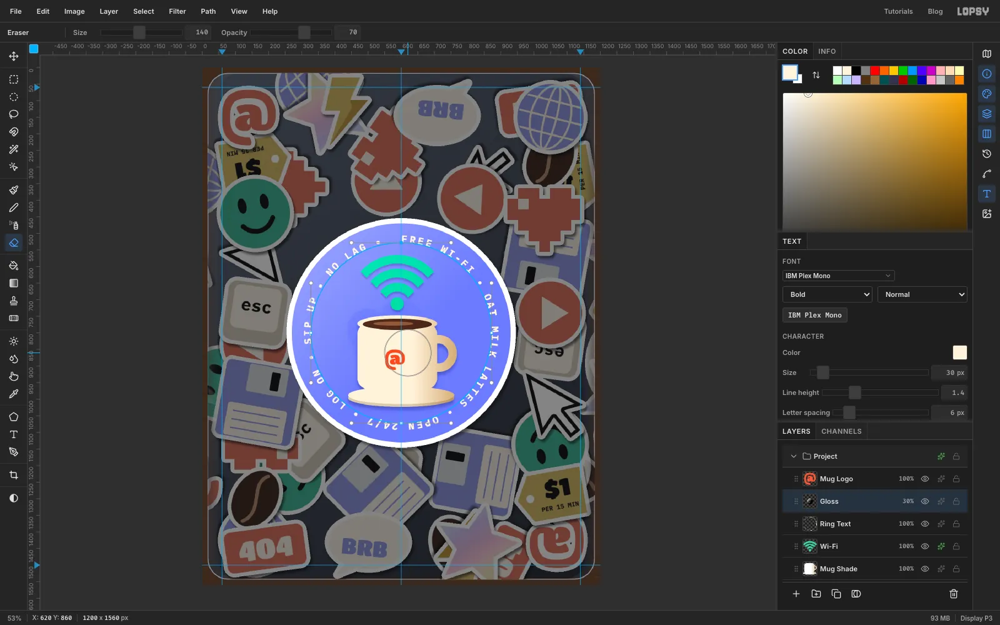

The sheen also washes over the mug and makes the cream look chalky. Pick
the **Eraser**, set **Size** `140` and **Opacity** `70%`, and brush down
the left side of the mug and over the rim.

## Group the hero

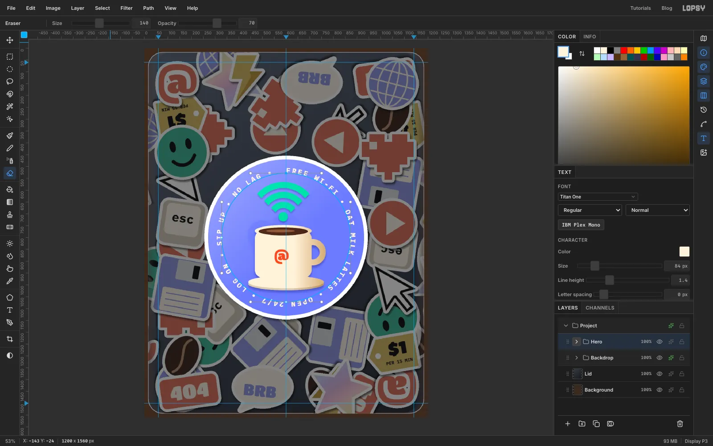

Click *Mug Logo*, [[Shift]]-click *Hero Disc*, and choose
**Layer → Group Layers**. Name the group *Hero* and collapse it.

## Print the tagline on a strip of tape

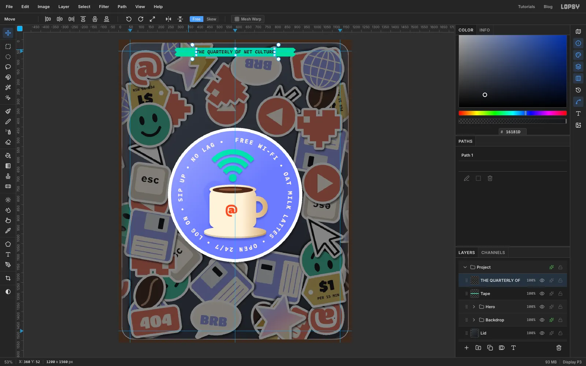

Click *Hero* and add a layer named *Tape*. With the **Pen**, click a strip
with zigzag ends: `300, 42`, `288, 54`, `300, 65`, `288, 77`, `300, 88`,
`900, 88`, `912, 77`, `900, 65`, `912, 54`, `900, 42`, and close it. Turn it
into a selection and fill it with mint.

Add the text `THE QUARTERLY OF NET CULTURE` in **IBM Plex Mono Bold** `24`,
ink, centred on `600, 65`, and merge it down. Give *Tape* a white
**Stroke** of `6` and the foreground shadow, then tilt it about 1°
anticlockwise.

## Set the PING masthead

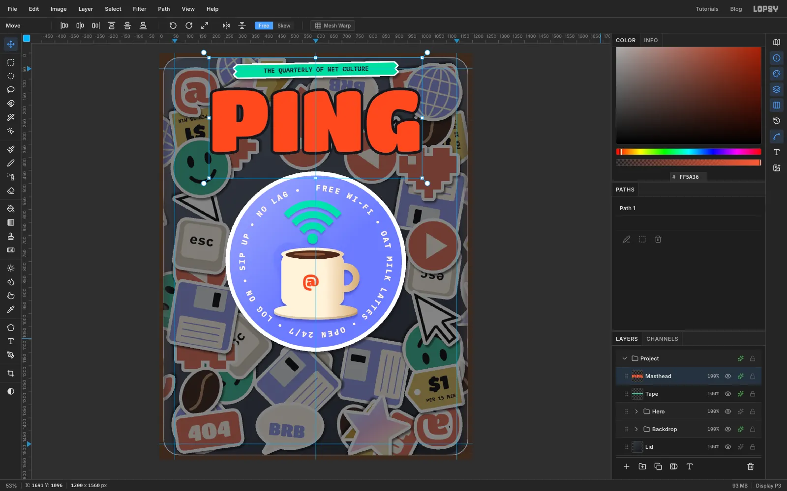

With *Tape* selected, pick the **Text** tool: **Titan One**, **Size**
`330`, tomato. Click above the disc, type `PING` and press [[Tab]]. Rename
the layer *Masthead* and centre it on about `600, 262`.

In its effects drawer, add a **Stroke** in ink, **Width** `10`,
**Outside**. That's the printed outline. The white die-cut border goes on
its own layer.

## Grow a die-cut border round the letters

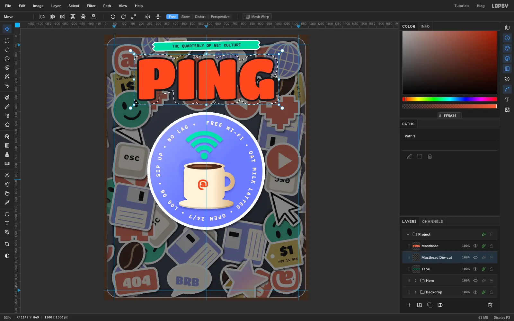

Click *Tape* and add a layer named *Masthead Die-cut*. It sits under the
text. [[Cmd]]-click the *Masthead* thumbnail, then choose
**Select → Grow…** `28`. The letters merge into one rounded outline, like
a sticker cutter would follow. Fill it with white, deselect, and give the
layer the foreground **Drop Shadow**.

## Tilt the masthead and its border together

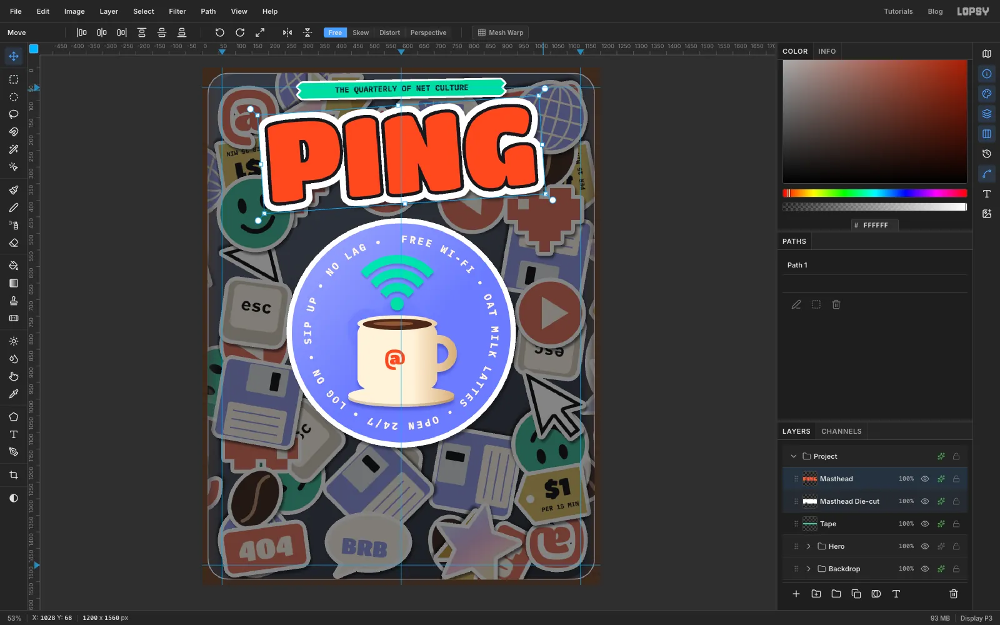

Click *Masthead* and [[Shift]]-click *Masthead Die-cut*. With the **Move**
tool, the two layers share one transform box. Drag the rotation zone
outside its top-right corner about 4° anticlockwise and press [[Cmd+D]].

Then click *Masthead* and click **Rasterize Layer** at the bottom of the
Layers panel. You won't edit PING again, and as a flat layer it can't be
picked up by the Text-tool clicks for the labels that sit close to it.

## Make the issue badge

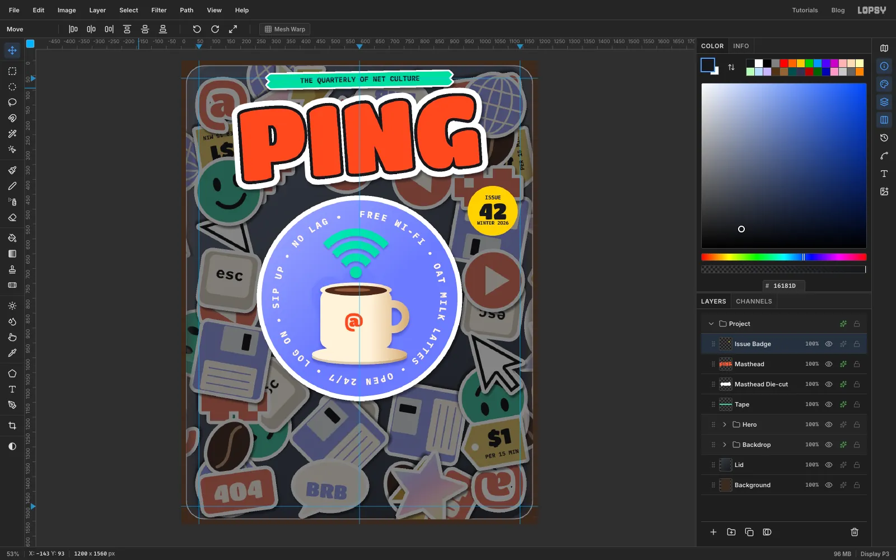

Click *Masthead* and add a layer named *Issue Badge*. Select a circle from
`964, 422` to `1132, 590` and fill it with butter. Set three lines of ink
text, each centred and merged down before the next:

- `ISSUE`, **IBM Plex Mono Bold** `18`, at `1048, 460`
- `42`, **Titan One** `76`, at `1048, 507`
- `WINTER 2026`, **IBM Plex Mono Bold** `16`, at `1048, 546`

Add the die-cut effects with the foreground shadow and tilt the badge about
12° clockwise.

## Write the first cover line on a slip

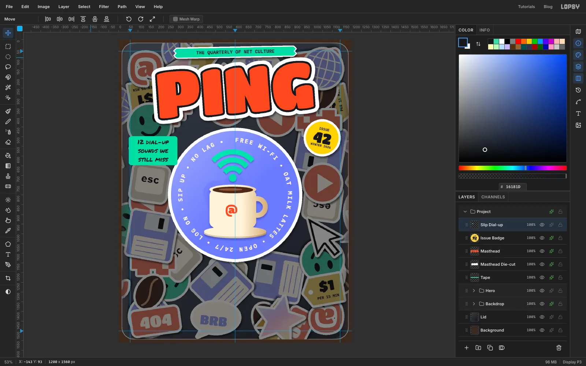

Add a layer named *Slip Dial-up*. Create a mint rectangle with **Corner
Radius** `14`, **250 × 150** at `178, 572`. Pick the **Text** tool:
**Permanent Marker**, **Size** `32`, ink, **Align** **Center**. Click on
the slip and type three lines, pressing [[Return]] between them:
`12 dial-up`, `sounds we`, `still miss`. Commit, centre the text on the
slip and merge it down. Add the die-cut effects and tilt it about 6°
anticlockwise. Its corner just overlaps the disc's white border, but keeps
clear of the ring text.

## Add the second slip

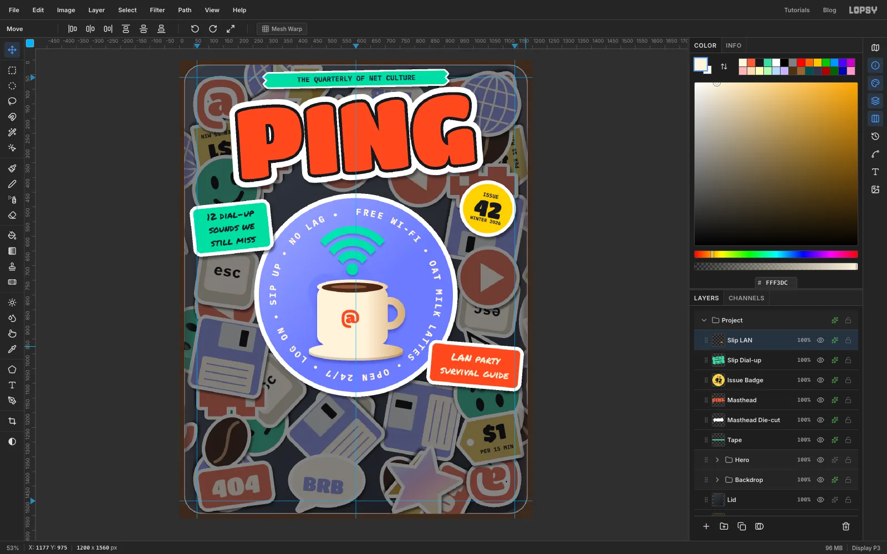

Add *Slip LAN*: a tomato rectangle, **Corner Radius** `14`,
**300 × 128** at `1005, 1040`, with `LAN party` and `survival guide` in
cream **Permanent Marker** `34`. Merge, add the die-cut effects, and tilt
it about 5° clockwise.

## Set the cover-story label

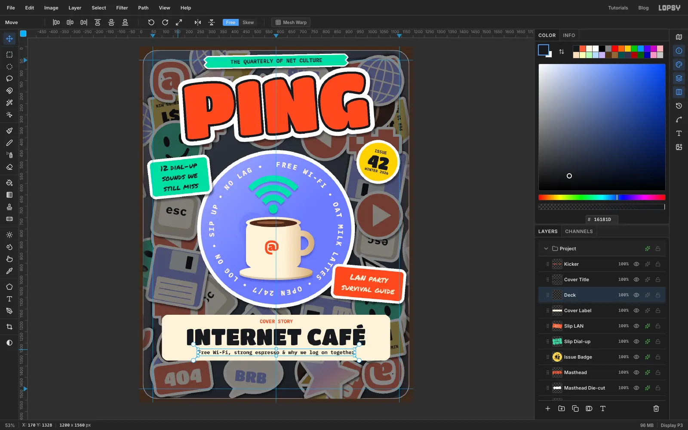

Click *Slip LAN* and add a layer named *Cover Label*. Create a cream
rectangle with **Corner Radius** `26`, **1000 × 200** at `600, 1276`.

Add three centred text layers. Click *Cover Label* before each, so you
don't restyle the one before:

- *Kicker*: `COVER STORY`, **IBM Plex Mono Bold** `22`, tomato, centred on `600, 1203`
- *Cover Title*: `INTERNET CAFÉ`, **Titan One** `100`, ink, centred on `600, 1263`
- *Deck*: `Free Wi-Fi, strong espresso & why we log on together`, **IBM Plex Mono Bold** `22`, ink, centred on `600, 1341`

At these sizes the title fills all but about 115 px either side, and the
deck sits well clear of the bottom edge.

## Peel up a corner

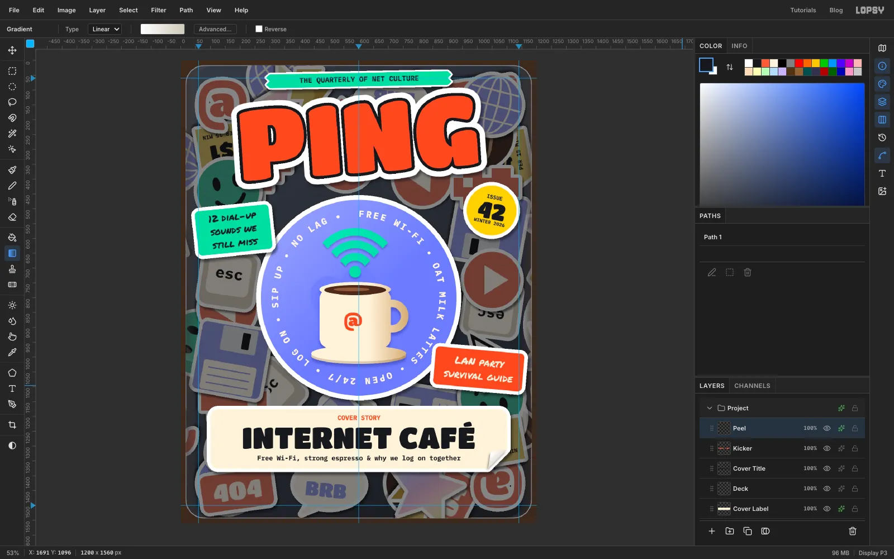

Click *Cover Label*. Pen a triangle over the bottom-right corner:
`1036, 1377`, `1101, 1377`, `1101, 1312`. Turn it into a selection, press
[[Delete]] and deselect. Now give the label the die-cut effects. The white
border follows the cut, as it would on a real sticker.

Click *Kicker* and add a layer named *Peel* on top. Pen the folded flap:
`1036, 1376`, `1100, 1312`, `1045, 1321`. Fill it with a gradient from
white to `#CFC8BA`, dragged from `1050, 1325` to `1080, 1356`. That's the
pale backing paper. Deselect and add a small **Drop Shadow** in `#0B0C10`:
**Offset X** `-4`, **Offset Y** `6`, **Blur** `10`, **Opacity** `45%`.

## Tilt the whole label

Click *Peel* and [[Shift]]-click *Cover Label* to select all five layers.
With the **Move** tool, drag the rotation zone at the top-right corner
about 2° anticlockwise and press [[Cmd+D]]. Live text turns with the
shapes and stays editable.

## Build a starburst from three squares

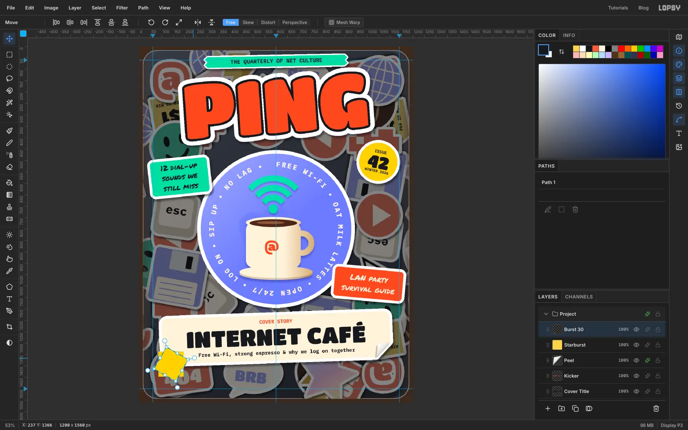

Click *Peel* and add a layer named *Starburst*. With the **Shape** tool
on **Rectangle**, **Corner Radius** `0`, butter fill and no stroke, create a
**110 × 110** square at `140, 1392`.

Choose **Layer → Duplicate Layer** and name the copy *Burst 30*.
[[Cmd]]-click its thumbnail, pick the **Move** tool and drag the rotation
zone while holding [[Cmd]]. The angle snaps in 15° steps, so stop at 30°
and press [[Cmd+D]]. Duplicate *Burst 30*, name the copy *Burst 60*, and
turn it another 30° the same way. Now press **Layer → Merge Down** twice.
Three squares at 0°, 30° and 60° make a twelve-point burst.

## Letter the starburst

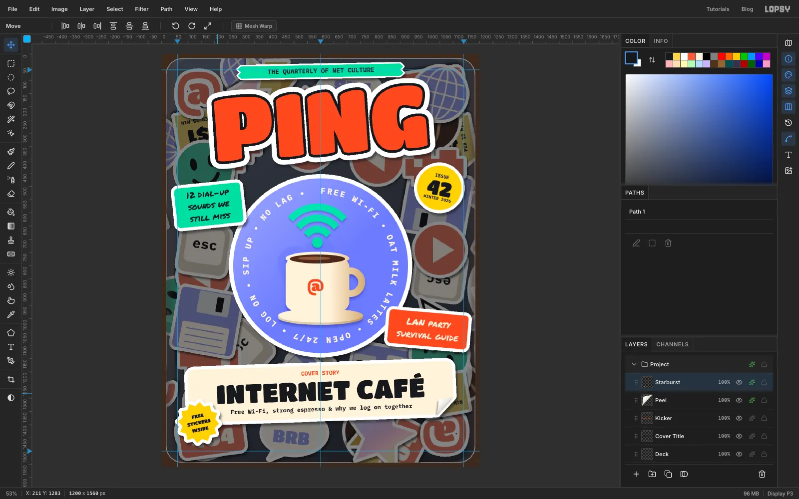

Add `FREE`, `STICKERS`, `INSIDE` on three lines in **Titan One** `18`, ink,
centred on the burst, and merge it down. Add the die-cut effects and tilt
the starburst about 12° anticlockwise.

It overlaps the label's corner by a good 60 px on purpose. A deliberate
overlap reads as layering; a 5 px one looks like an accident.

## Make the barcode sticker

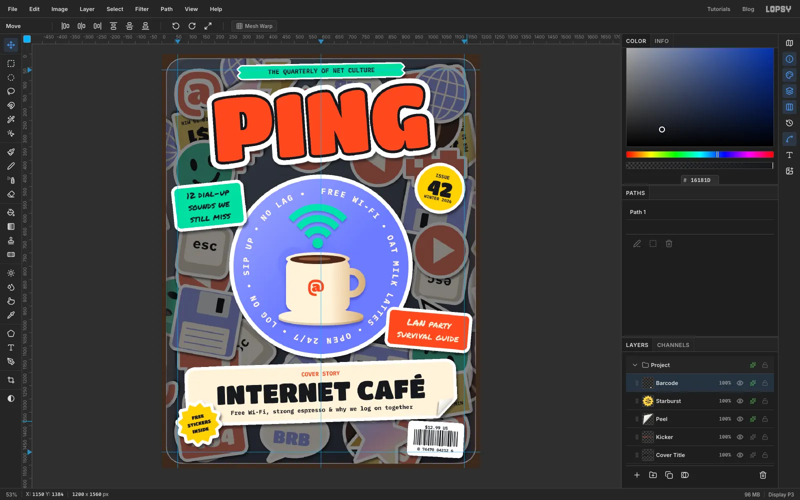

Add a layer named *Barcode*. Create a white rectangle with **Corner
Radius** `8`, **196 × 116** at `1032, 1452`. Pick the **Pencil** with ink
and draw the bars as vertical [[Shift]]-click lines from `y = 1419` to
`1474`, between `x = 950` and `1112`. Do three passes: **Size** `2`, `3`
and `5`, with gaps of 2 to 4 px. An uneven mix looks like a real code.

Add `$12.99 US` in **IBM Plex Mono Bold** `16` above the bars and
`0 74470 04212 6` in **IBM Plex Mono Bold** `15` below them, merging each down.
Give it a white **Stroke** of `8` and the foreground shadow, then tilt it
about 3° clockwise.

## Add print grain

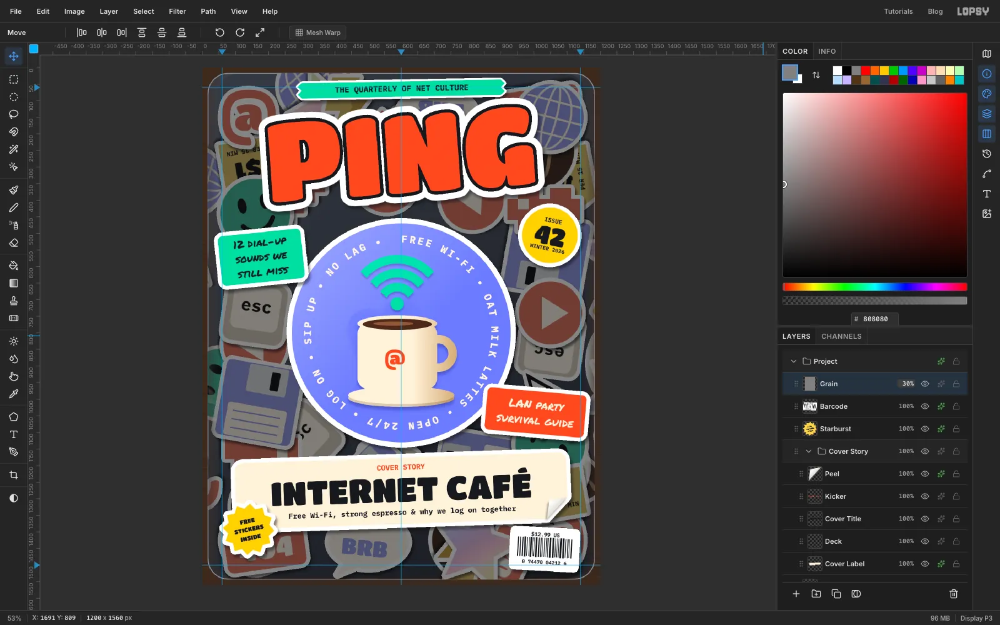

First tidy up: click *Peel*, [[Shift]]-click *Cover Label* and choose
**Layer → Group Layers**. Name the group *Cover Story*.

Click *Barcode* and add a layer named *Grain* at the top. Choose
**Select → All**, fill with grey `#808080` and deselect. Choose
**Filter → Add Noise…** with **Amount** `40`, **Mono** and **Gaussian**.
Set the layer's **Blend** to **Overlay** and its opacity to **30%**. Mid
grey disappears in Overlay, so only a fine print texture stays over the
flat vinyl colours.

Export with **File → Quick Export PNG** and save the project with
**File → Save Project**.
