Street-art posters borrow from the wall itself. A stencil is cut from a photo, so the subject breaks down into three or four flat tones, and each tone is sprayed through its own sheet. The paint takes on the bricks underneath it, runs when it's sprayed too heavily, and drifts in a fine mist of overspray. Paper flyers are pasted over the top with wheatpaste, and stickers and tags pile up around them.

In this tutorial you'll build all of that from scratch for *Pigeon Coup*, an imaginary street-art block party. The poster is 1800 × 2700 px and has:

- a painted brick wall made from one hand-drawn brick
- a spray-painted sunset disc with overspray, drips and a faded edge
- a pigeon photo turned into a four-colour stencil with a second, out-of-register shadow plate
- a gold crown drawn with the Pen tool
- a two-word graffiti title, a wheatpasted info flyer, a sticker and a tag

You'll need two photos from Wikimedia Commons:

- **Columba livia - 01.jpg** by Carlos Delgado, a close-up of a rock pigeon's head (CC BY-SA 4.0). Download the 1920 px version.
- **Feral Pigeon 2023 11 19.jpg** by Alexis Lours, a pigeon walking side-on (CC BY 4.0). Again, the 1920 px version.

Both licences let you use the photos as long as you credit the photographers. The BY-SA licence also means that anything you make from the first photo should be shared under the same licence.

Along the way you'll use patterns, the Magic Wand, the marquees and Lasso, the Gradient, Spray, Brush and Pen tools, a handful of filters (Posterize does the heavy lifting), layer masks, groups, live text, and the Stroke, Drop Shadow, Outer Glow and Color Overlay effects.

The palette is a night-time wall with hot spray paint on it:

- Wall bricks `#46444C`, mortar `#1B1C21`, light bricks `#5B5862`, dark bricks `#34323A`
- Disc `#FF7B35` → `#F25A5C` → `#E33A7E`
- Stencil navy `#17223B`, teal `#1F9E97`, mint `#9FE6CB`, cream `#F2EAD5`
- Crown gold `#FFC93C`, title gradient top `#FFE14D`, sprayed highlight `#FFF6C8`
- Ink `#121214`, paper `#EFE5CC`

> **Note:** Shortcuts are written for a Mac. On Windows use [[Ctrl]] wherever it says [[Cmd]].

## Draw one brick

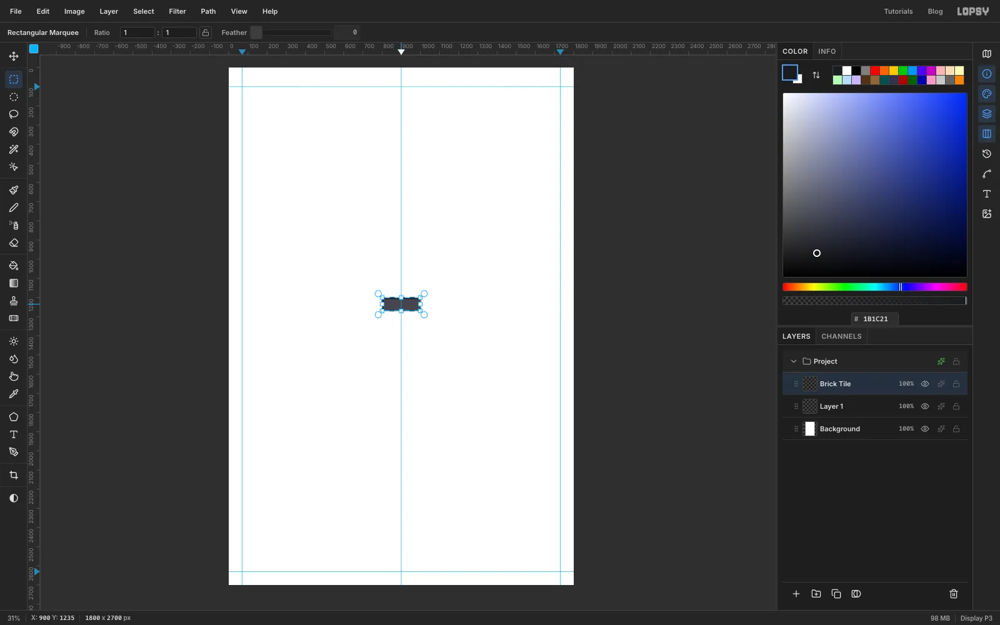

Choose **File → New** and make a **1800 × 2700** px document with a white background. Click the top ruler at **70**, **900** and **1730** to drop vertical guides for the margins and the centre line. Click the left ruler at **100** and **2630** for the top and bottom margins.

Click **Add Layer** and name the new layer *Brick Tile*.

Pick the **Rectangular Marquee** and click once on the canvas without dragging. That opens its exact-size dialog. Enter **800, 1200** to **1000, 1270** for a brick 200 px wide and 70 px tall, set the foreground to `#46444C` and choose **Edit → Fill**.

Now add the mortar. Pick the **Pencil**, set **Size** to **8** and the foreground to `#1B1C21`. Click at the top-left corner of the brick and [[Shift]]-click at its top-right corner to draw a line along the top edge. Then click the top-left corner again and [[Shift]]-click the bottom-left corner for the left edge. The other two edges come from the neighbouring bricks once the tile repeats.

The selection is still around the brick (if you lost it, enter the same corners again). Choose **Edit → Define Pattern**, press [[Cmd+D]] to deselect, and delete the *Brick Tile* layer. It has done its job.

> **Tip:** Patterns last only until you reload the page. If you come back to this later, redefine the brick from the finished wall: select **0, 0** to **200, 70** on the *Brick Wall* layer and choose **Define Pattern** again.

## Fill the wall with bricks

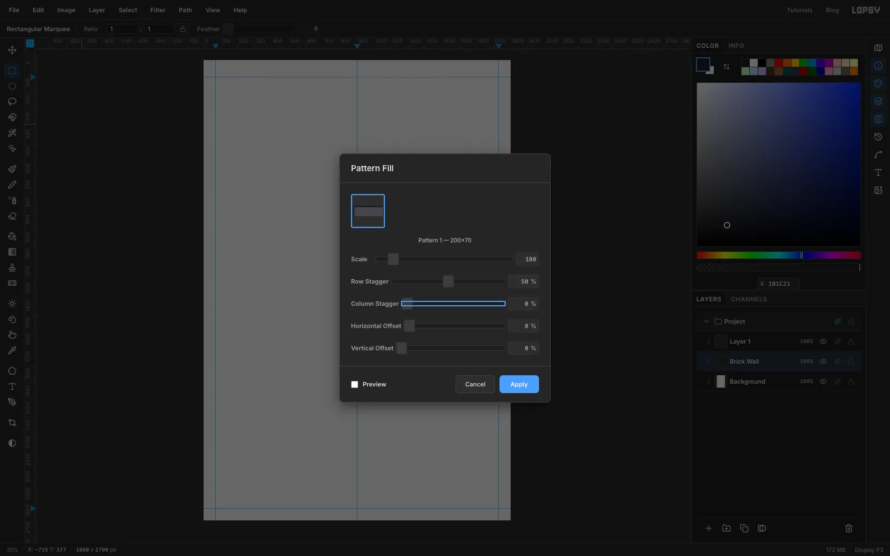

A new document comes with an empty *Layer 1*; you won't need it, so select it and click **Delete Layer**. Then click the *Background* layer, add a layer above it and name it *Brick Wall*. Choose **Edit → Fill with Pattern…**, pick your brick, and set **Row Stagger** to **50%**. Each row shifts by half a brick, which gives a proper running bond. Click **Apply**.

## Vary the bricks with the Magic Wand

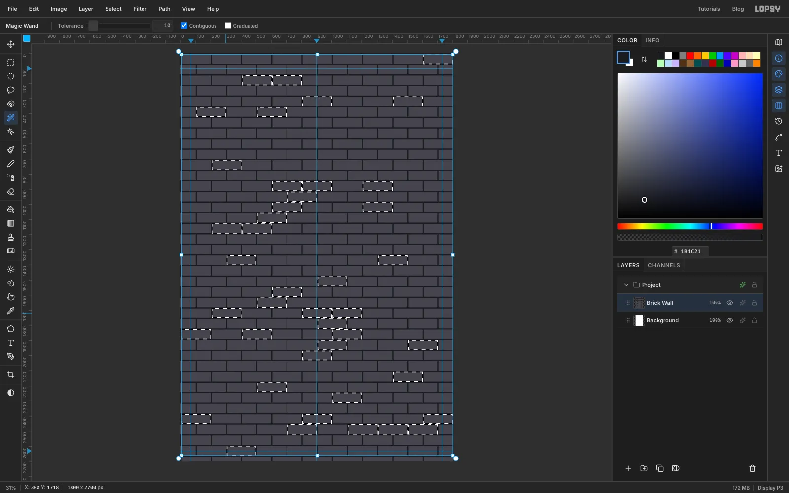

A wall where every brick is the same grey looks printed. Pick the **Magic Wand**, set **Tolerance** to **10** and tick **Contiguous**, so each click selects exactly one brick. Click a brick, then hold [[Shift]] and click forty or so more, scattered all over the wall. Don't make a pattern of it.

Click **Add Layer**, name it *Brick Tint*, set the foreground to the lighter `#5B5862` and choose **Edit → Fill**. Press [[Cmd+D]].

Click *Brick Wall* again and wand-select another scatter of bricks the same way, avoiding the ones you've already done. Click *Brick Tint*, fill these with the darker `#34323A` and deselect. Set *Brick Tint* to **70%** opacity.

## Add grit and grime

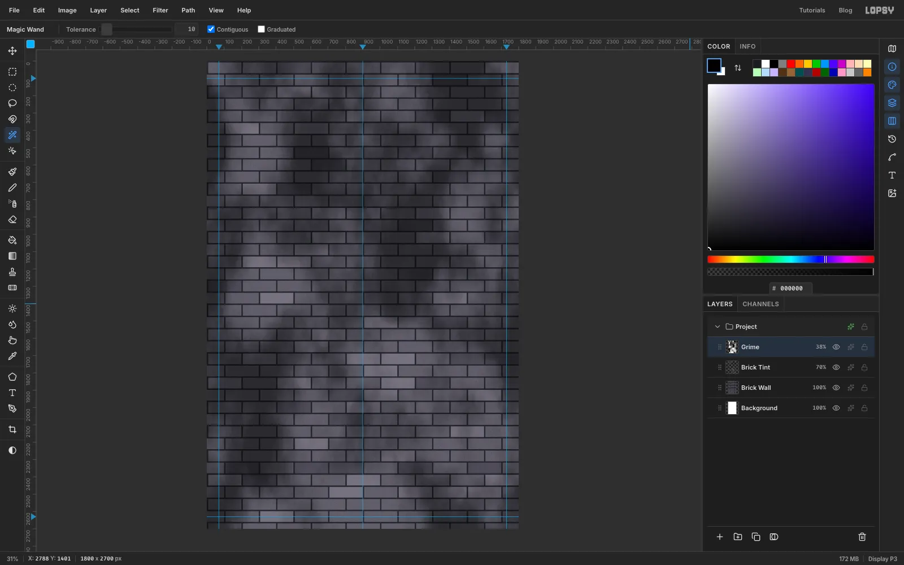

Click *Brick Wall* and choose **Filter → Add Noise…**. Pick **Mono**, set **Amount** to **18** and click **Apply**. This roughs up every brick face.

Click *Brick Tint* and add a layer above it called *Grime*. Choose **Filter → Clouds…** with **Scale** at **6**. Open the layer's effects with the sparkle button on its row, set the blend mode to **Overlay** and close the drawer. Then set the layer's opacity to about **38%**. The clouds become soft, uneven stains where rain and traffic have darkened the wall.

## Spray the sunset disc

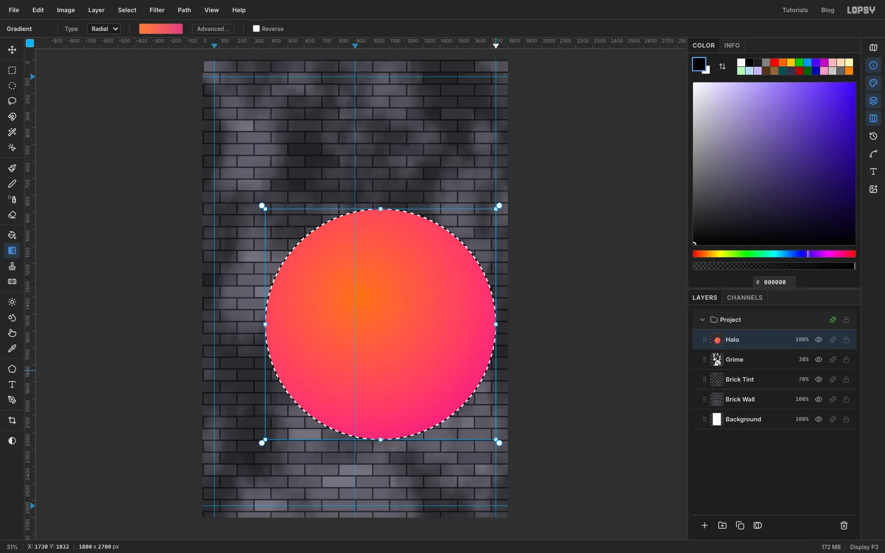

Add a layer above *Grime* called *Halo*. Click once with the **Elliptical Marquee** to open its exact-size dialog and enter a circle from **370, 880** to **1730, 2240**. That's a 1360 px disc, a little right of centre and a little below the middle.

Pick the **Gradient** tool, set **Type** to **Radial** and click **Advanced…**. Use three stops:

- `#FF7B35` at the left end
- `#F25A5C` about halfway along
- `#E33A7E` at the right end

Click **Done**. Drag from a point a little up and left of the disc's centre out to its lower-right rim. The hot spot sits off-centre, like a sun low in the sky.

## Add overspray around the rim

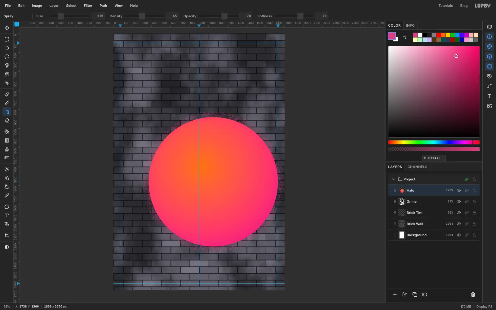

Press [[Cmd+D]]. A real stencil never has a perfectly clean edge, because some paint always mists past it.

Pick the **Spray** tool and set the foreground to `#E33A7E`. Set **Size** to **110**, **Density** to **45** and **Opacity** to **70**. Then drag once all the way around the disc, just on its edge. Keep moving at a steady pace. If you stop, the spray keeps building up in one spot.

## Let some paint run

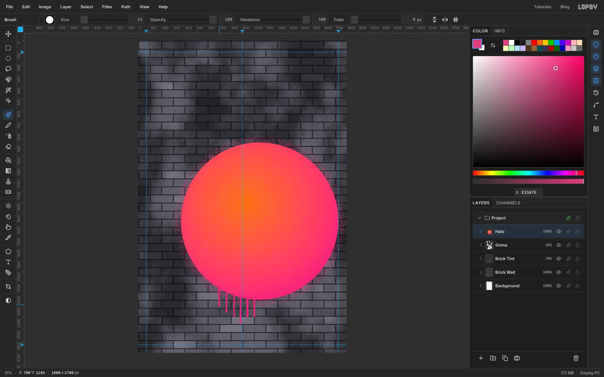

Too much paint in one place runs. Pick the **Brush**, set **Hardness** and **Opacity** to **100**, and keep the pink foreground.

Each drip is a straight line. Set the brush **Size** to somewhere between **10** and **19**, click on the disc's edge, then [[Shift]]-click straight below it. Make six to eight drips along the bottom-left of the disc, between about six and seven o'clock. Vary the sizes, and make the lengths anything from 40 px to about 300 px. Put the longest ones nearest the bottom.

Finish some of them, not all, with a bead. Make the brush a few pixels bigger and click once at the end of the drip.

## Fade the rim with a layer mask

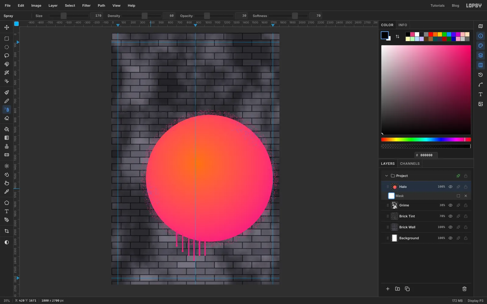

Paint wears thin at the edges first. With *Halo* still active, click **Add Mask** at the bottom of the Layers panel, then click the new mask thumbnail on the layer's row to edit the mask. The canvas tints blue while you're editing a mask.

Pick the **Spray**, set the foreground to black, set **Size** to **170** and **Opacity** to **30**, and keep **Density** at about **60**. Make two short passes just inside the rim: one at the upper right and one on the far left. Black on a mask hides paint, so the bricks start to show through there. Click the *Halo* layer's name when you're done to stop editing the mask.

## Drop in the pigeon photo and scale it

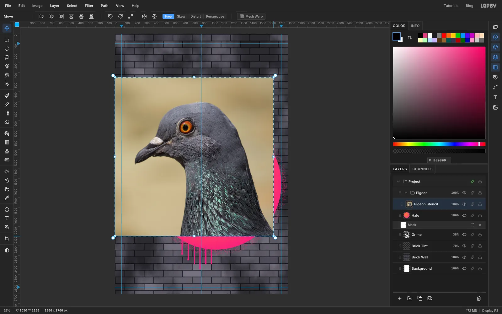

With *Halo* active, click **New Group** at the bottom of the Layers panel and name it *Pigeon*. Everything for the bird goes in here.

Drag the Carlos Delgado pigeon photo from your downloads folder onto the canvas. Lopsy shrinks it to fit the 1800 px width and selects it, with the **Move** tool already active. Rename the layer *Pigeon Stencil*.

The photo is still a little big. Hold [[Cmd]] and drag the bottom-right corner handle up and in until the photo is about **1650 px** square. [[Cmd]] keeps it square. Press [[Cmd+D]] to commit the scale.

## Move the bird into the disc

Drag the photo down and to the right until its top-left corner is at about **200, 920**. The status bar's X/Y reading shows where the pointer is. The head now sits in the upper half of the disc and the beak just pokes out past the disc's left edge. The right edge of the photo hangs slightly past the edge of the canvas, which is fine. The neck stops in a flat edge near the bottom. That's expected too: the paper flyer will cover it.

## Cut away the backdrop

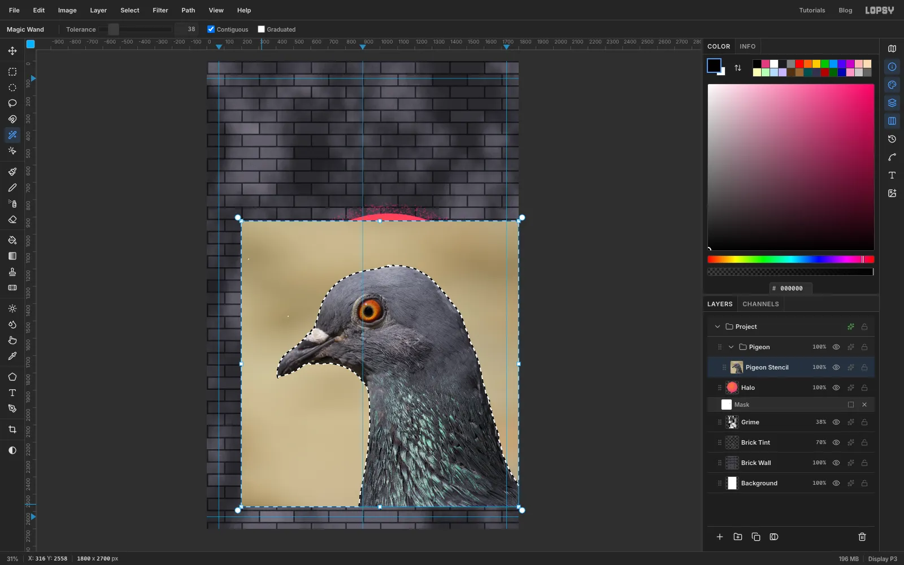

Pick the **Magic Wand**, set **Tolerance** to **38** and keep **Contiguous** ticked. Click the soft beige background in the top-left of the photo. [[Shift]]-click any background patches the first click missed:

- down the left side
- the gap between the beak and the neck
- across the top
- the right side
- the last sliver at the bottom-left corner

Press [[Delete]] to clear the background, then [[Cmd+D]]. The pigeon now sits directly on the pink disc.

## Flatten the photo into stencil tones

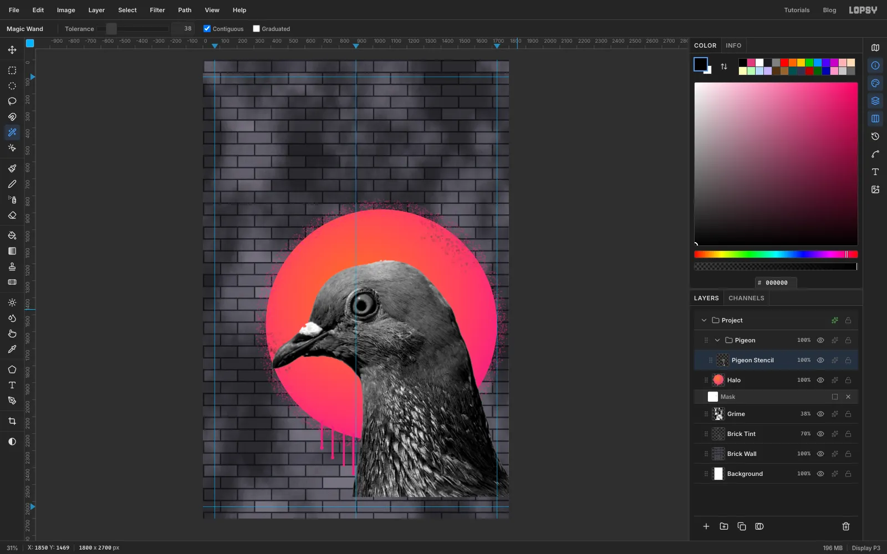

A stencil only works with a few flat tones, so the photo has to be simplified first. Apply these one after another to *Pigeon Stencil*:

1. **Filter → Desaturate**, which applies straight away.
2. **Filter → Brightness/Contrast…** with **Contrast** at **40**.
3. **Filter → Gaussian Blur…** with **Radius** at **4**. Blurring first gives the stencil smooth shapes instead of thousands of single-feather specks.

## Posterize to four greys

Choose **Filter → Posterize…**, set **Levels** to **4** and click **Apply**. The bird snaps into four flat greys: black, a dark grey, a light grey and white. Each one will become a separate spray colour.

## Select one grey at a time

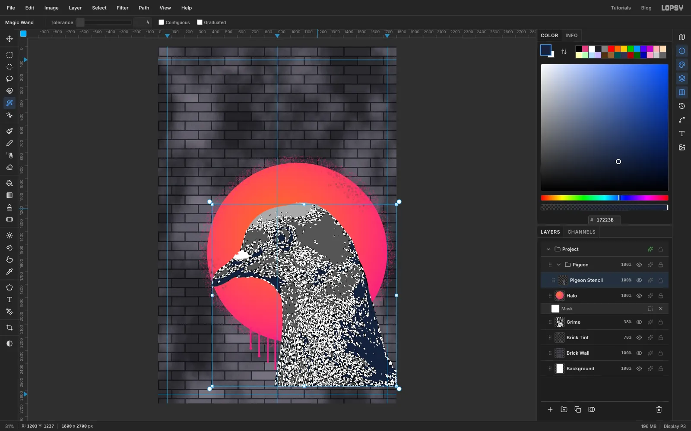

Pick the **Magic Wand**, set **Tolerance** to **4**, and this time **untick Contiguous**. One click then selects every pixel of that exact grey, wherever it is on the bird.

Click a black area and fill it with navy `#17223B`. Press [[Cmd+D]], click a dark grey area and fill it with teal `#1F9E97`. Do the same for the light grey with mint `#9FE6CB`, and the white patch at the top of the beak with cream `#F2EAD5`. Deselect before each new click.

The bird now reads as a stencil: a teal body, navy shadows, mint highlights on the head and neck, and a cream patch on the beak.

## Paint the eye

The eye is the one spot of real colour on the bird. Click once with the **Elliptical Marquee** to open its exact-size dialog, and make three circles over the eye, filling each with **Edit → Fill**:

- the iris, **882, 1377** to **1002, 1497**, in `#FF7B35`
- the pupil, **916, 1411** to **968, 1463**, in navy `#17223B`
- a small glint up and to the left, **919, 1414** to **937, 1432**, in cream `#F2EAD5`

If your photo sits a few pixels differently, hover the middle of the eye and read its position in the status bar, then centre the circles there.

Deselect when you're done.

## Add an out-of-register shadow plate

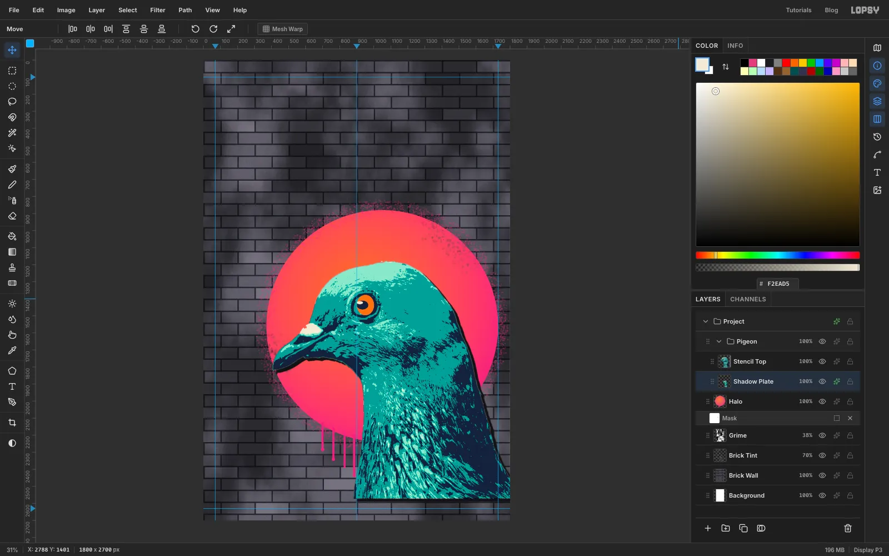

Multi-layer stencils are sprayed one sheet at a time and never line up perfectly. Fake a black sheet sprayed first.

Click **Duplicate Layer** and rename the copy *Stencil Top*. Click the original underneath and rename it *Shadow Plate*. Open its effects, turn on **Color Overlay** and set the colour to ink `#121214`. With the **Move** tool, nudge *Shadow Plate* **20 px right** and **16 px down** with the arrow keys. [[Shift]] makes each press 10 px. A thin black edge now shows along the back of the neck and under the head.

## Draw a crown with the Pen

Click *Stencil Top* and add a layer called *Crown*. Pick the **Pen** tool and click seven corner points, then click the first point again to close the path. Working clockwise from the bottom left:

1. the bottom-left corner, just above the pigeon's forehead
2. up and slightly out to the left for the first point
3. down to the first dip
4. up to the tall middle point
5. down to the second dip
6. up and slightly out to the right for the third point
7. the bottom-right corner, level with the first

Make it about **540 px** wide and **360 px** tall. Open the **Paths** panel, click **Path to Selection**, and then **Delete Path**.

## Fill the crown and add jewels

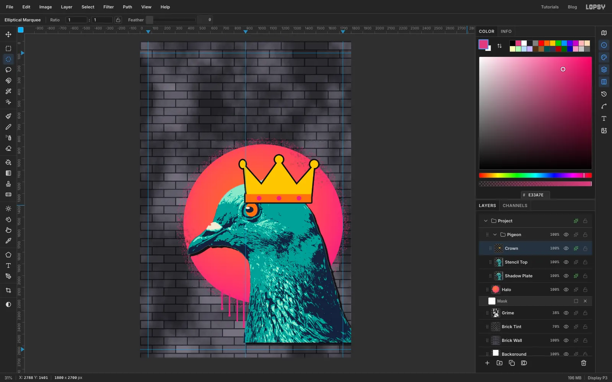

Set the foreground to gold `#FFC93C` and choose **Edit → Fill**. Deselect, then add the details:

- a **Rectangular Marquee** strip about 70 px tall across the bottom of the crown, filled orange `#FF7B35`, for the band. If its ends poke a few pixels past the crown's slanted sides, the outline you add next covers them.
- a circle about 68 px across on each of the three points, filled gold, for the beads
- three circles about 40 px across along the band, filled pink `#E33A7E`, for the jewels

Open the layer's effects, turn on **Stroke** and set **Width** to **12** in ink `#121214`.

## Tip the crown

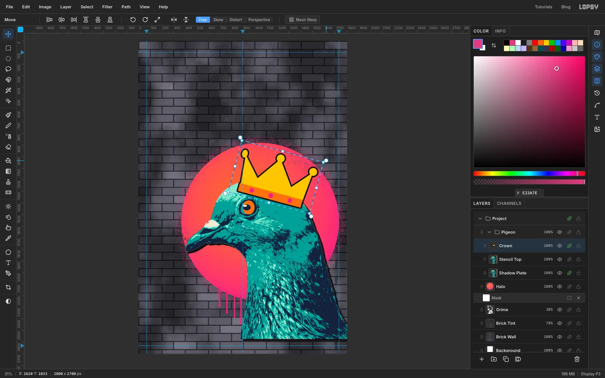

A crown sitting dead level looks stuck on. Drag a **Rectangular Marquee** around the whole crown with a little room to spare, and switch to the **Move** tool. Grab the round rotation handle just outside the top-right corner of the box and drag it clockwise about **15°**, so the crown tips back with the slope of the head. Press [[Cmd+D]] to commit.

## Rough up the crown

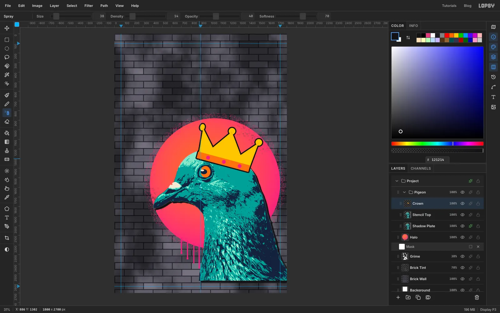

The crown is still too clean next to the gritty stencil. Open its effects and click **Rasterize Layer Style** to bake the outline into the pixels. Then choose **Filter → Add Noise…**, pick **Mono**, set **Amount** to **16** and click **Apply**.

Finally pick the **Spray** with ink `#121214`, **Size 38**, **Density 14** and **Opacity 40**. Trace once around the crown's outline so a little black mist breaks up the hard edge.

## Set the title in Knewave

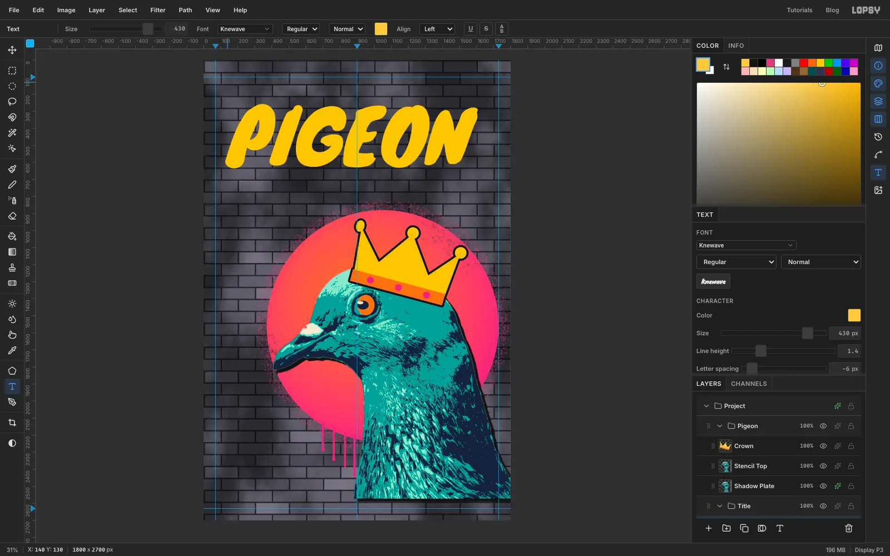

Click *Halo* and click **New Group**. Name the group *Title*. Because the group sits under *Pigeon*, the crown can overlap the title later.

One rule to know before you set any type: if a text layer is selected, changing the Text options restyles *that* layer. So before you start a new piece of text, click a plain (non-text) layer first.

Pick the **Text** tool and set:

- **Font** to **Knewave**
- **Size** to **430**
- colour to gold `#FFC93C`

Click near the top left of the canvas, type `PIGEON` and press [[Tab]] to commit. Rename the layer *PIGEON*. In the Text panel, set **Letter spacing** to **−6** to pull the letters together. Then use the **Move** tool and the arrow keys to centre the word on the middle guide, with the tops of the letters about **115 px** from the top of the canvas. The screenshot shows the word just after typing, before it's centred.

## Rotate the live text

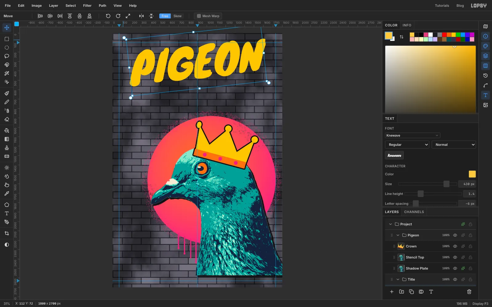

With the **Move** tool still active, hover just outside the top-left corner of the text box until the cursor turns into a crosshair. That's the rotation handle. Drag it a little down and to the left to rotate the word about **6°** counter-clockwise, so it climbs to the right. The text stays editable while you rotate it.

## Fill the title with a gradient

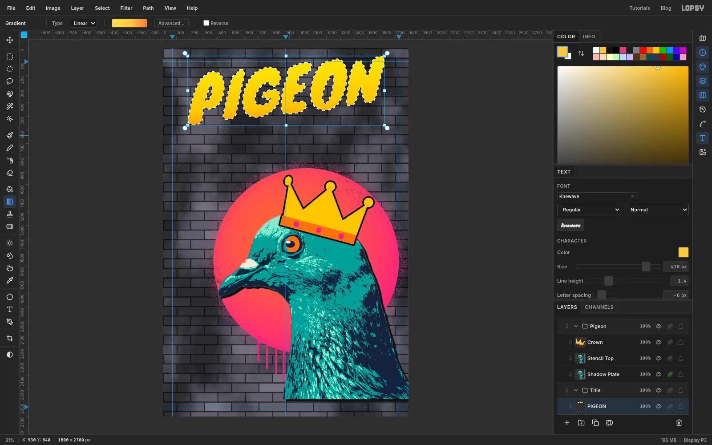

Check the spelling and spacing one last time, because the next click turns the text into pixels. Click the **Rasterize Layer** button (the **T** icon) at the bottom of the Layers panel. Then [[Cmd]]-click the layer's thumbnail to load the letters as a selection.

Pick the **Gradient** tool, set **Type** to **Linear**, and in **Advanced…** set three stops: `#FFE14D`, gold `#FFC93C` about halfway along, and orange `#FF7B35`. Drag from the top of the letters straight down to their bottom.

## Spray a highlight across the letters

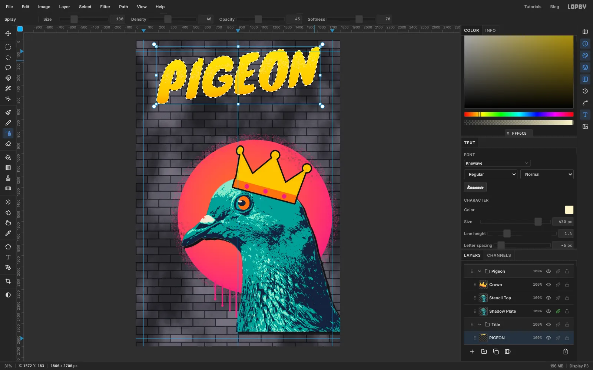

Graffiti fills usually have a sprayed highlight rather than a clean gloss. Keep the selection, pick the **Spray**, and set the foreground to `#FFF6C8`. Set **Size** to **130**, **Density** to **40** and **Opacity** to **45**. Make one pass from left to right across the upper third of the letters, following their tilt. The selection keeps the paint inside the letters. Press [[Cmd+D]].

## Outline the title and drop its shadow

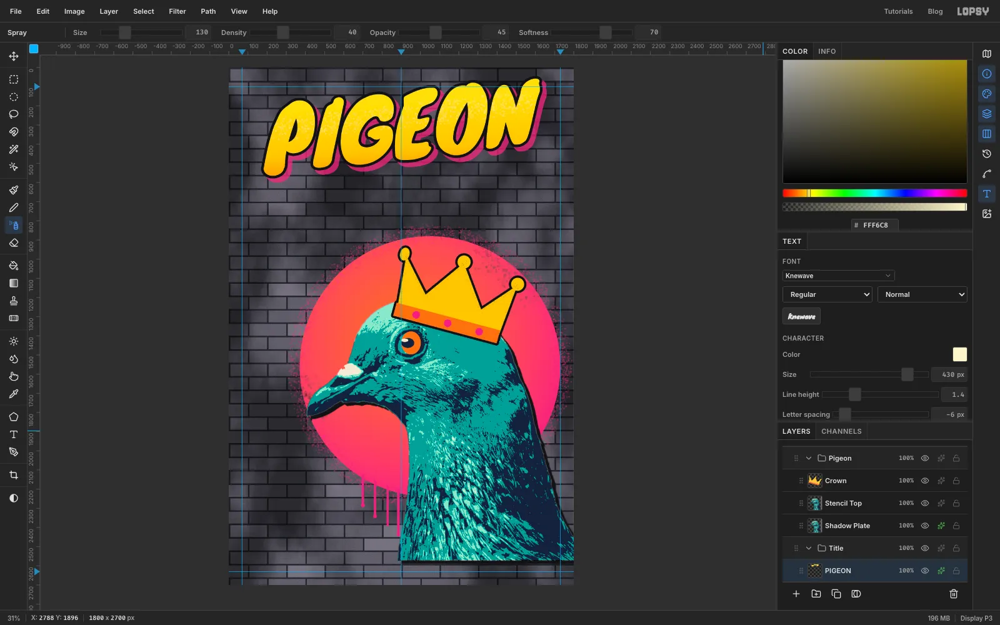

Open the layer's effects and turn on:

- **Stroke**: **Width 14** in ink `#121214`
- **Drop Shadow**: **Offset X 22**, **Offset Y 22**, **Blur 0**, **Spread 0**, **Opacity 75**, in pink `#E33A7E`

A drop shadow with no blur reads as a solid block of a second colour, like a classic piece.

## Add COUP in dripping letters

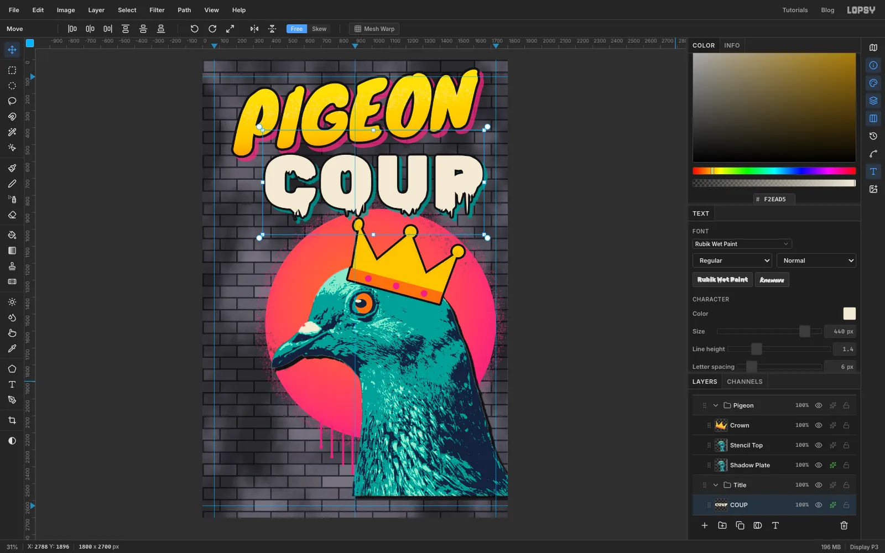

PIGEON is pixels now, so with its layer selected you can safely set up new text. Pick the **Text** tool and set:

- **Font** to **Rubik Wet Paint**
- **Size** to **440**
- colour to cream `#F2EAD5`

Click below the title, type `COUP` and press [[Tab]]. Rename the layer *COUP* and set **Letter spacing** to **6**. Nudge it so its top tucks about 10 px into the bottom of PIGEON and its centre sits a little right of the middle guide. That way the tilt of PIGEON and the flat COUP lock together.

Give it a **Stroke** of **12** in ink and a **Drop Shadow** with **Offset X 16**, **Offset Y 16**, **Blur 0** and **Opacity 75** in teal `#1F9E97`.

## Trim the drip that looks like a cedilla

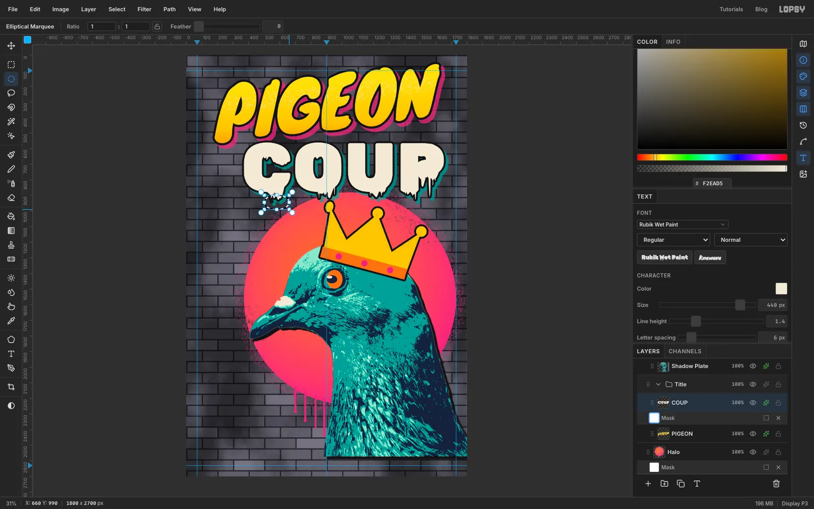

The drip under the bowl of the C makes the word read like "ÇOUP". You can hide it without rasterizing the text.

Click **Add Mask**, then click the mask thumbnail to edit it. Draw a small **Elliptical Marquee** around that one drip, set the foreground to black and choose **Edit → Fill**. Press [[Cmd+D]], then click the *COUP* layer's name to stop editing the mask. The text and its outline stay live.

## Move the whole pigeon as a group

The crown is crowding the bottom of COUP. Collapse the *Title* and *Pigeon* groups with their arrows. Then click the *Pigeon* group row, pick the **Move** tool, and drag straight down on the canvas by about **70 px**. Watch the Y value in the status bar as you drag. The stencil, the shadow plate and the crown all move together.

Click *Halo* and drag it down by the same amount, so the disc stays centred behind the head.

## Tear a strip of paper

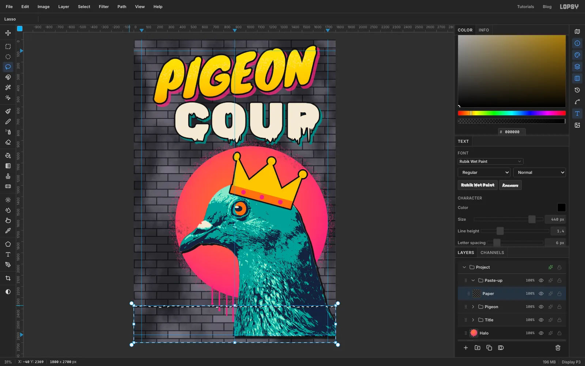

The event details go on a wheatpasted paper flyer. Click the collapsed *Pigeon* group and click **New Group**. Name the group *Paste-up* and add a layer inside it called *Paper*.

Pick the **Lasso**. Start just off the left edge of the canvas, about 320 px above the bottom. Drag across to just past the right edge in small, uneven jags to make the torn top edge. Carry on down past the bottom of the canvas, back along under it, and up to your starting point. Going off the canvas makes the paper bleed off both sides.

## Fill the paper and wrinkle it

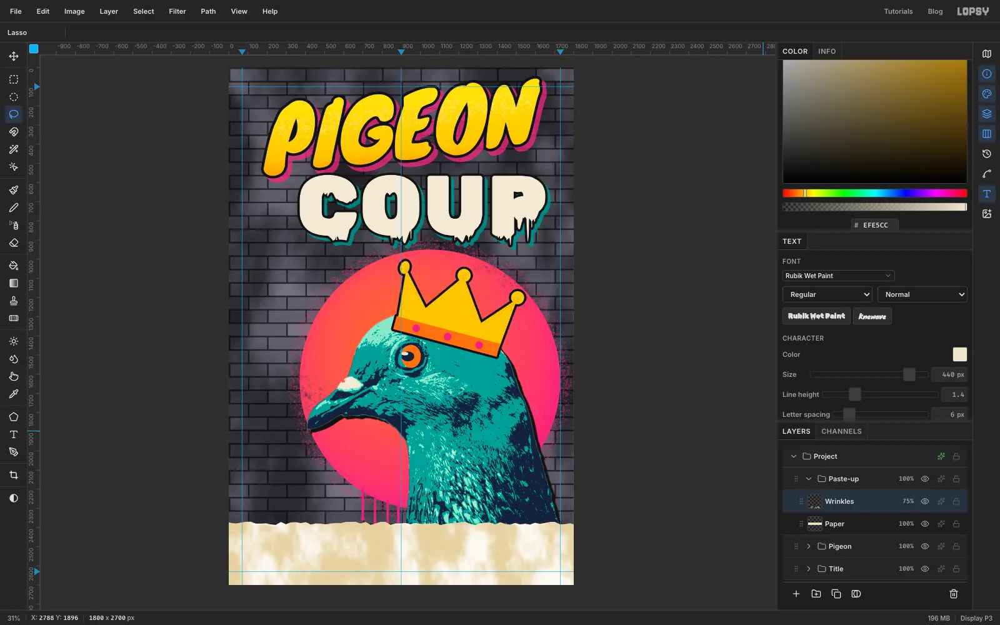

Fill the selection with `#EFE5CC` and deselect. Then choose **Filter → Add Noise…**, pick **Mono**, set **Amount** to **10** and click **Apply**.

For the wrinkles, [[Cmd]]-click the *Paper* thumbnail and add a layer called *Wrinkles*. Choose **Filter → Clouds…** with **Scale 14**, then **Filter → Emboss…** with **Strength 70**. Deselect, then set the layer to **Overlay** at **75%**. Wheatpaste leaves exactly this kind of blotchy, lumpy paper.

## Set the event details

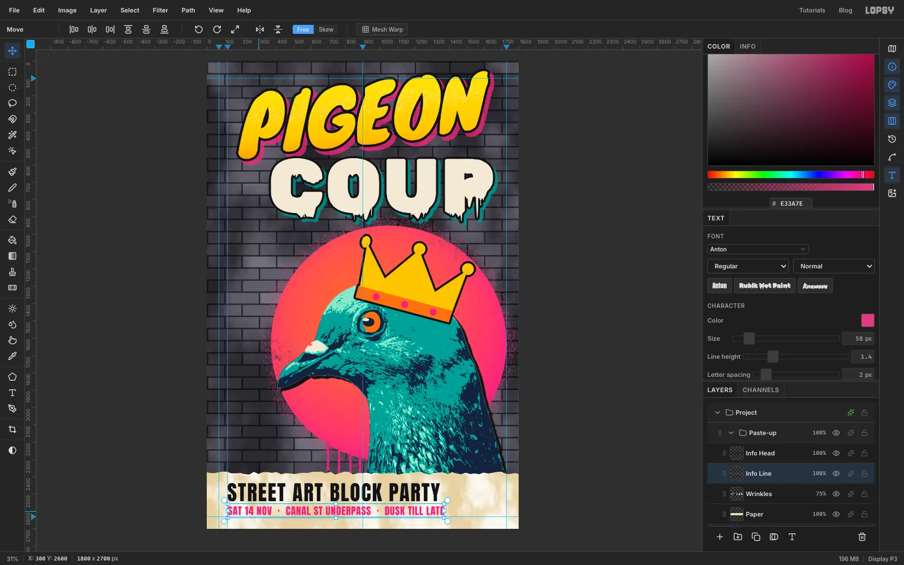

Click the top ruler at **120** to drop a guide for the text margin. With *Wrinkles* active, pick the **Text** tool and set **Anton** at **120** in ink `#121214`, with **Letter spacing** at **6**. Click in an empty part of the paper, type `STREET ART BLOCK PARTY` and press [[Tab]]. Rename it *Info Head* and nudge it so it starts on the guide, about 60 px below the paper's torn edge.

Click *Wrinkles* again, so the new settings don't restyle the headline. Set **Anton** at **58** in pink `#E33A7E` with **Letter spacing 2**. Click in empty paper below the headline and type the details, putting a middle dot with two spaces either side between each part. On a Mac the middle dot is [[Option+Shift+9]].

`SAT 14 NOV · CANAL ST UNDERPASS · DUSK TILL LATE`

Press [[Tab]], rename the layer *Info Line*, and line it up on the guide about 30 px under the headline.

## Trace a walking pigeon

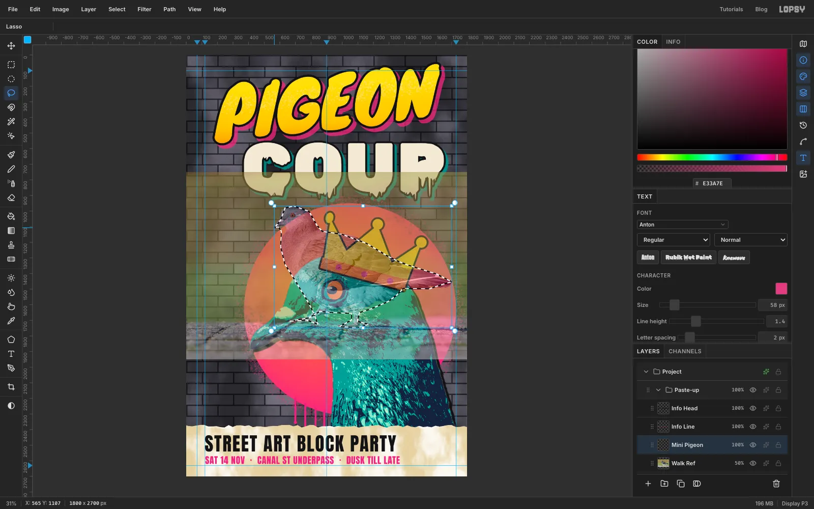

The flyer gets three small stencilled pigeons. The background of the walking-pigeon photo is too close in tone to the bird for the wand, so trace it by hand.

Click *Wrinkles*, drag the Alexis Lours photo onto the canvas and press [[Cmd+D]]. Rename it *Walk Ref* and set its opacity to **50%**, so you can see what you're tracing. Add a layer above it called *Mini Pigeon*.

Pick the **Lasso** and trace around the bird. Go from the beak over the head, along the back to the tip of the tail, back under the tail and belly, and down and around both legs and feet, then return to the beak. You don't need every feather. A silhouette this small only needs the head, tail and legs to read.

## Fill the silhouette and shrink it

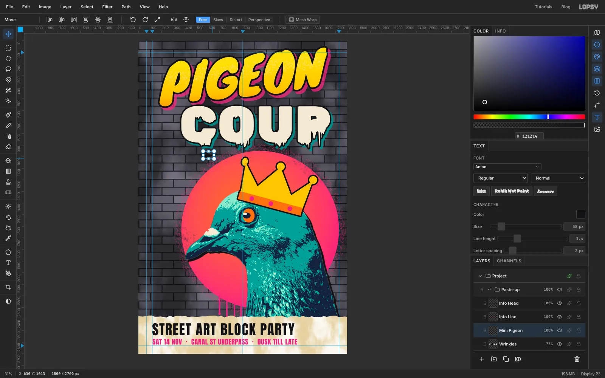

Fill the selection with ink `#121214`, deselect, and delete the *Walk Ref* layer.

Click *Mini Pigeon*, drag a **Rectangular Marquee** around the silhouette, switch to the **Move** tool, and [[Cmd]]-drag the bottom-right handle in until the bird is about **80 px** wide. Press [[Cmd+D]]. Then drag it with the **Move** tool to the right-hand end of the paper. Put its feet about level with the gap between the two lines of text, and keep it about 50 px clear of the end of the details line.

## Copy it into a little flock

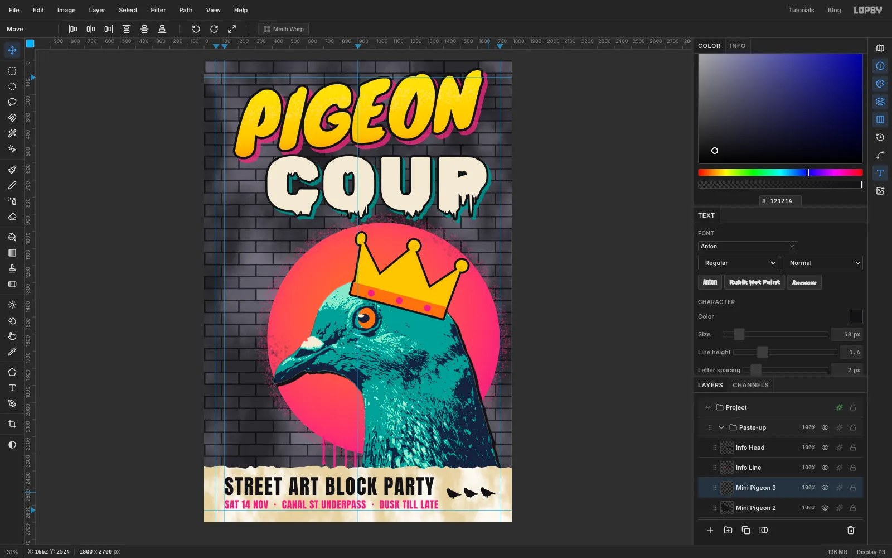

[[Cmd]]-click the *Mini Pigeon* thumbnail, then press [[Cmd+C]] and [[Cmd+V]]. When you paste something you copied inside Lopsy, it lands exactly where it came from, already selected. Drag it **100 px** to the right and a few pixels up, then press [[Cmd+D]] and rename it *Mini Pigeon 2*. Do the same from the copy to make *Mini Pigeon 3*. Leaving a gap between each tail and the next head keeps them reading as three birds, not one blob.

## Make a FREE ENTRY sticker

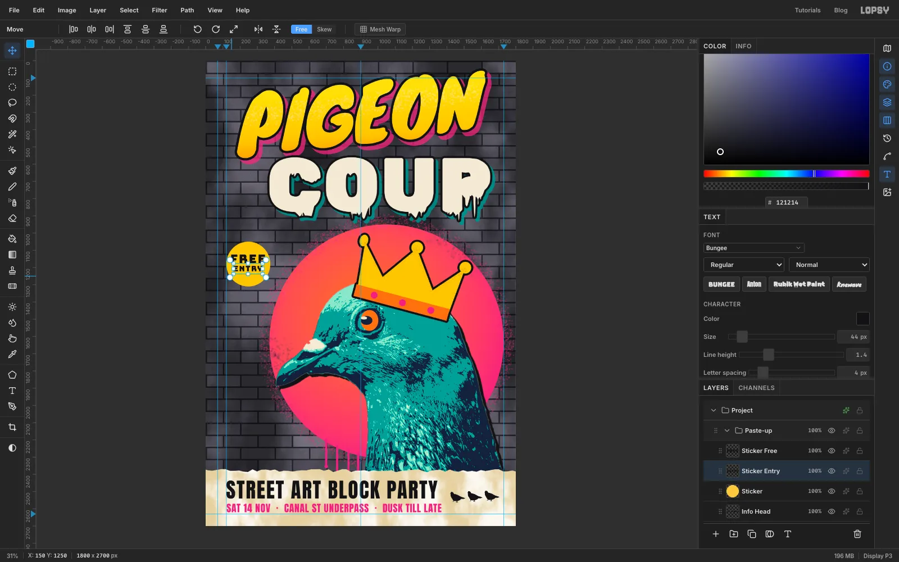

Click *Info Head* and add a layer called *Sticker*. With the **Elliptical Marquee**'s exact-size dialog, make a circle from **115, 1050** to **375, 1310** on the empty bricks left of the disc. Fill it gold `#FFC93C` and deselect.

Pick the **Text** tool and set **Bungee** at **70** in ink. Click away from other text, type `FREE` and press [[Tab]]. Nudge it so it's centred on the circle, sitting just above the middle. Click *Sticker*, then add `ENTRY` in **Bungee 44** with **Letter spacing 4**, centred just below the middle. Give both words a clear margin from the rim.

## Merge the sticker and turn it

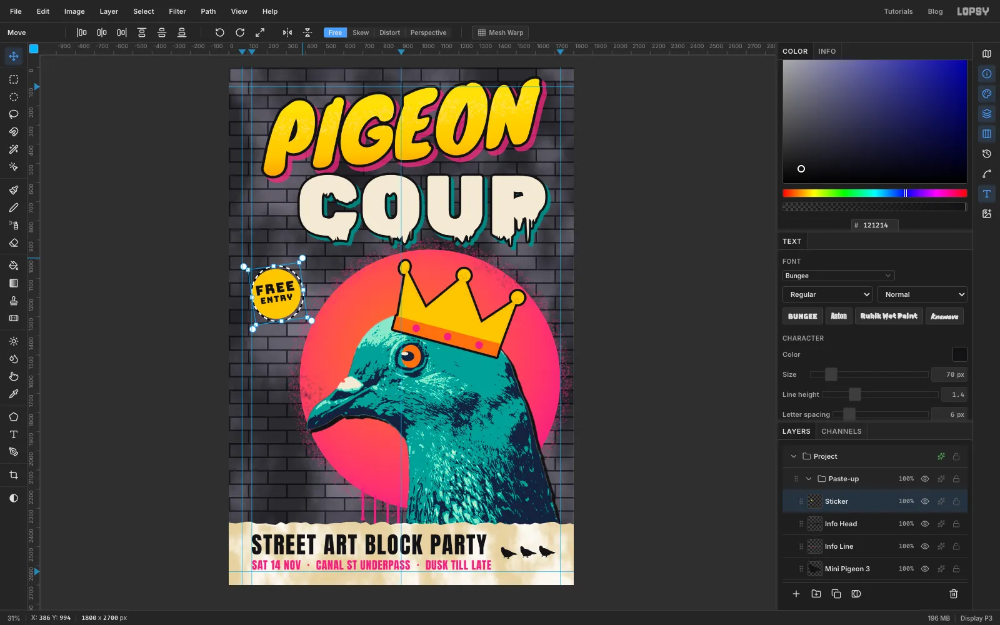

A sticker should turn as one piece, so merge it. Click *ENTRY* and choose **Layer → Merge Down**, then click *FREE* and merge it down too. Both words are now part of the *Sticker* layer.

Draw an **Elliptical Marquee** slightly larger than the sticker, and with the **Move** tool drag the top-right rotation handle about **8°** counter-clockwise. Press [[Cmd+D]].

## Give the sticker a vinyl border

Real stickers have a white die-cut border and sit a hair above the wall. Open the *Sticker* layer's effects and turn on:

- **Stroke**: **Width 8** in white
- **Drop Shadow**: **Offset X 2**, **Offset Y 3**, **Blur 3**, **Opacity 40**, in black

## Add a tag

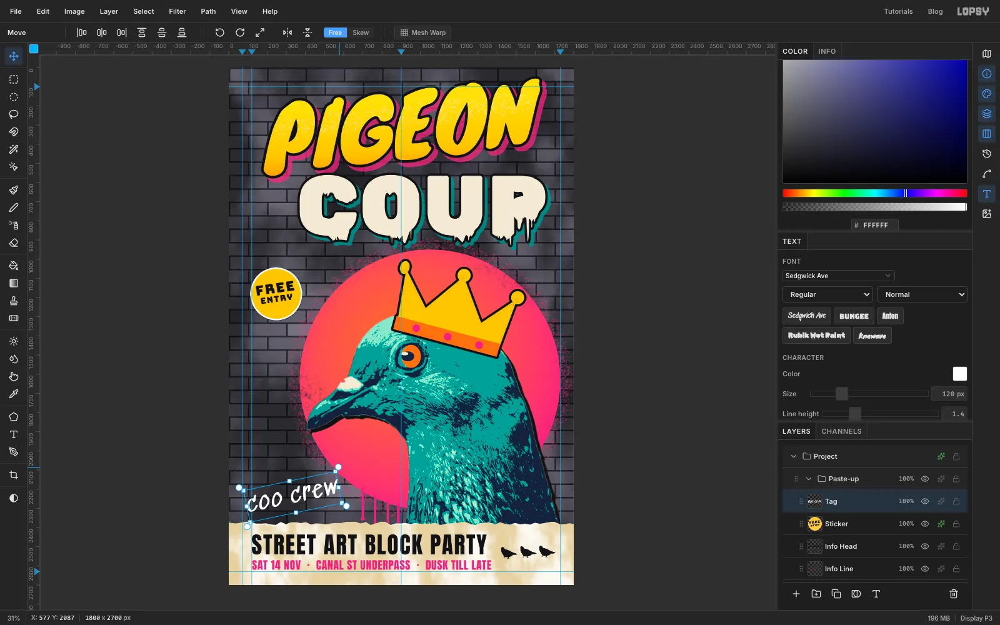

Click *Sticker*, pick the **Text** tool and set **Sedgwick Ave** at **120** in white. Sedgwick Ave is modelled on graffiti handstyles, so it reads as a tag rather than a typeface. Click on the bricks at the lower left, type `coo crew` and press [[Tab]]. Rename the layer *Tag*.

Switch to the **Move** tool and nudge it so it starts about 90 px from the left edge, above the paper and clear of the drips. Hover just outside the top-right corner of its box until the cursor becomes a crosshair, then drag that rotation handle and turn it about **12°** counter-clockwise. Then add an **Outer Glow** in white with **Size 8** and **Opacity 35** for a touch of spray mist.

## Press the bricks through the paint

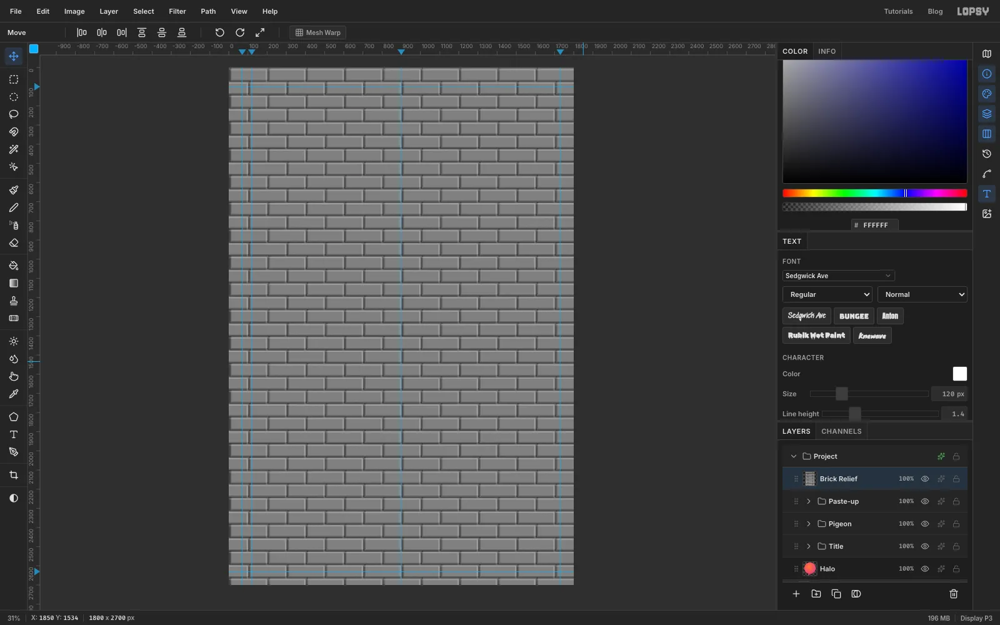

Paint and paper on a wall take on the bricks underneath. Collapse *Paste-up*, click it, and add a layer above it called *Brick Relief*. Choose **Edit → Fill with Pattern…**, pick the brick again with **Row Stagger** at **50%**, and click **Apply**.

Then apply **Filter → Emboss…** with **Strength 60**, **Filter → Desaturate**, and **Filter → Brightness/Contrast…** with **Brightness** at **22**. Lopsy's Emboss keeps the original colours, so desaturating and lifting the brightness turns the brick faces into a middle grey. On **Overlay**, middle grey changes nothing. Only the mortar lines and the edge highlights will show.

## Ease the relief off the title and paper

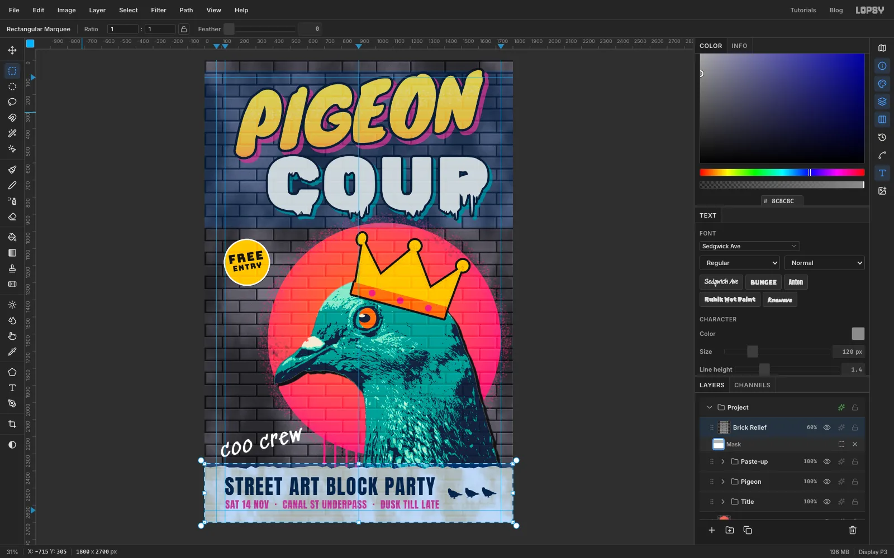

Set *Brick Relief* to **Overlay** at **60%**. The bricks now show through everything, which is a bit strong on the type and the paper.

Click **Add Mask** and click the mask thumbnail to edit it. Then:

1. Draw a **Rectangular Marquee** over the title area, from the top of the canvas to just below COUP. Set the foreground to `#B4B4B4` and choose **Edit → Fill**. That keeps about 70% of the relief there.
2. Draw a marquee over the paper strip and fill it with `#8C8C8C`, which keeps about half.

Deselect and click the layer's name to leave the mask.

## Finish with a vignette

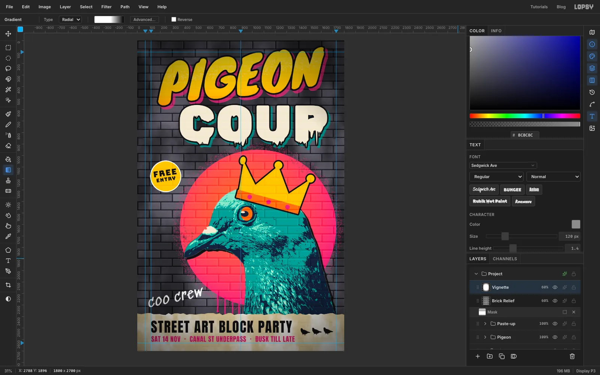

Add a layer called *Vignette*. Pick the **Gradient** tool, set **Type** to **Radial**, and in **Advanced…** make three stops: white at the left end, white at about **55%**, and black at the right end. Drag from the centre of the poster to its bottom-right corner, then set the layer to **Multiply** at **60%**. The corners darken, and the white centre stays untouched.

Choose **File → Quick Export PNG** to export the poster, and **File → Save Project** to keep the layers.

> **Credits:** Pigeon portrait "Columba livia - 01.jpg" by Carlos Delgado, CC BY-SA 4.0. Walking pigeon "Feral Pigeon 2023 11 19.jpg" by Alexis Lours, CC BY 4.0. Both are from Wikimedia Commons.
