Every autumn, monarch butterflies fly up to 4,800 km from Canada and the northern United States to a few mountain forests in central Mexico. Murals of monarchs turn up on walls all along that route, so they make a good cover story for a street-art zine.

In this tutorial you'll make the cover of **WILD WALLS**, an imaginary street-art zine, on a 1100 × 1700 px page (5.5 × 8.5 in, a standard half-letter zine). The cover is really a photo of a wall, with the zine's own printed bits stuck on top:

- a **cinderblock wall** spray-faded from indigo to teal, with an old half-painted-over tag, rain streaks and dirt
- a **mural monarch**, traced from a museum specimen photo with the Magic Wand and painted in flat spray colours
- a **graffiti piece** reading MONARCH: bouncing bubble letters with a fade fill, a 3D block, a pink cloud and drips
- a white **handstyle tag** underneath
- the zine's **masthead**, **cover lines** and a **HELLO my name is** sticker on top

Along the way you'll use:

- the **Pencil** with a snapped **grid**, **Add Noise**, **Emboss**, **Gaussian Blur**, **Motion Blur**, **Clouds** and **Threshold**
- **Paste**, the **Magic Wand** with and without **Contiguous**, **⌘-click** to select a layer's pixels, and **Select → Grow / Shrink / Feather / Inverse**
- scaling, moving and rotating with the **Move** tool, on pixels, live text and whole groups
- **Copy Merged** and paste in place, and **Option-drag** to stamp copies of a selection
- the **Pen** tool, the **Brush** with **Spacing** and **Taper**, the **Spray** and **Dodge / Burn**
- **Stroke**, **Drop Shadow** and **Outer Glow** effects, and the **Screen**, **Overlay** and **Multiply** blend modes
- per-character text colour, groups, and a **layer mask** with a gradient
- live text in **Titan One**, **Sedgwick Ave**, **Sedgwick Ave Display**, **Bungee**, **Special Elite** and **Rock Salt**

The palette:

- Wall fade `#15173A` → `#22357A` → `#127A86` → `#22A592`
- Mist pink `#E0458B`, mist cyan `#3FD8E6`, buff patch `#77768A`, dirt `#0A0F2A`
- Sun `#FFF6D2` → `#FFD76E` → `#F5A13A`, sun dots `#FFE7A0`
- Monarch black `#1A1210`, cells `#FFD447` → `#FF9A1F` → `#E8521A`, spots `#FFF8EA`, outline `#FFF3DA`, shadow `#2B124F`
- Letters `#FFE66D` → `#FFA21C` → `#EF4A2B`, glint `#FFF4CF`, outline `#141019`, block `#3A1C71`, cloud `#E8458B`
- Buff band `#F2EBDD`, ink `#17131D`, WALLS orange `#F26A1B`, tape `#E4DCC6`, paper `#F4F0E6`
- Sticker red `#D7263D`, sticker white `#FBFAF5`

You'll need one photo: **"Danaus plexippus MHNT.jpg"** by Didier Descouens on Wikimedia Commons. It shows two pinned monarchs on white. Download it and crop it to just the top butterfly (the male, wings fully open) with a little white around it, about 1120 × 750 px. Keep the crop handy.

> **Note:** Shortcuts are written for a Mac. On Windows use [[Ctrl]] for [[Cmd]] and [[Alt]] for [[Option]].

Positions are given in document pixels as `x, y` where things need to line up. The status bar at the bottom of the window shows the pointer's **X** and **Y**. Freehand strokes don't need to match exactly; follow the screenshots by eye.

Two habits will save you trouble. Before you start a new piece of text, click a layer that isn't text, so picking a font or size doesn't restyle the text you made last. And start each new piece of text in an empty patch of canvas: a click on existing text edits it instead.

## Set up the page and guides

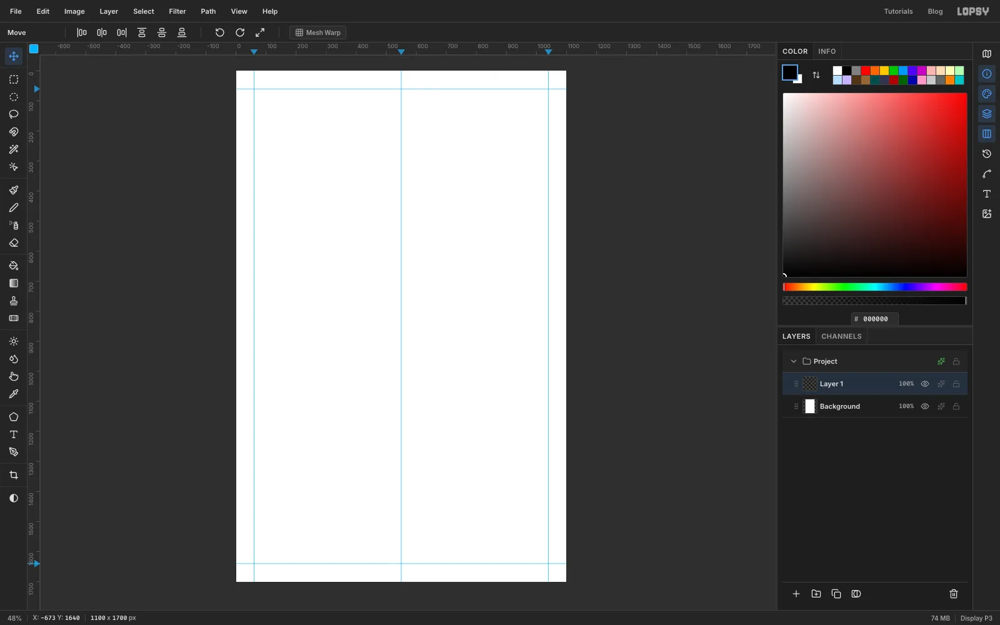

Choose **File → New** and make a **1100 × 1700** px document with a **White** background.

Click the top ruler at `x 60`, `550` and `1040` to drop three vertical guides: the two side margins and the centre. Then click the left ruler at `y 60` and `1640` for the top and bottom margins.

## Spray the wall's colour fade

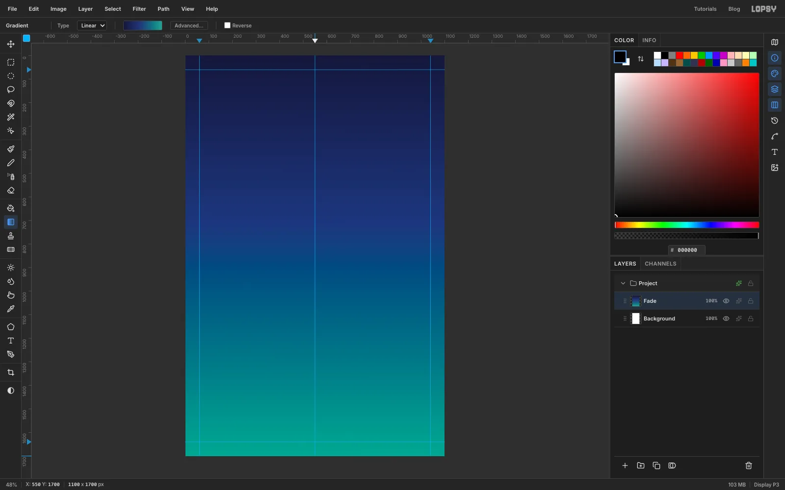

Double-click **Layer 1** and rename it `Fade`.

Pick the **Gradient** tool with **Type** set to **Linear** and click **Advanced…**. Make four stops: `#15173A` at the left end, `#22357A` at about 42%, `#127A86` at about 78% and `#22A592` at the right end. Click **Done**, then drag from the top centre of the page straight down to the bottom.

Muralists often start a wall with a "fade" like this: a few colours of spray paint blended into each other.

## Mist in some colour

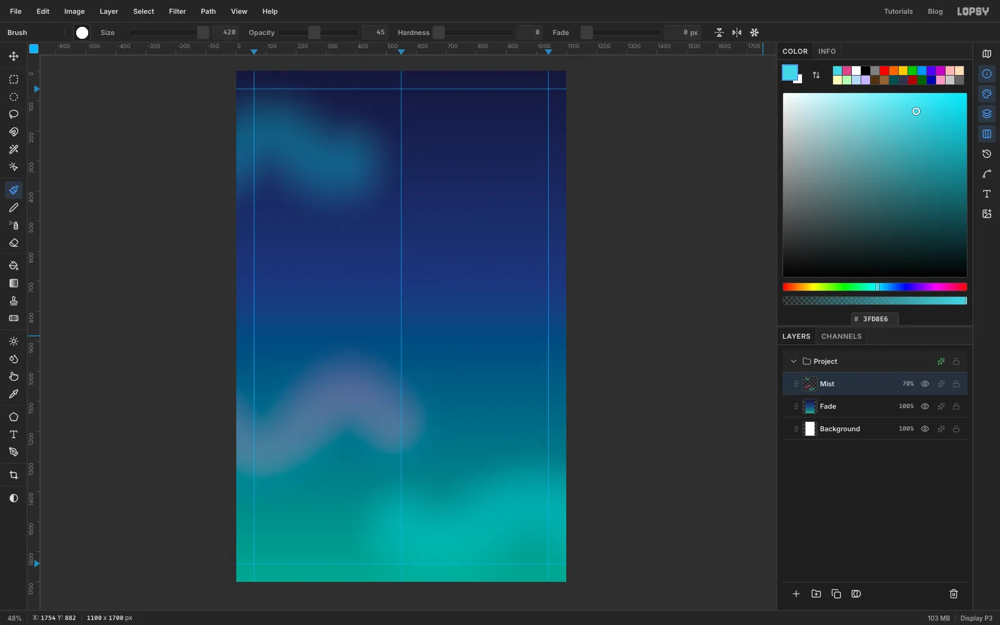

Click **Add Layer** and name the layer `Mist`. Pick the **Brush** and set **Size** `420`, **Hardness** `0` and **Opacity** `45`.

- With the foreground set to `#E0458B`, make one slow, wavy stroke across the lower left, from off the left edge to about the middle, at about `y 1180`.
- Switch to `#3FD8E6` and make two more: one across the bottom right at about `y 1500`, and a short one across the top left at about `y 260`.

Click the ✦ button on the layer's row to open its effects drawer, set the blend mode to **Screen** and close the drawer. Then click the opacity figure on the row and drag it to `70%`.

## Turn on a 128 px grid

Add a layer called `Blocks`. Set the foreground to `#7C7C7C`, press [[Cmd+A]], choose **Edit → Fill** and press [[Cmd+D]].

Choose **View → Show Grid**. A **Grid** slider appears at the right of the options bar: drag it until the label reads **128px**. Cinderblocks are twice as long as they are tall, so each block will be two grid cells wide and one tall.

## Draw the mortar with the Pencil

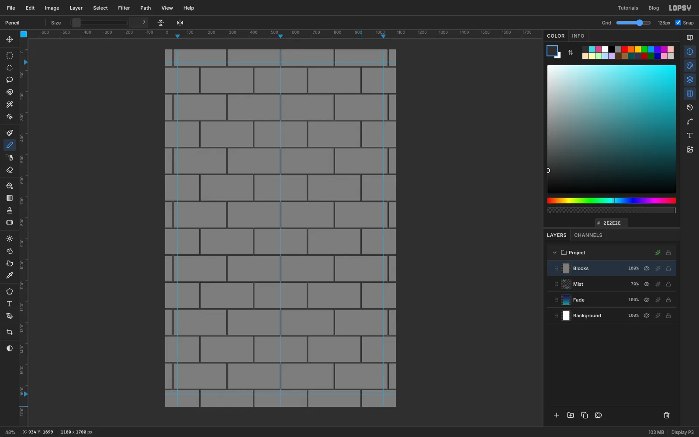

Pick the **Pencil** with **Size** `7` and set the foreground to `#2E2E2E`. The grid is centred on the page, so the first horizontal line is at about `y 82`, not at the top edge, and the top and bottom rows are part-blocks. Zoom in a little if your clicks don't land on the lines. It's a lot of clicks, but each one is quick.

1. For each horizontal grid line, click at the left edge of the canvas and [[Shift]]-click at the right edge. Shift-click draws a straight line from the last point.
2. Now the joints between blocks. In the top row, click on a vertical grid line and Shift-click straight down to the next horizontal line. Repeat on **every second** vertical grid line along the row.
3. In the next row down, do the same but on the grid lines you skipped, so the joints are staggered like real blockwork. Keep alternating to the bottom.

When the wall is done, choose **View → Show Grid** again to hide the grid.

## Emboss the blocks

With `Blocks` still active:

1. **Filter → Add Noise…** with **Amount** `22` and **Mono**. This gives the blocks a pitted concrete surface.
2. **Filter → Emboss…** with **Angle** `135` and **Strength** `40`. The mortar lines turn into grooves lit from the top left.
3. **Filter → Gaussian Blur…** with **Radius** `1.5`, to take the digital crispness off the edges.

## Press the wall into the paint

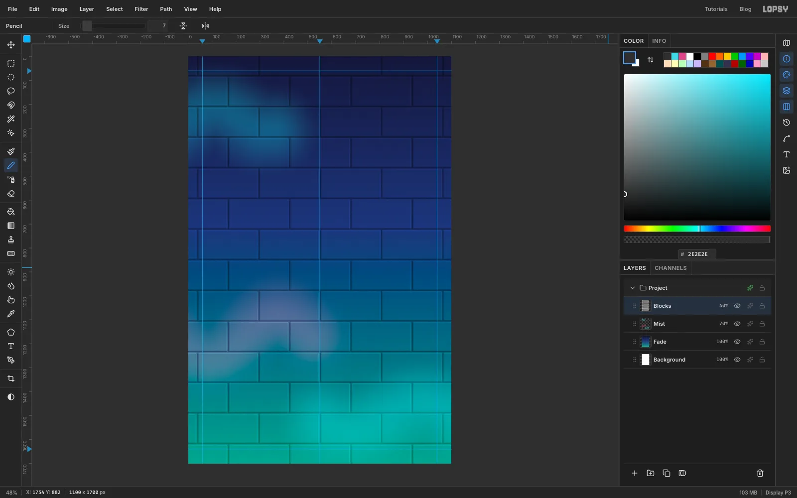

Open the effects drawer for `Blocks`, set the blend mode to **Overlay**, and close it. Set the layer's opacity to `40%`.

The grey disappears and leaves only the bumps and grooves, so the fade now looks like paint sprayed onto blocks. Everything painted on the wall later goes *under* this layer, so it takes the texture too.

## Leave an old tag and a buff patch

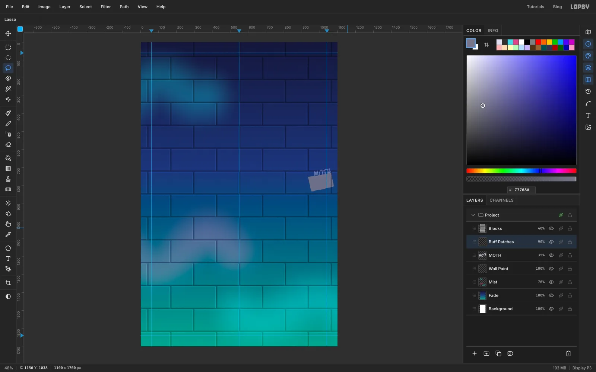

Real walls carry history. Here, someone's old tag has been half painted over ("buffed") with paint that doesn't quite match.

1. Click `Mist` and add a layer called `Wall Paint`. Leave it empty: it's a spare layer for touching up the wall later. Pick the **Text** tool, choose **Sedgwick Ave Display** at **Size** `46`, set the foreground to `#E4E0F2`, and click near the right edge at about `966, 704`. Type `MOTH` and press [[Tab]] to commit.
2. Pick the **Move** tool. Hover just outside the text box's top-right corner until the pointer turns into the rotate cursor, then drag up a little to tilt the tag about 12° anticlockwise. Press [[Cmd+D]].
3. Set the `MOTH` layer's opacity to `35%`.
4. Click **Add Layer** and call it `Buff Patches`. With the **Lasso**, draw a slightly tilted, roughly rectangular patch, about 130 × 80 px, that covers the bottom half of the tag and hangs below it. Fill it with `#77768A`, then run **Filter → Add Noise…** with **Amount** `10` and **Mono**. Deselect and set the layer to `90%`.

## Paint the sun

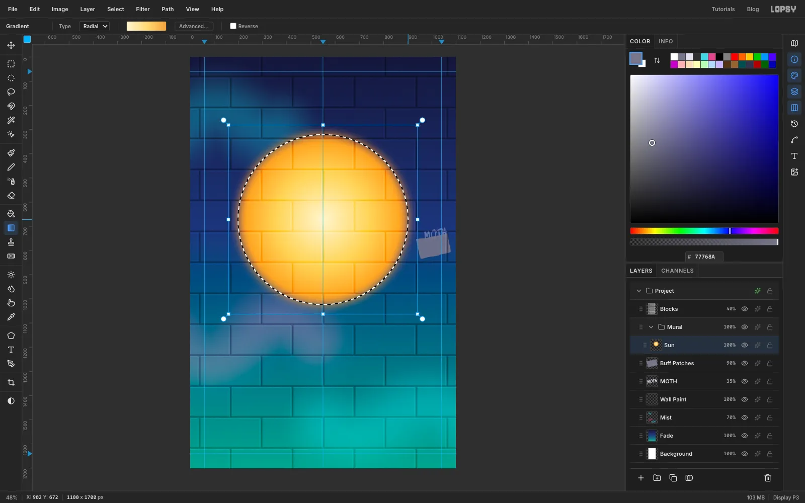

With `Buff Patches` active, click **New Group** at the bottom of the Layers panel and name it `Mural`. Everything painted for the mural goes in here. With the group selected, click **Add Layer** and name it `Sun`.

1. Pick the **Elliptical Marquee** and drag a circle from `198, 320` to `902, 1024`. That's a 704 px circle centred at `550, 672`.
2. Choose **Select → Feather…** with `40`. Spray paint never gives a clean edge.
3. Pick the **Gradient** tool, set **Type** to **Radial**, and in **Advanced…** use `#FFF6D2` at the left end, `#FFD76E` at about 55% and `#F5A13A` at the right end.
4. Drag from the centre of the circle to its right edge, then press [[Cmd+D]].

## Ring the sun with dots

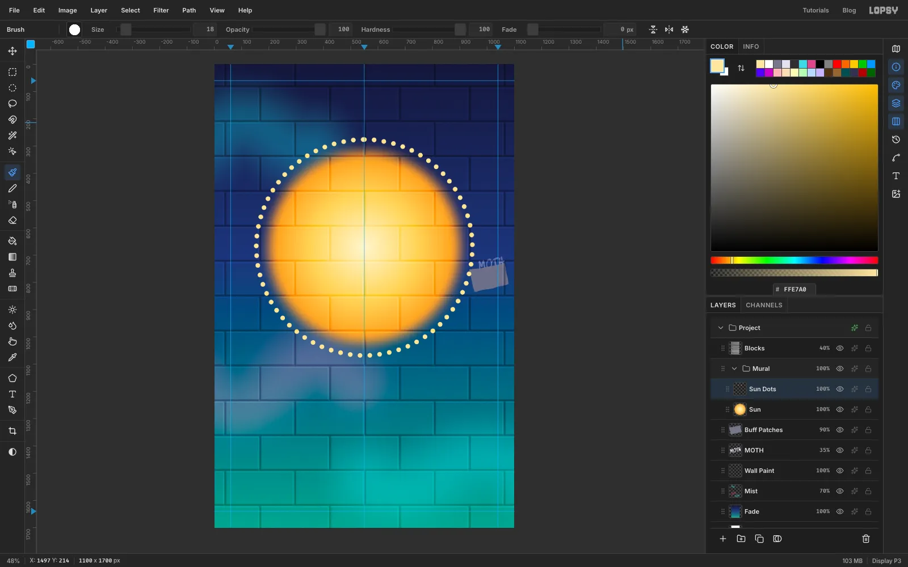

Add a layer called `Sun Dots`. Pick the **Brush** with **Size** `18`, **Hardness** `100` and **Opacity** `100`. Open the Brushes dialog with the brush-tip button at the left of the options bar, and on the **Shape** tab set **Spacing** to `200`. Close the dialog.

At 200% spacing each dab sits two brush-widths from the last, so a stroke becomes a row of dots. Set the foreground to `#FFE7A0` and drag slowly once around the sun, about 44 px outside its edge. A freehand ring will wobble a little, and that's fine: it looks hand-sprayed.

Open the Brushes dialog again and put **Spacing** back to `10` before you paint anything else.

## Paste in the reference photo

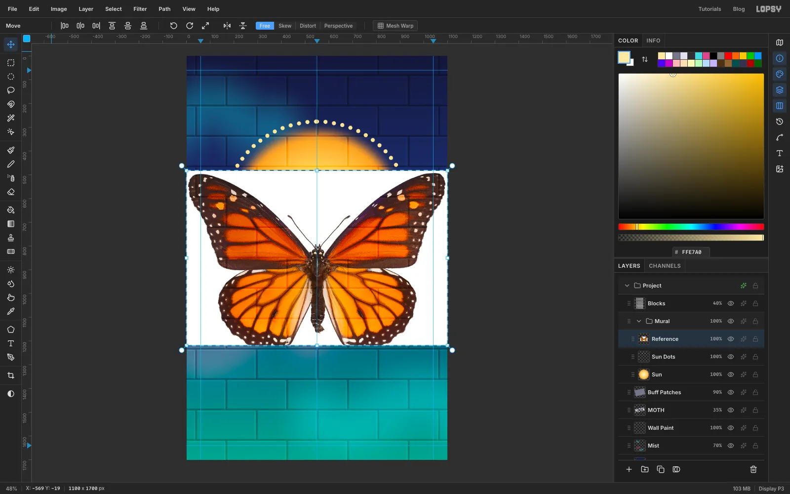

Open your cropped monarch photo in any image viewer, copy it, and press [[Cmd+V]] in Lopsy. The crop is a little wider than the page, so Lopsy shrinks it to fit and selects it, with the **Move** tool already active.

Rename the new layer `Reference` and set its opacity to `60%`, so you can see the wall through it as you work.

## Knock out the white backdrop

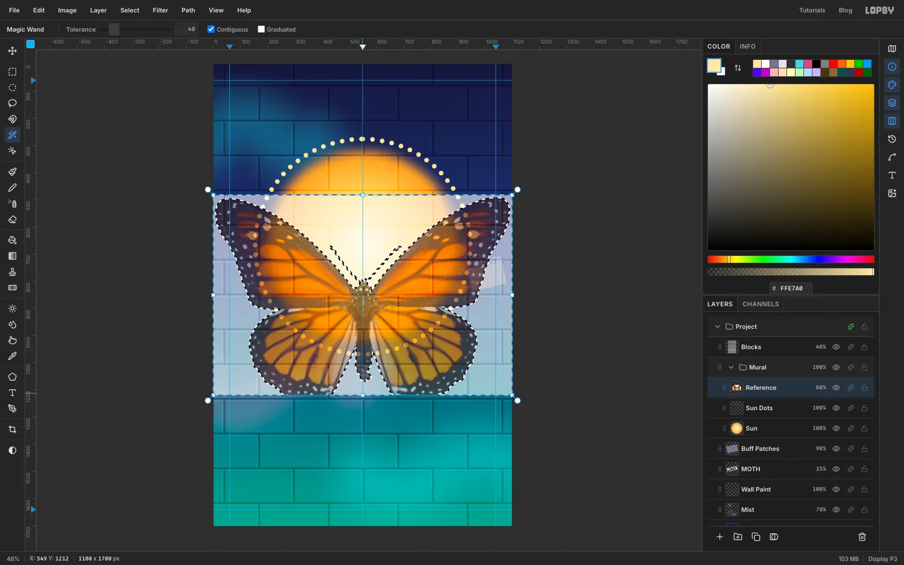

Press [[Cmd+D]]. Pick the **Magic Wand** and set **Tolerance** to `40` with **Contiguous** ticked.

Click the white in the photo's top-left corner. That selects the whole connected background. The small white wedge under the body, between the two lower wings, is a separate area, so [[Shift]]-click it to add it.

Press [[Delete]], then [[Cmd+D]]. Only the butterfly is left.

## Scale it down and centre it on the sun

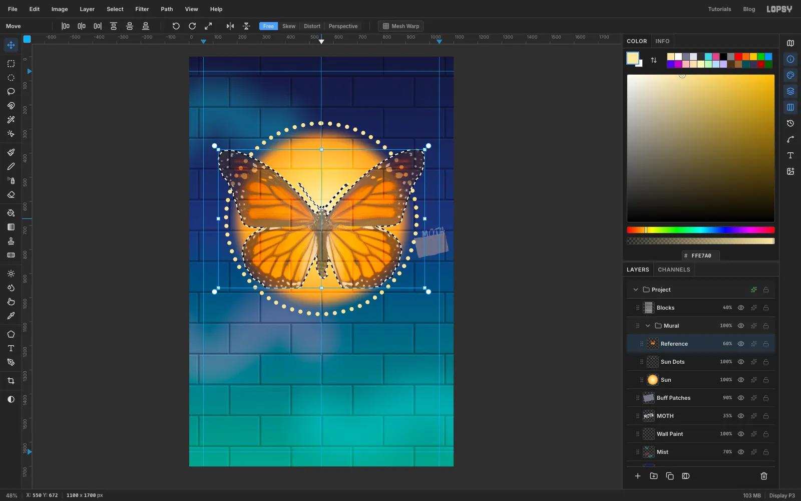

[[Cmd]]-click the `Reference` thumbnail to select the butterfly's pixels. The Move tool shows transform handles around it.

1. Hold [[Cmd]] and drag the bottom-right corner handle up and in until the butterfly is about 860 px wide. [[Cmd]] keeps the proportions.
2. Drag from the middle of the butterfly to move it until its body sits in the centre of the sun, at about `550, 672`.

## Tilt it into flight

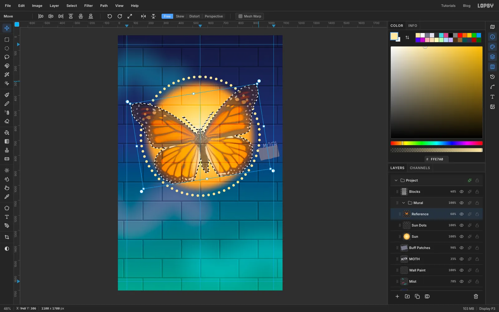

Hover just outside the box's top-right corner until you see the rotate cursor, then drag upward to turn the butterfly about **9° anticlockwise**, so its right wing lifts. A slight tilt makes it look like it's flying rather than pinned in a case.

Press [[Cmd+D]] to commit.

## Fill the black silhouette

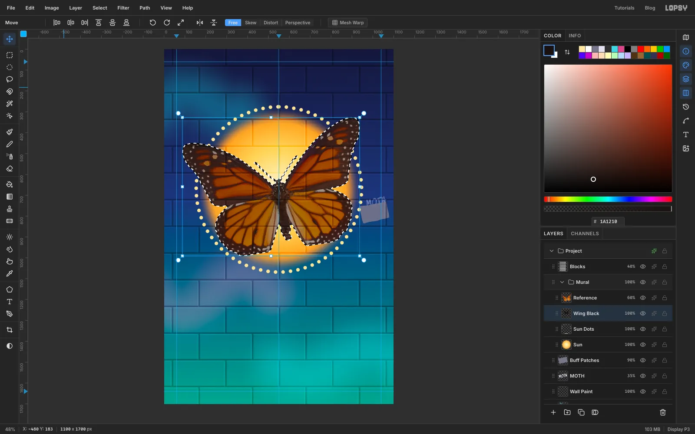

Now you'll trace the photo the way a mural painter works: black base first, colour on top, and the black that shows through becomes the veins.

1. Click `Sun Dots`, then **Add Layer**, and name the new layer `Wing Black`. It goes between `Sun Dots` and `Reference`.
2. [[Cmd]]-click the `Reference` thumbnail to select the butterfly.
3. Choose **Select → Grow…** with `4`, then **Select → Shrink…** with `4`. Growing and shrinking by the same amount closes the hairline gaps along the body without changing the outline.
4. Set the foreground to `#1A1210` and choose **Edit → Fill**. Press [[Cmd+D]].

The `Reference` layer sits on top at 60%, so the black looks brown for now.

## Select the orange cells

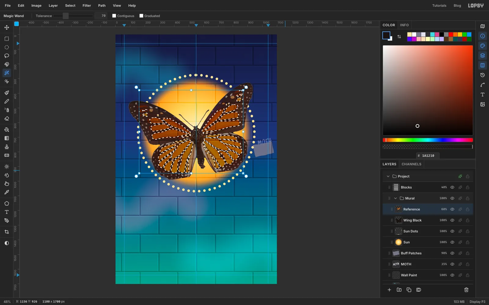

Click `Reference`. Pick the **Magic Wand**, set **Tolerance** to `70` and **untick Contiguous**, so one click finds that colour everywhere in the photo.

1. Click inside one of the orange cells in an upper wing.
2. [[Shift]]-click an orange cell in a lower wing. The lower wings are a lighter orange, so this adds the ones the first click missed.
3. Tidy the edges: **Select → Grow…** `1`, then **Shrink…** `2`, then **Grow…** `1`. This fills pinholes and drops the loose specks the photo's scales leave along the veins.

## Fill the cells with an orange fade

Click `Wing Black` and add a layer called `Orange`.

Pick the **Gradient** tool with **Radial**, and in **Advanced…** use `#FFD447` at the left end, `#FF9A1F` at about 45% and `#E8521A` at the right end. Drag from just below the butterfly's body, at about `550, 692`, out to the right about 440 px. The colour now glows from the body out to the tips, the way a muralist fades one can into another. Press [[Cmd+D]].

## Pick out the white spots

Click `Reference` again. Keep the **Magic Wand** with **Contiguous** off, and set **Tolerance** to `80`. Click the middle of one of the cream spots near the tip of the left upper wing. Every spot in the photo is selected.

Click `Orange`, add a layer called `Spots`, set the foreground to `#FFF8EA` and choose **Edit → Fill**. Press [[Cmd+D]].

## Clean up the body

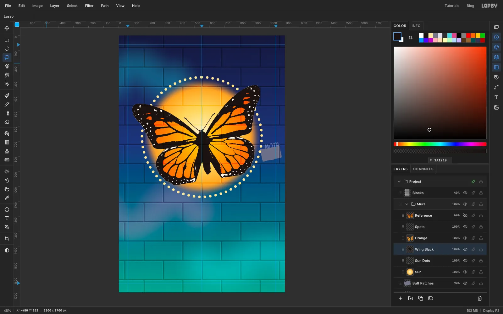

The specimen has pale scales along the inside of its lower wings and a speckled thorax, and the wand picked those up as white blotches. Paint over them:

1. On `Spots`, use the **Lasso** to draw a loose shape around the abdomen and the pale strips either side of it, from the bottom of the thorax to the tip of the abdomen.
2. Hold [[Shift]] and drag a small circle with the **Elliptical Marquee** over the thorax to add it.
3. Press [[Delete]], then [[Cmd+D]].
4. Click `Wing Black` and lasso a slim shape over the abdomen, then fill it with `#1A1210`. That closes any gaps along the body.

Click the eye on `Reference` to hide it.

## Outline it, drop a shadow and add overspray

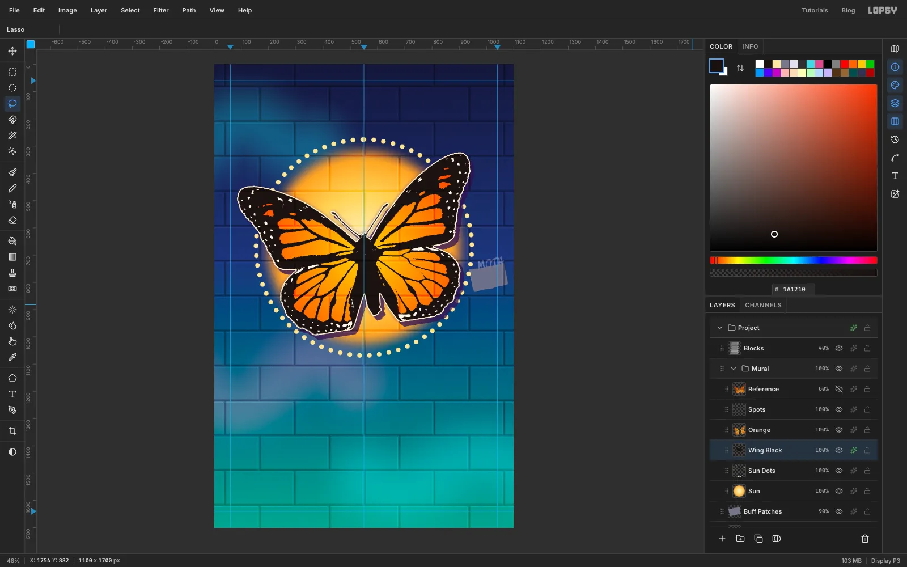

Open the effects drawer for `Wing Black`:

- **Stroke**: **Width** `4`, colour `#FFF3DA`, position **Outside**. Muralists often finish a figure with a thin light line so it pops off the background.
- **Drop Shadow**: **Offset X** `14`, **Offset Y** `16`, **Blur** `0`, **Opacity** `75`, colour `#2B124F`. A hard, solid shadow is a classic mural trick for depth.
- **Outer Glow**: **Size** `22`, **Opacity** `45`, colour `#2B124F`. This is the soft mist that spray paint leaves around a shape.

## Spray a sheen across the upper wings

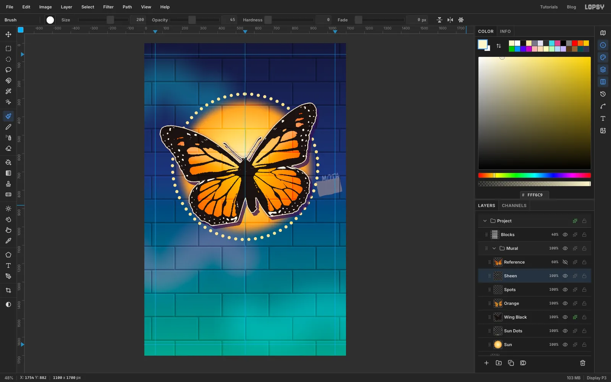

Click `Spots` and add a layer called `Sheen`. [[Cmd]]-click the `Orange` thumbnail so the highlight stays inside the cells.

Pick the **Brush** with **Size** `200`, **Hardness** `0`, **Opacity** `45` and the foreground `#FFF6C9`. Make one stroke along each upper wing, from near the tip toward the body. Press [[Cmd+D]] and set `Sheen` to **Screen**.

## Redraw the antennae and the abdomen

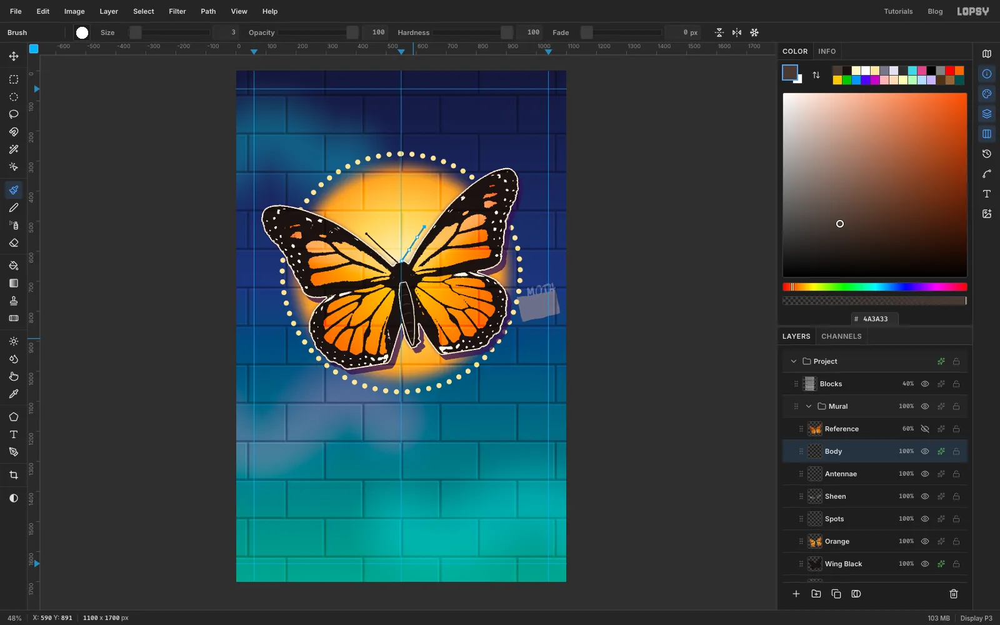

Traced antennae come out lumpy and pick up the cream outline as thick tubes. Draw clean ones instead.

1. Click `Wing Black`. With the **Lasso**, draw around the antennae in the gap above the head, staying clear of the wings, and press [[Delete]]. Press [[Cmd+D]].
2. Click `Sheen` and add a layer called `Antennae`. Set the foreground to `#1A1210`.
3. Pick the **Pen** tool and set **Stroke** to `4` in the options bar. Click at the tip of the left antenna (where the old one ended), click twice along its line, and click at the head. Press [[Enter]]. The Pen commits the path and strokes it in the foreground colour. Do the same for the right antenna. The last path stays selected, so its thin blue outline stays on screen in the next few screenshots; it's only a guide and never shows up in the export.
4. Pick the **Brush** with **Size** `9` and **Hardness** `100` and click once at each tip for the knobs.
5. Add a layer called `Body`. Lasso a slim shape for the abdomen that narrows to a rounded point at the bottom, and fill it with `#1A1210`. Give it a **Stroke** of **Width** `3`, **Outside**, in `#FFF3DA`, so it reads as its own segment.
6. With the **Brush** at **Size** `3` and the foreground `#4A3A33`, draw six short, slightly curved lines across the abdomen for its segments.

## Group the butterfly

Click the `Reference` layer and click **Delete Layer**: you won't need it again.

Click `Body`, then [[Shift]]-click `Wing Black` to select the six butterfly layers. Choose **Layer → Group Layers** and name the group `Monarch`. Now the whole butterfly can be moved and switched on and off as one.

## Copy the whole butterfly

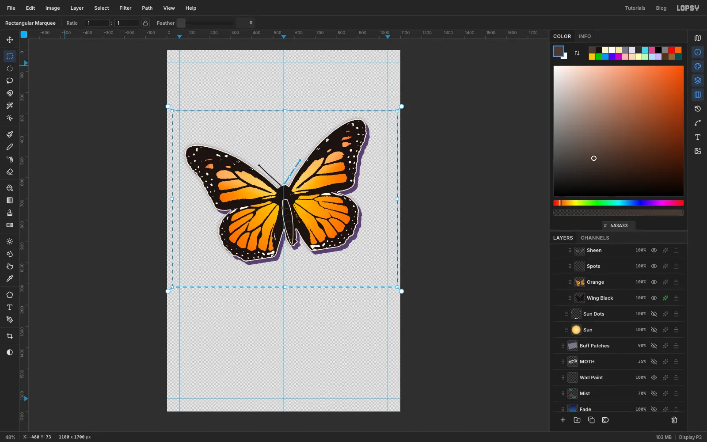

You want two small copies of the finished butterfly, outline and shadow included. **Copy Merged** copies everything visible inside a selection, so hide everything else first.

1. Click the eye on `Background`, `Fade`, `Mist`, `MOTH`, `Buff Patches`, `Blocks`, `Sun` and `Sun Dots`.
2. Draw a **Rectangular Marquee** around the whole butterfly, shadow included.
3. Choose **Edit → Copy Merged**, press [[Cmd+D]], and turn all those layers back on.

## Paste a small monarch

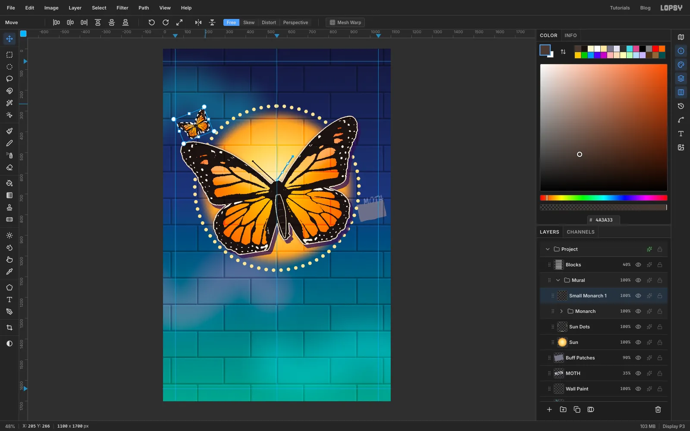

Collapse the `Monarch` group with the arrow on its row and click it. Press [[Cmd+V]]: the copy lands in place, right on top of the big butterfly, and it's selected with the **Move** tool active. Rename it `Small Monarch 1`.

1. Hold [[Cmd]] and drag the bottom-right handle in until the copy is about a sixth of its size, roughly 175 px wide.
2. Drag it up to the top left, centred at about `150, 368`, just under the masthead area and clear of the sun's dots.
3. Use the rotate handle at the top right to turn it about 22° anticlockwise, then press [[Cmd+D]].

## Paste a second, smaller one

Press [[Cmd+V]] again. The new copy lands on top of the big butterfly again, just like the first one. Rename it `Small Monarch 2`. Scale it to about 14% (roughly 145 px wide), move it to about `120, 965`, rotate it about 18° clockwise this time, and press [[Cmd+D]].

## Dot the flight route

Click `Sun Dots` and add a layer called `Flight Path`. It sits under the butterflies.

Pick the **Brush** with **Size** `9`, **Hardness** `100` and **Opacity** `85`, set **Spacing** `200` in the Brushes dialog again, and set the foreground to white.

1. Drag one smooth curve from just under the top-left monarch, out past the tip of the big left wing (keep about 15 px of wall between them), down the left side, and in toward the lower monarch, ending just above it at about `110, 926`.
2. For the arrowhead, make two short drags of about 36 px that both end at the end of the route: one coming in from up and to the left, one from up and to the right.

Put **Spacing** back to `10`.

## Type the piece

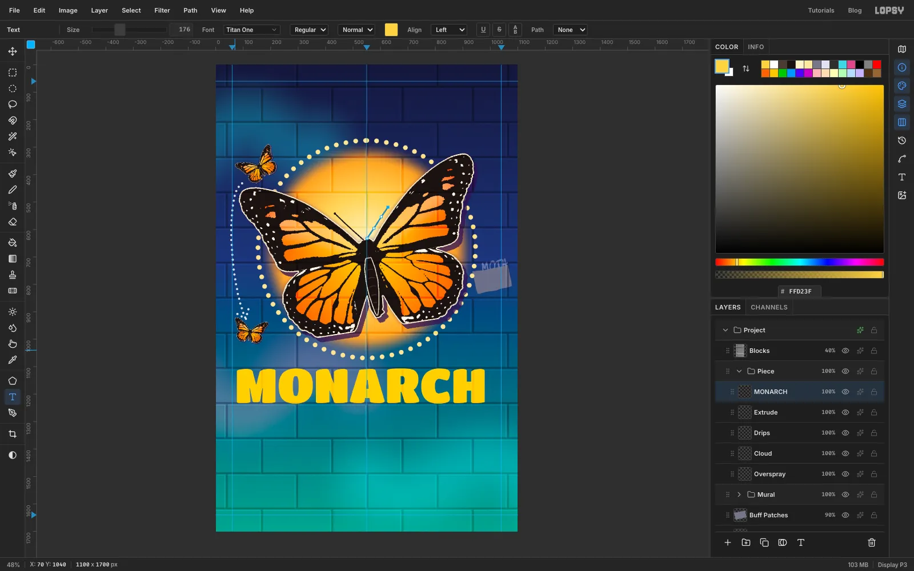

Collapse the `Mural` group and click it. Click **New Group** and name it `Piece`. Because `Mural` is collapsed, the new group lands above it instead of inside it.

With `Piece` selected, add four empty layers in this order: `Overspray`, `Cloud`, `Drips`, `Extrude`. Each new layer goes above the last, so they stack from the bottom up. Building the stack first means you never have to drag layers around later.

With `Extrude` active, set the foreground to `#FFD23F`, pick the **Text** tool, choose **Titan One** at **Size** `176`, click at about `70, 1040`, type `MONARCH` and press [[Tab]].

## Centre and rasterize the letters

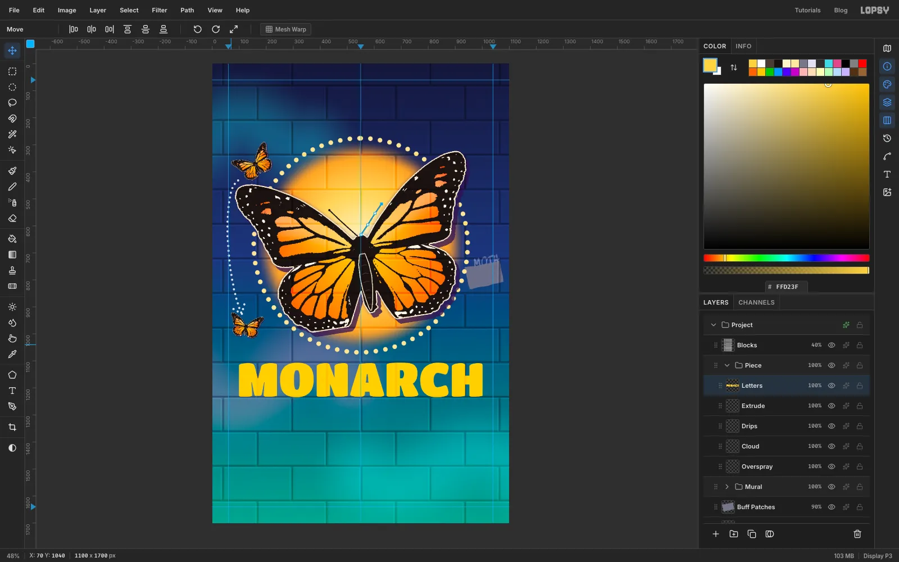

Pick the **Move** tool and click **Align center horizontally** in the options bar.

You're about to treat each letter as pixels, so click **Rasterize Layer** at the bottom of the Layers panel. Rename the layer `Letters`.

## Make the letters bounce

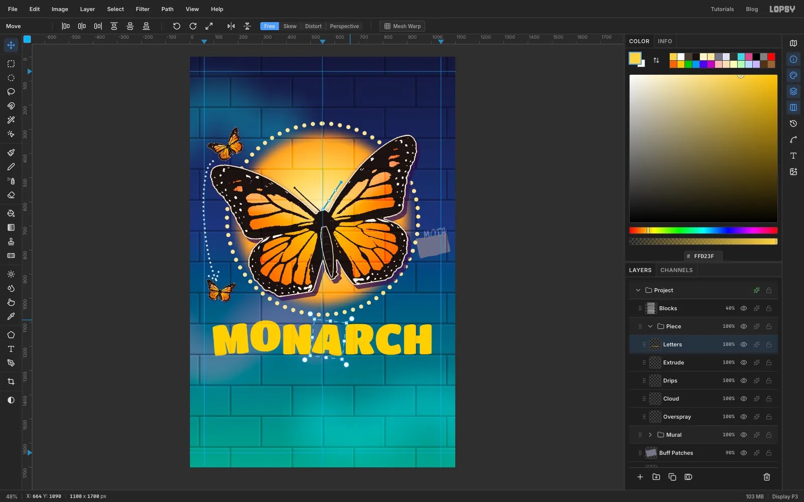

Graffiti letters never sit on a ruler-straight baseline. Give each one a little movement. For each letter, draw a **Rectangular Marquee** tightly around it (just that letter, a little above and below), then switch to the **Move** tool with [[V]] so you get the transform handles and arrow-key nudges. Titan One's letters sit close together; if a box catches part of a neighbour, draw the selection with the **Lasso** instead. Then:

- **M**: rotate about 5° anticlockwise with the rotate handle.
- **O**: with the **Move** tool, press [[Shift+Up]] once and [[Up]] four times to lift it 14 px.
- **A**: rotate about 7° clockwise.
- **R**: press [[Down]] eight times to drop it 8 px.
- **C**: rotate about 6° anticlockwise.
- **H**: rotate about 5° clockwise.

Press [[Cmd+D]] after each letter. Leave the **N** alone.

## Fill the letters with a fade and a glint

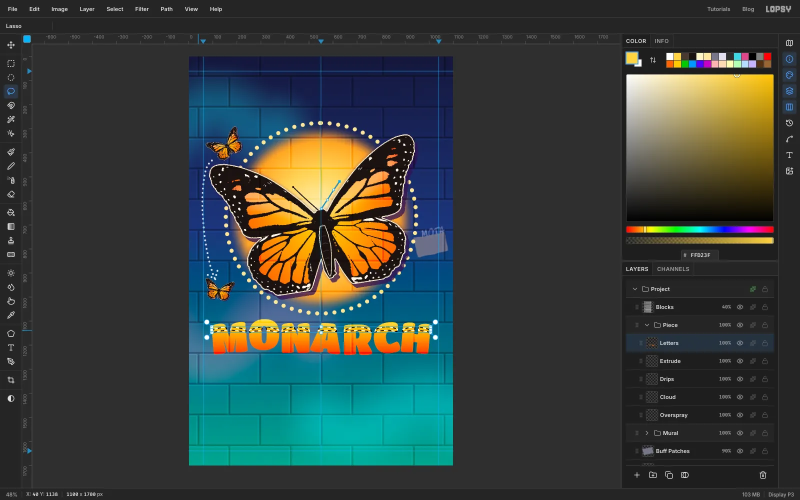

1. [[Cmd]]-click the `Letters` thumbnail. Pick the **Gradient** tool with **Linear**, and in **Advanced…** use `#FFE66D` at the left, `#FFA21C` in the middle and `#EF4A2B` at the right. Drag from the top of the letters straight down to their baseline.
2. Keep the selection. Pick the **Lasso**, hold [[Shift+Option]] and draw a thin band, about 10 px tall, across all the letters about a third of the way down. Let it arch up over each letter and dip in the gaps between them. [[Shift+Option]] intersects, so only the band *inside* the letters stays selected.
3. Fill it with `#FFF4CF` and press [[Cmd+D]].

## Outline the letters

Open the effects drawer for `Letters` and turn on **Stroke** with **Width** `7`, colour `#141019`, position **Outside**.

## Build the 3D block

Click `Extrude`. [[Cmd]]-click the `Letters` thumbnail, choose **Select → Grow…** with `7` so the block covers the outline too, set the foreground to `#3A1C71` and choose **Edit → Fill**.

Now stretch it into a block. Zoom in to about 200% first, so each small drag is big enough to control. Pick the **Move** tool, press inside one of the letters, and hold [[Option]] while you drag about 4 px right and 5 px down. Option-dragging a selection moves a copy and leaves the original pixels behind. Do it **three more times**, each time starting inside the copy you just moved. Each drag stamps the last copy in place and pulls a new one, so the purple steps out into a solid 3D block about 20 px deep.

## Outline the block

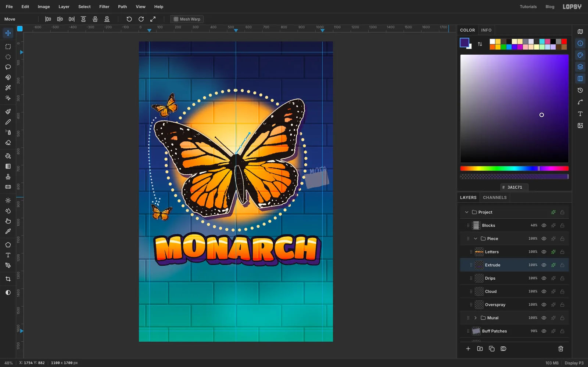

Press [[Cmd+D]]. Give `Extrude` a **Stroke** of **Width** `6`, `#141019`, **Outside**.

## Select a bubble cloud

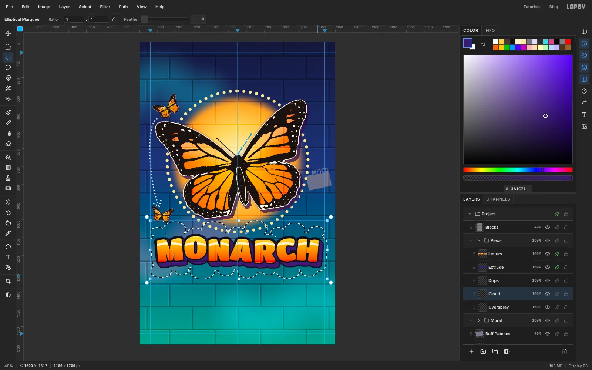

Click `Cloud`. [[Cmd]]-click the `Extrude` thumbnail and choose **Select → Grow…** with `26`.

Pick the **Elliptical Marquee**. Holding [[Shift]] each time to add, drag about nine ovals along the top edge and eight along the bottom edge, overlapping the selection by half their height. Vary them: some about 80 × 50, some about 140 × 90, and nudge a few up or down so the outline isn't a neat row of scallops.

## Fill, outline and shade the cloud

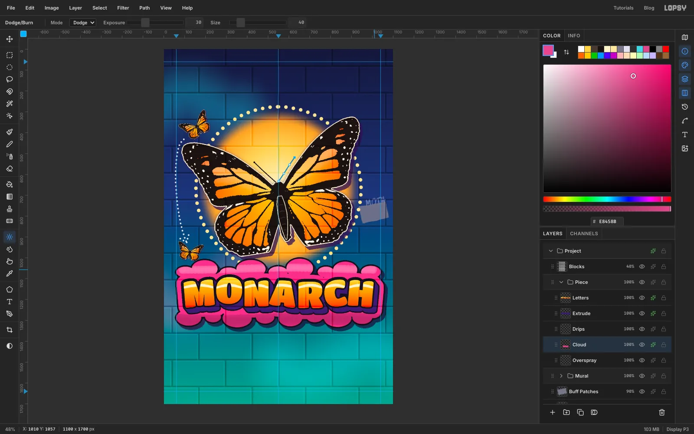

1. Fill the selection with `#E8458B` and press [[Cmd+D]].
2. Give `Cloud` a **Stroke** (**Width** `7`, `#141019`, **Outside**) and a **Drop Shadow** (**Offset X** `12`, **Offset Y** `14`, **Blur** `0`, **Opacity** `70`, `#1B0B33`).
3. Pick the **Dodge / Burn** tool. Set **Mode** to **Burn**, **Exposure** `22` and **Size** `64`, and drag once along the inside of the cloud's bottom edge.
4. Switch **Mode** to **Dodge** with **Exposure** `30` and **Size** `40`, and drag once along the top bubbles.

The cloud now looks rounded, like the bubble shading graffiti writers spray in by hand.

## Let the paint drip, and add overspray

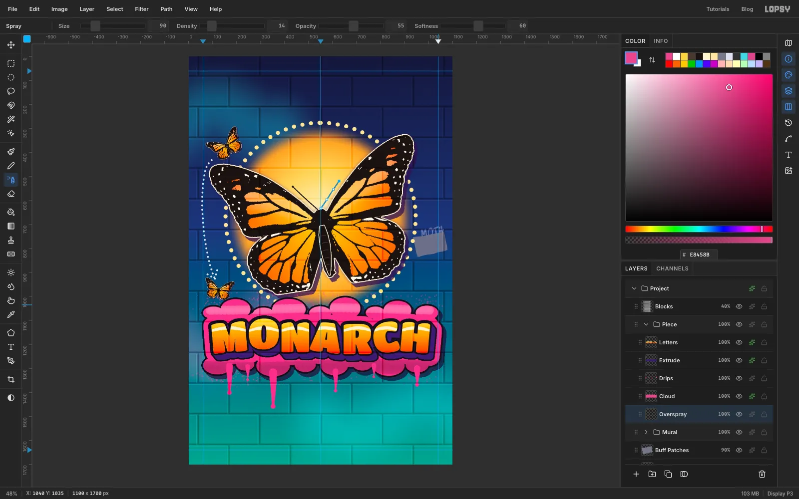

Click `Drips`. Pick the **Brush** with **Hardness** and **Opacity** at `100` and the foreground `#E8458B`.

Open the Brushes dialog. **Taper** shrinks a stroke from full size at its start to a point over that many pixels. Set it to about 1.6 times the drip's length, so the drip thins but never quite vanishes. For each drip, set **Size** and **Taper**, close the dialog, then drag from just inside the cloud straight down. Finish each with a click at the bottom using a brush a little over half the drip's size, for the drop. Make about six, uneven:

- at `x 170`: **Size** `30`, about 92 px long
- at `x 246`: **Size** `20`, about 38 px long
- at `x 352`: **Size** `34`, about 124 px long
- at `x 612`: **Size** `24`, about 64 px long
- at `x 772`: **Size** `20`, about 30 px long
- at `x 952`: **Size** `28`, about 50 px long

Set **Taper** back to `0` when you're done.

Then click `Overspray` and pick the **Spray** tool with **Size** `90`, **Density** `14`, **Opacity** `55` and **Softness** `60`. Keep the pink. Make one wavy pass just below the cloud and one just above it.

## Add the shines

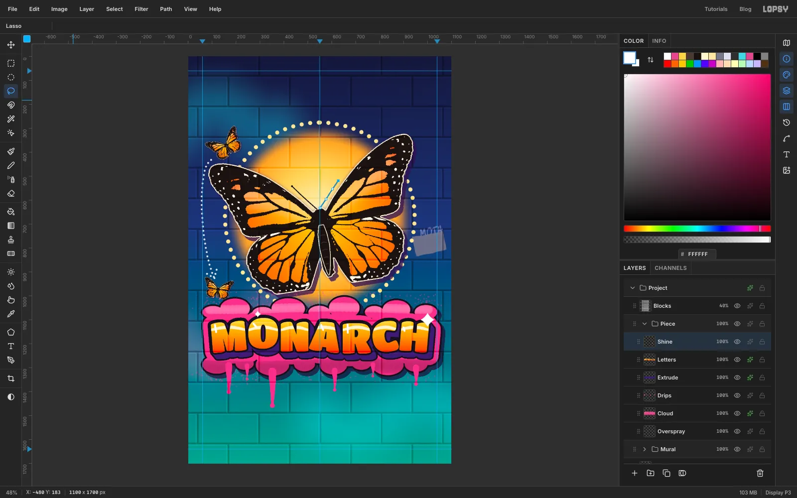

Click `Letters` and add a layer called `Shine`. Pick the **Brush** with **Size** `9` and white.

Draw five short highlight ticks inside the letters near their top-left corners: on the M, O, A, R and H. Vary them: 16 to 34 px long, at different angles from steep to diagonal. Leave the N and C without one.

Then add two sparkles. With the **Lasso**, draw a four-point star with deeply curved-in sides, about 60 px across, at the top right of the H, and fill it with white. Draw a smaller one, about 28 px, just above the O.

## Roll on the masthead band

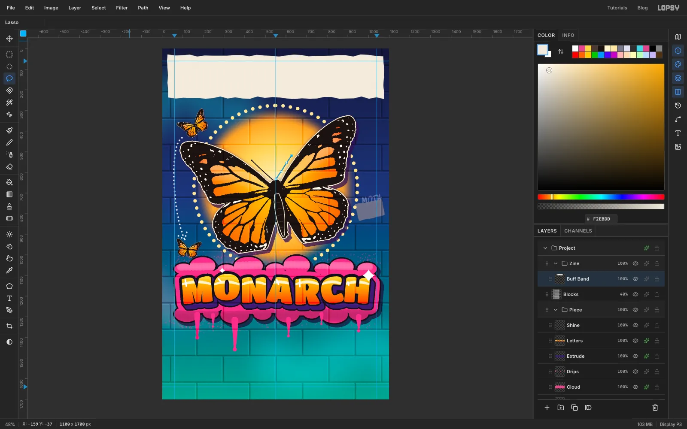

The masthead is a band of buff paint rolled over the wall, the way city crews paint over graffiti.

Click `Blocks` (it sits above the groups) and click **New Group**. Name it `Zine` and add a layer inside called `Buff Band`.

1. Draw a **Rectangular Marquee** right across the top of the page, from `0, 10` to `1100, 270`, and fill it with `#F2EBDD`.
2. **Filter → Add Noise…** with **Amount** `16` and **Mono**, then **Filter → Motion Blur…** with **Angle** `0` and **Distance** `45`. The noise smears sideways into roller streaks.
3. Pick the **Lasso** and draw the band's real shape inside that block: from about `26, 34` to `1074, 238`, with slightly wobbly, torn edges.
4. Choose **Select → Inverse**, press [[Delete]], and press [[Cmd+D]].

Cutting the band out *after* the filters keeps its edges crisp. If you filter a band that's already cut out, the blur drags transparency into its edges.

## Set the masthead and paint WALLS orange

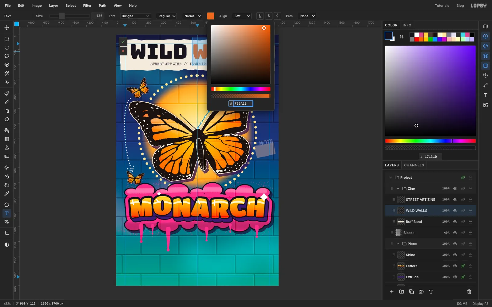

Set the foreground to `#17131D`.

1. With the **Text** tool, choose **Special Elite** at **Size** `25`, click at about `80, 178`, type `STREET ART ZINE  //  ISSUE 12  //  FALL 2026  //  $4` (two spaces either side of each `//`) and press [[Tab]].
2. Click `Buff Band`. Choose **Bungee** at **Size** `136`, click at about `40, 40`, type `WILD WALLS` and press [[Tab]]. Making the lower line first means this click doesn't land in it.
3. With the **Move** tool, click each text layer in turn and click **Align center horizontally**. Then use the arrow keys to put the tops of the big letters about 64 px from the top of the page, and the issue line about 22 px under them.

Now colour WALLS to match the monarch. With the **Text** tool, click inside `WILD WALLS` near its end, press [[End]], then press [[Shift+Left]] five times to select WALLS. Click the **Text color** swatch in the options bar, type `F26A1B` into its hex field and press [[Return]]. Click the swatch again to close it, and press [[Tab]] to finish.

## Tilt the masthead

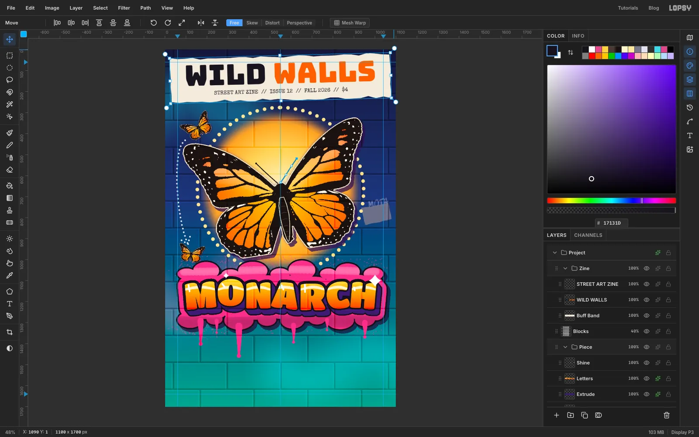

Click the `Zine` group's row. With the **Move** tool, its handles frame everything in it. Drag the rotate handle at the top right to turn the band about 1.5° anticlockwise, and press [[Cmd+D]]. The text stays live and turns with the band.

## Tape the corners down

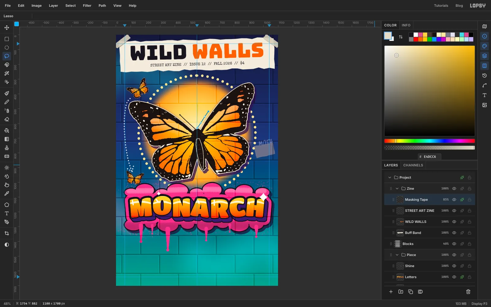

Click the issue-line text layer (the top of the group) and add a layer called `Masking Tape`. With the **Lasso**, draw a short strip about 115 × 34 px across each top corner of the band, angled about 37°, with ragged ends. Fill both with `#E4DCC6` and press [[Cmd+D]].

Set the layer to `85%` so the band shows faintly through, and give it a small **Drop Shadow**: **Offset X** `2`, **Offset Y** `3`, **Blur** `3`, **Opacity** `40`, colour `#0B0716`.

## Make the sticker blank

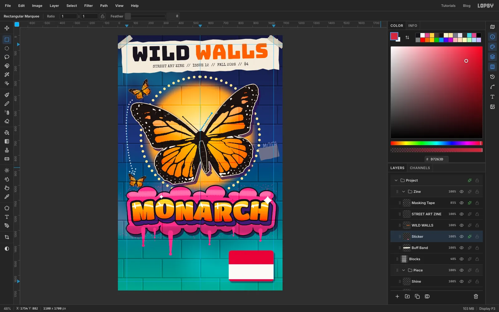

Click `Buff Band` and add a layer called `Sticker`.

The sticker's bottom edge sits right on the bottom guide, and guide snapping would drag the thin bottom strip onto it. Choose **View → Snap to Guides** to turn snapping off for now.

1. Build a rounded rectangle 300 × 206 px with its top-left at `740, 1434`. Draw a **Rectangular Marquee** the full height but 18 px in from each side. [[Shift]]-drag a second one the full width but 18 px in from the top and bottom. Then [[Shift]]-drag a 36 px circle with the **Elliptical Marquee** into each corner.
2. Fill it with `#FBFAF5` and press [[Cmd+D]].
3. [[Cmd]]-click the `Sticker` thumbnail. With the **Rectangular Marquee**, hold [[Shift+Option]] and drag across the top 92 px of the sticker. Fill that with `#D7263D`.
4. [[Cmd]]-click the thumbnail again and intersect a strip across the bottom 14 px the same way. Fill it red too, then press [[Cmd+D]].

Turn **View → Snap to Guides** back on. Give `Sticker` a **Drop Shadow**: **Offset X** `7`, **Offset Y** `9`, **Blur** `8`, **Opacity** `55`, `#120A22`.

## Letter the sticker

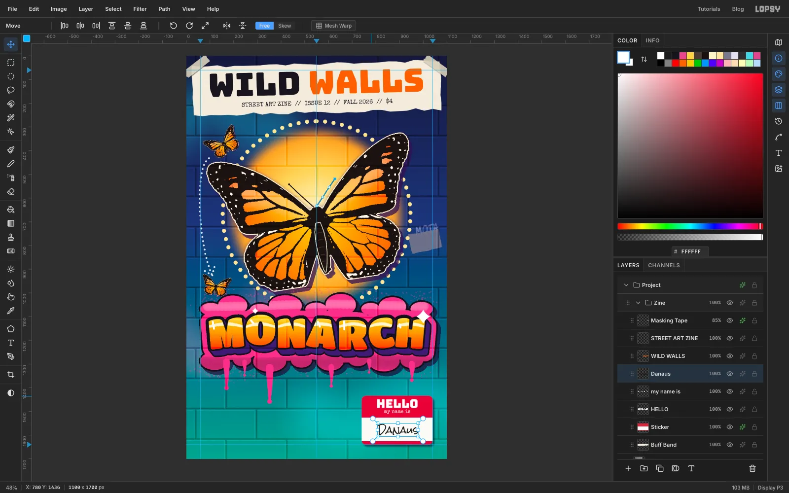

Make the three lines from the bottom up, so each click lands in empty space:

1. Foreground `#1A1A1A`, **Rock Salt** at `40`, click at about `780, 1546`, type `Danaus` (the monarch's genus) and press [[Tab]].
2. Click `Sticker`. Foreground white, **Special Elite** at `21`, click at about `780, 1496`, type `my name is` and press [[Tab]].
3. Click `Sticker` again. **Bungee** at `50`, click at about `780, 1436`, type `HELLO` and press [[Tab]].

With the **Move** tool, centre each line on the sticker's middle (`x 890`) with the arrow keys. Put the top of HELLO 14 px below the sticker's top edge and `my name is` 7 px under it, and sit `Danaus` halfway down the white area.

## Group and tilt the sticker

Click `Danaus`, [[Shift]]-click `Sticker`, choose **Layer → Group Layers** and name it `Hello Sticker`. With the **Move** tool, turn the group about 6° clockwise with its rotate handle and press [[Cmd+D]]. Stickers never go on straight.

## Tear three paper strips

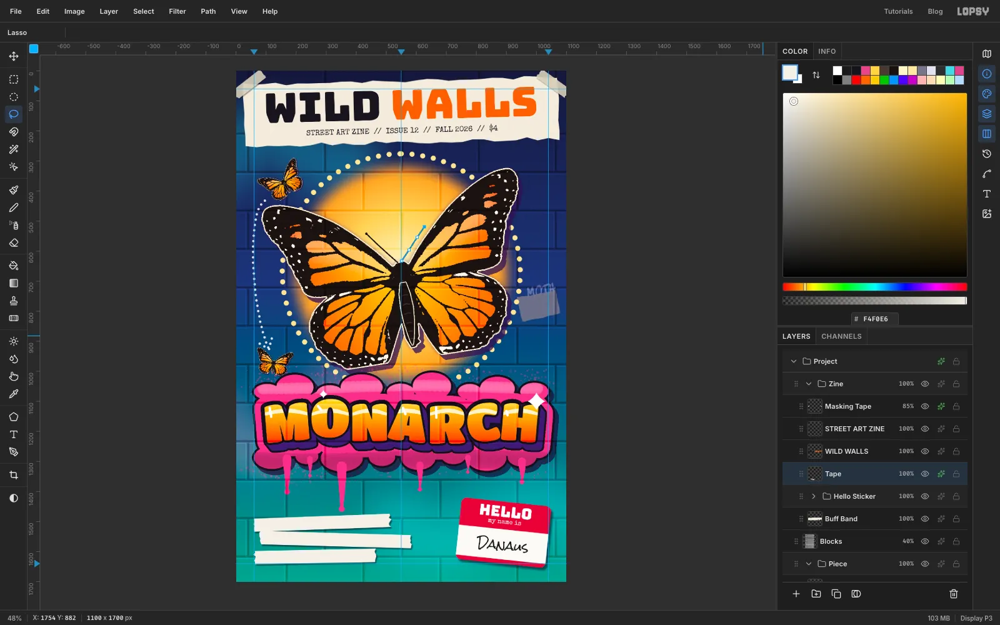

Collapse `Hello Sticker`, click it, and add a layer called `Tape` (for the paper strips; the masking tape is a separate layer up in the masthead). Set the foreground to `#F4F0E6`.

With the **Lasso**, draw one strip 44 px tall with torn, jagged ends, choose **Edit → Fill**, deselect, and repeat for the other two:

- from `60, 1482`, about 450 px long, tilted 2° anticlockwise
- from `82, 1538`, about 500 px long, tilted 1.5° clockwise
- from `62, 1594`, about 405 px long, tilted 1° anticlockwise

Press [[Cmd+D]]. [[Cmd]]-click the `Tape` thumbnail and run **Filter → Add Noise…** with **Amount** `8` and **Mono** for a paper grain, then deselect. Add a **Drop Shadow**: **Offset X** `4`, **Offset Y** `5`, **Blur** `4`, **Opacity** `50`, `#0B0716`.

## Type the cover lines

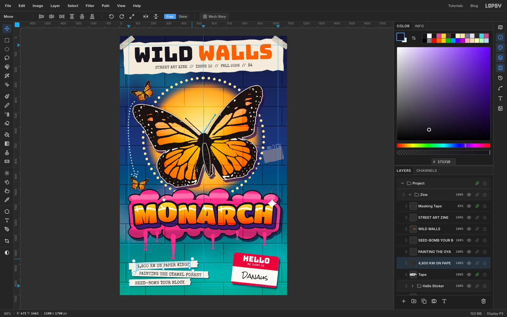

Set the foreground to `#17131D` and pick **Special Elite** at **Size** `28`. Do the bottom strip first, then the middle, then the top, clicking `Tape` before each:

- `SEED-BOMB YOUR BLOCK`
- `PAINTING THE OYAMEL FOREST` (oyamel firs are the trees the monarchs winter in)
- `4,800 KM ON PAPER WINGS`

For each one: click on its strip near the left end, type, and press [[Tab]]. Then with the **Move** tool, centre it on the strip with the arrow keys, and turn it with its rotate handle to the same tilt as its strip.

## Throw up the tag

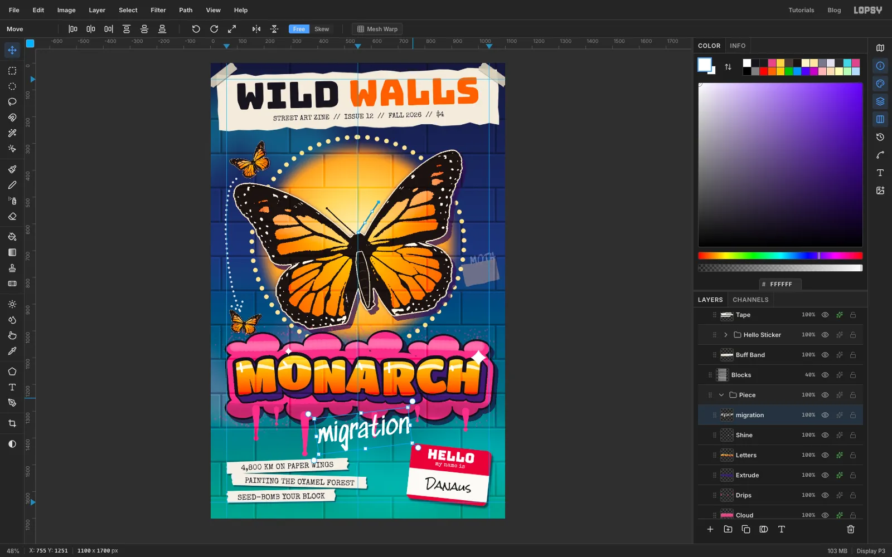

Expand the `Piece` group and click `Shine`. Set the foreground to white, pick **Sedgwick Ave** at **Size** `96`, click at about `420, 1300`, type `migration` and press [[Tab]].

With the **Move** tool, centre the word at about `x 570` with its top at about `y 1318`, so it sits just under the cloud, clear of the sticker and the paper strips. Then turn it about 7° anticlockwise with the rotate handle and press [[Cmd+D]].

## Outline the tag and let it drip

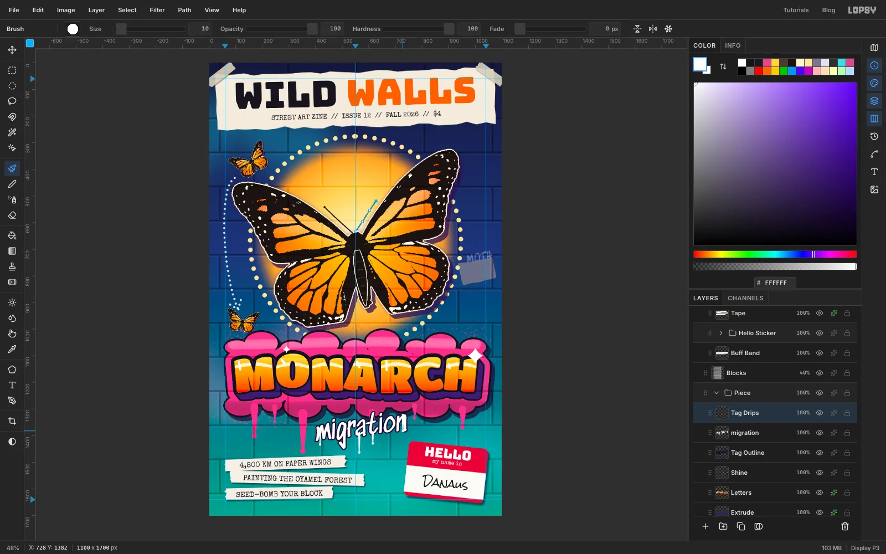

The tag crosses the pink drips, so give it a dark edge to show it was painted over them.

1. Click `Shine` and add a layer called `Tag Outline`. It goes under the tag.
2. [[Cmd]]-click the `migration` thumbnail, choose **Select → Grow…** with `4`, fill with `#1B0B33` and press [[Cmd+D]].
3. Click `migration` and add a layer called `Tag Drips`. With the **Brush** at **Size** `9`, white, and **Taper** about twice the drip's length (these are thinner, so they can taper further), drag four thin drips, 34 to 64 px long, down from the bottoms of the m, a, t and n. Click a 10 px drop at the end of each.
4. Set **Taper** back to `0` in the Brushes dialog.

## Weather the wall

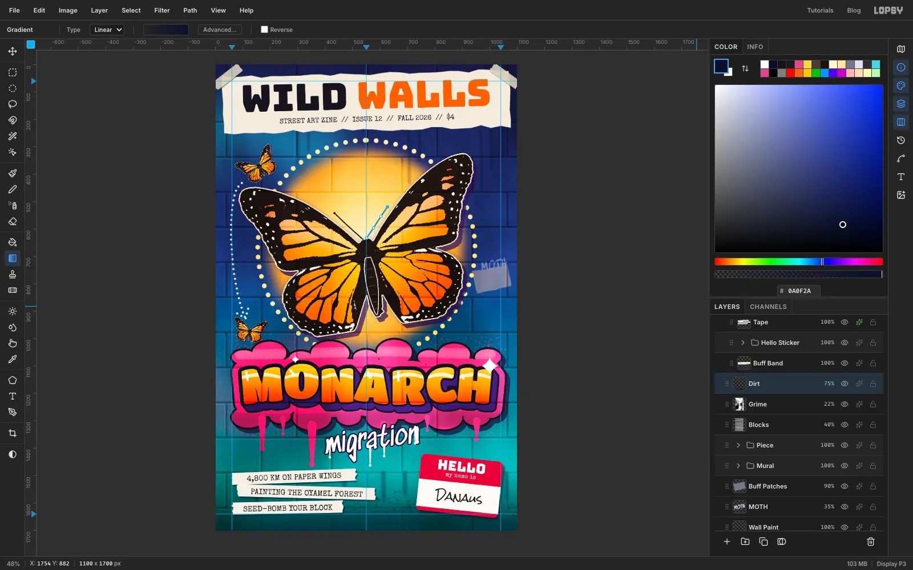

Collapse `Piece`, click `Blocks` and add a layer called `Grime`.

1. **Filter → Clouds…** with **Scale** `4`, then **Filter → Add Noise…** `20` **Mono**. Set it to **Overlay** at `22%`.
2. Add a layer called `Dirt`. Pick the **Brush** with **Size** `22`, **Hardness** `0`, **Opacity** `30` and the foreground `#0A0F2A`. Drag seven streaks straight down from the bottom of the masthead, 60 to 210 px long, in two or three clusters.
3. At **Size** `30` and **Opacity** `45`, drag six more, 70 to 140 px long, down from the mortar line at about `y 1492`.
4. At **Size** `180` and **Opacity** `60`, make one wavy stroke along the very bottom of the page.
5. Pick the **Spray** with **Size** `120`, **Density** `30` and **Opacity** `70` and make one wavy pass at about `y 1630`.
6. Draw a **Rectangular Marquee** across the bottom 220 px. Pick the **Gradient** tool with **Linear**, and in **Advanced…** set both stops to `#0A0F2A`, then select the left stop and drag its **Opacity** bar all the way to the left. Drag the gradient from the top of the marquee to the bottom and press [[Cmd+D]].

Set `Dirt` to **Multiply** at `75%`.

## Add photocopier toner specks

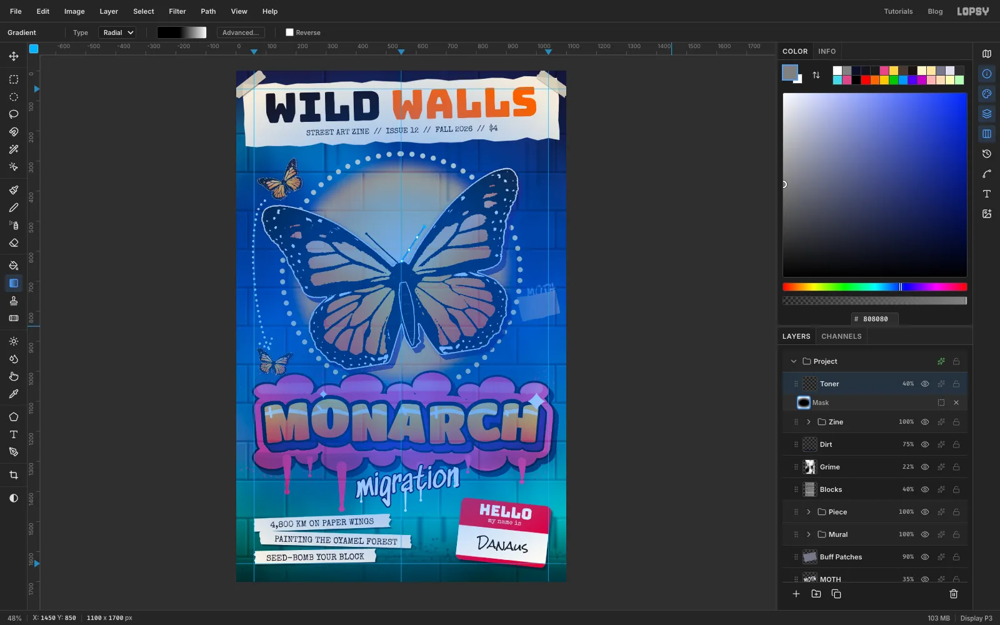

Zines are photocopied, and copiers leave specks, mostly toward the edges. Collapse `Zine`, click it, and add a layer called `Toner`. It goes at the very top.

1. Set the foreground to `#808080`, press [[Cmd+A]], choose **Edit → Fill** and press [[Cmd+D]]. Run **Filter → Add Noise…** with **Amount** `100` and **Mono**, then **Filter → Threshold…** with **Level** `40`. You get a few black specks on white.
2. Pick the **Magic Wand** with **Tolerance** `20` and **Contiguous** off, click a white pixel, press [[Delete]] and [[Cmd+D]]. Only the specks are left.
3. Set the layer to **Multiply** at `40%`.
4. Click **Add Mask**, then click the mask thumbnail on the layer's row to edit it. Use a **Radial** gradient: black at the left end, black again at about 45%, white at the right end. Drag from the middle of the page, `550, 850`, out about 900 px. The middle of the cover stays clean and the specks collect at the edges.

Click the `Toner` layer's name to stop editing the mask.

Choose **File → Quick Export PNG** to save the cover, and **File → Save Project** to keep the layers.

> **Credit:** Monarch reference photo "Danaus plexippus MHNT.jpg" by Didier Descouens, CC BY-SA 4.0, via Wikimedia Commons.
