Street art has its own printing press. The city paints a wall grey, somebody tags it, the city paints it again, and then the paste-ups arrive: photocopies glued on with wheat paste, stickers slapped on in passing, a stencil sprayed in ten seconds. A good street-art flyer borrows all of that. Every element should look like it was made with a different tool, by a different person, at a different time.

In this tutorial you'll build *Zero Vacancy*, an invitation to the opening night of an imaginary takeover where 40 artists paint all 40 rooms of an old motel before it's demolished. The page is 1200 × 1680 px (a 5 × 7 card) and holds:

- a cinder-block wall with rain streaks, old tags, and a patch of grey "buff" paint where the city covered a tag
- a torn, wheatpasted photocopy of a real motel sign
- a dripping graffiti **ZERO** and a stencil-sprayed **VACANCY**
- a *HELLO my name is* sticker, a taped typewriter note, a sprayed motel arrow, a round sticker and a footer

You'll need one photo: [Sandman Motel sign, Reno, Nevada](https://www.loc.gov/item/2017710542/) by John Margolies, from the Library of Congress's *Roadside America* collection. The Library lists it as having no known restrictions on publication. Open the 1024 px JPEG from that page in a browser tab. You'll copy it straight from there into Lopsy.

The tools you'll use:

- **Define Pattern** and **Fill with Pattern**, **Add Noise**, **Motion Blur**, **Brightness/Contrast**, **Desaturate**, **Threshold**, **Emboss** and **Gaussian Blur**
- the **Lasso**, **Rectangular Marquee**, **Magic Wand** and **Pen** tools, **Select → Grow / Shrink / Feather / Inverse**, and [[Cmd]]-click on a layer thumbnail to load that layer's shape as a selection
- the **Brush**, **Pencil**, **Spray**, **Smudge**, **Eraser** and **Burn** tools, with [[Shift]]-click for straight lines
- the **Shape** tool's click-to-size dialog and the **Gradient** tool
- live text in eight Google fonts: Sedgwick Ave Display, Stardos Stencil, Archivo Black, Archivo, Permanent Marker, Special Elite, Anton and Allerta Stencil
- groups that you rotate as one piece with the **Move** tool's handles
- layer effects: **Stroke**, **Drop Shadow** and **Outer Glow**, plus the **Multiply** and **Overlay** blend modes

The palette is concrete, paper and four spray cans:

- Wall `#9F9A90`, block `#B3AEA3`, mortar `#8B867C`
- Buff greys `#948F86` / `#8D887E` / `#99948A`
- Paper `#ECE7DA`, note paper `#F3EEE1`, tape `#E8DBAE`
- Ink `#141316`, band black `#18171B`
- Hot pink `#FF2E88` → `#FF3F6E` → `#FF7A1A` (the ZERO fade)
- Cyan `#1FB5E0`, acid yellow `#E2F03A`, sticker red `#D7263D`

> **Note:** Shortcuts are written for a Mac. On Windows use [[Ctrl]] wherever it says [[Cmd]].

> **Tip:** New layers appear just above whichever layer is selected. When a new layer shouldn't go above the one you just used, the step tells you which row to click first. Lopsy names text layers after their text. Rename the ones this tutorial refers to by name (double-click the name in the Layers panel).

## Start a 5 × 7 document and paint the wall grey

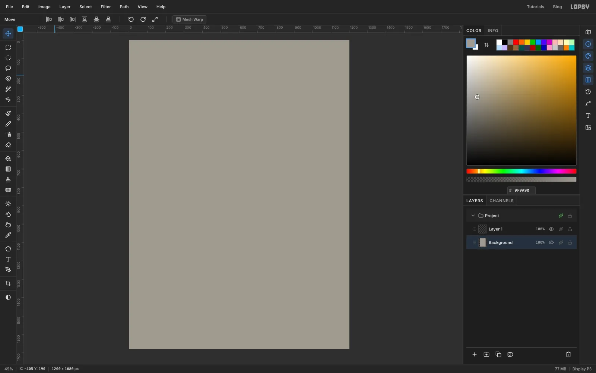

Choose **File → New**, keep the units on **Pixels**, and make the document **1200** wide and **1680** high. Click the **Background** layer, set the foreground colour to `#9F9A90` and choose **Edit → Fill**.

Click once on the top ruler at the middle of the page to drop a centre guide. Add guides about 60 px in from every edge the same way, clicking the top ruler for the left and right guides and the left ruler for the top and bottom ones. They'll keep the type off the edges later.

## Draw one block as a pattern tile

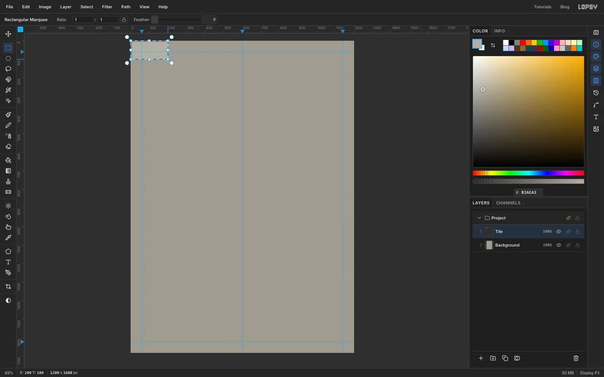

A new document comes with an empty *Layer 1*. Double-click its name and rename it *Tile*. A pattern always tiles from the top-left corner of the page, so build the tile there. Hold [[Cmd]] and scroll over the corner to zoom in, so you can place things a few pixels apart.

1. With the **Rectangular Marquee** ([[M]]), drag a box 200 px wide and 100 px tall from the very top-left corner. The size readout next to the cursor helps. Fill it with the mortar colour `#8B867C`.
2. Drag a second box that starts 6 px in from the top and left edges and ends at the same bottom-right corner. Fill it with the block colour `#B3AEA3`. You now have one block with a mortar line along its top and left.
3. Drag the 200 × 100 marquee around the whole tile again and choose **Edit → Define Pattern**.

Deselect with [[Cmd+D]] and delete the *Tile* layer with the trash button. The pattern stays defined. Press [[Cmd+0]] to fit the page back in the window.

## Fill the wall with staggered blocks

Click **Add Layer** at the bottom of the Layers panel and name the layer *Blocks*. Choose **Edit → Fill with Pattern...** and pick your block pattern. Set **Row Stagger** to **50** so each row shifts by half a block, and click **Apply**. That gives you the running bond of a real block wall.

## Patch a few blocks and add pores

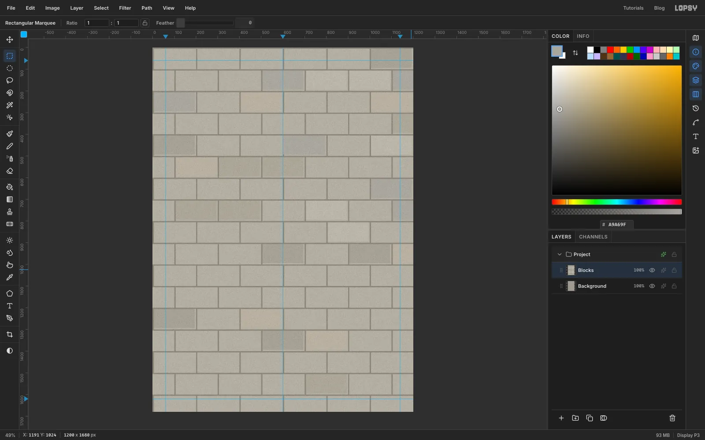

Real walls are repaired one block at a time, so a few blocks never match. With the marquee, drag inside the mortar of about 30 blocks scattered across the page, a few at a time. Fill them with one of `#ABA69A`, `#BAB5AA`, `#A6A196`, `#B7B0A2` or `#A9A69F`, mixing the greys so neighbouring blocks differ.

Deselect, then choose **Filter → Add Noise...**, set **Amount** to **26**, click **Mono** and apply. The speckle reads as the pores of cast concrete.

## Make a grime layer

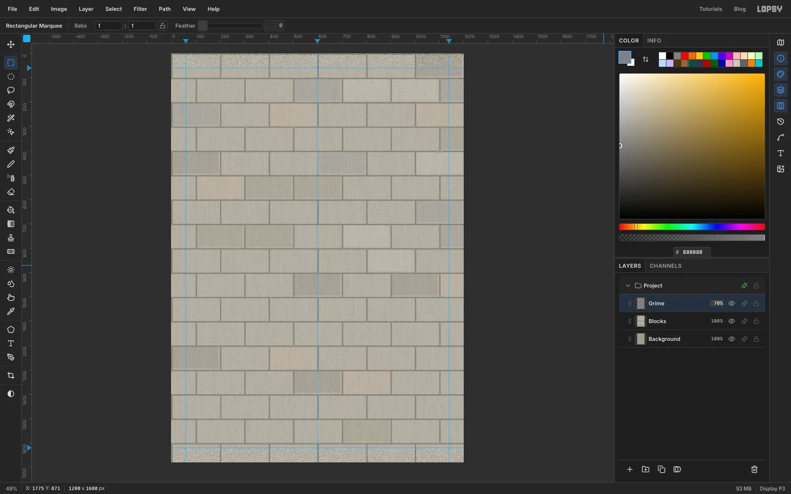

Add a layer named *Grime* and fill it with `#808080`. Run **Add Noise** at **100** (Mono).

Drag a marquee over everything except about the top and bottom 60 px of the page, then run **Filter → Motion Blur...** at **90°** with a **Distance** of **100**. Leaving the edges out stops the blur from smearing the edge pixels into stripes. Deselect and run **Brightness/Contrast...** with **Contrast** at **70**.

Open the layer's effects drawer, set the blend mode to **Overlay**, and lower the layer's opacity to **70%**.

## Darken the foot of the wall

Add a layer named *Pavement Dirt* and pick the **Gradient** tool. Click **Advanced** in the options bar and set both stops to `#3B3227`, with the right-hand stop at 0% opacity. Drag from the bottom edge up about a quarter of the page. Set the layer to **Multiply** at **55%**.

## Paint rain streaks

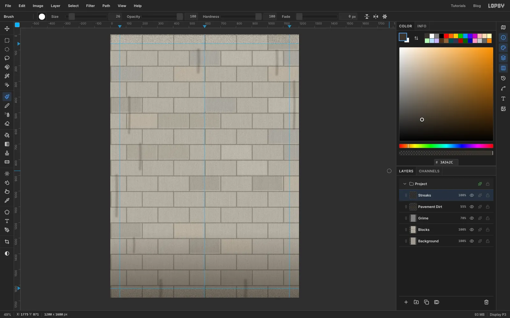

Add a layer named *Streaks* and pick the **Brush** ([[B]]). In the options bar set **Hardness** to **0**, **Opacity** to **22** and the size to about **30**, with the colour `#3A342C`. Drag short vertical strokes straight down from a few mortar joints, and from just under where the black band will go at the bottom. Set the layer to **Multiply**, then put the Brush's Hardness and Opacity back to 100.

## Write some old tags

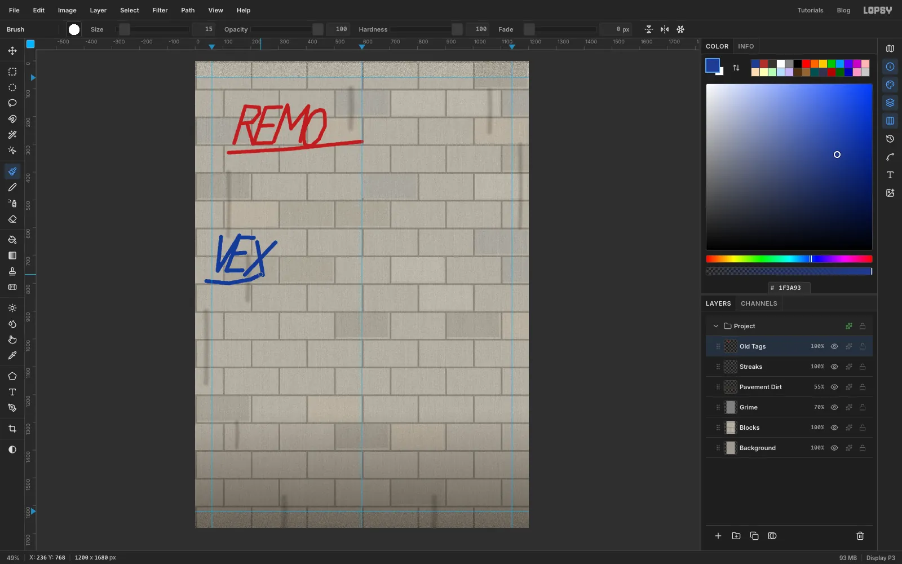

With *Streaks* selected, add a layer named *Old Tags*. Tags are written fast with a marker, so draw them in one pass with the **Brush** at a fixed size and don't fuss over them:

- In `#B0302A` at size **14**, write *REMO* in slanted capitals near the top left, with a quick underline that rises to the right.
- In blue `#1F3A93` at size **15**, write *VEX* in the left margin about a third of the way down, with a flicked underline.

## Buff over the red tag

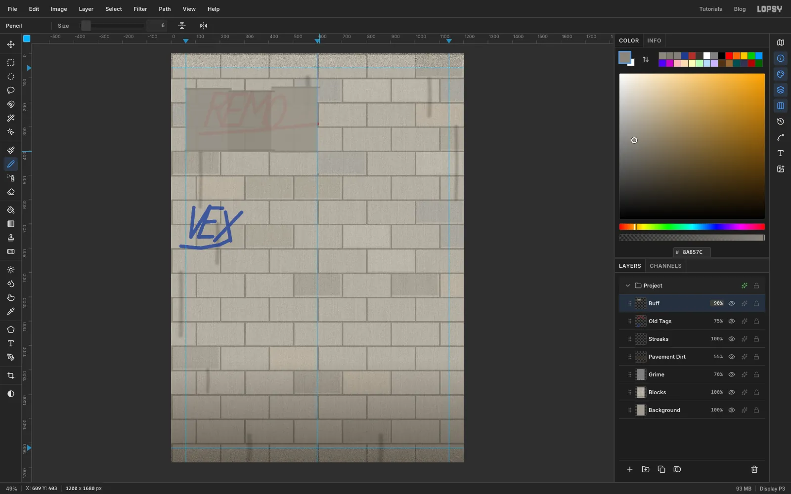

First lower *Old Tags* to **75%** so the tags sink into the wall.

City crews paint over tags with whatever grey they have, in roller-width passes, and they're never tidy: it's fine if the tip of the underline still pokes out. Add a layer named *Buff* and make three overlapping passes across the REMO tag. For each one:

1. Drag a tall marquee about 200 px wide that covers the tag from top to bottom.
2. Choose **Select → Feather…** and use **2** px, so the edge is soft like rolled paint.
3. Fill it with `#948F86`, `#8D887E` or `#99948A`, a different grey for each pass.

Deselect. Paint piles up where a roller starts and stops, so pick the **Pencil** ([[N]]) at size **6** in a grey a step darker (`#86817A`). Click at one end of each pass's top edge and [[Shift]]-click the other end to draw a straight ridge. Do the same along each bottom edge. Lower the layer to **90%** so the tag ghosts through faintly.

## Add roller streaks inside the buff

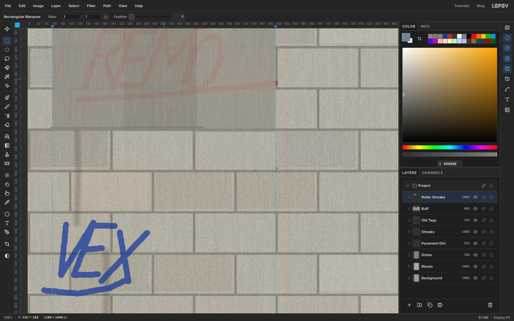

Add a layer named *Roller Streaks*. Drag a marquee a little bigger than the whole buff patch, fill it with `#808080`, then run **Add Noise** at **60** (Mono) and **Motion Blur** at **90°** with a distance of **30**.

Now trim the streaks to the paint. [[Cmd]]-click the *Buff* thumbnail to load its shape, click the *Roller Streaks* row, choose **Select → Inverse** and press [[Delete]]. Deselect and set the layer to **Overlay**.

## Tear a sheet of paper for the paste-up

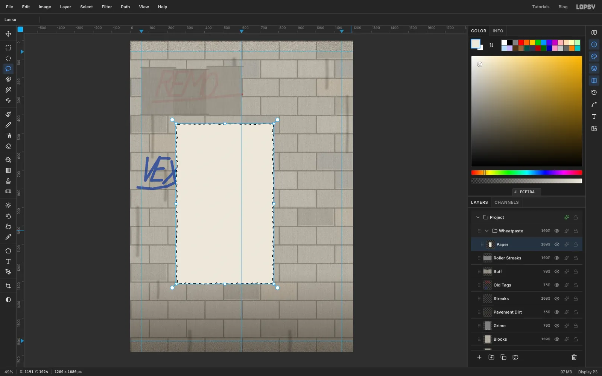

With *Roller Streaks* selected, click the **New Group** button and name the group *Wheatpaste*. Add a layer inside it named *Paper*.

With the **Lasso** ([[L]]), draw a tall rectangle about 520 × 860 px. Put it a little left of centre, starting about a quarter of the way down the page. Wobble your hand slightly as you go so every edge comes out torn. Fill it with `#ECE7DA` and run **Add Noise** at **6** (Mono) for paper tooth. Deselect.

## Paste in the motel photo

In the browser tab with the photo, right-click it and choose **Copy Image**. Click back in Lopsy and press [[Cmd+V]]. The photo lands in the top-left corner as a new layer inside the group, with its pixels selected. Deselect and rename the layer *Sandman*.

## Lasso around the sign

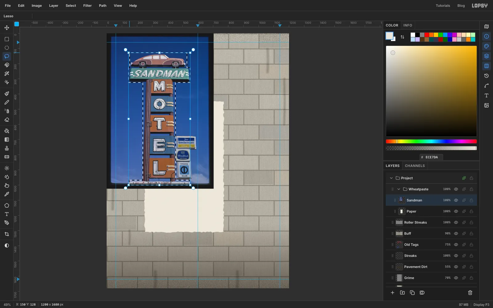

With the **Lasso**, drag a rough outline around the sign: across the top of the car, around the green SANDMAN board, down both sides of the pole and the letter panels, and around the little VACANCY plaque at the bottom. Leave the credit-card signs on the right outside the selection.

Choose **Select → Inverse** and press [[Delete]]. Only the sign and some pockets of sky are left.

## Select the leftover sky and delete it

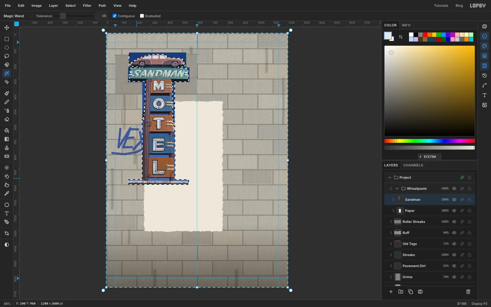

Pick the **Magic Wand** ([[W]]), leave **Contiguous** on and set **Tolerance** to **48**. Click the sky to the left of the pole, then hold [[Shift]] and click each other blue pocket: right of the pole, around the car, beside the SANDMAN board and beside the plaque. Press [[Delete]] and deselect. The sign is now a clean cut-out.

## Turn the photo into a photocopy

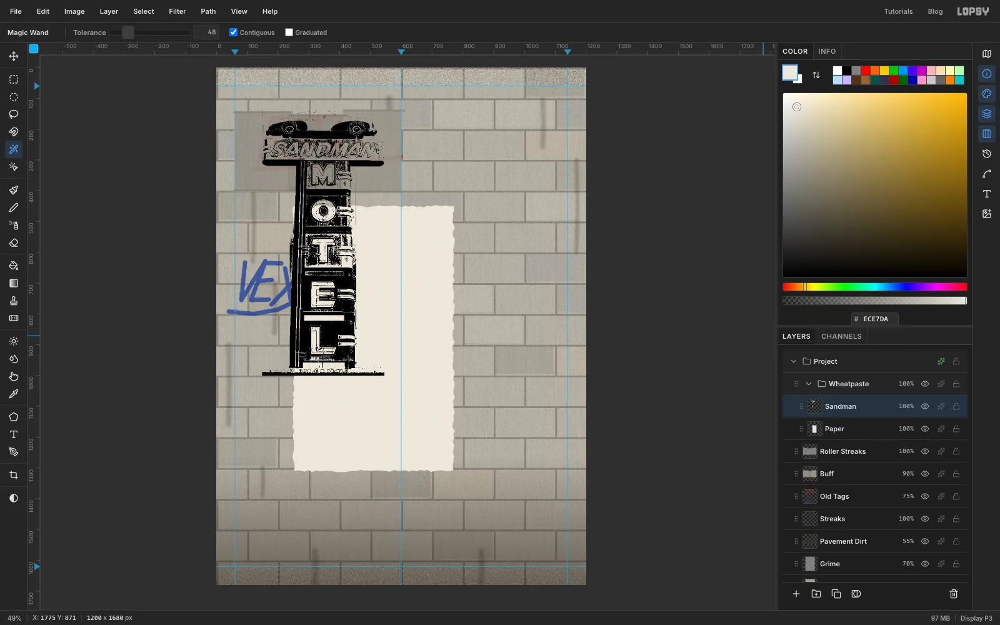

A cheap copier throws away every grey. Run these on the *Sandman* layer:

1. **Filter → Desaturate**
2. **Filter → Brightness/Contrast...** with **Brightness 10** and **Contrast 45**
3. **Filter → Threshold...** at **132**

Open the effects drawer and set the blend mode to **Multiply**, so the white drops out and only black toner is left. The sign is still sitting at the top left. You'll move it onto the paper next.

## Scale the sign onto the paper

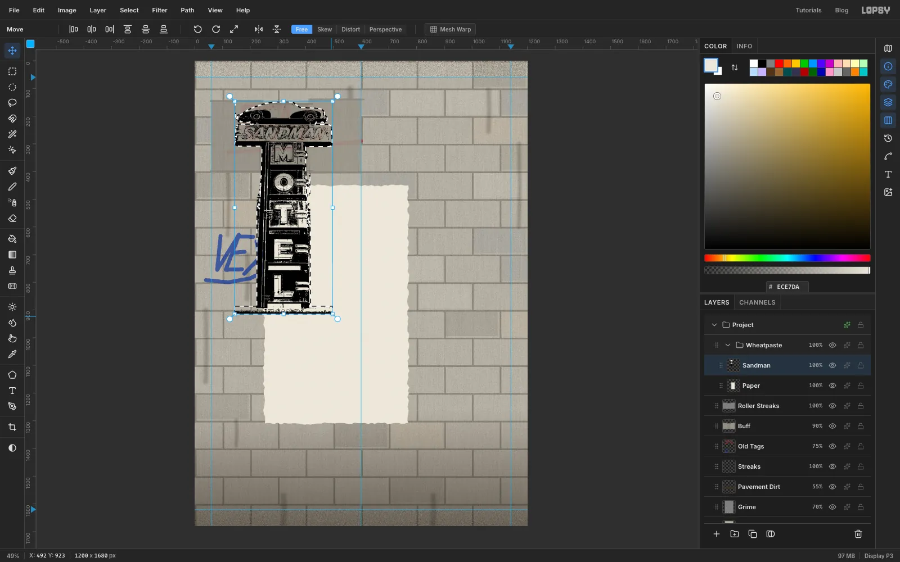

[[Cmd]]-click the *Sandman* thumbnail to select the sign, then pick the **Move** tool ([[V]]). Hold [[Cmd]] and drag the bottom-right corner handle inward a little, about 8%, so the sign keeps its proportions and will fit inside the paper with a margin. Press [[Cmd+D]] to commit.

Now drag the sign down onto the middle of the sheet, then fine-tune its position with the arrow keys.

## Add a few creases

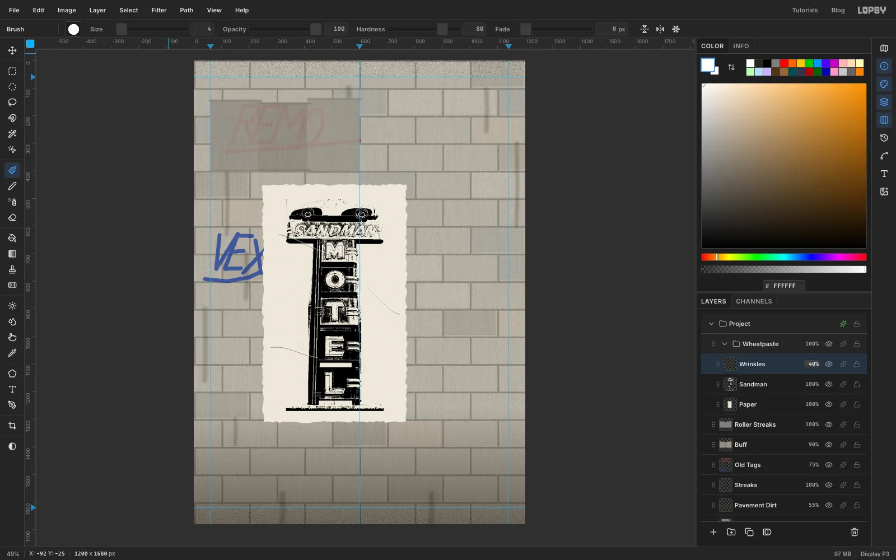

Wheat paste wrinkles the paper as it dries. Add a layer named *Wrinkles* and pick the **Brush** at size **4**. Paint three gentle curves across the sheet, each in one smooth drag in dark `#2A241C`. Then trace each one again in white, just above and to the left. Every crease now has a shadow side and a lit side.

Run **Gaussian Blur** at **1**. Then [[Cmd]]-click the *Paper* thumbnail, click *Wrinkles*, choose **Select → Inverse** and press [[Delete]], so nothing hangs off the sheet. Lower the layer to **40%**.

## Peel back a corner

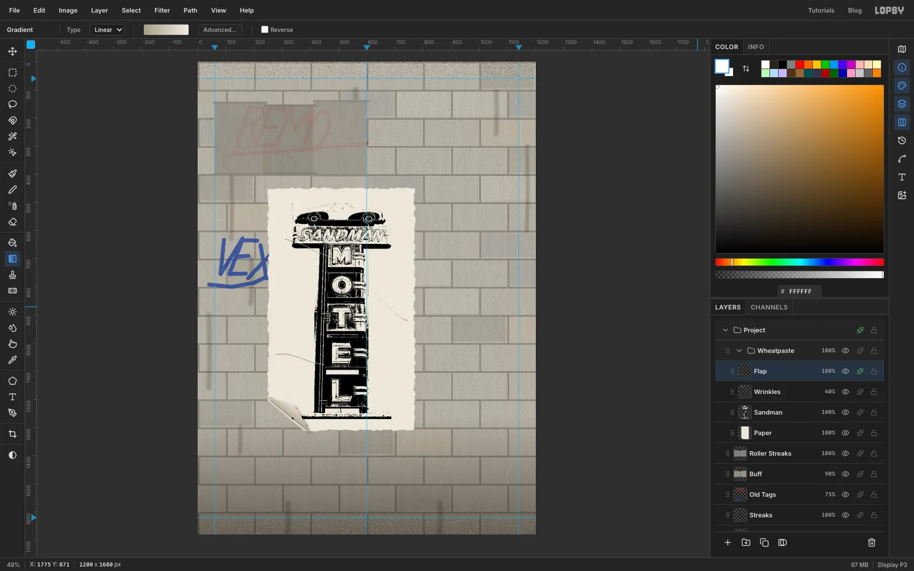

Paste-ups always lift at a corner. With the **Lasso**, draw a triangle over the bottom-left corner of the sheet, about 150 px along the bottom edge and 120 px up the left side. Click the *Paper*, *Sandman* and *Wrinkles* rows in turn and press [[Delete]] on each.

Add a layer named *Flap* and lasso the folded-back paper. Its fold is a straight line across the gap, and its two other edges are torn, meeting at a point inside the sheet. Fill it with a **linear gradient** from `#A79E8A` at the fold to `#F1ECE1` at the tip. Give the layer a **Drop Shadow** with **Offset X 7**, **Offset Y 9**, **Blur 12** and **Opacity 55**.

## Rotate the whole paste-up

Click the *Wheatpaste* group's row and pick the **Move** tool. A box with handles appears around everything in the group. Each corner has a small round rotation handle on a short line just outside it. Drag the top-left one about **3°** anticlockwise, then press [[Cmd+D]] to commit. The paper, photo, creases and flap all turn together.

## Let the wall show through the paper

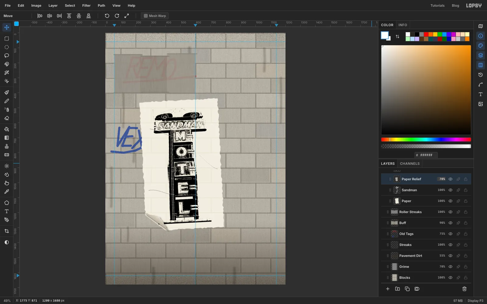

Wet paste sinks into the wall, so the joints show through the sheet. Do this after the rotation, so the joints stay level with the real wall.

[[Cmd]]-click the *Paper* thumbnail, click the *Blocks* layer and press [[Cmd+C]]. Click the *Sandman* layer and press [[Cmd+V]]. The copy pastes in place, inside the group, as a piece of wall exactly the shape of the paper. Deselect and name the layer *Paper Relief*.

Run **Filter → Emboss...** with **Angle 135** and **Strength 30**, then set the layer to **Overlay** at **70%**.

## Darken the wall around the paste

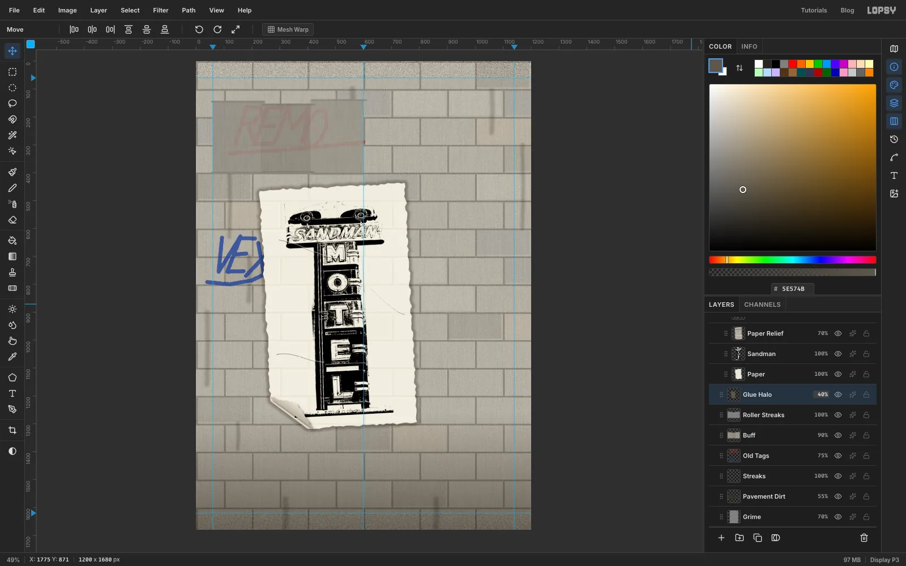

Paste soaks into the wall just around the paper. Click the *Roller Streaks* layer, so the new layer goes just under the group, and add a layer named *Glue Halo*. [[Cmd]]-click the *Paper* thumbnail, then choose **Select → Grow…** at **10** and **Select → Feather…** at **8**. Fill with `#5E574B`, deselect, and set the layer to **Multiply** at **40%**.

## Type ZERO

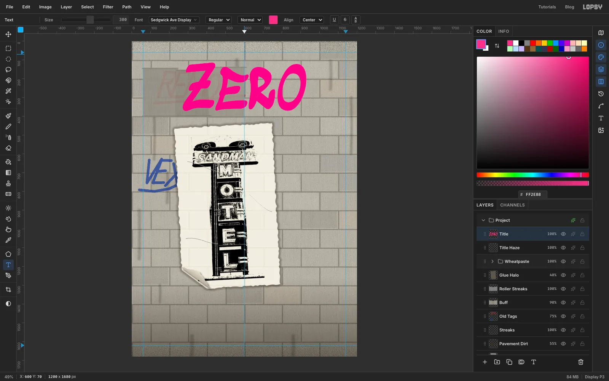

Click the arrow on the *Wheatpaste* row to collapse the group. Click the group's row and add a layer named *Title Haze*. It will hold the cloud behind the lettering.

Pick the **Text** tool ([[T]]). In the options bar choose **Sedgwick Ave Display**, set **Size** to **300**, **Align** to **Center** and the colour to `#FF2E88`. Click on the centre guide near the top, type `ZERO`, and press [[Tab]] to commit. Rename the layer *Title*. Then use the **Move** tool and the arrow keys to centre it across the top of the page.

## Tilt the lettering

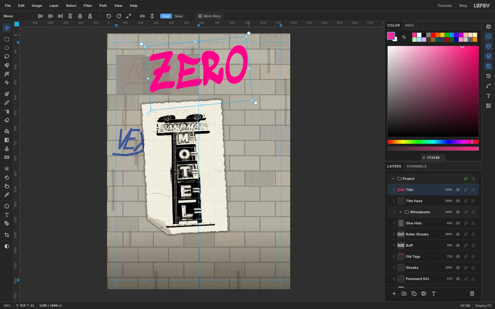

With the **Move** tool still active and *Title* selected, handles appear around the text. Drag the top-right rotation handle about **6°** anticlockwise, so the word climbs to the right like a piece painted from a ladder.

## Fade the fill from pink to orange

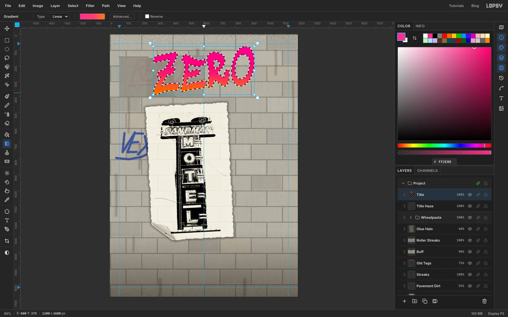

Click **Rasterize Layer** at the bottom of the Layers panel so you can paint into the letters, then [[Cmd]]-click the *Title* thumbnail to select them.

Pick the **Gradient** tool and use **Advanced** to make three stops: `#FF2E88`, `#FF3F6E` and `#FF7A1A`. Drag from the top of the letters straight down to their bottom. Fades like this are the most common fill in graffiti pieces.

## Paint the shine

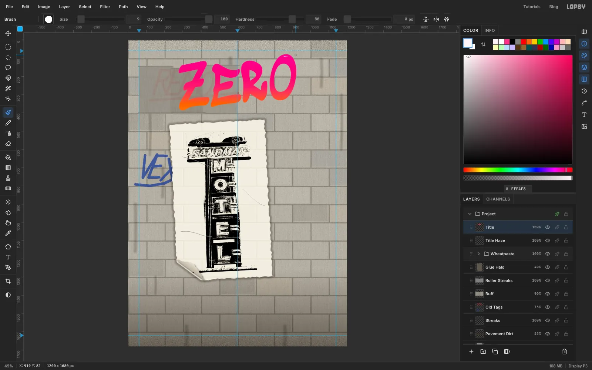

Keep the letters selected and choose **Select → Shrink…** at **10**, so the highlights stay off the edges. With the **Brush** at size **9** in `#FFF4F8`, paint a short stroke along the top of each letter, curving slightly to the right. Deselect.

## Outline it and give it depth

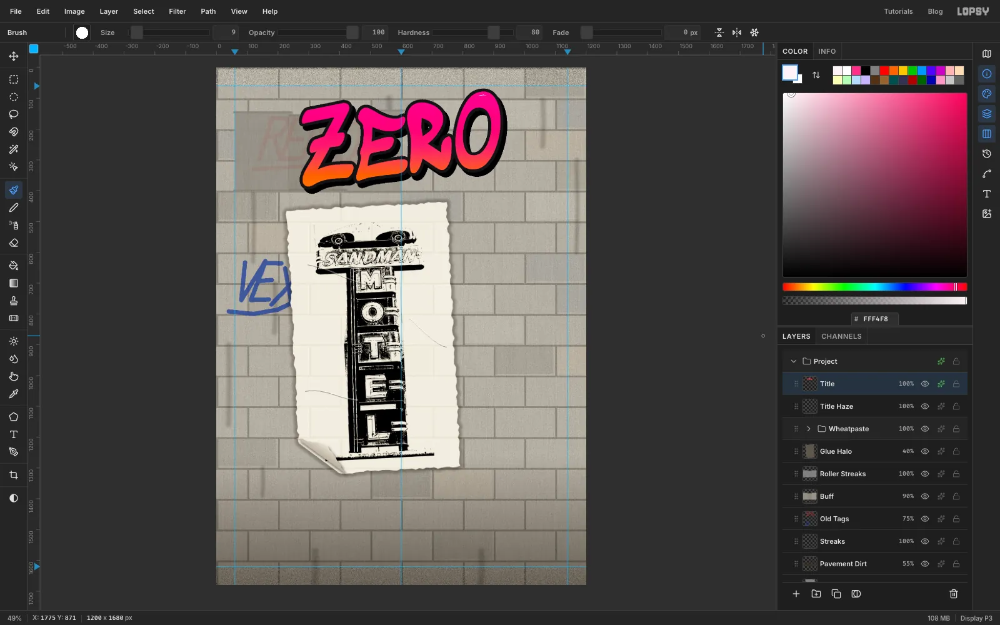

Open the *Title* layer's effects drawer and add:

- **Stroke**: **Width 10**, colour `#141316`
- **Drop Shadow**: **Offset X 12**, **Offset Y 14**, **Blur 0**, **Opacity 100**

With zero blur, the shadow becomes the hard 3D extrusion graffiti writers paint by hand.

## Paint the cloud behind it

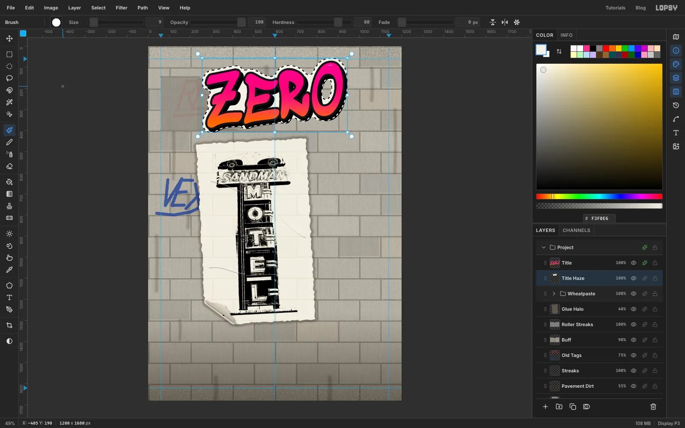

Click the *Title Haze* layer and [[Cmd]]-click the *Title* thumbnail. Choose **Select → Grow…** at **40**, then **Select → Shrink…** at **18**. Growing further than you need and then shrinking back closes up the small gaps inside letters like the E, so the cloud has no holes. Fill with `#F3F0E6`, deselect, and give the layer a **Stroke** of **6** in black.

## Spray a cyan mist behind everything

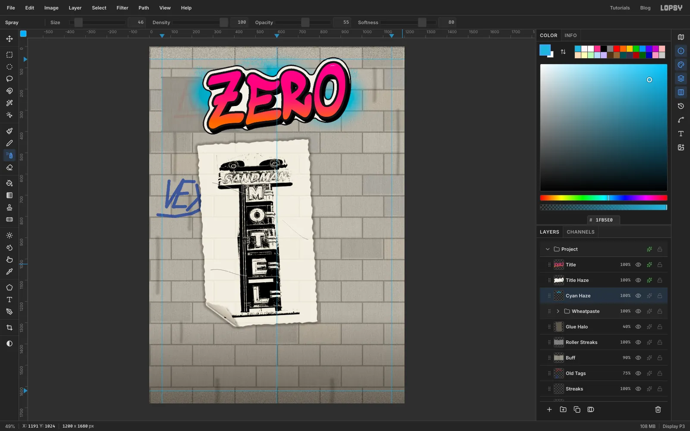

Add a layer named *Cyan Haze*. Pick the **Brush** with **Size 230**, **Hardness 0**, **Opacity 55** and the colour `#1FB5E0`, and drag two wavy passes across the full width of the piece. Then switch to the **Spray** tool ([[J]]) with **Size 46**, **Density 100**, **Opacity 55** and **Softness 80**. Drag it along the top edge of the mist for fine overspray. Run **Add Noise** at **18** (Mono) to break it up.

In the Layers panel, drag the *Cyan Haze* row below *Title Haze* so the mist sits behind the cloud. Put the Brush back to Hardness 100 and Opacity 100.

## Let the paint drip

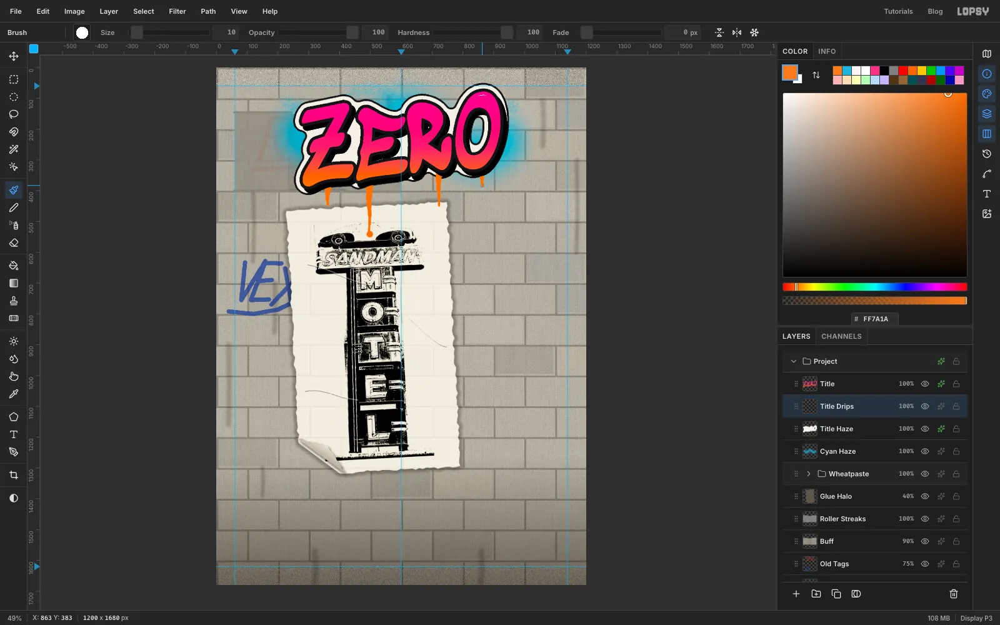

Click *Title Haze* and add a layer named *Title Drips*. It sits under the lettering, so each drip starts hidden inside a letter. Pick the **Brush** in `#FF7A1A`.

For each drip, click just inside the bottom of a letter at size **26**. Then [[Shift]]-click a little further down, lowering the size each time, for example 22, 17, 13 and 9. The run gets thinner as it falls. Make four drips of different lengths, from about 50 px to 165 px. On the longest one, finish with a single click at size **22** for a hanging drop.

## Add two sparkles

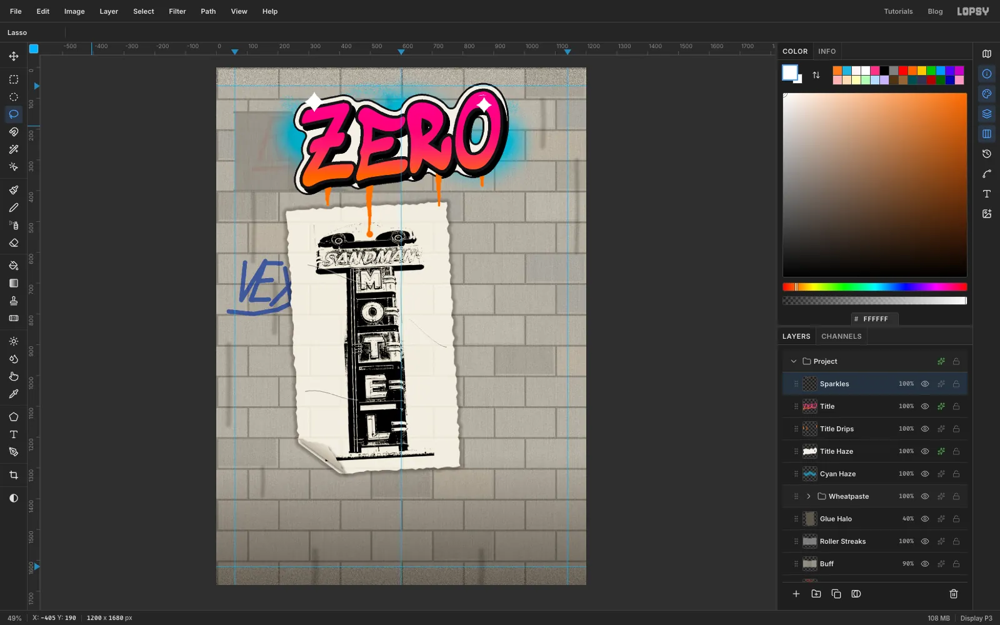

Click *Title* and add a layer named *Sparkles*. With the **Lasso**, draw two four-pointed stars with concave sides, a larger one on the top-left of the Z and a smaller one on the O. Fill them white. They're the classic graffiti glint.

## Roll a black band for the stencil

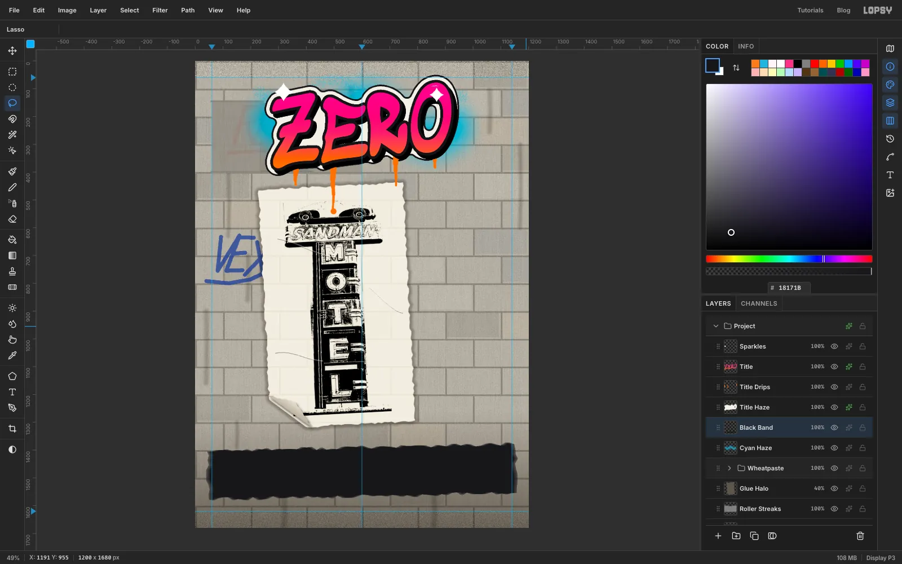

Click *Cyan Haze* and add a layer named *Black Band*. With the **Lasso**, draw a long, rough strip about 1100 × 175 px across the bottom of the page, tilted about 1°, and fill it with `#18171B`. Keep it selected and run **Add Noise** at **10** (Mono), then **Motion Blur** at **0°** with a distance of **30**, for horizontal roller texture. Deselect.

## Type VACANCY as a stencil

With the **Text** tool, choose **Stardos Stencil**, weight **Bold**, size **170**, **Center**, colour `#E2F03A`. Click the centre guide on the band, type `VACANCY` and press [[Tab]]. Rename the layer *Vacancy Type* and nudge it to the middle of the band.

This layer is only the stencil. You'll spray through it rather than keep it.

## Spray through the stencil

[[Cmd]]-click the *Vacancy Type* thumbnail, then click its eye icon to hide it. The selection stays.

1. Click *Black Band* and add a layer named *Vacancy Halo*. Choose **Grow…** at **7** and **Feather…** at **6**, fill with the yellow and lower the layer to **14%**. This is the faint glow of paint that creeps under a stencil.
2. [[Cmd]]-click *Vacancy Type* again and add a layer named *Vacancy Spray*.
3. Pick the **Spray** tool with **Size 120**, **Density 100**, **Opacity 100** and **Softness 20**. Zigzag across the letters five or six times until they're solid.

## Add overspray at the edges

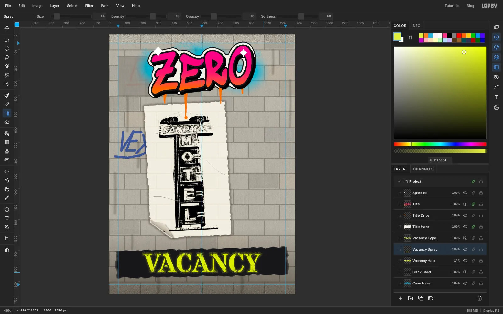

With the selection still active, choose **Grow…** at **12** and **Feather…** at **8**. Set the Spray to **Size 44**, **Opacity 30**, **Density 70** and **Softness 60**. Drag one wavy pass along the tops of the letters and another along their bottoms, then deselect. The fine mist that clings to the edges is what tells the eye "stencil".

## Draw the name-tag sticker

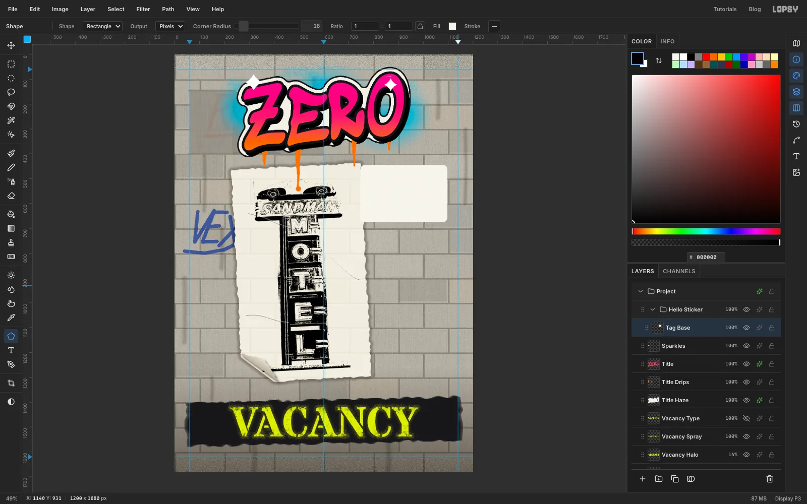

Click the *Sparkles* layer, click **New Group** and name the group *Hello Sticker*. Add a layer named *Tag Base*.

Pick the **Shape** tool ([[U]]) and choose **Rectangle**, with **Corner Radius 18**, a fill of `#F7F5EE` and no stroke. Click (don't drag) to the right of the paste-up, near the top. In the **Shape Size** dialog, enter **350** × **230** and click **Create**. Let the sticker overlap the right edge of the paper slightly. Stickers get slapped over whatever is already there.

## Add the red bands

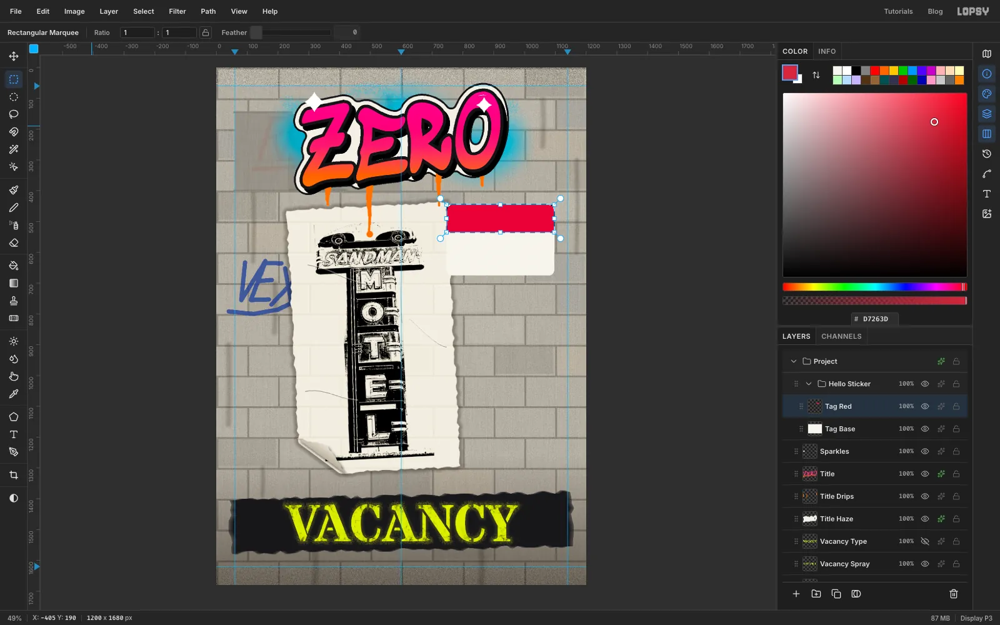

Add a layer named *Tag Red* and [[Cmd]]-click the *Tag Base* thumbnail. With the **Rectangular Marquee**, hold [[Shift+Alt]] and drag a box across the top 100 px of the sticker. That keeps only the part of the sticker inside your box, with its rounded corners. Fill it with `#D7263D`.

Do the same for a thin strip, about 25 px, along the bottom of the sticker, then deselect.

## Write on the sticker

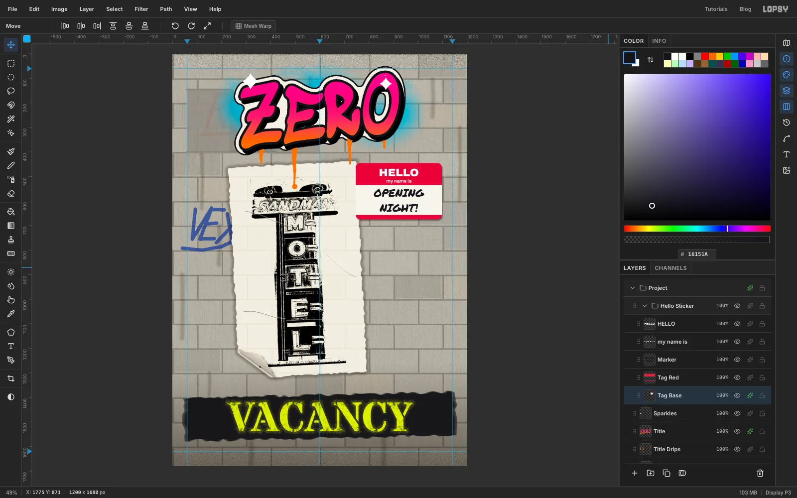

Use the **Text** tool, centred:

- `HELLO` in **Archivo Black**, size **44**, white, centred in the red band
- `my name is` in **Archivo SemiBold**, size **20**, white, just under it and still inside the red
- `OPENING` and `NIGHT!` on two lines in **Permanent Marker**, size **44**, `#16151A`, centred in the white area with equal space above and below. Rename this layer *Marker*.

Before you create each text layer, click a non-text layer such as *Tag Red*. Otherwise the new font settings restyle the text layer you just made.

Give *Tag Base* a **Drop Shadow** of **3 / 5 / 6** (offset X, offset Y, blur) at **45%** so the sticker lifts off the wall.

## Tilt the sticker

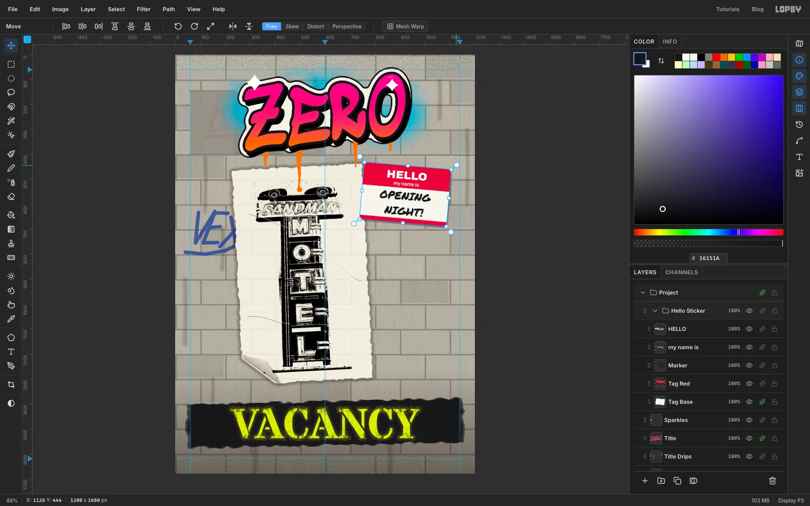

Click the *Hello Sticker* group row, pick **Move**, and drag the top-right rotation handle about **5°** clockwise. Press [[Cmd+D]], then collapse the group.

## Type the details on a torn note

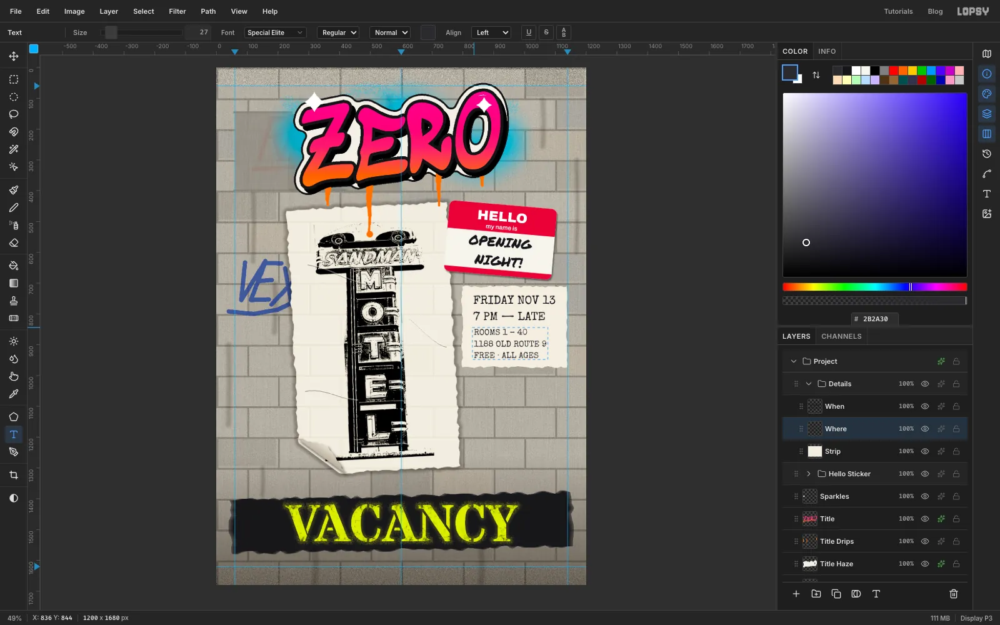

Click *Hello Sticker*, make a new group named *Details*, and add a layer named *Strip*. Lasso a torn rectangle about 340 × 260 px under the sticker. Fill it with `#F3EEE1` and add **Noise** at **7** (Mono).

With the **Text** tool in **Special Elite**, left aligned, colour `#16151A`:

- at size **38**, two lines: `FRIDAY NOV 13` and `7 PM — LATE`
- under them at size **27**, three lines: `ROOMS 1 – 40`, `1188 OLD ROUTE 9` and `FREE · ALL AGES`

Rename the two text layers *When* and *Where*.

Click *Strip* before you set up the second block, for the same reason as on the sticker. Leave about 35 px from the left edge of the note, about the same as the space after the longest line.

## Tape it to the wall

Add a layer named *Tape*. Lasso two short strips about 120 × 34 px, angled across the top-left and bottom-right corners of the note, and fill them with `#E8DBAE`. Let the top strip run onto the sticker above. Lower the layer to **85%** so the note shows through the tape. Give *Strip* a **Drop Shadow** of **2 / 3 / 4** at **35%**.

## Tilt the note

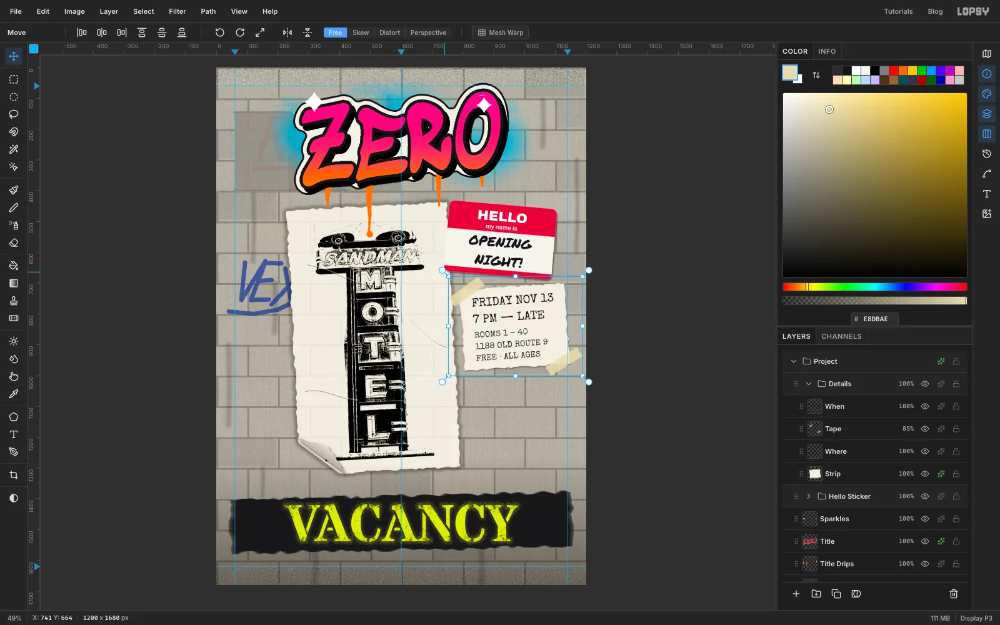

Click the *Details* group row and, with **Move**, drag its top-left rotation handle about **4°** anticlockwise, the opposite way to the sticker. Press [[Cmd+D]] and collapse the group.

## Draw a motel arrow with the Pen

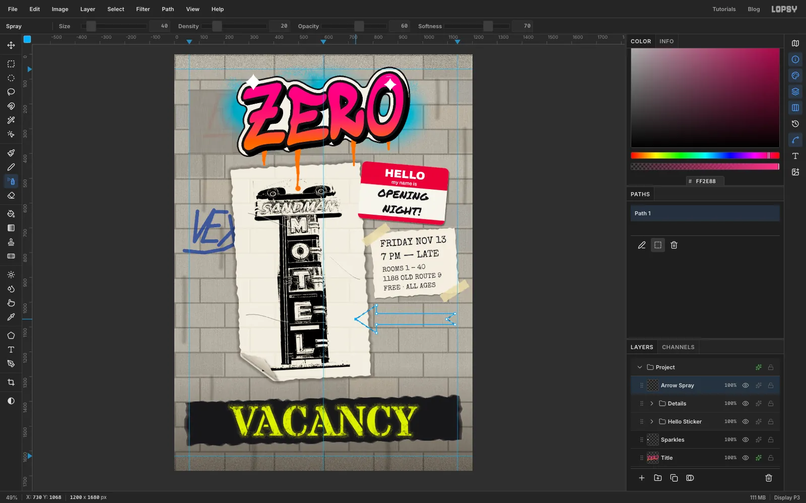

Click *Details* and add a layer named *Arrow Spray*. Pick the **Pen** tool ([[P]]) and click the corners of a classic motel arrow, about 400 px long, pointing left at the poster:

1. the point
2. the top of the head
3. back in to the top of the shaft
4. the top-right end
5. a notch in the tail
6. the bottom-right end
7. the bottom of the shaft
8. the bottom of the head

Click the first point again to close the path. In the **Paths** panel, click **Path to Selection**, then pick the **Spray** tool. The path's blue outline stays on screen over the selection.

## Spray the arrow and light the bulbs

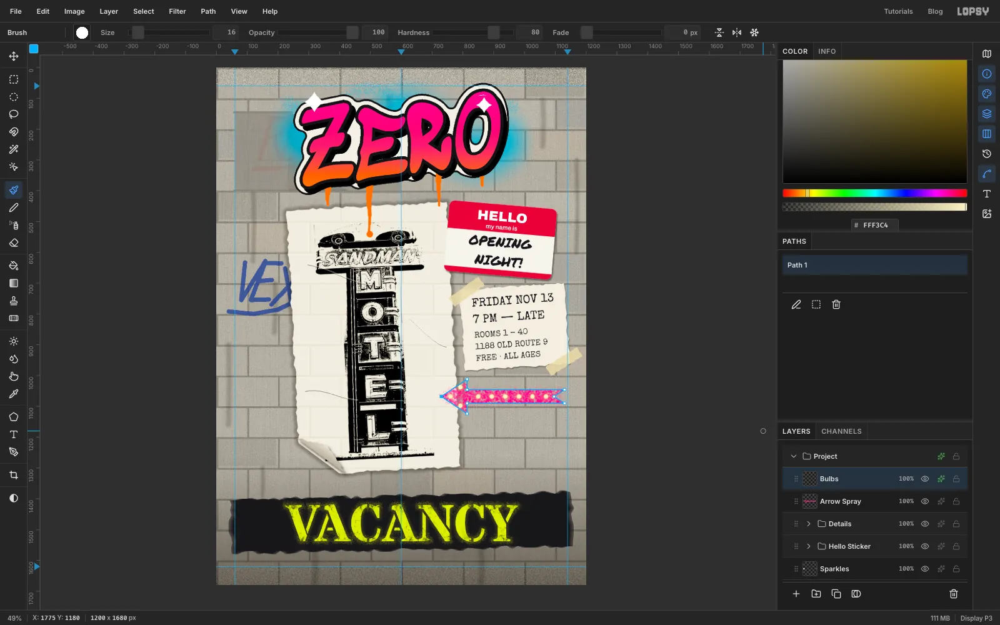

With the **Spray** tool in `#FF2E88` (**Size 90**, **Density 100**, **Opacity 100**, **Softness 45**), drag three passes through the arrow. Then **Grow…** by **10**, **Feather…** by **8**, and do one light pass at **Opacity 30** for overspray. Deselect.

Add a layer named *Bulbs*. With the **Brush** at size **16** in `#FFF3C4`, click a row of dots along the shaft about 44 px apart, plus three in the head. Give the layer an **Outer Glow** with **Size 14**, **Spread 10**, **Opacity 80** and colour `#FFE36A`.

## Slap on a round sticker

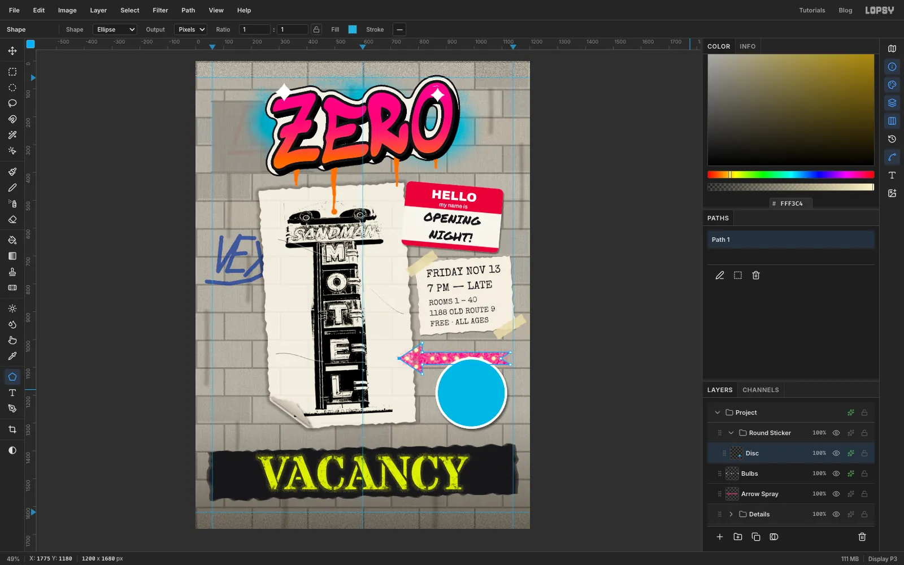

Click *Bulbs*, make a group named *Round Sticker*, and add a layer named *Disc*. With the **Shape** tool set to **Ellipse**, click below the arrow and make a **240 × 240** circle in `#1FB5E0`. Place it so its top overlaps the tail of the arrow, as if it was stuck on after the paint dried.

Give it a white **Stroke** of **9** for the die-cut edge and a **Drop Shadow** of **5 / 8 / 10** at **50%**.

## Give it a sheen and its copy

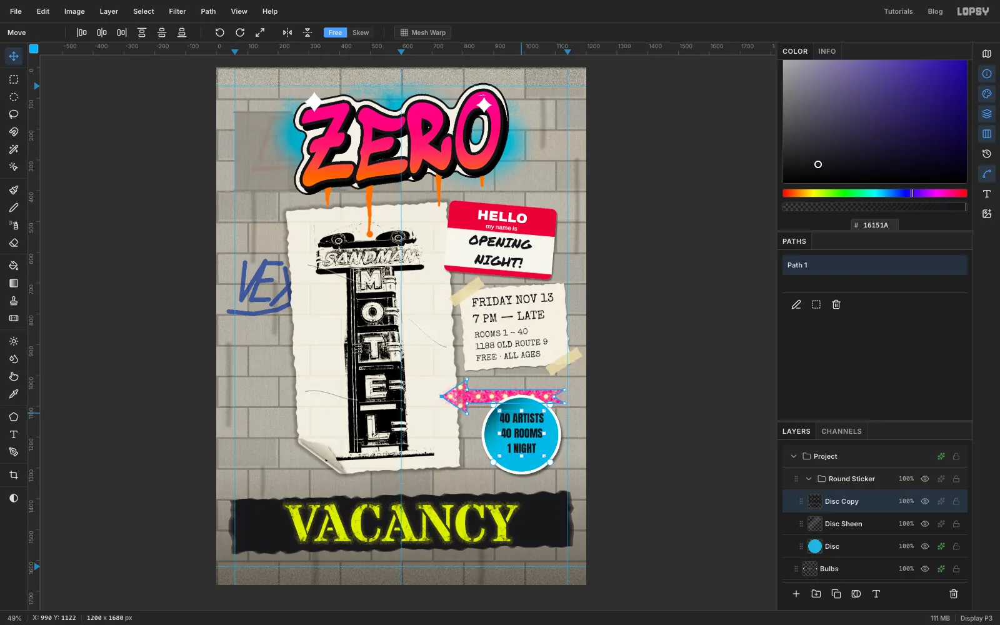

Add a layer named *Disc Sheen* and [[Cmd]]-click the *Disc* thumbnail. With the **Gradient** tool, open **Advanced** and set both stops to white, the left one at **55%** opacity and the right one at **0%**. Drag from the top-left edge of the circle to its centre, then deselect.

Click *Disc Sheen* and type `40 ARTISTS`, `40 ROOMS` and `1 NIGHT` on three lines in **Anton**, size **35**, centred, in `#16151A`, and rename the layer *Disc Copy* (the copy printed on the disc). Seat the block a touch above the circle's centre, with at least 30 px of cyan around it.

## Tilt the round sticker

Click the *Round Sticker* group row and, with **Move**, drag the top-right rotation handle about **9°** anticlockwise. The text turns with the circle. Press [[Cmd+D]] and collapse the group.

## Add the footer

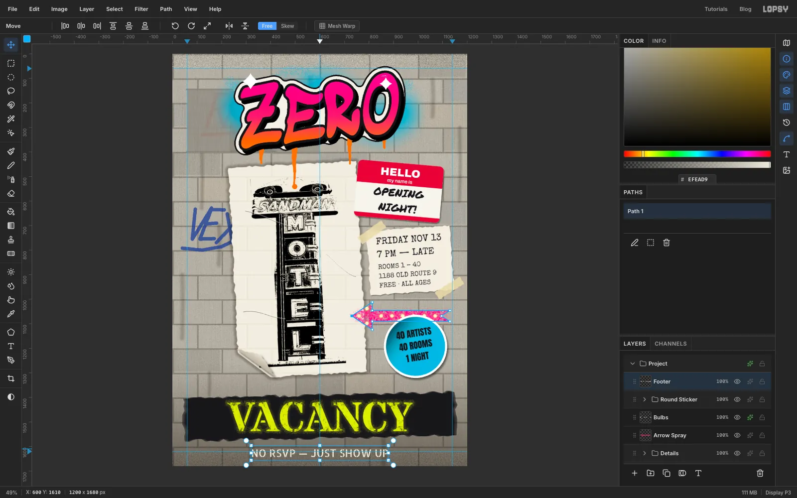

Click the *Round Sticker* row. With the **Text** tool in **Allerta Stencil**, size **43**, centred, colour `#EFEAD9`, type `NO RSVP — JUST SHOW UP` on the centre guide below the band. Rename the layer *Footer*. Nudge it until it sits halfway between the band and the bottom edge, clear of the mortar line.

## Flick some splatter

Click *Title Drips* and add a layer named *Splatter*. With the **Brush**, make clusters of a dozen or so flecks in hot pink and acid yellow. Make each fleck a click with a tiny flick outward, at sizes from about 4 to 18. Put the clusters near the paper's top-left and bottom-left corners, beside the title, and in the bottom-right corner, never on top of text.

When you're happy, choose **Layer → Merge Down** to fold the splatter into *Title Drips*.

## Smear two drips longer

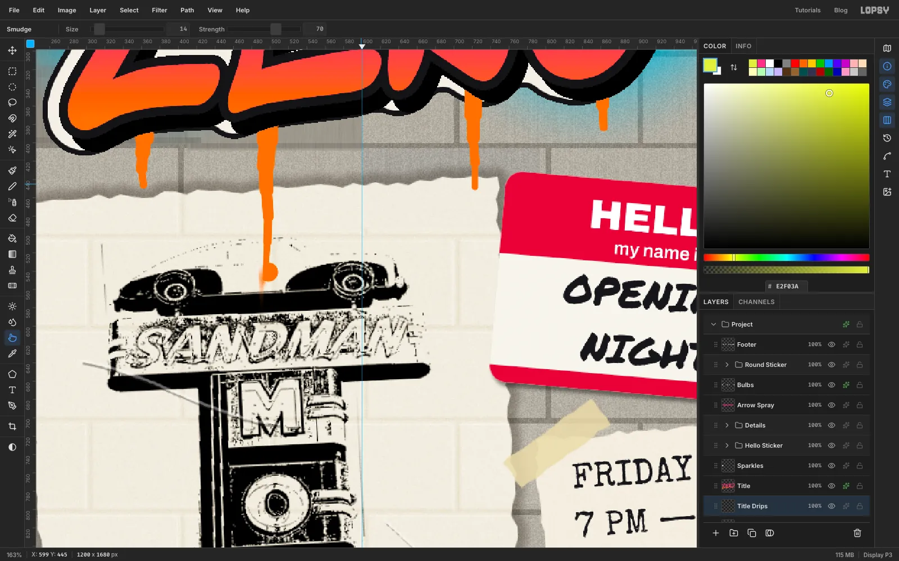

Click *Title Drips*. Pick the **Smudge** tool ([[R]]) at **Size 14** and **Strength 70**, and drag down from just above the end of the second drip, then the third. Paint that's still wet keeps running, so the drips stretch out thinner and less even.

## Wear down the old tag

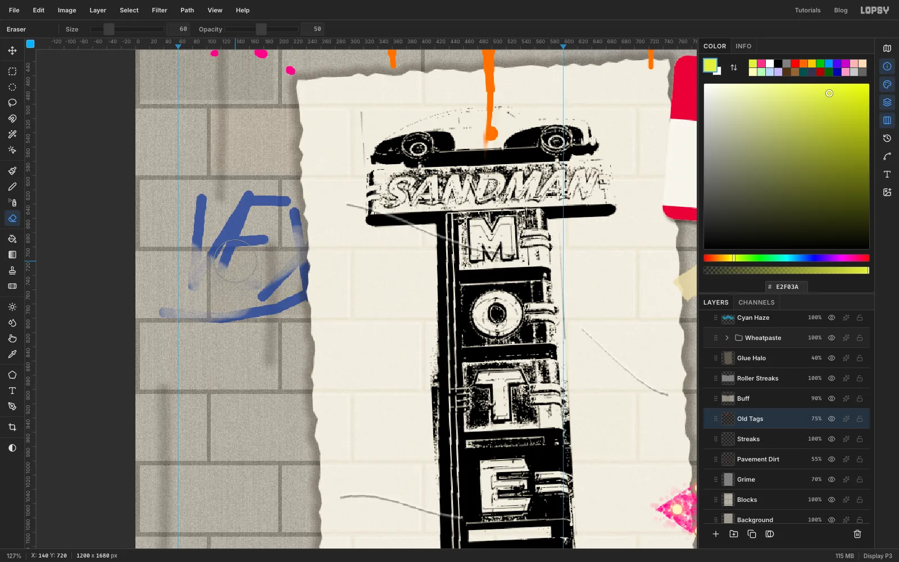

Click *Old Tags* and pick the **Eraser** ([[E]]) at **Size 60** and **Opacity 50**. Drag once across the middle of the VEX tag and once along its underline. It fades unevenly, like a tag that's been scrubbed.

## Burn the foot of the wall

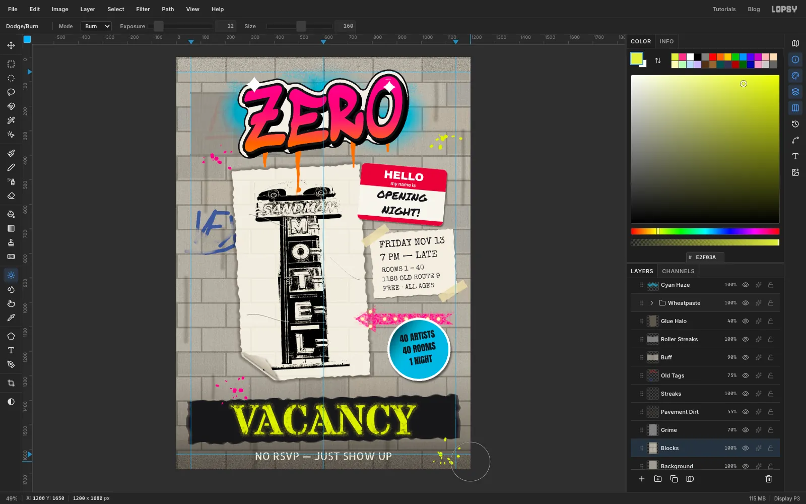

Click *Blocks* and pick the **Dodge/Burn** tool ([[O]]). Set its mode to **Burn**, **Exposure** to **12** and **Size** to **160**, and drag once along the bottom edge of the page.

## Add grain

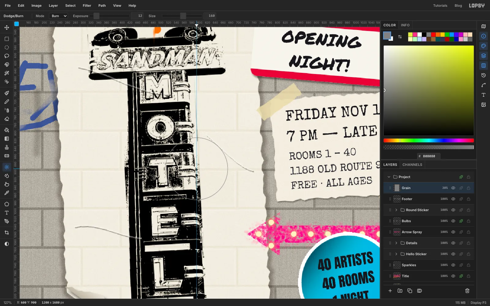

Click *Footer* and add a layer named *Grain*. Choose **Select → All**, fill with `#808080`, and deselect. Run **Add Noise** at **40** (Mono) and set the layer to **Overlay** at **30%**. The grain ties the paint, paper and wall together.

## Finish with a vignette

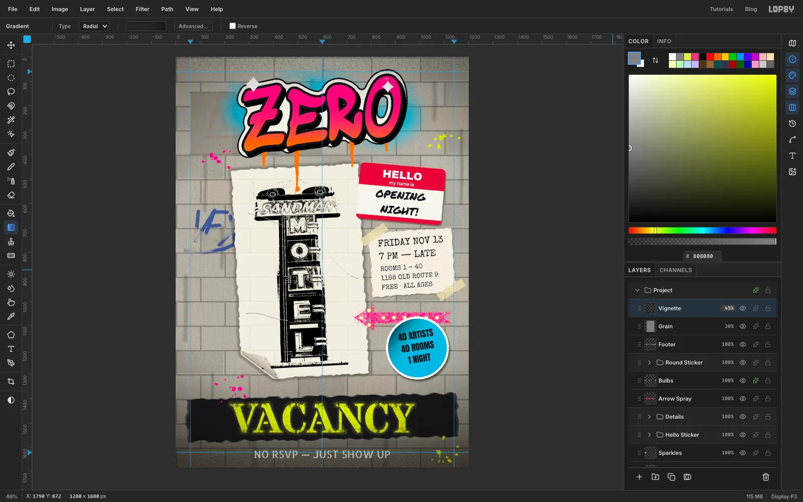

Add a layer named *Vignette*. Pick the **Gradient** tool set to **Radial** and, in **Advanced**, make three stops in `#1A1614`: transparent at the start, still transparent at about 60%, and fully opaque at the end. Drag from the middle of the page out past a corner, then set the layer to **Multiply** at **45%**.

Save with **File → Save Project** and export with **File → Quick Export PNG**.
