In 1915 Kazimir Malevich hung a set of paintings in Petrograd that had no subject at all: only black, red, yellow and blue rectangles floating on white. He called the movement **Suprematism**. One of the best known, *Suprematist Composition: Airplane Flying*, doesn't show an aeroplane. It's a cluster of tilted planes that *feels* like flight.

This tutorial turns that language into a piece of film pre-production: a **concept-art key frame** for an imaginary sci-fi film, *Red Wanderer*. A starship built only from flat planes climbs over a pale steppe towards a black eclipse. A real astronaut, cut out of a NASA photo the way Soviet photomontage artists cut up magazines, hangs off the stern on a tether. Since the film's look is Soviet, his layer is called **Cosmonaut**. Black letterbox bars carry the slate labels a studio puts on every frame.

The frame is 1920 × 1080 px. The letterbox bars leave a 1920 × 804 picture, the 2.39:1 shape of a widescreen film.

You'll need two public-domain images from Wikimedia Commons:

- **Suprematist Composition - Airplane Flying (Malevich, 1915).jpg**, as a reference only. It never goes into the picture.
- **Astronaut-EVA.jpg**, NASA's 1984 photo of Bruce McCandless flying free of the Space Shuttle. Download the 1920 px version.

The tools you'll use:

- the **Gradient** tool, the **Rectangular** and **Elliptical Marquee** (including their click-for-exact-size dialogs), the **Lasso** and the **Magic Wand**
- the **Pen** with **Path to Selection** for straight-edged shapes
- **Select → Feather / Shrink / Inverse**, and [[Cmd]]-click on a layer thumbnail to load its shape as a selection
- the **Shape** tool, the **Pencil** and the **Eraser**
- the **Move** tool's rotate and scale handles, rotating a whole **group** at once, and **Distort** mode
- **Duplicate Layer**, **Merge Down**, **Copy** and **paste in place**
- **Gaussian Blur**, **Hue/Saturation** and **Add Noise**
- the **Color Overlay** effect and **Rasterize Layer Style**
- the **Multiply**, **Color** and **Overlay** blend modes
- live text in two Google fonts, Syncopate and IBM Plex Mono, including rotated live text

The palette is Malevich's, laid on a warm off-white:

- Steppe `#DED7C7` → `#F3EEE2`, ground `#F1ECE0` → `#E5DECE`, haze `#FBF7EE`
- Ink black `#1D1C1B`
- Hull red `#B5372C`, wake red `#D2695A`
- Ochre `#D9A33C`, wake ochre `#DDB466`
- Ultramarine `#26357A`
- City white `#F2EEE4`, city shade `#CFC7B6`, wake grey `#A69F92`
- Title cream `#EFE8D8`, label grey `#B8AE9C`

> **Tip:** On a wide-gamut (Display P3) screen, Lopsy reads typed hex codes as P3 colours. These codes were picked as P3 values, so they match the finished frame. On an sRGB screen they look a little duller.

> **Note:** Shortcuts are written for a Mac. On Windows use [[Ctrl]] wherever it says [[Cmd]].

Two habits will save you trouble throughout:

- **New layers land directly above the active layer.** Each step says which layer to click first.
- **Each layer row has a ✦ button** that opens the effects drawer. The drawer holds the layer's blend mode menu and effects like Color Overlay.

## Set up the frame, the guides and a reference

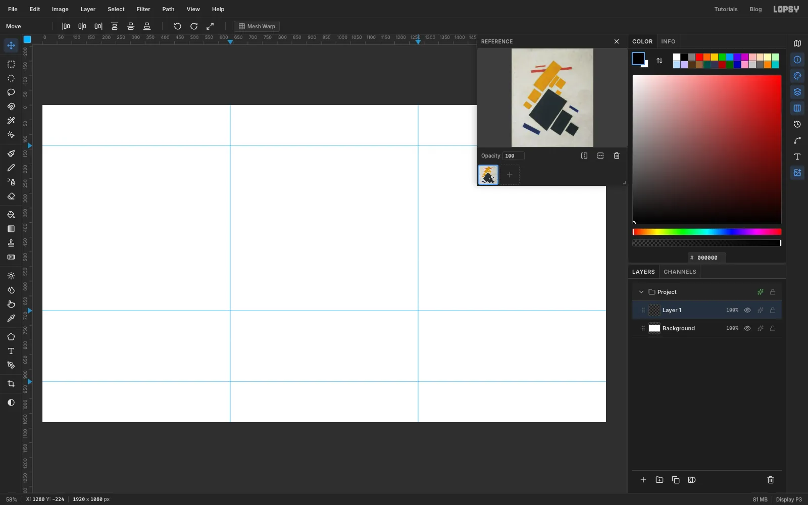

Choose **File → New** and make a **1920 × 1080** document with a White background.

Click the left ruler to drop horizontal guides at **138** and **942**. These are the inner edges of the letterbox bars. Add a third at **700** for the horizon. Then click the top ruler at **640** and **1280** to mark the thirds.

Open the **Reference** drawer from the panel toolbar on the right and add the Malevich painting. Look at how nothing in it sits level: every plane is tilted, and the planes cross each other at steep angles instead of running parallel. Close the drawer when you've had a good look.

## Paint the sky and the steppe

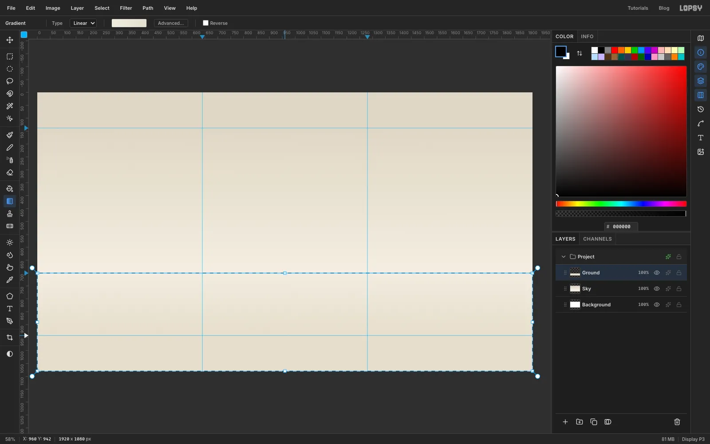

Double-click **Layer 1** and rename it **Sky**. Pick the **Gradient** tool, set it to **Linear** and click **Advanced…** to set two stops: `#DED7C7` on the left and `#F3EEE2` on the right. Drag from the top bar guide straight down to the horizon guide. The sky is darker at the top and brightest at the horizon, like the glow before sunrise.

Click **Add Layer** at the bottom of the Layers panel and name the new layer **Ground**. With the **Rectangular Marquee**, select everything from the horizon guide down to the bottom of the canvas. Change the gradient stops to `#F1ECE0` and `#E5DECE`, then drag from the horizon down to the bottom bar guide. The steppe should stay almost white: Malevich's backgrounds are off-white, never brown.

Press [[Cmd+D]] to deselect.

## Make the planet and feather its corona

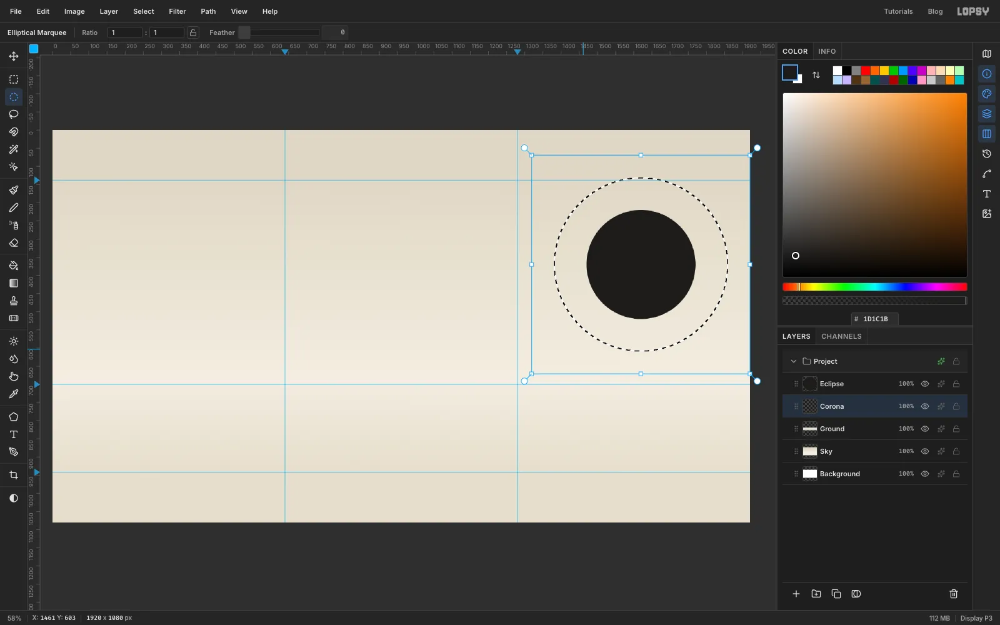

The eclipse goes in the upper-right third, where the ship will be heading.

First the planet. Add a layer called **Eclipse**. With the **Elliptical Marquee**, click once on the canvas without dragging to open the exact-size dialog. Enter a circle from **1470, 220** to **1770, 520**, a 300 px disc. Set the foreground colour to `#1D1C1B` and choose **Edit → Fill**. Deselect.

Now click the **Ground** layer and add a layer called **Corona**. It lands between the ground and the planet. Click with the Elliptical Marquee again and make a much larger circle on the same centre, from **1380, 130** to **1860, 610**. Choose **Select → Feather…** and enter **63**, the largest feather Lopsy allows.

## Fill the corona

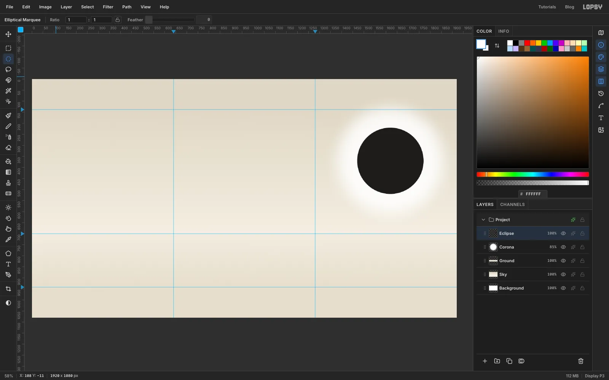

Fill the feathered circle with white `#FFFFFF`, deselect, and set the Corona layer's opacity to **85%**.

The feather fades the white out over 63 px around the circle's edge, so the planet looks backlit.

## Draw the ring with the Shape tool

Click the **Eclipse** layer and add a layer called **Ring** above it.

Pick the **Shape** tool and set **Shape** to **Ellipse**. Click the **Fill** swatch and choose **Remove fill**. Click the stroke **—** button to add a stroke, type `D9A33C` into the colour popover's hex field, and set **Width** to **5**.

Shapes grow out from where you press. Press on the centre of the planet and drag about 220 px right and 44 px down. You get a flat ochre ellipse wider than the planet.

## Tilt the ring

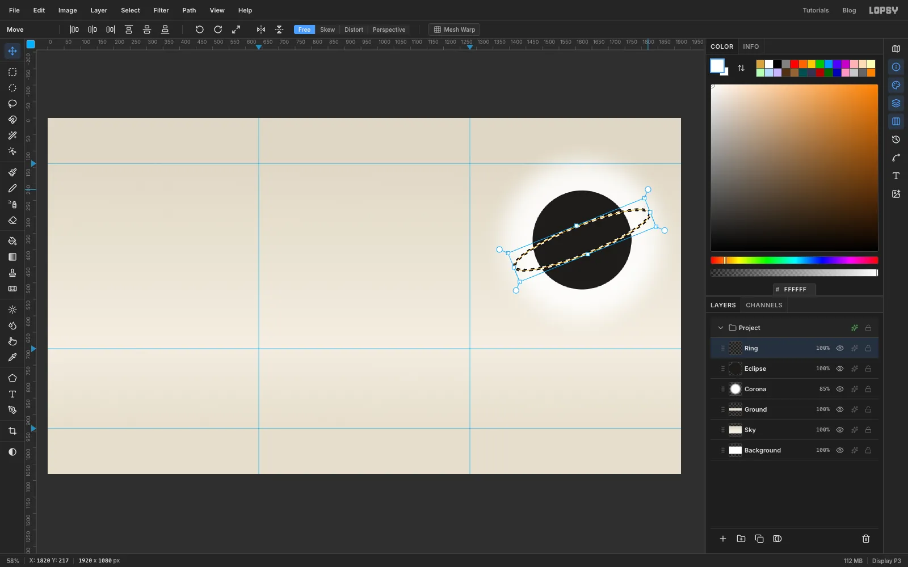

[[Cmd]]-click the Ring layer's thumbnail to load the ring as a selection. Switch to the **Move** tool ([[V]]): handles appear around it.

Drag the round **rotation handle** just outside the top-right corner anticlockwise, by about **22°**, so the ring rises to the right. Press [[Enter]] to apply it and [[Cmd+D]] to deselect.

## Hide the back of the ring behind the planet

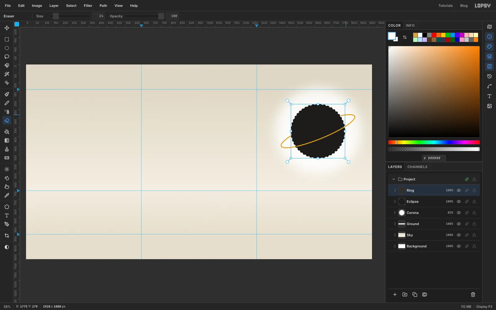

Right now the ring runs across the front of the planet all the way round. The back half needs to disappear behind it.

[[Cmd]]-click the **Eclipse** thumbnail. This selects the disc, but the Ring layer stays active. Pick the **Eraser** ([[E]]), set **Size** to **24**, and drag along the *upper* stretch of the ring, the part that crosses the disc above its centre. The selection stops the eraser at the disc's edge, so the ring is cut cleanly where it goes behind the planet. Deselect.

## Build a distant city out of slabs

Suprematist architecture was white blocks with no windows: Malevich called his plaster models *architectons*. A row of them on the horizon gives the frame its sense of scale.

Click the **Ring** layer and add a layer called **Steppe City**. With the Rectangular Marquee, drag a narrow slab whose bottom edge sits on the horizon guide, somewhere under the eclipse. Then hold [[Shift]] and drag eight more, so they add to the selection. Make them 20–80 px wide and anywhere from 15 to 200 px tall, and let a couple of tall thin ones rise well above the rest.

Fill the selection with city white `#F2EEE4` and deselect.

## Shade the slabs and cast their shadows

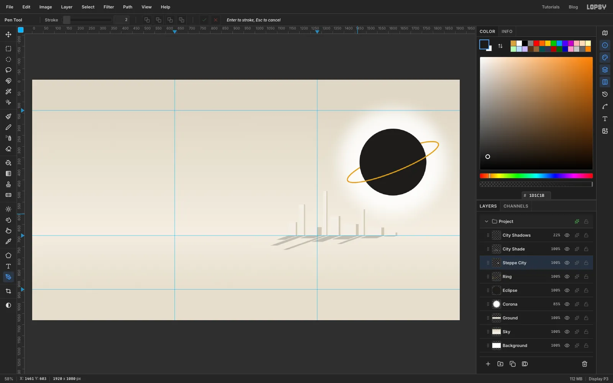

Add a layer called **City Shade**. [[Shift]]-drag a thin strip down the right side of every slab, about a sixth of its width (5 px for the thinnest). Fill with `#CFC7B6`. A hairline of shade is all the block needs to look solid.

The light is high on the right, so shadows fall towards us and to the left. Add a layer called **City Shadows** and set the foreground to ink. Each shadow is a slanted parallelogram with perfectly straight edges, so draw it with the **Pen** ([[P]]), not the freehand Lasso:

1. Click the four corners: the far end of the shadow, the slab's bottom-left corner, its bottom-right corner, and the far end again on the right. Make the shadow run down and left about as far as the slab is tall.
2. Click the first point again to close the path.
3. In the **Paths** panel, click **Path to Selection**, then **Edit → Fill** and deselect.

Repeat for each slab. Then run **Filter → Gaussian Blur…** at **2**, open the layer's effects drawer (✦), set the blend mode to **Multiply**, and set the layer's opacity to **22%**. Finally, select **Steppe City** and give it a **Gaussian Blur** of **1** so the distant slabs sit back in the haze.

## Draw the ship's planes, level, inside a group

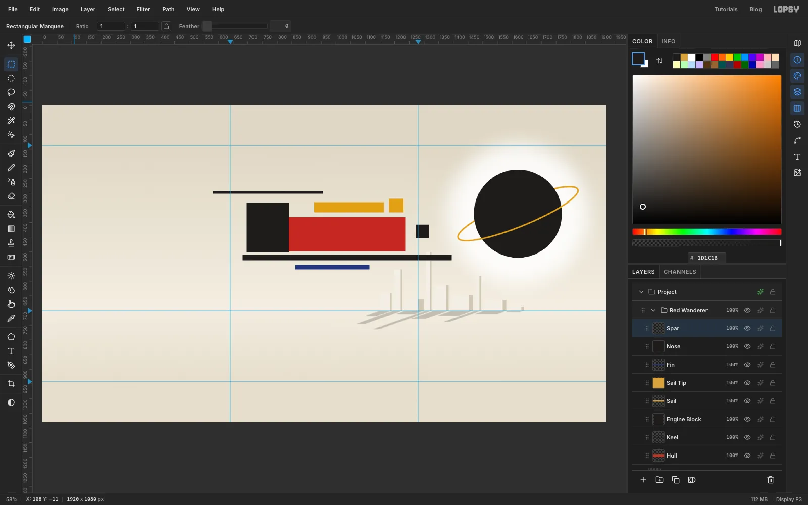

Click **City Shadows**, then click **New Group** in the Layers panel and name the group **Red Wanderer**. Every plane of the ship goes on its own layer inside this group. Draw them all level for now: the whole ship gets turned in one go afterwards, so all the planes look parallel at this stage.

For each plane, add a layer, marquee a rectangle, fill it and deselect. Start with the hull. Click with the Rectangular Marquee to open the exact-size dialog and enter **804, 382 → 1236, 498**. Every other plane is placed by eye around it. Here they are from the bottom of the stack to the top:

- **Hull**, red `#B5372C`: 432 × 116, the big plane everything hangs on.
- **Keel**, ink: 712 × 18. A long bar just below the hull, sticking out about 120 px at the back and 160 px at the front.
- **Engine Block**, ink: 144 × 170. A heavy square covering the rear end of the hull, with its bottom edge just below the hull's.
- **Sail**, ochre `#D9A33C`: 238 × 34. A bar floating about 15 px above the hull, starting near its middle.
- **Sail Tip**, ochre: 49 × 46. A small block just past the front of the sail.
- **Fin**, ultramarine `#26357A`: 252 × 16. A thin bar just below the keel.
- **Nose**, ink: 45 × 45. Use the **Shape** tool for this one. Set Shape to **Rectangle**, remove the stroke, and set the fill to ink. *Click* (don't drag) just in front of the hull, halfway down it, then type **45 × 45** into the Shape Size dialog and press [[Enter]].
- **Spar**, ink: 374 × 9. A very thin rod high above the engine block, sticking out well behind it.

## Turn the whole ship as one

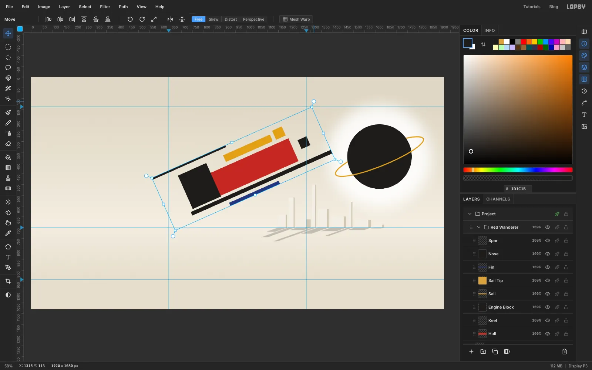

Click the **Red Wanderer** group's row and press [[Cmd+D]] so nothing is selected. With the **Move** tool, a single frame of handles appears around all the planes in the group.

Drag the top-right rotation handle anticlockwise by **24°** and press [[Enter]]. The whole ship now climbs to the right, towards the eclipse. Every plane turned around the same centre, so they all keep their places.

Try [[Cmd+Z]] and [[Cmd+Shift+Z]] here: the turn undoes and redoes as one step.

## Cross the planes against each other

Malevich's planes cross at steep angles. Here, every plane is still at the same 24°. Two of them need to break ranks.

[[Cmd]]-click the **Spar** thumbnail and, with the Move tool, drag its rotation handle clockwise by **60°**. Press [[Enter]] and deselect. Then drag the spar so it runs from above the engine block, down through the rear of the hull, to the keel.

Do the same with the **Fin**: turn it **90°** clockwise so it stands across the ship. Then drag it so it crosses the front of the hull and the keel, about two thirds of the way along.

## Add a tail bar and an antenna

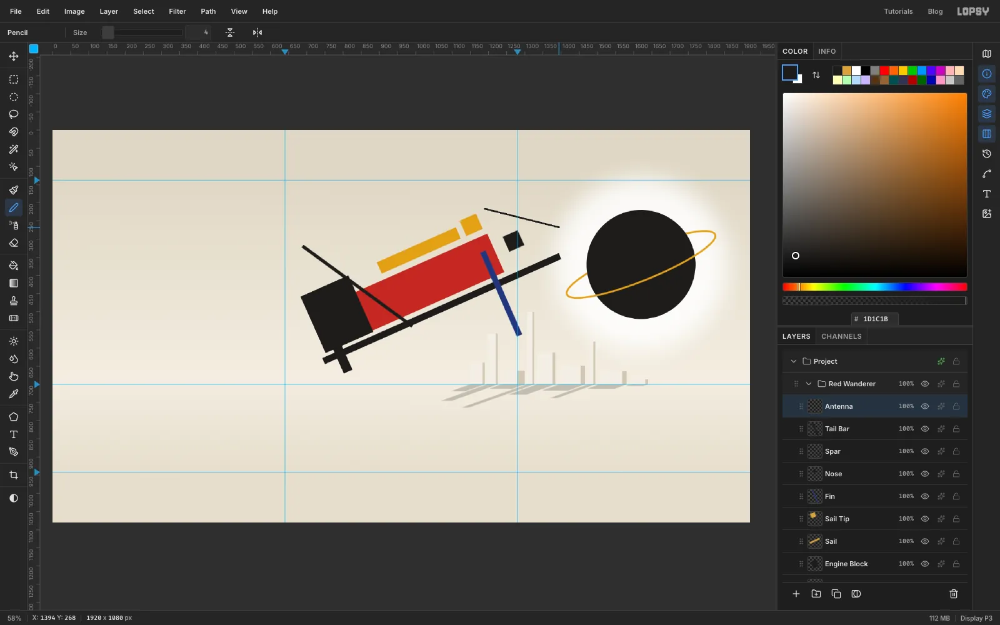

Click the **Spar** layer and add a layer called **Tail Bar** (it lands inside the group). Marquee an upright bar about **26 × 210** px, centred on the keel about 60 px in from its back end, and fill it with ink. While it's still selected, switch to the Move tool and turn it **24°** anticlockwise, so it stands at right angles to the keel. Press [[Enter]] and deselect.

Add one more layer called **Antenna**. Pick the **Pencil** ([[N]]) at **Size 4** with ink as the foreground colour. Click just above the sail tip, then [[Shift]]-click out past the nose. The Shift-click draws a dead-straight line between the two points.

## Duplicate the ship and merge the copy

The ship needs a shadow on the ground, and the quickest way is to start from a copy of the whole ship.

Click the **Red Wanderer** group row and click **Duplicate Layer**. The copy appears directly above the original. Rename the *original* (lower) group **Shadows**. It will hold everything that sits behind the ship.

Inside **Shadows**, click its top layer (**Antenna**) and choose **Layer → Merge Down** nine times, until one layer is left. Rename it **Ship Shadow**. Rename the copy group back to **Red Wanderer** and collapse it with its arrow.

## Lay the shadow flat on the ground

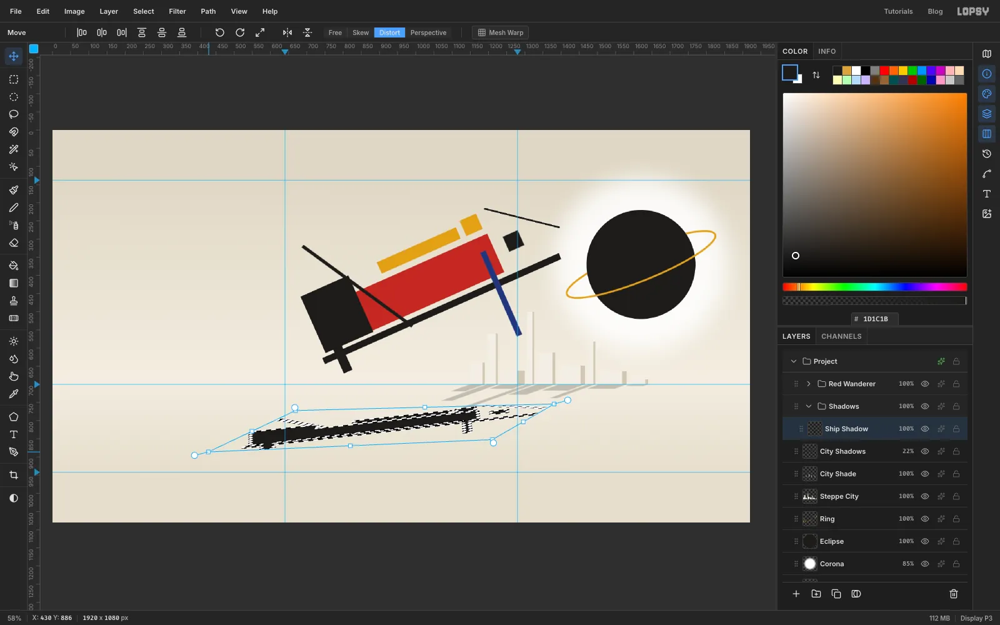

With **Ship Shadow** active, open its effects drawer (✦), turn on **Color Overlay** with ink black, and click **Rasterize Layer Style**. The merged ship is now a solid black silhouette.

[[Cmd]]-click its thumbnail, switch to the Move tool, and click **Distort** in the options bar. In Distort mode each corner handle moves on its own. Drag the four corners down onto the ground, below the ship. Squash the silhouette into a long, thin, slanted band about 950 px long and 100 px deep: the top edge a little shorter than the bottom, and the left end lower than the right. Press [[Enter]] and deselect.

## Soften the shadow

Run **Gaussian Blur** at **3**, set the layer to **Multiply** and drop its opacity to **16%**. Keep it faint. The ship is high up, and a dark shadow would pin it to the ground.

## Draw hard-edged speed wedges

Click **Ship Shadow** and add a layer called **Speed Lines**. It lands inside the Shadows group, so it sits behind the ship.

Each wedge is a long, thin triangle. It's wide at the stern, just behind the engine block, and runs to a point down and to the left, parallel to the ship. Draw each one with the Pen: click the far tip, then the two stern corners, then the tip again to close it. **Path to Selection**, fill, deselect. From top to bottom:

- wake red `#D2695A`: about 22 px wide at the stern and 480 px long
- wake grey `#A69F92`: about 12 px wide and 560 px long
- wake ochre `#DDB466`: about 18 px wide and 420 px long

Set the layer's opacity to **90%**. Leave the edges sharp: blurring them would make a smudge, which is the opposite of Suprematism.

## Drop in the astronaut photo

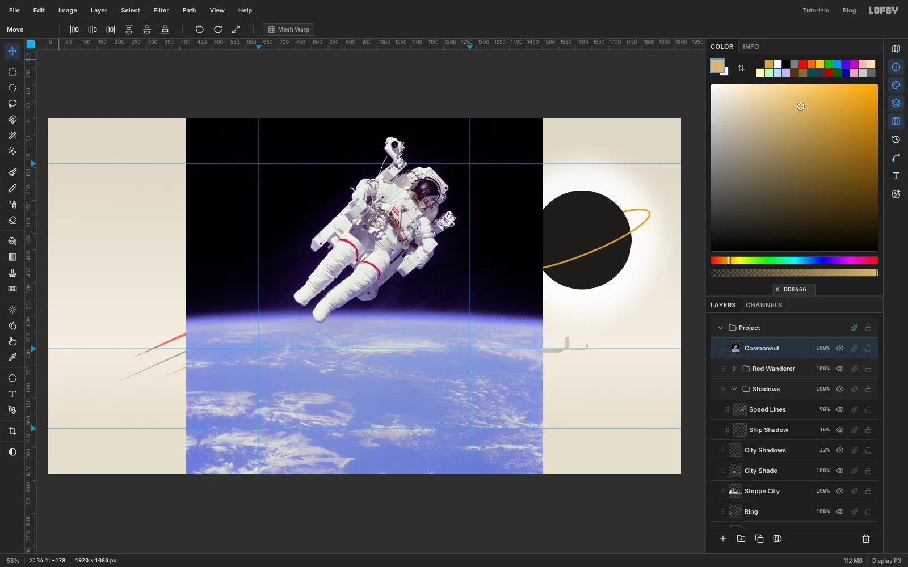

Click the **Red Wanderer** group's row so the photo lands above the ship. Drag **Astronaut-EVA.jpg** from your desktop onto the canvas. Lopsy shrinks it to fit the 1080 px height and selects it. Rename the new layer **Cosmonaut** and press [[Cmd+D]].

## Lasso around the astronaut

With the **Lasso**, trace loosely around the astronaut, about 10 px outside him. Include the camera on its arm above his head. Keep the line tight under his boots so the blue Earth stays outside. A loose freehand line is fine here, because the next step cleans up what's left.

Choose **Select → Inverse** and press [[Delete]]. Everything outside the line, including the Earth, is gone. Deselect.

## Remove the black margin with the Magic Wand

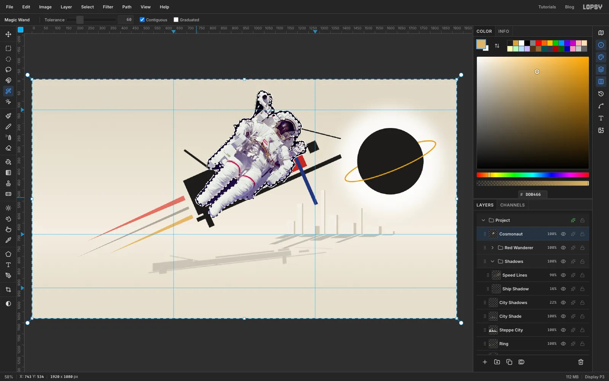

A thin rim of black space is left around him, plus dark gaps between his legs and between his arm and body. Pick the **Magic Wand** ([[W]]), set **Tolerance** to **60** and keep **Contiguous** on. Click the rim, then [[Shift]]-click each dark gap. Press [[Delete]] and deselect.

Contiguous matters here. It stops the wand from reaching the dark visor of his helmet, which isn't connected to the background.

## Clean the edge

Photos always leave a dark fringe of half-black pixels along the cut. [[Cmd]]-click the Cosmonaut thumbnail, choose **Select → Shrink…** at **3**, then **Select → Inverse** and [[Delete]]. That trims three pixels off the whole outline. Deselect.

## Scale, move and tilt him in one transform

[[Cmd]]-click his thumbnail again and switch to the Move tool.

1. Hold [[Cmd]] and drag the bottom-right corner handle inwards until he's about **205 px** tall, a bit taller than the engine block.
2. Drag from the middle of the box to move him into the upper-left of the frame, well clear of the speed wedges.
3. Turn him about **18°** anticlockwise with a rotation handle, so his head leans towards the ship.

Press [[Enter]] once at the end. All three changes apply together, so the photo is only resampled once.

> **Tip:** After a scale, the round rotation handles are drawn closer to the corners. Grab them where you see them.

[[Cmd]]-click the thumbnail once more, **Shrink** by **1**, **Inverse**, [[Delete]]. That trims the slight halo the scale leaves.

## Warm the suit to match the frame

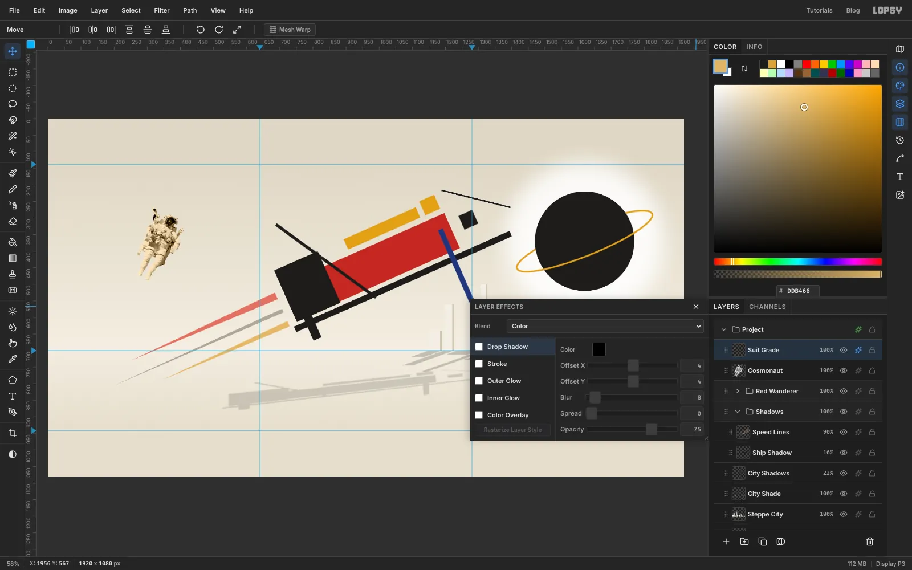

His suit is a cold, bright NASA white, and he looks pasted onto the warm frame. Run **Filter → Hue/Saturation…** with **Saturation −30** and **Lightness −3** to quiet the blue.

Then click **Duplicate Layer** and rename the copy **Suit Grade**. In its effects drawer, give it a **Color Overlay** of `#C9B48F` and click **Rasterize Layer Style**. Set the blend mode to **Color**, close the drawer and set the layer's opacity to **40%**. Color mode takes only the copy's hue, so the suit picks up the warmth of the paper and keeps all its photographic shading.

Choose **Layer → Merge Down** to fold the grade into the Cosmonaut layer.

## Tether him to the ship

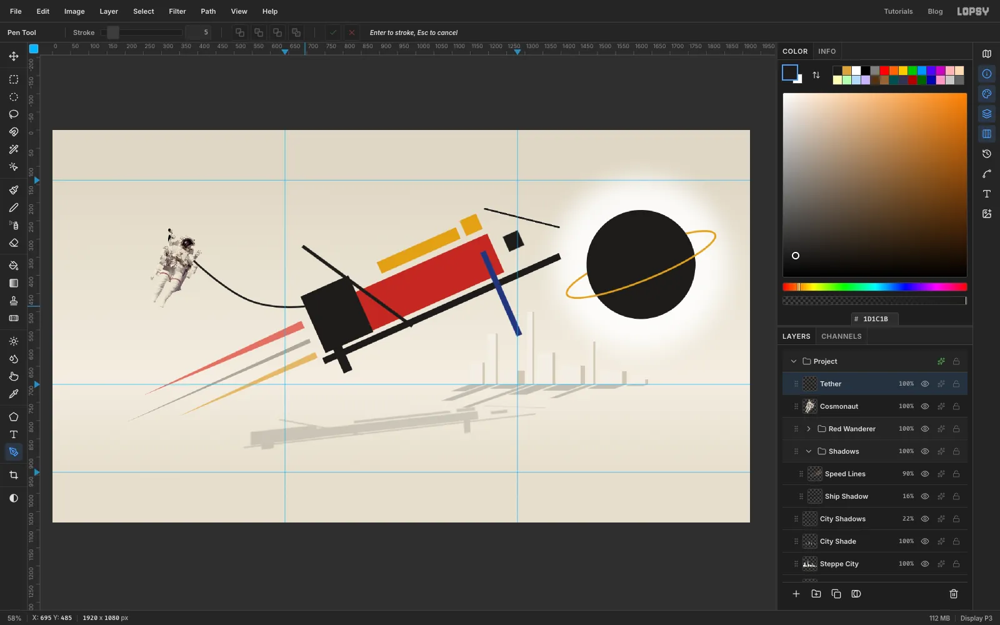

Click **Cosmonaut**, add a layer called **Tether**, and set the foreground to ink. Pick the **Pen** and set **Stroke** to **5** in the options bar.

1. Click on his backpack, at the right side of his body.
2. Press about halfway to the ship and a little lower, and drag to the right to pull out a curve handle. That gives the line a gentle sag.
3. Click on the left edge of the black engine block, near its top.

Press [[Enter]]. The path is stroked with the foreground colour at 5 px. Delete the path in the **Paths** panel so its outline doesn't get in the way.

## Scatter a few loose planes

Add a layer called **Debris**. Marquee a **24 × 24** square just below the ship's stern and fill it with ink.

Press [[Cmd+C]] and [[Cmd+V]]. Lopsy pastes the copy in place on a new layer, already selected and with the Move tool active. Drag it up ahead of the ship, just above the antenna, and turn it about **30°** clockwise. Press [[Enter]] and deselect.

Click **Debris** again and paste a second copy. Move this one just below the stern, under the speed wedges, and turn it about **18°** anticlockwise.

Click the top pasted layer and choose **Merge Down** twice to gather both copies back into Debris. Last, with Debris still active, marquee an **18 × 18** square just below and to the right of the astronaut and fill it with hull red.

## Give the astronaut a shadow too

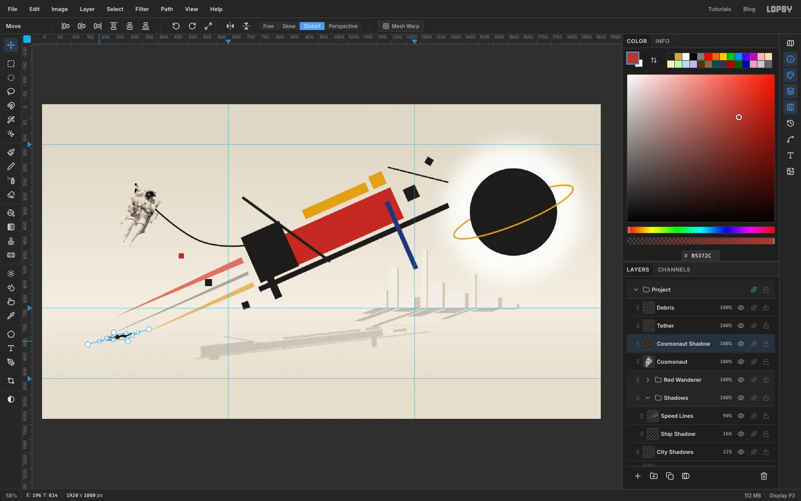

The ship and the city cast shadows, so the astronaut needs one as well. Click **Cosmonaut**, click **Duplicate Layer**, and rename the copy **Cosmonaut Shadow**. Add a black **Color Overlay**, click **Rasterize Layer Style**, and [[Cmd]]-click the thumbnail.

With the Move tool in **Distort** mode, drag the corners down into a thin, flat sliver on the ground at the lower left, about 130 px long and 25 px deep. It should slant the same way as the ship's shadow. Press [[Enter]] and deselect.

Blur it by **3**, set it to **Multiply** and **16%** opacity, just like the ship's shadow.

## Add the letterbox bars

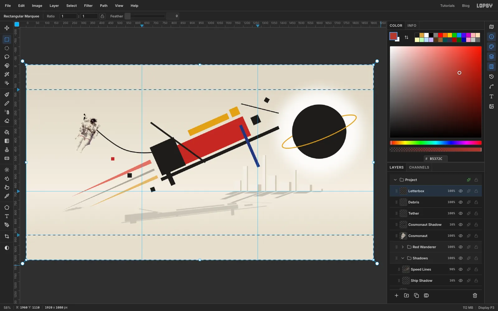

Click **Debris** and add a layer called **Letterbox**. Make sure **View → Snap to Guides** is on.

With the Rectangular Marquee, drag from just off the top-left corner of the canvas to just off the right edge, letting go next to the **138** guide. The bottom edge snaps onto the guide. Hold [[Shift]] and drag a second bar from the **942** guide to just off the bottom-right corner. Fill both with ink black and deselect.

## Set the slate type

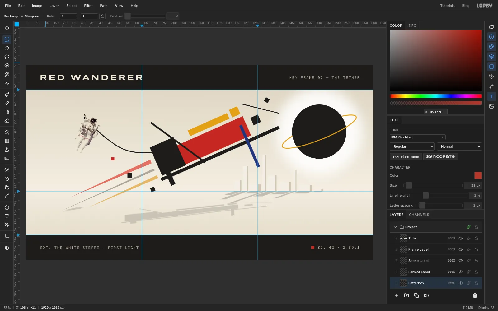

Studios label every key frame with the film, the frame number and the scene. Pick the **Text** tool ([[T]]). Before each new piece of text, click the **Letterbox** layer: if a text layer is active, changing the font restyles that layer instead.

1. **Title**: Syncopate, **Bold**, **44 px**, cream `#EFE8D8`, letter spacing **8**. Click in the top bar near the left and type `RED WANDERER`. Press [[Tab]] to finish, and rename the layer **Title**.
2. **Frame Label**: IBM Plex Mono, **Regular**, **21 px**, `#B8AE9C`, letter spacing **3**. Click in the right half of the top bar and type `KEY FRAME 07 — THE TETHER`.
3. **Scene Label**: same settings. Click near the left of the bottom bar and type `EXT. THE WHITE STEPPE — FIRST LIGHT`.
4. **Format Label**: same settings. Click in the right half of the bottom bar and type `SC. 42 / 2.39:1`.

Now line everything up with the Move tool and the arrow keys. The left-hand text starts **80 px** from the left edge and the right-hand text ends 80 px from the right edge. Centre the capitals vertically in each bar: the top bar's middle is y 69 and the bottom bar's is y 1011.

Finally, click **Letterbox**, marquee a **16 × 16** square 20 px to the left of `SC. 42`, centred on the text, and fill it with hull red.

## Rotate a registry mark to the hull's angle

Click **Debris** and make one more text layer in an empty patch of sky at the left: `RW-1924` in **Syncopate Bold 28 px**, `#F3ECDC`, letter spacing **6**. Rename it **Hull Mark**.

Switch to the Move tool. A live text layer gets its own handles with no selection needed. Drag a rotation handle **24°** anticlockwise to match the hull. The text stays editable after it's turned.

## Seat the mark on the hull

Drag the mark onto the red hull, then nudge it with the arrow keys until it sits in the middle of the red band. Leave clear red between it and the black spar on the left and the blue fin on the right. If it touches the crossing bars, the planes read as a tangle.

## Lift the horizon with a band of haze

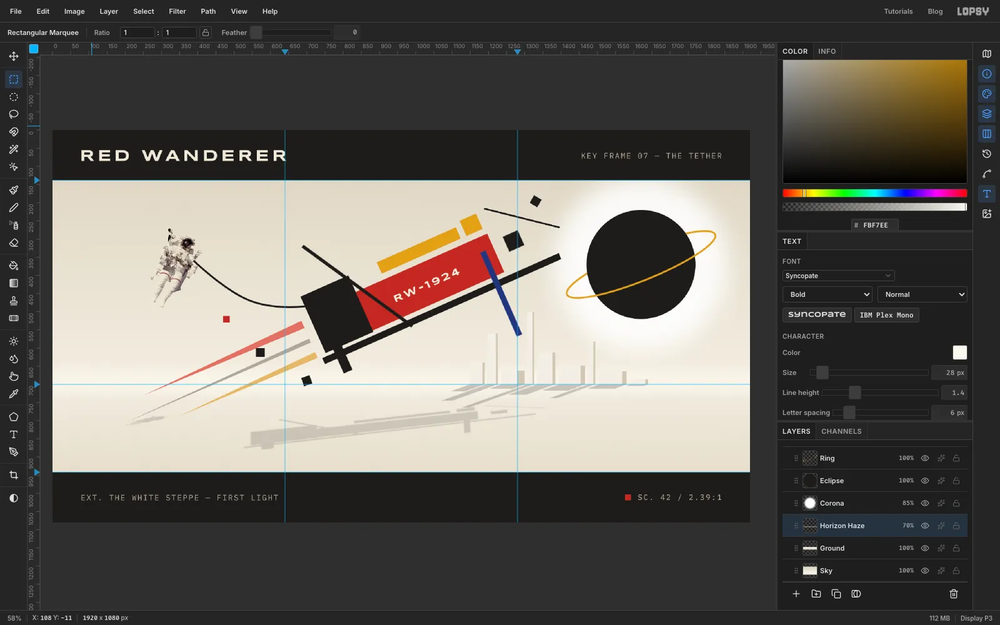

Click **Ground** and add a layer called **Horizon Haze**. Marquee a full-width band from **40 px above** the horizon to **26 px below** it. Choose **Select → Feather…** at **24**, fill with `#FBF7EE` and deselect. Set the layer to **70%** opacity.

The ground now melts into the sky at the horizon instead of meeting it at a hard line, which pushes the city into the distance.

## Add a fine canvas grain

Click **Horizon Haze** and add a layer called **Canvas Grain**. Fill it with mid-grey `#808080`, run **Filter → Add Noise…** with **Amount 22** and **Mono** on, set it to **Overlay** and drop it to **40%**.

Because the grain sits low in the stack, it only textures the sky and the ground. The planes, type and astronaut above it stay perfectly flat. That's how a Suprematist painting reads: flat colour on a living white.

Export with **File → Quick Export PNG** and keep the layers with **File → Save Project**.
