Surrealist painters liked a plain, almost deadpan way of painting. René Magritte painted impossible things as neatly as a sign painter would. Giorgio de Chirico's empty squares have long afternoon shadows, and Salvador Dalí let hard objects go soft. This flier borrows a little from each. It advertises an open jam session, so the planet **Jupiter** is kept in a **jam** jar. It's daytime in the desert and night inside the jar. The planet is melting into marmalade, and the jar stands on a piano keyboard that runs to the horizon.

Everything is drawn from scratch with selections, gradients and filters. The techniques to watch:

- **Liquify** stirs flat stripes into Jupiter's bands, then bulges them into a ball.
- **Edit → Fill with Pattern…** and the Move tool's **Distort** mode turn one octave of piano keys into a road.
- **Distort** also lays the jar's own outline down as its shadow, and a **layer mask** fades it out.
- **Cut and paste** splits an orbit ring so it passes behind and in front of the jar.
- **Mesh Warp** lets one cloud sag.

Some steps give positions in document pixels. Hover over the canvas and read **X** and **Y** at the bottom left of the window. Close is good enough. For the few selections that need exact corners, **click once with the Rectangular Marquee without dragging**. A small dialog opens where you can type the From and To corners.

Hold [[Shift]] while you drag a marquee or lasso to **add** to the selection, [[Alt]] to **subtract**, and [[Shift+Alt]] to keep only the overlap. After a transform, press [[Cmd+D]] to commit it and deselect.

Several gradients here use see-through stops. When a step lists only colours, check that every stop is back at 100% opacity before you drag.

Palette:

- Sky `#16457A` → `#4F96C4` → `#BFDDE0` → `#F8E4BF`
- Desert `#F2D6AC` → `#E2AE7C` → `#9C5237`
- Mesas `#C99E90` / `#E3BC98`, dune shade `#7A3A26`
- Piano keys `#F6ECD8` / `#1B1622`, key joints `#4A3930`
- Jupiter `#E3BC83`, belts `#C4703C` / `#A9582F` / `#8F5A3C`, zones `#F4E6C8` / `#F1DDB8`
- Red spot `#B23E26` / `#DC7B4C`
- Night in the jar `#0A0F2E` → `#1B2A63` → `#3A2A5E`, stars `#FFF6DC`
- Marmalade `#F2A640` → `#D9701F` → `#7E2A12`
- Lid `#F27A66` / `#D2402F` / `#7E1A18`
- Title cream `#FFF3D0`, footer cream `#FBF0D4`
- Footer ink `#1B2A52`, footer red `#B92D26`

## Set the horizon and a vanishing point

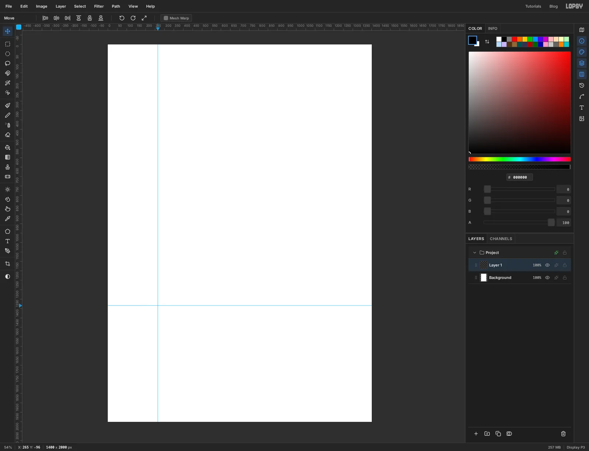

1. Create a **1400 × 2000 px** document with a white background.
2. Click the left ruler at y **1384** to drop the horizon guide.
3. Click the top ruler at x **265**. Where the two guides cross is the vanishing point. The keyboard road will run to it.

Putting the vanishing point off to the left means the road crosses the picture on a diagonal. You'll see it arrive at the horizon beside the jar instead of hiding behind it.

## Paint the sky

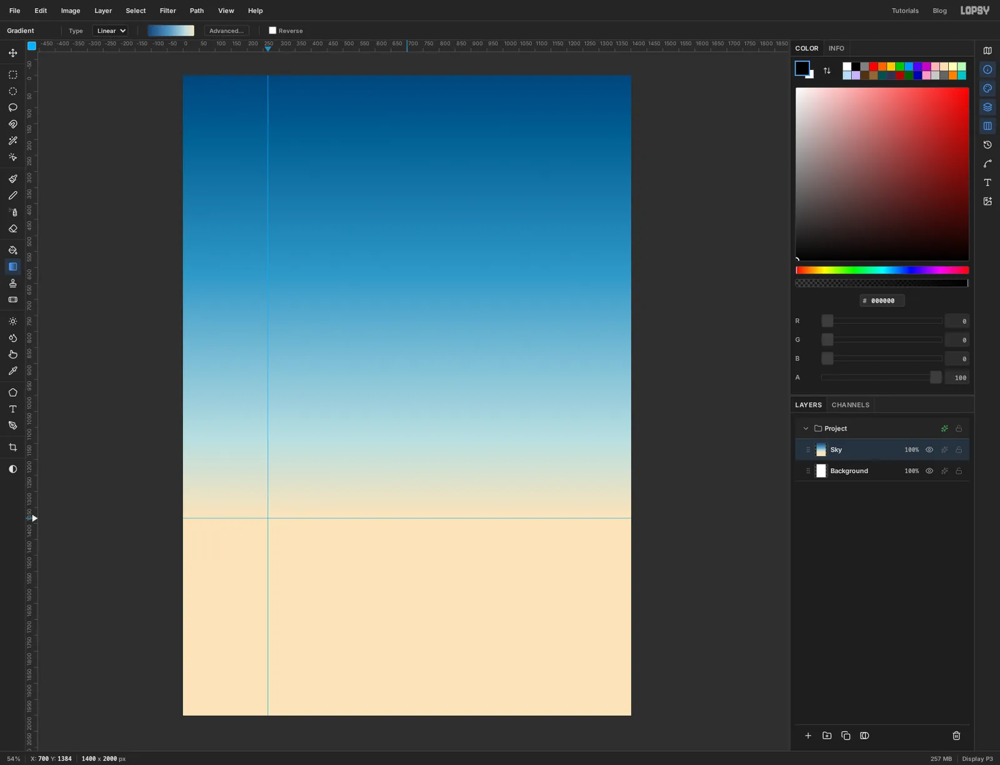

1. Rename **Layer 1** to `Sky`.
2. Pick the **Gradient** tool, set **Type** to **Linear** and open **Advanced…**. Set four stops:
   - `#16457A` at the start
   - `#4F96C4` at 45%
   - `#BFDDE0` at 82%
   - `#F8E4BF` at the end
3. Drag straight down from the top of the canvas to the horizon guide.

The cream carries on below the guide for now. The desert covers it next.

## Lay down the desert

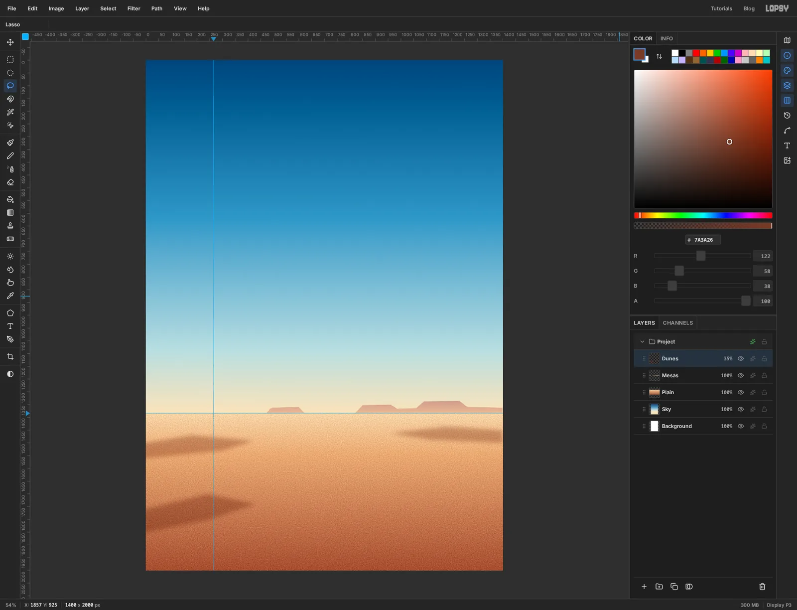

1. Add a layer named `Plain`. Select everything below the horizon, from (0, 1384) to (1400, 2000).
2. Set the gradient stops to `#F2D6AC`, `#E2AE7C` at 25% and `#9C5237`. Drag from the horizon to the bottom edge.
3. Run **Filter → Texture…** with **Amount** 14 and **Size** 3 for sand grain, then deselect.
4. Add a layer named `Mesas`. With the **Lasso**, draw a low range with two or three flat tops sitting on the horizon on the right side, 20 to 50 px tall, and [[Shift]]-add a small mesa nearer the middle. Fill them with a top-to-bottom gradient from `#C99E90` to `#E3BC98`, so they fade into the haze at their feet.
5. Add a layer named `Dunes`. Lasso three long, lens-shaped patches on the sand: two on the left and one on the right. Use **Select → Feather…** at 18 px and fill with `#7A3A26`.
6. Deselect, then set the layer to **Multiply** at **35%**.

The dune shadows stop the desert from reading as a flat gradient.

## Draw one octave of piano keys

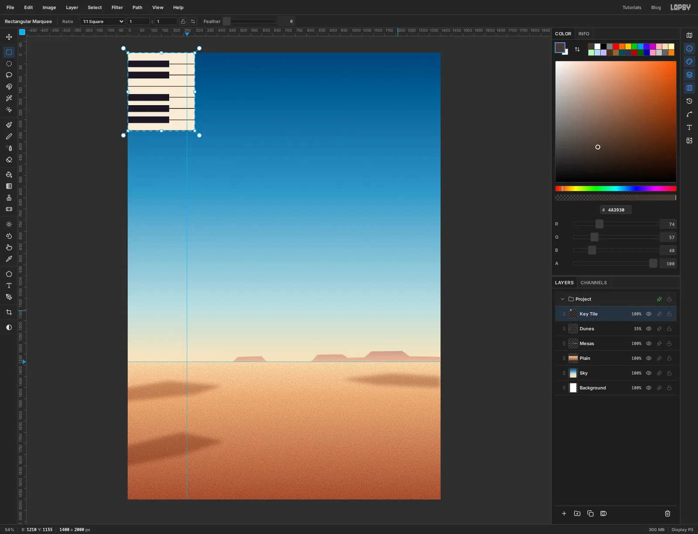

The road is a keyboard seen end on, so each key lies across the road. Draw one octave as a tile and let a pattern fill repeat it.

1. Add a layer named `Key Tile`. Select (0, 0) to (300, 350) and fill it with `#F6ECD8`. That's seven white keys, each 50 px tall.
2. Deselect. With the **Rectangular Marquee**, drag a black key 185 px wide and 30 px tall from the left edge, centred on y 50. Hold [[Shift]] and add four more, centred on y 100, 200, 250 and 300. That leaves the gaps after the third and seventh keys, as on a real piano.
3. Fill all five with `#1B1622` and deselect.
4. Pick the **Pencil** at size 3 with `#4A3930`. For each black key, click at its right end and [[Shift]]-click the right edge of the tile. This draws the joint between the two white keys.
5. Draw two full-width joints the same way, at y 150 and along the bottom edge of the tile.
6. Select the whole tile again, (0, 0) to (300, 350), and choose **Edit → Define Pattern**.
7. Delete the **Key Tile** layer. The pattern is saved.

## Fill a strip with the pattern

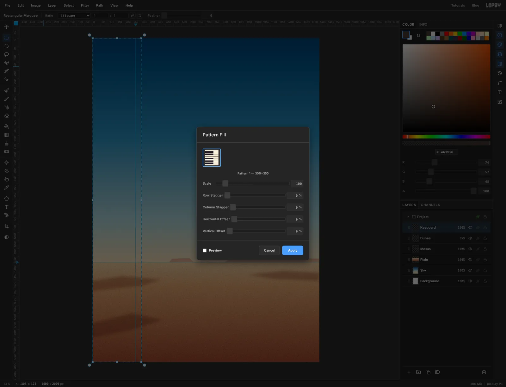

1. Select **Dunes** and add a layer named `Keyboard`.
2. Select a strip the width of the tile and the full height of the canvas, from (0, 0) to (300, 2000).
3. Choose **Edit → Fill with Pattern…**. Leave **Scale** at 100 and click **Apply**.

The strip holds almost six octaves, lying flat. Keep the selection for the next step.

## Pull the near end across the bottom

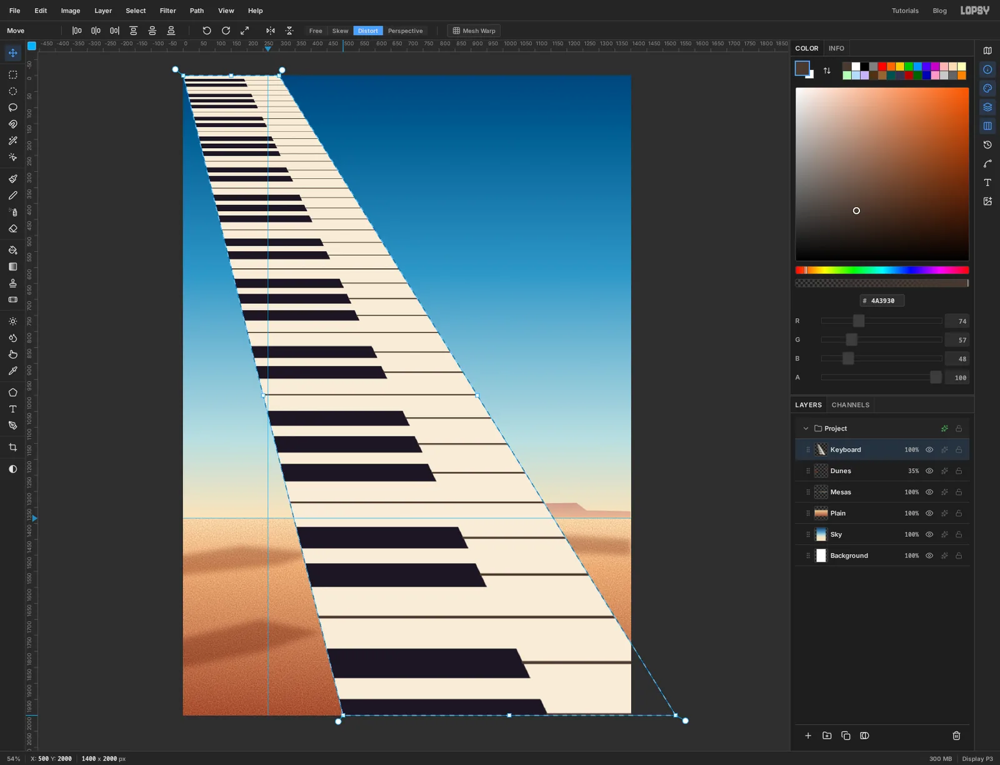

1. Pick the **Move** tool and choose **Distort** in the options bar. In this mode each corner handle moves on its own.
2. Drag the **bottom-right** handle along the bottom edge to about x **1540**. That's a little past the right side of the canvas.
3. Drag the **bottom-left** handle along the bottom edge to x **500**.

## Send the far end to the vanishing point

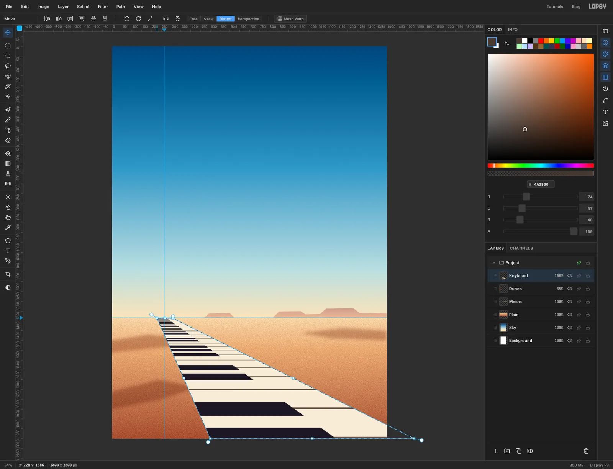

1. Drag the **top-right** handle down to just under the horizon at (308, 1386).
2. Drag the **top-left** handle to (228, 1386). The far end is now 80 px wide and sits on the vanishing point.
3. Press [[Cmd+D]].
4. Open the layer's effects and add a **Drop Shadow**: **Offset X** 16, **Offset Y** 8, **Blur** 12, **Opacity** 50, colour `#3A1A12`. It lifts the keyboard a little off the sand.

Distort is a true perspective transform. The near keys come out about 150 px deep and the far ones shrink to hairlines.

## Paint Jupiter's bands

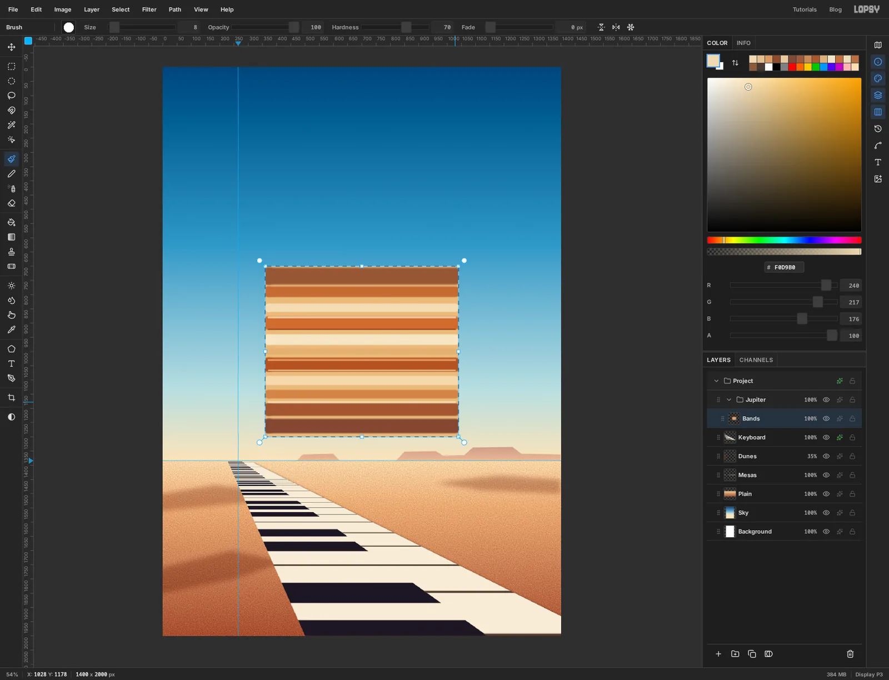

Paint the planet flat first, as a block of stripes in the middle of the canvas. You'll move it into the jar later.

1. Click **New Group** in the Layers panel and name it `Jupiter`. Add a layer inside it named `Bands`.
2. Select (360, 700) to (1040, 1300) and fill with `#E3BC83`.
3. Pick the **Brush** and set **Hardness** to 70. Paint each band by clicking at the left edge of the selection and [[Shift]]-clicking at the right edge. The rows below are the ones used here, from the top down. They don't have to be exact:
   - y 735, size 70, `#8F5A3C`
   - y 790, size 44, `#B9703F`
   - y 846, size 34, `#F1DDB8`
   - y 900, size 54, `#C4703C`
   - y 958, size 44, `#F4E6C8`
   - y 1000, size 26, `#DDB37A`
   - y 1046, size 58, `#A9582F`
   - y 1102, size 38, `#F0D9B0`
   - y 1150, size 36, `#C98952`
   - y 1204, size 52, `#9A5A3A`
   - y 1262, size 60, `#7E4A36`
4. Add five thin streaks, size 6 to 8, on the edges between bands. Use a paler or darker neighbour of whichever band you're on.

What matters is the mix: wide and narrow bands, with pale ones between the dark ones.

## Stir the bands with Liquify

1. With the **Elliptical Marquee**, select an oval about 124 × 72 px centred on (800, 1072), on the lower right of the stripes. **Feather** it 5 px and fill with `#B23E26`.
2. Select a smaller oval inside it, about 72 × 36 px. **Feather** 6 px and fill with `#DC7B4C`. This is the Great Red Spot. Deselect.
3. Choose **Filter → Liquify…**. Leave **Mode** on **Push Forward** and set **Brush Size** 90 and **Pressure** 45.
4. Drag across the block five times, each time along the edge between two bands, wobbling up and down by 15 to 20 px as you go. Alternate left-to-right and right-to-left.
5. Switch **Mode** to **Twirl CCW**, with **Brush Size** 170 and **Pressure** 60. Make two small circles with the pointer on the red spot. It winds up into a storm.
6. Set **Brush Size** to 100. Add three small swirls in **Twirl CW** and two in **Twirl CCW** along other band edges.
7. Click **Apply**.

## Round the corners with Lens Distortion

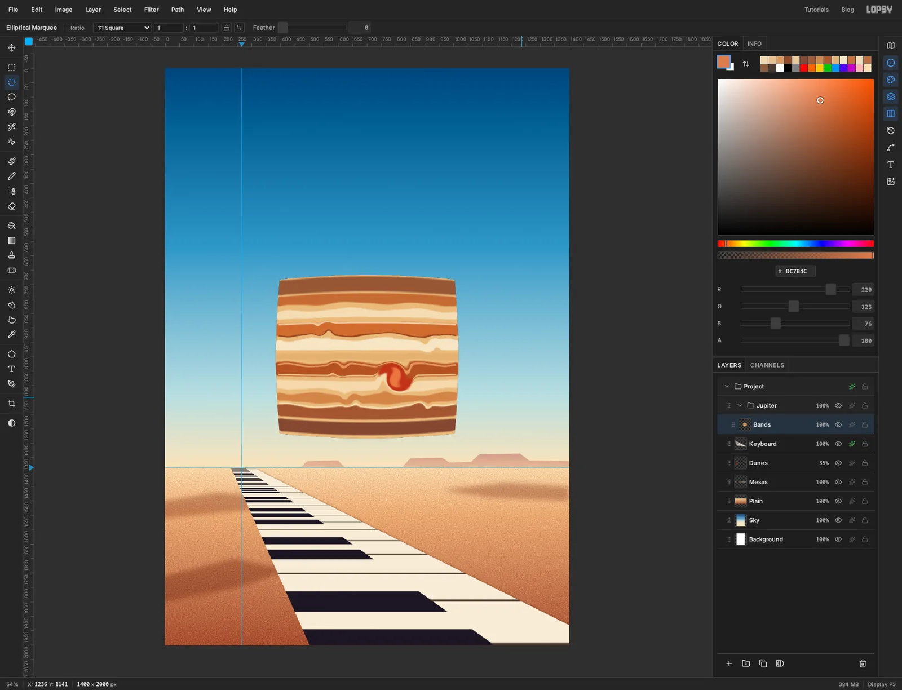

Run **Filter → Lens Distortion…** with **Strength** 100.

The filter is centred on the canvas, which is why the stripes were painted there. On a patch this size the effect is gentle: the edges bow out a little. The next step does most of the rounding.

## Bulge the middle with Bloat

1. Open **Filter → Liquify…** again. Set **Mode** to **Bloat**, **Brush Size** to 500 and **Pressure** to 30.
2. Put the pointer on the centre of the canvas, (700, 1000), and make two tiny scribbles, each only a pixel or two long.
3. Click **Apply**.

Each scribble swells the middle. The bands above the centre arch up and the ones below arch down, the way lines of latitude curve on a globe. Stop at two. A third stretches the red spot too far.

## Cut out the disc

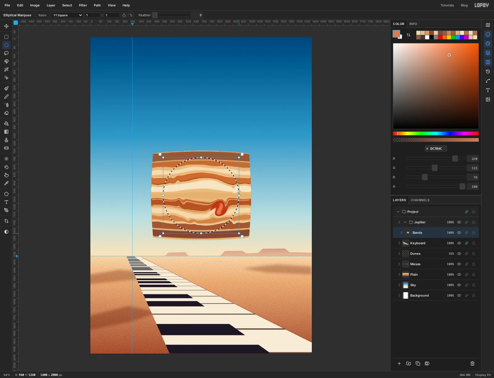

1. With the **Elliptical Marquee**, select a circle 480 px across around the centre of the canvas, from (460, 760) to (940, 1240).
2. Choose **Select → Inverse** and press [[Delete]].
3. Deselect.

## Shade the sphere

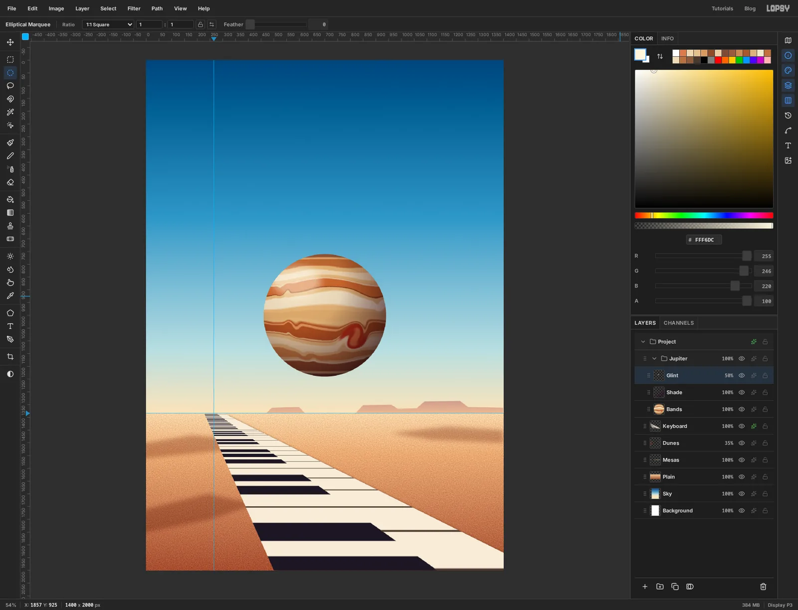

1. Add a layer named `Shade`. [[Cmd]]-click the **Bands** thumbnail to select the disc.
2. Pick a **Radial** gradient and set four stops:
   - `#2A1326` at 0% opacity at the start
   - `#2A1326` at 8% opacity, at 35%
   - `#2A1326` at 55% opacity, at 68%
   - `#140818` at 96% opacity at the end
3. Drag from the upper left of the disc, about (600, 880), to a little past its lower right, about (935, 1225).
4. Deselect and set the layer to **Multiply**.
5. Add a layer named `Glint`. Select an oval about 190 × 120 px at the upper left of the disc. **Feather** it 30 px and fill with `#FFF6DC`.
6. [[Cmd]]-click **Bands** again, choose **Select → Inverse** and press [[Delete]]. That trims the glow to the planet.
7. Deselect. Set **Glint** to **Screen** at **50%**.

The light comes from the upper left, and everything else in the picture will be lit from the same side.

## Scale the whole group and move it

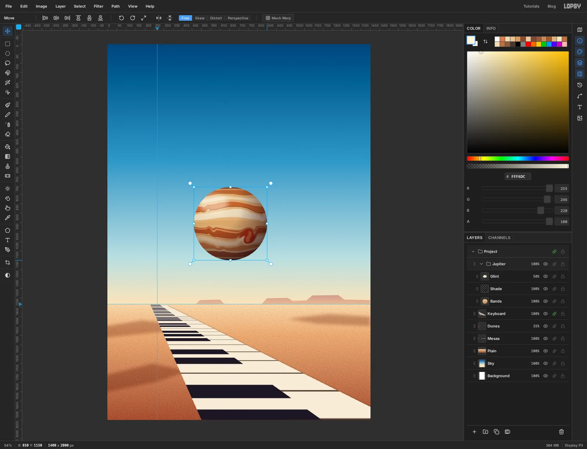

1. Click the **Jupiter** group row and pick the **Move** tool. With a group selected and nothing marqueed, the handles frame all three layers.
2. Hold [[Cmd]] and drag the **bottom-right** handle in by about 90 px, until the planet is about 390 px across.
3. Drag the planet to the left and down until its centre is near (650, 1250). It should straddle the horizon.
4. Press [[Cmd+D]].

## Build the jar from marquees

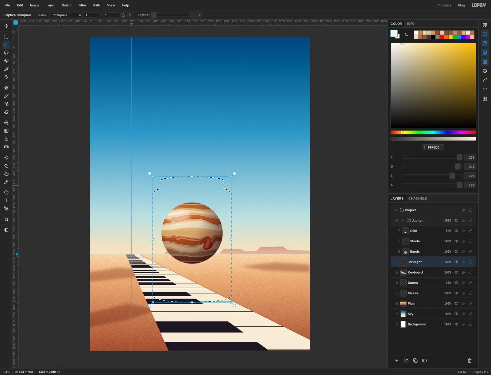

The jar's outline is two rectangles and three ellipses added together. You only build it once. After this step the filled layer keeps the shape, and you can load it back with a [[Cmd]]-click on its thumbnail.

1. Select the **Keyboard** layer and add a layer named `Jar Night`. It sits under the Jupiter group.
2. With the **Rectangular Marquee**, drag the body from (400, 1000) to (900, 1650).
3. Hold [[Shift]] and add the neck, from (446, 918) to (854, 1002).
4. Switch to the **Elliptical Marquee**. Holding [[Shift]] each time, add:
   - the rounded base, from (400, 1608) to (900, 1692)
   - the shoulders, from (400, 942) to (900, 1058)
   - the mouth, from (446, 890) to (854, 946)

## Fill the jar with night

1. Set a **Linear** gradient with stops `#0A0F2E`, `#1B2A63` at 60% and `#3A2A5E`. Drag from the top of the jar to its base.
2. Keep the selection. Add a layer named `Stars`.
3. Pick the **Brush** with **Hardness** 100 and colour `#FFF6DC`. Click about 70 dots across the jar. Use size 3 for most of them, size 4 for some and size 7 for a few bright ones. The selection keeps them inside the glass.
4. Deselect. Add an **Outer Glow** to **Stars**: **Size** 6, **Opacity** 60, colour `#BCD4FF`.

Magritte's *Empire of Light* puts a night street under a daytime sky. This is the same trick turned inside out: broad daylight outside, and night in the jar.

## Pour the marmalade

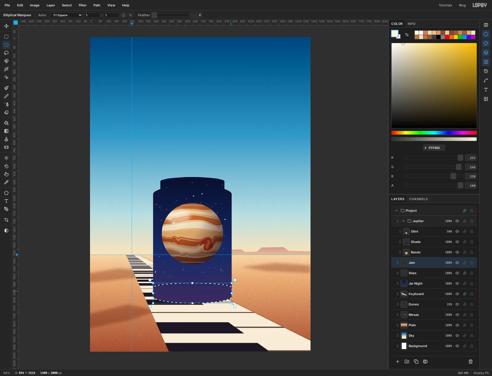

1. Add a layer named `Jam`. [[Cmd]]-click the **Jar Night** thumbnail to load the jar shape.
2. With the **Rectangular Marquee**, hold [[Shift+Alt]] and drag a box across the bottom of the jar. Start left of the jar at y 1590 and drag to below and right of the base. Only the part of the jar under y 1590 stays selected.
3. With the **Elliptical Marquee**, hold [[Shift]] and add an ellipse from (406, 1564) to (894, 1616). This gives the pool its curved top.
4. Set the gradient stops to `#F2A640`, `#D9701F` at 35% and `#7E2A12`. Drag from the top of the pool to the base of the jar, then deselect.
5. Select an ellipse 480 × 48 px centred on (650, 1590) for the surface. Fill it with a gradient from `#FFD98A` to `#EFA03C`, dragging from its upper left to its lower right. Deselect.

## Let the planet drip

1. Click the **Jupiter** group row and add a layer named `Drips`. It lands inside the group, above the planet.
2. With the **Lasso**, draw a drip. Start inside the planet's lower edge with a wide top, pull it into a thin neck and finish with a round bead. Make the middle one long enough to reach the pool.
3. Hold [[Shift]] and add four more of different lengths: two medium ones beside the first and two short ones further out.
4. Set the gradient stops to `#6E3E2C`, `#B9581F` at 25% and `#F2A640`. Drag from just inside the planet's lower edge down to the pool. The tops match the planet's dark underside and the beads match the jam.
5. Deselect. Add a layer named `Ripples`. Select a flat ellipse about 92 × 14 px where the long drip lands and fill it with `#FFE9B0`. Use **Select → Shrink…** by 2 px and press [[Delete]]. That leaves a thin ring.
6. Make a second ring the same way, about 168 × 22 px, around the first. Deselect and set the layer to **70%**.

## Tint the glass and draw its edge

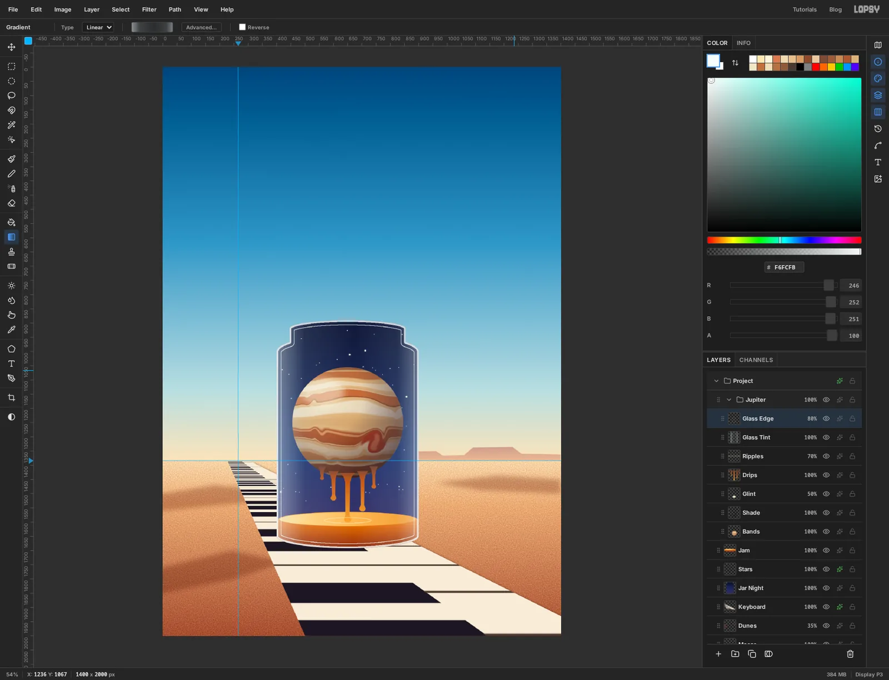

1. Add a layer named `Glass Tint` and [[Cmd]]-click the **Jar Night** thumbnail. The new layer lands inside the **Jupiter** group, above **Ripples**, and so do the next three. That's fine. The whole stack becomes the jar group later.
2. Set a **Linear** gradient with five stops. Only the opacity changes much:
   - `#EAF7FA` at 50% opacity at the start
   - `#D3ECF2` at 14% opacity, at 20%
   - `#D3ECF2` at 4% opacity, at 55%
   - `#CFE7EE` at 14% opacity, at 85%
   - `#EAF7FA` at 42% opacity at the end
3. Drag from the jar's left side to its right side. Glass looks thicker and paler where it curves away from you.
4. Keep the selection and add a layer named `Glass Edge`. Fill with `#F6FCFB`.
5. **Shrink** the selection 6 px and press [[Delete]]. That's the outer wall.
6. **Shrink** 9 px more and fill again. Then **Shrink** 2 px and press [[Delete]]. That's a thin inner line, so the glass has some thickness.
7. Deselect and set the layer to **80%**.

## Add the highlights and the rim

1. Add a layer named `Glass Shine`. With the **Lasso**, draw a tall sliver about 24 px wide down the left side of the jar, just inside the wall.
2. Hold [[Shift]] and add a thinner one beside it and a dim one inside the right wall. With the **Elliptical Marquee**, [[Shift]]-add a flat oval on the left shoulder.
3. **Feather** 5 px. Fill with a top-to-bottom gradient of white: 95% opacity at the start, 60% at 60%, and 12% at the end.
4. Deselect and set the layer to **75%**.
5. Add a layer named `Rim`. Select an ellipse 408 × 56 px centred on (650, 918), the mouth of the jar. Fill with `#F8FDFC`, **Shrink** 5 px and press [[Delete]].
6. Make two more rings the same size at y 950 and y 976, shrinking by 3 px. These are the screw threads.
7. Pick the **Eraser** at size 44. On each of the two lower rings, click at the left end of the back half and [[Shift]]-click at the right end. Leave the mouth ring whole. Only the front of a thread shows on a real jar.
8. Set the layer to **88%**.

## Lay the jar down as its own shadow

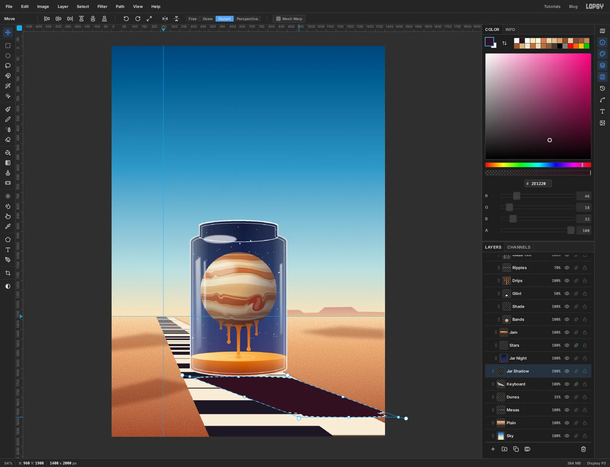

1. Click the **Jupiter** group row, [[Shift]]-click **Jar Night**, and choose **Layer → Group Layers**. Name the new group `Jar`.
2. Select the **Keyboard** layer and add a layer named `Jar Shadow`.
3. [[Cmd]]-click the **Jar Night** thumbnail and fill the selection with `#2E1220`. Keep the selection.
4. Pick the **Move** tool and choose **Distort**.
5. Drag the **top-right** handle down to about (1470, 1900), past the right edge of the canvas.
6. Drag the **top-left** handle to about (960, 1900). The two bottom corners stay under the jar, so the shadow is hinged at its base.
7. Press [[Cmd+D]].

## Fade the shadow with a mask

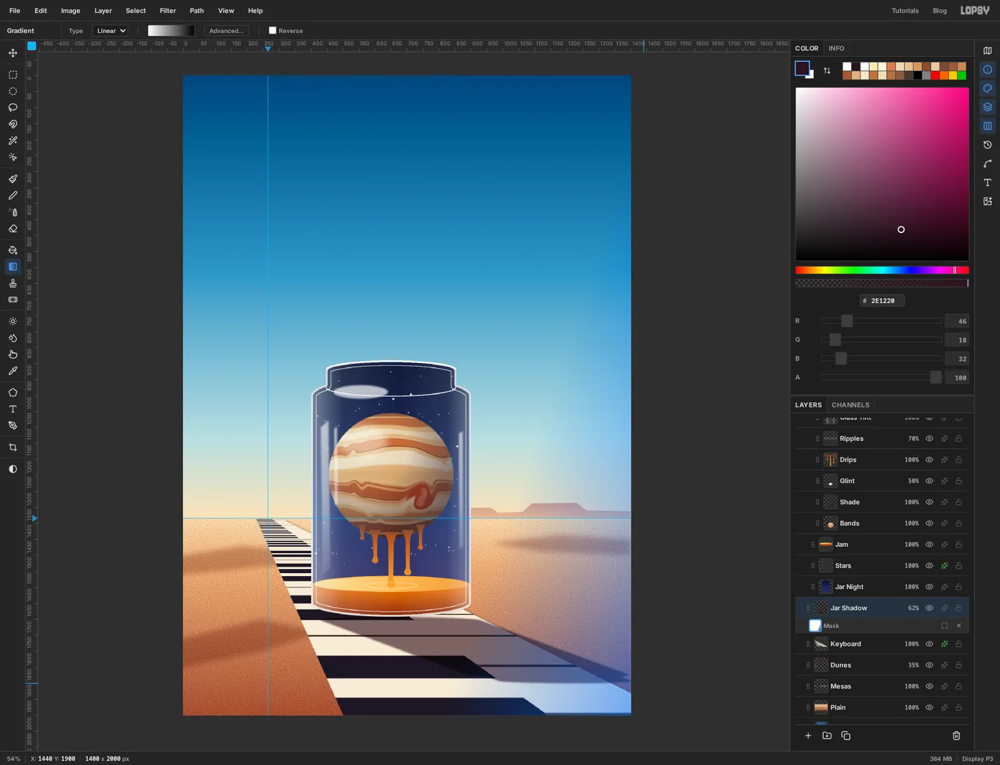

1. Run **Filter → Gaussian Blur…** at **Radius** 7. Set the layer to **Multiply** at **62%**.
2. Click **Add Mask** in the Layers panel. You're now painting on the mask.
3. Set a **Linear** gradient from `#FFFFFF` to `#000000`. Drag from the jar's base at about (900, 1720) to the far end of the shadow at (1440, 1900).
4. Click the **Jar Shadow** layer row to leave mask edit mode.

White keeps the shadow and black hides it. It's darkest where it leaves the jar and fades to nothing at the tip.

## Add a caustic and a contact shadow

1. Add a layer named `Caustic`. Lasso a slanted patch inside the shadow, just right of the jar's base, about 250 px long. **Feather** 14 px and fill with `#FFB648`.
2. Deselect. Set the layer to **Overlay** at **70%**. Sunlight that goes through the marmalade lands on the ground as an orange glow.
3. Add a layer named `Contact`. Select a flat ellipse about 524 × 52 px centred under the jar at (655, 1692). **Feather** 9 px and fill with `#1E0A12`.
4. Deselect. Set the layer to **Multiply** at **65%**.

Most of the contact shadow is hidden by the jar. The thin dark line that shows around the base is what makes the jar stand on the keys.

## Draw and tilt an orbit

1. With **Contact** selected, add a layer named `Orbit`.
2. Select an ellipse 860 × 200 px centred on the planet at (650, 1250). Fill with `#FFF3D0`, **Shrink** 5 px and press [[Delete]].
3. Deselect, then [[Cmd]]-click the **Orbit** thumbnail to select the ring.
4. Pick the **Move** tool. Hold [[Cmd]] and drag a **rotation handle** counter-clockwise one step. [[Cmd]] snaps to 15°.
5. Press [[Cmd+D]].

The layer is under the jar, so you'll only see the two ends of the ring sticking out past the glass.

## Bring the front of the ring forward

1. With the **Lasso**, select the lower half of the ring. The Lasso is freehand, so keep the button down and drag from point to point: from (150, 1384) to (1150, 1116), which runs along the ring's long axis. Then go down to (1150, 1650), across to (150, 1650) and back to the start.
2. Press [[Cmd+X]] to cut it.
3. Click the **Project** row at the top of the Layers panel and press [[Cmd+V]]. The half ring pastes in place on a new layer above everything.
4. Press [[Cmd+D]] and rename the layer `Orbit Front`.

The far half of the ring now goes behind the jar and the near half passes in front of it.

## Make a moon and copy it

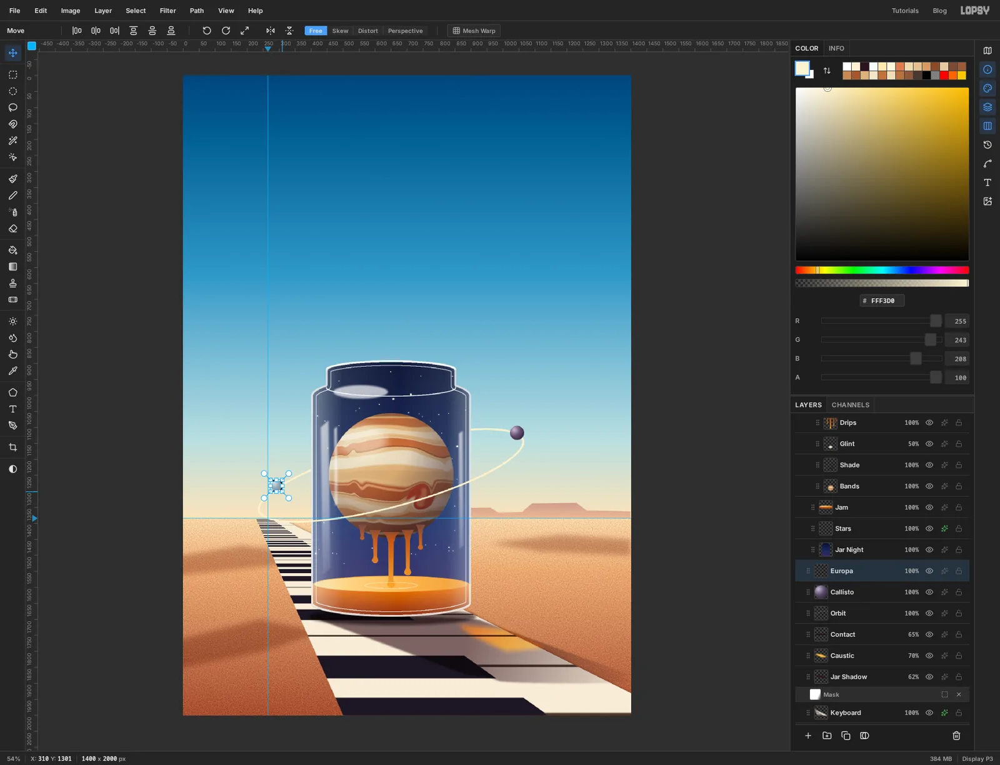

1. Select **Orbit** and add a layer named `Callisto`.
2. Select a circle 44 px across on the upper right of the ring, centred near (1044, 1117).
3. Pick a **Radial** gradient with stops `#C9B9D4`, `#5E4E6E` at 45% and `#1E1626`. Drag from the upper left of the circle to just past its lower right. Deselect.
4. Pick the **Move** tool, hold [[Alt]] and drag the moon to the far left of the ring, near (295, 1286). [[Alt]] leaves the original where it was and drags a copy on a new layer.
5. Rename the copy `Europa`. Run **Filter → Hue/Saturation…** with **Hue** −70 and **Lightness** 42. The violet moon turns icy blue.
6. [[Cmd]]-click the **Europa** thumbnail. Hold [[Cmd]] and drag a corner handle in a little, so this moon is about 36 px across. Press [[Cmd+D]].

## Add the two near moons

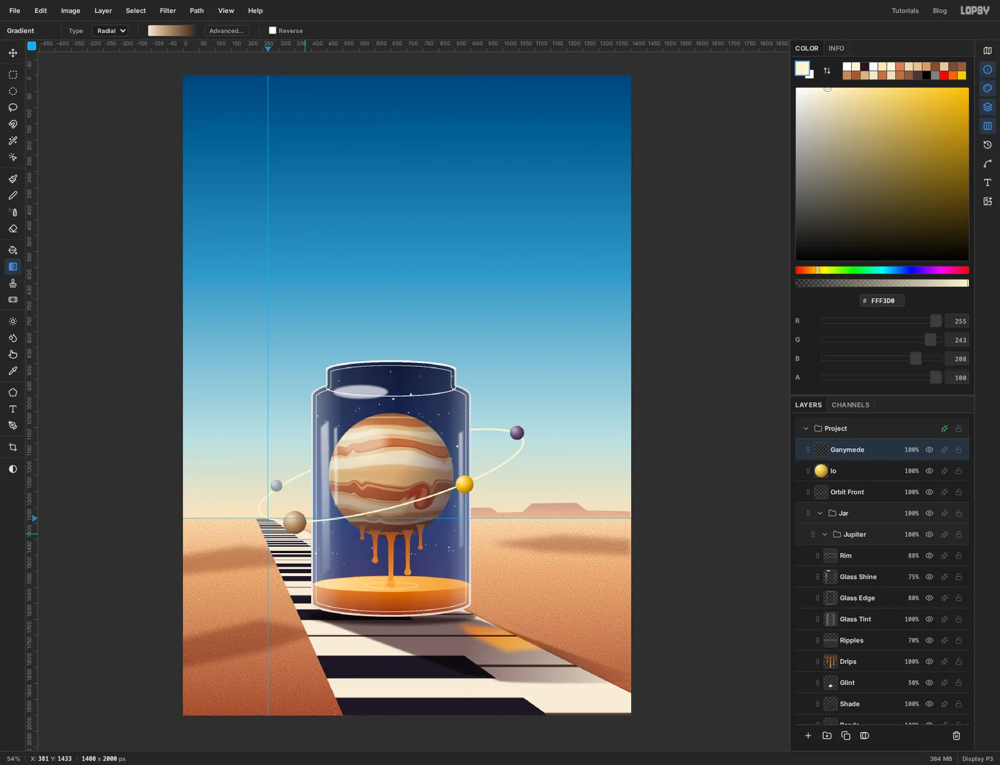

1. Select **Orbit Front** and add a layer named `Io`. Select a circle 56 px across where the front of the ring crosses the jar's right wall, near (880, 1278).
2. Fill it with a radial gradient of `#FFF4B0`, `#E8B93C` at 45% and `#7A4A12`. Drag from upper left to lower right, as before.
3. Add a layer named `Ganymede`. Select a circle 72 px across at the front left of the ring, near (349, 1397), and fill it with `#F4E4CC`, `#B08A62` at 45% and `#3F2A1E`.

Moons on the near half of the ring are bigger than the ones on the far half. All four are lit from the upper left, like the planet.

## Build the lid lying flat

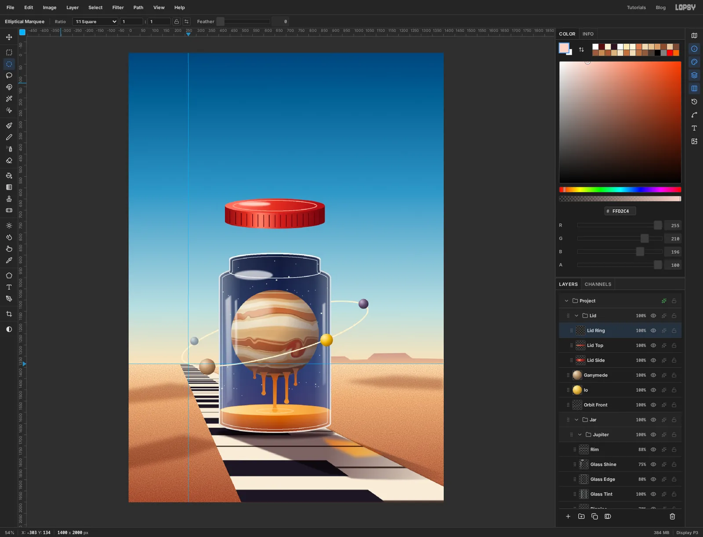

1. Click the **Project** row, click **New Group** and name it `Lid`. Add a layer inside it named `Lid Side`.
2. With the **Rectangular Marquee**, drag from (428, 680) to (872, 750). With the **Elliptical Marquee**, [[Shift]]-add an ellipse from (428, 718) to (872, 782) for the curved bottom edge.
3. Set a **Linear** gradient with stops `#7E1A18`, `#D2402F` at 22%, `#F58A70` at 36%, `#C5352A` at 55% and `#641212`. Drag from the left edge of the lid to the right edge. The pale stop is a highlight running down the side. Deselect.
4. Pick the **Pencil** at size 3 with `#5A0F10`. Draw short vertical grip lines every 25 px around the side with a click and a [[Shift]]-click. Start each one a little lower as you get nearer the middle, so they follow the curve.
5. Add a layer named `Lid Top`. Select an ellipse from (428, 648) to (872, 712). Fill it with a gradient of `#F27A66`, `#D2402F` at 50% and `#A82722`, dragged from its upper left to its lower right. Deselect.
6. Add a layer named `Lid Ring`. Select an ellipse 376 × 50 px centred on the top face. Fill it with `#F8A995`, **Shrink** 3 px and press [[Delete]].
7. Select a small flat oval on the left of the top face. **Feather** 6 px and fill with `#FFD2C4` for a sheen. Deselect.

The ring is on its own layer so that deleting its middle doesn't punch a hole in the top of the lid.

## Tip the lid and float it

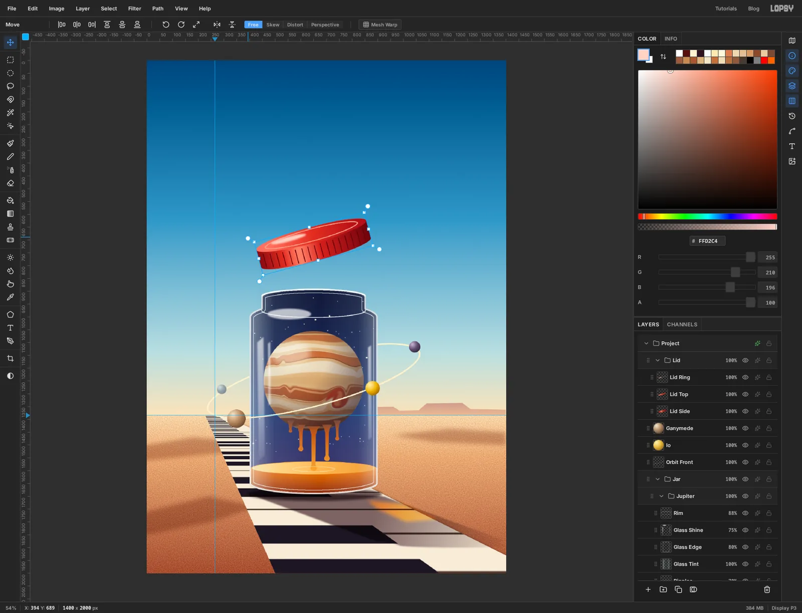

1. Click the **Lid** group row and pick the **Move** tool.
2. Hold [[Cmd]] and drag a **rotation handle** counter-clockwise one 15° step.
3. Drag the lid about 90 px to the right and 30 px down, so it hangs above the right side of the jar's mouth.
4. Press [[Cmd+D]].

## Build a cloud from ellipses

1. Select the **Sky** layer and add a layer named `Cloud`.
2. With the **Elliptical Marquee**, drag a wide, flat ellipse about 340 × 96 px in the upper left of the sky, centred near (250, 620).
3. Hold [[Shift]] and add five rounder ellipses along its top: a big one in the middle, a medium one on each side of it and a small one at each end.
4. Switch to the **Rectangular Marquee**, hold [[Alt]] and drag a box across the bottom of the shape. This cuts the base flat.
5. Set the gradient stops to `#FFFFFF`, `#F2F6F8` at 50% and `#A9C6DA`. Drag from above the cloud's upper left to below its lower right, then deselect.

Magritte's clouds are tidy shapes with flat bottoms.

## Copy, flip and shrink it

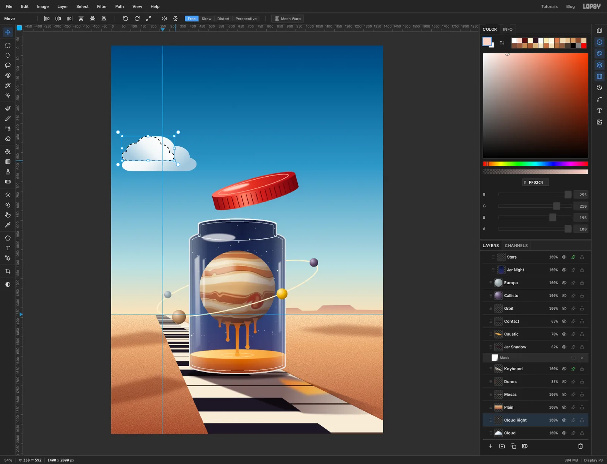

1. Choose **Layer → Duplicate Layer** and rename the copy `Cloud Right`.
2. Choose **Image → Flip Horizontal**. The copy mirrors in place.
3. [[Cmd]]-click its thumbnail. Hold [[Cmd]] and drag the **bottom-right** handle in until the cloud is about 70% of its size.

## Scatter the clouds

1. Drag the small cloud to the upper right, around (1150, 540), and press [[Cmd+D]].
2. Select **Cloud**, duplicate it again and name the copy `Cloud Low`. [[Cmd]]-click its thumbnail and scale it to about 85%. Drag it to the right side, centred near (1150, 900), a little above the jar's shoulders. Press [[Cmd+D]].
3. Select **Cloud** once more and duplicate it as `Cloud Far`. Scale it to about 45% and drag it low on the left, around (150, 1130). Press [[Cmd+D]].

Keep every cloud fully inside the canvas. A cloud cut off by the edge looks like a mistake.

## Let one cloud sag

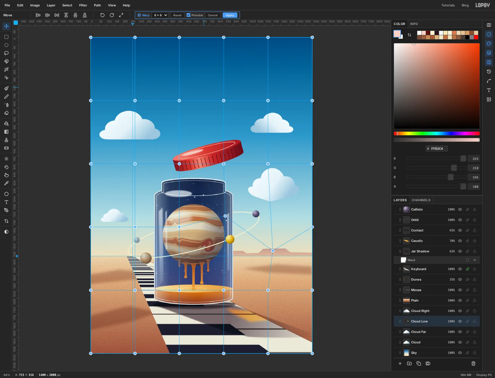

1. Select **Cloud Low** and pick the **Move** tool. Click **Mesh Warp** in the options bar.
2. Set the grid to **6 × 6** and tick **Preview**.
3. The grid covers the whole canvas. Find the first node below the cloud, at about (1120, 1200), and drag it down 150 px and a little to the right. The cloud's flat base bellies downward.
4. Drag the next node to its left up by about 70 px, so the sag stays on the cloud's right side.
5. Click **Apply**.

Only one cloud gets this treatment. It's a small nod to Dalí's soft watches.

## Add a wanderer

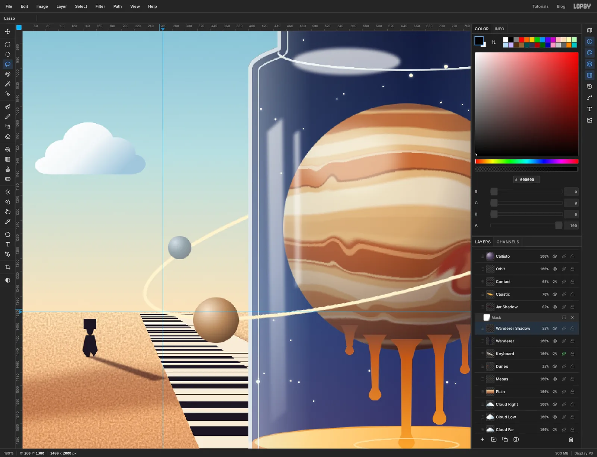

1. Select the **Keyboard** layer and add a layer named `Wanderer`. Zoom in on the sand left of the road, around x 150, just below the horizon.
2. With the **Lasso**, draw a small coat shape about 25 px wide and 35 px tall. Give it narrow shoulders, a flared hem and a notch at the bottom for the legs.
3. Hold [[Shift]] and add a small circle for the head with the **Elliptical Marquee**. Then use the **Rectangular Marquee** to add a thin brim and a small box above it for the crown of a bowler hat. At this size a box reads as a hat.
4. Fill with `#1B1622` and deselect. The figure should be about 55 px tall, with the top of the hat a little below the horizon.
5. Add a layer named `Wanderer Shadow`. Lasso a long thin wedge from his feet toward the road, about 120 px long and pointing slightly downhill. **Feather** 2 px and fill with `#2E1220`.
6. Deselect. Set the layer to **Multiply** at **55%**.

One small figure gives the jar its scale. His shadow runs the same way as the jar's.

## Set the title

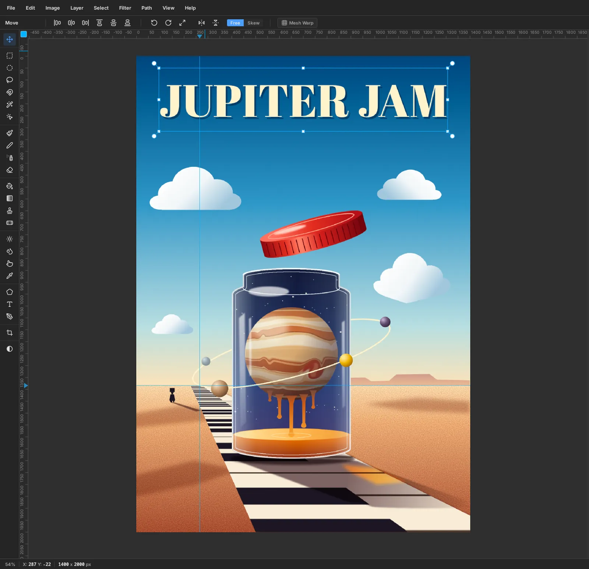

1. Click the **Project** row first, so the text isn't created inside a group. Set the foreground colour to `#FFF3D0`.
2. Pick the **Text** tool. Choose **Abril Fatface** and set **Size** to 190.
3. Click near the top left of the sky, type `JUPITER JAM` and press [[Tab]] to commit.
4. Pick the **Move** tool and click **Align center horizontally**. Nudge the title up or down with the arrow keys until the tops of the letters are about 120 px from the top edge.
5. Add a **Drop Shadow**: **Offset X** 7, **Offset Y** 8, **Blur** 0, **Opacity** 60, colour `#0B2447`. With no blur it reads as a second printing of the letters.

The title is about 1200 px wide, which leaves a 100 px margin on each side.

## Add the subtitle

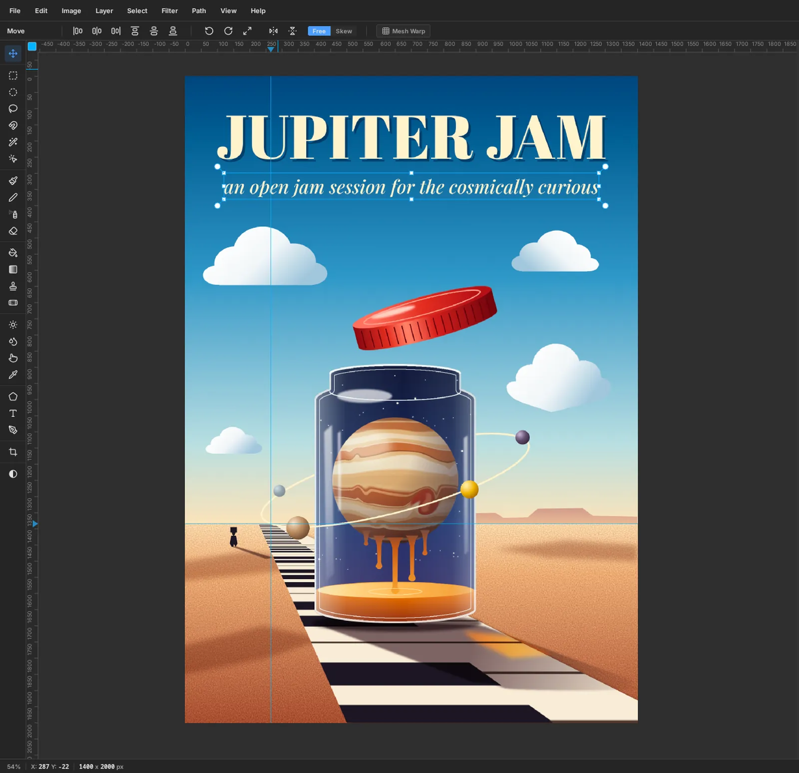

1. Click the **Project** row again. With the **Text** tool, choose **Playfair Display**, **Size** 58, weight **Medium** and style **Italic**.
2. Click under the title, type `an open jam session for the cosmically curious` and press [[Tab]].
3. Click **Align center horizontally**. Nudge the line until there's about 60 px between the bottom of the title and the top of the tall letters.

The line sits about 100 px above the top-right cloud, so the two don't crowd each other.

## Lay in the footer band

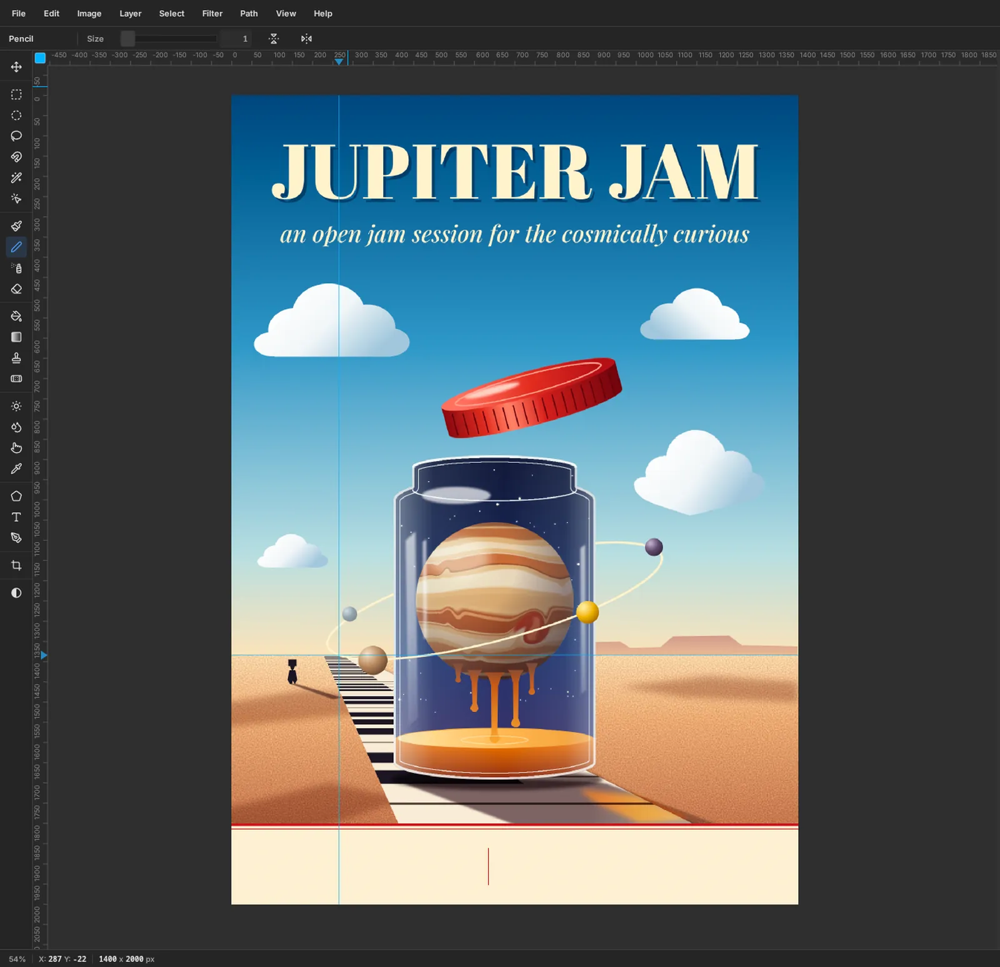

1. Click the **Project** row and add a layer named `Footer`.
2. Select (0, 1800) to (1400, 2000) and fill with `#FBF0D4`.
3. Select a 7 px strip along the top of the band, (0, 1800) to (1400, 1807), and fill with `#B92D26`. Add a 2 px rule the same way from y 1813 to 1815. Deselect.
4. Pick the **Pencil** at size 2 with `#B92D26`. Click and [[Shift]]-click a vertical divider about 90 px tall at x 635, a little left of centre. The venue goes to its left and the date to its right.

The band covers the nearest key and the tip of the shadow. That's fine. The road now seems to run out from under the footer.

## Set the details in two columns

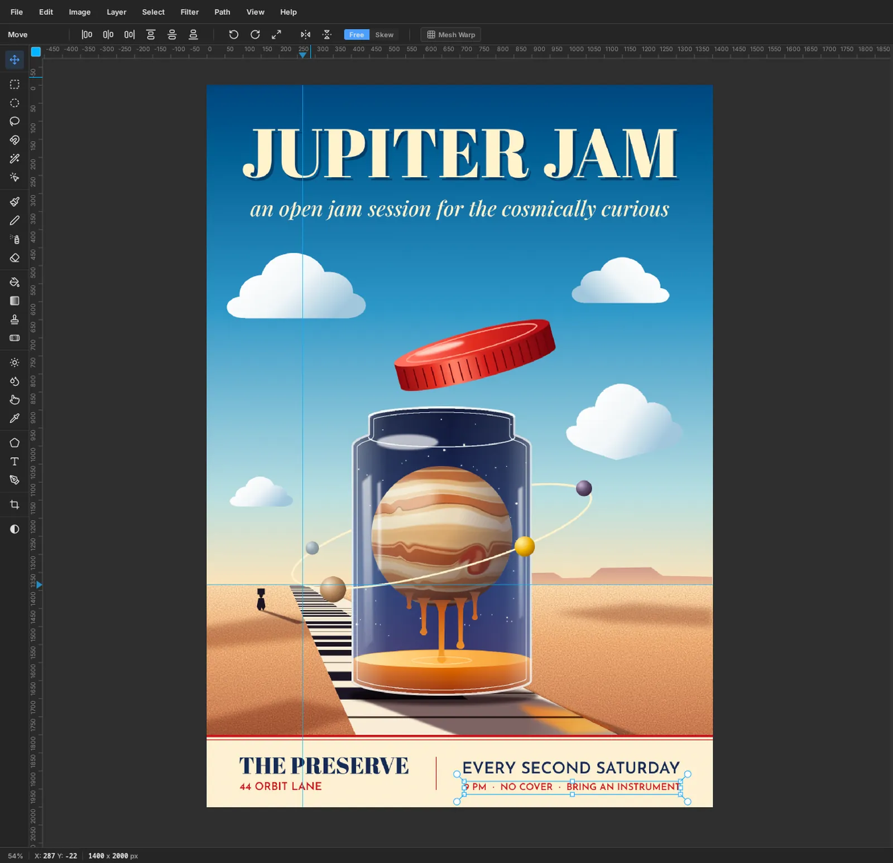

Click the **Project** row before each new piece of text. Otherwise the Text tool edits the text layer that's still active, or puts the new one inside a group. Set the style back to **Normal** first, because it's still on Italic from the subtitle. Press [[Tab]] to commit each line.

1. Set the colour to `#1B2A52`. In **Abril Fatface** at **Size** 64, click in the left of the band and type `THE PRESERVE`. With the **Move** tool, click **Align left**, then press [[Shift+→]] nine times for a 90 px margin.
2. Set the colour to `#B92D26`. In **Josefin Sans**, **SemiBold**, **Size** 30, type `44 ORBIT LANE` below it. Align it left and nudge it in by the same 90 px.
3. Set the colour back to `#1B2A52`. In **Josefin Sans**, **SemiBold**, **Size** 44, click in the right half of the band and type `EVERY SECOND SATURDAY`. Click **Align right**, then press [[Shift+←]] nine times.
4. In red again at **Size** 26, type `9 PM  ·  NO COVER  ·  BRING AN INSTRUMENT`. Align it right and nudge it in by 90 px.
5. Nudge the lines up and down until the two big lines sit on the same baseline and the two small lines share one too. Leave about the same space above the big lines as below the small ones, a little under 50 px. The divider should end up halfway between the two columns, running from the top of the big letters to the baseline of the small ones.

The venue gets the display face because it's the thing people need to remember. Keep every line well inside the band. No letter should come closer than about 45 px to the rules or the bottom edge.

## Add grain and export

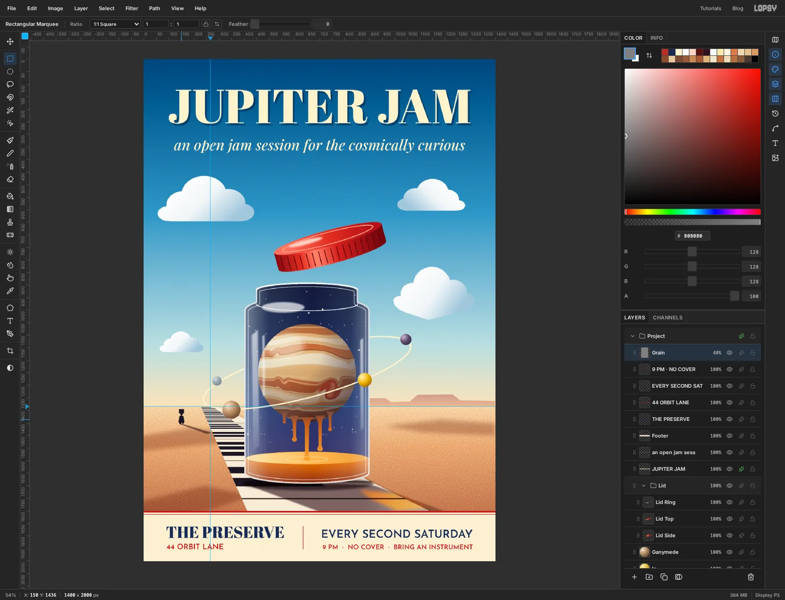

1. Click the **Project** row and add a layer named `Grain`. Press [[Cmd+A]] and fill with `#808080`.
2. Run **Filter → Add Noise…** at **Amount** 22 and deselect.
3. Set the layer to **Soft Light** at **40%**. A fine grain over everything ties the flat shapes together, like ink on paper.
4. Choose **File → Quick Export PNG**, and **File → Save Project** to keep the layers.

To make the flier your own, change what's in the jar. Saturn would need its rings to pass through the glass the way the orbit does here, and a full moon could sink into honey.
