René Magritte's *Empire of Light* paintings show a street at night under a bright daytime sky. Giorgio de Chirico painted empty piazzas, long raking shadows and greenish dusk skies. This tutorial combines the two in one picture, **Umbral Keyhole**. It's night on a checkerboard piazza, but a keyhole in a brick wall opens onto a summer afternoon. Daylight spills through the keyhole onto the floor, and a few clouds drift out toward a key made of cloud.

You'll paint it from scratch. Gradients, pattern fills and filters do most of the work, plus two public-domain cloud photos. The techniques to watch:
- **Distort** lays a flat checkerboard down in perspective.
- A **mask on a whole group** cuts the keyhole through every wall layer at once.
- **Flip Vertical**, a squash and the **Perspective** mode turn the keyhole into the light on the floor.
- **Copy and paste** with scaling makes the drifting clouds.

Some steps give positions in document pixels. Hover over the canvas and read **X** and **Y** at the bottom left of the window. You don't need to hit them exactly. Most selections that need precise shapes use the marquee's exact-size dialog: **click once with the marquee without dragging**, type the From and To corners, and press **Select**.

Hold [[Shift]] while you drag a marquee or lasso to **add** to the selection, and [[Alt]] to **subtract** from it. For small shapes that need exact corners, zoom in and watch the X/Y readout while you drag. The Lasso is freehand: to make straight edges, hold the mouse button and drag in straight lines from point to point. After a transform, press [[Cmd+D]] to commit it and deselect.

The cloud photos are both free to use:
- [Clouds in blue sky](https://commons.wikimedia.org/wiki/File:Clouds_in_blue_sky.jpg) by Rosendahl, public domain.
- [Cumulus clouds in the sky](https://commons.wikimedia.org/wiki/File:Cumulus_clouds_in_the_sky.jpg), CC0.

Palette:

- Night sky `#080C24` → `#182A52` → `#2C5560` → `#9D9566`
- Moon `#F4EAD0`, star glow `#CFE0FF`
- Floor tiles `#E6D2A6` / `#B6553A`, floor night `#8A88A4` → `#4A4C6C`
- Bricks `#9A8A70` / `#8C7C64` / `#A6967A`, mortar `#56463A`
- Wall shade `#8A8698` → `#2C2840`, coping `#6E6250`
- Daylight `#FFF0C4`, tunnel `#E6D3B0` / `#B89A72` / `#6E5A48`
- Shadow `#151022`
- Apple `#5F9A2C` → `#173010`, rim light `#D8F08A`, leaf `#3D7A28`

## Set the horizon and the vanishing point

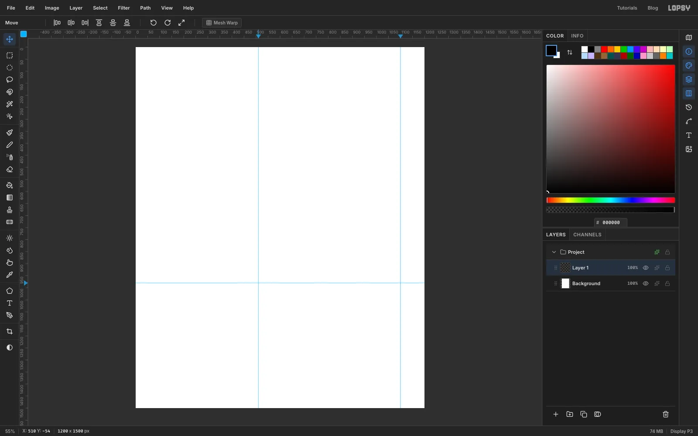

1. Create a **1200 × 1500 px** document with a white background.
2. Click the left ruler at y **980** to drop the horizon guide.
3. Click the top ruler at x **1100**. Where this guide crosses the horizon is the vanishing point. Every receding edge in the picture points at it.
4. Click the top ruler at x **510** for the keyhole's centre line.

A vanishing point far to the right gives the view the off-centre, slightly uneasy angle of de Chirico's squares.

## Paint the night sky

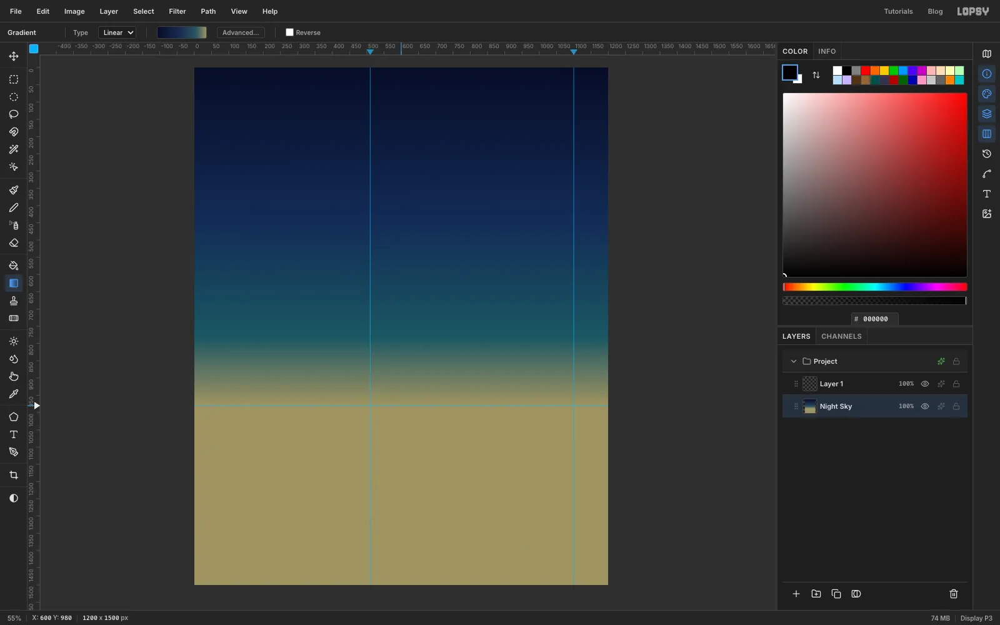

1. Select **Background** and rename it `Night Sky`.
2. Pick the **Gradient** tool, set **Type** to **Linear** and open **Advanced…**. Set four stops:
   - `#080C24` at the start
   - `#182A52` at 45%
   - `#2C5560` at 80%
   - `#9D9566` at the end
3. Drag from the top of the canvas straight down to the horizon guide.

The olive-green glow along the horizon is de Chirico's colour. It makes the night feel strange rather than just dark.

## Make a star field from noise

1. Rename `Layer 1` to `Stars`. Set the foreground to black and choose **Edit → Fill**.
2. Choose **Filter → Add Noise…** with **Amount** 100, **Mode** Mono and **Distribution** Gaussian.
3. Choose **Filter → Threshold…** with **Level** 50. Only the brightest grains survive, as single-pixel stars.
4. Open the layer's effects drawer and set the blend mode to **Screen**. The black disappears and the stars sit on the sky.

## Fade the stars toward the horizon

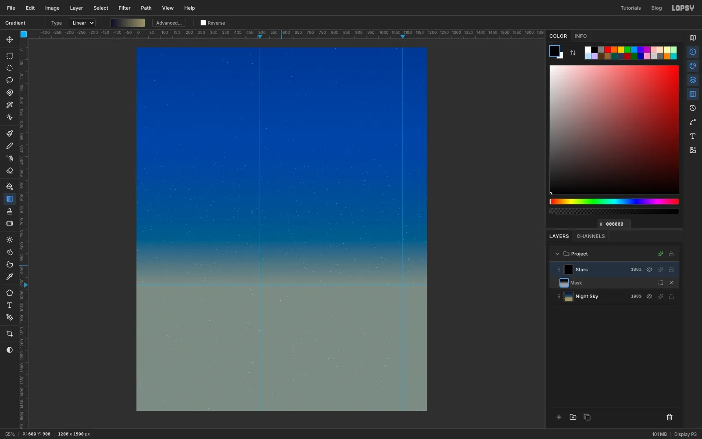

Stars disappear into the glow near the horizon, so fade them out.

1. With **Stars** selected, click **Add Mask** at the bottom of the Layers panel, then click the mask thumbnail to edit the mask.
2. In the Gradient tool's **Advanced…** editor, set the stops to white then black.
3. Drag from y **380** down to y **900**.

The blue tint is the mask-editing overlay. Click the **Stars** layer name to leave mask editing.

## Add a few bright stars

1. Add a layer named `Bright Stars`.
2. Pick the **Brush**. In the brush settings, set **Size** 6, **Hardness** 90 and **Spacing** 10.
3. Set the foreground to `#FBF6E8` and click a dozen single dots around the sky. Keep them off the wall area and spread them unevenly.
4. Add an **Outer Glow** with **Size** 10, **Opacity** 70 and colour `#CFE0FF`.

## Cut a crescent moon

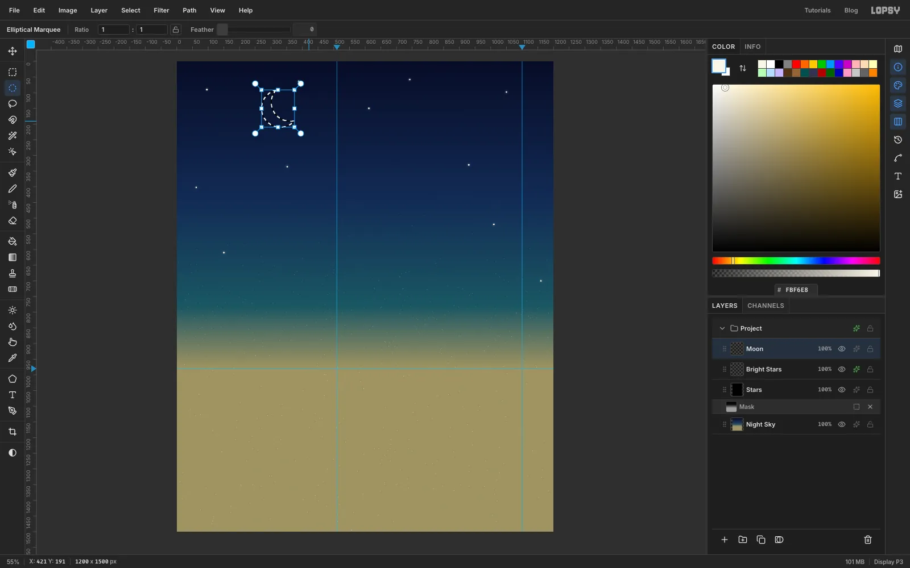

1. Add a layer named `Moon` and pick the **Elliptical Marquee**.
2. Click once (no drag) and enter From (270, 90) and To (390, 210) for a 120 px circle.
3. Zoom in, hold [[Alt]] and drag a second circle of the same size from (301, 71) to (421, 191). It's shifted up and to the right, so it bites a crescent out of the first.

## Fill and glow the moon

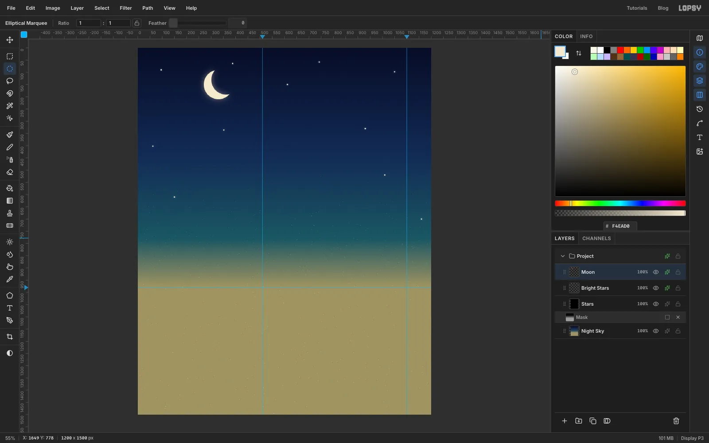

1. Set the foreground to `#F4EAD0`, choose **Edit → Fill**, and deselect.
2. Add an **Outer Glow** with **Size** 36, **Opacity** 45 and colour `#F4E6C0`.

The moon sits well clear of where the wall's top edge will go. If they touch, the moon looks like it is resting on the wall.

## Lay in the distant hills

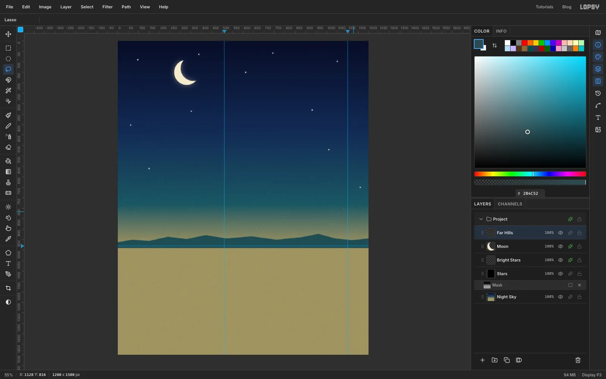

1. Add a layer named `Far Hills`.
2. With the **Lasso**, draw a gentle, uneven hill line between about y 920 and y 965. Bring it down below the horizon and back to the start.
3. Fill it with `#2B4C52` and deselect.
4. Run **Filter → Gaussian Blur…** at **Radius** 2 so the hills sit back in the distance.

## Add horizon haze and group the sky

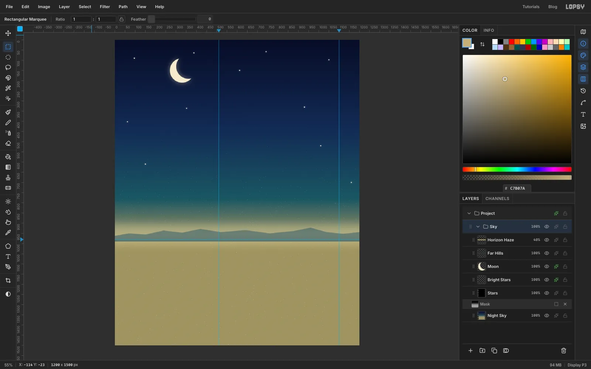

1. Add a layer named `Horizon Haze`. Select the rectangle from (0, 905) to (1200, 1005).
2. Choose **Select → Feather…** with 40 px. Fill with `#C7B07A`.
3. Set the layer to **Screen** at **40%** opacity.
4. Click **Night Sky**, then [[Shift]]-click **Horizon Haze** to select all the sky layers.
5. Choose **Layer → Group Layers** and rename the group `Sky`.
6. Collapse the group with its arrow. A collapsed group that's selected makes new layers go above it, not inside it.

## Draw a checkerboard tile

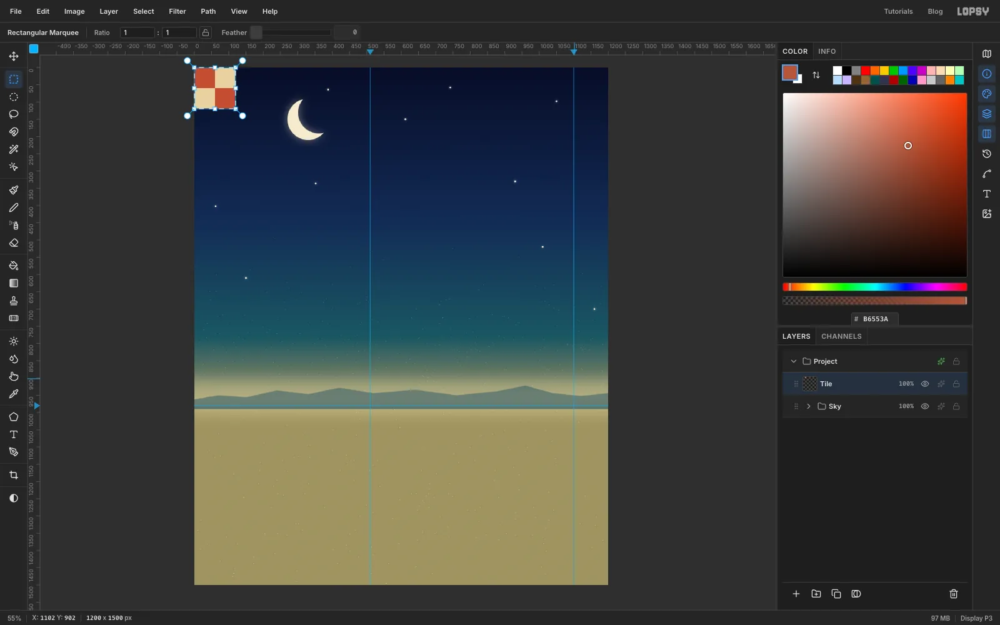

1. With the **Sky** group selected, add a layer named `Tile`.
2. Select (0, 0) to (120, 120) and fill it with `#E6D2A6`.
3. Select (0, 0) to (60, 60). Zoom in, hold [[Shift]] and drag a second square from (60, 60) to (120, 120). Fill both with `#B6553A`.
4. Select the whole tile, (0, 0) to (120, 120), and choose **Edit → Define Pattern**.
5. Delete the **Tile** layer. The pattern is saved and you don't need the layer any more.

## Fill a square with the pattern

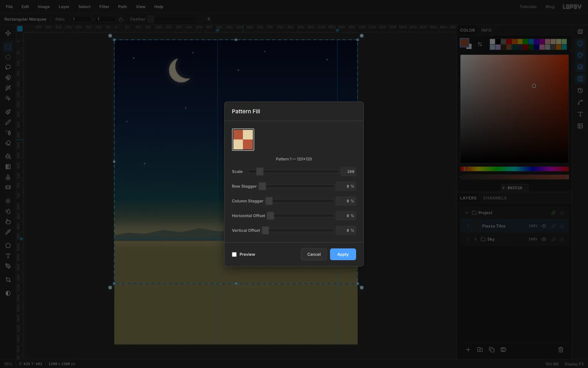

1. Click the **Sky** group again, add a layer named `Piazza Tiles` and select (0, 0) to (1200, 1200). It's a square of floor, laid out flat.
2. Choose **Edit → Fill with Pattern…**, pick the checker and click **Apply**.

The checkerboard covers the sky for now. You'll lay it down on the ground next.

## Distort the far edge onto the horizon

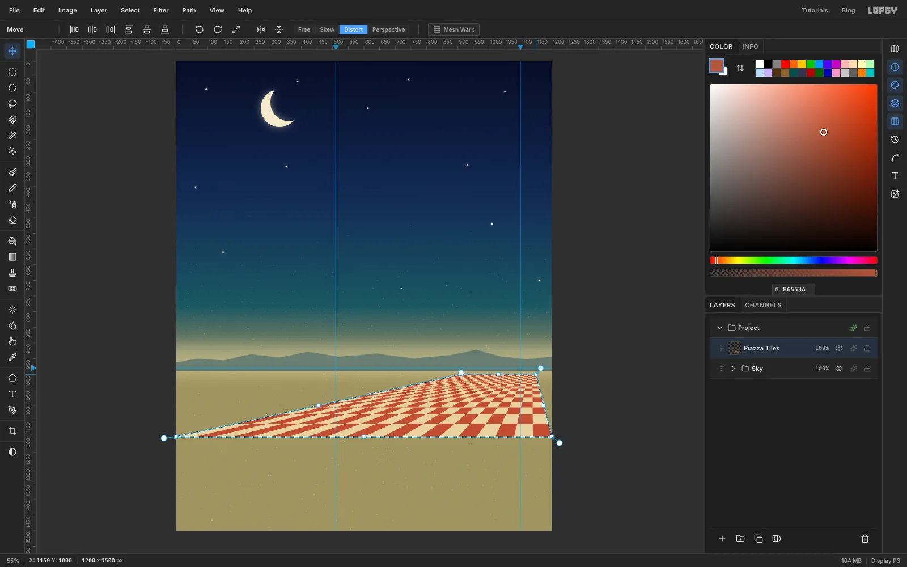

1. Keep the selection and pick the **Move** tool. Choose **Distort** in the options bar.
2. Drag the **top-left** corner handle to (911, 1000), just below the horizon and left of the vanishing point.
3. Drag the **top-right** handle to (1150, 1000).

The far edge of the floor is now a short line near the vanishing point.

## Pull the near corners out wide

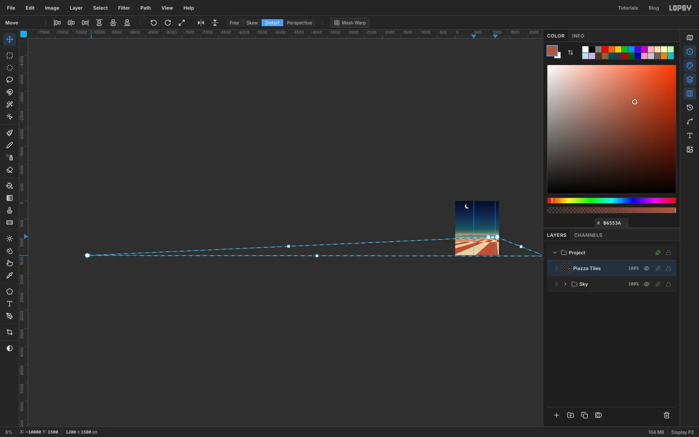

The near corners have to go far beyond the canvas edges, or the floor stops short on the left.

1. Press [[Cmd+-]] until the zoom readout at the bottom left shows about **8%**.
2. Drag the **bottom-right** handle to about (2400, 1500): right of the canvas, level with the bottom edge.
3. Hold [[Space]] and drag the view to the right to make room on the left.
4. Drag the **bottom-left** handle a very long way left, to about x −10000, level with the bottom edge. Watch the board's left edge. It should still point at the vanishing point, and it should leave the canvas just below the horizon.
5. Press [[Cmd+D]] to commit, then [[Cmd+0]] to fit the canvas back on screen.

Distort is a true perspective transform, so the rows of tiles shrink as they recede.

## Darken the floor and add distance fog

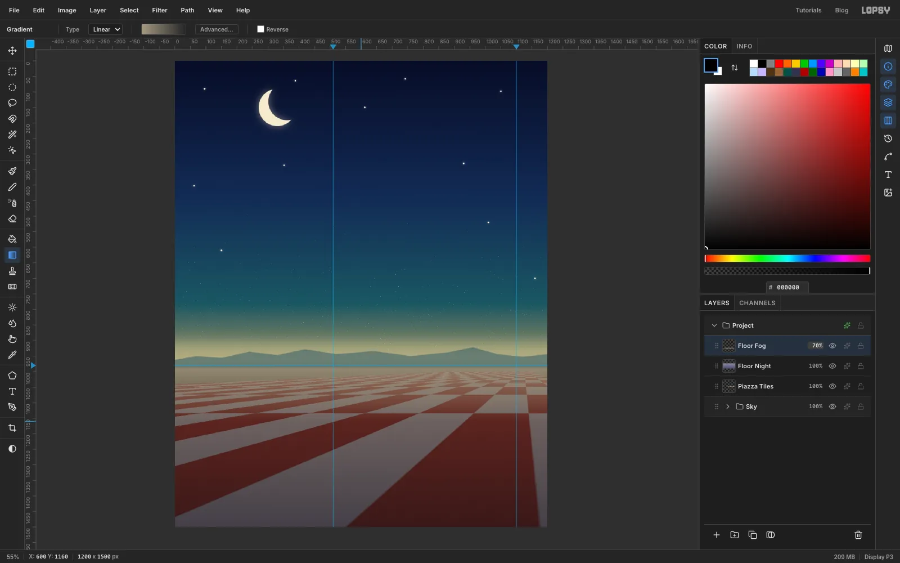

1. Add a layer named `Floor Night` and select (0, 985) to (1200, 1500).
2. Set the gradient stops to `#8A88A4` and `#4A4C6C`. Drag from just under the horizon down to the bottom of the canvas.
3. Set the layer to **Multiply**.
4. Add a layer named `Floor Fog`. With the same selection, set both gradient stops to `#A49A82`. Give the second stop **0% opacity**.
5. Drag from y 990 down to y 1160, then deselect and set the layer to **70%** opacity.
6. Group **Piazza Tiles**, **Floor Night** and **Floor Fog** as `Piazza`, then collapse the group.

Limit the fog to the floor with the selection. Without it, the gradient's solid start colour floods the whole sky.

## Drop in the daytime sky

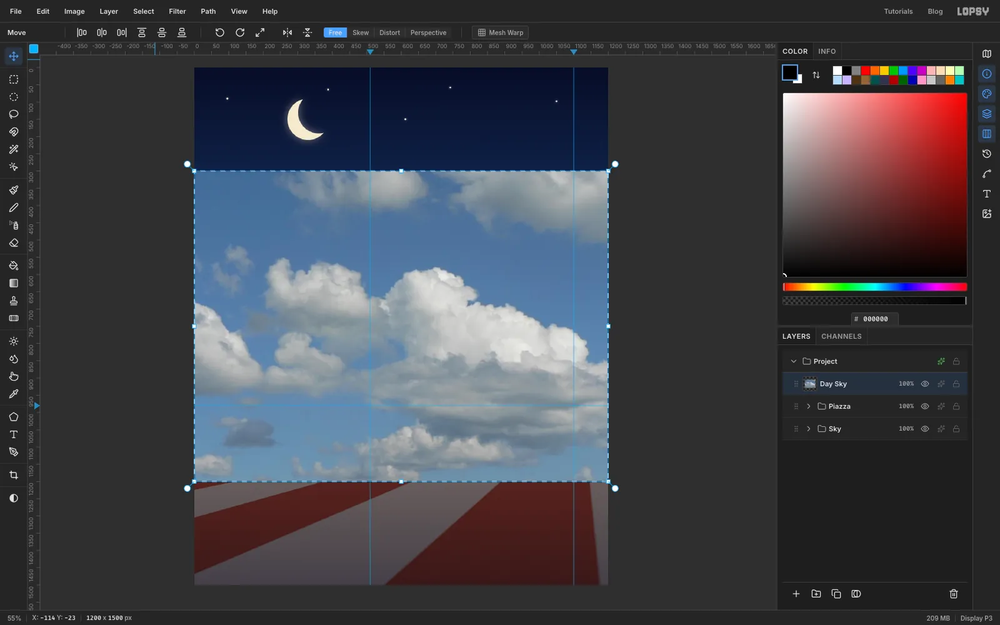

1. With **Piazza** selected, drag the *Clouds in blue sky* photo from your desktop onto the canvas. It arrives as a new layer, fitted to the canvas width.
2. Rename the layer `Day Sky`.
3. Drag it about 150 px left and 20 px down, so the big cloud bank sits around the keyhole's centre line. Press [[Cmd+D]].

You'll trim it to the keyhole later.

## Draw a brick tile

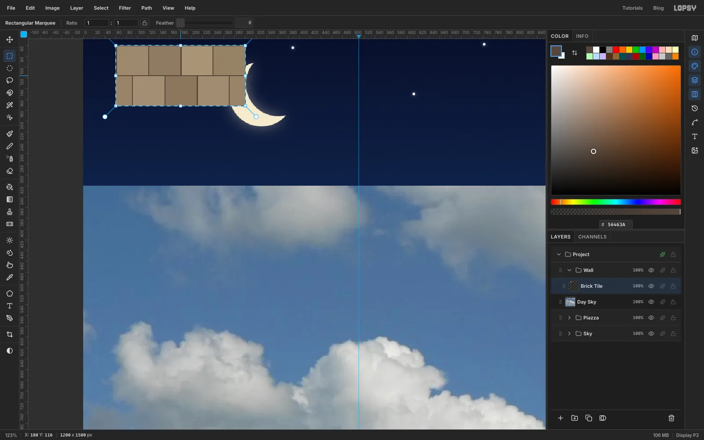

1. Click **New Group** at the bottom of the Layers panel and name it `Wall`. Add a layer inside it named `Brick Tile`.
2. Build two courses of 60 × 56 px bricks with the exact-size marquee dialog, filling each rectangle as you go:
   - **Top course** (y 60 to 116): four bricks from x 60 to 300, each 60 px wide. Give each its own tone: `#9A8A70`, `#8C7C64`, `#A6967A`, `#938368`.
   - **Bottom course** (y 116 to 172): shifted by half a brick. Fill x 90–150, 150–210 and 210–270 with `#A09076`, `#88785F` and `#9D8D73`. Then select the half brick at x 60–90, [[Shift]]-add the one at x 270–300, and fill both with `#95856C`. They share a colour because they join into one brick when the pattern repeats.
3. Select the whole tile, (60, 60) to (300, 172), and add **Add Noise** at **Amount** 8, Mono, Gaussian.
4. Pick the **Pencil** at size 2 with `#56463A`. Click and [[Shift]]-click to draw straight mortar lines:
   - across the top of each course
   - down the left edge of each top-course brick, at x 60, 120, 180 and 240
   - down the bottom course at x 90, 150, 210 and 270
5. Keep the tile selected. Choose **Edit → Define Pattern**, then delete the **Brick Tile** layer.

Eight bricks in eight tones keep the wall from looking like bathroom tiles.

## Fill the wall face with bricks

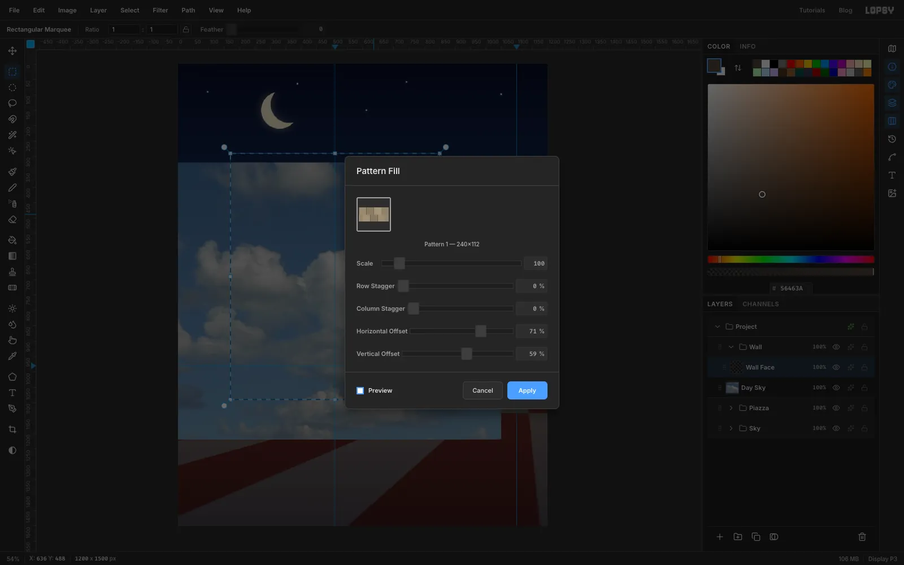

1. Add a layer named `Wall Face`. Select the wall rectangle from (170, 290) to (850, 1090).
2. Choose **Edit → Fill with Pattern…** and pick the brick pattern.
3. Set **Horizontal Offset** 71% and **Vertical Offset** 59%. This lines up a mortar joint with the top-left corner of the wall.
4. Click **Apply**.

## Weather the bricks

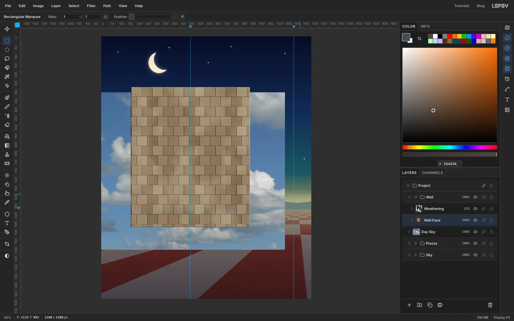

1. Keep the wall selection. Add a layer named `Weathering` and run **Filter → Clouds…** with **Scale** 10.
2. Set the layer to **Soft Light** at **22%**.
3. Deselect, select **Wall Face** and run **Filter → Emboss…** with **Angle** 135 and **Strength** 8. Lopsy's Emboss adds a highlight and a shadow to the existing colours, so a low strength is enough.

## Shade the backlit wall

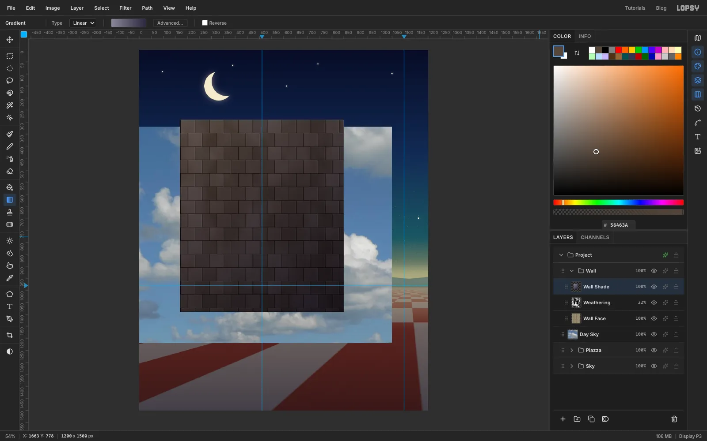

The daylight is behind the wall, so the face you see is in shade. Only a little moonlight reaches it.

1. Select **Weathering** and add a layer named `Wall Shade` above it.
2. Select the wall rectangle again.
3. Set the gradient stops to `#8A8698` and `#2C2840`. Drag from the wall's top-left corner to its bottom-right corner.
4. Deselect and set the layer to **Multiply**.

## Add the side face and the coping

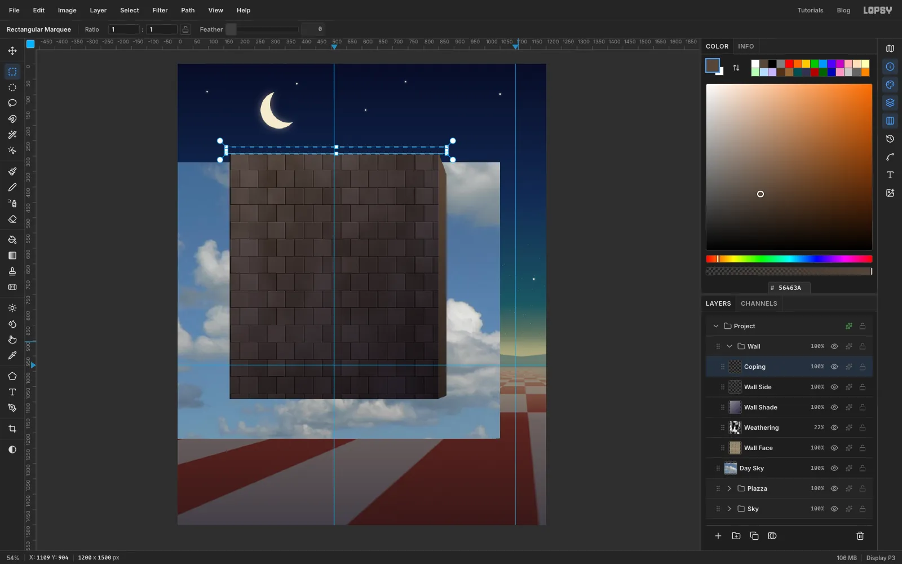

1. Add a layer named `Wall Side`. With the **Lasso**, select the side face, from the wall's top-right corner (850, 290) to (875, 359), down to (875, 1079), and back to the bottom corner (850, 1090). The slanted top edge points at the vanishing point.
2. Fill it with a top-to-bottom gradient from `#5A4A3C` to `#2A231E`.
3. Add a layer named `Coping` and select the cap stone from (158, 270) to (876, 292).
4. Fill with `#6E6250` and deselect.
5. Add a **Drop Shadow**: **Offset X** 0, **Offset Y** 8, **Blur** 10, **Opacity** 60.

## Catch the daylight on the top edge

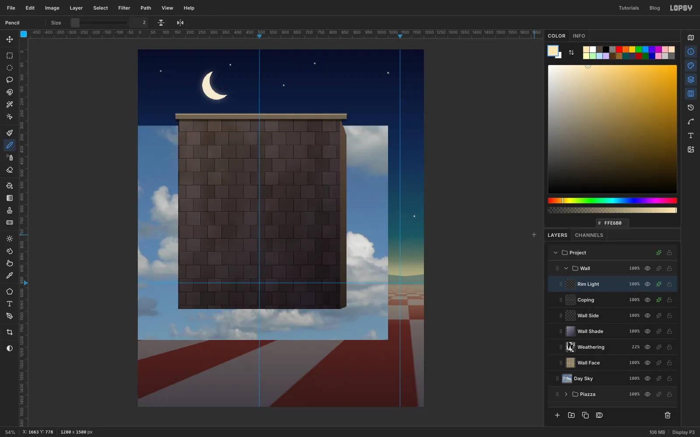

1. Add a layer named `Rim Light`. Pick the **Pencil** at size 2 with `#FFE6B0`.
2. Click the coping's top-left corner and [[Shift]]-click its top-right corner.
3. Add an **Outer Glow**: **Size** 10, **Opacity** 40, colour `#FFCF80`.

A hair of light along the top is the only hint, before the keyhole is cut, that the sun is behind the wall.

## Select the keyhole on the group mask

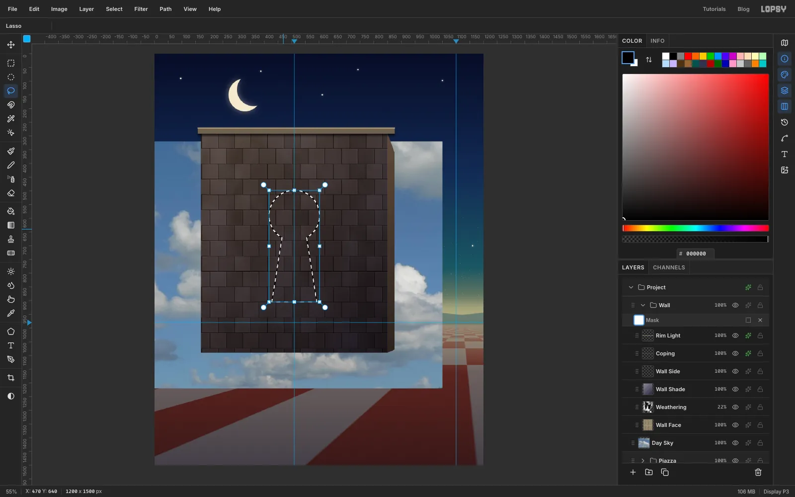

Cut the keyhole through the whole **Wall** group with a group mask. You don't have to erase it from every layer, and the cut stays editable.

1. Click the **Wall** group row and click **Add Mask**. Then click the mask thumbnail to edit it.
2. With the **Elliptical Marquee**, select the circle from (418, 498) to (602, 682).
3. Pick the **Lasso**, hold [[Shift]], and drag in straight lines around the slot to add it:
   - start at (470, 640) inside the circle
   - (550, 640)
   - (592, 905)
   - (428, 905)
   - back to the start

## Cut the keyhole

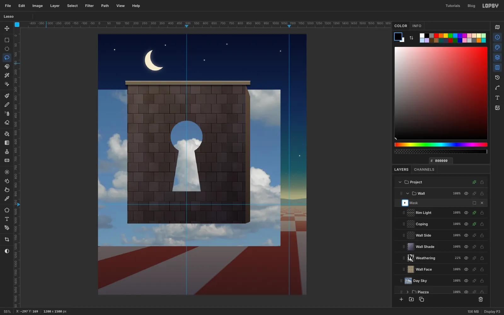

Set the foreground to black and choose **Edit → Fill**, then deselect. In mask edit mode, Fill paints the mask, and black hides the wall. The photo underneath shows through.

## Build the tunnel walls

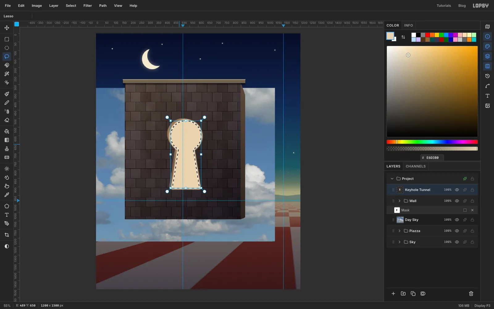

The wall has thickness, so you see the inside of the keyhole as well as the hole.

1. Collapse the **Wall** group, select it, and add a layer named `Keyhole Tunnel` above it.
2. Make the keyhole selection again: the circle, then [[Shift]] and the slot.
3. Pick a **Radial** gradient from `#B89A72` to `#6E5A48`. Drag from about (528, 602), a little right of and below the keyhole circle's centre, about 185 px up and to the left to (378, 492).
4. Add a little **Add Noise** (6, Mono) for stone grain.
5. Select the **back opening**. It's the same keyhole shifted about 18 px toward the vanishing point:
   - circle from (438, 512) to (617, 691)
   - [[Shift]]-lasso slot (489, 650), (567, 650), (607, 907), (448, 907)
6. Use **Select → Grow…** 8 px and **Feather…** 5 px, then fill with `#E6D3B0`. This is daylight grazing the tunnel walls.
7. Make the back opening selection again and press [[Delete]].
8. Make the front keyhole selection, choose **Select → Inverse** and press [[Delete]] to tidy anything outside the hole.
9. Deselect and add an **Outer Glow**: **Size** 60, **Opacity** 45, colour `#FFCF7A`.

## Trim the day sky to the keyhole

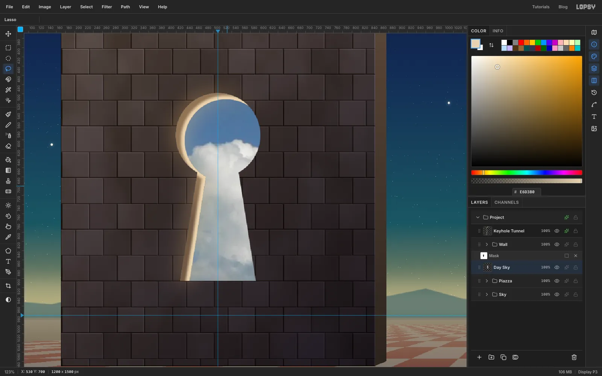

The photo still covers the whole canvas behind the wall.

1. Select the **Day Sky** layer and make the back opening selection.
2. Choose **Select → Inverse** and press [[Delete]].

Now the only daylight in the picture is inside the keyhole.

## Cast the wall's long shadow

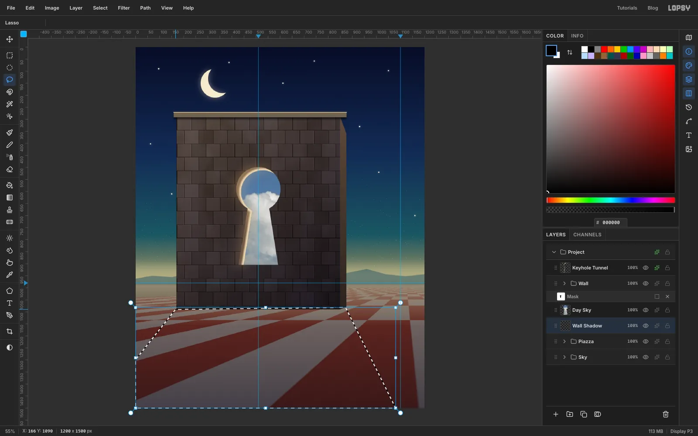

1. Select the **Piazza** group and add a layer named `Wall Shadow`.
2. With the **Lasso**, drag in straight lines from the wall's bottom-left corner (166, 1090) to the bottom of the side face (872, 1082). Continue to the bottom edge of the canvas at about x 1080, then to x −160 on the same edge, just off the left side. The shadow widens as it comes toward you.
3. Fill with `#151022`, deselect and run **Gaussian Blur** at 5.
4. Set the layer to **Multiply** at **85%**.

## Turn the keyhole into a pool of light

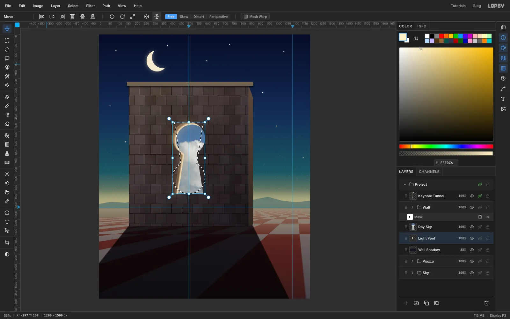

Daylight from behind the wall passes through the keyhole and lands on the floor in front. The patch it makes is the keyhole flipped upside down and flattened.

1. Add a layer named `Light Pool`, make the keyhole selection again and fill it with `#FFF0C4`. Deselect.
2. [[Cmd]]-click the **Light Pool** thumbnail to select its pixels.
3. Pick the **Move** tool and click **Flip Vertical** in the options bar.

The Light Pool layer sits under the wall, so for now you only see the selection outline flip. The fill shows up once you move it onto the floor in a later step.

## Flatten it onto the floor

Drag the **top** middle handle down until the shape is a little over half its height, about 225 px tall. A patch of light on the ground looks flattened because you see the ground at an angle.

## Widen the near end with Perspective

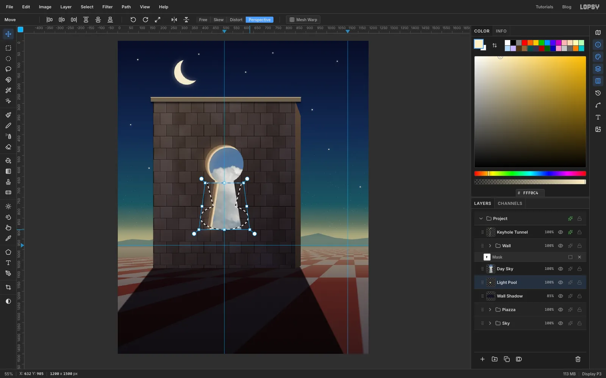

1. Choose **Perspective** in the options bar.
2. Drag the **bottom-right** corner about 30 px to the right. The bottom-left corner mirrors it, so the end nearest you gets wider.
3. Press [[Cmd+D]].
4. Drag the pool down onto the floor. Its slot end should sit about 80 px in front of the wall's base and line up under the keyhole.

## Knock the pool out of the shadow

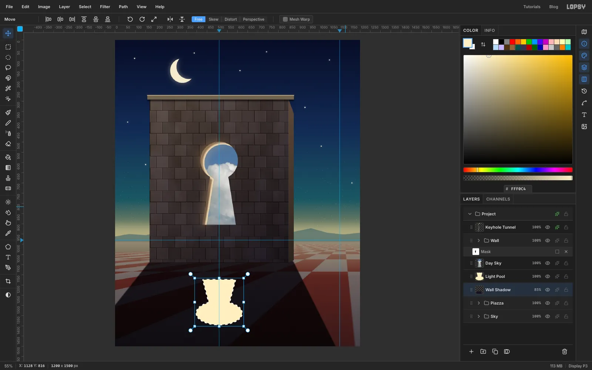

Where the daylight lands there is no shadow.

1. [[Cmd]]-click the **Light Pool** thumbnail, then use **Select → Feather…** 6 px.
2. Click the **Wall Shadow** layer and press [[Delete]].

## Soften the pool

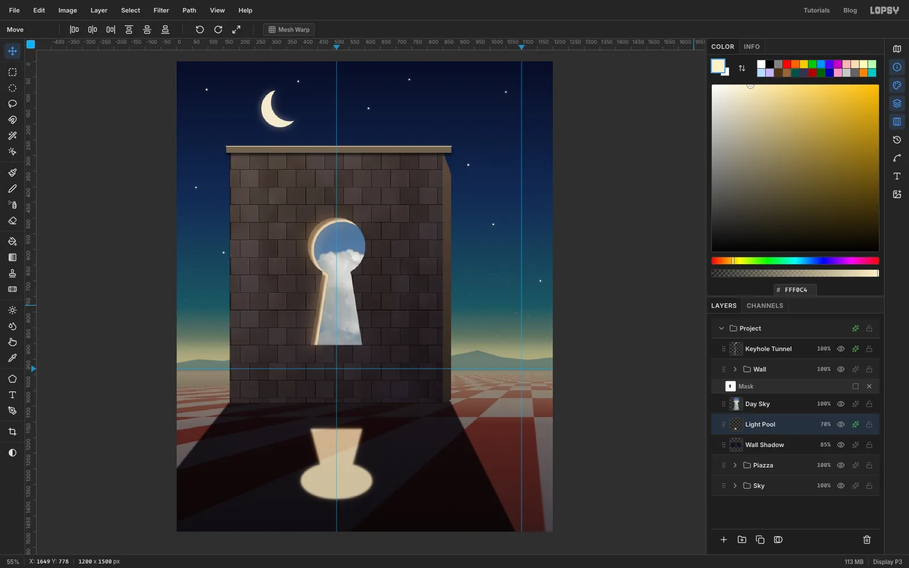

Deselect. Select **Light Pool** and run **Gaussian Blur** at 8, so every edge is equally soft. Set the layer to **70%** opacity, and add an **Outer Glow** with **Size** 24, **Opacity** 35 and colour `#FFD98A`.

## Add dust in the light

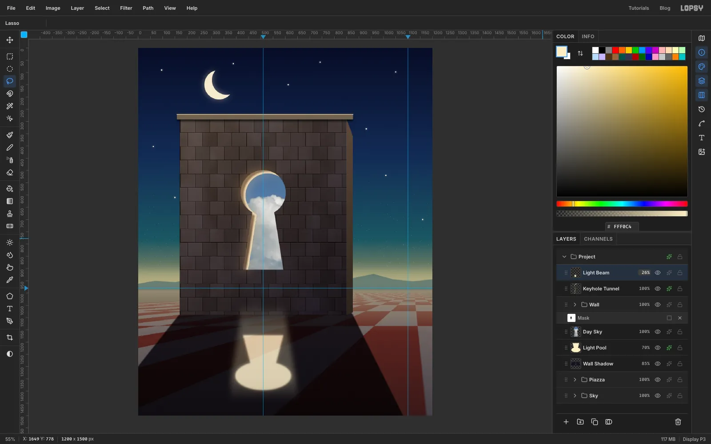

1. Select **Keyhole Tunnel** and add a layer named `Light Beam` above it.
2. Lasso a wedge from the wall's base under the keyhole to the near, round end of the pool:
   - (420, 1092)
   - (600, 1092)
   - (650, 1392)
   - (372, 1392)
3. **Feather** it 20 px and fill with `#FFF0C4`.
4. Add **Add Noise** (60, Mono, Gaussian) and deselect.
5. Run **Filter → Motion Blur…** with **Angle** 86 and **Distance** 90. The noise turns into rising streaks.
6. Set the layer to **Screen** at **26%**.

## Build the key from marquees

1. Click **New Group**, name it `Cloud Key`, and add a layer inside it named `Key`. Draw the key lying flat, left of and below where it will finally float. Turn off **View → Snap to Guides** for this step. The bit sits close to the x 1100 guide and would snap to it. Zoom in for the small collars and notches.
2. **Bow:** with the **Elliptical Marquee**, select a circle from (730, 360) to (850, 480). Hold [[Shift]] and add three smaller circles:
   - (700, 390) to (760, 450)
   - (760, 330) to (820, 390)
   - (760, 450) to (820, 510)
3. **Shaft and collars:** switch to the **Rectangular Marquee** and [[Shift]]-add:
   - the shaft, (840, 407) to (1120, 433)
   - two collars, (858, 395) to (872, 445) and (884, 399) to (894, 441)
4. **Bit:** [[Shift]]-add (1050, 433) to (1112, 500), and the tip (1108, 401) to (1124, 439).
5. **Holes:** hold [[Alt]] and take away a circle from (772, 402) to (808, 438) for the hole in the bow, and a notch from (1070, 464) to (1090, 500) in the bit.
6. Fill with `#DFE8F4` and deselect.

## Scale a cloud photo over the key

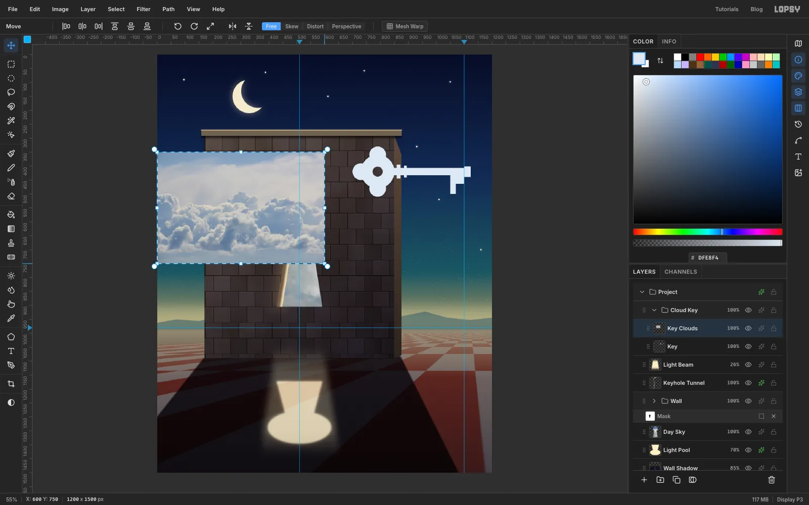

1. Drag the *Cumulus clouds in the sky* photo onto the canvas and rename the layer `Key Clouds`.
2. Hold [[Cmd]] and drag its **bottom-right** handle up and in until the photo is half its size.
3. Drag the photo up and to the right until its puffiest clouds cover the key. Keep the whole photo on the canvas. Anything hanging off the edge is not removed by the trim in the next step, and would show up again when you flip the key.
4. Press [[Cmd+D]].

## Trim the clouds to the key

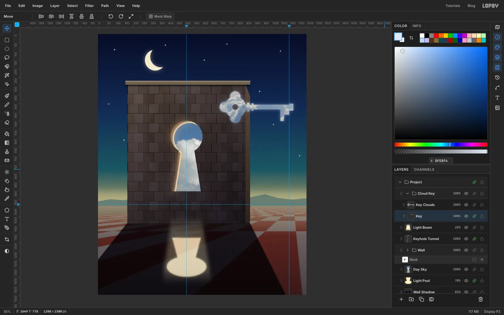

1. [[Cmd]]-click the **Key** thumbnail and choose **Select → Inverse**.
2. Click **Key Clouds**, press [[Delete]] and deselect.
3. Run **Gaussian Blur** at 2 on **Key Clouds** and again on **Key**, so the key's edge is soft like cloud.
4. Give **Key** an **Outer Glow**: **Size** 26, **Opacity** 55, colour `#BCD4FF`.

## Flip and rotate the whole group

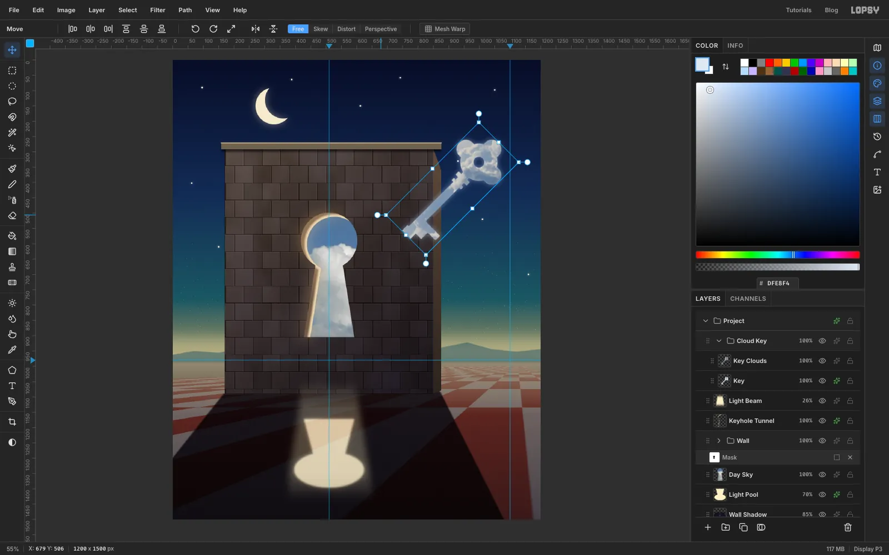

1. Click the **Cloud Key** group row and pick the **Move** tool. With a group selected and nothing marqueed, the handles frame the whole group.
2. Click **Flip Horizontal**, so the bow is on the right.
3. Hold [[Cmd]] and drag the **top-left rotation handle** counter-clockwise. [[Cmd]] snaps to 15° steps. Stop at 45°, so the bit points down toward the keyhole.
4. Press [[Cmd+D]].

Flip first, then rotate. Here the order matters.

## Scale the key and float it into place

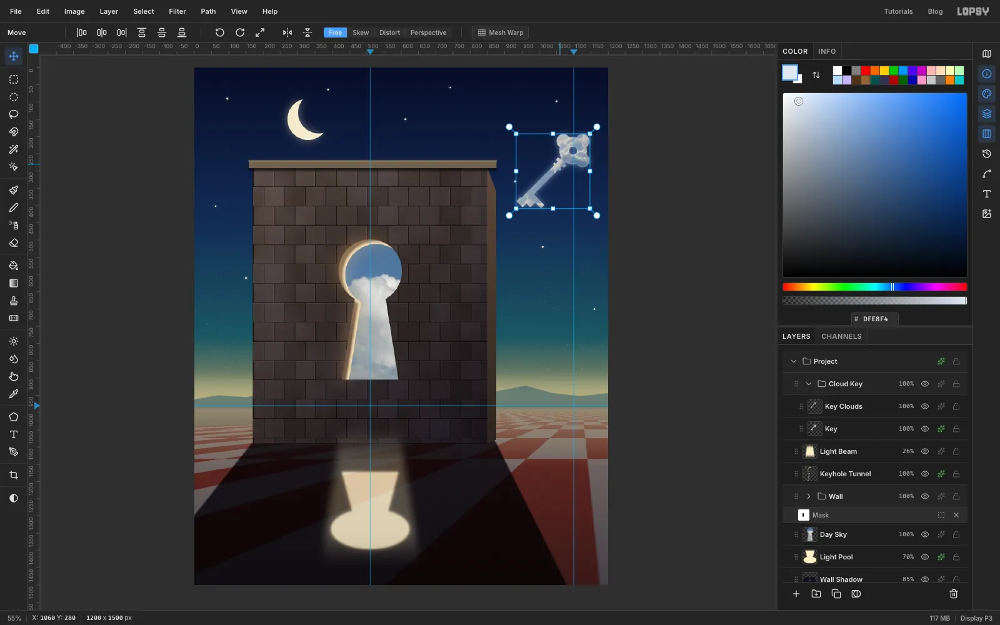

1. Select the group again. Hold [[Cmd]] and drag the **bottom-right** handle in until the key is about two-thirds the size. Press [[Cmd+D]].
2. Drag the group to the upper right, centred around (1040, 300). Leave at least 50 px between the key and the canvas edge, and more between the key and the wall. Press [[Cmd+D]].

## Cut the clouds out of the blue

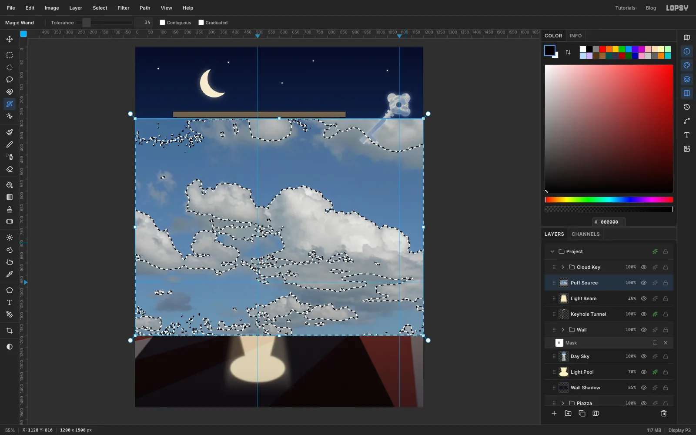

1. Collapse **Cloud Key**, select **Light Beam**, and drag the *Clouds in blue sky* photo in again. Rename it `Puff Source` and press [[Cmd+D]].
2. Pick the **Magic Wand**, set **Tolerance** to 34 and turn off **Contiguous**.
3. Click a patch of blue sky. Every blue pixel in the photo is selected.
4. **Feather** 2 px and press [[Delete]]. Only the clouds are left.

## Lasso a puffy cloud

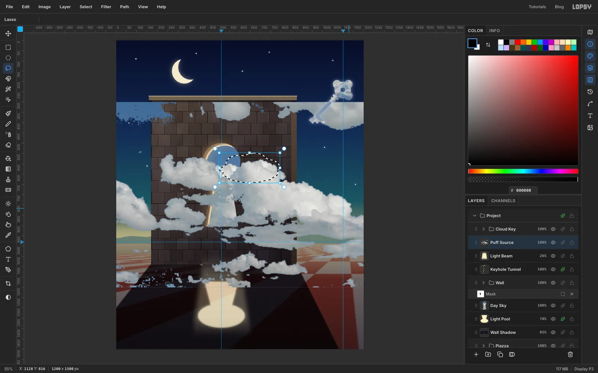

With the **Lasso**, draw a cartoon cumulus outline around a dense, white part of the big cloud bank. Give it a bumpy top and a flatter base, about 260 × 130 px. **Feather** it 2 px.

A cloud-shaped outline gives you a clean puff, even where the photo's clouds run together.

## Copy, paste and shrink it

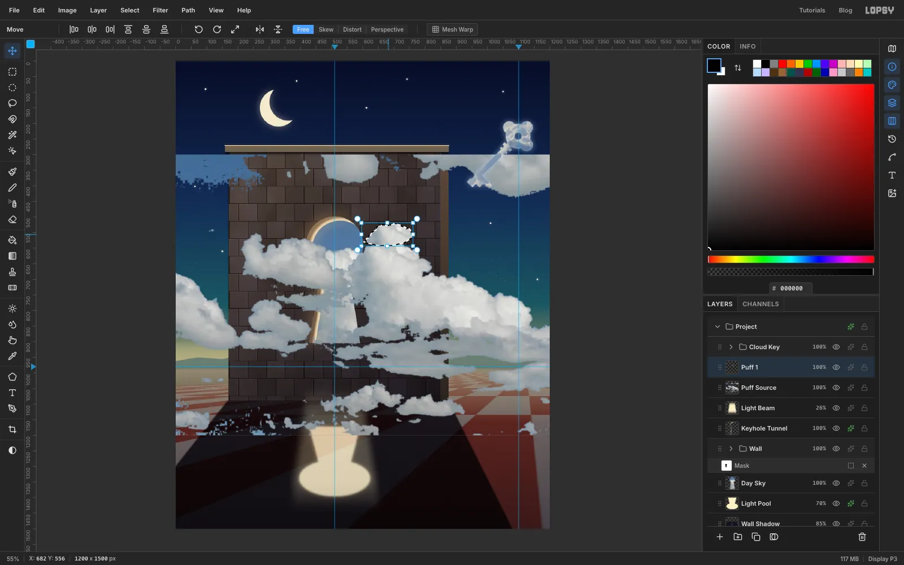

1. Press [[Cmd+C]] then [[Cmd+V]]. The puff pastes in place on its own layer, already selected with the Move tool.
2. Rename the layer `Puff 1`.
3. Hold [[Cmd]] and drag the corner handle in to about 60%.
4. Drag the puff so it's just leaving the keyhole's right edge, around (680, 555). Press [[Cmd+D]].

## Make the cloud trail

1. Select **Puff Source** again and lasso a second puff from the right-hand cloud bank. Copy, paste and rename it `Puff 2`.
2. Scale it to about 40% and place it higher up, around (790, 505). Keep it on the wall face, clear of the edge.
3. Click **Duplicate Layer** and rename the copy `Puff 3`. [[Cmd]]-click its thumbnail, scale it to 60%, and move it into the open sky below the key's bit, around (935, 466). Press [[Cmd+D]].
4. Delete **Puff Source**.
5. Give each puff an **Outer Glow**: **Size** 10, **Opacity** 25, colour `#EEF3FF`.
6. Set **Puff 2** to 85% opacity and **Puff 3** to 70%.

The trail climbs steadily and fades as it goes. That leads the eye from the keyhole to the key.

## Shape the apple

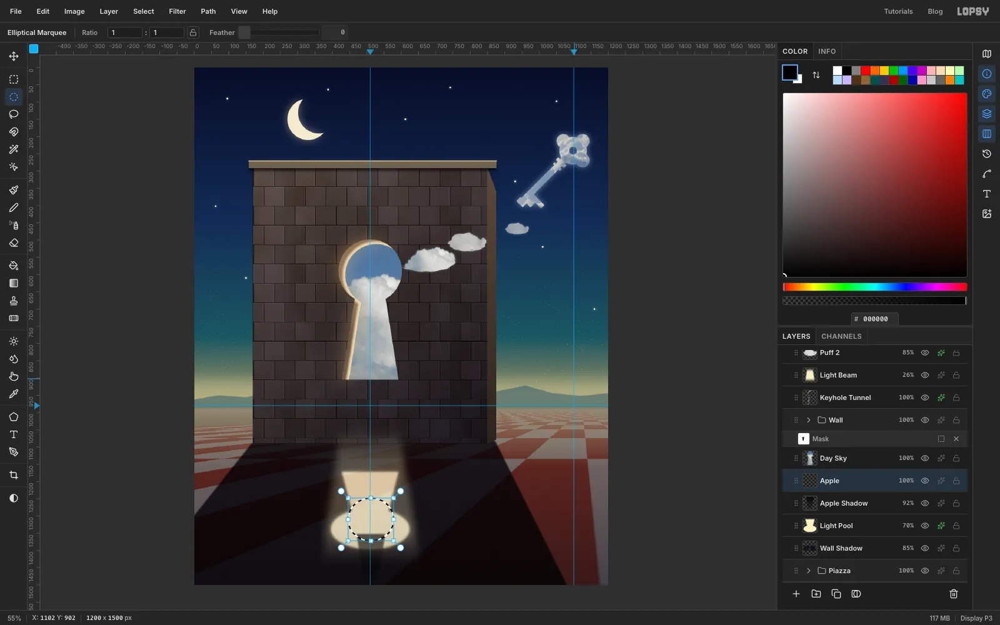

1. Select **Light Pool** and add a layer named `Apple Shadow`.
2. Lasso a long, tapering shape from under the apple toward you:
   - (470, 1352)
   - (554, 1352)
   - (530, 1495)
   - (494, 1495)
3. Fill it with a linear gradient of `#08060C`, running from fully opaque at the top to 15% opacity at the bottom. Deselect.
4. Run **Gaussian Blur** at 6 and set the layer to **Multiply** at **92%**.
5. Add a layer named `Apple` and select the ellipse from (446, 1248) to (578, 1372).
6. Fill the apple with a linear gradient from `#5F9A2C` at the top to `#173010` at the bottom. The side facing you is turned away from the light.
7. Select a small oval from (492, 1243) to (532, 1266), **Feather** 3 px, and fill it with `#122408` for the dimple where the stem sits.

## Light the apple from behind

1. Add a layer named `Apple Rim` and [[Cmd]]-click the **Apple** thumbnail.
2. Zoom in, hold [[Alt]] and drag an ellipse slightly bigger than the apple and about 13 px lower, from (444, 1261) to (580, 1392). What's left is a thin crescent along the apple's top.
3. **Feather** it 2 px and fill with `#D8F08A`.
4. Deselect and set the layer to **85%**.

That crescent of light is what says the sun is behind the apple.

## Add the stem and leaf

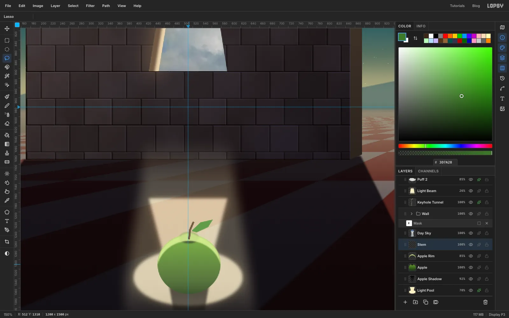

1. Add a layer named `Stem`.
2. Pick the **Brush** at size 5 with **Hardness** 80 and colour `#3B2616`.
3. Click in the dimple, then [[Shift]]-click twice, going up and slightly to the right, for a short bent stem.
4. With the **Lasso**, draw a small leaf off the stem and fill it with `#3D7A28`.

## Finish with grain and a vignette

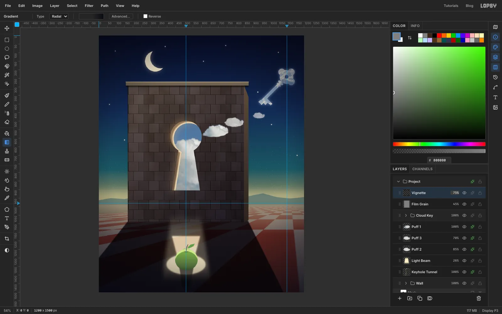

1. Select the **Cloud Key** group and add a layer named `Film Grain`. Fill it with `#808080`.
2. Add **Add Noise** (30, Mono, Gaussian) and set the layer to **Soft Light** at **45%**. This gives every surface the same fine painted texture.
3. Add a layer named `Vignette`. Pick a **Radial** gradient with three stops, all `#05060F`:
   - transparent at the start
   - transparent at 55%
   - 85% opacity at the end
4. Drag from the middle of the picture to a top corner, then set the layer to **75%**.
5. Choose **File → Quick Export PNG**, and **File → Save Project** to keep the layers.

To push the surrealism further, try your own swap. Put a night sky in the keyhole of a sunny wall, or float the apple instead of the key.
