*Surrealism* is the art of dreams: ordinary things placed where they can't be. René Magritte, the Belgian painter, did it with very calm, very plain pictures. A daytime sky hangs over a street at night. A bird is cut out of a cloudy sky. A pipe is captioned "this is not a pipe". Giorgio de Chirico painted empty plazas with long shadows that stretch to a far horizon. None of it is busy or loud. The strangeness comes from one impossible idea, painted as if it were perfectly normal.

That calm makes surrealism a good fit for a website. In this tutorial you'll make the homepage of *Rainmaker Umbrellas*, a made-up umbrella atelier in Brussels. The page is a 1440 × 2130 px mockup, a desktop browser window scrolled all the way down. Its one impossible idea: an umbrella whose canopy is a window onto a sunny sky, floating in the middle of the night, sheltering under its own little rain cloud.

You'll build:

- a **night sky** with stars and a crescent moon
- a **checkerboard plain** pulled into perspective
- the **umbrella**, drawn with the Pen and filled with a cloud photo through a layer mask
- a **rain cloud** cut out of the same photo with Quick Selection, and rain
- the **hero type** and buttons, and the **navigation bar**
- a **collection** of three product cards
- an amber **forecast ribbon** and an ink-black **footer**

You'll use:

- **guides**, the **Rectangular** and **Elliptical Marquee**, the **Lasso** and **Quick Selection**, adding, subtracting and intersecting selections with [[Shift]] and [[Option]], and **Select → Inverse**, **Grow**, **Shrink** and **Feather**
- **Define Pattern**, **Fill with Pattern** and the Move tool's **Perspective** transform
- a **layer mask** made from a selection, and a gradient painted into a mask
- the **Pen** tool, both to make selections and to stroke lines
- **Oil Paint**, **Hue/Saturation**, **Gaussian Blur** and **Add Noise**
- **Copy**, **Copy Merged**, **Paste**, **Merge Down** and **Group Layers**
- the **Shape** tool for rounded buttons, cards and a sticker
- the layer effects **Outer Glow**, **Inner Glow** and **Stroke**, and the **Multiply** and **Overlay** blend modes
- live text in **Instrument Serif**, **Special Elite**, **Gloock** and **La Belle Aurore**

The sky inside the umbrella is *White Cumulus Clouds against Blue Sky (4)* by Vanlewen on Wikimedia Commons (CC BY-SA 4.0). Any photo of a few round white clouds on a deep blue sky will do, as long as one cloud stands on its own.

The palette:

- Night sky `#0A1430` → `#2E4169`, navy shade `#14224A`
- Bone cream `#EDE5D3`, card paper `#F7F2E7`, rim cream `#F3EAD8`
- Ink `#15171D`, umbrella amber `#E3A63A`, price amber `#A16A12`
- Rain `#C9D4E8`, subhead blue-grey `#C9D2E3`
- Card panels `#CFDDEB` / `#2A3A6B` / `#F1D2BF`

> **Tip:** Every text layer in this tutorial is made the same way. Select an ordinary empty layer first, choose the **Text** tool, set the font, size and colour in the options bar, click in an empty part of the canvas, type, and press [[Tab]] to finish ([[Esc]] would throw the new text away). Then move it into place with the **Move** tool: drag it close, and fine-tune with the arrow keys ([[Shift]] + arrow moves 10 px). Clicking near existing text edits that text instead of starting a new one, which is why you type in empty space first. Each step says what to name the layer: double-click its name in the Layers panel to rename it.

> **Note:** Shortcuts are written for a Mac. On Windows use [[Ctrl]] wherever it says [[Cmd]], and [[Alt]] for [[Option]].

## Set up the page and guides

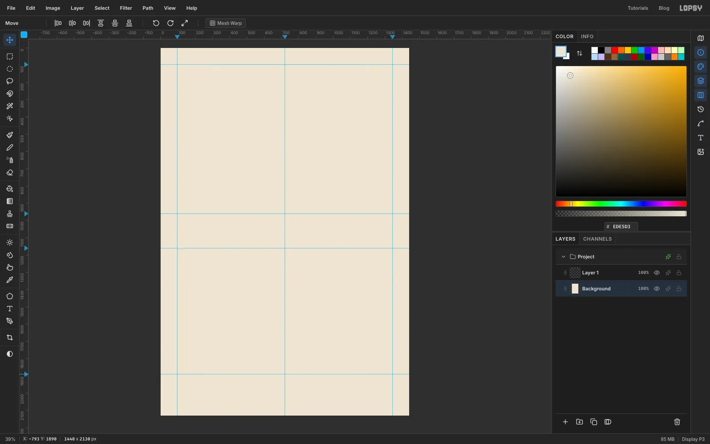

Choose **File → New**, keep the units on **Pixels**, and make the document **1440** wide and **2130** high.

Click the top ruler to drop vertical guides at **96**, **720** and **1344**. The outer two are the page margins and the middle one is the centre line. Click the left ruler to drop horizontal guides at **96** (the bottom of the navigation bar), **960** (the horizon), **1160** (the bottom of the hero) and **1890** (the top of the footer).

Select the *Background* layer, set the foreground colour to bone cream `#EDE5D3`, and choose **Edit → Fill**. The whole page is now cream. You'll paint the hero and footer over it.

## Paint the night sky

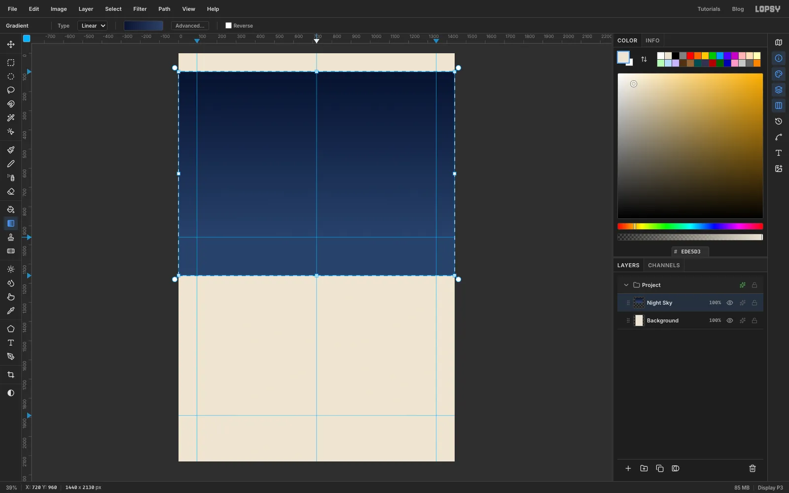

Rename *Layer 1* to *Night Sky* (double-click its name). With the **Rectangular Marquee**, drag from the left edge at the 96 guide to the right edge at the 1160 guide, so the whole hero band is selected.

Choose the **Gradient** tool, set the type to **Linear**, and click **Advanced…**. Make the left stop `#0A1430` and the right stop `#2E4169`. Drag from near the top of the band straight down to the horizon guide at 960, keeping the drag vertical. The sky is darkest overhead and lightens towards the horizon, the way a real night sky does. Press [[Cmd]]+[[D]] to deselect.

While you're here, add the footer. Click **Add Layer**, name it *Footer*, drag a marquee from the 1890 guide to the bottom-right corner, fill it with ink `#15171D`, and deselect.

## Scatter the stars

Select *Night Sky* and add a layer called *Stars*. Choose the **Brush**, set the foreground to `#EDE5D3`, and click single dots across the sky:

- Most of them at Size **4** to **6**.
- A few, maybe one in five, at Size **10**.

Keep three areas clear: the left third of the hero between about y 270 and 930, where the headline and buttons will sit; the middle of the top, where the rain cloud will go; and the right half from about y 340 down to the horizon, where the umbrella will float. Stars poking out behind letters look like stray punctuation.

Set the layer's opacity to **85%** so the stars sit back a little.

## Cut a crescent moon

Add a layer called *Moon*. With the **Elliptical Marquee**, hold [[Shift]] and drag a circle about 92 px across near the top-right corner, centred around (1290, 196).

Now hold [[Option]] and drag a second, slightly smaller circle that overlaps the first but sits a little up and to the right. [[Option]] subtracts it, so only a crescent is left selected. Fill it with `#EDE5D3` and deselect.

Open the layer's effects (the **fx** button on its row), turn on **Outer Glow**, and set Size **40**, Opacity **55** and the colour to amber `#E3A63A`. A warm glow is enough to make the moon feel lit.

## Make one checker tile

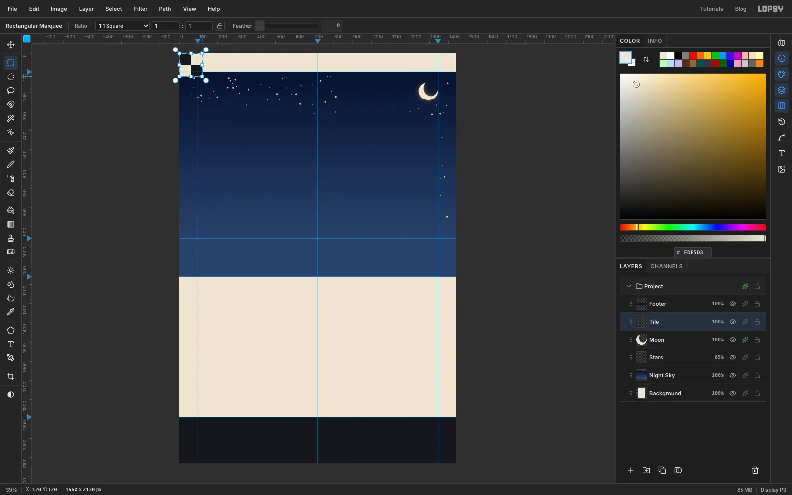

The floor is a classic surrealist checkerboard. You'll make one tile of four squares, save it as a pattern, and repeat it.

Add a layer called *Tile*. With the **Rectangular Marquee**, select a 60 × 60 px square in the very top-left corner. Hold [[Shift]] and add a second 60 × 60 square diagonally below and to the right of it. Fill both with ink `#15171D`.

Select the other two squares the same way (top-right and bottom-left) and fill them with `#EDE5D3`. Then select the whole 120 × 120 block and choose **Edit → Define Pattern**. Lopsy saves the selected pixels as a pattern.

Deselect and delete the *Tile* layer. You don't need it any more.

## Fill the floor with the pattern

Add a layer called *Floor*. Drag a marquee across the full width of the page from the horizon guide (960) down to the bottom of the hero (1160).

Choose **Edit → Fill with Pattern…**, click your checker tile in the grid, and click **Apply**. The band fills with flat rows of squares. Keep the selection active for the next step.

## Pull the floor into perspective

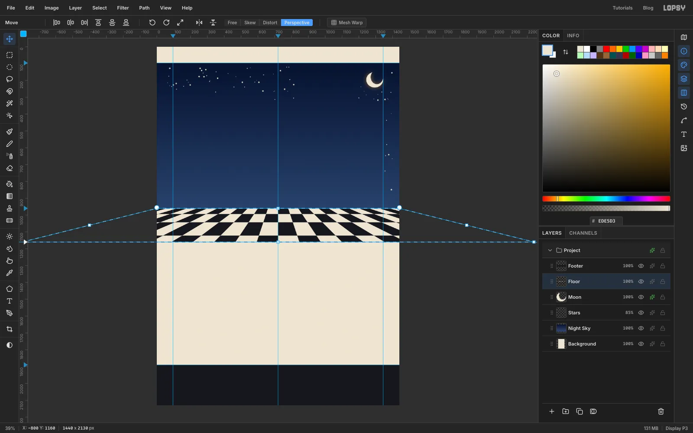

Zoom out ([[Cmd]]+[[-]]) until there's plenty of grey space to the left of the canvas. Choose the **Move** tool. Because a selection is active, the options bar shows the transform modes. Click **Perspective**.

Grab the handle at the **bottom-left** corner of the band and drag it to the left, far past the edge of the canvas (to about x = −800). In Perspective mode, the bottom-right corner moves the same distance the opposite way. The top edge stays on the horizon, so the squares fan out and grow taller as they come towards you. That reads as a flat plain stretching away.

Press [[Enter]] to apply and [[Cmd]]+[[D]] to deselect.

## Fade the floor into the horizon

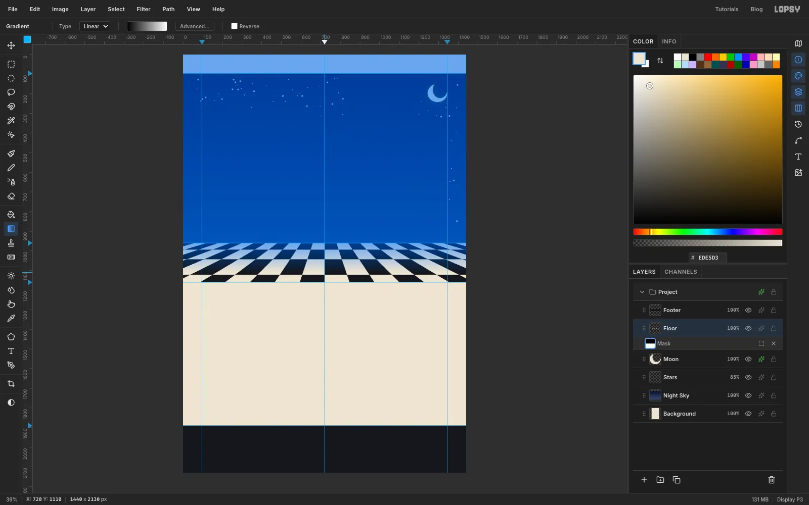

A hard edge at the horizon looks pasted on. With *Floor* selected, click **Add Mask** at the bottom of the Layers panel, then click the new mask thumbnail to edit the mask. The canvas turns blue while you're painting into a mask. That's normal.

Choose the **Gradient** tool, click **Advanced…** and set the stops to black on the left and white on the right. Drag from the horizon guide (960) straight down about 150 px. Black hides and white shows, so the floor now melts into the night haze at the horizon. Click the *Floor* layer's name to stop editing the mask.

## Draw the canopy with the Pen

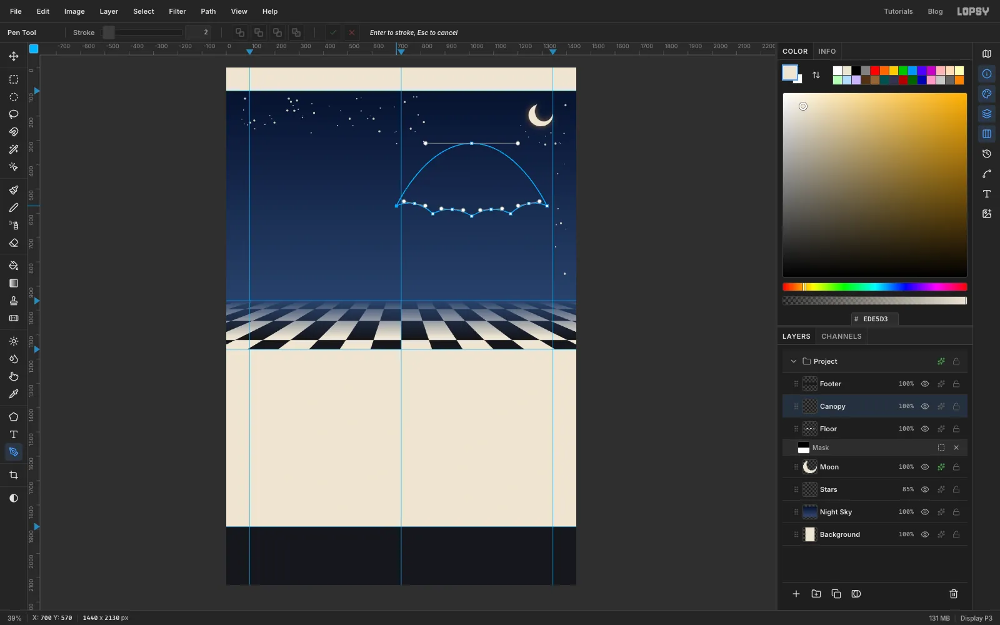

Add a layer called *Canopy* above *Floor*. Choose the **Pen** tool. Click to place a sharp corner, or click and drag to place a smooth point with handles. You'll go round the canopy clockwise, starting at its left tip. It's about 620 px wide and 300 px tall, in the right half of the hero:

1. Click the left tip of the canopy, just right of the centre guide, at about (700, 570).
2. Click and drag at the very top of the dome, above the centre (x 1010, y 312). Drag the handle straight to the right, about 190 px. This gives the dome its rounded crown.
3. Click the right tip, level with the left one (x 1320).
4. Now come back along the hem, right to left. The hem has three rib tips between the two outer tips, spaced evenly about 160 px apart. The middle one is the lowest, about 40 px below the outer tips; the other two are about 30 px below them. Between each pair of tips there's a scallop: click and drag at the middle of each scallop, roughly 25 px higher than the tips either side, pulling the handle to the left, then click the next rib tip. That's four scallops and three rib tips.
5. Click the first point again to close the shape.

The hem curves *up* between the rib tips. That's what makes it read as fabric stretched between ribs.

## Fill the canopy

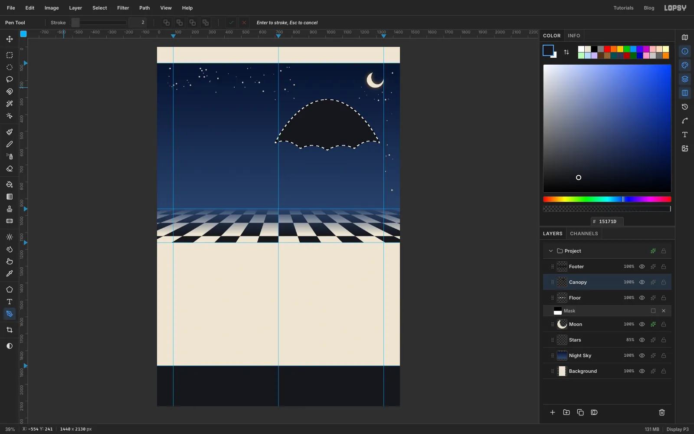

Open the **Paths** panel, click **Path to Selection**, then **Delete Path** (you won't need the outline again).

Fill the selection with ink `#15171D` and deselect. This black shape is the canopy's silhouette. Everything inside the umbrella will be shaped by it.

## Bring in the cloud photo

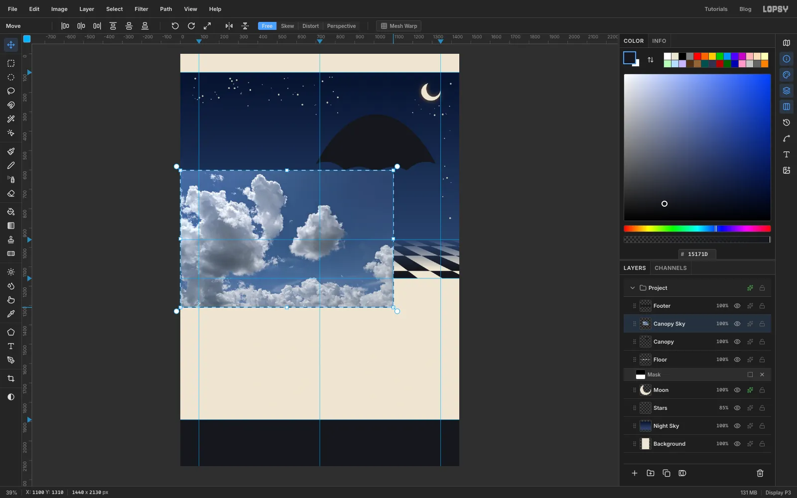

Select *Canopy*, then drag your cloud photo from your desktop onto the canvas. It arrives as a new layer, sized to the page width. Name it *Canopy Sky*.

Hold [[Cmd]] and drag the bottom-right corner handle inward to scale the photo down to about 1100 px wide. [[Cmd]] keeps its proportions. Press [[Enter]].

## Place the cloud in the canopy

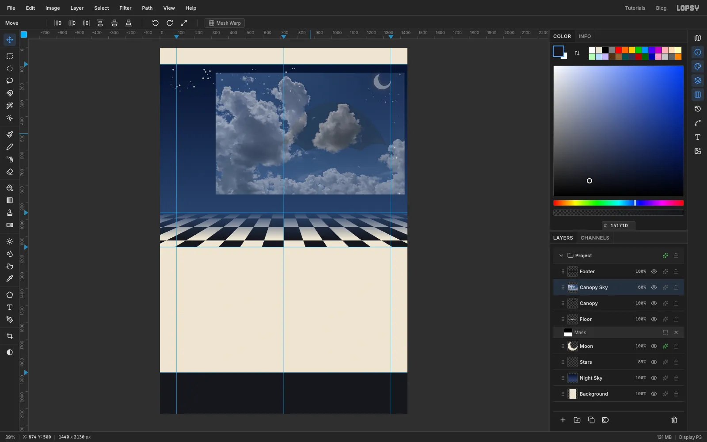

Drop the layer's opacity to **60%** so you can see the black canopy through it. With the **Move** tool, drag the photo until one round, standalone cloud sits in the middle of the canopy, with blue sky around it. A single clear cloud reads far better at this size than a crowd of them.

Put the opacity back to **100%**.

## Paint the photo

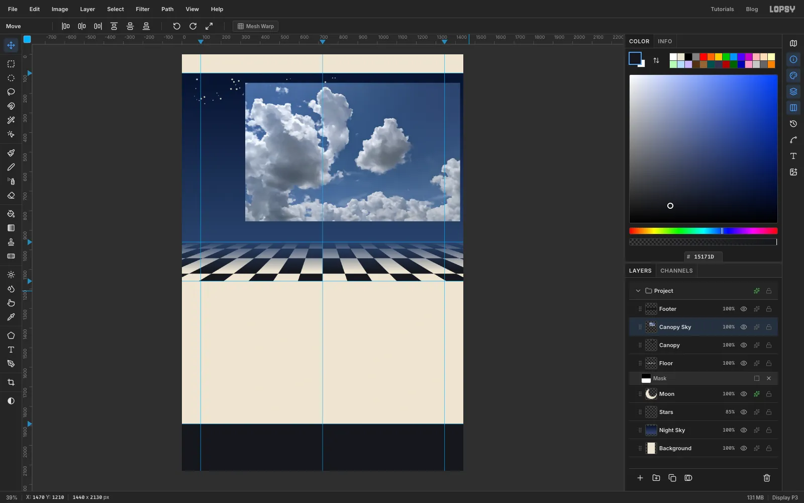

Magritte's skies are painted, not photographed. Choose **Filter → Oil Paint…** and click **Apply** with the default settings (Radius 4, Sharpness 1.5). The clouds lose their fine photographic detail and pick up smooth, brushy forms.

## Load the canopy as a selection

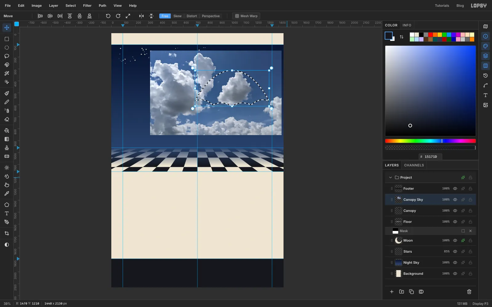

Hold [[Cmd]] and click the *Canopy* layer's thumbnail. Lopsy selects exactly the canopy's shape. Now click the *Canopy Sky* layer's name, so that layer is active and the selection stays.

## Mask the sky to the canopy

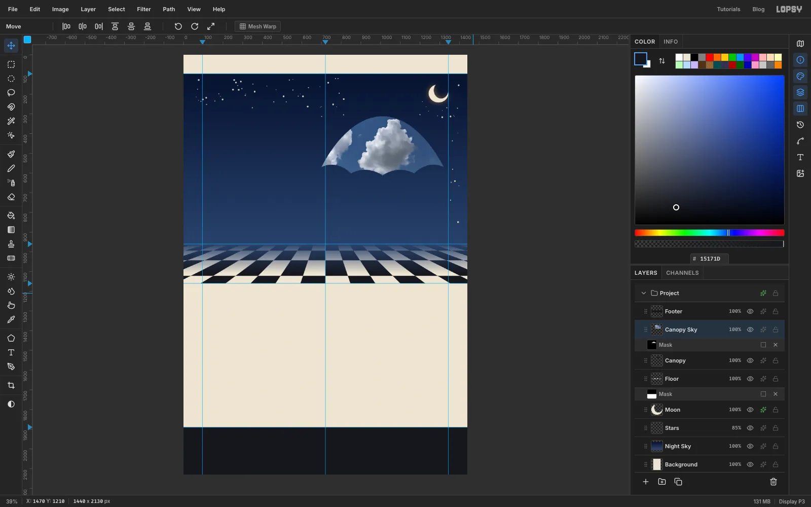

Click **Add Mask**. Because a selection is active, the mask shows only what's inside it: the sky now appears inside the umbrella and nowhere else. Deselect.

That's the whole surrealist trick: a sunny afternoon, cut into the shape of an umbrella, floating in the night. The photo is still all there under the mask, so you can move it later if you want a different cloud to show.

## Shade alternate panels

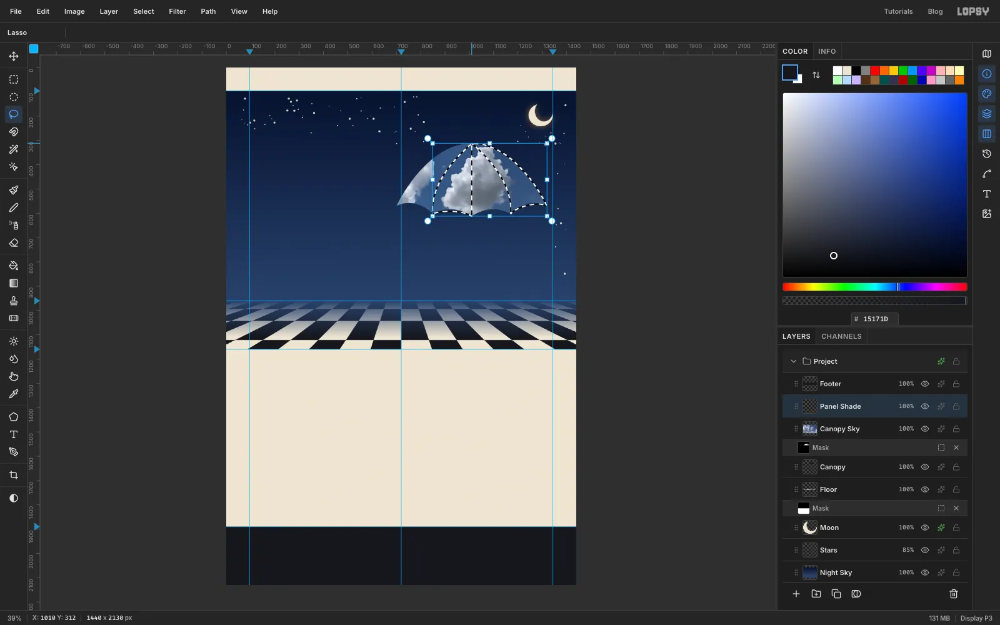

An umbrella's panels catch the light differently. Select *Canopy Sky* and add a layer called *Panel Shade*.

The ribs come in the next step, but you can already see where they'll run: from the top of the canopy down to each rib tip on the hem. With the **Lasso**, trace the second panel from the left: from the top, curve down and slightly outward to the left-hand inner rib tip, follow its scallop to the centre tip, and go straight back up to the top. Hold [[Shift]] and trace the right-most panel too, from the top down the outside edge to the right tip, along the last scallop, and back up from the right-hand inner rib tip. Fill with navy `#14224A`.

The lasso is a little rough at the edges, so trim it. [[Cmd]]-click the *Canopy* thumbnail, select *Panel Shade* again, choose **Select → Inverse** and press [[Delete]]. Deselect, set the blend mode to **Multiply** and the opacity to **28%**.

## Draw the ribs

Add a layer called *Ribs* and set the foreground to `#14224A`. Choose the **Pen** tool and set **Stroke** to **3** in the options bar.

For each of the three inner rib tips, click the top of the canopy, then click and drag at the rib tip, pulling the handle a little outward and down so the rib bows out. Press [[Enter]] and the Pen strokes the line in the foreground colour. The middle rib is just two clicks, so it's straight.

> **Tip:** After each rib, delete its path in the **Paths** panel. The next rib starts at the same tip, and clicking the end of a selected open path continues that path instead of starting a new one.

Set the *Ribs* layer to **60%** opacity.

## Add the shaft and crook

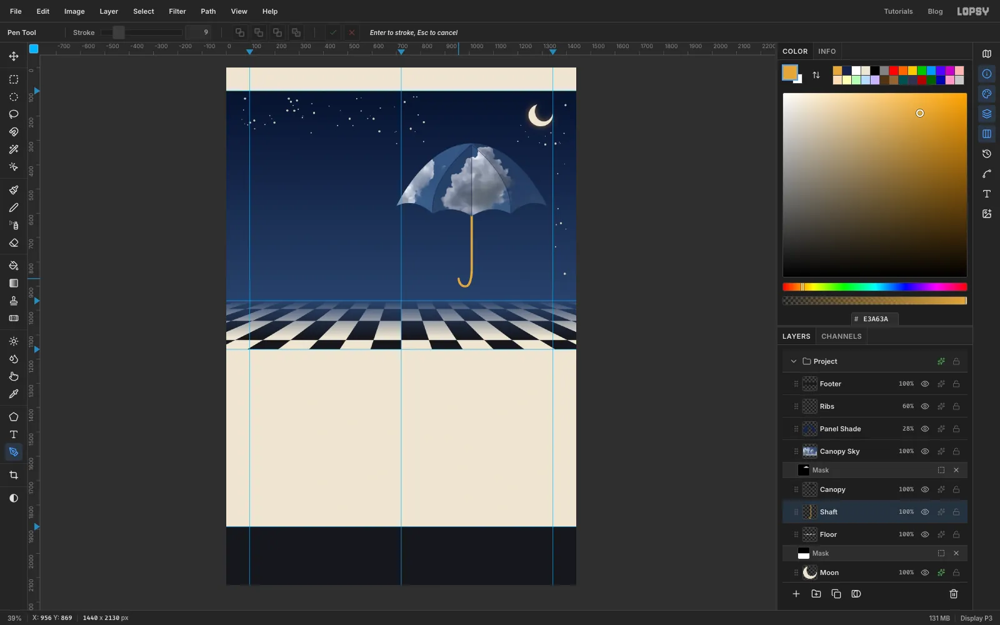

Select *Floor* and add a layer called *Shaft*, so it sits under the canopy. Set the foreground to amber `#E3A63A`, choose the **Pen**, and set **Stroke** to **9**.

Draw the shaft and handle as one path:

1. Click under the middle of the canopy, a little above the hem.
2. Click straight below it, about 270 px further down.
3. Click and drag about 70 px lower and 25 px to the left, at the bottom of the crook, pulling the handle to the left.
4. Click the tip of the crook, about 30 px further left and 30 px up, so the hook curls back on itself.

Press [[Enter]] and delete the path. Drawing the shaft and hook as one stroke keeps them the same width and colour where they meet.

## Finish the umbrella

Select *Ribs* and add a layer called *Finial*. Drag a small upright oval, about 16 × 32 px, over the tip of the canopy with the **Elliptical Marquee**, fill it with amber and deselect.

Select *Canopy*, open its effects, and turn on **Stroke**: Width **2**, colour `#F3EAD8`. The black silhouette is hidden under the photo, so only this thin cream rim shows around the edge.

Select *Canopy Sky* and turn on **Inner Glow**: Size **40**, Opacity **60**, colour `#14224A`. The edges of the canopy darken, so it looks rounded rather than flat.

## Cut out a rain cloud with Quick Selection

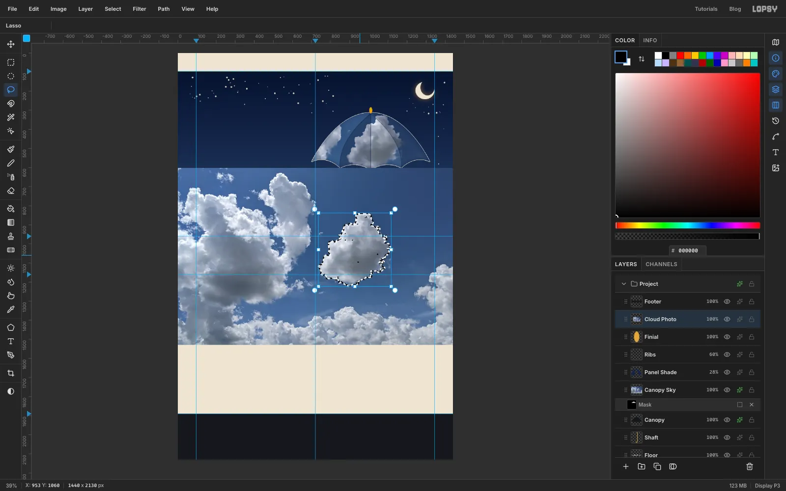

Select *Finial* and drag the same cloud photo onto the canvas again. Name this layer *Cloud Photo*.

Choose **Quick Selection** and set **Tolerance** to **22**. Paint a stroke through the bright parts of the standalone cloud, then a second stroke across its right side. The selection grows to the cloud's edges and stops at the blue.

> **Tip:** Keep the Tolerance low. The darkest grey shadows inside a cloud are close to the colour of the sky, and at the default 32 the selection leaks out into the blue. If a dark pocket in the cloud is missed, hold [[Shift]] and lasso around it to add it.

Then tidy the edge: **Select → Grow** by **3**, then **Select → Shrink** by **3**. Growing and shrinking by the same amount fills any pinholes inside the cloud. Finish with **Select → Feather** of **1** for a soft edge.

## Paste and squash the cloud

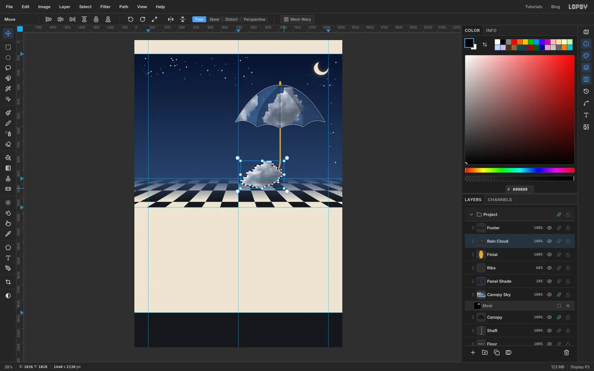

Press [[Cmd]]+[[C]] and [[Cmd]]+[[V]]. The cloud is pasted onto a new layer of its own. Name it *Rain Cloud* and delete the *Cloud Photo* layer.

Choose the **Move** tool and [[Cmd]]-click the *Rain Cloud* thumbnail to show its transform handles. Drag the bottom-right handle *without* [[Cmd]] so you can change its shape: about 300 px wide and 190 px tall. A flatter cloud looks heavier with rain. Press [[Enter]] and deselect. Then drag the cloud up above the umbrella, centred over its tip with its top about 40 px below the navigation bar, and fine-tune with the arrow keys.

## Turn the cloud grey

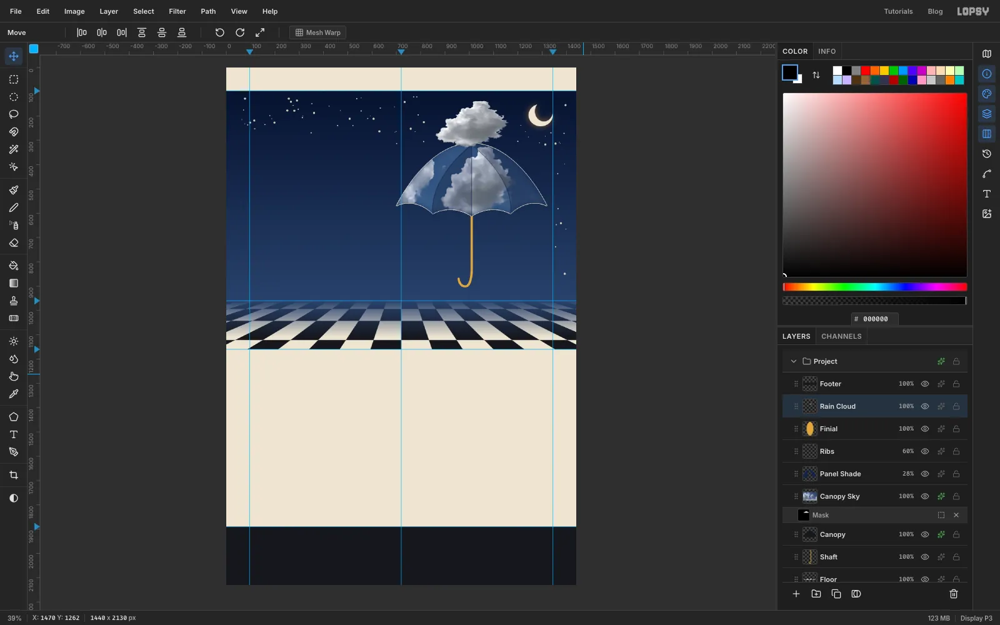

Choose **Filter → Hue/Saturation…** and set Saturation **−55** and Lightness **+4**. The blue drains out of the cloud's shadows and it turns a soft silver grey, a rain cloud. It's still made of the same photo as the canopy sky, so the two are lit the same way and look like they belong together.

## Group and lower the umbrella

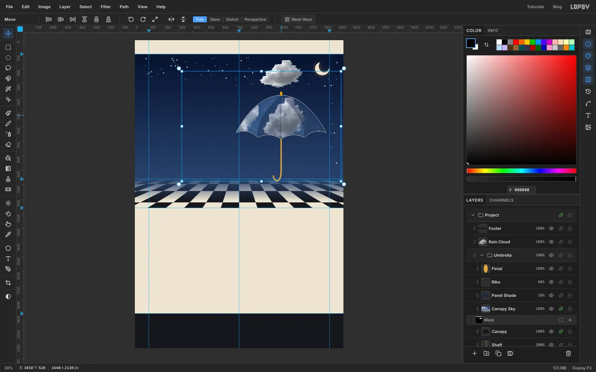

The umbrella needs a little more room under the cloud. Click the *Shaft* layer, [[Shift]]-click *Finial*, and choose **Layer → Group Layers**. Name the group *Umbrella*.

With the group selected, use the **Move** tool to drag everything straight down by about 70 px, or press [[Shift]]+[[Down]] seven times. The canopy, the masked photo, the ribs and the handle all move together, and the mask moves with its photo.

## Make it rain

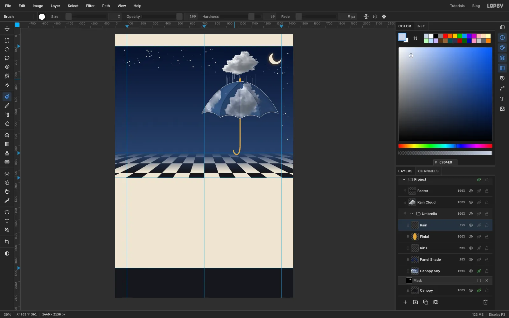

Select *Finial* (inside the group) and add a layer called *Rain*. Choose the **Brush**, set Size **2** and the foreground to `#C9D4E8`.

Each raindrop streak is a click just under the cloud, then a [[Shift]]-click straight below it, which paints a straight line. Draw about 30 of them across the width of the cloud:

- Space them unevenly and start them at slightly different heights.
- Run most of them right down to the canopy, and stop a few short.
- Paint a few at Size **1** for variety.
- Lower the brush **Opacity** to about **40%** for the streaks near the left and right ends, so the rain fades out at its edges. Use 80–90% in the middle.

To make sure nothing lands *on* the canopy, [[Cmd]]-click the *Canopy* thumbnail, select *Rain* again, press [[Delete]], and deselect. Set the layer to **75%** opacity.

## Cast a shadow on the floor

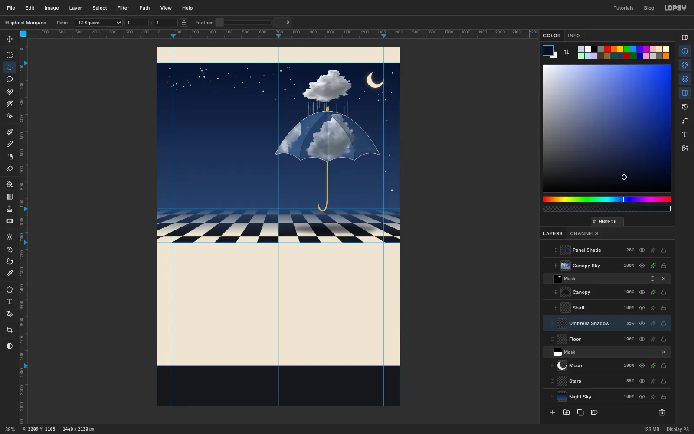

A shadow on the ground is what makes something look like it's floating. Select *Floor* and add a layer called *Umbrella Shadow*.

Drag an oval about 500 × 48 px with the **Elliptical Marquee**, on the floor below the umbrella and a little to the right, centred around (1050, 1080). Fill it with `#0B0F1E` and deselect. Apply **Filter → Gaussian Blur…** with Radius **30**, set the blend mode to **Multiply** and the opacity to **55%**.

## Set the headline

Select *Rain Cloud* and add an empty layer called *Hero Anchor*. New text layers go above it, and having a plain layer selected stops the text options from restyling an existing text layer.

Make the kicker line, *Kicker*: `EST. 1926  ·  ATELIER BRUXELLES` in **Special Elite**, 20 px, amber `#E3A63A`, letter spacing **4** in the **Text** panel. Move its left edge onto the 96 guide, at about y 296.

Select *Hero Anchor* again before every new text layer in the hero. Then the headline, *Headline*, on three lines (press [[Enter]] between them): `Weather,` / `made to` / `measure.` in **Instrument Serif**, **124** px, `#EDE5D3`, letter spacing **0**. In the **Text** panel set **Line height** to **1.0** so the lines sit tight like a printed title. Move it so the top of the W is about 48 px below the kicker and the stem of the W sits on the margin guide. The W's diagonal starts a few pixels further out than its visible stroke, so nudge it 4 px left until it looks aligned.

## Add the subhead and buttons

Type the subhead, *Subhead*, in two lines: `Hand-sewn umbrellas for skies` / `that refuse to behave.` in **Instrument Serif**, 34 px, `#C9D2E3`, Line height **1.3**. Place it 40 px under the headline.

For the buttons, add a layer called *Button Commission* and choose the **Shape** tool. Set Shape to **Rectangle**, Output to **Pixels**, **Corner Radius** to **32**, the fill to amber and no stroke. Shapes grow from where you press, so press at the button's centre and drag out to a corner. The pill is 280 × 60 px, with its left edge on the margin guide and its top 36 px below the subhead, so press at about (236, 858) and drag 140 px right and 30 px down.

Add *Button Collection* and draw a 256 × 60 px pill 24 px to its right, centred at about (528, 858). Remove its fill and give it a `#EDE5D3` stroke, Width **2**.

With *Button Collection* selected, type `Commission yours` (*Label Commission*) in **Special Elite** 21 px, ink, letter spacing **1**, and `The collection` (*Label Collection*) in the same font in cream. Centre each label in its pill with the arrow keys. Zoom in and centre them by eye on the lowercase letters, ignoring the tail of the y: the pill should look as full above the x-height as below it.

## Make a logo mark from the canopy

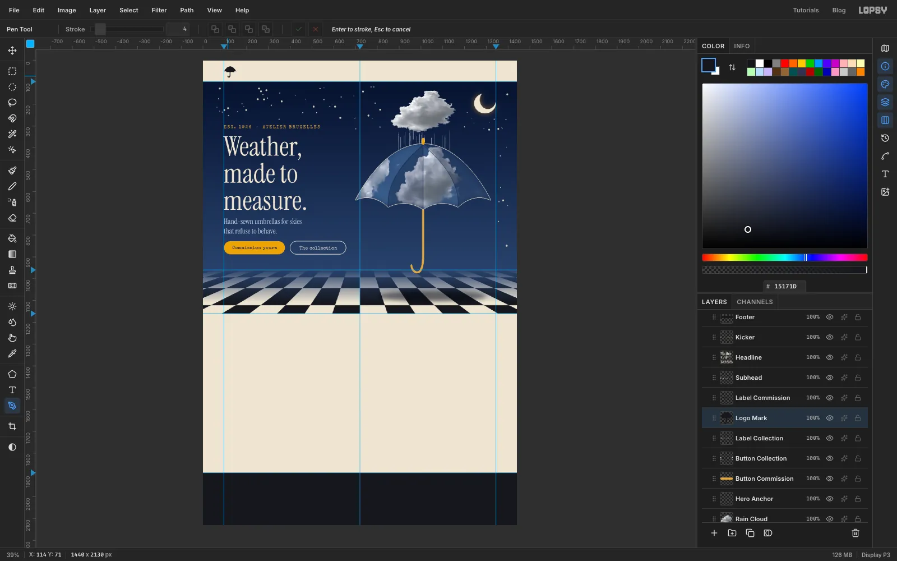

The logo is the same umbrella, small. [[Cmd]]-click the *Canopy* thumbnail, select the *Canopy* layer, and press [[Cmd]]+[[C]]. Deselect, select *Label Collection* (the top hero layer), and press [[Cmd]]+[[V]]. Name the new layer *Logo Mark*.

The black silhouette is pasted on top of the original. Choose the **Move** tool, [[Cmd]]-click its thumbnail, then [[Cmd]]-drag a corner handle to shrink it to 56 px wide. Press [[Enter]] and deselect. Drag the little canopy up into the navigation bar, about 28 px in from the margin guide and centred on y 40, then fine-tune with the arrow keys.

Still on *Logo Mark*, draw a tiny shaft and crook under it with the **Pen** (ink, Stroke **4**), the same way you drew the big one: about 16 px straight down, then a crook about 10 px wide. Press [[Enter]] and delete the path.

## Finish the navigation bar

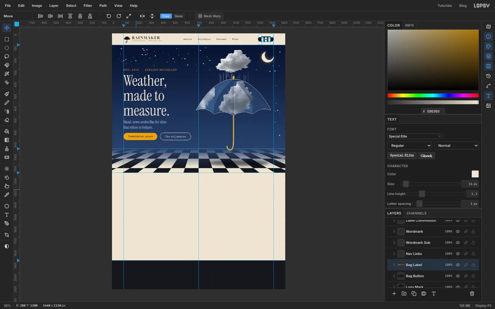

Select *Logo Mark* before each of the next text layers. Next to the logo, type `RAINMAKER` (*Wordmark*) in **Gloock**, 30 px, ink, letter spacing **6**, its left edge at x 168 and its top at y 24. Under it, 10 px lower, type `UMBRELLAS · BRUXELLES` (*Wordmark Sub*) in **Special Elite**, 12 px, `#8A6420`, letter spacing **5**.

Type the links (*Nav Links*) as one line, with eight spaces between each word: `Atelier`, `Collection`, `Forecast`, `Visit`, in **Special Elite**, 17 px, ink, spacing **1**. Centre it on x 820 and vertically in the bar.

For the bag button, select *Logo Mark*, add a layer called *Bag Button*, and draw a 130 × 44 px **Rectangle** with Corner Radius **22** and an ink fill: press at (1279, 48), just inside the right margin guide, and drag 65 px right and 22 px down. With *Bag Button* selected, type `Bag (0)` (*Bag Label*) in **Special Elite**, 16 px, cream, and centre it in the pill.

## Head up the collection

Select *Logo Mark* and add an empty layer called *Section Anchor*. Type `The Collection` (*Collection Title*) in **Instrument Serif**, **76** px, ink. Put its top 96 px below the bottom of the hero (y 1256) with its left edge on the margin.

With *Section Anchor* selected again, type `Three skies, permanently in stock.` (*Collection Note*) in **Special Elite**, 18 px, `#4A4A52`, and right-align it to the 1344 guide. Line its *baseline* up with the bottom of the heading's letters, not its descenders: the y and p hang below the line.

Now copy the finished umbrella for the cards. [[Cmd]]-click the *Canopy* thumbnail, select *Section Anchor*, and choose **Edit → Copy Merged**. Copy Merged copies everything you can see inside the selection (the photo, the panel shading and the ribs) as one flat image. Deselect.

## Build the first card

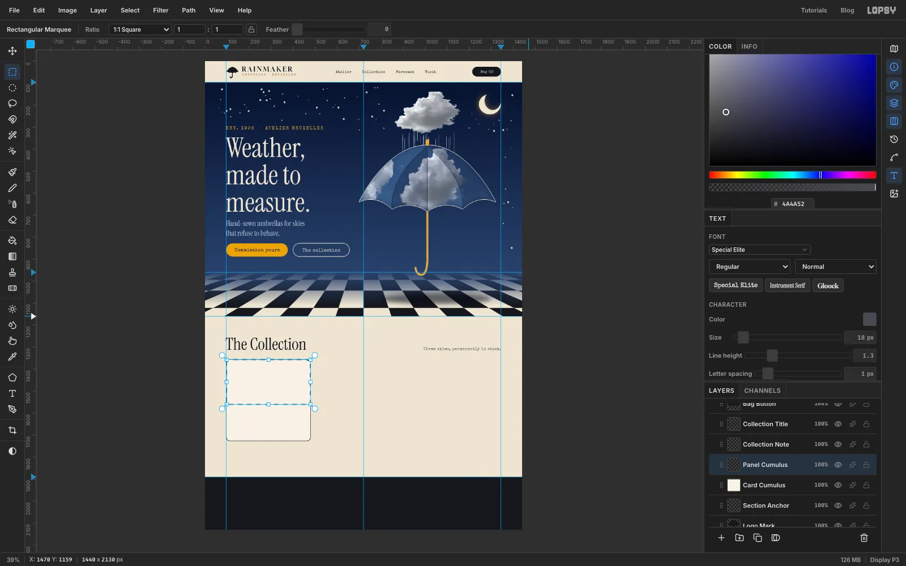

Add a layer called *Card Cumulus*. With the **Shape** tool, draw a **Rectangle** with Corner Radius **18**, fill `#F7F2E7` and an ink stroke of Width **2**. The card is 384 × 370 px with its left edge on the margin guide and its top 44 px below the heading, so press at its centre, about (288, 1541), and drag 192 px right and 185 px down.

The card's top 206 px is a coloured panel for the product picture. Add a layer called *Panel Cumulus*. [[Cmd]]-click the *Card Cumulus* thumbnail to select the card's shape, select *Panel Cumulus*, then choose the **Rectangular Marquee**, hold [[Shift]]+[[Option]] and drag a rectangle from just above and outside the card's top-left corner to just outside its right edge at y 1562. [[Shift]]+[[Option]] *intersects*: only the top of the card stays selected, rounded corners and all.

Choose **Select → Shrink** by **2** so the panel sits inside the card's outline, fill it with pale sky `#CFDDEB`, and deselect.

## Paste in a small umbrella

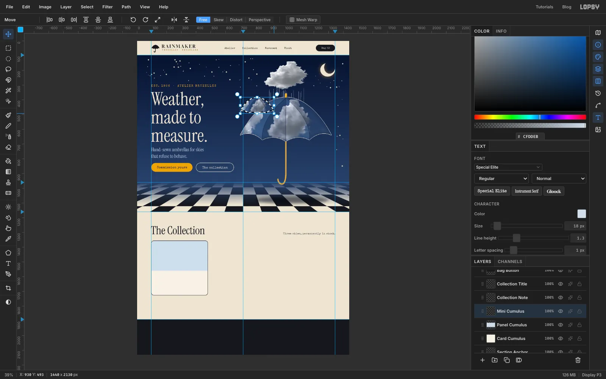

Press [[Cmd]]+[[V]]. The merged umbrella lands on top of the big one in the hero. Name it *Mini Cumulus*. Choose the **Move** tool, [[Cmd]]-click its thumbnail, and [[Cmd]]-drag a corner handle until it's 230 px wide. Press [[Enter]] and deselect. Drag it down into the card's panel, centred on the card and about 74 px below its top, then fine-tune with the arrow keys.

Give it a **Stroke** effect, Width **2**, `#F3EAD8`, the same rim as the big one.

Add a layer called *Shaft Cumulus* and draw its shaft and crook with the **Pen** in amber at Stroke **5**, starting just under the small canopy and ending about 52 px lower.

## Write the card text

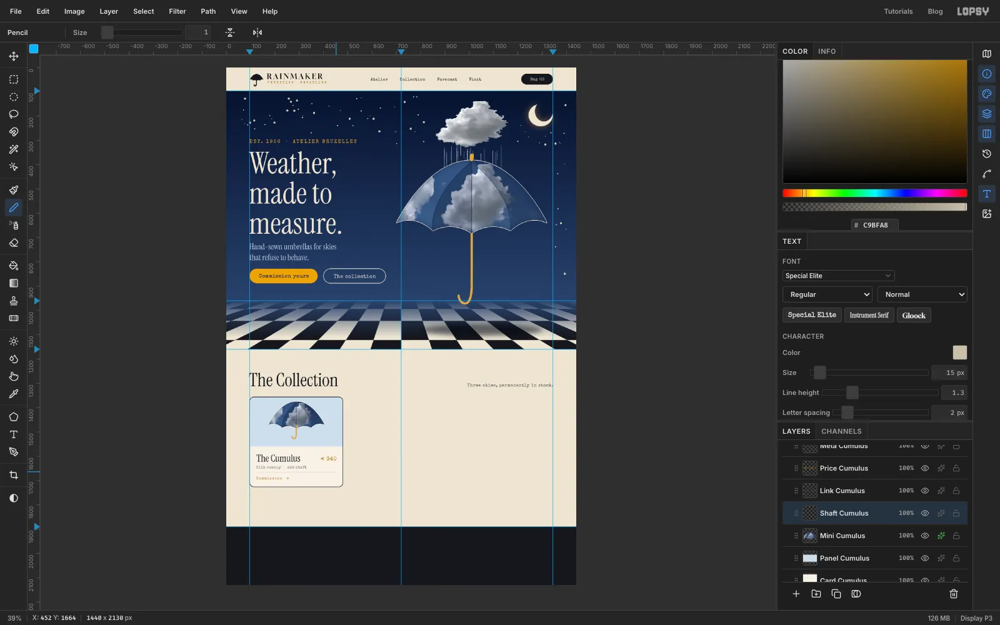

Select *Shaft Cumulus* before typing each line, so the text lands with the card's other layers. Each new line goes in just above the shaft, so the title you type first ends up on top. Type the card's text, 28 px in from its left and right edges:

- `The Cumulus` (*Title Cumulus*) in **Instrument Serif**, 40 px, ink, its top 236 px below the card's top.
- `€ 340` (*Price Cumulus*) in **Special Elite**, 22 px, `#A16A12`, right-aligned and centred on the title's height.
- `Silk canopy  ·  ash shaft` (*Meta Cumulus*) in **Special Elite**, 15 px, `#55555E`, spacing **1**, 18 px under the title.
- `Commission  →` (*Link Cumulus*) in **Special Elite**, 15 px, `#A16A12`, spacing **2**, 328 px below the card's top.

Between the specifications and the link, select *Shaft Cumulus* again, choose the **Pencil** at Size **1** with `#C9BFA8`, click 28 px in from the left at y 1664 and [[Shift]]-click 28 px in from the right. That draws a hairline rule.

## Make the other two cards

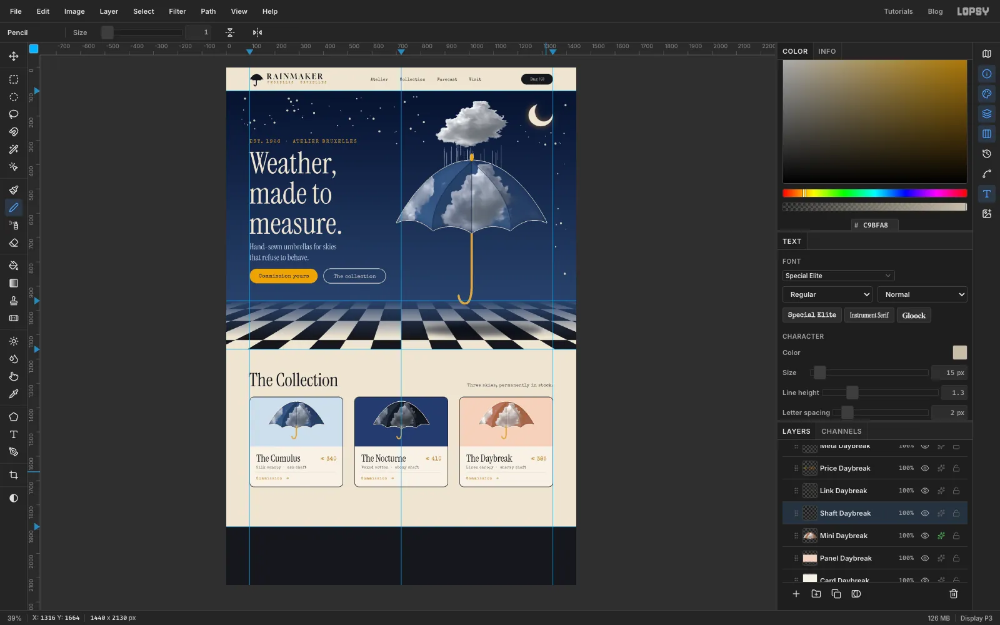

Build *The Nocturne* (x 528) and *The Daybreak* (x 960) exactly the same way. Paste the same merged umbrella each time. What changes is the panel colour, the umbrella's colour and the text (use the card's name in each layer name, like *Panel Nocturne* and *Title Nocturne*):

- **The Nocturne:** panel `#2A3A6B`. After pasting, apply **Hue/Saturation** with Saturation **−35** and Lightness **−18**, for a moonlit version of the same sky. Specs `Waxed cotton  ·  ebony shaft`, price `€ 410`.
- **The Daybreak:** panel `#F1D2BF`. Apply **Hue/Saturation** with Hue **+160**, Saturation **−10** and Lightness **+18**. The blue sky turns a warm sunrise coral while the white clouds stay white. Specs `Linen canopy  ·  cherry shaft`, price `€ 385`.

Before starting each card, select the previous card's title layer (its topmost layer), so each card's layers stay together in the stack.

> **Tip:** Measure the text positions from the first card, not from each title. "The Daybreak" has a descender (the y), so its text box is taller. If you placed its specifications "18 px under the title" by eye, they'd sit lower than on the other cards.

## Build the footer

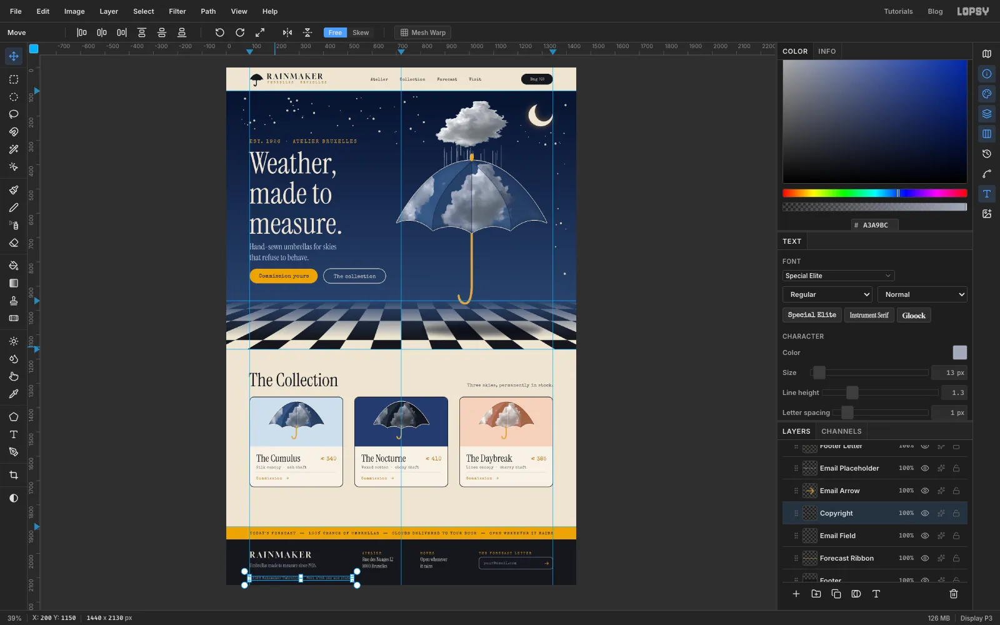

Select *Footer* and add a layer called *Forecast Ribbon*. Fill a 52 px band across the top of the footer with amber. Select *Forecast Ribbon* before each footer text layer. Type `TODAY’S FORECAST  —  100% CHANCE OF UMBRELLAS  —  CLOUDS DELIVERED TO YOUR DOOR  —  OPEN WHENEVER IT RAINS` in **Special Elite**, 16 px, ink, spacing **3**, and centre it in the ribbon.

In the black below:

- `RAINMAKER` in **Gloock**, 34 px, cream, spacing **6**, 102 px below the top of the footer. Under it, 24 px lower, `Umbrellas made to measure since 1926.` in **Instrument Serif**, 21 px, `#A9B0C0`.
- Two columns at x 560 and x 800. Each has a small heading, its top at y 1994, (`ATELIER`, `HOURS`) in **Special Elite**, 13 px, amber, spacing **4**, and two lines under it in **Instrument Serif**, 21 px, cream, Line height **1.3**: `Rue des Nuages 12` / `1000 Bruxelles` and `Open whenever` / `it rains`.
- At x 1040, the heading `THE FORECAST LETTER` at the same height. For the email field, add a layer called *Email Field* and draw a **Rectangle** with no fill, a `#6E7690` stroke of Width **2** and Corner Radius **10**, 304 × 48 px, ending on the right margin: press at about (1192, 2040) and drag 152 px right and 24 px down. With *Email Field* selected, type `your@email.com` in **Special Elite**, 15 px, `#7D8499`, 20 px from the left, and an amber `→` near the right end, both centred vertically.
- A copyright line along the bottom, its top at y 2096: `© 2026 Rainmaker Umbrellas  ·  Ceci n’est pas une pluie.` in **Special Elite**, 13 px, `#A3A9BC`.

## Stick on a best-seller badge

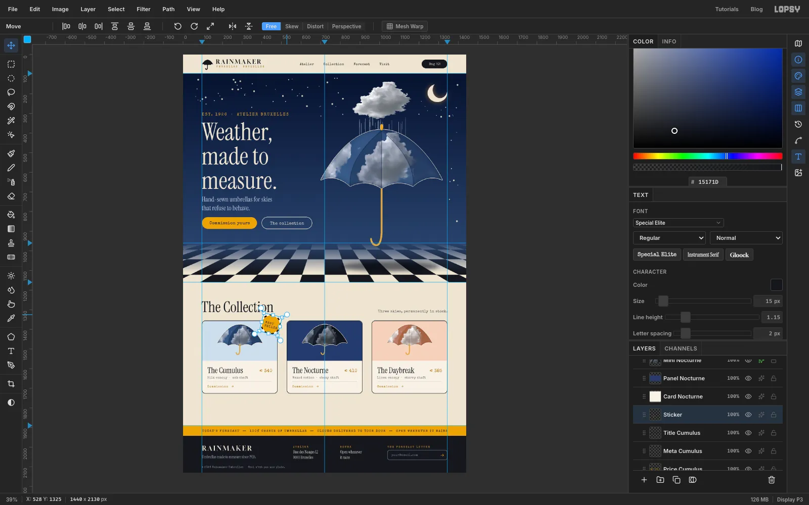

Select *Title Cumulus* and add a layer called *Sticker*. With the **Shape** tool set to **Ellipse**, amber fill and no stroke, draw a 96 px circle that overlaps the top-right corner of the first card.

Type `BEST` / `SELLER` on two lines in **Special Elite**, 15 px, ink, spacing **2**, Line height **1.15**. Centre it in the circle, then nudge it about 3 px right and 2 px down. Letter shapes look off-centre when they're mathematically centred.

Choose **Layer → Merge Down** to merge the text into the circle. [[Cmd]]-click the *Sticker* thumbnail, then drag a rotation handle (just outside a corner) to tilt it about 14°. Press [[Enter]] and deselect. A slight tilt is what makes it look stuck on by hand.

## Add the caption and group the cards

Select *Section Anchor* and type `Ceci n’est pas un parapluie.` ("This is not an umbrella") in **La Belle Aurore**, 40 px, ink. It's a nod to Magritte's famous caption under his painting of a pipe. Centre it on the centre guide, with its top 64 px below the cards.

Now tidy the Layers panel. Click the *Sticker* layer, [[Shift]]-click *Card Cumulus*, and choose **Layer → Group Layers**. Name the group *Cumulus Card*. Group the other two cards the same way, from each title down to its card. Now you can select a card group and nudge the whole card at once.

## Finish with a paper grain

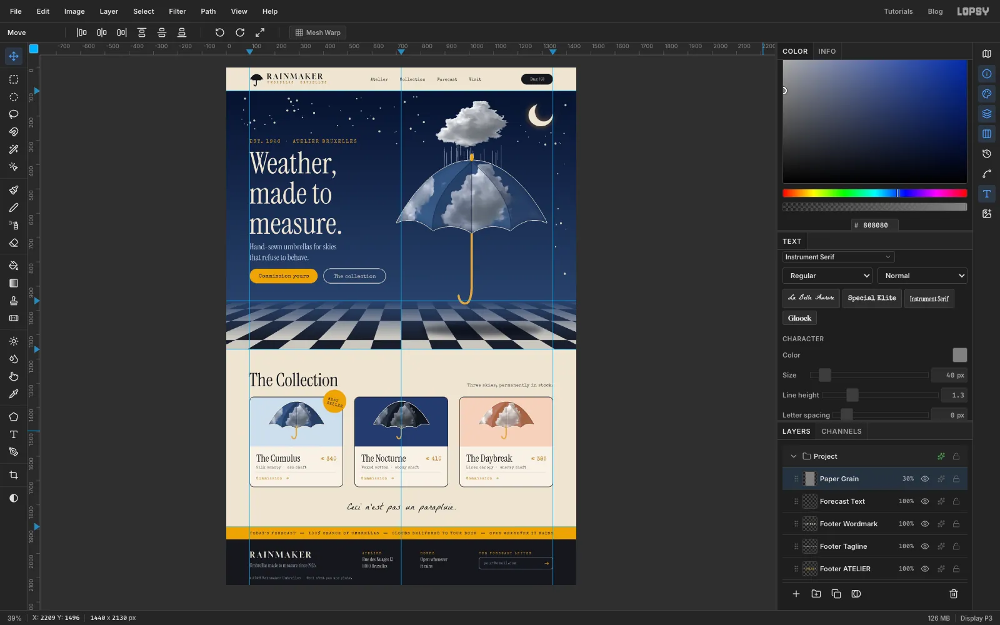

Select *Floor* and lower its opacity to **82%**, so the navy sky shows faintly through the cream squares and the floor feels part of the night.

Finally, select the top layer and add a layer called *Paper Grain*. Fill it with mid-grey `#808080`, then apply **Filter → Add Noise…** with Amount **14**, **Mono** and **Gaussian**. Set the blend mode to **Overlay** and the opacity to **30%**. Overlay leaves mid-grey invisible and shows only the speckle, so the whole page gets a faint printed-paper texture.

Export with **File → Quick Export PNG**, or save the project with **File → Save Project** to keep every layer editable.
