A tattoo flash sheet is a menu of ready-to-tattoo designs. Each design gets
a number and a price, and clients pick one off the wall. This one borrows its
look from **Swiss International Style**, the 1950s Zürich and Basel school of
Josef Müller-Brockmann and Emil Ruder: a strict column grid, flush-left
grotesk type, flat colour and lots of open paper.

You'll make a **1500 × 2000 px** sheet with five jay-themed designs. The
first jay is drawn the way a compass drawing is built: from circles, with the
red construction circles left showing behind it. Then you'll turn a photo into
a three-tone screen-print portrait, draw a notched tail feather, an acorn with
a pattern-filled cap and a round seal with text running around two arcs. A
huge grid-fitted title goes across the bottom.

The palette:

- Paper `#F2EFE8`, ink `#141414`, white `#FFFFFF`
- Jay blue `#3466D1`, sky `#86ABE6`
- Swiss red `#D23C2C`

Type: **IBM Plex Sans** (Regular, Medium and Bold) for everything small, and
**Archivo Black** for the title.

You'll also need a photo of a blue jay for the portrait. This tutorial uses
[Blue Jay by Stephen Rahn](https://commons.wikimedia.org/wiki/File:Blue_Jay_(51206796385).jpg)
from Wikimedia Commons, which is public domain (CC0). Download it at 1280 px
wide.

## Set up the Swiss grid

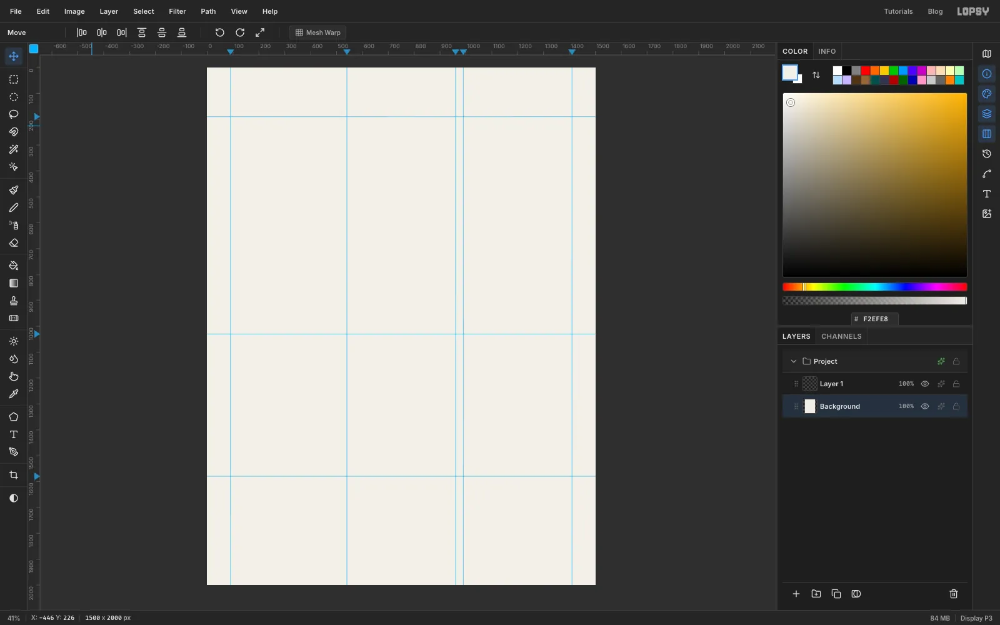

Choose **File → New** and create a **1500 × 2000** document. The grid has
**90 px margins** and six columns, each 195 px wide with 30 px gutters, so
the columns start at x = 90, 315, 540, 765, 990 and 1215.

1. Turn on **View → Show Rulers**.
2. Click the top ruler to drop vertical guides at **90**, **540**, **960**,
   **990** and **1410**. Those are the left margin, the column 3 start, the
   two edges of the gutter before column 5, and the right margin.
3. Click the left ruler to drop horizontal guides at **190**, **1030** and
   **1580**. Those are where the three black rules will go.
4. Select **Background**, set the foreground to `#F2EFE8` and choose
   **Edit → Fill**. With no selection it fills the whole layer.

Every coordinate in this tutorial is in document pixels. The **X / Y**
readout at the bottom left of the status bar shows where the cursor is, so
hover there to find a point before you click.

## Rule the page and set the header

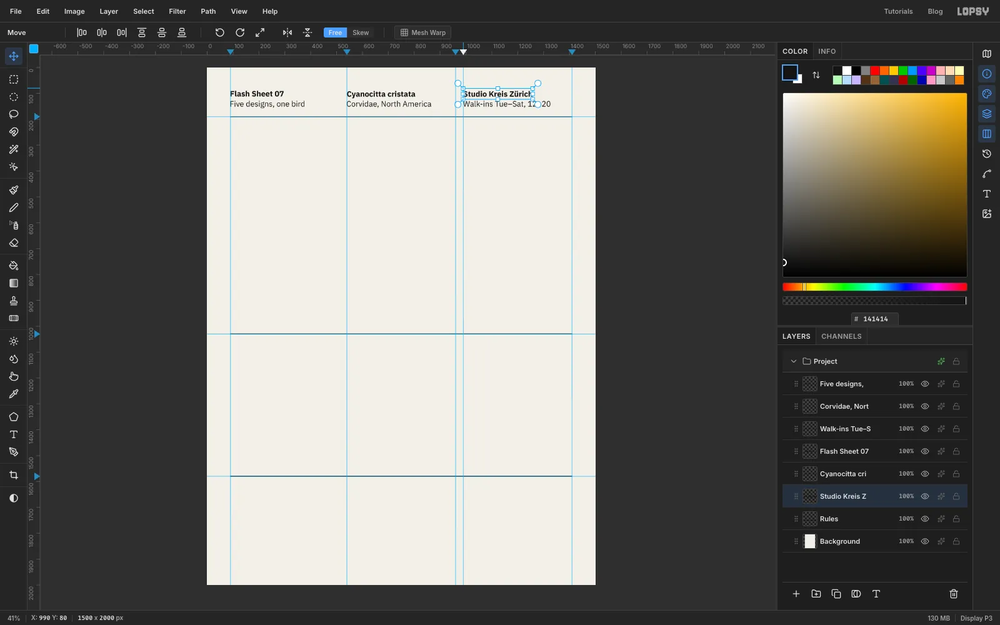

Rename **Layer 1** to **Rules**. Pick the **Pencil** ([[N]]), set **Size**
to **3** and the foreground to `#141414`. For each rule, click the left
margin on the guide, then hold [[Shift]]+[[Cmd]] and click the right margin.
[[Shift]] draws a straight line from the last point, and [[Cmd]] snaps it to
the nearest 15°, so the rule stays dead level from x 90 to x 1410 at y 190,
1030 and 1580.

Now the header. Pick the **Text** tool ([[T]]), set the font to **IBM Plex
Sans**, **Regular** and **30**. Create the lower line of each column first:
a Text click inside an existing line's box edits that line instead of
starting a new one.

- Column 1 at x 90: `Five designs, one bird`
- Column 3 at x 540: `Corvidae, North America`
- Column 5 at x 990: `Walk-ins Tue–Sat, 12–20`

On a Mac, the en dash – is [[Option+-]], the middle dot · is
[[Option+Shift+9]], and Ü is [[Option+U]] then [[Shift+U]]. You'll need them
in the labels and the seal too.

Press [[Tab]] to commit each one, then click the **Rules** layer before you
start the next. With a text layer selected, the Text options restyle it.

Switch to **Bold** and add the upper lines above them: `Flash Sheet 07`,
`Cyanocitta cristata` and `Studio Kreis Zürich`. With the **Move** tool
([[V]]), nudge each line with the arrow keys so the bold caps start at y 90,
the regular caps about 39 px lower, and every line's left edge sits exactly
on its guide. Zoom in and hover the top of a capital to read its Y in the
status bar.

## Draw the compass circles

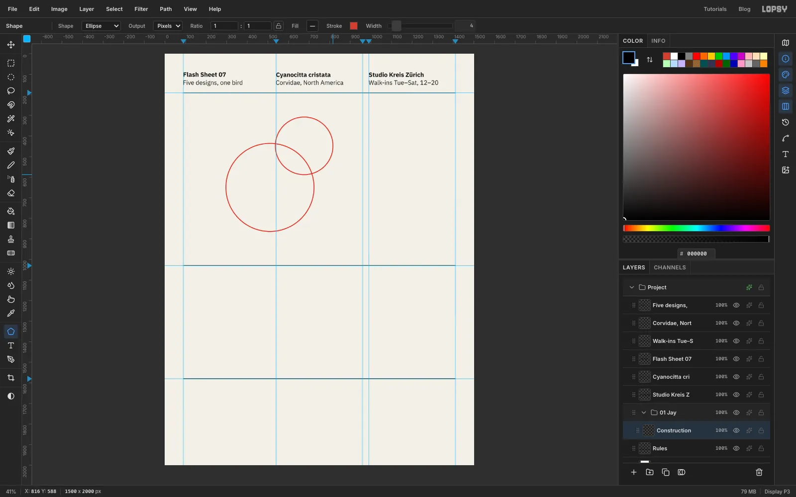

Every part of the jay is a circle, so start with the construction drawing.
With **Rules** selected, click **New Group** in the Layers panel and name it
**01 Jay**. Click **Add Layer** and name the new layer **Construction**. It
goes inside the group.

Pick the **Shape** tool ([[U]]) and set **Shape** to **Ellipse** and
**Output** to **Pixels**. Click the Fill swatch and choose **Remove fill**.
Then click the Stroke **—** button, type `D23C2C` in its hex field, and set
**Width** to **4**.

A shape grows out from where you press, so press at the centre, hold
[[Cmd]] for a perfect circle and drag diagonally down and to the right. The
point you drag to is the corner of the circle's box:

- **Body ring:** press at (510, 650) and drag to (724, 864), a radius of 214.
- **Head ring:** press at (676, 448) and drag to (816, 588), a radius of 140.

These rings sit 30 px outside the body and head you'll draw next, the way
a draughtsman's compass lines frame a drawing.

## Add the cross-hairs

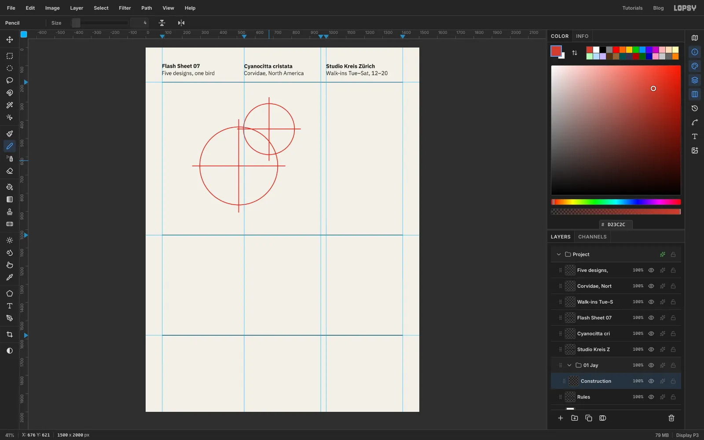

Pick the **Pencil**, set **Size** to **4** and the foreground to
`#D23C2C`. Draw a horizontal and a vertical line through each centre with
click, then [[Shift]]+[[Cmd]]+click:

- **Body:** from x 256 to x 764 at y 650, and from y 396 to y 904 at x 510.
  That runs 40 px past the ring on every side.
- **Head:** from x 503 to x 849 at y 448, and from y 275 to y 621 at x 676.

Keep the overshoot the same on all four arms. Uneven arms are the first
thing that makes a construction drawing look sloppy.

## Draw the tail with the Pen

Click **Add Layer** and name it **Tail**. The tail is a straight bar 78 px
wide and about 260 px long, angled down to the left at 138°.

Pick the **Pen** tool ([[P]]) and click its four corners without dragging,
so each one is a sharp corner: two corners side by side under the body
circle near (374, 750) and (426, 808), then two at the far end near
(231, 983) and (179, 925). Click the first corner again to close the path.

Open the **Paths** panel, click **Path to Selection**, then **Delete Path**
so the outline doesn't get in the way. Set the foreground to `#3466D1` and
choose **Edit → Fill**.

## Bar the tail and add its white tip

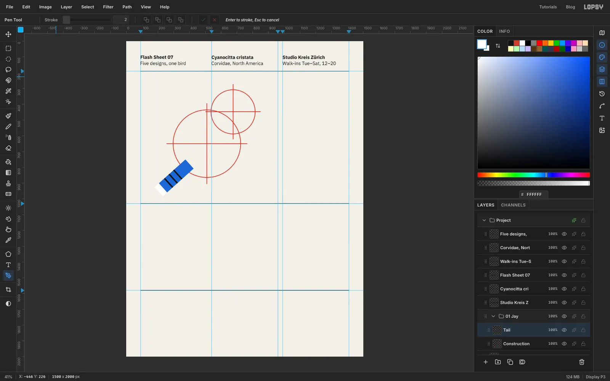

Leave the tail selection on, because it will clip the brush. Pick the
**Brush** ([[B]]). Open the brush settings and set **Size 10**, **Hardness
100** and **Spacing 5**. Set the foreground to `#141414`. Draw three bars
straight across the tail, spaced evenly along its middle, by clicking just
outside one long edge and [[Shift]]+clicking just outside the other. The
selection trims the ends.

Press [[Cmd+D]]. For the tip, draw a second four-corner Pen path covering the
last 14 % of the tail, with corners at (207, 900), (259, 958), (231, 983) and
(179, 925). Turn it into a selection,
delete the path, and fill it with `#FFFFFF`. A filled selection gives a
hard edge. A big brush stroke would leave a soft one.

## Cut the belly from the body

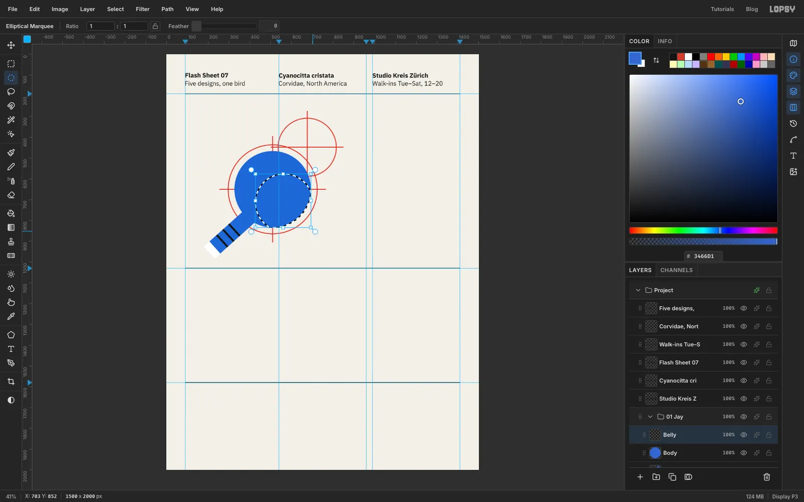

Click **Add Layer** and name it **Body**. Pick the **Elliptical Marquee** and
click once on the canvas without dragging to open the exact-corners dialog.
Enter **From** 326, 466 and **To** 694, 834. That's a circle of radius 184
on the body centre. Fill it with `#3466D1`.

Click **Add Layer** and name it **Belly**. Make the same body circle again,
then hold [[Shift]]+[[Option]] and drag a second circle centred on (565, 714)
with a radius of 138, from (427, 576) to (703, 852). [[Shift]]+[[Option]]
*intersects*, so you're left with only the part of the belly circle that's
inside the body. Fill it with `#FFFFFF`.

## Stripe the wing

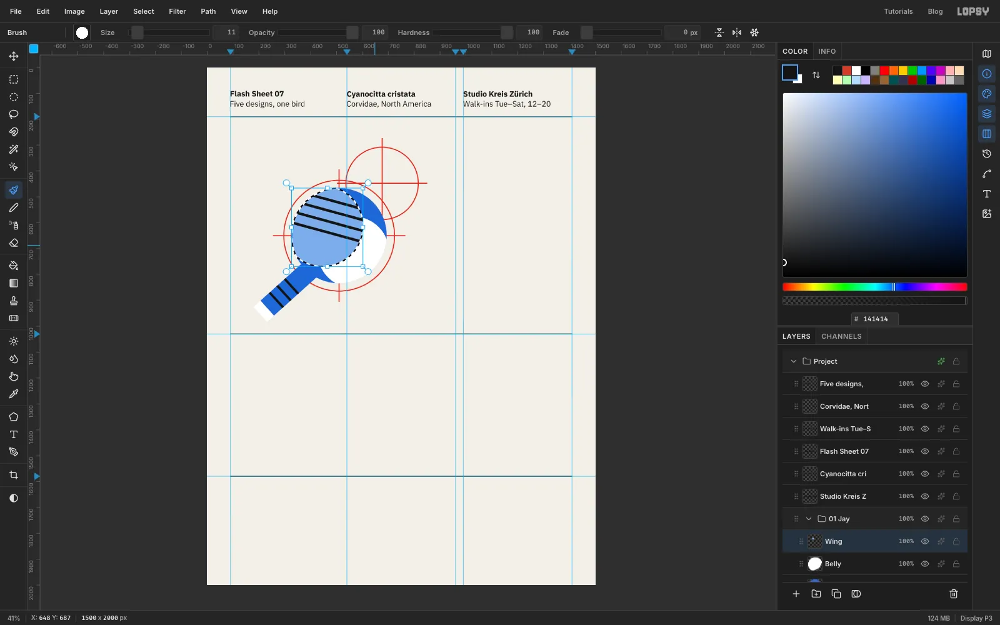

Click **Add Layer** and name it **Wing**. Make the body circle once more and
[[Shift]]+[[Option]]-drag the wing circle from (290, 457) to (602, 769):
centre (446, 613), radius 156.
Fill it with `#86ABE6`.

Keep the selection. Set the Brush **Size** to **11** and the foreground to
`#141414`. Draw four parallel bars that slope gently down to the right
across the wing, about 42 px apart, with click and [[Shift]]+click. Start and
end each one outside the wing so the selection makes a clean cut.

## Dot the wing

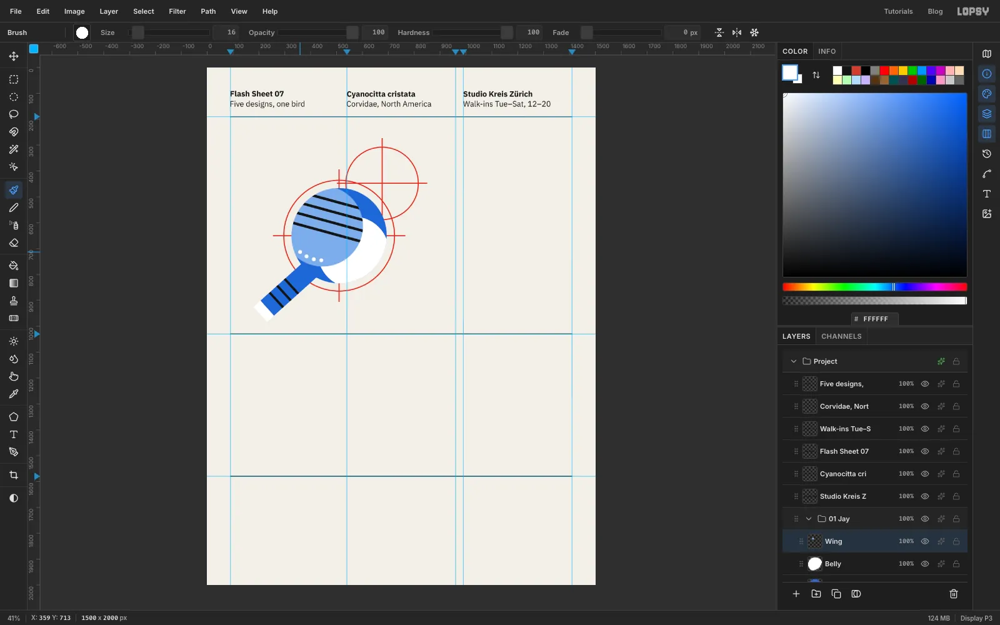

Press [[Cmd+D]]. Set the Brush **Size** to **16** and the foreground to
`#FFFFFF`. Click four dots in a gentle curve about 24 px inside the wing's
lower left edge, each about 30 px from the last. Real jays have white tips
on these feathers. Keep the dots fully inside the wing: a dot that touches
the outline looks clipped once the outline goes on.

## Build the head and the collar

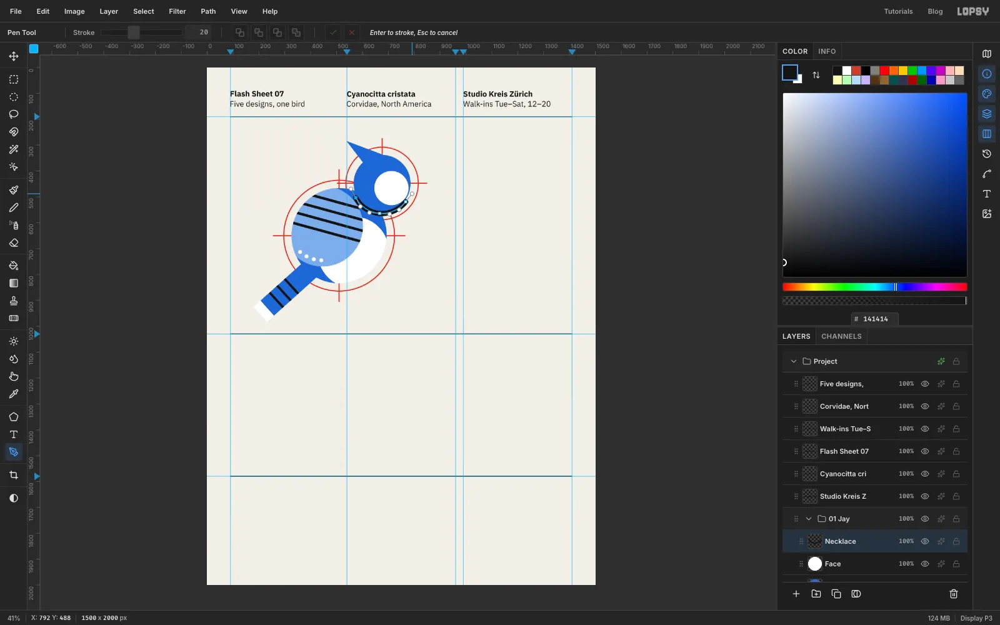

Add three more layers, one per shape:

1. **Crest.** Click three Pen corners: the crest tip at (538, 284), then
   (690, 341) and (609, 376) inside the head circle. Close the path, turn it
   into a selection, delete the path and fill it with `#3466D1`.
2. **Head.** A circle from (566, 338) to (786, 558), radius 110, filled with
   `#3466D1`. Use the Elliptical Marquee's exact-corners dialog.
3. **Face.** A circle from (646, 400) to (778, 532), radius 66, filled with
   `#FFFFFF`. Press [[Cmd+D]].

For the black collar, click **Add Layer** and name it **Necklace**. Set the
foreground to `#141414` and the Pen's **Stroke** to **20**. Draw a smooth
arc around the bottom of the head, 116 px from its centre, with three
anchors. At each one, press and drag a handle about 40 px along the
direction of travel, left to right:

- (574, 502), about 8 o'clock, handle dragged down and to the right
- (666, 564), about 6 o'clock, handle dragged straight right
- (767, 519), about 4 o'clock, handle dragged up and to the right

Press [[Enter]]. Enter strokes the open path with the
foreground colour, and the ends come out round. Delete the path in the
**Paths** panel afterwards.

## Add the eye, beak, perch and legs

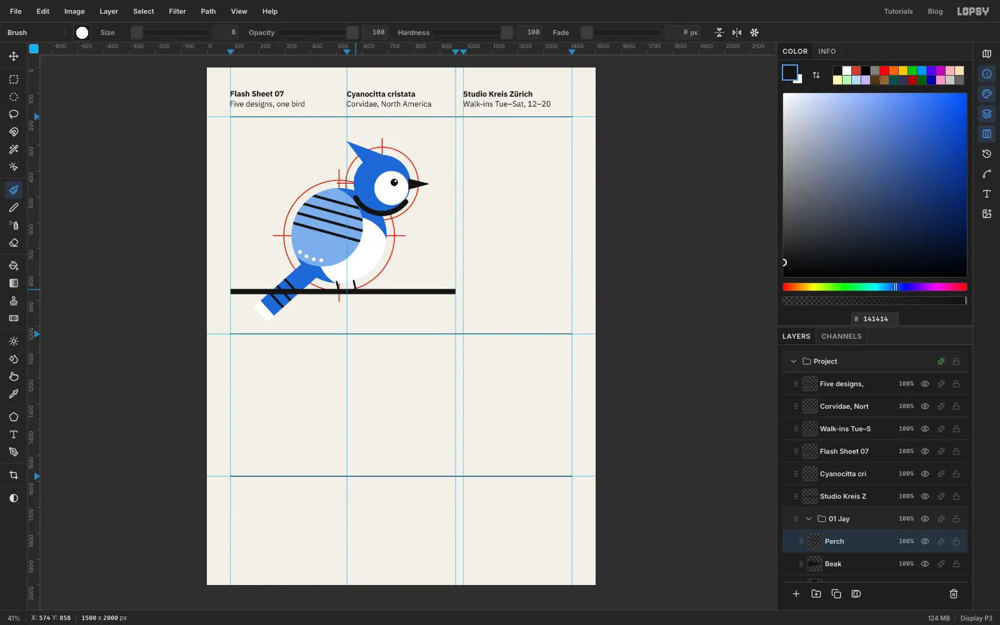

Give each of these its own layer, named **Eye**, **Beak** and **Perch**, and
draw the legs on **Perch**.

1. **Eye:** a black circle from (709, 430) to (737, 458), plus a white
   catchlight from (724, 435) to (732, 443), just up and to the right of its
   centre.
2. **Beak:** a three-corner Pen path from (777, 429) to the tip at
   (860, 450) and back to (777, 472), filled black.
3. **Perch:** click the **Rectangular Marquee** once for its dialog, enter
   **From** 90, 856 and **To** 960, 876, and fill it black. The perch runs
   from the left margin to the end of column 4, so the tail clearly hangs
   behind it.
4. **Legs:** set the Brush **Size** to **8**. Draw two short black lines
   from the bottom of the body down to the perch.

## Line the jay

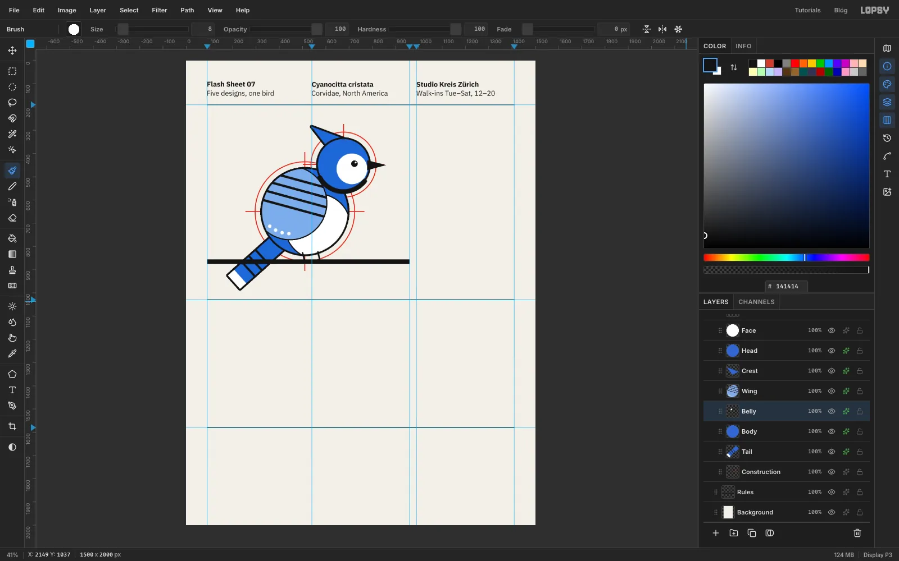

Tattoo flash needs strong, even black lines. Select the **Tail** layer,
click its **✦** (layer effects) button and turn on **Stroke**. Set the
colour to `#141414`, **Width** to **8** and **Position** to **outside**.
Do the same for **Body**, **Crest** and **Head**.

Give **Wing** and **Belly** a **Width** of **5** instead. Lighter interior
lines keep the outer contour as the strongest line, which is how flash is
lined.

## Drop in the reference photo

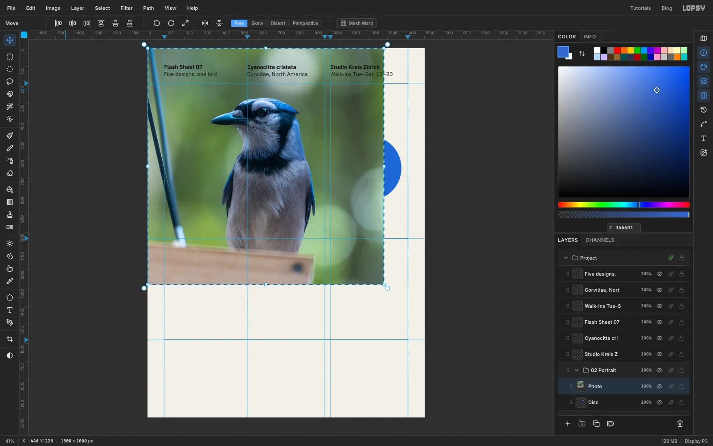

Collapse **01 Jay** with its arrow and keep the group row selected. Click
**New Group** and name it **02 Portrait**. Because **01 Jay** is collapsed,
the new group lands beside it instead of inside it.

Click **Add Layer**, name it **Disc**, and fill a circle from (1025, 475) to
(1375, 825) with `#3466D1`. Press [[Cmd+D]]. The disc's centre lines up with the jay's
horizontal axis.

Drag the jay photo from Finder onto the canvas. It lands at full size in the
top-left corner, already selected. Rename it **Photo**.

## Scale the photo

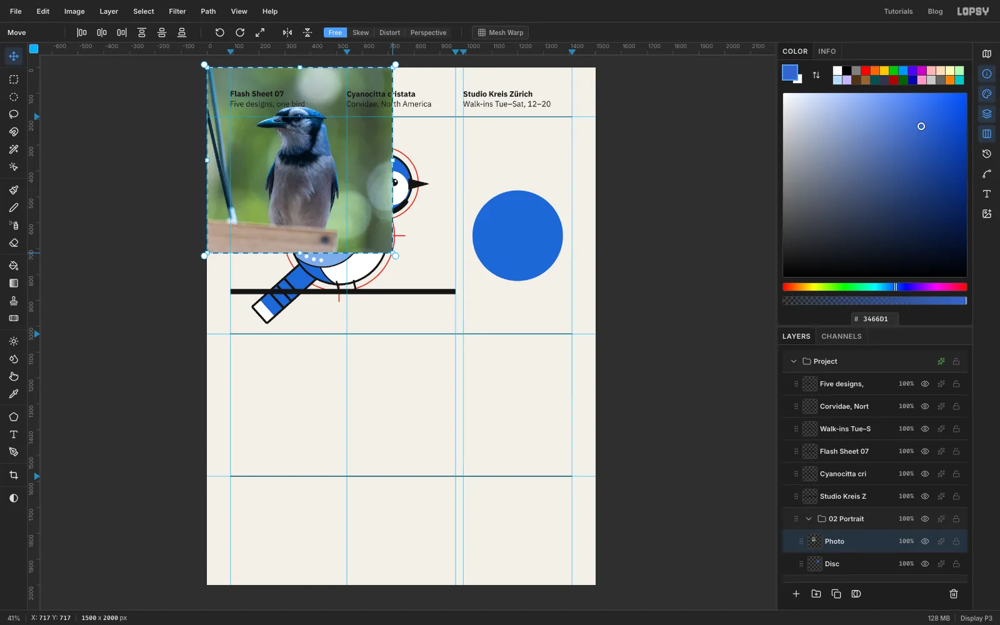

With the **Move** tool, hold [[Cmd]] and drag the photo's bottom-right
corner handle up and to the left until it's about **56 %** of its size,
roughly 716 px wide. [[Cmd]] keeps the proportions. Press [[Cmd+D]] to
commit the transform.

Drag the photo over to the blue disc so the jay's head is centred on it. Aim
for the crest tip about 40 px inside the top of the disc and the beak tip
about 30 px inside the left edge. The photo hangs past the canvas edge on the
right. That's fine, and the next step deals with it.

## Blur the photo and cut it into a disc

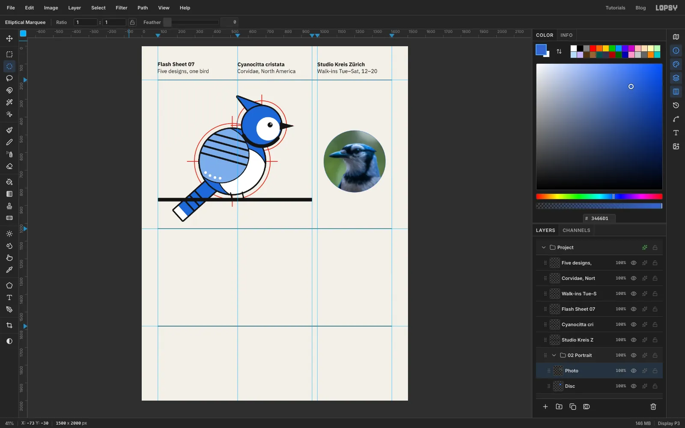

Choose **Filter → Gaussian Blur…**, set **Radius** to **4** and click
**Apply**. A small blur before Threshold gives you smooth shapes instead of
salt-and-pepper speckle.

Now make the circle: an Elliptical Marquee from (1026, 476) to
(1374, 824), radius 174, a pixel inside the disc. Choose
**Select → Inverse**, press [[Delete]], then press [[Cmd+D]]. Filters only
work inside an active selection, so a selection left on here would stop the
next steps from doing anything.

> **Tip:** Blur *before* this crop, not after. Inverse and Delete can't reach
> the pixels that hang off the canvas edge. A blur afterwards would smear
> them back in as a grey streak down the right side of the page.

## Split out the highlights

Choose **Layer → Duplicate Layer** and name the copy **Ink**. Then select
the original underneath and rename it **Highlights**.

On **Highlights**, choose **Filter → Threshold…**, set **Level** to **118**
and apply. The pale face and breast turn white and everything darker turns
black. You won't see it yet, because the **Ink** copy on top still shows the
photo. That doesn't matter: the Magic Wand reads only the selected layer.

Pick the **Magic Wand** ([[W]]). Set **Tolerance** to **10** and untick
**Contiguous**, so one click selects every black area at once. Click on the
jay's black necklace, which is solid black on **Highlights**, and press
[[Delete]], then [[Cmd+D]]. Only the white highlights are left, sitting
on the blue disc.

## Threshold the black ink

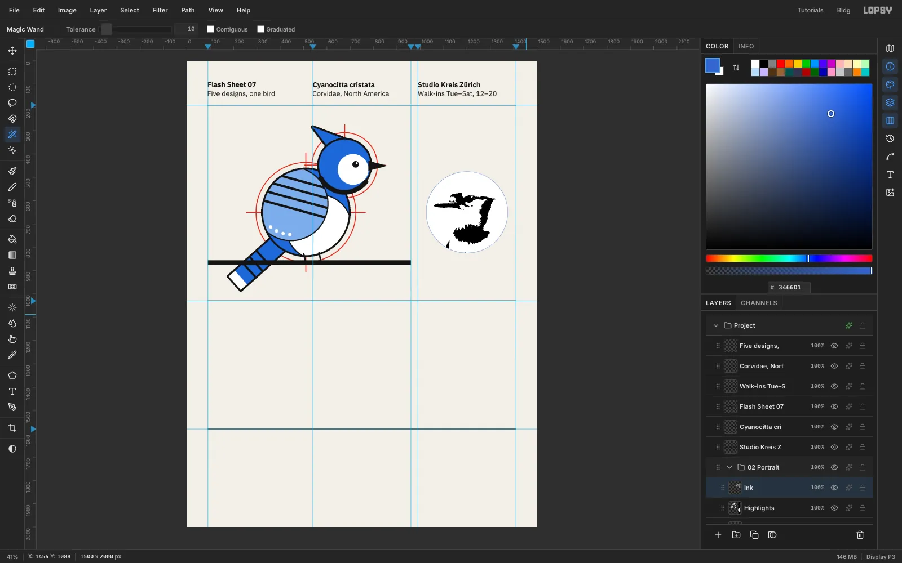

Select **Ink**. Apply **Filter → Threshold…** at a
**Level** of **60**. Only the darkest parts survive as black: the beak, the
eye stripe, the crown markings and the necklace.

With the Magic Wand still set to non-contiguous, click a white area and
press [[Delete]], then [[Cmd+D]]. Now black ink sits over white highlights
over the blue disc. That's a three-colour screen print made from one photo.

## Ring the portrait

Click **Add Layer** and name it **Rings**. With the **Shape** tool, remove
the fill and set the stroke to `#141414`, **Width 8**. Press on the disc
centre (1200, 650) and [[Cmd]]-drag to (1375, 825), so the ring sits on the
disc's edge.

Change the stroke to `#D23C2C`, **Width 4**, and drag a second circle to
(1396, 846), a radius of 196. It echoes the red construction circles in
design 01. That corner is only a few screen pixels from the 1410 guide, so
turn off **View → Snap to Guides** for this one circle. Turn it back on
afterwards.

## Draw a notched feather

Collapse **02 Portrait**, keep it selected, and click **New Group**. Name it
**03 Feather**. Inside it add an empty layer named **Sun** (you'll fill it
later), then a layer named **Feather** above it.

Draw the vane with the **Pen**, centred on (300, 1300). It's about 310 px
tall and 90 px wide: pointed at the top, widest a third of the way down,
with a blunt base and a **V notch** cut into each edge. Go round it
clockwise from the tip. *Click* the corner anchors. At the smooth ones,
*press and drag* a short handle (about 20 px) along the outline:

- tip (300, 1132), corner
- (328, 1169) and (341, 1231), smooth
- right notch: (345, 1303), (329, 1317), (345, 1334), all corners
- (340, 1389) and (324, 1429), smooth
- base (306, 1444) and (294, 1444), corners
- (274, 1426) and (260, 1374), smooth
- left notch: (259, 1279), (274, 1266), (260, 1250), all corners
- (264, 1193) and (279, 1156), smooth

Click the tip again to close the path.

## Add the tip, bars and shaft

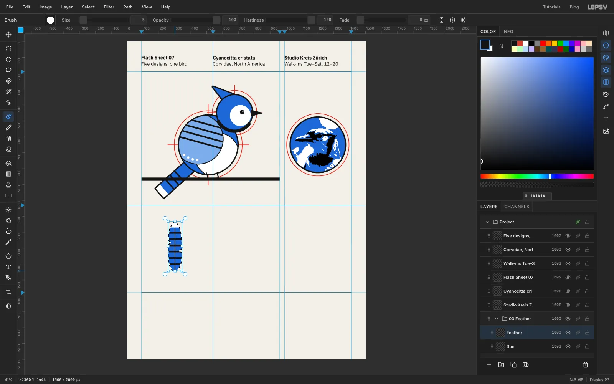

Turn the path into a selection, delete the path, and fill it with
`#3466D1`. Keep the selection, switch to the **Rectangular Marquee**, hold
[[Shift]]+[[Option]] and drag a rectangle from above the tip down to y 1171,
wider than the feather on both sides. That's an intersection, so only the top
40 px of the feather stays selected. Fill it with `#FFFFFF`.

[[Cmd]]-click the **Feather** thumbnail to select the whole vane again. With
the Brush at **Size 11** in `#141414`, draw six evenly spaced horizontal bars
across it, starting and ending outside the edges. Set the Brush **Size** to
**5** and draw the shaft straight down the middle, from just under the white
tip to the base.

Press [[Cmd+D]]. Draw the quill below the vane in two pieces: a **Size 9**
line for the first 40 px, then a **Size 5** line for the last 25 px, so it
tapers. Add a **Stroke** effect, **Width 8**, `#141414`, outside.

## Rotate the feather and add a sun

With the **Rectangular Marquee**, draw a box around the whole feather with a
little room on every side. Switch to the **Move** tool. The small round
handle on a short stalk just outside the box's top-right corner rotates it.
Drag it up and to the left. There's no angle readout, so turn it until the
tip sits about 170 px left of the quill's end, which is about 28°
counter-clockwise. Press [[Cmd+D]] to commit.

Select the **Sun** layer. Make an 86 px-radius circle behind the upper
right of the feather, centred about 35 px in from the feather's right edge
and 95 px below its tip, so the red peeks out beside it. Fill it with
`#D23C2C`, press [[Cmd+D]], and give it the same 8 px black **Stroke**.

Then click the **03 Feather** group row and, with the Move tool, nudge the
whole group with the arrow keys. Centre it on x 300 (the middle of columns
1–2) and put the quill's end at y 1529, about 50 px above the bottom rule.
Moving the group moves the feather and the sun together.

## Define a cross-hatch pattern

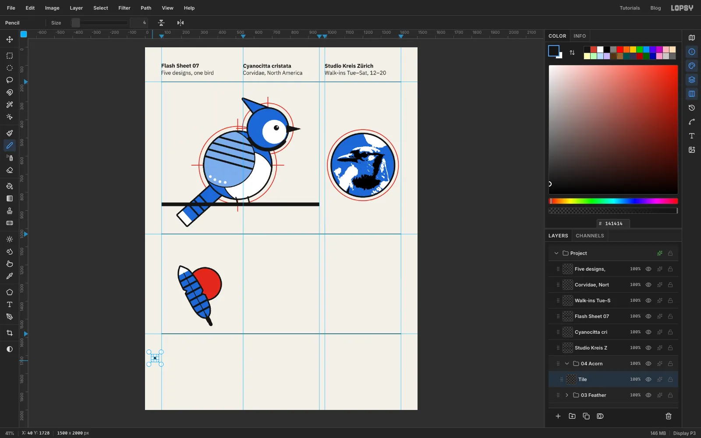

Collapse **03 Feather**, keep it selected, and click **New Group**. Name it
**04 Acorn**. For the acorn cap you need a hatch pattern, so draw one tile
first.

Click **Add Layer** and name it **Tile**. Zoom right in on an empty corner of
the canvas. Pencil endpoints wander by a pixel or two at fit zoom. Make a
**28 × 28 px** rectangular marquee there. With the **Pencil** at **Size 4**
in `#141414`, click one corner of the box and [[Shift]]+click the opposite
corner, then do the same for the other diagonal. Choose **Edit → Define
Pattern**, press [[Cmd+D]], then delete the **Tile** layer. The pattern
stays.

## Draw the nut and its shadow

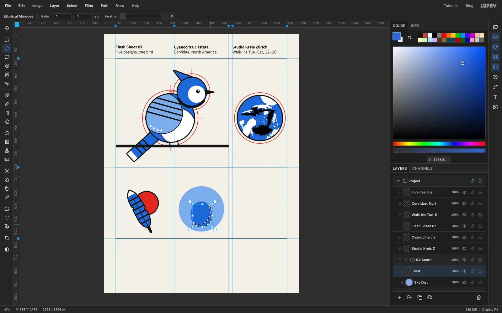

1. **Sky Disc:** click the **04 Acorn** row, click **Add Layer** and name it
   **Sky Disc**. Fill a circle from (575, 1176) to (925, 1526) with
   `#86ABE6`. It's the same size as the seal you'll make next.
2. **Nut:** on a new layer, an elliptical marquee from (666, 1294) to
   (834, 1490), filled with `#3466D1`.

For a packed black shadow, keep the nut selected, hold [[Option]] and drag
the same size oval 16 px further left and 20 px higher. [[Option]]
*subtracts*, which leaves a crescent along the lower right. Fill it with
`#141414`.

Press [[Cmd+D]]. With a **Size 12** white Brush, drag a short curved
highlight inside the nut's upper left. With a **Size 14** black Brush, draw
the stem up and slightly to the right from where the cap will sit.

## Fill the cap with the pattern

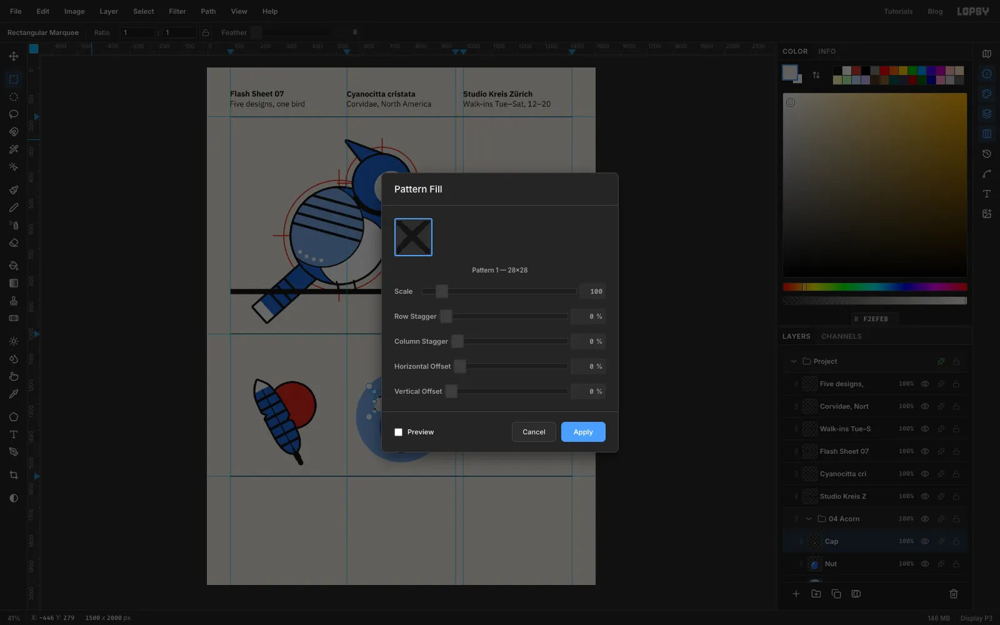

Click **Add Layer** and name it **Cap**. Make an elliptical marquee from
(646, 1252) to (854, 1364). Then switch to the **Rectangular Marquee** and
[[Shift]]+[[Option]]-drag a rectangle over everything above y 1330, which cuts the bottom off flat. Fill it with
paper `#F2EFE8`.

Keep the selection and choose **Edit → Fill with Pattern…**. The tile you
just defined is already picked. Click **Apply**, and the X tiles join up into
a diamond lattice clipped to the cap.

## Line the acorn

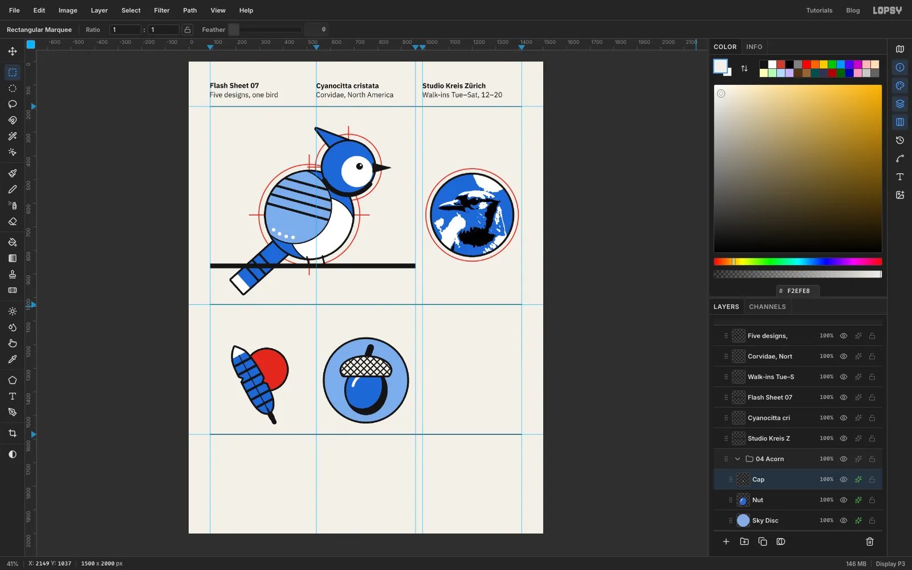

Press [[Cmd+D]]. Give **Sky Disc**, **Nut** and **Cap** a **Stroke** effect
of **8**, `#141414`, outside. The cap's outline closes off the ends of the
hatch lines.

## Copy Merged the jay's head

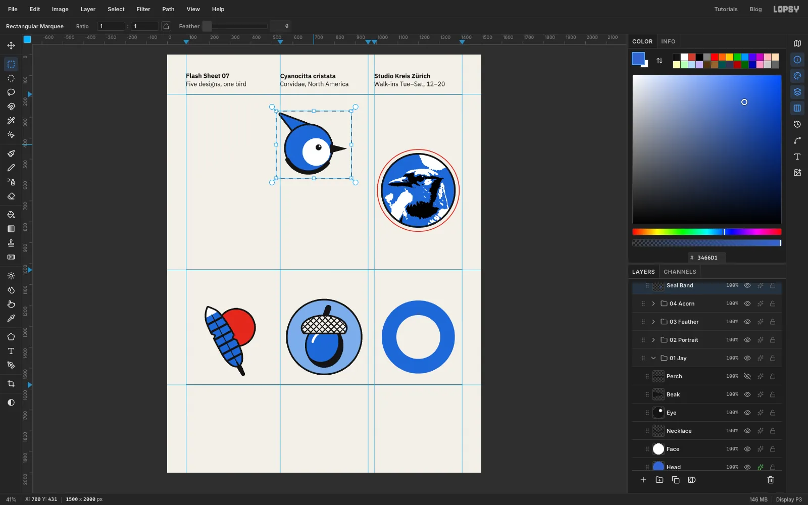

The seal reuses the jay's head. Collapse **04 Acorn**, keep it selected and
add a group named **05 Seal**.

Click **Add Layer** and name it **Seal Band**. Make a circle from
(1025, 1176) to (1375, 1526). Then [[Option]]-drag a circle from
(1095, 1246) to (1305, 1456) to subtract the middle, and fill the ring with `#3466D1`.

Expand **01 Jay** and click the eye buttons to hide **Construction**,
**Tail**, **Body**, **Belly**, **Wing** and **Perch**. Draw a rectangular
marquee from (520, 270) to (880, 592) around the head and choose **Edit →
Copy Merged**. That copies everything visible in the box as one flat image.
Show the hidden layers again and collapse **01 Jay**.

## Paste and shrink the head

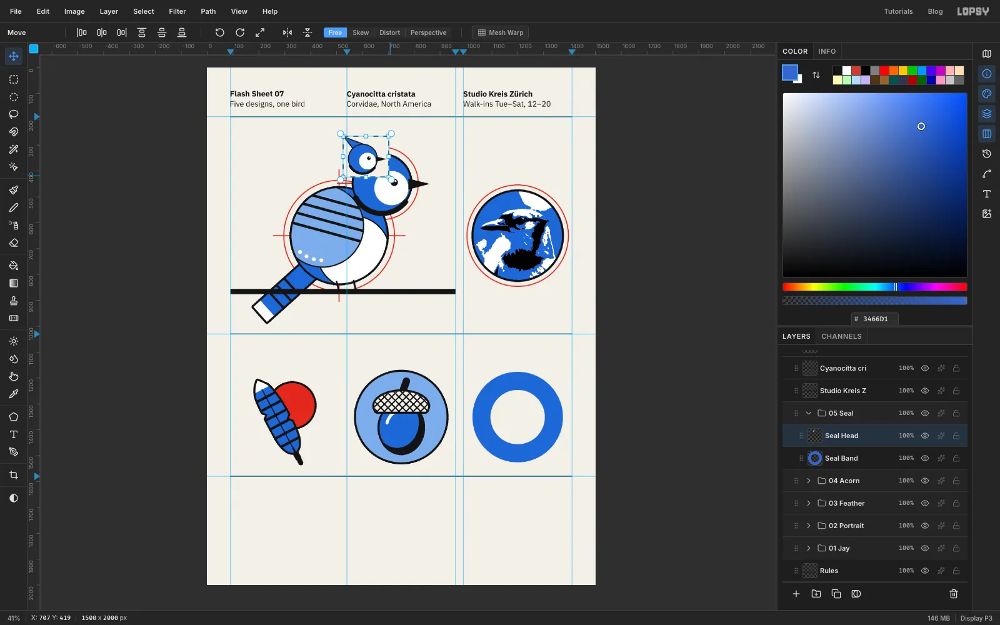

Select **Seal Band** and choose **Edit → Paste**. Lopsy pastes its own
copies in place, so the head lands right on top of the original. Rename it
**Seal Head**.

Draw the same marquee around it again. With the **Move** tool, [[Cmd]]-drag
the bottom-right handle until the copy is about **half size**, then press
[[Cmd+D]]. Drag it into the middle of the seal. Then make a circle from
(1100, 1251) to (1300, 1451), choose **Select → Inverse**, press [[Delete]]
to trim it round, and press [[Cmd+D]].

## Ring the seal

Click **Add Layer** and name it **Seal Rings**. With the **Shape** tool, no
fill, stroke `#141414`:

- **Width 8**, [[Cmd]]-dragged from (1200, 1351) to (1375, 1526): the outer
  edge.
- **Width 5**, [[Cmd]]-dragged from (1200, 1351) to (1305, 1456): the inner
  edge.

Then click two white **Size 10** Brush dots in the middle of the band at
3 o'clock and 9 o'clock, 140 px out from the centre. They separate the
two lines of text.

## Set the seal's type on two arcs

Round-seal type is two separate runs. The top run reads clockwise over the
top. The bottom run reads left to right along the bottom, so it stays the
right way up.

1. Keep **Seal Rings** selected, so the type lands inside the seal's
   group. Set the foreground to `#FFFFFF`. With the **Text** tool set to
   **IBM Plex Sans Bold 24**, click in an empty spot and type
   `CYANOCITTA CRISTATA`. Press [[Tab]] and rename the layer **Seal Top**.
   Open the **Text** panel (the **T** button in the strip of panel icons on
   the right) and set **Letter spacing** to **1**.
2. Click **Seal Rings** again, click another empty spot and type
   `BLUE JAY · ZÜRICH`. Press [[Tab]], rename it **Seal Bottom** and set its
   **Letter spacing** to **7**. A short line needs more tracking to fill a similar
   arc.
3. Draw the paths with the **Pen**. The top run sits on an arc 131 px from
   the centre, running clockwise from about 10 o'clock to 2 o'clock. Press
   at each of these anchors and drag a handle about 34 px along the curve,
   in the direction of travel: (1082, 1294), (1155, 1227), (1254, 1231),
   (1322, 1302). Click the **✓** in the options bar to commit it without
   stroking.
4. The bottom run sits on an arc 149 px from the centre, running left to
   right under the seal from about 8 o'clock to 4 o'clock, with handles
   about 39 px long: (1065, 1413), (1148, 1490), (1261, 1486), (1339, 1404).
   Commit it with **✓**.
5. Select each text layer and, with the Text tool active, pick its arc in
   the **Path** dropdown of the options bar. **Path 1** is the top arc and
   **Path 2** the bottom one.

Text on a path starts at the path's first anchor. If a run looks off-centre,
drag that anchor along the circle until both ends sit the same distance from
the white dots. The top arc has the smaller radius because its letters stand
outward from the curve. The bottom letters hang inward, so their arc goes on
the outside of the band.

## Label every design

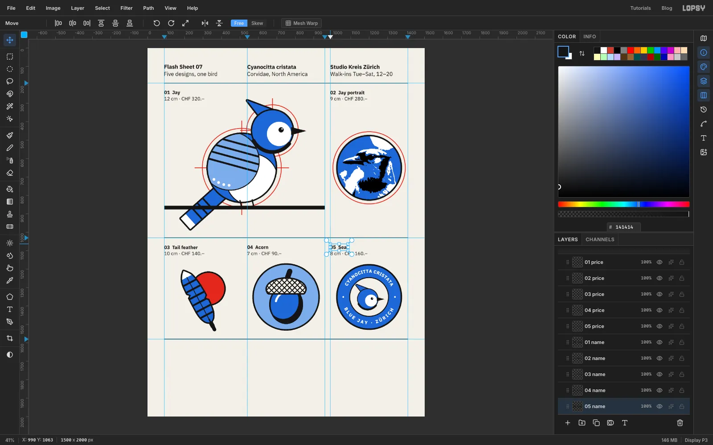

Each cell gets a two-line label in **IBM Plex Sans 26**. The bold line's caps
start 41 px under the rule, and the regular line's caps 34 px lower. Before
you start, click **Rules**, pick the Text tool, set **Letter spacing** back
to **0** in the Text panel and set the foreground to `#141414`. The seal's
tracking and its white both carry over to new text otherwise.

Set the weight to **Regular** and type the second lines first. Then switch
to **Bold** and type the first lines above them. Click **Rules** before
each new label:

- x 90, under rule 1: **01  Jay** / `12 cm · CHF 320.–`
- x 990, under rule 1: **02  Jay portrait** / `9 cm · CHF 280.–`
- x 90, under rule 2: **03  Tail feather** / `10 cm · CHF 140.–`
- x 540, under rule 2: **04  Acorn** / `7 cm · CHF 90.–`
- x 990, under rule 2: **05  Seal** / `8 cm · CHF 160.–`

`CHF 320.–` is how Swiss prices are written. Real flash also lists a size,
so the client knows what they're picking.

## Colour the title letter by letter

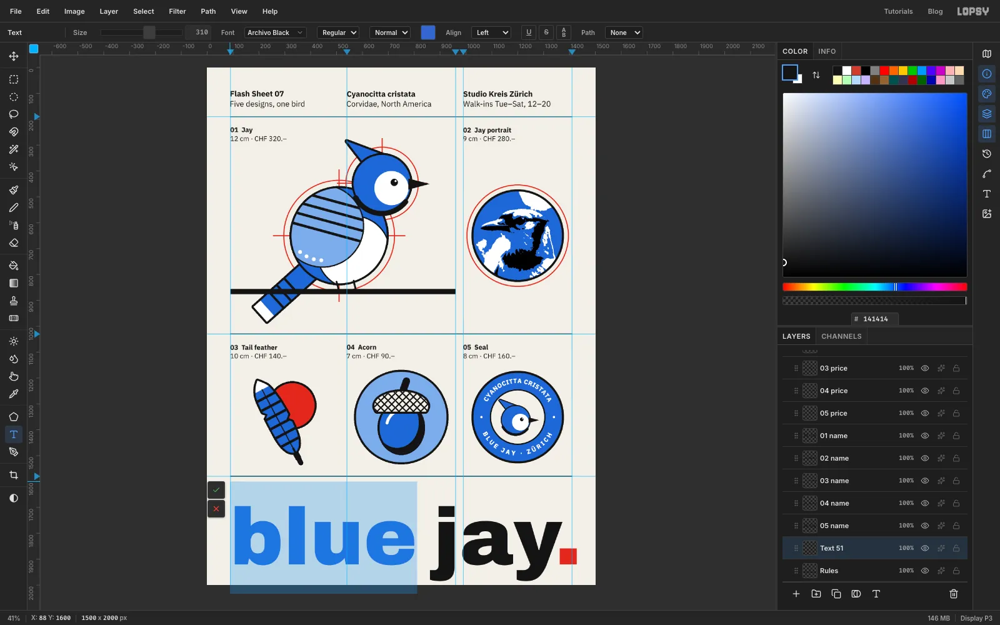

Click **Rules**. Set the Text tool to **Archivo Black**, **310**, in
`#141414`, and click just under the bottom rule at the left margin. Type
`blue`, a **thin space**, and `jay.`. A normal space is far too wide at this
size. On a Mac, press [[Ctrl+Cmd+Space]] to open the system Character
Viewer, search for *thin space* and double-click it. On Windows, copy the
U+2009 character from Character Map.

Don't press Tab yet. While you're still editing:

1. Press [[Shift+←]] to select the period. Click the **Text color** swatch in
   the options bar and type `D23C2C`. Click the swatch again to close it.
2. Press [[Home]], then [[Shift+→]] four times to select **blue**, and give
   it `#3466D1`.

Now press [[Tab]] to commit. Each range keeps its own colour.

## Fit the title to the measure

In Swiss work a big title runs the full measure. Check where the period ends
and adjust the **Size** until its right edge lands on the 1410 guide. At 310
px with a thin space it does. Then use the Move tool and the arrow keys to
put the left edge of the **b** on the 90 px guide and the bottoms of the
**j** and **y** at y 1910, the same 90 px margin as the sides.

## Rotate the colophon

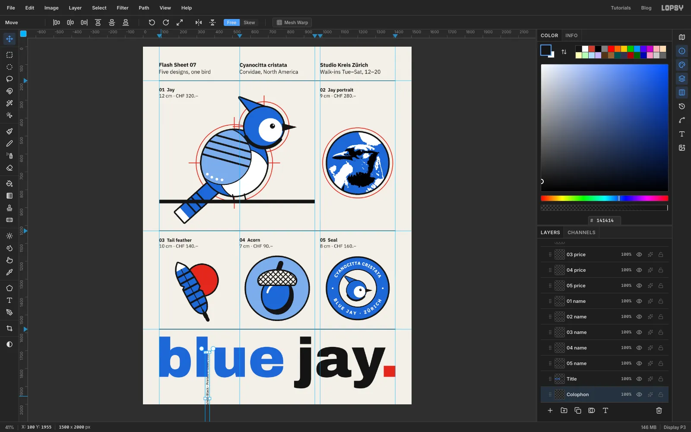

Click **Rules**. With the Text tool at **IBM Plex Sans Medium 18** in
`#141414`, click in the empty bottom margin and type
`Set in IBM Plex Sans and Archivo Black · Printed in Basel, 2026`. Press
[[Tab]].

Press [[Cmd+D]] so nothing is selected, switch to the **Move** tool and click
**Rotate 90° CCW** in the options bar. The text stays live and turns on its
own centre, so it now stands upright, reading from bottom to top.

## Place the colophon in the margin

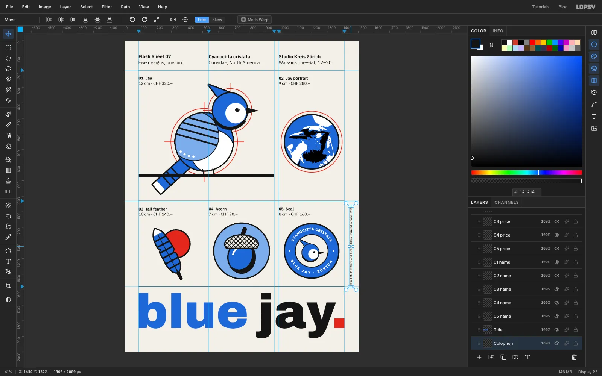

Drag the colophon into the right margin and finish with the arrow keys. Its
left edge goes at x 1446, centred in the 90 px margin, and its bottom
exactly on the bottom rule at y 1580. At 18 px it runs up almost to the
second rule, so it spans the whole second row.

## Add paper grain

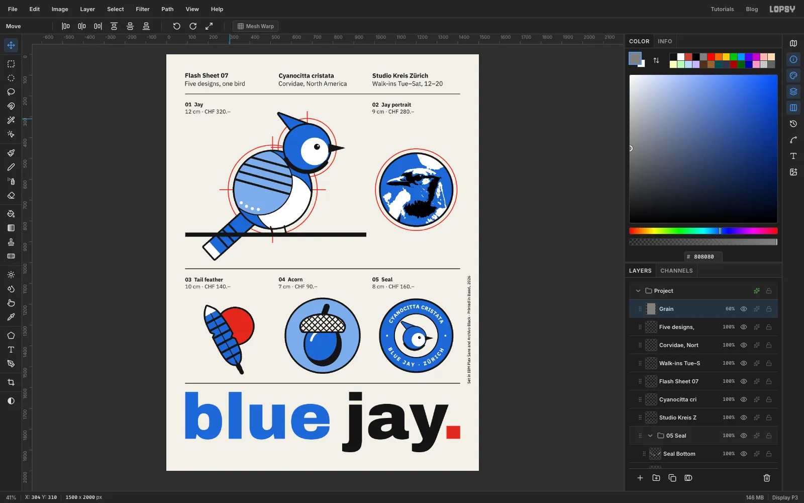

Select the topmost layer in the list and click **Add Layer**, so the new
layer sits over everything. Name it **Grain**. Fill it with `#808080`, then
apply **Filter → Add Noise…** with **Amount 30**, **Mono** and **Gaussian**.

Open the layer's effects drawer, set the **Blend mode** to **Overlay**, and
set the layer opacity to **60 %**. Mid-grey disappears in Overlay, so only
the speckle shows, as a fine paper tooth over every colour. Turn off
**View → Show Guides** and choose **File → Quick Export PNG**.
