The Swiss International Typographic Style came out of Zürich and Basel in the 1950s. Josef Müller-Brockmann's concert posters for the Zürich Tonhalle are the best-known examples. Each one is built on a strict grid, with flush-left grotesque type, flat colour and one geometric idea that stands in for the music.

This tutorial uses that approach for an invitation to an invented recital of Bach's **Sonatas and Partitas for solo violin**. The idea is a violin seen from very close: a red disc for the sound and four strings for G, D, A and E, getting thinner from top to bottom. Where the strings cross the disc they become gaps, so you see the paper through the red. Everything else hangs from a 6-column grid and a 39 px baseline grid. At the end, a layer of grain and a few paper-coloured specks make the flat colour look printed.

The card is 1500 × 2100 px, a 5 × 7 inch card at 300 dpi.

The tools you'll use:

- guides on a 6-column grid, and **Snap to Guides**
- the **Elliptical** and **Rectangular Marquee**, including their exact-size dialog
- **Select → Shrink**, and [[Cmd]]-click on a layer thumbnail to load its shape as a selection
- the **Brush** and **Pencil** with [[Shift]]-click straight lines
- **Add Noise**, **Threshold** and the **Magic Wand**
- live text in **Inter Tight** at four weights, a per-line text colour, letter spacing, and rotating live text with the **Move** tool
- **Merge Down**, **Group Layers**, the **Multiply** blend mode and a **Color Overlay** layer effect

The palette is one red, one black and the paper:

- Paper `#EEEAE2`, light text on red `#F6F3EC`, ink specks `#EEE9E0`
- Ink black `#161616`
- Swiss red `#D52A2E`

> **Tip:** On a wide-gamut (Display P3) screen, Lopsy reads typed hex codes as P3 colours, so the red looks a little hotter there than on an sRGB screen.

> **Note:** Shortcuts are written for a Mac. On Windows use [[Ctrl]] wherever it says [[Cmd]].

## Set up the card and the column grid

Choose **File → New** and make a document **1500** px wide and **2100** px high.

The grid has 110 px margins and six 188 px columns with 30 px gutters. Click the top ruler to drop a vertical guide at each column edge. Zoom in and watch the position readout in the status bar before you click, so each guide lands on the exact pixel:

- **110** and **298**
- **328** and **516**
- **546** and **734**
- **764** and **952**
- **982** and **1170**
- **1200** and **1388**

Click the left ruler to drop horizontal guides at **110** (the top margin), **456** (where the title will sit), **1727** (the top of the info block) and **1990** (the bottom margin).

Select the **Background** layer, set the foreground colour to `#EEEAE2` and choose **Edit → Fill**.

## Put a grain layer over everything

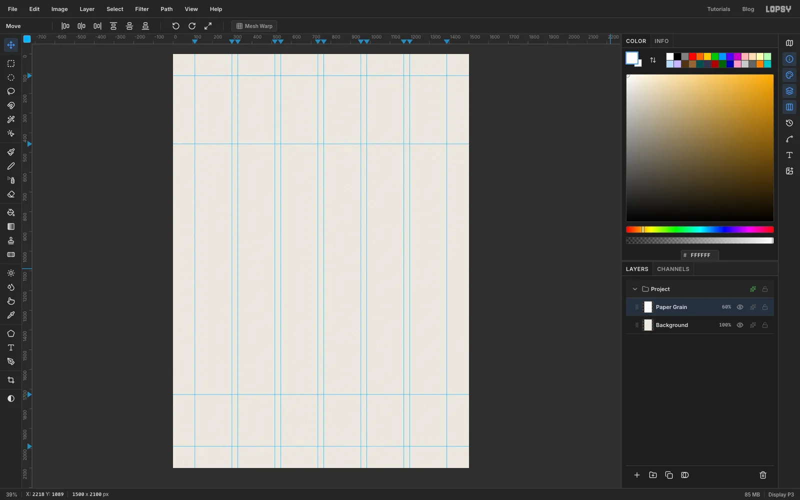

The grain goes on **top** of every other layer, so it textures the ink as well as the paper.

1. Select **Layer 1** and rename it **Paper Grain**. Set the foreground to white `#FFFFFF` and choose **Edit → Fill**.
2. Choose **Filter → Add Noise…**, set **Amount** to **80**, and pick **Mono** and **Gaussian**. Click **Apply**.
3. Open the layer's effects drawer, set the blend mode to **Multiply**, and drop the layer's opacity to **60%**.

From now on, click **Background** before you add a new layer. New layers go directly above the active layer, so everything you add stays under the grain.

## Draw the red disc

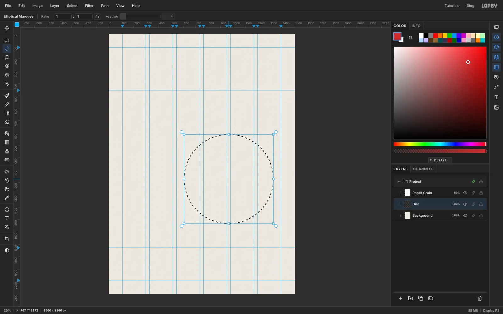

With **Background** selected, click **Add Layer** and name the new layer **Disc**.

Choose the **Elliptical Marquee** and click once on the canvas without dragging. That opens a dialog where you can type exact corners. Enter **From** 607, 812 and **To** 1327, 1532. That's a 720 px circle centred under columns 3 to 6.

Set the foreground to red `#D52A2E`, choose **Edit → Fill** and press [[Cmd+D]] to deselect.

## Add a thin ring around the disc

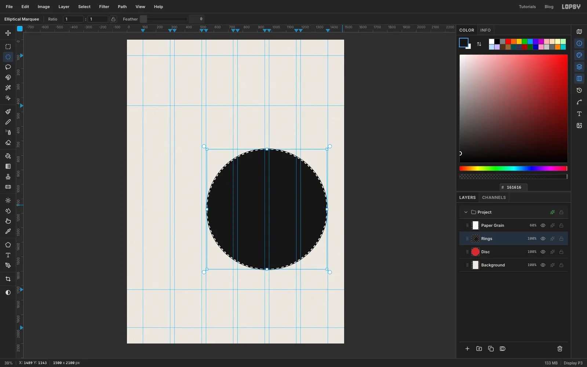

Add a layer called **Rings**. With the Elliptical Marquee, click once again and enter **From** 547, 752 and **To** 1387, 1592. This circle runs from just inside the left edge of column 3 to just inside the right margin.

1. Set the foreground to `#161616` and choose **Edit → Fill**.
2. Choose **Select → Shrink…** and shrink by **5** px. You can see the smaller marquee sitting inside the black circle.
3. Press [[Delete]], then [[Cmd+D]].

All that's left is an even 5 px ring.

## Draw the first strings

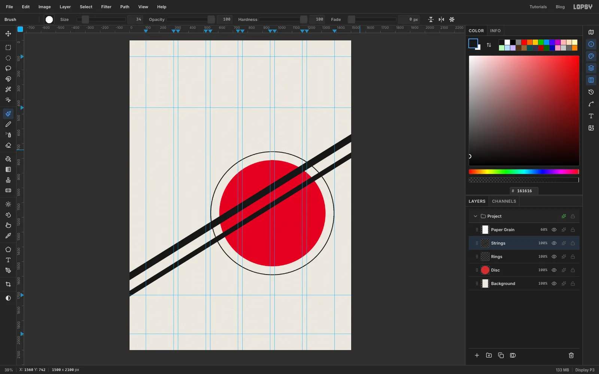

Add a layer called **Strings** above Rings.

Set the foreground to `#161616` and choose the **Brush**. In the brush settings, set **Hardness** to **100** so the edges are crisp, and **Size** to **46** for the G string.

The strings rise at about 32°, from the left edge of the card to the right edge. To draw a straight line, click once, then hold [[Shift]] and click the end point. Start and end each line just outside the canvas, so the round brush tips are cut off by the edge.

- **G** (size 46) leaves the left edge at about **y 1599** and the right edge at about **y 662**.
- **D** (size 34) runs 118 px lower on both edges: about **1717** on the left and **780** on the right.

> **Tip:** If a line lands in the wrong place, press [[Cmd+Z]] twice. Each Shift-click line is two history steps, the first dab and then the line.

## Finish the four strings

Draw the last two strings the same way, another 118 px lower each time:

- **A** at size **24**, from about **y 1835** on the left to **898** on the right
- **E** at size **14**, from about **y 1953** on the left to **1016** on the right

The spacing stays the same and only the thickness changes. That's the rhythm that makes them read as strings.

## Punch the strings through the disc

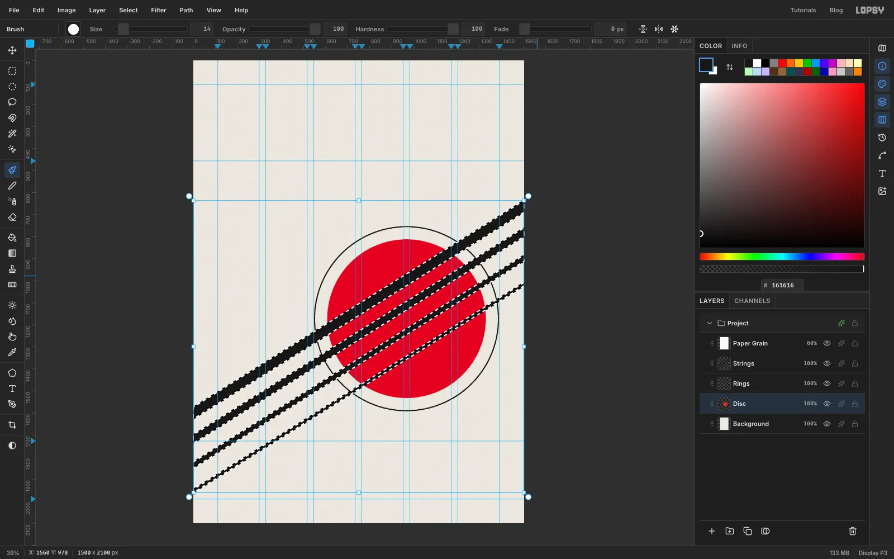

The strings should not cover the red. They should be holes in it, so the paper shows through.

1. Hold [[Cmd]] and click the **Strings** layer's thumbnail. That loads the four strings as a selection.
2. Click the **Disc** layer to make it active. The selection stays.
3. Press [[Delete]], then [[Cmd+D]].

The disc now has four gaps cut along the strings.

## Clear the strings inside the disc

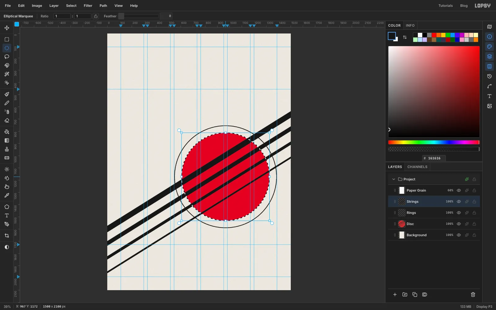

The black strings still run across the gaps. Select the **Strings** layer, click once with the Elliptical Marquee and enter the disc's corners again: **From** 607, 812 and **To** 1327, 1532. Press [[Delete]] and [[Cmd+D]].

Inside the disc you now see paper where each string passes. Because the Paper Grain layer sits on top, the gaps have exactly the same texture as the rest of the card, so they read as holes, not as cream paint.

## Add two echo lines to the E string

Add a layer called **Echo**. Set the Brush to size **4** and draw two hairlines parallel to the E string, using the same Shift-click method. Start the first one 28 px below where the E string meets each edge, and the second one 52 px below. That leaves a little more paper between the hairlines than the E string is thick.

The echoes should stop where they meet the ring, not cross it. Click once with the Elliptical Marquee, enter the ring's outer circle (**From** 547, 752 and **To** 1387, 1592), press [[Delete]] and deselect.

## Merge the echoes into the strings

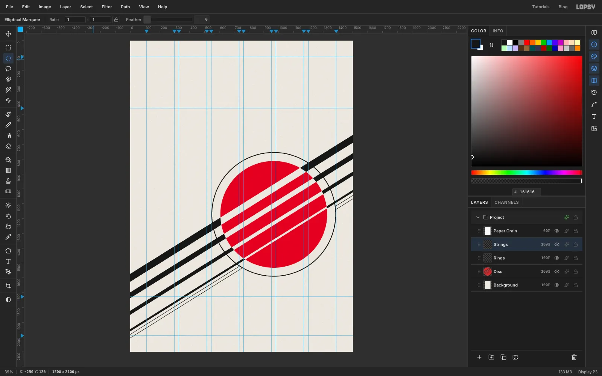

With **Echo** active, choose **Layer → Merge Down**. The hairlines join the strings on a single layer. If the merged layer's name isn't **Strings**, rename it.

Each hairline now meets the ring in a clean T-junction. There are no small slivers left between the ring and the disc.

## Type the catalogue line

Select **Strings** so the new text lands above it. Choose the **Text** tool, then set the font to **Inter Tight** and the weight to **SemiBold** (600), at size **28**. Set the foreground to red.

Click in an empty part of the top of the card and type `köthen 1720 · bwv 1001–1006`. Click the ✓ **Commit text** button, then double-click the layer's name and rename it **Catalogue**.

This line will run down the right margin, from the top margin guide (110) to the title guide (456). Adjust the **Size** in the **Text** panel until the line is that long. At **26.5** it spans 346 px, the gap between the two guides.

## Rotate the line a quarter turn

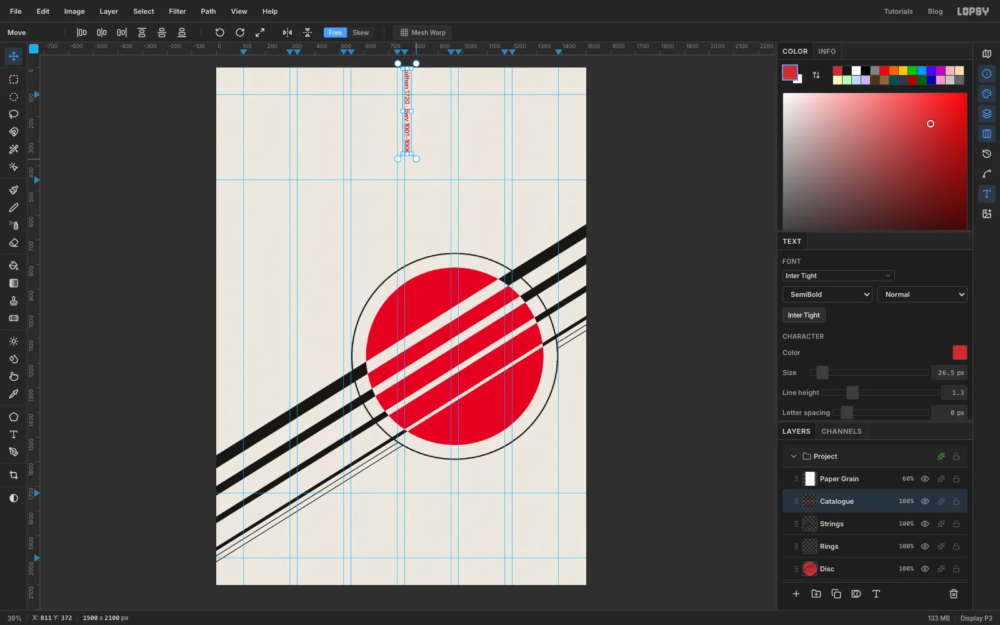

Switch to the **Move** tool. A live text layer shows transform handles without needing a selection. Hold [[Cmd]] and drag the round rotation handle at the top-right corner clockwise. Holding [[Cmd]] snaps to 15° steps, so stop at **90°**.

The text stays live: you can still edit it with the Text tool, and it stays sharp.

## Place the line on the right margin

Drag the line to the top-right corner of the grid. Then zoom in and nudge it with the arrow keys ([[Shift]]+arrow moves 10 px) until:

- its right edge touches the **1388** guide
- its first letter touches the **110** guide

The last character should end right on the **456** guide, which is where the title will sit.

## Draw the rule and the RSVP box

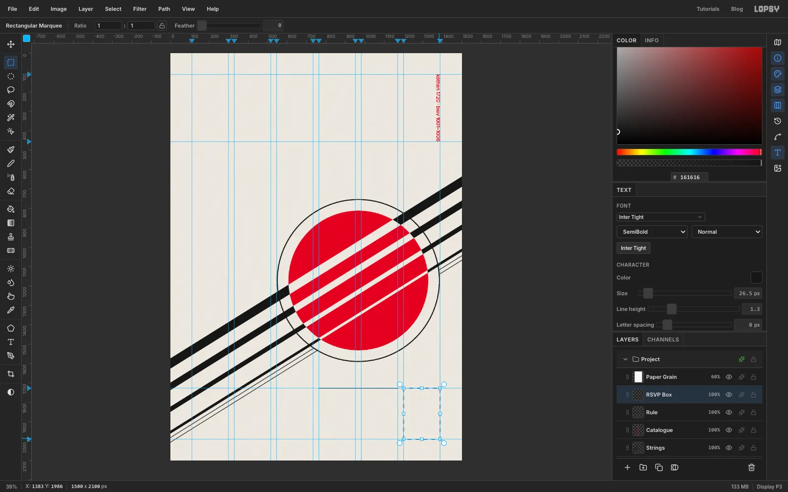

Add a layer called **Rule**. Set the foreground back to `#161616`, choose the **Pencil**, set **Size** to **3**, click on the **1727** guide at the left edge of column 4 (x 764), then [[Shift]]-click at the right edge of column 5 (x 1170).

Add a layer called **RSVP Box**. Choose the **Rectangular Marquee** and drag from just inside the top-left corner of column 6 (at the 1727 guide) to just inside the bottom margin at the right margin. With **View → Snap to Guides** on, both corners snap onto the guides. Fill the box with red and deselect.

The box shares its top with the rule and its bottom with the bottom margin.

## Set the info columns on a baseline grid

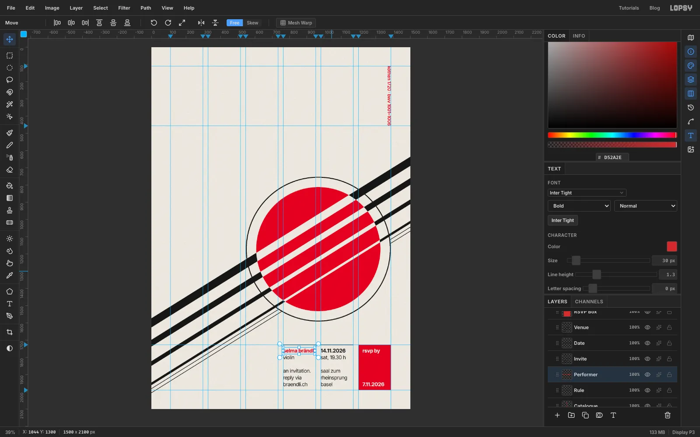

All the small type is **Inter Tight 30 px** with a **Line height of 1.3** (set it in the Text panel), which gives a 39 px baseline grid. Drop two temporary guides on the left ruler at **1771** and **1966**. These are the first and last baselines of the info block, five lines apart. Drag them back onto the ruler when you're done.

Each column is two text layers: a bold first line, and a Regular block underneath. Click well away from existing text each time, because a click inside an existing text layer edits that layer instead of starting a new one. Rename each layer as you go, so the Layers panel stays readable.

- **The box.** Select **RSVP Box** first, so these sit above it. Use **Bold** in `#F6F3EC`:
  - `rsvp by` (layer **RSVP**), sitting on the 1771 guide
  - `7.11.2026` (layer **RSVP Date**), sitting on the 1966 guide
- **Column 5.** Select **Rule** first, and set the foreground to `#161616`:
  - `14.11.2026` in **Bold** (layer **Date**), sitting on the 1771 guide
  - in **Regular** (layer **Venue**): `sat, 19.30 h`, an empty line, then `saal zum` / `rheinsprung` / `basel`. Its last line sits on the 1966 guide.
- **Column 4:**
  - in **Regular**, black (layer **Invite**): `violin`, an empty line, then `an invitation.` / `reply via` / `braendli.ch`. Its last line sits on the 1966 guide.
  - `selma brändli` in **Bold**, red (layer **Performer**), sitting on the 1771 guide

Drag each block into place with the Move tool, then zoom in and finish with the arrow keys. Column 4 starts on the **764** guide and column 5 on the **982** guide. The box text starts 24 px inside the box, at x 1224.

## Type the title, subtitle and programme

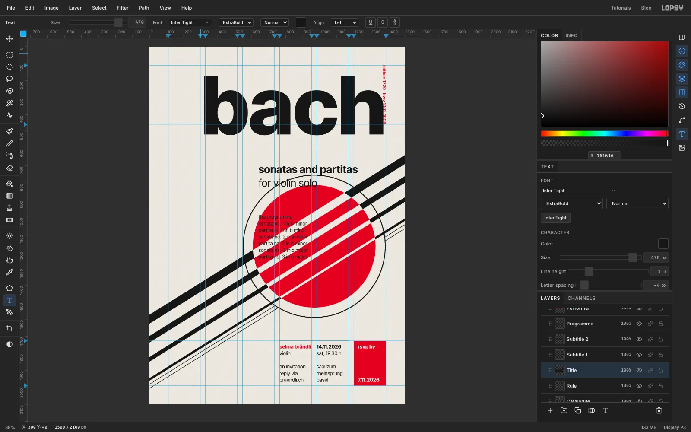

Select the **Rule** layer and set the foreground to `#161616`. Then make four more text layers in Inter Tight, all with a **Line height** of **1.3**, and name them as shown in bold:

- **Programme**, in **Regular 30 px**: `the programme`, then the six works, one per line: `sonata no. 1 in g minor`, `partita no. 1 in b minor`, `sonata no. 2 in a minor`, `partita no. 2 in d minor`, `sonata no. 3 in c major`, `partita no. 3 in e major`
- **Subtitle 2**: `for violin solo` in **Regular 62 px**
- **Subtitle 1**: `sonatas and partitas` in **Bold 62 px**
- **Title**: `bach` in **ExtraBold 470 px**, with **Letter spacing** set to **−4** in the Text panel for now. You'll fine-tune it in the next step.

> **Tip:** Make the small text first and the big title last, or start the title in an empty corner. A click lower down might otherwise land inside the title's text box.

## Line the type up and colour the heading

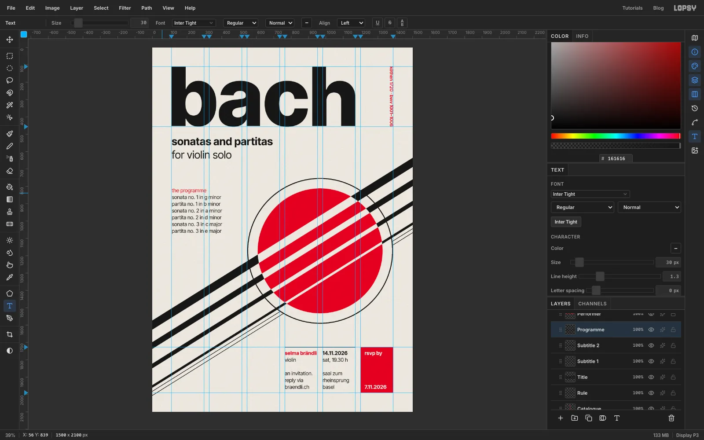

Move each block with the Move tool, then zoom in and finish with the arrow keys:

- **Title**: put the left edge of the **b** on the **110** column guide, with the top of the **b** touching the **110** margin guide. At 470 px, the bottom of the letters then lands on the **456** guide. In the **Text** panel, raise **Letter spacing** from −4 to **−2**, so the right stem of the **h** lands on the **1170** guide at the right edge of column 5.
- **Subtitles**: drop a temporary guide at **640** and sit `for violin solo` on it. Put `sonatas and partitas` two lines (78 px) higher, so its baseline is at 562.
- **Programme**: line the tops of its tallest letters up with the top of the red disc. Its first line then sits on the same 39 px grid as the info block.

To colour just the heading, choose the Text tool and click into the first line of the programme. Click a **second** time to place the caret, because the first click only starts editing. Press [[Home]], then [[Shift+End]] to select that line. Click the colour swatch in the Text options bar, type `D52A2E` into its hex field, and click ✓ to commit. Only "the programme" turns red.

## Group the layers

Click the top text layer (**RSVP Date**) and [[Shift]]-click **Catalogue**. That range also sweeps in **Rule** and **RSVP Box**, which belong with the type. Choose **Layer → Group Layers** and name the group **Type**. The Move tool's handles now wrap the whole group. Do the same with **Strings**, **Rings** and **Disc**, and name that group **Instrument**.

Try dragging the whole Instrument group somewhere else with the Move tool, then press [[Cmd+Z]]. It goes back exactly where it was, so you can test other placements without risk.

## Make ink-dropout specks

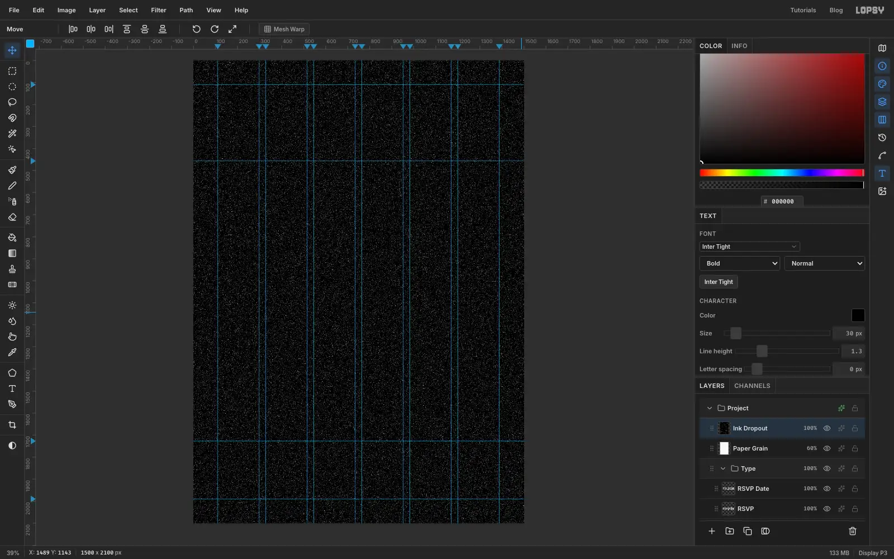

Real offset printing leaves tiny paper-coloured specks in solid ink. Here's how to make them.

1. Select **Paper Grain** and add a layer called **Ink Dropout** above it.
2. Fill it with black.
3. Run **Filter → Add Noise…** with **Amount 100**, **Mono** and **Gaussian**.
4. Run **Filter → Threshold…** at **29**. About 4% of the pixels turn white, and the rest stay black.

## Delete the black

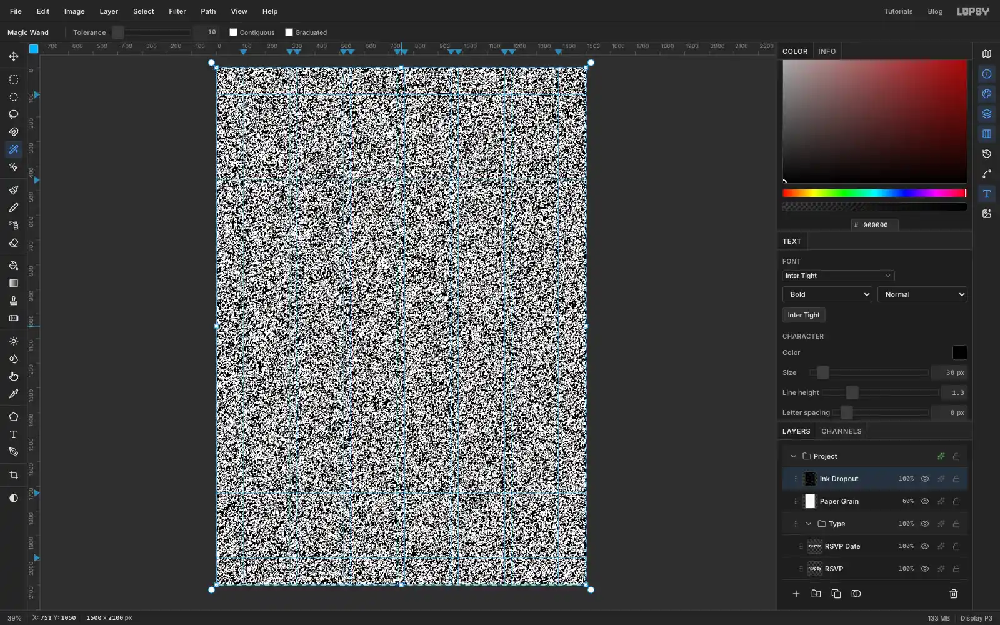

Choose the **Magic Wand**. Turn **Contiguous** off and set **Tolerance** to **10**. Click any black pixel: every black pixel in the layer is selected at once. With thousands of marching ants, the layer looks much busier than it is. Press [[Delete]] and [[Cmd+D]].

Only the scattered white specks are left on a transparent layer.

## Tint the specks and finish

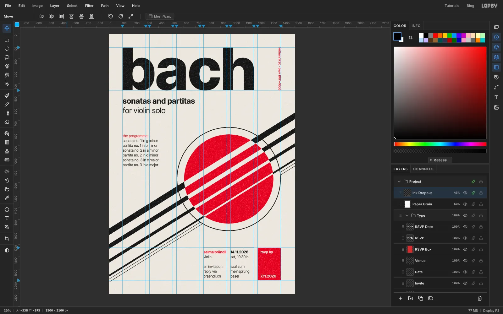

Open the Ink Dropout layer's effects and turn on **Color Overlay** in `#EEE9E0`, the colour of the paper. Lower the layer's opacity to **45%**.

Zoom in on the title or the disc: the solid ink now has a light, even speckle, like a printed card. Choose **View → Show Guides** to hide the guides, then **File → Quick Export PNG**.
