A tattoo flash sheet is a printed menu of ready-to-tattoo designs, each with
a number, a size and a price. Sacred geometry suits the format perfectly:
every design is built from circles, triangles and ratios, the same way a
draughtsman would build them with a compass and a ruler.

This sheet borrows its layout from **Swiss International Style**, the school
of Josef Müller-Brockmann, whose concert posters set big flat geometry
against a black field. You'll make a **1500 × 2000 px** sheet. A black header
holds a white Metatron's Cube and a huge grotesk title. Under it, six designs
sit in a strict three-column grid. Along the way you'll use the Shape tool's
exact-size dialog, radial symmetry, the Magic Wand, the Pen, marquee add,
subtract and intersect, a halftone filter for tattoo dotwork, flips,
rotations, groups and copy and paste.

The palette:

- Ink `#141414`, paper `#ECEBE6`, line white `#F7F6F2`
- Vermilion `#E8401C`, ochre `#E2A229`
- Colophon grey `#5E5C58`

Type is **Inter Tight** throughout: **ExtraBold** for the title, **Bold**
for the design names, **Medium** for the numbers and the header, and
**Regular** for sizes, prices and the colophon.

Type every colour into the **Hex** field of the Color panel (or the hex field
of the popover you're in) and press [[Enter]]. Every coordinate is in
document pixels. The **X / Y** readout at the bottom left of the status bar
shows where the cursor is, so hover to find a point before you click.

Most circles here are exact sizes, so you'll use two dialogs a lot. With the
**Shape** tool, a click without dragging opens **Shape Size**, and the shape
is centred on your click. With either **Marquee**, a click without dragging
(when nothing is selected) opens a **From / To** dialog for the selection's
corners. For a circular marquee, From and To are the corners of the
circle's box. A 50 px circle centred on (100, 100) is From 75, 75 To 125,
125.

## Set up the Swiss grid

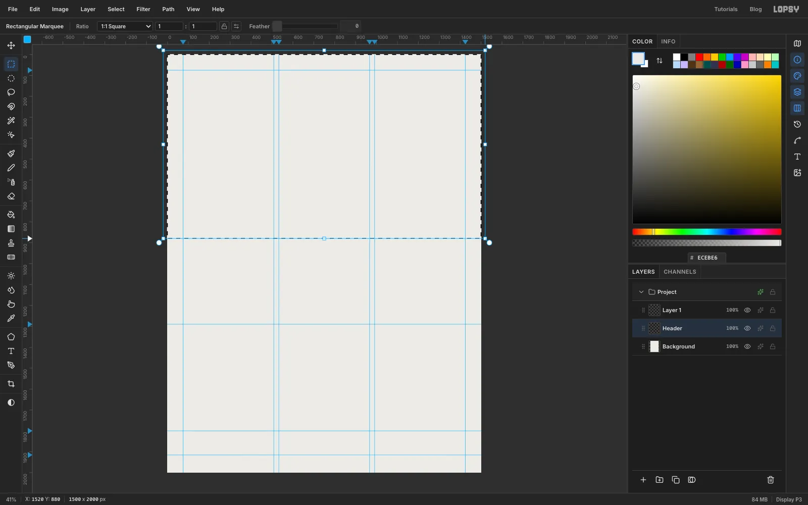

Choose **File → New** and create a **1500 × 2000** document. The grid has
**75 px margins** and six 205 px columns with 24 px gutters. Each design
cell spans two columns, so the cells run from x 75 to 509, 533 to 967 and
991 to 1425.

1. Turn on **View → Show Rulers**. Click the top ruler to drop vertical
   guides at **75**, **509**, **533**, **967**, **991** and **1425**.
2. Click the left ruler to drop horizontal guides at **75** (the top
   margin), **880** (the bottom of the header), **1290** and **1800** (the
   rules under each row of designs) and **1915** (the foot of the sheet).
3. Open the **View** menu and untick **Snap to Guides**. Several small
   circles in this sheet sit within a few pixels of a guide, and snapping
   would drag them onto it.
4. Select **Background**, set the foreground to `#ECEBE6` and choose
   **Edit → Fill**. With no selection it fills the whole layer.

New documents also come with an empty **Layer 1**. Leave it where it is;
it becomes the colour layer of the first design.

Click **Add Layer** and name the new layer **Header**. Pick the
**Rectangular Marquee** ([[M]]) and drag from just outside the top-left
corner of the canvas, past the right edge, down to the 880 guide.

## Fill the black header

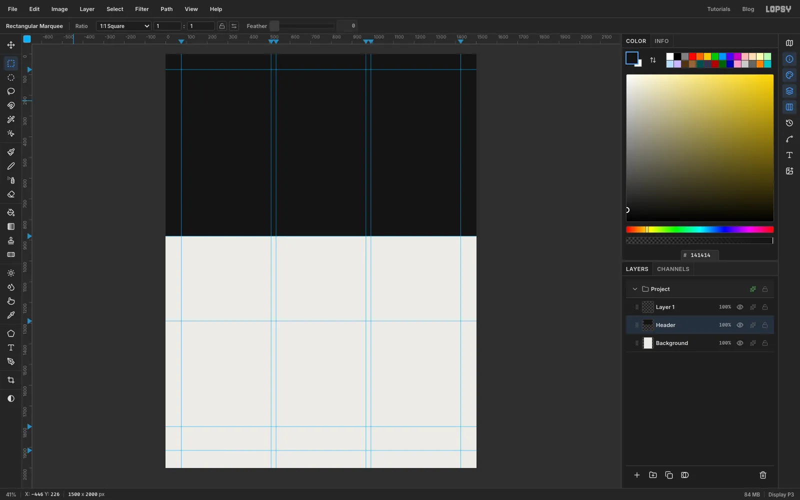

Set the foreground to `#141414`, choose **Edit → Fill**, then press
[[Cmd+D]] to deselect.

Starting the marquee outside the canvas means the black runs cleanly off
the top and both sides. A Swiss poster's colour fields bleed off the edge;
a thin paper sliver along one side would look like a printing mistake.

## Draw the thirteen circles of Metatron's Cube

Metatron's Cube starts as the *Fruit of Life*: thirteen equal circles. One
sits in the centre, six touch it, and six more sit twice as far out on the
same spokes.

Click **Add Layer** and name it **Hero Circles**. Pick the **Shape** tool
([[U]]) and set **Shape** to **Ellipse** and **Output** to **Pixels**.
Click the Fill swatch and choose **Remove fill**. Click the Stroke swatch,
type `F7F6F2` in its hex field and set **Width** to **3**.

Now click once without dragging. The **Shape Size** dialog opens. Type
**116** for both Width and Height and press [[Enter]]. The circle is
created centred on your click, so click at each centre in turn:

- **Centre:** (1164, 365)
- **Inner ring**, 116 px out: (1164, 249), (1264, 307), (1264, 423),
  (1164, 481), (1064, 423), (1064, 307)
- **Outer ring**, 232 px out: (1164, 133), (1365, 249), (1365, 481),
  (1164, 597), (963, 481), (963, 249)

The outermost circles reach the 1425 margin on the right and the 75 margin
at the top, so the figure hangs exactly in the grid's top-right corner.

## Turn on six-way radial symmetry

The full cube has 78 lines joining every centre to every other. Because the
figure is six-way symmetric, you only need to draw nine of them.

Click **Add Layer** and name it **Hero Lines**. Pick the **Brush** ([[B]])
and click **Radial Symmetry** in its options bar. Set **Segments** to **6**,
then [[Cmd]]+click the centre of the middle circle at (1164, 365) to move
the symmetry centre there.

Pick the **Pencil** ([[N]]). The symmetry setting carries over. Set
**Size** to **2** and the foreground to `#F7F6F2`. Click the centre, then
[[Shift]]+click the centre of the top outer circle at (1164, 133). Shift
draws a straight line from your last click, and symmetry repeats it as six
spokes at once.

## Draw the rest of Metatron's Cube

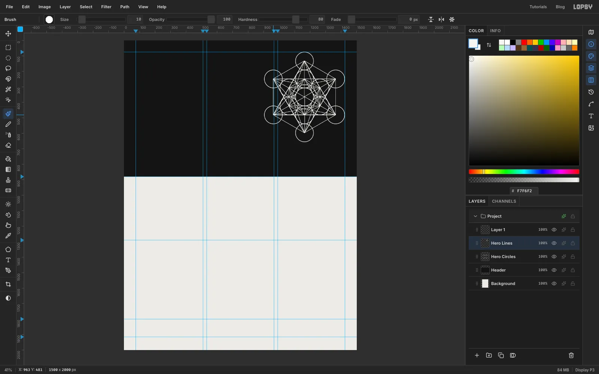

Each line below is a click on the first point and a [[Shift]]+click on the
second. Press each click right on a circle's centre. The top inner centre is
(1164, 249) and the top outer centre is (1164, 133).

1. Top inner to the upper-right inner centre (1264, 307).
2. Top inner to the lower-right inner centre (1264, 423).
3. Top outer to the upper-right outer centre (1365, 249).
4. Top outer to the lower-right outer centre (1365, 481).
5. Top inner to the upper-right outer centre (1365, 249).
6. Top inner to the upper-left outer centre (963, 249).
7. Top inner to the lower-right outer centre (1365, 481).
8. Top inner to the lower-left outer centre (963, 481).

Those eight lines, plus the spoke, give all 78 once they're repeated six
times. The hexagon, the two big triangles (a hexagram) and the inner star
appear on their own.

Finish by clicking the Brush's **Radial Symmetry** button again to turn it
off. Leave it on and every later stroke will repeat six times.

## Set the title

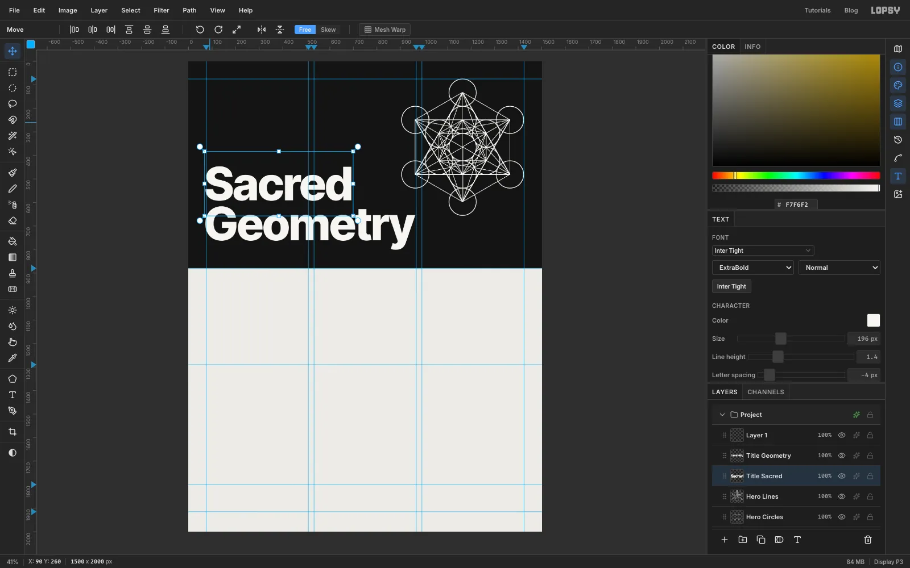

Select **Hero Lines** first. If a text layer is selected, changing the Text
settings restyles that layer, so always select a non-text layer before you
start new type. Pick the
**Text** tool ([[T]]). Set the font to **Inter Tight**, the weight to
**ExtraBold** and the size to **196**, and the colour to `#F7F6F2`. Open the
**Text** panel and set **Letter spacing** to **-4**. Big type looks loose at
default spacing; a slight negative track tightens it the way Swiss
typesetters did by hand.

Make the lower line first. A Text click inside an existing line's box edits
that line instead of starting a new one, so work bottom to top. Click in the
empty left half of the header, type `Geometry` and press [[Tab]]. Click
**Hero Lines** again, then click higher up and type `Sacred`.

With the **Move** tool ([[V]]), use the arrow keys ([[Shift]] moves 10 px)
to seat the type:

- **Geometry:** left edge on the 75 margin, bottom of the *y* descender at
  y 800. That leaves 80 px of black under it, the same as the side margin.
- **Sacred:** left edge on the margin, baseline 24 px above the top of the
  *G*.

*Geometry* runs to about x 963, just short of the end of the fourth column
(967), and the cube clears its cap height by about 80 px.

## Draw the Seed of Life rings

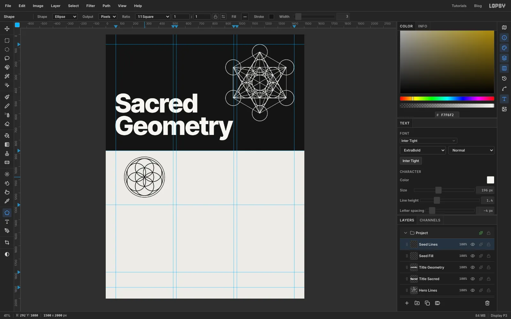

The first design is the *Seed of Life*: seven circles, each passing through
its neighbours' centres.

Select **Layer 1**, which is still empty at the top of the stack, and rename
it **Seed Fill**. Click **Add Layer** and name it **Seed Lines**, so the
lines sit above the colour.

With the **Shape** tool, keep the fill removed, set the stroke to `#141414`
and **Width** to **4**. Using the Shape Size dialog, make seven **140 × 140**
circles. Put one at the cell's centre, **(292, 1080)**, and six on a 70 px
ring around it: (292, 1010), (353, 1045), (353, 1115), (292, 1150),
(231, 1115) and (231, 1045).

Then frame the flower. Make a **280 × 280** circle on the centre, which
touches the six outer petals. Set **Width** to **3** and add a
**306 × 306** circle around it.

## Select the centre with the Magic Wand

The overlapping rings divide the centre into six white petals and six small
three-sided spaces between them. Colour the spaces and the petals stand out
in white.

Pick the **Magic Wand** ([[W]]), set **Tolerance** to **10** and keep
**Contiguous** on. The wand reads only the active layer, so keep **Seed
Lines** selected. It sees the empty space between the lines as separate
regions.

Click inside the space just up and to the right of the centre, at about
(312, 1045). Then [[Shift]]+click the other five spaces, going round the
centre every 60°.

## Fill the Seed of Life

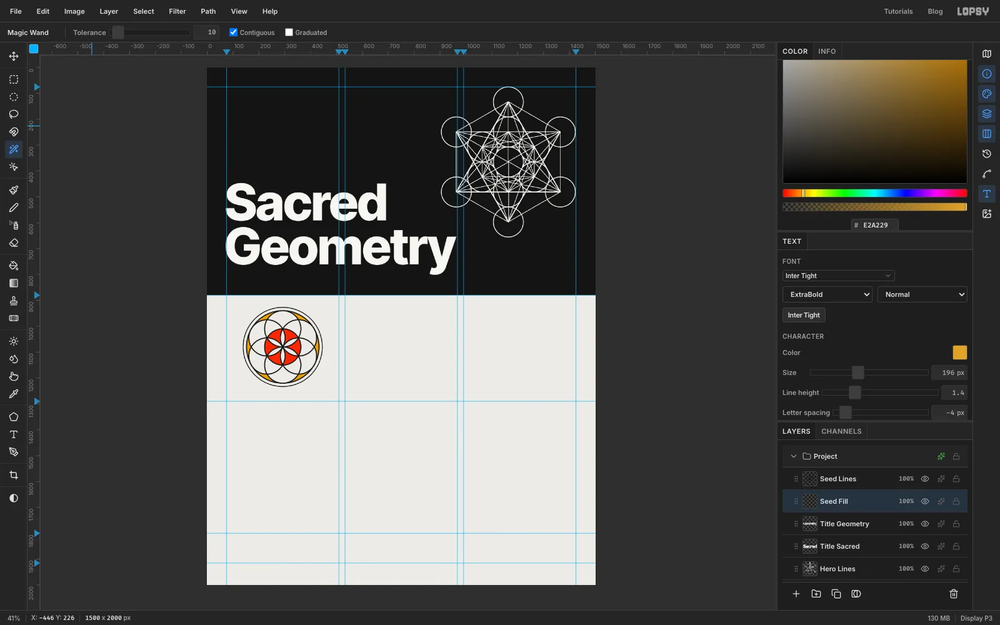

Choose **Select → Grow…** and grow by **2** px so the colour tucks under the
lines. Select **Seed Fill**, set the foreground to `#E8401C` and choose
**Edit → Fill**. Press [[Cmd+D]].

Now the gold. Select **Seed Lines** again and use the wand on the six thin
crescents between the outer circles and the 280 px ring. The first is at
about (356, 969), up and to the right; [[Shift]]+click the rest. Grow by
**2**, select **Seed Fill** and fill with `#E2A229`.

Keeping colour on its own layer under the linework is how flash is painted
too: the outline is the stencil, and the colour goes in underneath.

## Draw the lotus with radial symmetry

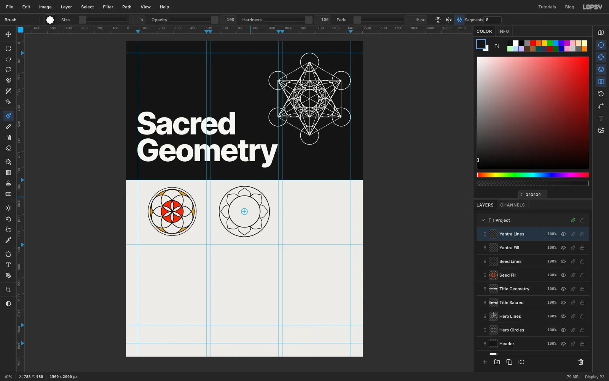

Design 02 is a *Shatkona yantra*: two interlocked triangles in a ring of
lotus petals. Its centre is **(750, 1080)**.

Click **Add Layer** twice, naming the layers **Yantra Fill** and then
**Yantra Lines**. With the Shape tool at Width **4**, make a **320 × 320**
and a **200 × 200** circle on the centre.

Pick the **Brush**, turn **Radial Symmetry** on with **Segments 8**, and
[[Cmd]]+click the centre. Set **Size** to **4**, **Hardness** to **100**
and the foreground to `#141414`.

Draw a single petal in one continuous stroke. Start on the inner ring at
(712, 988), swing outward and up to a point at (750, 930), and come back
down the other side to (788, 988). Keep the stroke slow and smooth. The
other seven petals appear as you draw. Turn **Radial Symmetry** off.

## Draw the triangles with the Pen

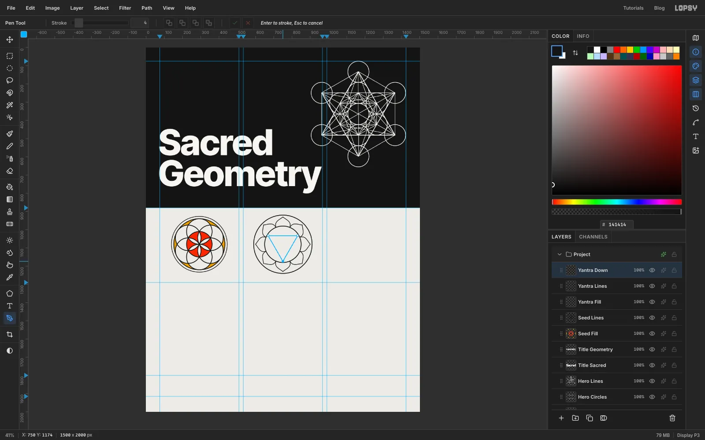

Click **Add Layer** and name it **Yantra Down**. Pick the **Pen** ([[P]]),
set **Stroke** to **4** and keep the foreground on ink. Click three corners
at (750, 1174), (669, 1033) and (831, 1033), then click the first corner
again to close the path. Press [[Enter]] to stroke it. In the **Paths**
panel, click **Delete Path**.

Click **Add Layer**, name it **Yantra Up**, and draw the upward triangle the
same way: (750, 986), (831, 1127) and (669, 1127), closed and stroked with
[[Enter]]. Keep this path for the next step.

Each triangle sits on its own layer so the two can weave over and under
each other.

## Fill the triangle and weave the lines

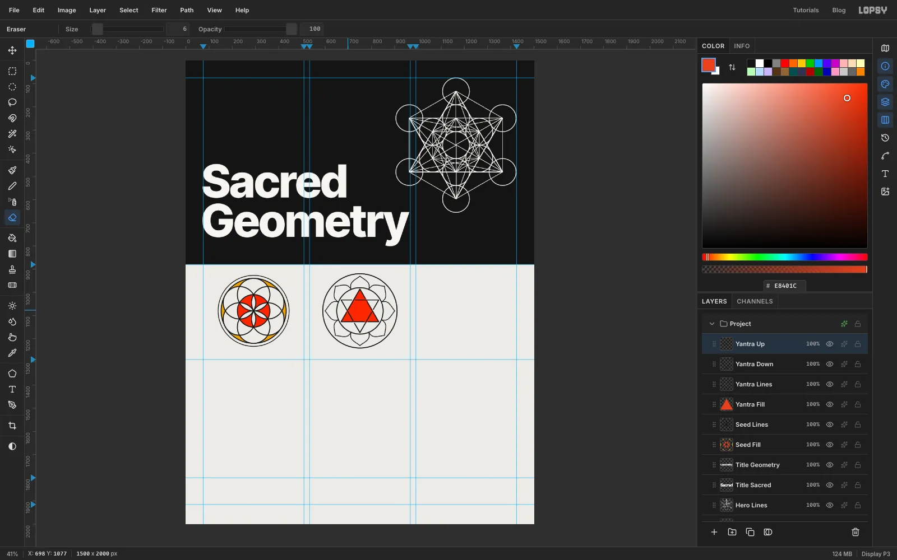

With the up triangle's path still selected, click **Path to Selection** in
the Paths panel, then delete the path. Choose **Select → Grow…** with **2**,
select **Yantra Fill** and fill with `#E8401C`. Press [[Cmd+D]].

The triangles cross at six points. To weave them, cut a short gap in the
line that passes *under* at each crossing, alternating all the way round.
Pick the **Eraser** ([[E]]) and set its **Size** to **6**.

1. Select **Yantra Down** and erase the down triangle's line at the
   crossings at (723, 1033), (804, 1080) and (723, 1127).
2. Select **Yantra Up** and erase the up triangle's line at (777, 1033),
   (777, 1127) and (696, 1080).

At each crossing, click about 4 px along the line you're cutting on one side
of the crossing, and [[Shift]]+click 4 px along it on the other side. With a
6 px eraser the gap comes out about 14 px, just wider than the line on top.
Zoom in for this; it's fiddly at full-page size.

## Gild the lotus

Select **Yantra Lines** and use the Magic Wand on the middle of each lotus
petal, [[Shift]]+clicking round all eight. Grow by **2**, select **Yantra
Fill** and fill with `#E2A229`.

Finish with the *bindu*, the dot at the centre. Select **Yantra Up**, pick
the **Elliptical Marquee** and click once to open the From / To dialog.
Enter From **741, 1071** To **759, 1089**, an 18 px circle on the centre.
Fill it with `#141414` and deselect.

## Start a dotwork sphere

Design 03 is a ring of eight moon phases around a dotwork sphere. Its
centre is **(1208, 1080)**.

Click **Add Layer** and name it **Luna Sphere**. With the **Elliptical
Marquee**, make a **124 px** circle on the centre: From **1146, 1018** To
**1270, 1142**. Pick the **Gradient** tool, set it to
**Radial**, and in **Advanced…** make the stops white `#FFFFFF` and black
`#000000`. Drag from the highlight at (1186, 1056) towards the lower right,
to about (1260, 1136).

## Turn the gradient into dots

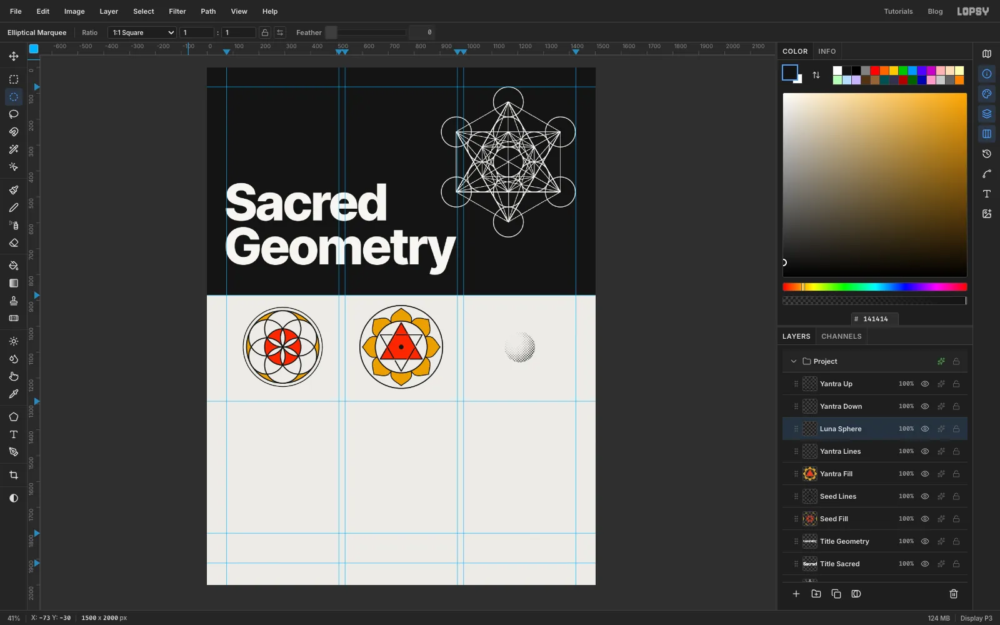

Tattoo dotwork shades with dots instead of grey. **Filter → Halftone…**
does the same thing to a gradient. Set **Dot Size** to **7** and
**Softness** to **0.3**, and apply. Press [[Cmd+D]].

The halftone leaves a soft half-dot rim on the circle's edge, so trim it.
Make a **118 px** circle on the same centre (From **1149, 1021** To
**1267, 1139**), choose **Select → Inverse** and press [[Delete]]. Deselect.

Pure white makes no dot, so the highlight is clean paper. Grey cells print
grey dots, so open the layer's effects drawer, turn on **Color Overlay** and
set it to `#141414`. Every dot is now solid ink.

## Shade a gibbous moon with a subtraction

The moons sit on a 128 px orbit around the sphere, each **50 px** across.
Click **Add Layer**, name it **Full Moon**, select a 50 px circle on the
top of the orbit (From **1183, 927** To **1233, 977**), fill it with
`#E8401C` and press [[Cmd+D]]. The From / To dialog only opens when nothing
is selected, so deselect after every fill in this design.

Click **Add Layer** and name it **Moons Right**. Each phase's dark side is
a selection:

- **Gibbous, upper right:** select a 50 px circle from **1274, 965** to
  **1324, 1015**. Then hold [[Option]]+[[Cmd]] and drag a second circle
  14 px further right, from (1288, 965) to (1338, 1015). Option subtracts
  and Cmd keeps it round, leaving a thin crescent on the left. Fill it with
  ink and press [[Cmd+D]].

## Shade the quarter moon with an intersection

Now the quarter moon on the right. Select a 50 px circle from
**1311, 1055** to **1361, 1105**. Switch to the **Rectangular Marquee**,
hold [[Shift]]+[[Option]] and drag a rectangle over the circle's left half,
from (1306, 1050) to (1336, 1110). Shift and Option together keep only the
overlap, a half-disc. Fill it with ink and press [[Cmd+D]].

## Shade the crescent and finish the right side

Last on this side is the crescent at the lower right. With the
**Elliptical Marquee**, select a 50 px circle from **1274, 1146** to
**1324, 1196**. Hold [[Shift]]+[[Option]]+[[Cmd]] and drag a second circle
14 px to the left, from (1260, 1146) to (1310, 1196). The overlap is a big
dark body with only a sliver lit on the right. Fill it with ink and
deselect.

The dark shapes are 1 px smaller than the moon outlines you'll add later,
so nothing pokes past an outline.

## Duplicate and flip the moons

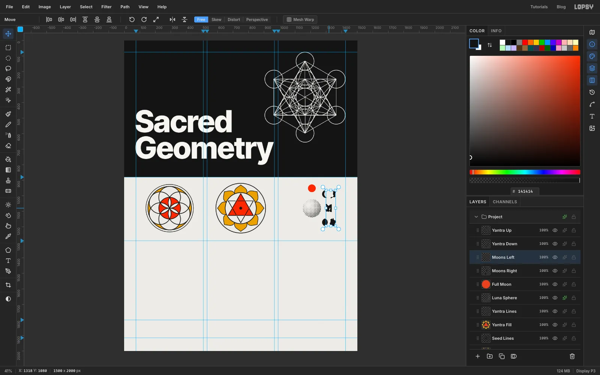

The left side of the orbit is the mirror image of the right. Click
**Duplicate Layer** and rename the copy **Moons Left**.

Draw a rectangular marquee around the three right-hand moons, from about
(1264, 956) to (1370, 1205). Switch to the **Move** tool and click **Flip
Horizontal** in its options bar. The moons flip in place inside the marquee.

## Slide the copy across

Press inside the selection and drag it straight left by **218 px**, until
the quarter moon's centre sits at (1080, 1080). The flipped copy now
mirrors the right side about the vertical axis. Press [[Cmd+D]].

Select **Moons Right** again and fill a 50 px circle at the bottom of the
orbit (From **1183, 1183** To **1233, 1233**) with ink for the new moon.

## Add the orbit and the outlines

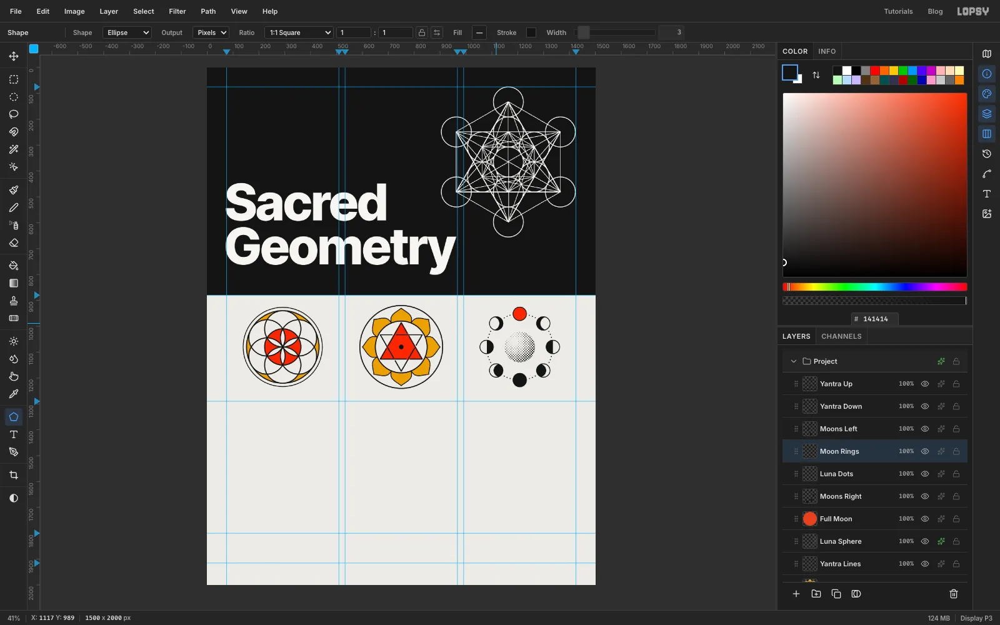

Click **Add Layer** and name it **Luna Dots**. Turn on **Radial Symmetry**
with **Segments 8**, [[Cmd]]+click the centre, and set the **Brush** to
**Size 5**. Click three dots on the orbit in the gap to the right of the
full moon, at (1245, 958), (1257, 962) and (1268, 967). The other seven
gaps fill in. Turn symmetry off.

Click **Add Layer** and name it **Moon Rings**. With the **Shape** tool
(fill removed, stroke ink, **Width 3**), make a **52 × 52** circle on each
of the eight moon centres: (1208, 952), (1299, 990), (1336, 1080),
(1299, 1171), (1208, 1208), (1117, 1171), (1080, 1080) and (1117, 990).
The outline layer goes last so it sits over every fill.

## Lay in the Fibonacci colour and dots

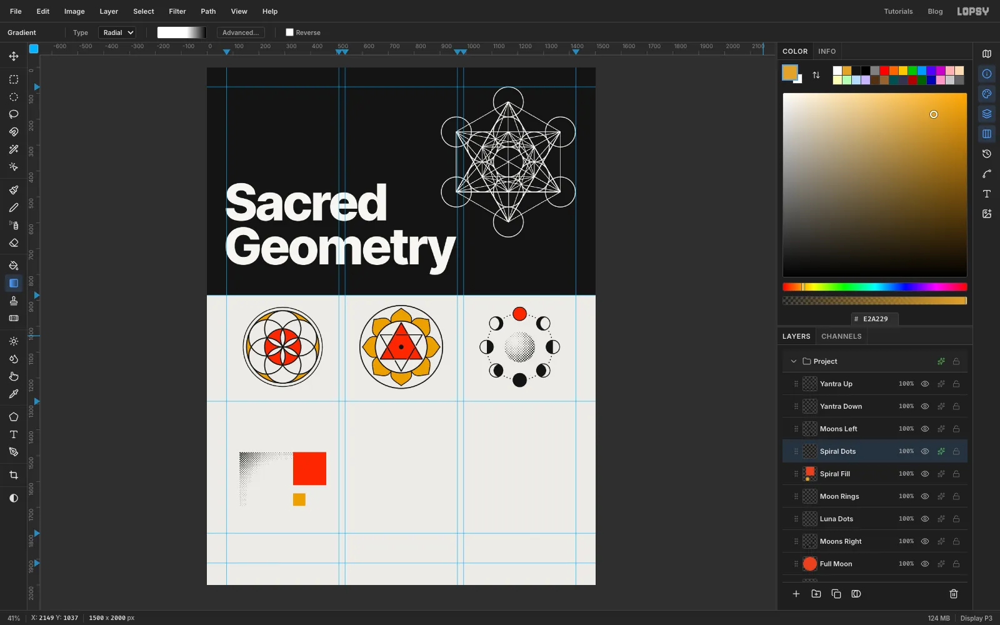

Design 04 is a golden spiral over Fibonacci squares. The rectangle is
21 × 13 units of 16 px, so 336 × 208 px, starting at **(124, 1486)**.
You'll scale it up at the end.

Click **Add Layer** and name it **Spiral Fill**. Use the Rectangular
Marquee's From / To dialog for each square:

- Fill the **8-unit square**, (332, 1486) to (460, 1614), with `#E8401C`,
  and press [[Cmd+D]].
- Fill the **3-unit square**, (332, 1646) to (380, 1694), with `#E2A229`,
  and press [[Cmd+D]].

Click **Add Layer** and name it **Spiral Dots**. Marquee the big
**13-unit square**, (124, 1486) to (332, 1694). Set a **radial** gradient
with three stops: white at 0 %, white at 60 % and black at 100 %. Drag it
from the square's bottom-right corner to its top-left corner. Apply
**Halftone** (Dot Size **6**, Softness **0.3**), deselect, and add a
**Color Overlay** in `#141414`. The dots gather in the outer corner the
spiral sweeps past.

## Rule the Fibonacci squares

Click **Add Layer** and name it **Spiral Grid**. Pick the **Pencil**, set
**Size 3**, and draw each line with a click and a [[Shift]]+click.

1. The outer rectangle: (124, 1486) → (460, 1486) → (460, 1694) →
   (124, 1694) → back to (124, 1486).
2. The divisions, largest first:
   - x 332 from top to bottom
   - y 1614 from x 332 to 460
   - x 380 from y 1614 to 1694
   - y 1646 from x 332 to 380
   - x 364 from y 1614 to 1646
   - y 1630 from x 364 to 380

Each line cuts the leftover rectangle into a square and a smaller golden
rectangle, which is the whole idea of the Fibonacci tiling.

## Draw the first spiral arc

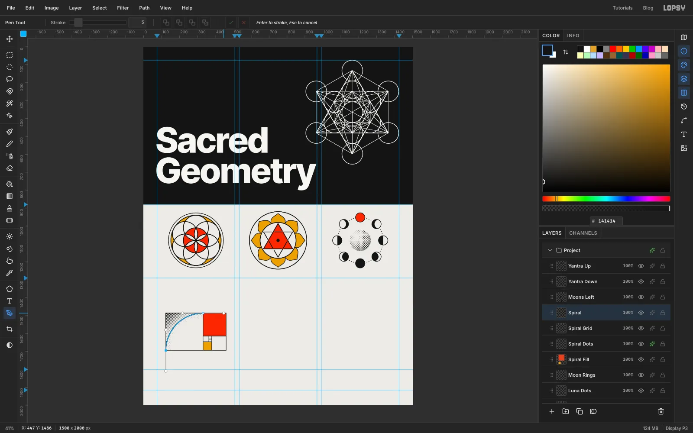

The golden spiral is one quarter circle per square. Each arc is a two-point
Pen path with its handles pulled along the square's edges.

Click **Add Layer** and name it **Spiral**. Pick the **Pen**, set
**Stroke** to **5** and the foreground to ink. For the big square:

1. Press on its bottom-left corner (124, 1694) and drag straight **up**
   about 115 px before letting go.
2. Press on its top-right corner (332, 1486) and drag straight **right**
   about 115 px.
3. Press [[Enter]] to stroke it, then delete the path in the Paths panel.

The handle length is 0.55 × the square's side. That's the number that makes
a two-point Bézier curve a near-perfect quarter circle.

## Finish the golden spiral

Repeat for the next five squares. Each arc starts where the last one ended,
and both handles run along the square's edges, 0.55 × its side:

- **8 square:** press (332, 1486) and drag right 71, then press (460, 1614)
  and drag down 71.
- **5 square:** press (460, 1614) and drag down 44, then press (380, 1694)
  and drag left 44.
- **3 square:** press (380, 1694) and drag left 27, then press (332, 1646)
  and drag up 27.
- **2 square:** press (332, 1646) and drag up 18, then press (364, 1614)
  and drag right 18.
- **1 square:** press (364, 1614) and drag right 9, then press (380, 1630)
  and drag down 9.

Stroke each one with [[Enter]] and delete its path before starting the
next.

## Group and scale the spiral

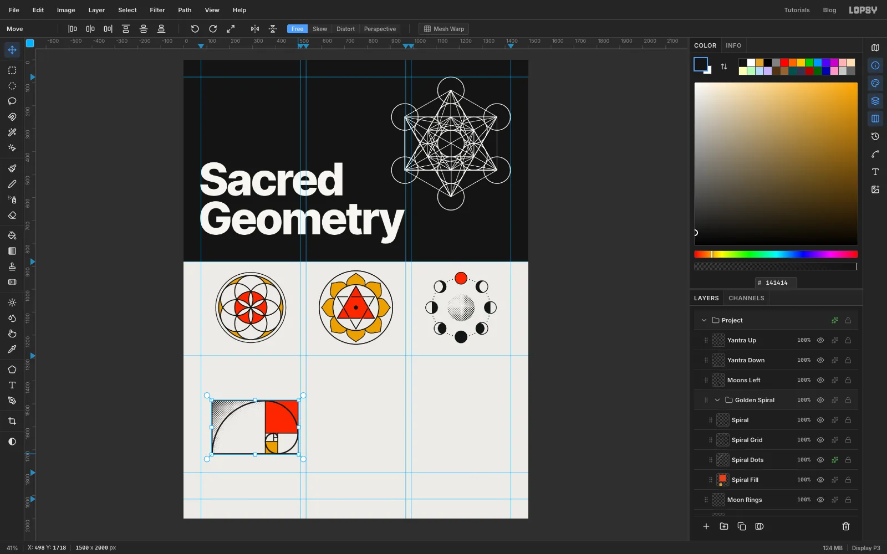

Select **Spiral**, then [[Shift]]+click **Spiral Fill** to select all four
spiral layers. Choose **Layer → Group Layers** and name the group
**Golden Spiral**.

With the group selected, pick the **Move** tool. Hold [[Cmd]] and drag the
bottom-right handle outward until the rectangle is about **374 px** wide.
[[Cmd]] keeps the proportions. Then use the arrow keys to centre it in the
cell at (292, 1590), so it spans about x 104 to 481. That leaves about
30 px of air on both sides.

## Rotate a copy of the triangle

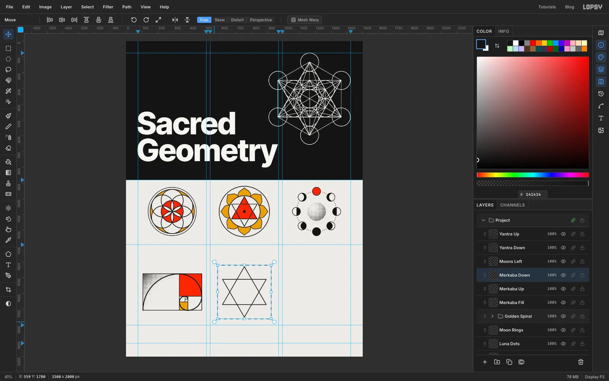

Design 05 is a *Merkaba*, the star tetrahedron, centred at **(750, 1590)**.

Click the arrow on the **Golden Spiral** group row to collapse it. A new
layer then lands beside the group instead of inside it. Click **Add Layer**
and name it **Merkaba Fill**. Click **Add Layer** again and name it
**Merkaba Up**.

With the **Pen** at **Stroke 4**, click (750, 1430), (889, 1670) and
(611, 1670), close the path on the first point and press [[Enter]]. Delete
the path.

Click **Duplicate Layer** and rename the copy **Merkaba Down**. Draw a
square marquee from (580, 1420) to (920, 1760), centred on the star. Switch
to the **Move** tool. Hold [[Cmd]] and drag the rotation handle, just
outside a corner, half a turn round until the copy reads **180°**. [[Cmd]]
snaps the angle in 15° steps. Press [[Cmd+D]] to commit.

## Draw the edges and select the tips

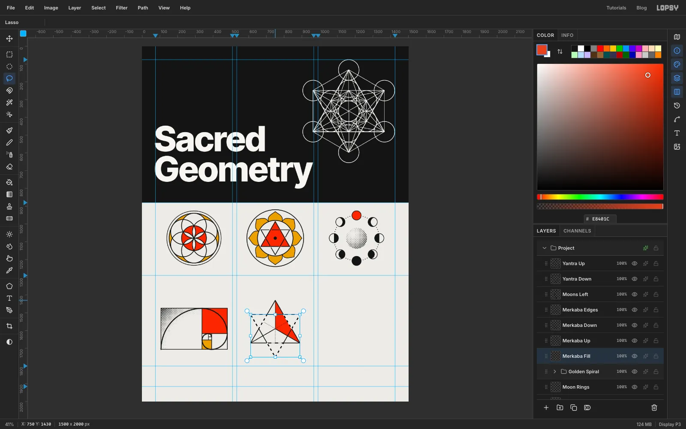

The Merkaba is two tetrahedra: one points at you, one points away.

Click **Add Layer** and name it **Merkaba Edges**. With the **Pencil** at
**Size 3**, draw three solid lines from the centre to the up triangle's
three corners. These are the visible edges.

The hidden edges, to the tetrahedron pointing away, are dotted. Pick the
**Brush** at **Size 4**, open the **Brushes** panel, note the current
**Spacing**, and set it to **320 %** so each dab sits apart. Click the
centre (750, 1590) and [[Shift]]+click (750, 1664). Do the same towards
(686, 1553) and (814, 1553). Each dotted edge points at one of the down
triangle's tips and stops at the inner hexagon, where the edge disappears
behind the front faces. Set Spacing back to what it was.

Now the colour, on **Merkaba Fill**:

1. **Red facet:** with the Pen, click the centre, the top point and the
   lower-right corner, and close the path. Click **Path to Selection** and
   delete the path. Grow by **1**, fill with `#E8401C` and deselect.
2. **Gold tips:** make the down triangle a selection the same way, (750,
   1750), (611, 1510), (889, 1510), and delete the path. Pick the
   **Lasso** ([[L]]), hold [[Option]] and drag along the up triangle's
   three edges. The Lasso is freehand, so zoom in and trace down the middle
   of each black line; the 4 px stroke on top hides small wobbles. Only
   the star's three outer tips stay selected.

## Finish the Merkaba

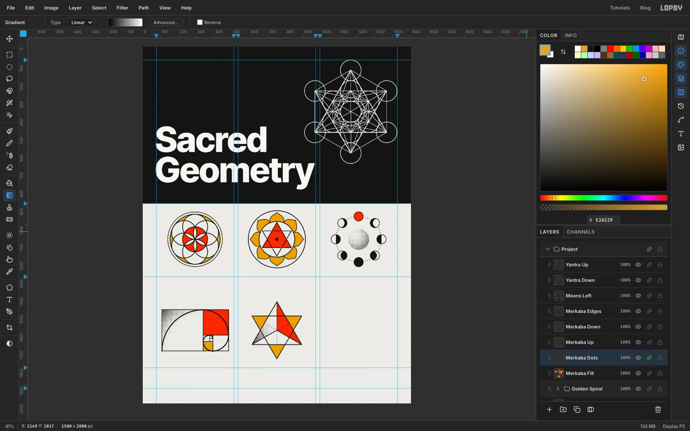

Grow the tips selection by **1** and fill it with `#E2A229`.

Click **Add Layer** and name it **Merkaba Dots**. With the Pen, make the
lower-left facet into a selection: the centre, the lower-left corner and
the top point. Delete the path. Draw a **linear** black-to-white gradient from the
lower-left corner (611, 1670) to just past the centre, at about (767, 1580).
Apply **Halftone** (Dot Size **6**, Softness **0.3**), deselect, and add an
ink **Color Overlay**.

To tidy the panel, select **Merkaba Edges**, [[Shift]]+click **Merkaba
Fill**, and choose **Layer → Group Layers**. Name the group **Merkaba**.

## Build the vesica piscis

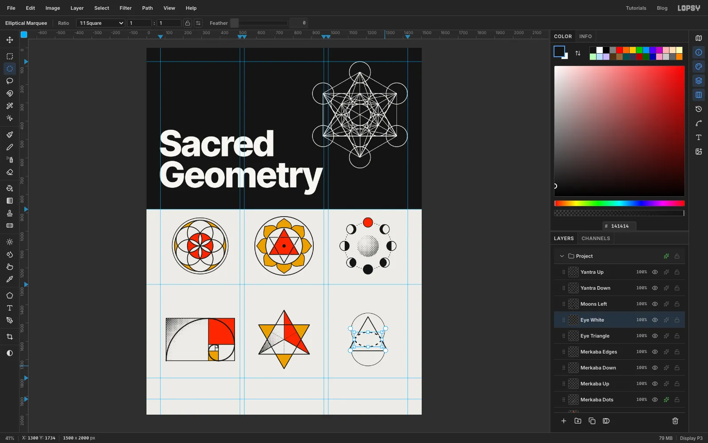

A *vesica piscis* is the almond made by two equal circles, each passing
close to the other's centre. Design 06 sets an eye in one, centred at
**(1208, 1590)**.

Click **Add Layer** and name it **Eye Triangle**. With the **Pen** at
**Stroke 4**, draw a closed triangle through (1208, 1466), (1315, 1652) and
(1101, 1652), and press [[Enter]]. With the **Shape** tool at **Width 2**,
add two **184 × 184** circles centred at (1208, 1538) and (1208, 1642).

Click **Add Layer** and name it **Eye White**. With the **Elliptical
Marquee**, select the upper circle: From **1116, 1446** To **1300, 1630**.
Then hold [[Shift]]+[[Option]]+[[Cmd]] and drag over the lower circle,
from (1116, 1550) to (1300, 1734). The intersection is the vesica, the
almond in the middle.

## Draw the eye and its rays

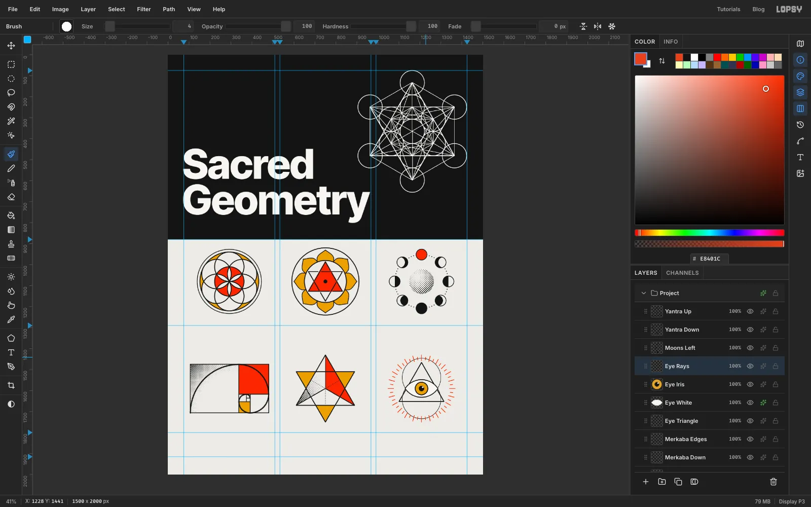

Fill the almond with `#F7F6F2` and deselect. In the effects drawer turn on
**Stroke** with **Width 4** in `#141414`. An effect outline stays crisp and
can be changed later.

Click **Add Layer** and name it **Eye Iris**. Fill three circular
selections, deselecting between them:

- the iris, From **1178, 1560** To **1238, 1620**, in `#E2A229`
- the pupil, From **1195, 1577** To **1221, 1603**, in ink
- a glint up and to the right, From **1210, 1580** To **1218, 1588**, in
  `#F7F6F2`

Still on **Eye Iris**, add a **60 × 60** Shape circle on the centre with an
ink stroke of **4** around the iris.

Click **Add Layer** and name it **Eye Rays**. Turn on **Radial Symmetry**
with **Segments 24** and [[Cmd]]+click the centre. Set the **Brush** to
**Size 4** in `#E8401C`.

1. Draw a long ray straight up, from (1208, 1457) to (1208, 1430).
2. Draw a short ray just to its right, from (1226, 1454) to (1228, 1441).

Symmetry turns those two strokes into 48 alternating rays. Turn symmetry
off.

## Rule the cells

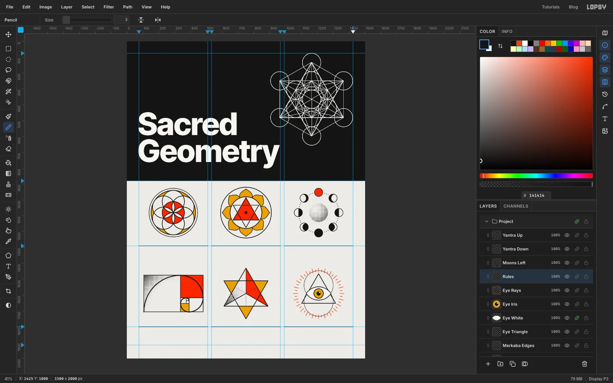

Click **Add Layer** and name it **Rules**. Pick the **Pencil** at
**Size 3** in ink. Under each cell, click the left edge and [[Shift]]+click
the right edge, on the guides at **y 1290** and **y 1800**:

- x 75 to 509
- x 533 to 967
- x 991 to 1425

The gaps between the rules are the column gutters, so each design reads as
its own card.

## Label every design

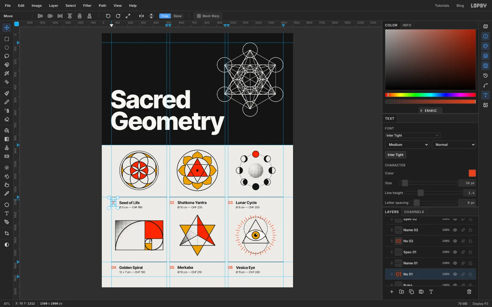

Each label has three text layers. Select **Rules** before each one so you
never restyle an existing label. Create the bottom-right label first and
work backwards; that way no click lands inside an earlier line's box.

- **Size and price:** Inter Tight **Regular 22**, ink, e.g.
  `Ø 9 cm — CHF 180`.
- **Name:** Inter Tight **Bold 30**, ink, e.g. `Seed of Life`.
- **Number:** Inter Tight **Medium 30**, `#E8401C`, e.g. `01`.

The six labels are 01 *Seed of Life* (Ø 9 cm, CHF 180), 02 *Shatkona
Yantra* (Ø 10 cm, CHF 220), 03 *Lunar Cycle* (Ø 9 cm, CHF 200), 04
*Golden Spiral* (12 × 7 cm, CHF 190), 05 *Merkaba* (Ø 10 cm, CHF 210) and
06 *Vesica Eye* (Ø 11 cm, CHF 240).

Nudge each one into place with the **Move** tool. The number starts on the
cell's left edge. The name and the price line start **62 px** in, so the
names form a clean tab. Name and number caps sit **32 px** under the rule,
and the price line **72 px** under it.

## Add the vermilion disc

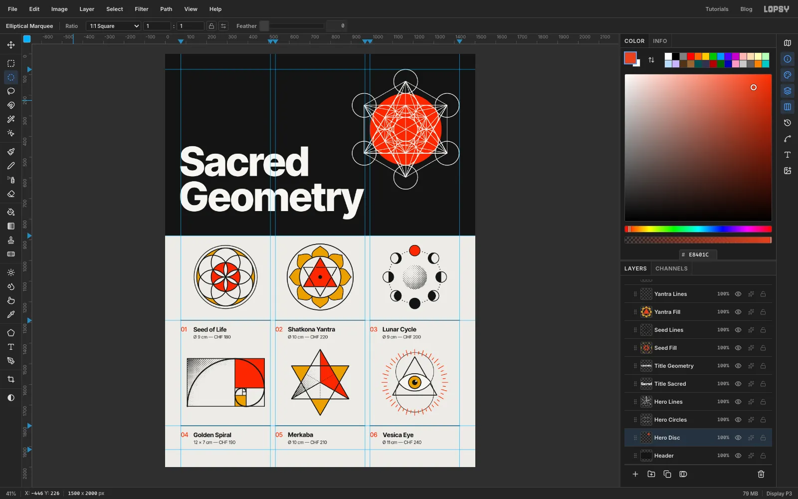

Back in the header, select **Header** and click **Add Layer**. Name it
**Hero Disc**; it lands between the black and the white lines.

Select a **348 px** circle centred on the cube, From **990, 191** To
**1338, 539**, and fill it with `#E8401C`. Its edge touches the outer edges of the six inner
circles, so the disc reads as part of the construction. It's the one big
flat colour field a Müller-Brockmann poster would anchor on.

## Set the info row

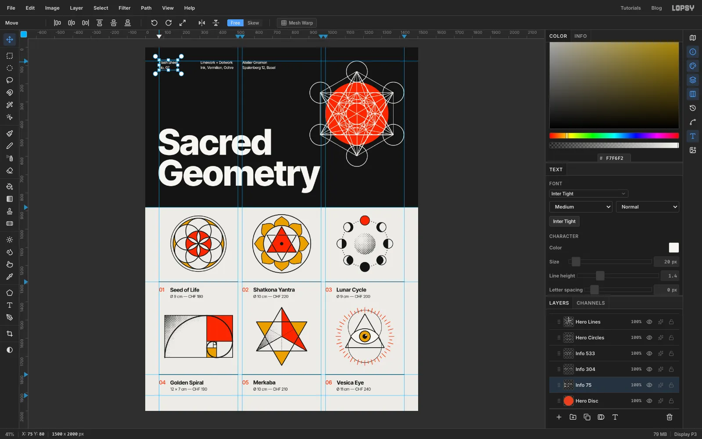

Select **Hero Disc**. With the **Text** tool at Inter Tight **Medium 20** in
`#F7F6F2`, type three two-line blocks (press [[Enter]] for the second
line). Make them right to left:

- x 533: `Atelier Gnomon` / `Spalenberg 12, Basel`
- x 304: `Linework + Dotwork` / `Ink, Vermilion, Ochre`
- x 75: `Flash Sheet` / `No. 07`

Nudge each so its left edge sits on its column line and its caps sit on the
75 guide, level with the top of the cube.

## Copy the registration marks

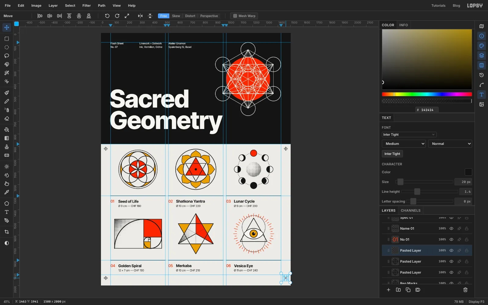

Screen-printed flash carries registration marks for lining up the colour
passes. Select **Rules** and click **Add Layer**; name it **Reg Marks**.

Centre the first mark in the margin at (37, 917). With the **Pencil** at
**Size 2**, draw a 32 px cross through it: click (21, 917) and
[[Shift]]+click (53, 917), then click (37, 901) and [[Shift]]+click
(37, 933). Add a **20 × 20** Shape circle with a **Width 2** ink stroke on
the same point.

Select a 40 px square around the mark, From **17, 897** To **57, 937**, and
press [[Cmd+C]]. Then, three times, press [[Cmd+V]]. Each paste lands in
place on a new **Pasted Layer** right above the mark. Drag it from its
middle with the **Move** tool to the next corner: (1463, 917), (37, 1941)
and (1463, 1941). Press [[Cmd+D]] when you're done.

## Add the colophon and grain

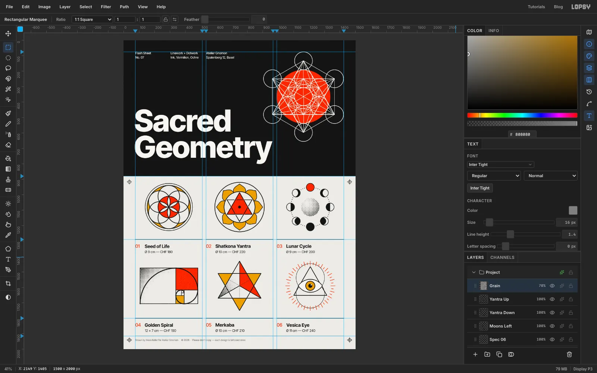

Select **Rules** and draw a **Size 1** Pencil hairline across the foot at
**y 1915**, from x 75 to 1425. Under it, add the colophon in Inter Tight
**Regular 16**, colour `#5E5C58`, with its caps at y 1935, level with the
lower registration marks: `Drawn by Mara Keller for Atelier Gnomon · © 2026
· Please don't copy — each design is tattooed once`.

Finish with grain. Select the topmost layer in the Layers panel and click
**Add Layer**, so the new layer sits over everything. Name it **Grain**.
Fill it with `#808080`, then apply **Filter → Add Noise…** with
**Amount 100** and **Mono**, leaving Distribution on **Uniform**. Set its
**Blend mode** to **Overlay** and its opacity to **70 %**.

Overlay hardly moves near-black and near-white, which is why the noise has
to be this strong: it ends up as a subtle 3–4 % tooth on both the black
header and the paper. Turn off **View → Show Guides** and choose
**File → Quick Export PNG**.
