The Swiss or International Typographic Style grew up in Zurich and Basel in the 1950s. It is built on a strict column grid, flush-left sans-serif type, asymmetric layouts and a few bold, flat shapes. It still works very well for small-business print, because the grid makes even a busy flier feel calm and easy to read.

In this tutorial you'll make a flier for **Herbal Infusions**, an imaginary loose-leaf tea bar. A teacup seen from above stands in for the round shapes Swiss posters love. It sits on a red saucer that bleeds off the right edge. Every word of type hangs on a six-column grid, and a huge two-line headline fills the full width of the page.

The canvas is 1200 × 1700 px, a portrait sheet close to A-series proportions. The artwork is built from selections, gradients and a few layer effects. The only painting is a handful of straight pencil lines, one eraser stroke and one brush stroke repeated by radial symmetry.

Along the way you'll use:

- the **Elliptical Marquee** and **Rectangular Marquee**, adding and subtracting selections with [[Shift]] and [[Alt]]
- **Radial** and **Linear** gradients, and a gradient on a **layer mask**
- **Select → Shrink** and **Select → Inverse**, and selecting a layer's pixels with [[Cmd]]-click
- the **Halftone** and **Add Noise** filters, with the **Multiply** and **Overlay** blend modes
- the **Lasso**, the **Pencil** with [[Shift]]-click lines, the **Eraser**, and the **Brush** with **Radial Symmetry**
- **Copy** and **Paste**, rotating and scaling with the transform handles, and **groups**
- ruler **guides** and the **grid** with snap
- live text in **Schibsted Grotesk**, recolouring part of a text layer, and rotating text with its handle
- **Stroke** and **Drop Shadow** effects, and **Rasterize Layer Style**

The palette:

- Paper `#EFEBE1`, ink `#151515`
- Swiss red `#E1251B`, saucer groove `#B51A12`
- Tea `#E8A93F` → `#B36A1E` → `#6B360D`, ripples `#F7D592`
- Mint `#3F8E58` / `#1F5E37`, veins `#B9DDB0`
- Chamomile petals `#FBF8EF`, centre `#F2B705`

> **Tip:** Positions are given as `x, y` in document pixels. The status bar at the bottom left shows where your cursor is. Mac key names are used; on Windows and Linux use Ctrl for Cmd. The one exception is a drag on the canvas, such as scaling with the transform handles or rotating text: there, use the Windows (Meta) key in place of Cmd.

> **Tip:** "Fill" means set the foreground colour in the Color panel's hex field, then choose **Edit → Fill**. Press [[Cmd+D]] before you draw a new marquee, because pressing inside an existing selection moves its outline instead of starting a new one.

> **Tip:** Name each layer as you create it (double-click its name in the Layers panel). The steps refer to layers by name, and a flier like this ends up with about thirty of them.

## Lay down the paper

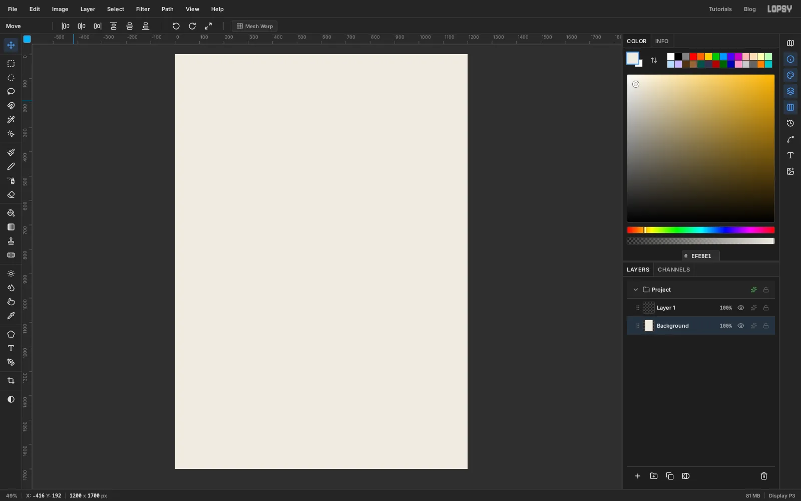

Create a new document `1200` × `1700` px. Select the `Background` layer and fill it with the paper colour `#EFEBE1`. A warm off-white looks like uncoated print stock and is much kinder to the eye than pure white.

Leave the empty `Layer 1` above it. You'll use it for the saucer next.

## Cut the saucer and its groove

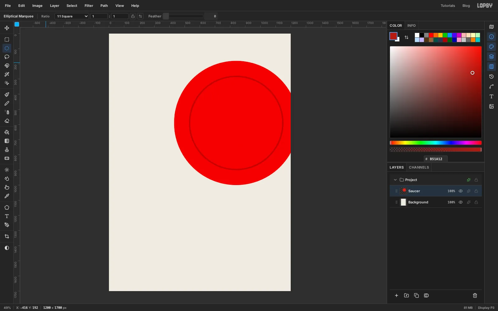

Rename `Layer 1` to `Saucer`. The saucer is a circle of 410 px radius centred on `840, 590`. The **Elliptical Marquee** draws from corner to corner, so drag from the top left of the circle's bounding box (`430, 180`) to its bottom right (`1250, 1000`). The right side runs off the canvas, and that's on purpose: a shape that bleeds off the edge gives a Swiss layout its tension. Fill it with `#E1251B` and press [[Cmd+D]].

Every circle in this tutorial is drawn the same way: start the drag at the centre minus the radius, and end it at the centre plus the radius.

Now add the groove the cup sits in. Make a ring like this:

1. Drag a circle of 312 px radius on the same centre.
2. Hold [[Alt]] and drag a second circle on the same centre, 9 px smaller all round. [[Alt]] subtracts it, leaving only a thin ring selected.
3. Fill the ring with `#B51A12` and deselect.

You'll use this select-then-subtract ring several more times. Unlike filling a circle and deleting its middle, it never touches what's already on the layer.

## Add the handle and rotate it

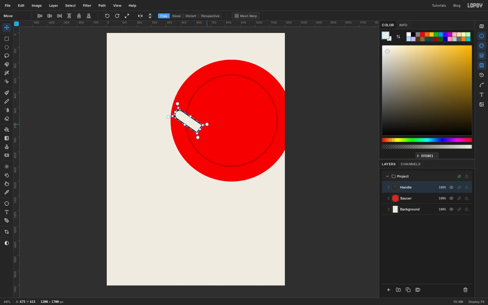

Add a layer named `Handle`. Draw the pill shape from two selections:

1. With the **Rectangular Marquee**, drag a box 160 px wide and 56 px tall. Its left edge goes at x `480`, and it's centred on the saucer's centre line, y `590`.
2. Switch to the **Elliptical Marquee**, hold [[Shift]] and drag an ellipse 60 px wide and 56 px tall, centred on the box's left edge. [[Shift]] adds it, rounding off the end.

Fill with the paper colour `#EFEBE1` and deselect. Open the layer's effects drawer, turn on **Stroke** with **Width** `6` in `#151515`, then click **Rasterize Layer Style** so the outline becomes real pixels.

[[Cmd]]-click the `Handle` thumbnail to select its pixels. Switch to the **Move** tool ([[V]]), grab the round rotation handle just outside the top-right corner, and turn the handle about 35° clockwise. The outer end tips up to the left. Press [[Enter]] to commit, then deselect. The inner end will be hidden under the cup.

## Add the cup and a flat shadow

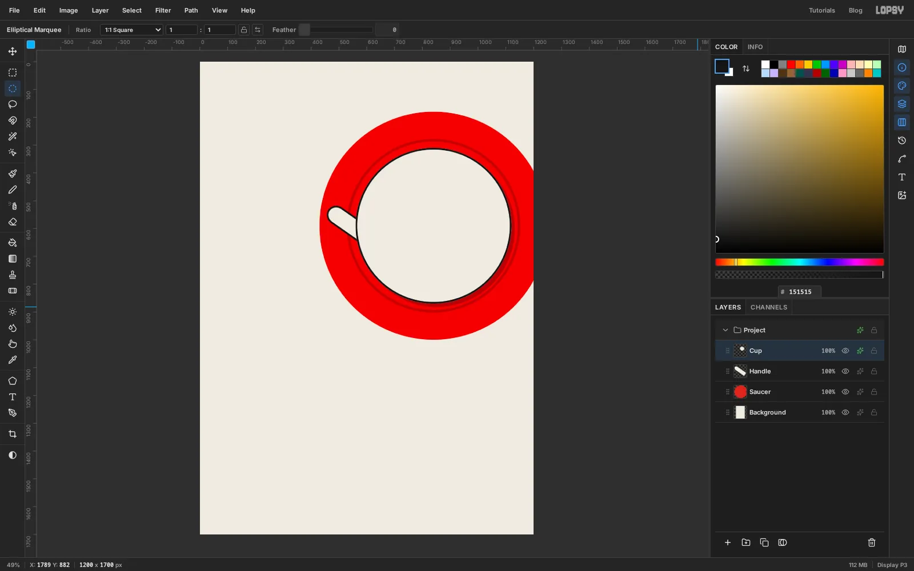

Add a layer named `Cup`. Select a circle of 280 px radius on the same centre (`840, 590`), fill it with `#EFEBE1`, and deselect. Then draw a 6 px ring in `#151515` at the cup's edge, using the subtract method from the saucer step (a 280 px circle, minus a 274 px one).

Open the effects drawer and turn on **Drop Shadow**: colour `#151515`, **Offset X** `12`, **Offset Y** `12`, **Blur** `0`, **Opacity** `25`. A hard, translucent ink shadow reads like a second printing plate rather than a photo. You'll use exactly the same shadow on every piece of artwork, so everything looks lit the same way. Click **Rasterize Layer Style** when you're happy with it.

## Pour the tea with a radial gradient

Add a layer named `Tea` and select a circle of 234 px radius on the cup's centre.

Choose the **Gradient** tool, set **Type** to **Radial** and click **Advanced…** to edit the stops: `#E8A93F` at the left end, `#B36A1E` at about 55% and `#6B360D` at the right end. Drag from a point up and to the right of the centre (`894, 532`) out to the lower-left edge of the liquid. The light spot is where the tea catches the light.

Deselect, then draw a 5 px `#151515` ring on the same layer just outside the liquid (a 236 px circle minus a 231 px one) to separate it from the cup wall.

## Draw the ripples and clip them to the tea

Add a layer named `Ripples`. Using the ring method, draw six rings in `#F7D592`, all centred on the light spot at `894, 532`: radii of about 32, 66, 102, 144, 190 and 238 px. Make the first two 4 px thick, the next three 3 px and the outer one 2 px, so they thin out as they spread.

The outer rings spill past the tea. To trim them:

1. [[Cmd]]-click the `Tea` thumbnail to select the liquid.
2. Choose **Select → Shrink…** and shrink by `8` px, so the ripples stop just short of the black edge.
3. Select the `Ripples` layer again, choose **Select → Inverse** ([[Shift+Cmd+I]]) and press [[Delete]]. Then deselect.

Lower the layer's opacity to `75%`.

## Fade the ripples with a layer mask

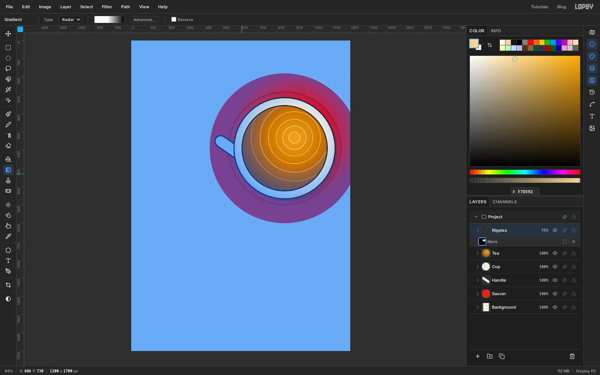

The rings stop too abruptly at the rim. With `Ripples` selected, click **Add Mask** at the bottom of the Layers panel, then click the new mask thumbnail on the layer row so you're painting on the mask, not the pixels.

Pick the **Gradient** tool with **Type** set to **Radial** and stops of white at 0%, white at 45% and black at 100%. Drag from the ripple centre out to the lower-left edge of the tea. Now the ripples are crisp near the light and fade away towards the rim. Click the layer's name again to leave mask editing.

## Add a halftone shadow

Swiss posters often used halftone photographs. A halftone shadow on the tea nods to that.

1. [[Cmd]]-click the `Tea` thumbnail, then add a layer named `Tea Halftone`.
2. Make a **Linear** gradient from white, through `#F2F2F2` at 40%, to `#4A4A4A`, and drag it from the upper right of the tea to its lower left. Deselect.
3. Choose **Filter → Halftone…**, set **Dot Size** to `9` and apply. The grey ramp turns into dots that grow towards the shadow side.
4. Set the layer's blend mode to **Multiply** and its opacity to `45%`.

> **Tip:** This is a good moment to check undo. Press [[Cmd+Z]] three times, which takes back the opacity, the blend mode and the halftone. Then press [[Shift+Cmd+Z]] three times to bring them back. The dots should come back exactly as they were.

## Draw a mint leaf

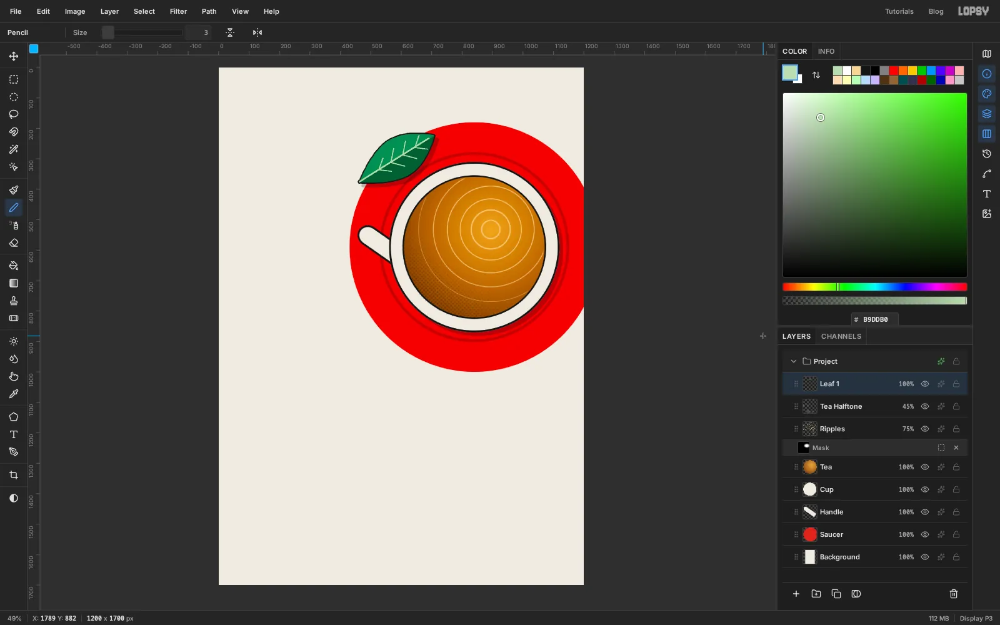

Add a layer named `Leaf 1` above `Tea Halftone`. The leaf is about 290 px long and 114 px wide, tilted up to the right, and lies across the top-left rim of the saucer with its centre near `586, 300`.

1. With the **Lasso**, draw the upper half of the leaf: a curved edge from one pointed end to the other, then straight back along the midrib. Fill it with `#3F8E58`.
2. Draw the lower half the same way and fill it with the darker `#1F5E37`. Two flat tones read as a fold down the middle.
3. Take the **Pencil** at **Size** `4` in `#B9DDB0`. Click at the lower-left end and [[Shift]]-click near the upper-right end for the midrib. At **Size** `3`, add four pairs of side veins the same way, each angled out from the midrib towards the upper-right end.

Give the layer a **Stroke** of **Width** `4` in `#151515` to match the cup's outline, plus the same **Drop Shadow** as the cup. Then rasterize the style.

## Copy, rotate and scale more leaves

[[Cmd]]-click the `Leaf 1` thumbnail and press [[Cmd+C]], then [[Cmd+V]]. The copy is pasted in place on a new layer. Name it `Leaf 2`.

With its pixels still selected, use the **Move** tool's rotation handle to turn it about 128° clockwise, so it stands almost upright. Press [[Enter]]. Select it again, then hold [[Cmd]] and drag a corner handle inwards to shrink it by about a fifth, and press [[Enter]]. Finally, drag it with the Move tool onto the lower-right rim of the saucer, around `1086, 905`.

Paste two more copies the same way:

- `Leaf 3`: rotate about 62° clockwise and shrink to half size. Float it on the tea, a little below and left of the centre.
- `Leaf 4`: rotate about 95° anticlockwise, shrink by a third, and set it on the top-right rim, clear of the header area.

Vary the angles and sizes. Identical leaves look stamped.

## Part the water around the floating leaf

A leaf floating on tea pushes the ripples aside. Select `Ripples` and take the **Eraser** at **Size** `44`. Click just below and left of the small leaf, then [[Shift]]-click just above and right of it. The straight stroke breaks the rings under the leaf.

## Paint chamomile with radial symmetry

Select `Leaf 4`, the top layer, and add a layer named `Chamomile`. Choose the **Brush** ([[B]]). Open the brush settings and set **Size** `22`, **Hardness** `100` and **Spacing** `5`. Set the colour to `#FBF8EF`.

In the options bar, click **Radial Symmetry** and set **Segments** to `14`. [[Cmd]]-click on the canvas at `520, 880`, on the lower-left rim of the saucer, to move the symmetry centre there.

Now paint one petal: click 26 px to the right of the centre and [[Shift]]-click 72 px to the right. All fourteen petals appear at once. Turn **Radial Symmetry** off again.

Select a circle of 26 px radius on the same centre and fill it with `#F2B705`. Finish with a **Stroke** of **Width** `3` in `#151515` and the shared **Drop Shadow**, and rasterize.

## Add a second, smaller flower

[[Cmd]]-click the `Chamomile` thumbnail, copy, and paste. Name the new layer `Chamomile 2`. Hold [[Cmd]] and drag a corner handle in until the flower is about 60% of its size, then press [[Enter]].

Drag it onto the empty paper left of the saucer, under where the menu will go, around `318, 596`. The two flowers on the left balance the leaves on the right.

## Group the leaves

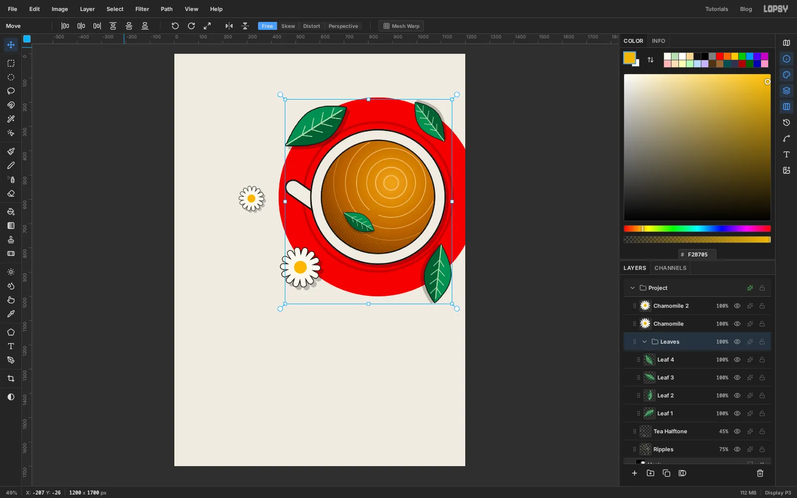

Click `Leaf 1`, [[Shift]]-click `Leaf 4`, and choose **Layer → Group Layers**. Name the group `Leaves`. With the group selected, one Move drag moves all four leaves at once, which is handy for fine-tuning the balance. Try a small drag, then [[Cmd+Z]] and [[Shift+Cmd+Z]] to see the whole group step back and forward together.

Grouping last keeps things tidy. A layer added while a group is selected goes inside that group, and you don't want the flowers or the type in `Leaves`.

## Set up the column grid with guides

Now for the type, which hangs on a classic six-column grid. The margins are 72 px, and the six columns are 156 px wide with 24 px gutters.

Click the top ruler to drop vertical guides at each column's left and right edges: `72`, `228`, `252`, `408`, `432`, `588`, `612`, `768`, `792`, `948`, `972` and `1128`. Then click the left ruler at y `72` (top margin), `140` (header rule), `1490` (info rule) and `1628` (bottom margin).

## Rule the header and info rows

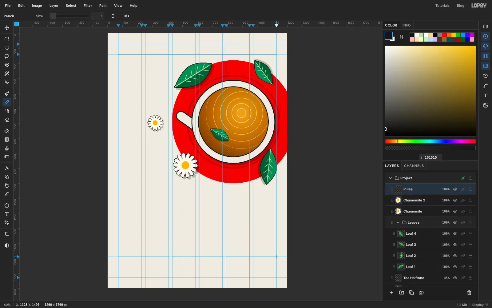

Select `Chamomile 2` and add a layer named `Rules`. Take the **Pencil** at **Size** `3` in `#151515`.

- Click at `72, 140` and [[Shift]]-click at `1128, 140` for the full-width header rule.
- At y `1490`, draw three shorter rules, each spanning two columns: `72` to `408`, `432` to `768`, and `792` to `1128`.

Each info block will sit under its own rule. That repetition is what makes Swiss layouts feel organised.

## Set the header row

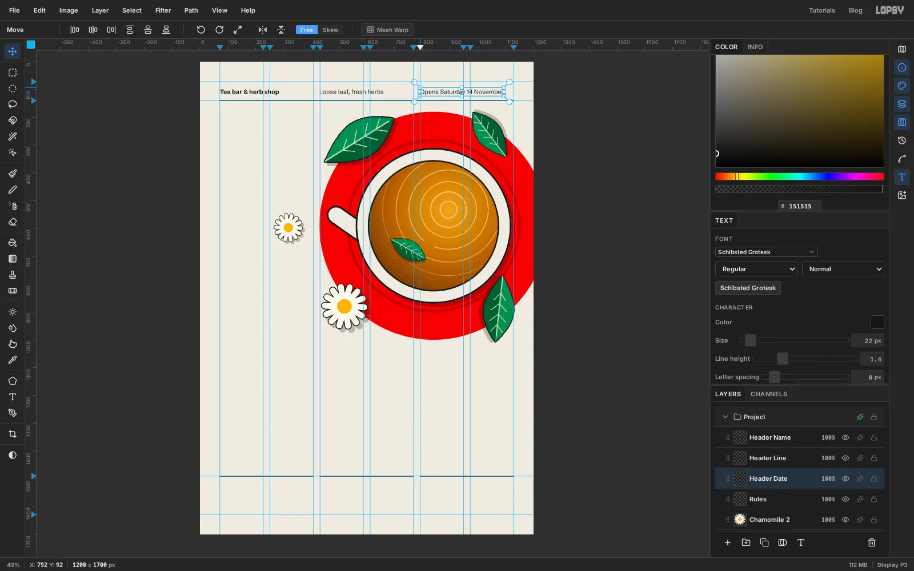

Clicking with the Text tool while a text layer is selected edits that layer. So before each new piece of text in this tutorial, click the `Rules` layer first.

Choose the **Text** tool ([[T]]) and set **Schibsted Grotesk**, **Size** `22`, colour `#151515`. In the Text panel, set **Letter spacing** to `0` and **Line height** to `1.4`. Type three items, each starting on a column edge, and press [[Tab]] to commit each one:

- `Tea bar & herb shop` in **Bold**, at the left margin (`72`), named `Header Name`
- `Loose leaf, fresh herbs` in **Regular**, at column three (`432`), named `Header Line`
- `Opens Saturday 14 November` in **Regular**, at column five (`792`), named `Header Date`

Then nudge them with the arrow keys so their capital letters all start at y `100`. That puts the three on one baseline, about 20 px above the rule.

## Set the headline across the full width

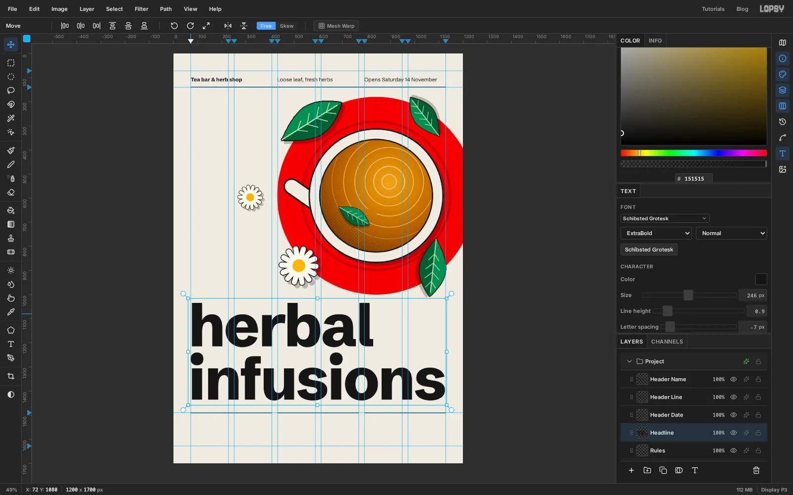

Select `Rules`. Set **Schibsted Grotesk** at **ExtraBold**, start at about **Size** `210`, and type `herbal`, press [[Enter]], then type `infusions`. Commit with [[Tab]] and name the layer `Headline`.

Big type needs tighter spacing than small type. In the Text panel, set **Letter spacing** to `-7` and **Line height** to `0.9`.

Now make `infusions` fill the grid exactly. With the layer selected and the Text tool active, raise the **Size** until the word runs from the left margin guide to the right one, about `246`. Then move the block so its left edge sits on x `72` and the bottom of `infusions` sits about 50 px above the info rule.

## Colour the first line green

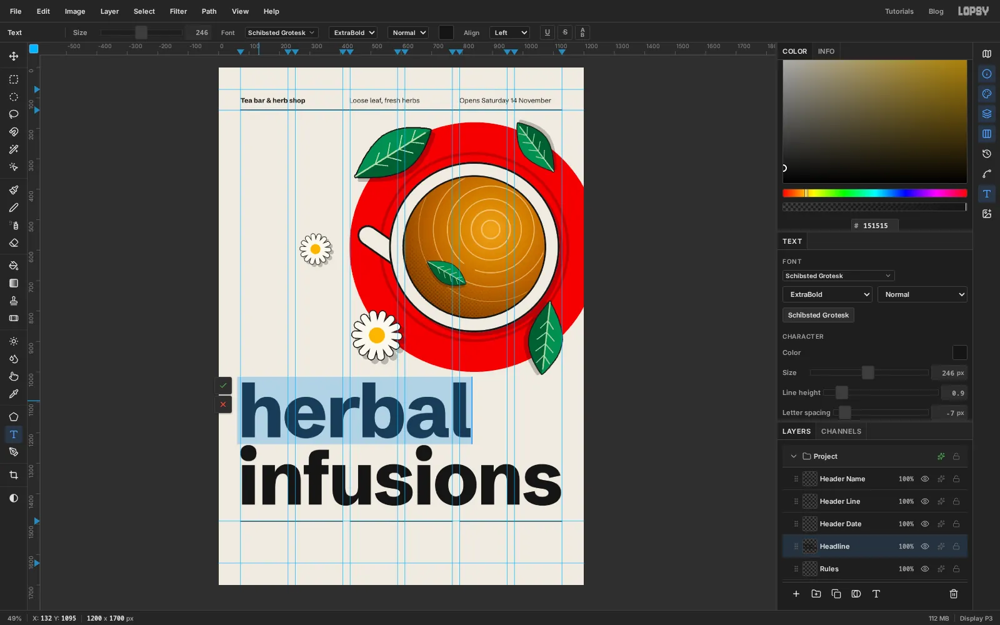

With the **Text** tool, click into the headline to edit it. Drag across `herbal` to select just that word.

Click the **Text color** swatch in the options bar and enter `#1F5E37`. Only the selected word changes colour. Press [[Escape]] to close the picker, then [[Tab]] to commit.

> **Tip:** Use the Text color swatch for this, not the Color panel. While you're editing text, the Color panel sets the colour of the whole text layer.

The green ties the headline to the leaves, and the black second line anchors it to the ink in the rest of the flier.

## Typeset the menu, using the grid to place it

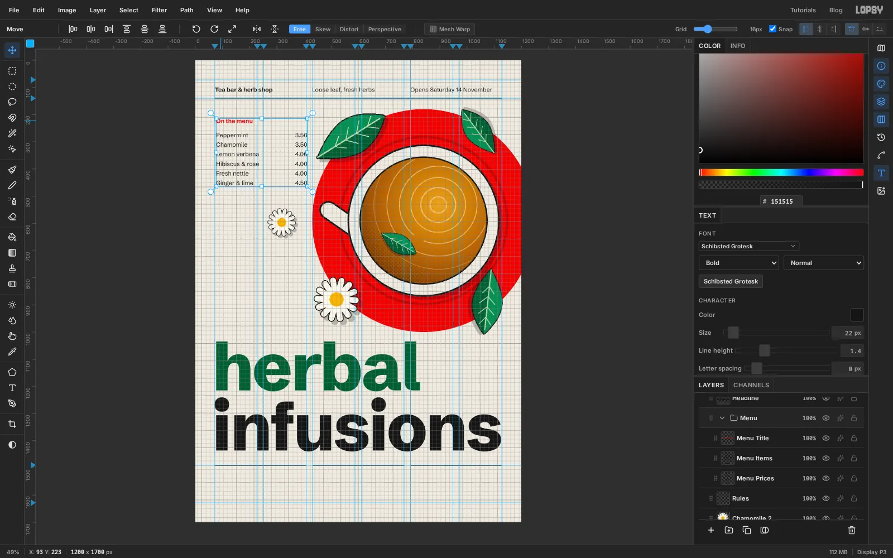

Type three text layers in **Schibsted Grotesk** **Size** `22`, selecting `Rules` before each one:

1. `Menu Title`: `On the menu` in **Bold**, colour `#E1251B`, at the left margin, about y `176`.
2. `Menu Items`: the six drink names in **Regular** `#151515`, one per line, starting at y `226`: Peppermint, Chamomile, Lemon verbena, Hibiscus & rose, Fresh nettle, Ginger & lime. Set **Line height** to `1.6`, so the list breathes.
3. `Menu Prices`: the prices in the same style, but with **Align** set to **Right** and clicked on the second column's right edge, x `408`: 3.50, 3.50, 4.00, 4.00, 4.00, 4.50. Use the same `1.6` line height so each price lines up with its drink.

Group the three layers as `Menu`. Show the grid (**View → Show Grid**, 16 px, with **Snap** on) and drag the `Menu` group down two cells, so it clears the header comfortably. Hide the grid again. Snapping can shift the layers sideways by a few pixels, so nudge the title and names back onto x `72` and the prices back onto `408` with the arrow keys.

## Rotate a vertical tagline

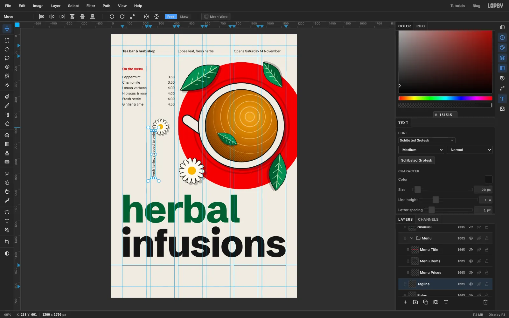

Select `Rules`, and type `Fresh herbs, steeped to order` in **Schibsted Grotesk** **Medium**, **Size** `20`, with **Letter spacing** `1`. Click somewhere in the empty space on the left to place it, and name the layer `Tagline`.

Switch to the **Move** tool. With a text layer selected, it shows handles around the text without any selection. Hold [[Cmd]] and drag the top-right rotation handle anticlockwise. Holding [[Cmd]] snaps the angle to 15° steps, so stop at exactly -90°. The text now reads from bottom to top.

Nudge it onto the left margin so its left edge sits on x `72`, with its foot about 48 px above the top of the headline. Vertical type in the margin is a classic Swiss device. Keep the words short and don't repeat information found elsewhere.

## Fill in the info row

Under each of the three short rules, set a label and a body, flush with the rule's left end. Select `Rules` before each one, and name them `Opening day Label`, `Opening day Body` and so on.

- Labels: **Bold**, **Size** `22`, `#E1251B`, about 18 px below the rule (y `1508`).
- Bodies: **Regular**, **Size** `26`, `#151515`, **Line height** `1.3`, starting at y `1548`.

The three blocks are:

- **Opening day**: Saturday 14 November / 10:00 – 18:00
- **Find us**: Hazel Street 41 / Tram 4, stop Hazelplatz
- **Bring this flier**: and your first cup / of tea is on us

Write the date the same way everywhere, here and in the header.

## Add paper grain and export

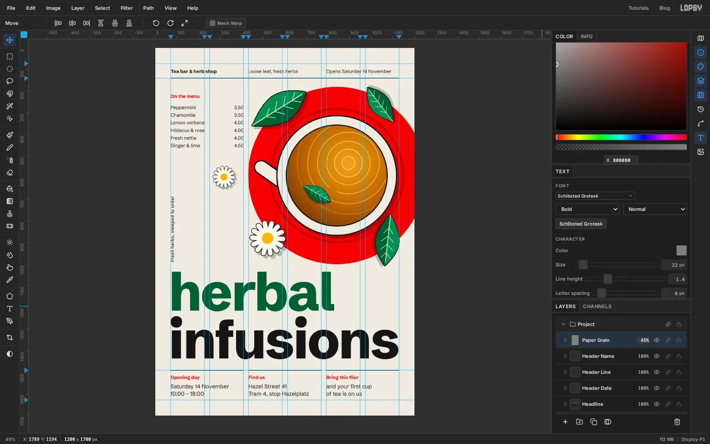

Flat colour can look a little too digital. Every text layer was added just above `Rules`, so the first one you typed, `Header Name`, is now at the top of the stack. Select it and add a layer named `Paper Grain`, which lands above everything.

Fill it with `#808080`. Choose **Filter → Add Noise…**, set **Amount** to `30`, click **Mono** and **Gaussian**, and apply. Set the layer to **Overlay** at `45%` opacity. The grey disappears and only the speckle is left on the paper, the red and the type.

Hide the guides with [[Cmd+;]]. Save the project with **File → Save Project**, and use **File → Quick Export PNG** to get the finished flier.
