A stencil contact sheet shows every template in a kit on one page, so you can pick a design and check it before you cut. This one is for an imaginary 80s spray kit called **Midnight Arcade**: six stencil plates taped to a cutting mat, with neon paint glowing through the cut-outs.

The trick that makes it work is a **layer mask**. The six cards are one flat layer, and every icon is a hole cut in that layer's mask. A layer of bright gradients sits underneath and shows through wherever you cut. Because each icon is a real hole, you have to design it like a real stencil: every loose piece of card needs a **bridge** holding it to the rest, or it would fall out.

You'll make a 1500 × 2000 px sheet and use:

- **guides** with snapping, the **Gradient** tool and the **Shape** tool
- a **layer mask**, cut with the marquees and Lasso using add, subtract, **Select → Shrink** and **Edit → Fill**
- the **Drop Shadow**, **Inner Glow**, **Stroke**, **Color Overlay** and **Outer Glow** layer effects
- the **Spray** tool, **Gaussian Blur**, **Select → Feather** and **Add Noise**
- text in **Saira Stencil**, **Mr Dafoe** and **Share Tech Mono**, a text-shaped mask for a chrome fill, and a rotated script
- copy and paste, **Duplicate Layer**, rotate and flip, **Merge Down**, groups, and a **Hue / Saturation** group adjustment

The palette:

- Mat `#090418` → `#1A0A38` → `#3B0F5E`
- Grid cyan `#35E6F2`
- Card `#17102E`, card tint `#241A4D`, card edge `#8F74FF`
- Sunset neon `#FFE14D` → `#FF8A3D` → `#FF2E88` → `#8A2BE2`
- Electric neon `#00F0FF` → `#3D7BFF` → `#B026FF` → `#FF2EC4`
- Overspray pink `#FF4FB0`, overspray cyan `#3CE8FF`, glow pink `#FF5FD2`
- Label cyan `#9AF4FF`, tape yellow `#FFE14D`
- Chrome `#FFFFFF` → `#8FD8FF` → `#2A49D6` → `#14062E` → `#FF3EA5` → `#FFB36B` → `#FFF4C8`

> **Tip:** Positions are written as `x, y` in document pixels. The status bar at the bottom of the window shows where the cursor is, so you can hover to find a spot. Key names are Mac keys. On Windows and Linux, use Ctrl for Cmd. With the marquees and the Lasso, hold [[Shift]] to add to the selection and [[Alt]] to cut away from it. Hold [[Cmd]] while you drag a marquee to keep it a perfect circle or square. It combines with [[Shift]] and [[Alt]].

## Lay out the cutting mat

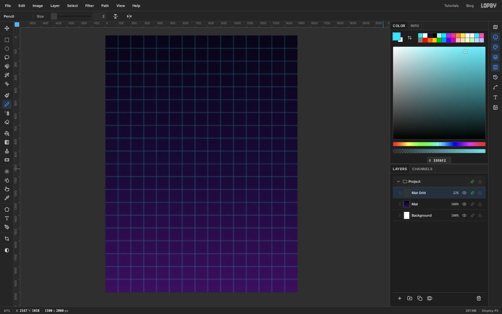

Choose **File → New**, set the size to **1500 × 2000** px and click **Create**. Rename `Layer 1` to `Mat` (double-click its name).

Pick the **Gradient** tool, leave the type on **Linear** and click **Advanced…** to open the Gradient Editor. Click under the bar to add a stop, drag stops to move them, and type a hex into the colour picker to set each one. Set three stops: `#090418` at the left, `#1A0A38` just past the middle and `#3B0F5E` at the right. Click **Done**, then drag from the top edge of the canvas straight down to the bottom edge.

Now rule the mat. Click **Add Layer** and name it `Mat Grid`. Pick the **Pencil** (**N**), set **Size** `2` and the foreground to `#35E6F2`. Click at the top of the canvas at **100, 0**, then hold [[Shift]] and click at **100, 2000**: the Pencil draws a straight line between the two clicks. Do the same every 100 px across the canvas, starting each line with a plain click and ending it with a [[Shift]]-click. Then rule the horizontal lines the same way, from the left edge to the right edge every 100 px down. The rulers along the top and left make the hundreds easy to find.

Click the layer's opacity (the `100%` on its row) and drag it down to `22%`. Then open the layer's effects (the **✦** button on its row), tick **Outer Glow** and set **Size** `10`, **Opacity** `60` and the colour to `#35E6F2`, so the lines look lit.

## Paint the neon that will show through

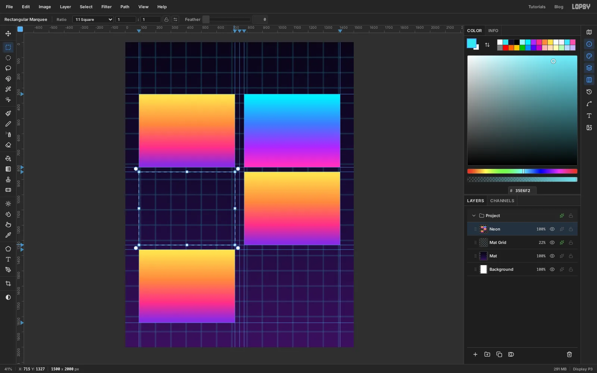

Guides mark where the six cards go. Check that **View → Show Guides** and **View → Snap to Guides** are both ticked. Click the top ruler at **90**, **720**, **780** and **1410** to drop four vertical guides, and [[Cmd]]-click it near the middle to drop one exactly on the centre line. Click the left ruler at **340**, **820**, **850**, **1330**, **1360** and **1840**. That gives you two columns and three rows of 630 × 480 px cells.

Add a layer called `Neon` above `Mat Grid`. In the Gradient Editor, build the sunset ramp: `#FFE14D` at the left, `#FF8A3D` at 40%, `#FF2E88` at 75% and `#8A2BE2` at the right.

Pick the **Rectangular Marquee** (**M**) and drag across the top-left cell. You don't need to be exact, because the marquee snaps to the guides. Switch back to the Gradient tool and drag from the top of the cell to the bottom. Do the same in the middle-right and bottom-left cells, so the sunset cells form a checkerboard.

Then build the electric ramp (`#00F0FF`, `#3D7BFF` at 40%, `#B026FF` at 75%, `#FF2EC4`) and fill the other three cells the same way. Press [[Cmd+D]] to deselect.

## Draw the cards and trim the neon

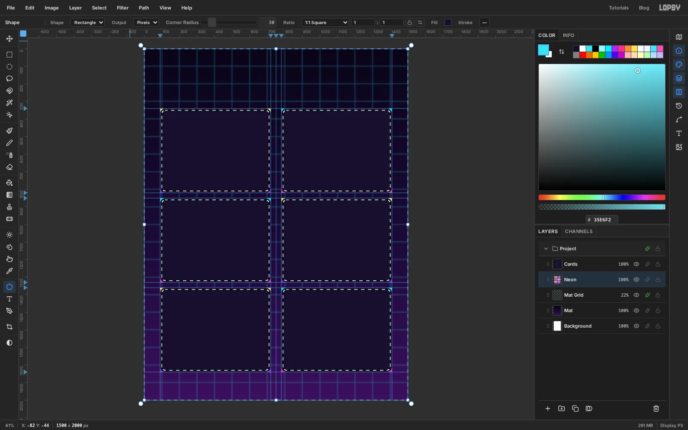

Add a layer called `Cards`. Pick the **Shape** tool (**U**) and choose **Rectangle** from the **Shape** dropdown. Click the **Fill** swatch and type `17102E`, then set **Corner Radius** to `30`.

The Shape tool draws outward from where you press, so start each card at the **centre** of a cell and drag to one of its corners. The corner snaps to the guides. The cell centres are at x **405** and **1095**, and y **580**, **1090** and **1600**. Draw all six.

The rounded corners leave little triangles of neon poking out. To trim them, [[Cmd]]-click the `Cards` thumbnail to load the cards as a selection, choose **Select → Shrink…** and shrink by `10`. Click the `Neon` layer, choose **Select → Inverse** and press [[Delete]]. The neon now stops 10 px inside every card edge. Deselect.

From here on the guides get in the way. Untick **View → Snap to Guides** so the selections you draw next don't jump to them.

## Add the mask and cut the sun

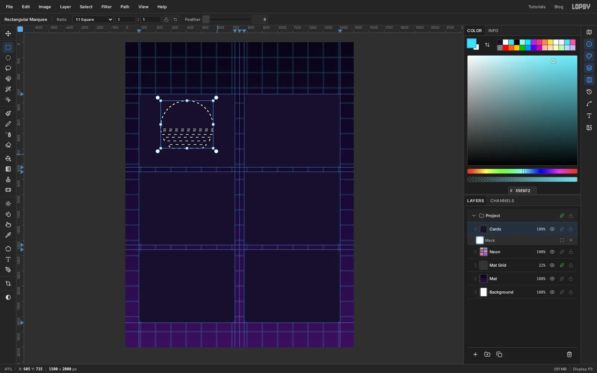

Click the `Cards` layer and click **Add Mask** at the bottom of the Layers panel. A white `Mask` row appears under the layer and you are now editing the mask, not the card. White keeps the card, black cuts a hole.

Start with the classic striped sun. Pick the **Elliptical Marquee** and drag a circle about **345** px across in the top-left card, a little above the card's centre so there's room for a label underneath.

Switch to the Rectangular Marquee. Hold [[Alt]] and drag a thin bar right across the lower half of the circle, starting just below its middle. That slices a gap out of the selection. Cut three more below it, making each gap taller than the last: about **12**, **18**, **24** and **40** px. Let the last one run off the bottom of the circle so no thin sliver is left.

Set the foreground to black `#000000` and choose **Edit → Fill**. While you're editing the mask the hole shows as a blue overlay. The strips of card between the bands are this stencil's bridges.

## Lasso the palm tree

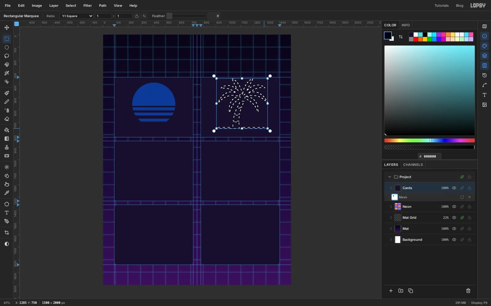

The palm is drawn freehand. Pick the **Lasso** (**L**) and, in the top-right card, draw one long curved frond: a thin leaf that arcs up and out from the crown, about **210** px long and **30** px wide at its fattest. Hold [[Shift]] and draw seven more around the crown, three arching to each side and two drooping down, like a firework.

Still holding [[Shift]], draw the trunk as **four** separate blocks that lean to the right as they climb, each a little narrower than the one below. Leave a gap of about **8** px between blocks. The gaps are bridges, and they also read as the rings on a palm trunk.

Finish with the ground: switch to the Rectangular Marquee and [[Shift]]-drag two thin lines either side of the trunk's base, without touching it. Choose **Edit → Fill** to cut the lot.

> **Tip:** If a frond comes out lumpy, press [[Cmd+Z]] to drop just that one and draw it again. Every add or subtract is its own undo step.

## Cut the mixtape

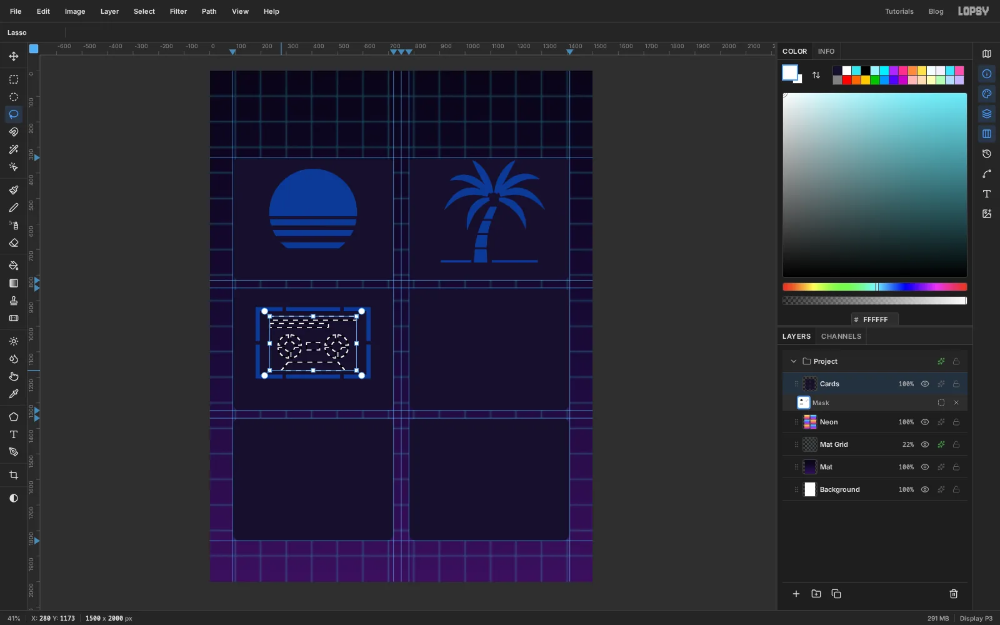

A cassette is a frame with shapes inside it, so it needs more planning. A full frame would drop the whole middle out of the card.

1. In the middle-left card, drag the cassette body with the Rectangular Marquee, about **450 × 280** px, and fill it with black.
2. Choose **Select → Shrink…** by `16`, set the foreground to white `#FFFFFF` and fill. White puts the card back, which leaves a 16 px frame cut out.
3. Deselect. Drag a small rectangle across the top edge of the frame, then [[Shift]]-drag five more: another on the top edge, two on the bottom and one on each side. Fill once with white. Those are the bridges that hold the middle in. Deselect again.

Now select the details and cut them in one go. Drag a long thin bar and a shorter one for the label lines, holding [[Shift]] for the second. Switch to the Elliptical Marquee and [[Shift]]-drag two reels about **92** px across. Hold [[Alt]] and drag a small circle in the centre of each to make them rings. Switch back to the Rectangular Marquee and [[Alt]]-drag a thin horizontal bar and a thin vertical bar through each reel, splitting each ring into four arcs. [[Shift]]-drag a small window between the reels, then [[Shift]]-lasso a wide trapezoid along the bottom. Set the foreground back to black and fill.

## Cut the coupe

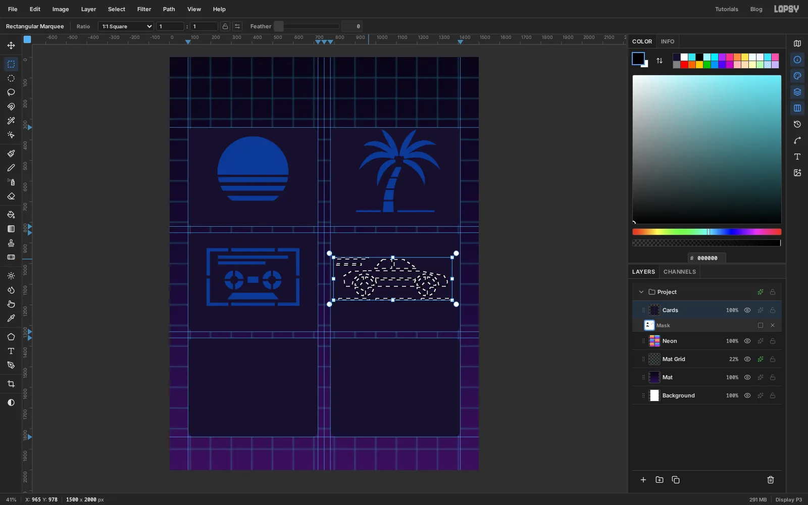

In the middle-right card, lasso the car's lower body as one long low wedge, about **500** px long: a flat bottom, a short tail, a long nose that slopes down to the front bumper.

- Hold [[Alt]] and drag a circle with the Elliptical Marquee over each end of the body to cut the wheel arches.
- [[Alt]]-drag a thin bar along the door between the arches for a body stripe. It has to reach both arches, or it would be a loose strip.
- [[Shift]]-lasso two windows above the body, leaving a gap between them for the pillar and a gap below them so they don't touch the body.
- For each wheel, [[Shift]]-drag a circle inside the arch, [[Alt]]-drag a smaller circle for the hub, and [[Alt]]-drag a thin cross through it, the same way you split the cassette reels.
- [[Shift]]-drag three dashes of road under the wheels and two speed lines behind the roof.

Fill with black.

## Cut the joystick

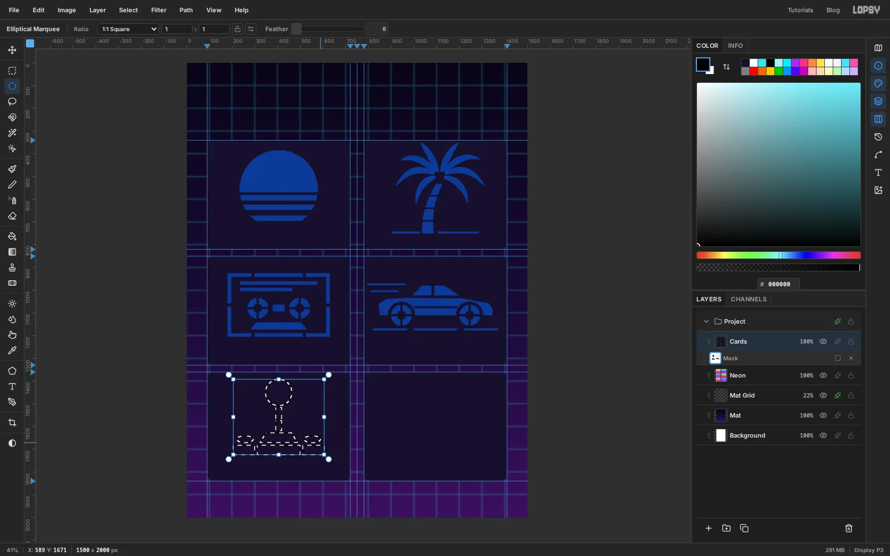

This one is all simple shapes stacked up the middle of the bottom-left card. Drag a circle about **115** px across for the ball. [[Shift]]-drag two short rectangles under it for the shaft, with a gap between them. [[Shift]]-lasso a trapezoid for the collar, wider at the bottom. [[Shift]]-drag a long bar about **400 × 42** px for the base, then [[Alt]]-drag two thin vertical bars through it to split it in three. With the Elliptical Marquee, [[Shift]]-drag a flat oval above each end of the base for the buttons. Fill with black.

## Cut the lightning bolt

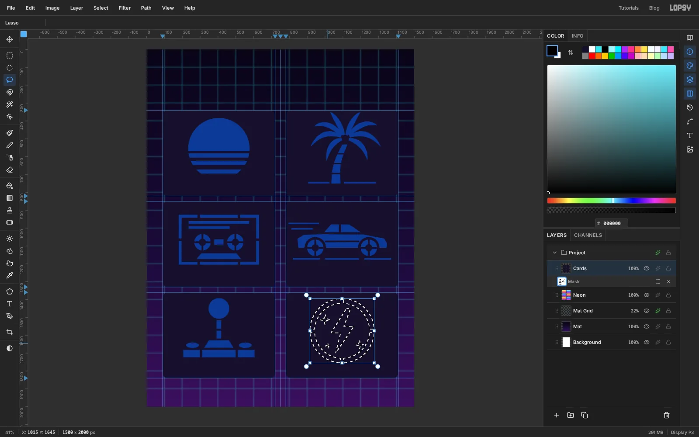

In the last card, drag a circle about **360** px across with the Elliptical Marquee. Hold [[Alt]] and drag a slightly smaller circle from just inside its top-left, leaving a ring about **26** px thick. Without bridges the whole disc inside the ring would fall out, so [[Alt]]-drag one thin bar across the full width of the ring through its centre and another down its full height. That breaks the ring into four arcs.

[[Shift]]-lasso a zigzag bolt in the middle: down and left from the top, a short step back to the right, then down to a point. Keep it clear of the ring. [[Shift]]-lasso three small four-point sparkles in the spaces beside it. Fill with black and deselect.

Click the `Neon` layer and then `Cards` again to leave mask editing. The blue overlay goes away and all six icons light up.

## Give the cards depth

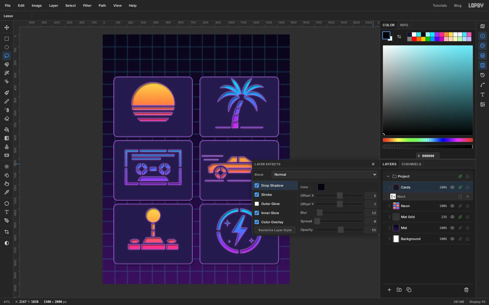

Open the effects for `Cards` and tick four of them. Each one follows the mask, so they wrap around the holes as well as the card edges.

- **Drop Shadow:** **Offset X** `5`, **Offset Y** `7`, **Blur** `12`, **Opacity** `55`, colour `#05020F`. The shadow falls into the holes too, which makes the card look like it has thickness.
- **Stroke:** **Width** `3`, colour `#8F74FF`.
- **Inner Glow:** **Size** `16`, **Opacity** `80`, colour `#FF5FD2`. This is the light spilling onto the cut edges.
- **Color Overlay:** colour `#241A4D`. This lifts the cards a shade so they separate from the mat.

Untick **View → Show Guides**. You're done with them.

## Spray the overspray

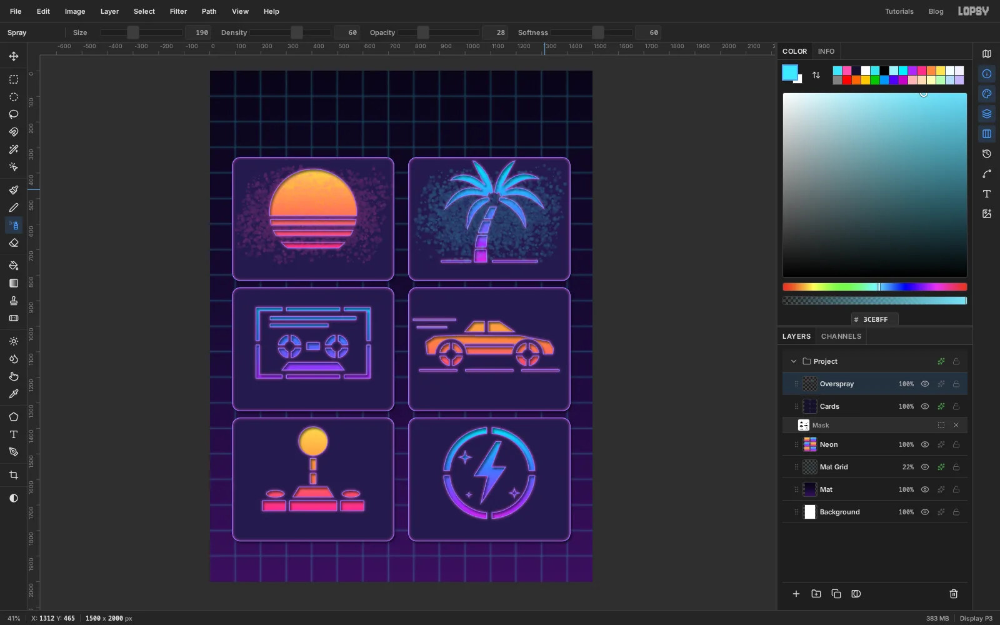

A used stencil is never clean. Add a layer called `Overspray` above `Cards` and pick the **Spray** tool (**J**). Set **Size** `190`, **Density** `60`, **Opacity** `28` and **Softness** `60`.

Set the foreground to pink `#FF4FB0` and scribble a loose zigzag over the sun, going a little way past the icon on every side but staying off the bottom strip of the card. One pass is enough. Do the same over the coupe and the joystick. Switch to cyan `#3CE8FF` for the palm, the mixtape and the bolt.

Choose **Filter → Gaussian Blur…** with **Radius** `2` to take the hard edge off the dots. In the layer's effects, set the blend mode to **Screen**, and drop the layer's opacity to `80%`.

## Clear the label strips

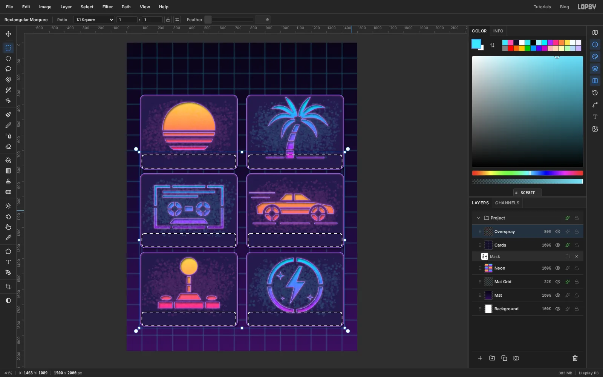

The labels go along the bottom of each card, and speckles behind small type make it hard to read. With `Overspray` still selected, drag a marquee across the bottom **85** px of the first card, then [[Shift]]-drag the same strip on the other five.

Choose **Select → Feather…**, set it to `18` and press [[Delete]]. The feather fades the overspray out instead of chopping it off in a straight line. Deselect.

## Label the plates and add a registration mark

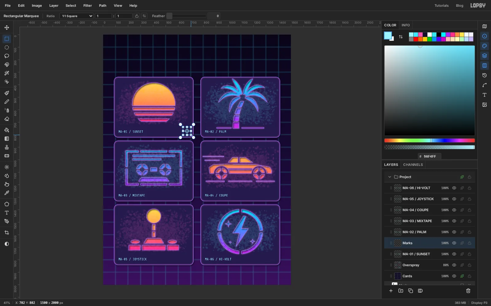

Pick the **Text** tool (**T**). Set the font to **Share Tech Mono**, the size to `26` and the foreground to `#9AF4FF`. Click near the bottom-left corner of the first card, about **35** px in from the left edge and **60** px up from the bottom, type `MA-01 / SUNSET` and press [[Tab]] to commit. Label the rest the same way: `MA-02 / PALM`, `MA-03 / MIXTAPE`, `MA-04 / COUPE`, `MA-05 / JOYSTICK` and `MA-06 / HI-VOLT`. Starting each label at the same spot in its card is what makes them look like a set.

Registration marks are the little crosshairs printers use to line sheets up. Click the top label in the Layers panel and add a layer called `Marks`, so it sits above all six. In the bottom-right corner of the first card, drag a circle about **30** px across with the Elliptical Marquee, fill it with `#9AF4FF`, choose **Select → Shrink…** by `3` and press [[Delete]] to leave a thin ring. Deselect. With the **Pencil** at **Size** `3`, click to the left of the ring and [[Shift]]-click to the right of it, then do the same from above it to below it.

Draw a marquee around the finished mark and press [[Cmd+C]]. Then, for each of the other five cards:

1. Press [[Cmd+V]]. The copy lands on top of the original on its own layer.
2. Press [[Cmd+D]], pick the **Move** tool (**V**) and drag the copy to the same corner of the next card.
3. Press [[Cmd+E]] to merge it down into `Marks`.

## Tear off a strip of tape

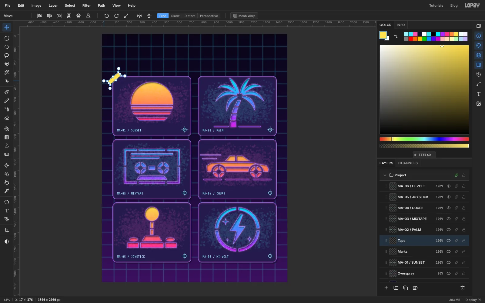

Add a layer called `Tape`. Drag a marquee about **108 × 30** px over the top-left corner of the first card, so it sits half on the card and half on the mat, and fill it with `#FFE14D`.

Draw a slightly bigger marquee around the strip and pick the **Move** tool. Handles appear around the selection. Drag the round rotation handle just outside the top-left corner anticlockwise, until the strip sits at about **40°** across the corner. Press [[Cmd+D]] to commit.

## Tape down every card

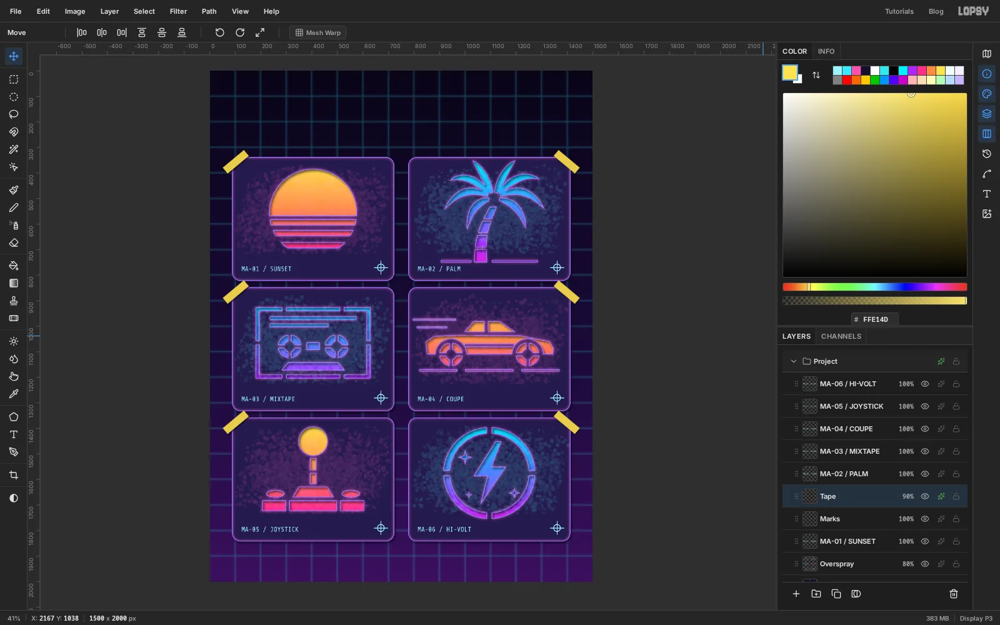

The right-hand cards need the strip mirrored. Choose **Layer → Duplicate Layer**. Draw a marquee around the strip, and with the Move tool click **Flip Horizontal** in the options bar. Deselect, drag the flipped strip across to the top-right corner of the top-right card and press [[Cmd+E]] to merge it down. `Tape` now holds a matching pair.

Duplicate the layer again and drag the copy straight down **510** px, so the pair lands on the same corners of the middle row. Duplicate that copy and drag it down another **510** px to the bottom row. Press [[Cmd+E]] twice to fold both copies back into `Tape`.

Set the layer's opacity to `90%` and add a **Drop Shadow** with **Offset X** `3`, **Offset Y** `4`, **Blur** `6`, **Opacity** `60` and colour `#05020F`.

## Set the title

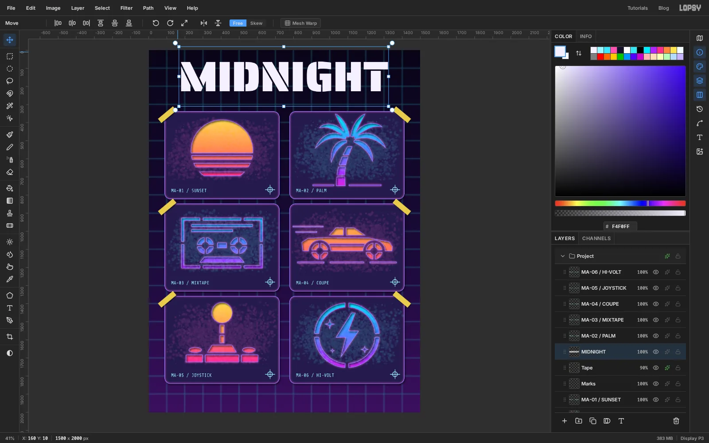

`Tape` should still be selected. If a label is selected instead, click `Tape` first, or the font change will restyle that label. Pick the Text tool, set the font to **Saira Stencil**, the weight to **Black**, the size to `236` and the foreground to `#F4F0FF`. Click near the top-left corner of the canvas, type `MIDNIGHT` and commit with [[Tab]].

Switch to the Move tool and click **Align center horizontally** in the options bar. Then nudge the word with the arrow keys ([[Shift]] moves 10 px at a time) until the tops of the letters are about **60** px from the top edge. That leaves a strip above for a line of small type and a gap below before the cards.

## Mask a chrome gradient into the letters

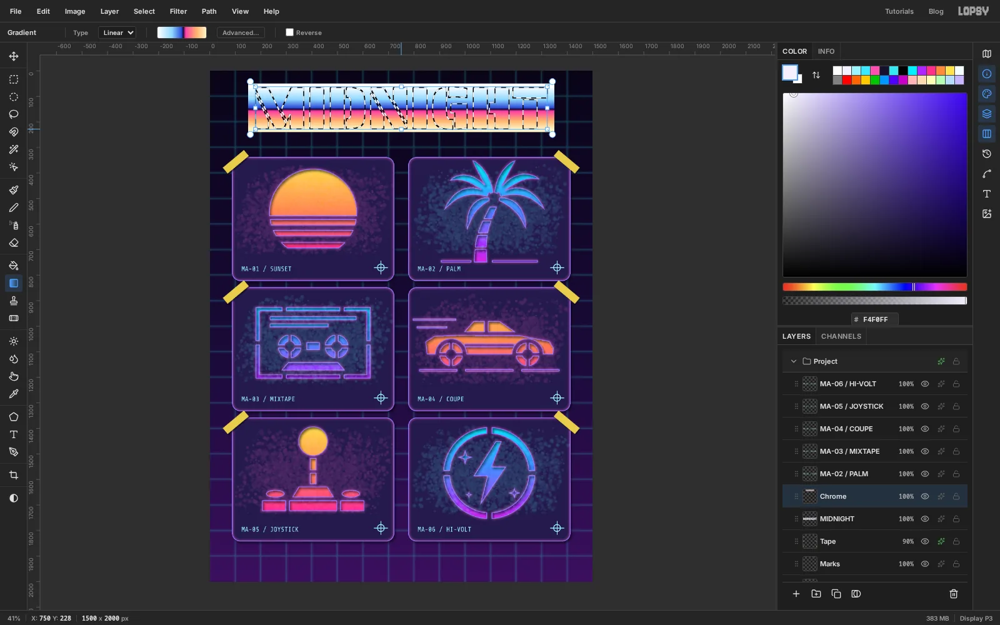

Chrome lettering is a sky reflected above a horizon and a sunset reflected below it. Add a layer called `Chrome` above the title. In the Gradient Editor set seven stops: `#FFFFFF` at the left, `#8FD8FF` at 30%, `#2A49D6` at 50%, `#14062E` at 53%, `#FF3EA5` at 58%, `#FFB36B` at 80% and `#FFF4C8` at the right. The three stops crowded around the middle make the hard horizon line.

Drag a marquee around the whole word, then drag the gradient from the top of the letters to the bottom. Deselect.

Now [[Cmd]]-click the `MIDNIGHT` thumbnail in the Layers panel. That loads the letters as a selection. Click the `Chrome` layer and click **Add Mask**. With a selection active, the new mask keeps only what's selected, so the band is cut down to the letters. The type itself stays editable underneath.

## Outline and extrude the chrome

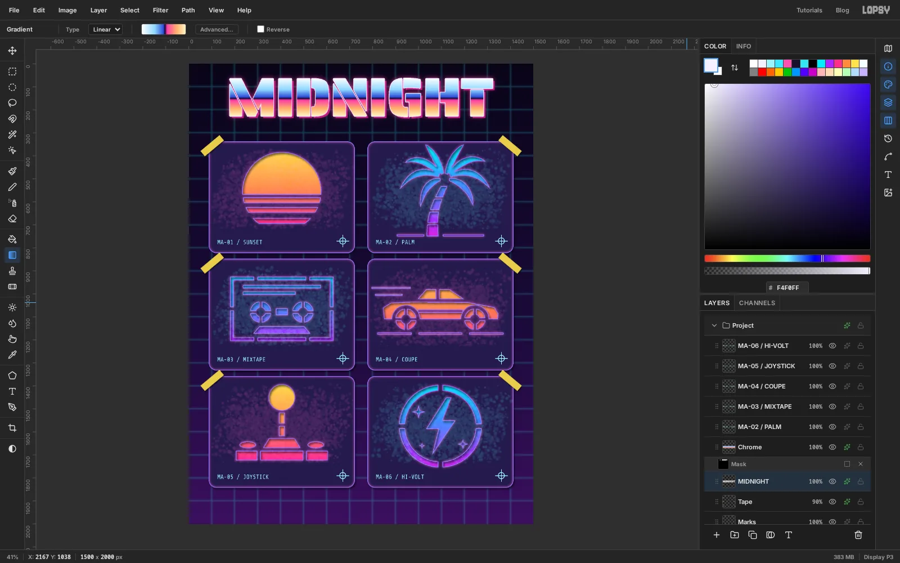

Click the `MIDNIGHT` layer and then `Chrome` again to leave mask editing. Open the effects for `Chrome`:

- **Stroke:** **Width** `3`, colour `#F1E6FF`
- **Outer Glow:** **Size** `30`, **Opacity** `75`, colour `#FF3EA5`

Then open the effects for the `MIDNIGHT` text layer underneath and tick **Drop Shadow** with **Offset X** `9`, **Offset Y** `9`, **Blur** `0`, **Opacity** `100` and colour `#B3127A`. A hard shadow with no blur reads as a block of magenta behind the letters, like the side of extruded type.

## Add the script

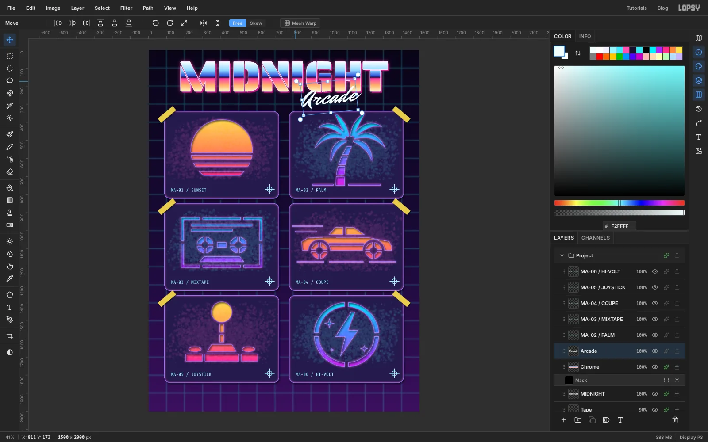

Outrun logos pair heavy capitals with a fast brush script. Click the `Chrome` layer, pick the Text tool and set the font to **Mr Dafoe**, weight **Regular**, size `124` and the foreground to `#F2FFFF`.

A click inside an existing text box edits that text, and the title's box is taller than its letters. So click in the empty mat below the cards, type `Arcade` and commit. Then drag it up with the Move tool until it overlaps the bottom of the letters **G H T**.

With the Move tool still active, drag the rotation handle outside the top-left corner of its box anticlockwise by about **6°**. Press [[Esc]] to commit. Nudge the word so its last letter ends under the **T** and the lowest part of the script stays about **25** px above the cards. It must not touch them.

## Light the script

White script over a cream and pink chrome fill needs help to read. Open the effects for `Arcade`:

- **Stroke:** **Width** `6`, colour `#160830`. The dark outline separates the script from the title.
- **Outer Glow:** **Size** `22`, **Opacity** `90`, colour `#19E3FF`.

Cyan against the warm chrome keeps the two words apart even where they overlap.

## Add the strap line and the footer

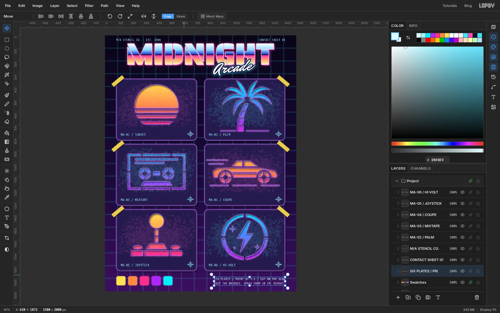

Click `Tape`, then add a layer called `Swatches`. With the **Shape** tool still on Rectangle, set **Corner Radius** `14`. Draw five squares about **72** px across in a row along the bottom-left margin, changing the **Fill** before each one: `#FFE14D`, `#FF8A3D`, `#FF2E88`, `#B026FF` and `#00F0FF`. Line the first one up with the left edge of the cards. Give the layer an **Outer Glow** with **Size** `14`, **Opacity** `55` and colour `#FF5FD2`.

Click the `Swatches` layer, pick the Text tool and set **Share Tech Mono** at size `24` in `#9AF4FF`. Type each of these in the empty mat at the bottom, then drag it into place with the Move tool:

- `M/A STENCIL CO. — EST. 1986` goes in the top-left corner. Line its left edge up with the cards and sit it about **22** px from the top.
- `CONTACT SHEET 01` goes in the top-right corner, with its right edge on the right edge of the cards and its capitals level with the first line.

For the footer note, change the foreground to `#D9FBFF`, click in the mat to the right of the swatches and type `SIX PLATES / PRINT AT 1:1 / CUT ON THE GLOW`, press [[Enter]], and type `KEEP THE BRIDGES. SPRAY FROM 20 CM. REPEAT.` Commit, set **Align** to **Right** in the options bar, and move the block so its right edge sits on the right edge of the cards and it's centred on the swatches.

## Group the layers and test the groups

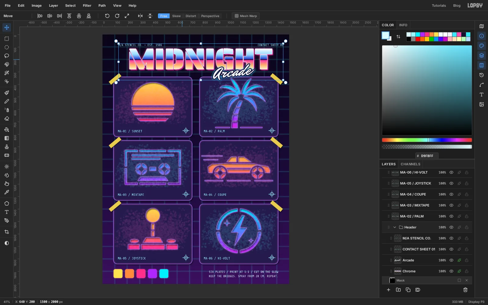

Twenty loose layers are hard to manage. Click `MIDNIGHT` in the Layers panel, then [[Cmd]]-click `Chrome`, `Arcade` and the two strap lines. Choose **Layer → Group Layers** and rename the group `Header`.

Next click `Neon`, then [[Cmd]]-click `Cards`, `Overspray`, the six labels, `Marks` and `Tape`, and group those as `Plates`. Last, click the footer note, [[Cmd]]-click `Swatches` and group them as `Footer`.

Click the `Header` group and drag on the canvas with the Move tool. The title, its chrome mask, the script and the strap lines all move as one. If you were only testing, press [[Cmd+Z]] to put it back. If the header needs to sit a little higher or lower on your sheet, this is the way to move it.

## Boost the colour

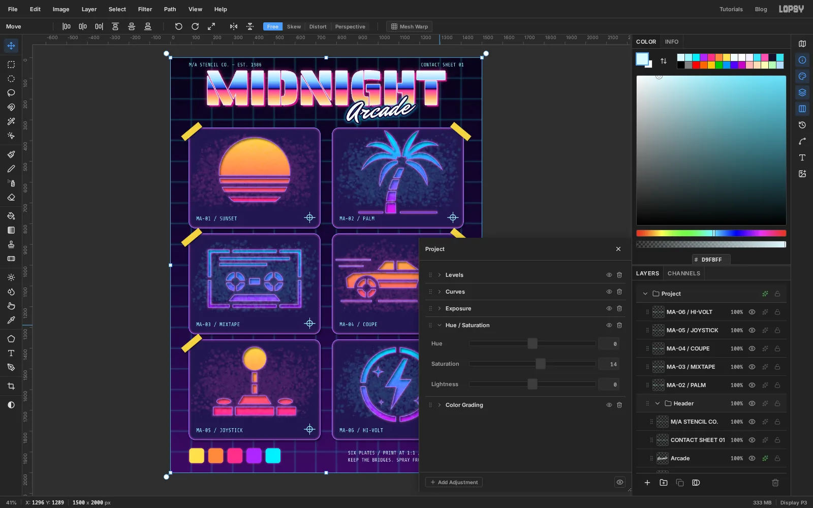

Click the `Project` group at the top of the Layers panel and choose **Layer → Adjustment Layer…**. Lopsy keeps adjustments on groups, so the drawer that opens applies to everything inside `Project`. Expand **Hue / Saturation** and set **Saturation** to `14`. Close the drawer.

## Finish with a vignette and grain

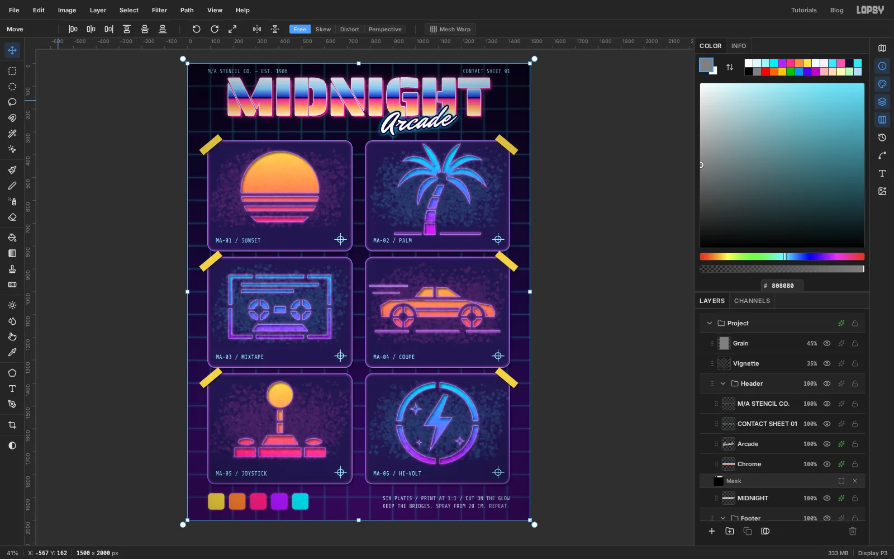

Click the `Project` group and add a layer called `Vignette`. With the Gradient tool set to **Radial**, make three stops, all `#05010F`: fully transparent at the left, fully transparent at 62%, and fully opaque at the right. (The **Opacity** bar under the colour picker sets a stop's transparency.) Drag from the centre of the canvas to a little way past the bottom edge. Set the layer to **Multiply** at `35%`.

Add one more layer called `Grain`. Set the foreground to `#808080`, press [[Cmd+A]] and choose **Edit → Fill**. Deselect, then choose **Filter → Add Noise…** with **Amount** `14`. Set the layer to **Overlay** at `45%`. A little grain over everything stops the gradients looking too clean and ties the type to the cards.

Look the sheet over one last time. Every icon should be made of separate holes with card between them, the script should clear the cards, and nothing should crowd the labels. Then choose **File → Save Project** and **File → Quick Export PNG**.
