**Synthwave** (also called retrowave or outrun) is the look of 1980s album covers and arcade cabinets as remembered through a haze of VHS static: a violet night sky that burns pink and orange at the horizon, a huge sun sliced by horizontal stripes, a glowing grid running off to a vanishing point, palm silhouettes, chrome and neon lettering.

This tutorial uses that look for something practical: a flier for **Cassette Oasis**, an imaginary shop that fixes tape decks and Walkmans and sells mixtapes. The hero is a cassette tape you build from shapes, floating in front of the sun with its tape spilling out across the grid. Two tricks do most of the heavy lifting:

- The grid isn't drawn line by line. You draw **one small tile**, turn it into a pattern, fill the floor with it, and then pull it into perspective with the Move tool's **Perspective** mode.
- The palms come from a **real photo**. A power line gets cloned out, **Threshold** turns the photo into black and white, and the **Magic Wand** lifts out the palm.

The flier is 1200 × 1600 px. The palm photo is *Roystone regia in silhouette Ellison Rd Geebung P1050113.jpg* by John Robert McPherson on Wikimedia Commons (CC BY-SA 4.0). Download it at about 1280 px wide.

The tools you'll use:

- the **Gradient** tool and its **Advanced…** stop editor, **Edit → Fill**, **Edit → Define Pattern** and **Edit → Fill with Pattern…**
- the **Rectangular** and **Elliptical Marquee**, the **Lasso** and **Magic Wand**, with [[Shift]] to add, [[Alt]] to subtract and [[Shift]]+[[Alt]] to intersect
- [[Cmd]]-click on a layer thumbnail, and **Select → Grow** and **Select → Inverse**
- the Move tool's **Perspective** and **Free** transforms, **Flip Horizontal**, and a transform of a whole group
- the **Clone Stamp**, **Threshold**, **Add Noise** and **Gaussian Blur**
- the **Shape** tool (rectangles, ellipses and a hexagon), the **Pen** tool with **Path to Selection**, the **Pencil**, and the **Brushes** panel's **Taper**
- **Copy** and **Paste** in place, **Duplicate Layer**, **Rasterize Layer**, **Merge Down**, groups, and dragging rows in the Layers panel
- live text in Audiowide, Yellowtail, Permanent Marker and Share Tech Mono, rotated with its own handles
- the **Outer Glow**, **Inner Glow**, **Stroke** and **Drop Shadow** layer effects, and the **Screen** and **Overlay** blend modes

The palette:

- Sky `#0A0419` → `#1E0A3C` → `#4B1268` → `#A4237E` → `#FF5A6E` → `#FF9A4D`
- Sun `#FFE66B` → `#FF8A3D` → `#FF2E88`
- Floor `#0E0422`, grid `#FF2BD6`, mountains `#1B0A33`
- Neon pinks `#FF4FD8` (edges and lines), `#FF3DA8` (glows and the pill), `#FF5FA8` (rim light)
- Neon cyan `#2EF2FF`, cyan glow `#18D8FF`, gold `#FFD86B`
- Palms `#12021F`, trunk rings `#3A1652`, ground shadow `#3A0638`
- Cassette shell `#221A33`, head area `#352A4D`, label `#F4E9D8`, label ink `#2B1458`, window `#0F0A1A`
- Tape `#4A2A1E` (spools), `#6B3A1E` (ribbon), highlight `#FF8A3D`
- Title face `#FFF6C9` → `#FFD23F` → `#FF7A2F` → `#FF2F86`, extrusion `#8A1F9A` → `#1A0638`
- Panel `#12062A`, dark type `#1A0838`, starburst `#FFE14D`

Positions are given in document pixels. Hover over the canvas and watch the **X** and **Y** readout at the bottom left of the window.

## Set up the page and paint the dusk sky

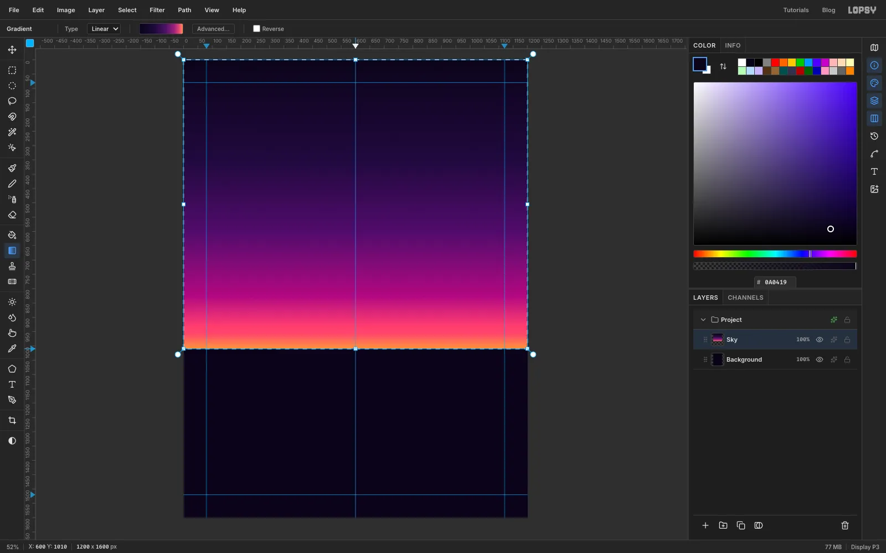

Choose **File → New**, pick **Pixels**, and make a **1200 × 1600** document. Fill the **Background** layer with the darkest sky colour, `#0A0419`, using **Edit → Fill**.

Add guides by clicking the rulers. Click the top ruler at x 80, 600 and 1120, and the left ruler at y 80, 1010 and 1520. The guide at **y 1010 is the horizon**. Everything above it is sky and everything below it is floor. Turn off **View → Snap to Guides** so your marquees aren't pulled onto the guides.

Rename the empty **Layer 1** to **Sky**. Drag a rectangular marquee from the top-left corner down to the horizon guide, right across the page. Pick the **Gradient** tool, set it to **Linear**, and open **Advanced…**. In the Gradient Editor, click a stop to select it and type its colour in the **Hex** field. Click on the bar to add a stop at that point, drag a stop sideways to change its position, and use **Delete** to remove the selected one. Set six stops:

- `#0A0419` at 0%
- `#1E0A3C` at 35%
- `#4B1268` at 60%
- `#A4237E` at 82%
- `#FF5A6E` at 95%
- `#FF9A4D` at 100%

Drag from the top of the page straight down to the horizon.

## Make a starfield from noise

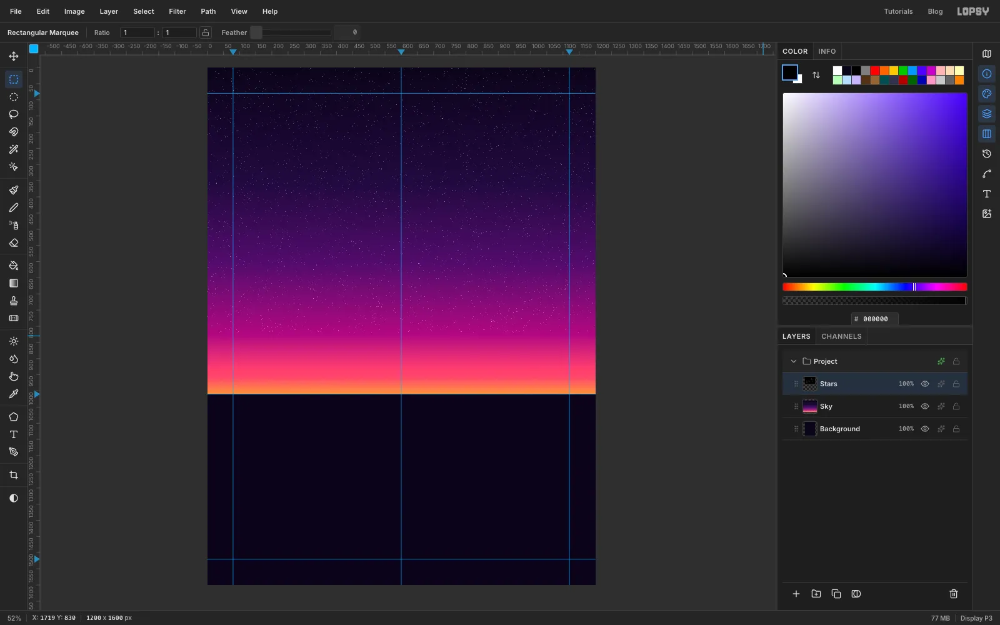

Press [[Cmd+D]] to deselect, and add a new layer called **Stars**. Marquee the sky from the top down to about y 820 and fill it with black. Then:

1. Choose **Filter → Add Noise…** with Amount **100**, **Mono** and **Gaussian**.
2. Choose **Filter → Threshold…** at **46**. Only the brightest specks of noise stay white, and that's your starfield.
3. Open the layer's effects drawer (the ✦ button on its row) and set the blend mode to **Screen**. Black disappears in Screen mode, so only the stars show.

## Cut out the sun's half circle

Add a layer called **Sun** above Stars. With the **Elliptical Marquee**, drag a circle 840 px across, centred where the centre guide meets the horizon: start at about (180, 590) and drag to (1020, 1430). Its bottom half hangs below the horizon, but that part gets cut off next.

Hold [[Shift]]+[[Alt]] and drag a rectangle from above the circle down to the horizon guide, wider than the circle. Shift+Alt keeps only the overlap, so now just the top half of the circle is selected.

Set a Linear gradient of `#FFE66B` → `#FF8A3D` (at 50%) → `#FF2E88`, and drag from the top of the half circle straight down to the horizon.

## Slice the sun into stripes

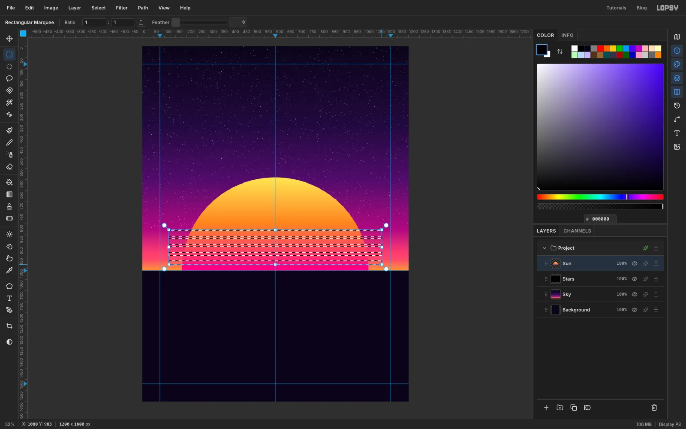

The classic synthwave sun has gaps that get thicker as they near the horizon. Deselect, then drag five long, thin rectangular marquees across the lower half of the sun, holding [[Shift]] for every one after the first so they add together. Make them about 5, 8, 11, 14 and 17 px tall, with their tops at roughly y 826, 858, 892, 928 and 966, so the gaps grow toward the horizon.

Press [[Delete]], then deselect. In the effects drawer, tick **Outer Glow** with Size **60**, Spread **0**, Opacity **70** and colour `#FF3D9A`.

## Add mountains and the floor

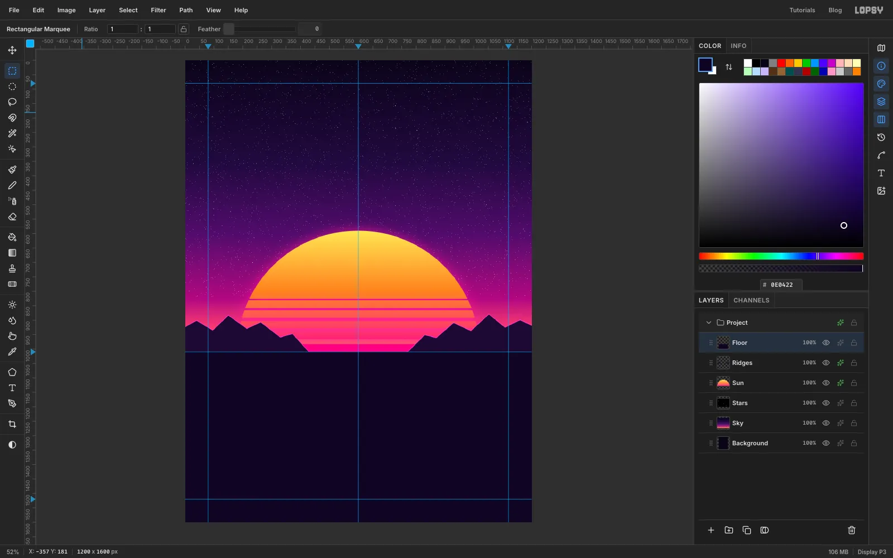

Add a layer called **Ridges**. With the **Lasso**, draw a low, jagged range of peaks on the left from the page edge to about x 430, keeping the peaks between y 880 and 960 and closing the shape along the horizon. Hold [[Shift]] and draw a second range on the right, from about x 770 to the page edge. Fill both with `#1B0A33`. Give the layer a **Stroke** effect, Width **2**, colour `#FF4FD8`, for a thin pink edge.

Add a layer called **Floor**. Marquee from the horizon guide to the bottom of the page and fill it with `#0E0422`.

## Draw one grid tile and fill the floor with it

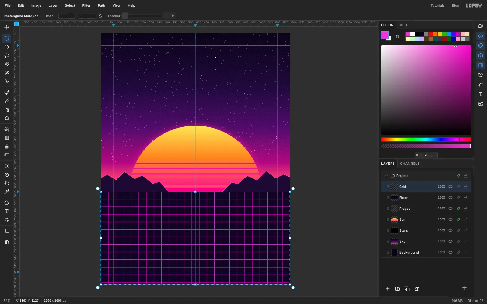

Add a temporary layer. Pick the **Pencil**, set Size **3** and colour `#FF2BD6`. Zoom right into the top-left corner of the page and draw two lines: click at (1, 1), then [[Shift]]-click at (47, 1) along the top edge. Click at (1, 1) again and Shift-click at (1, 47) down the left edge. That's one 48 × 48 cell of the grid, with a line along its top and its left side.

To select exactly that cell, deselect and **click once** (don't drag) with the **Rectangular Marquee**. A dialog asks for the corners: enter From 0, 0 and To 48, 48. Choose **Edit → Define Pattern**, then delete the temporary layer.

Select **Floor** and add a layer called **Grid**. Marquee the floor from the horizon to the bottom of the page, choose **Edit → Fill with Pattern…**, click your new tile and press **Apply**.

## Pull the grid into perspective

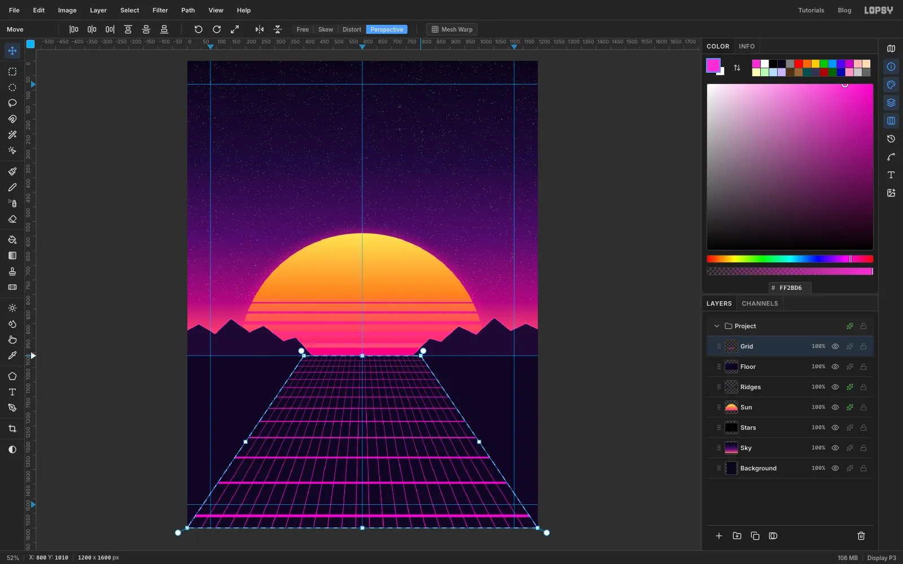

Keep the marquee and switch to the **Move** tool. In the options bar, click **Perspective**. In this mode, dragging a corner moves the opposite corner of the same edge the other way.

Drag the **top-right** handle left until the top edge is a third of the page wide, from x 400 to x 800. The vertical lines now converge toward the horizon. The rows near the top squash together while the rows at the bottom stay big, just like a floor going away from you. Press [[Enter]] to apply.

## Stretch the grid off both sides

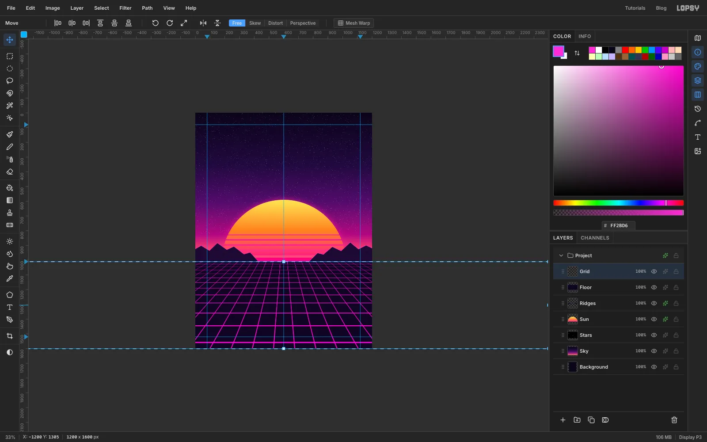

The grid now ends in two diagonal edges, and you want its lines to run off the sides of the page. Press [[Cmd+D]] and use **View → Zoom Out** until the page is about a third of its size (around 33%), with a page width of grey on either side of it. Marquee the floor again and click **Free** in the options bar.

Drag the **right** edge handle out by a full page width, to x 2400. Then drag the **left** edge handle out by the same amount, to x −1200. The grid is now three times as wide and centred where it was. Press [[Enter]], deselect, and press [[Cmd+0]] to fit the page back on screen.

## Make the grid glow and light up the horizon

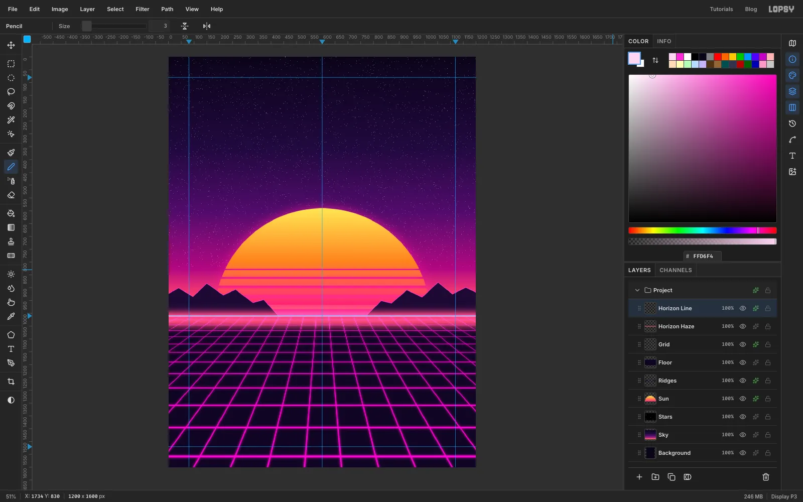

Give the **Grid** layer an **Outer Glow**: Size **14**, Spread **0**, Opacity **80**, colour `#FF2BD6`.

Add a layer called **Horizon Haze**. Marquee a band from just above the horizon to about 40 px below it, fill it with `#FF5A6E`, deselect, and run **Filter → Gaussian Blur…** at **40**. Set it to **Screen**.

Add a layer called **Horizon Line**. With the **Pencil** at Size 3 and colour `#FFD6F4`, click at the left end of the horizon guide and [[Shift]]-click at the right end. Add an **Outer Glow** of Size **18**, Spread **10**, Opacity **90**, colour `#FF4FD8`.

## Drop in the palm photo

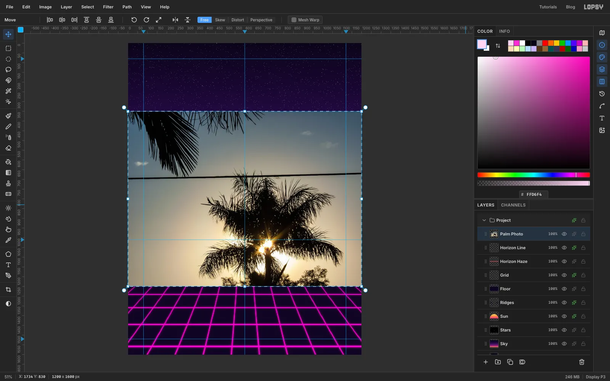

Drag the downloaded palm photo onto the canvas. Lopsy places it on a new layer, fitted to the width of the page. Rename the layer **Palm Photo**.

Two things in the photo would get in the way. A power line runs across the sky and right through the top of the palm, and there's a second palm in the top-left corner. The corner palm is easy to leave out later. The power line has to go first.

## Clone the power line away

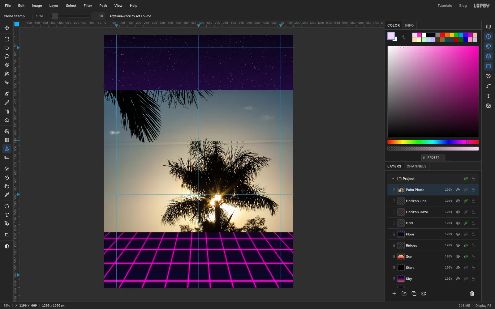

Press [[Cmd+D]] and pick the **Clone Stamp** ([[S]]). Set Size to **18**. [[Alt]]-click on clean sky just *below* the left end of the wire, about 30 px under it. That sets the spot the stamp copies from.

Now click on the wire at its left end, then [[Shift]]-click on the wire at its right end. The Clone Stamp paints a straight line between the two clicks and keeps the same distance to the source all the way along. It copies the strip of sky just below the wire over the top of it. Where the wire crosses the fronds, it copies fronds instead, so the top of the palm stays whole.

> **Tip:** the Healing Brush is the wrong tool here. It blends each dab toward the colour already underneath, so a dark wire leaves a grey ghost behind.

## Threshold the photo

Choose **Filter → Threshold…** and set Level **125**. Every pixel becomes pure black or pure white, so the palm turns into a crisp black silhouette. The darker blue sky at the top of the photo turns black too. Don't worry about it: the next step leaves it out.

## Select just the palm

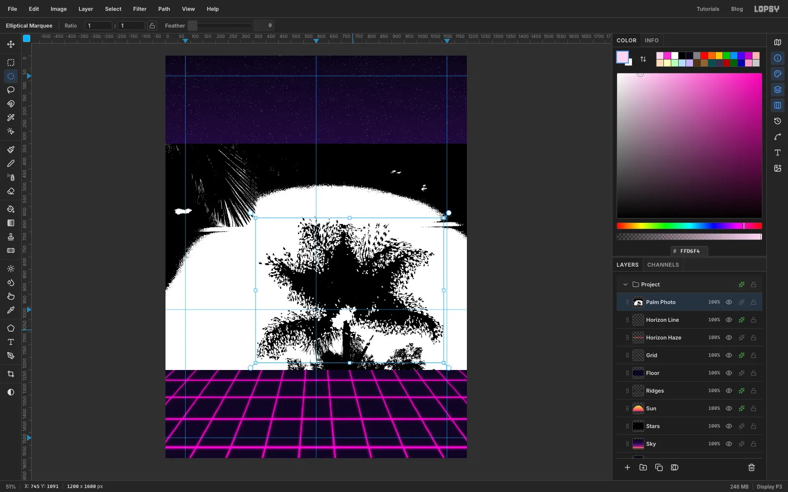

Pick the **Magic Wand**. Set Tolerance **10** and untick **Contiguous**. Click on the palm's trunk, and every black pixel in the photo is selected, including the dark sky at the top.

You only want the central palm:

1. Hold [[Shift]]+[[Alt]] and drag a loose **Lasso** around the palm's crown. Leave out the corner palm, the dark sky above it and the bushy trees along the bottom. Only the overlap stays selected.
2. The sun shone through the crown where the trunk joins it, leaving a white hole. Hold [[Shift]] and drag a small **Elliptical Marquee** over that spot to add it back.
3. Choose **Select → Grow…** by **1** px to close the pinholes between the fronds.

## Fill the silhouette

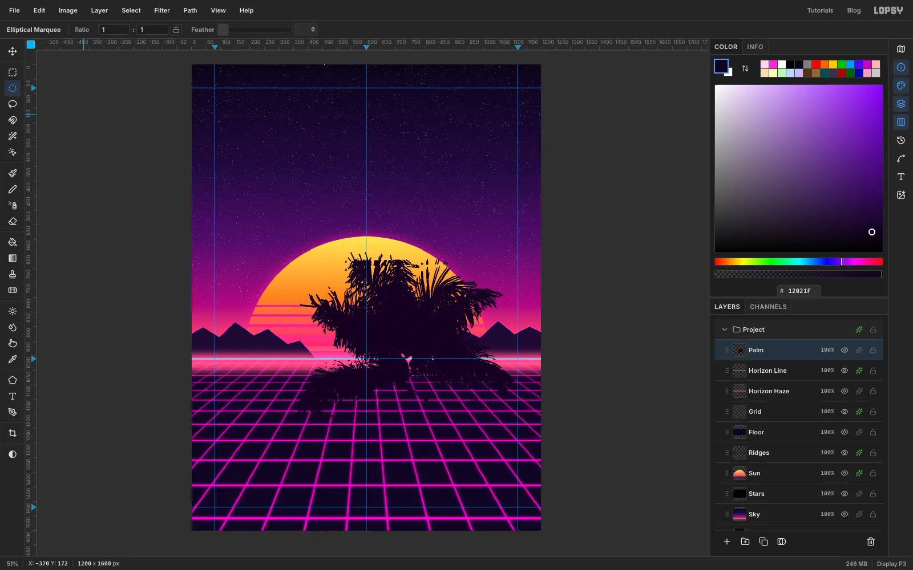

Add a layer called **Palm** and fill the selection with `#12021F`. Deselect, select the **Palm Photo** layer, and delete it with the bin button in the Layers panel.

## Scale the palm down

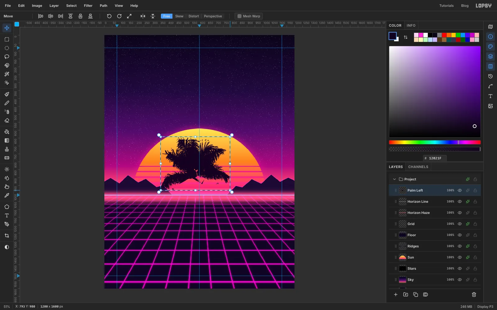

Select **Palm** and rename it **Palm Left**. Drag a marquee around the whole crown. With the **Move** tool, hold [[Cmd]] and drag the bottom-right handle in until the palm is a little over half its size, about 58%. Press [[Enter]] and [[Cmd+D]].

Drag the palm with the Move tool to the top-left of the page. Let the crown hang off the left edge, with its top at about y 360.

## Make a mirrored second palm

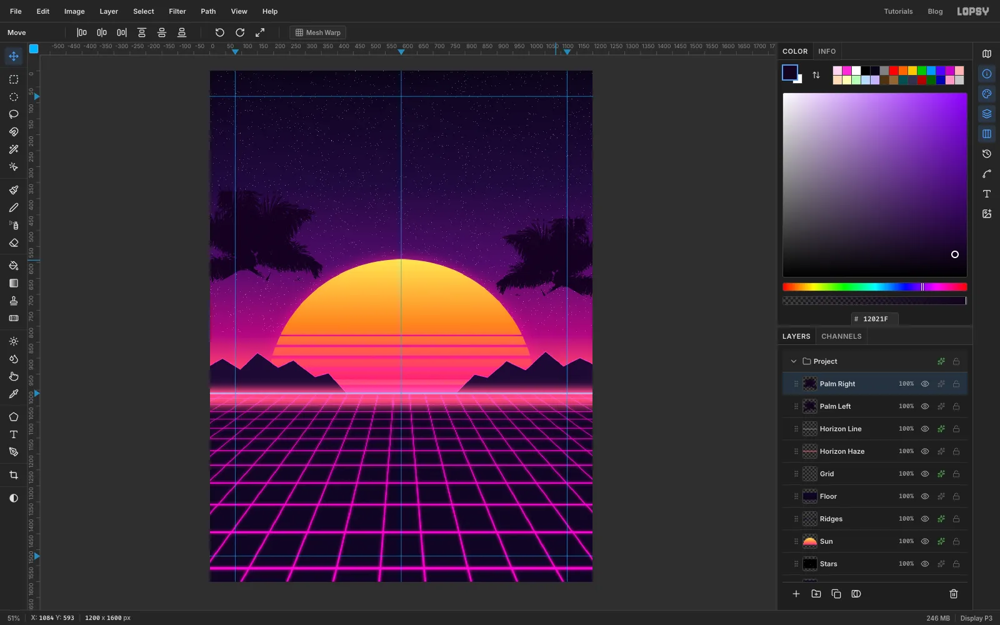

Choose **Layer → Duplicate Layer** and rename the copy **Palm Right**. Click its row, marquee around it, and press **Flip Horizontal** in the Move tool's options bar. Press [[Enter]], then scale it down to about 86% the same way as before.

Drag it to the right edge so the crown hangs off the page there too, a little lower than the left one (top at about y 450). Two palms that don't match exactly look more natural than a mirror image.

## Draw the trunks with the Pen

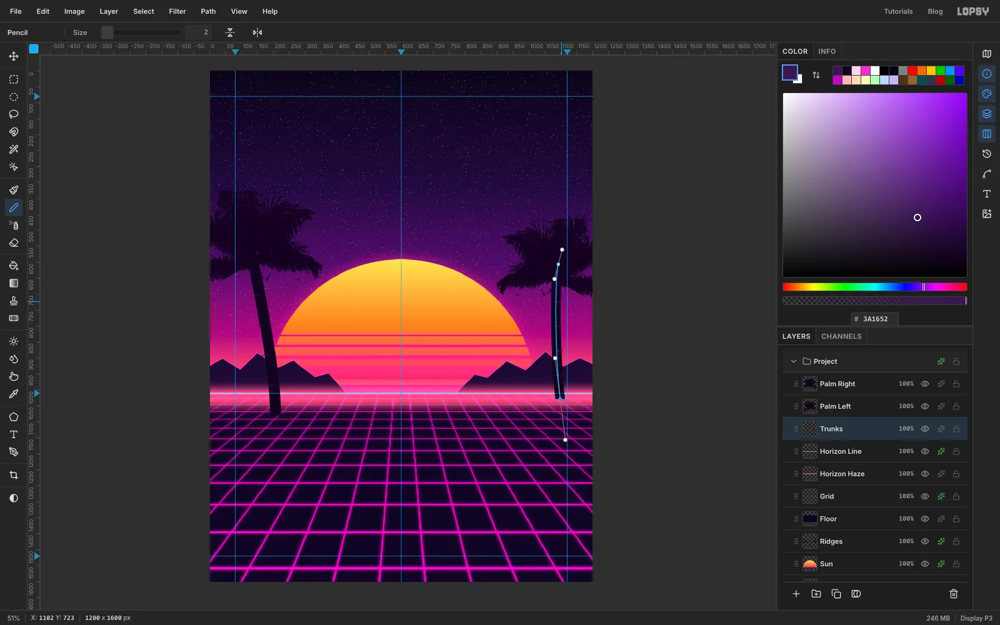

Select **Horizon Line** and add a layer called **Trunks**, so the trunks sit under the crowns. Set the foreground colour to the palm colour, `#12021F`.

Pick the **Brush** and click the brush tip button at the left of the options bar to open the **Brushes** panel. On the **Shape** tab, set Hardness **100** and **Taper 420**, then close it. Pen strokes use these settings too. Taper starts a stroke at full width and narrows it toward the end, so draw each trunk **from the ground up**:

1. Pick the **Pen**, set **Stroke** to **34** in the options bar, and click-drag at the base of the left trunk, about (206, 1080), pulling the handle upward.
2. Click-drag again inside the left crown at about (126, 556) so the trunk reaches well into the fronds. Press [[Enter]] to stroke the path.
3. Do the same for the right trunk at Stroke **30**, from about (1098, 1028) up into the right crown.

Delete the two paths in the **Paths** panel when you're done. The Pen strokes end in round caps. To square the bottoms off, marquee the area just below each base and press [[Delete]].

Finally, pick the **Pencil** at Size 2 in `#3A1652` and add four short ticks across each trunk, clicking on one side and [[Shift]]-clicking on the other. They read as the growth rings on a palm trunk.

## Add sunset rim light

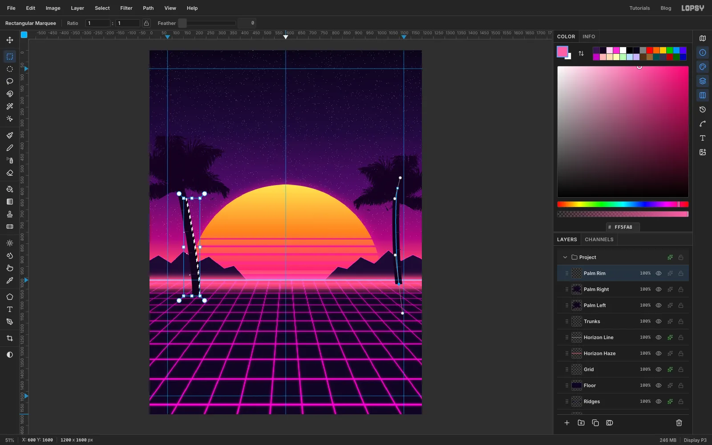

The sun is low in the middle of the page, so the inner edge of each trunk should catch a little pink light. Select **Palm Right** and add a layer called **Palm Rim**. Then:

1. [[Cmd]]-click the **Trunks** thumbnail to select the trunks' shape.
2. Pick the **Rectangular Marquee** and press [[←]] three times. This moves the selection outline three pixels left without touching the pixels.
3. Choose **Select → Inverse**, then [[Cmd]]+[[Shift]]+[[Alt]]-click the **Trunks** thumbnail to intersect with the trunks again. What's left is a three-pixel sliver down the *right* edge of each trunk.
4. Hold [[Shift]]+[[Alt]] and drag a rectangle over the left half of the page, from just below the crown down. That keeps only the left trunk's sliver, and stops it before the crown.

Select **Palm Rim**, set the foreground to `#FF5FA8` and fill. Repeat with [[→]] for the right trunk's left edge, keeping the right half of the page. Set the layer to **80%** opacity.

## Glow the crowns and ground the trunks

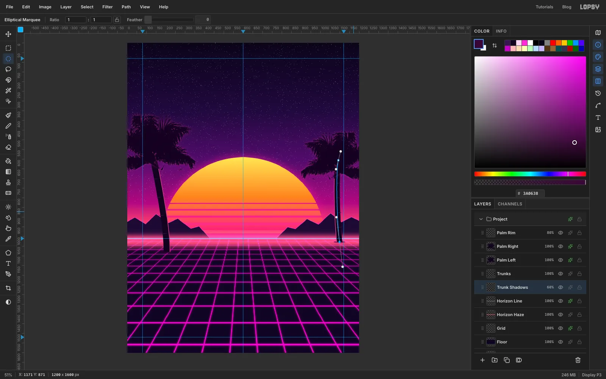

Don't rim-light the crowns the same way: their thresholded edges would turn into jagged pink dashes. Give **Palm Left** and **Palm Right** each an **Outer Glow** of Size **16**, Spread **0**, Opacity **45**, colour `#FF4FA8` instead, for a soft backlit halo.

Select **Horizon Line** and add a layer called **Trunk Shadows**, so it sits under the trunks. With the Elliptical Marquee, drag a small flat ellipse (about 68 × 10 px) centred on the base of the left trunk, and [[Shift]]-add one about 60 × 10 px at the right trunk's base. Fill with `#3A0638`, deselect, run **Gaussian Blur…** at **3**, and set the layer to **60%**.

## Start the cassette: shell and head area

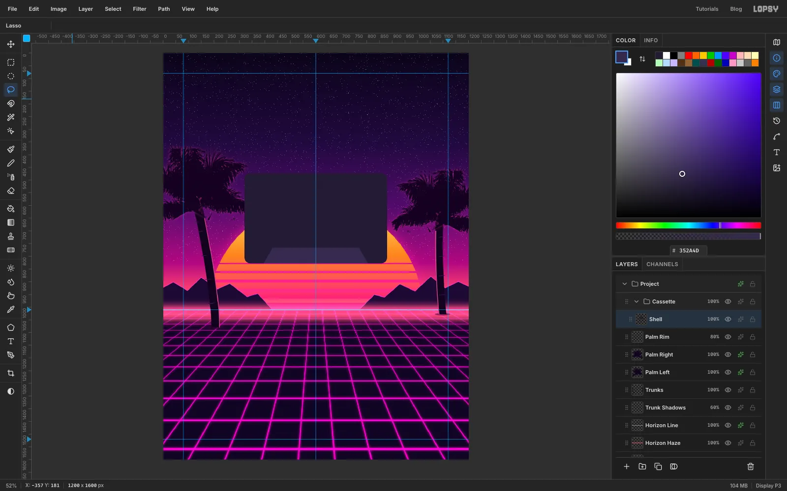

Select **Palm Rim** and click **New Group** in the Layers panel. Name the group **Cassette**, and add a layer inside it called **Shell**. Build the whole tape upright and centred on the page. You'll tilt it at the end.

Pick the **Shape** tool, choose **Rectangle**, set Corner Radius **24**, Fill `#221A33` and no stroke. Click once (don't drag) at the centre of the page, at (600, 650). In the **Shape Size** dialog, enter **560 × 356**.

A real cassette has a raised head area along its bottom edge. Lasso a trapezoid that is narrow at the top (about x 430 to 770 at y 766) and wider at the shell's bottom edge (about x 395 to 805). Fill it with `#352A4D`.

## Add the label and its stripes

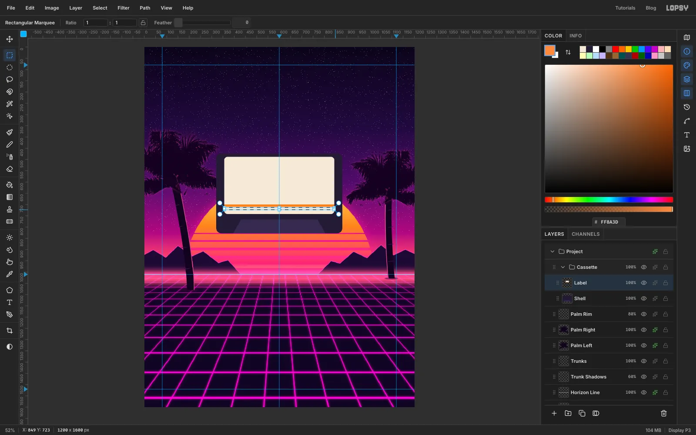

Add a layer called **Label**. With the Shape tool, set Corner Radius **14** and Fill `#F4E9D8`, and click-create a **488 × 254** rectangle centred at (600, 615).

Paint three stripes along the bottom of the label so that they follow its rounded corners:

1. [[Cmd]]-click the **Label** thumbnail.
2. Hold [[Shift]]+[[Alt]] and drag a band across the whole label from y 700 to y 710, a little wider than the label.
3. Fill with `#FF8A3D`.

Repeat for a `#FF2E88` band from y 713 to 723 and a `#7A2BB8` band from y 726 to 736. The label's bottom edge is at y 742, so the last band runs into its rounded corners and gets clipped to them.

## Cut the window and show the tape inside

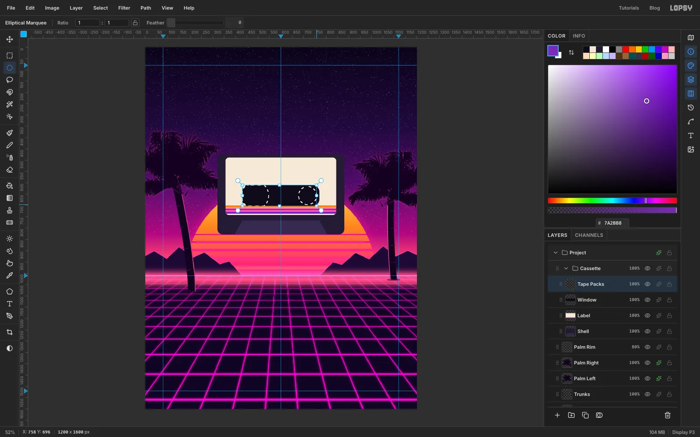

Add a layer called **Window** and click-create a **340 × 92** rectangle with Corner Radius **30**, Fill `#0F0A1A`, centred at (600, 656).

Add a layer called **Tape Packs**. With the Elliptical Marquee, drag a circle about 128 px across around the left reel position (482, 656). Hold [[Shift]] and add a smaller circle, about 80 px across, around the right reel (718, 656). A cassette that's been played halfway has more tape on one side.

[[Cmd]]+[[Shift]]+[[Alt]]-click the **Window** thumbnail to clip the circles to the window, and fill with `#4A2A1E`.

## Add the reels, screws and tape slot

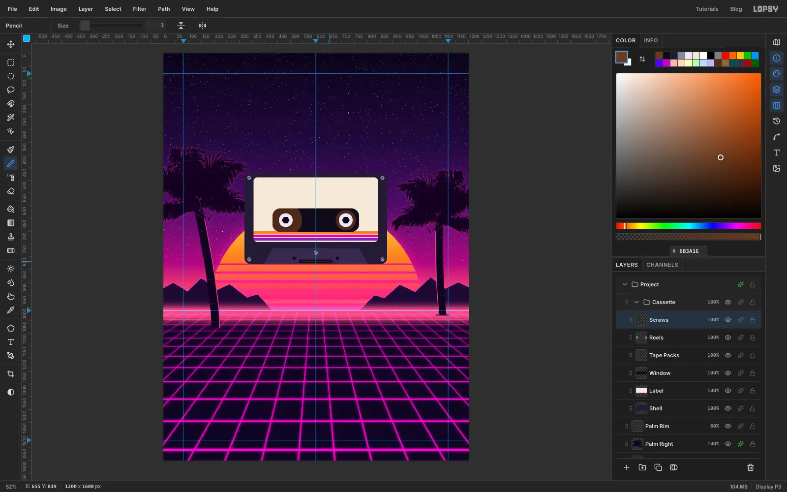

On a new layer called **Reels**, click-create two **54 × 54** ellipses in `#ECE6F5` on the reel positions. Then switch the Shape to **Polygon** with **6** sides and click-create a **30 × 30** hexagon in `#0F0A1A` on each one.

On a layer called **Screws**:

- Click-create **16 × 16** ellipses in `#8C86A0` at the four corners of the shell and one in the head area at (600, 784). Draw a short Pencil line across each in the shell colour for the screw slot.
- Along the bottom edge, click-create a **130 × 14** dark slot (Corner Radius 4) at (600, 818) and a **14 × 14** hole on either side of it.
- With the Pencil at Size 3 in `#6B3A1E`, draw a line along the slot. That's the tape showing through, ready to spill out.

## Put a glare on the window

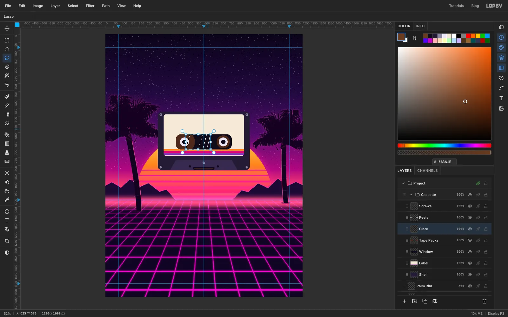

Select **Tape Packs** and add a layer called **Glare**. Lasso a broad slanted band across the window, and [[Shift]]-add a thin one beside it. [[Cmd]]+[[Shift]]+[[Alt]]-click the **Window** thumbnail to keep only the part inside the window. Fill with white and drop the layer to **22%** opacity. It reads as light on clear plastic.

## Letter the label

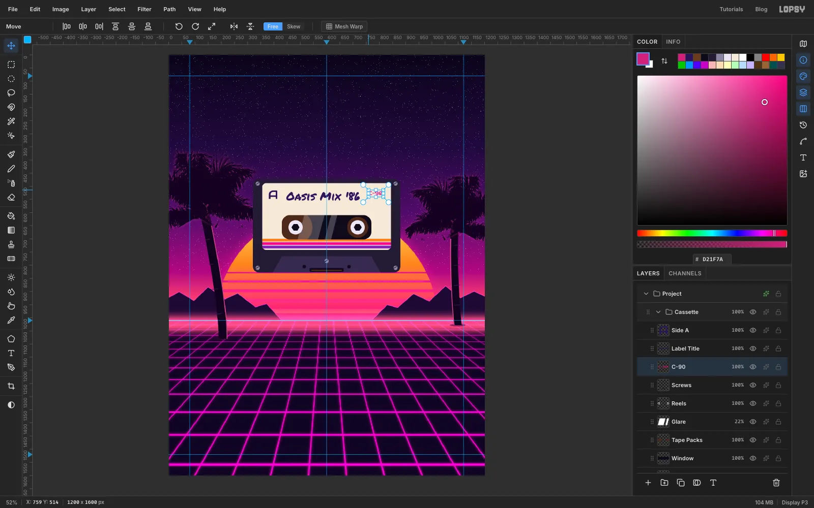

Select **Screws** before each new piece of text. If a text layer is active, the text options restyle it instead of setting up the next one.

With the **Text** tool:

- **A** in **Audiowide** at **46** px, colour `#2B1458`, in the label's top-left corner (side A of the tape). Name the layer **Side A**.
- **Oasis Mix '86** in **Permanent Marker** at **44** px, same colour, so it looks hand-written on the label. Name it **Label Title**.
- **C-90** in **Audiowide** at **19** px, `#D21F7A`, tucked into the top-right corner with about the same margin as the A.

## Scale the whole cassette as one

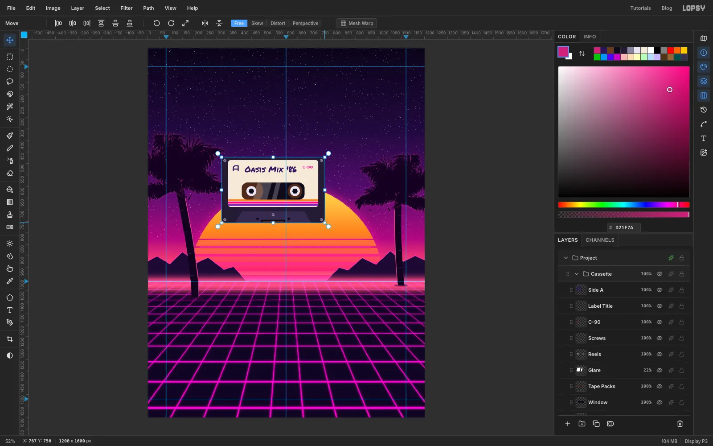

The cassette covers too much of the sun, so make the whole group smaller. Press [[Cmd+D]], click the **Cassette** group row in the Layers panel, and pick the **Move** tool. With no marquee, the transform box frames every layer in the group, text included.

Hold [[Cmd]] and drag the bottom-right handle in to about **80%**. Then drag from inside the box to centre the cassette at about (600, 612), a little higher than before.

## Tilt the cassette

Still in the same box, drag the top-right **rotation** handle (the circle just outside the corner) a little **counter-clockwise**, about 8°. A small tilt makes the tape look like it's floating rather than pasted on.

Press [[Esc]] to finish. For this kind of transform, Escape applies the change rather than cancelling it. The label text is still live text: it was turned and scaled with the rest, so you could still fix a typo in it.

## Give the shell a neon edge

Expand the **Cassette** group, select **Shell**, and add a **Stroke** of Width **4** in `#FF4FD8` and an **Outer Glow** of Size **46**, Spread **4**, Opacity **75**, colour `#FF3DA8`.

## Spill the tape across the grid

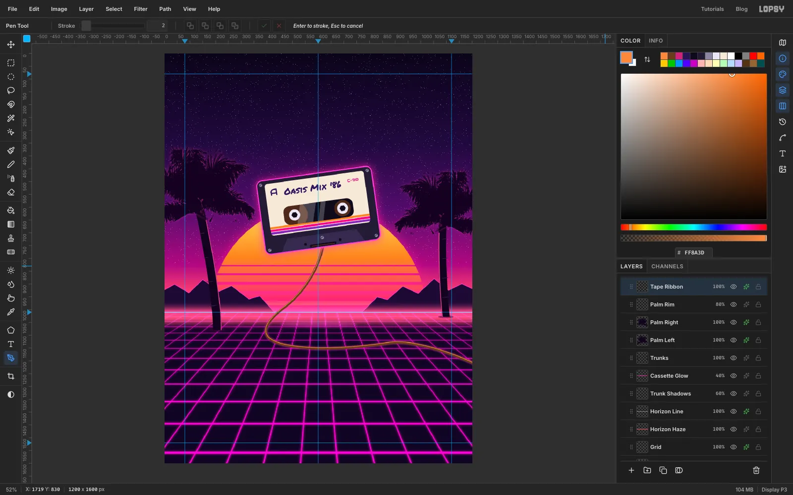

For a soft reflection on the grid, select **Trunk Shadows** and add a layer called **Cassette Glow**. Fill a flat ellipse about 300 × 20 px under the cassette with `#FF3DA8`, blur it by **14**, set it to **Screen** at **40%**.

Select **Palm Rim** and add a layer called **Tape Ribbon** (it goes *under* the cassette group). In the Brushes panel set Taper back to **0**. Set the foreground to `#6B3A1E` and use the **Pen** at Stroke **10**:

1. Click-drag at the slot.
2. Click-drag down to the left of the sun at about (470, 990).
3. Curl back across at about (480, 1140).
4. Sweep right across the grid at about (880, 1130).
5. Finish off the right edge of the page.

Press [[Enter]], and delete the path in the **Paths** panel. For a shiny highlight, set the foreground to `#FF8A3D` and trace a second Pen path along the top edge of the tape, about 3 px above the first one's centre, following the same curve. Stroke it at **2** and delete that path too. Give the layer an **Outer Glow** of Size **10**, Opacity **70**, colour `#FF4FD8`.

## Set the title

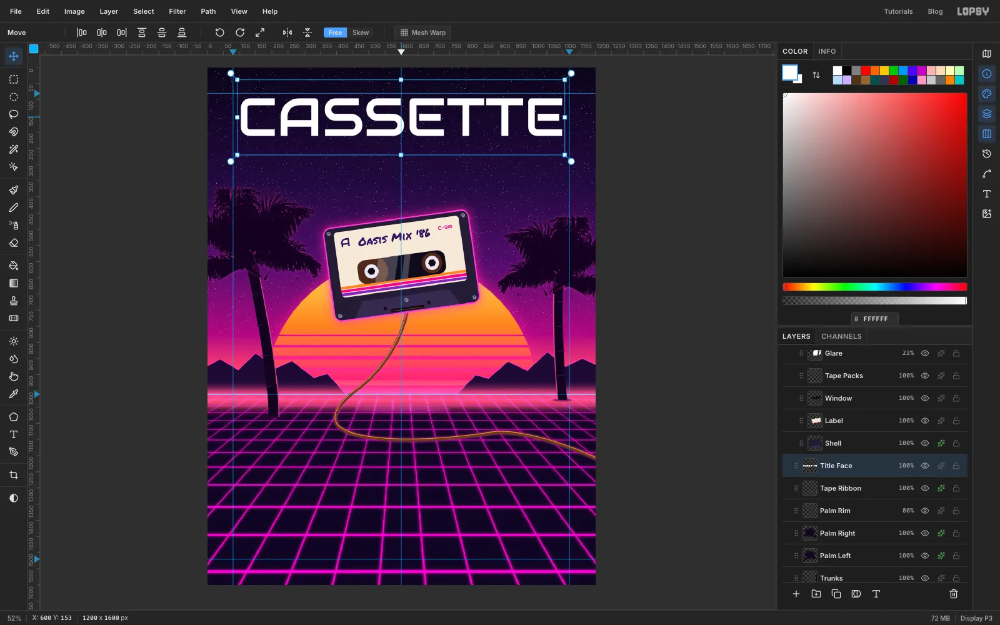

Select **Tape Ribbon**, pick the **Text** tool, and type **CASSETTE** in **Audiowide** at **166** px in white. Name the layer **Title Face** for now. At that size it spans almost exactly 1000 px. Centre it with the Move tool, with its top at about y 96, just under the top guide.

## Build the 3D extrusion

Click the **Rasterize Layer** button (the **T** icon at the bottom of the Layers panel) to turn the text into pixels. [[Cmd]]-click its thumbnail and press [[Cmd+C]] then [[Cmd+V]] to paste an exact copy on top. Name the original **Title Extrude** and the copy **Title Face**.

On **Title Extrude**, [[Cmd]]-click the thumbnail and fill with `#3A0C5E`. Now build the depth by doubling:

1. [[Cmd]]-click the **Title Extrude** thumbnail, then [[Cmd+C]] and [[Cmd+V]].
2. Press [[Cmd+D]], pick the Move tool and nudge the copy **2 px** right and **2 px** down with the arrow keys.
3. Choose **Layer → Merge Down**.
4. Repeat with a nudge of **4 px**, then **8 px**.

The stack ends up 14 px deep and solid all the way through. Doubling the nudge each time takes three merges instead of fourteen.

[[Cmd]]-click the extrusion again and drag a Linear gradient from `#8A1F9A` at the top to `#1A0638` at the bottom. Then add an **Outer Glow** of Size **34**, Opacity **55**, colour `#FF3DA8`.

## Paint the sunset face

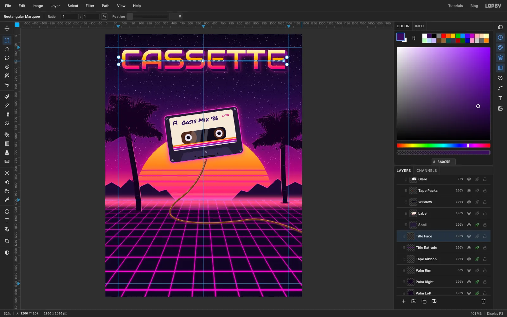

Select **Title Face** and [[Cmd]]-click its thumbnail. Drag a Linear gradient from the top of the letters to the bottom with these stops:

- `#FFF6C9` at 0%
- `#FFD23F` at 40%
- `#FF7A2F` at 62%
- `#FF2F86` at 100%

Keep the selection, hold [[Shift]]+[[Alt]], and drag a 4 px band across the letters a little below their middle. Fill it with `#FFF4FB` for a bright chrome "horizon" line through the type. Deselect and add an **Inner Glow** of Size **5**, Opacity **70** in white to bevel the edges.

## Add "Oasis" and tilt it

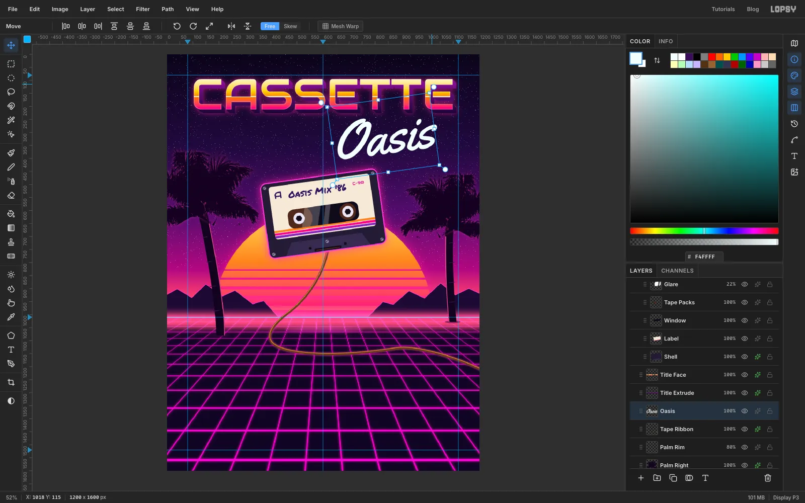

Select **Tape Ribbon** again and type **Oasis** in **Yellowtail** at **200** px, colour `#F4FFFF`. Name the layer **Oasis**.

Press [[Cmd+D]] and pick the Move tool. A text layer gets its own transform box with nothing selected. Drag its top-right rotation handle counter-clockwise by about 8°, the same tilt as the cassette.

Then drag the word so its right edge lines up with the right edge of the **E** in CASSETTE. Its top should sit about 15 px below the extrusion so the two don't touch.

> **Tip:** don't marquee around text to turn it. The marquee has to cover the text's whole line box, which is taller than the letters, or Lopsy asks you to rasterize first. The text's own handles always work.

## Turn "Oasis" into neon

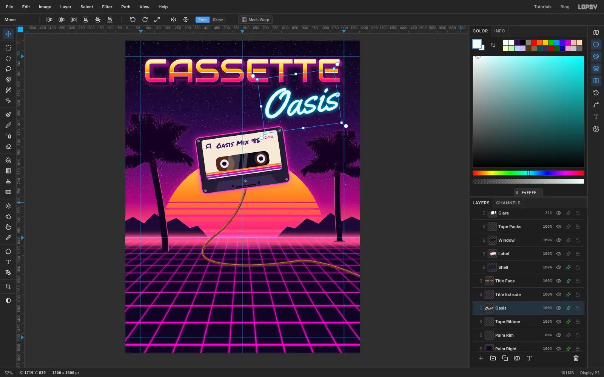

Open the effects drawer on **Oasis** and tick **Inner Glow**: Size **7**, Opacity **100**, colour `#2EF2FF`. That turns the edges of the white letters cyan, so the centre reads as the hot core of a neon tube. Then tick **Outer Glow**: Size **30**, Spread **6**, Opacity **90**, colour `#18D8FF`.

## Build the info panel and its tab

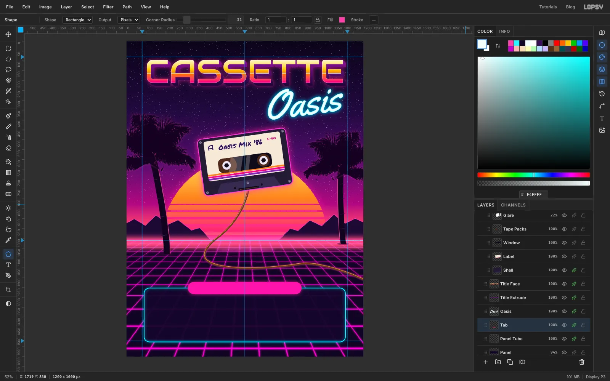

Select **Tape Ribbon** and add a layer called **Panel**. Click-create a **1020 × 274** Rectangle, Corner Radius **28**, Fill `#12062A`, centred at (600, 1389). Set the layer to **94%** opacity. That's dark enough that the grid lines never cross the text.

Add a layer called **Panel Tube**, change the Shape tool's Fill to none and its Stroke to `#2EF2FF` at Width **4**. Click-create the same rectangle in the same place, then give it an **Outer Glow** of Size **22**, Spread **2**, Opacity **85**, colour `#18D8FF`.

Add a layer called **Tab**. Set Fill `#FF3DA8` with no stroke and Corner Radius **31**, and click-create a **576 × 62** pill centred on the panel's top edge at (600, 1252). Give it an Outer Glow of Size **26**, Opacity **70**, in the same pink.

## Set the shop details

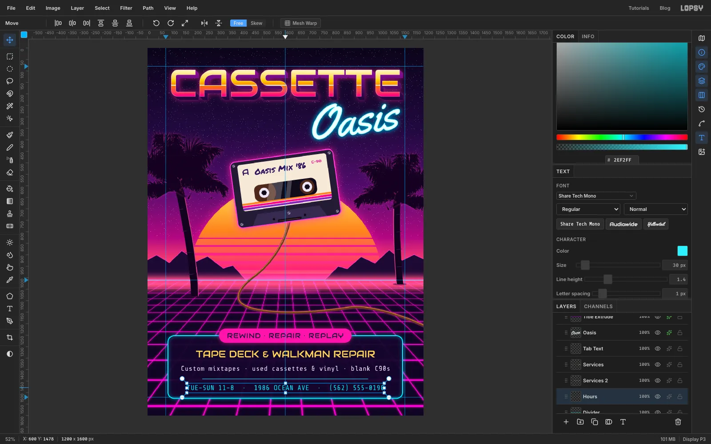

Select **Tab**, pick the Text tool and set **Align** to **Center**. Make each line, then centre it with the Move tool. Click the **Tab** layer again before starting each new line, so the font settings don't restyle the line you just made:

- **REWIND · REPAIR · REPLAY** in **Audiowide 30** `#1A0838` with Letter spacing **2** (in the **Text** panel), centred in the pill both ways. These are all capitals, so centre the letters themselves in the pill. Name it **Tab Text**.
- **TAPE DECK & WALKMAN REPAIR** in **Audiowide 42** `#FFD86B`, with Letter spacing set back to **0** (it carries over from the last text). Put its top about 35 px below the pill and name it **Services**.
- **Custom mixtapes · used cassettes & vinyl · blank C90s** in **Share Tech Mono 30** `#F3E6FF`, Letter spacing **1**, about 40 px below the heading. Name it **Services 2**.
- On a new layer called **Divider** (made with **Tab** selected), a **Pencil** rule at Size 2 in `#2EF2FF` across the middle 720 px of the panel: click at one end and [[Shift]]-click at the other.
- With **Divider** selected, **TUE–SUN 11–8 · 1986 OCEAN AVE · (562) 555-0190** in **Share Tech Mono 30** `#2EF2FF`, Letter spacing **1**, with about 35 px below it to the panel's border. Name it **Hours**.

## Draw the coupon starburst

Select **Divider** and add a layer called **Coupon**. The starburst is 20 spikes around a circle about 210 px across, centred at about (990, 1112). That's just above the panel, right of the pill and below the right palm's base.

With the **Pen**, click (don't drag) its 40 corners in order: a spike tip, then an inner point about 18 px further in, then the next tip, and so on round the circle. Click the first point again to close the path. In the **Paths** panel, click **Path to Selection**, then delete the path. Don't worry if the spikes aren't perfectly even. A hand-cut sticker looks better a little irregular.

Fill with `#FFE14D`. Add a **Stroke** of **3** in `#1A0838` and a hard **Drop Shadow**: Offset X **7**, Offset Y **7**, Blur **0**, Opacity **100**, colour `#FF3DA8`. It looks like a sticker slapped on the flier.

## Letter the coupon

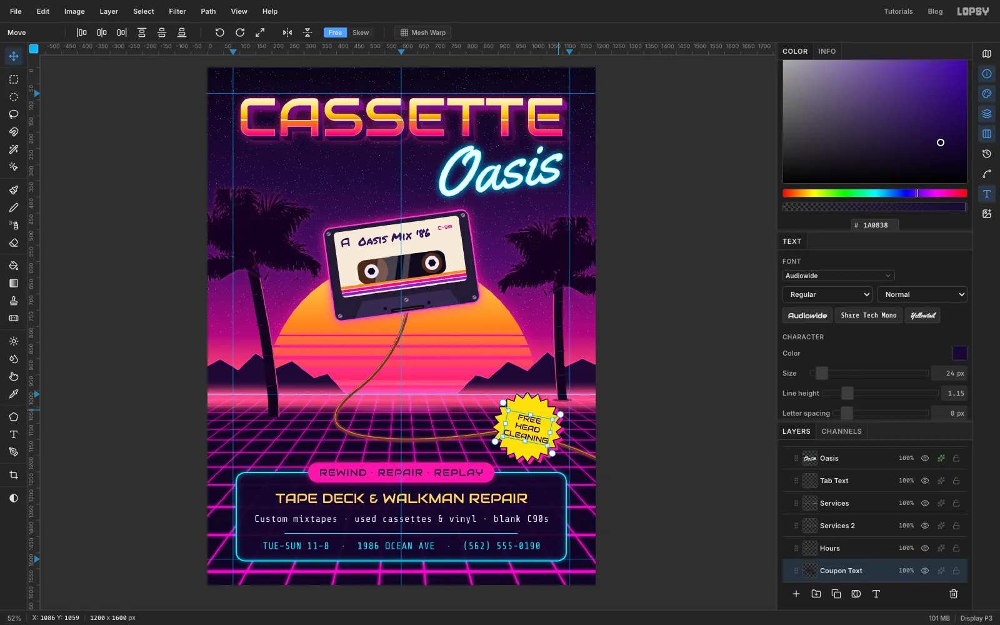

With **Divider** selected and **Align** still on Center, type **FREE**, [[Enter]], **HEAD**, [[Enter]], **CLEANING** in **Audiowide 24**, colour `#1A0838`, and set Letter spacing to **0**. Name the layer **Coupon Text**. In the **Text** panel, set **Line height** to **1.15** so the three lines hug together. Move the block to the middle of the starburst.

With the Move tool and nothing selected, drag the text's rotation handle **clockwise** by about 12°, against the tilt of everything else, so the sticker feels stuck on at an angle. Centre it on the star again afterwards.

## Add scanlines above everything

The finishing layers need to sit on top of everything, including the Cassette group. Collapse the Cassette group with its arrow, select **Title Face**, and add a layer called **Scanlines**. Drag its grip in the Layers panel up into the top half of the **Cassette** row, so the drop line shows above it, and let go.

Draw the scanlines:

1. Click once with the Rectangular Marquee and enter From 0, 0 To 4, 1 to select a 4 × 1 px strip in the top-left corner. Fill it with black.
2. Do the same with To 4, 4 to select the 4 × 4 square around it, and choose **Edit → Define Pattern**.
3. Press [[Cmd+A]], choose **Edit → Fill with Pattern…**, pick the new pattern and press **Apply**.
4. Drop the layer to **14%** opacity.

## Add grain and export

Add a layer called **Grain** above **Scanlines**. Select all, fill with mid-grey `#808080`, and deselect. Run **Filter → Add Noise…** at **18**, **Mono**, **Gaussian**, set the layer to **Overlay** and drop it to **45%**. Grey disappears in Overlay mode, leaving only a fine film grain that takes the digital edge off the gradients.

Save the project with **File → Save Project**, and export the flier with **File → Quick Export PNG**.
