Synthwave is the 80s as remembered by a VHS tape: a sun sinking into a neon
grid, mountains outlined in laser light and chrome lettering with a script
slashed across it. In this tutorial you'll put a Christmas tree in that world
and make **Tannenbaum Aurora**, a 5 × 7 inch holiday card. There's an aurora
in the sky as well as the sun, because a synthwave card doesn't have to
make sense.

You'll work on a 1500 × 2100 px canvas, from the back of the scene to the
front. Each part of the picture goes in its own group: Sky, Mountains, Floor,
Weather, Tree, Type and Finish. Almost all the glow comes from two layer
effects, **Stroke** and **Outer Glow**. The rest comes from filters: Halftone
for the sun, Clouds, Add Noise and Motion Blur run *inside a layer mask* for
the aurora curtains, and Sunburst for the grid. You'll draw shapes with the
Pen tool (paths are managed in the **Paths** panel, which you open from the
icon strip on the right), bend the aurora with Mesh Warp, and use Copy Merged and Flip
Vertical to make a reflection.

A few habits make the whole build go smoothly:

- **New groups.** To add a group next to the previous one, collapse the
  previous group, click its row, then click **New Group** at the bottom of
  the Layers panel. Then click **Add Layer**: with a group row selected, the
  new layer goes inside it. Each later Add Layer goes just above the
  selected layer.
- **Exact marquees.** Click once with the Rectangular or Elliptical Marquee
  without dragging (and with nothing selected) to get a dialog where you can
  type the corners. Press [[Cmd+D]] first if something is already selected.
- **Gradients.** The Gradient tool's colours come from its **Advanced…**
  editor, not from the foreground colour. Click the bar to add a stop, click
  a stop to select it, and type its hex. Two stops is the default, so delete
  any extra stops left over from a previous gradient.
- **Layer effects.** Click the sparkle (✦) button on a layer row to open the
  effects drawer, tick an effect and set its values there. Blend mode is at
  the top of the same drawer.
- **Filter dialogs** open with their default values every time. Any value a
  step doesn't mention stays at its default.

The palette:

- Night sky `#0A0726` → `#2B0F57` → `#7A1D7E` → `#E8457F`
- Sun `#FFF1A8` → `#FF9A5C` → `#FF3D8B`, glow `#FF2E9A`
- Aurora `#B44CFF` → `#29E0FF` → `#3DFFA8`
- Back range `#4A1F7A` → `#1E0B3F`, edge `#FF3BD4`
- Front range `#1A0B3A` → `#0A0420`, edge `#29E0FF`
- Floor `#2A0B4A` → `#06021A`, grid `#FF3BD4`, haze `#FF6FD0`
- Tree `#061A24` → `#11524E`, edge `#3DFF8E`, trunk `#0B0618`
- Lights `#FFE7A0`, light glow `#FFC94D`
- Baubles `#FF3EA5` / `#3BE8FF` / `#FFD447` / `#B04CFF`, rim `#1A0636`
- Star `#FFE45E`, star burst `#FFF6C8`, gift box `#1A0B3A`
- Chrome `#1B3B8C` → `#8FD4FF` → `#FFFFFF` → `#3A1450` → `#8A2E6E` → `#FF9E5E` → `#FFE3B0`
- Chrome rim `#FFD8F6`, shadow `#FF2BD6`
- Script `#FFE1F5`, knockout `#1A0830`
- Tagline `#7DF9FF`, pill `#0A0420`, halo `#0D0420`

## Make the canvas and paint the night sky

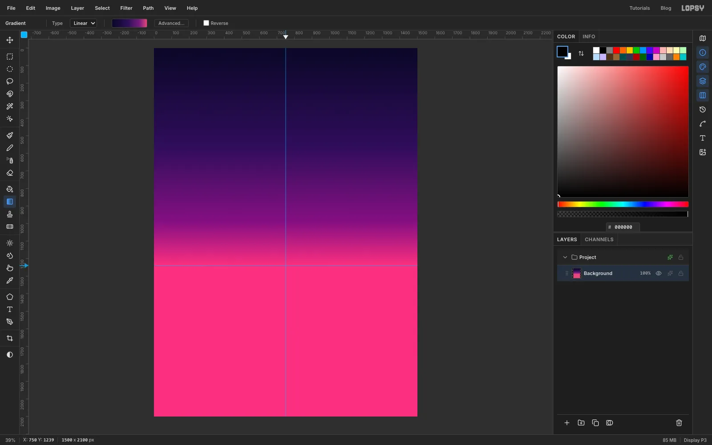

Choose **File → New**, make a **1500 × 2100** px document and click
**Create**. The 1.4:1 shape is a 5 × 7 inch card.

Click the top ruler at **750** to drop a vertical guide down the middle, and
click the left ruler at **1239** for the horizon. Watch the X/Y readout in
the status bar as you hover, so each guide lands on the number.

Select **Layer 1** and click **Delete Layer**, then select **Background**.
Pick the **Gradient** tool and set Type to **Linear**. In **Advanced…**, make
four stops: `#0A0726` at the left end, `#2B0F57` at 45%, `#7A1D7E` at 80% and
`#E8457F` at the right end. Drag from the top of the canvas straight down to
the horizon guide. Everything below the horizon will be covered by the floor
later, so it doesn't matter that it fills with pink.

## Scatter stars with noise and Threshold

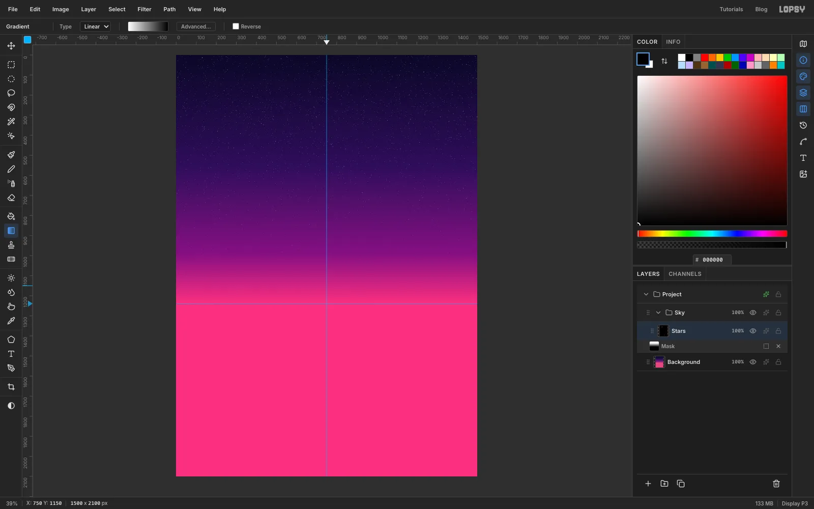

With **Background** selected, click **New Group** and name it **Sky**. Click
**Add Layer** and name the layer **Stars**.

Set the foreground colour to `#000000` and choose **Edit → Fill**. Then run:

1. **Filter → Add Noise…**: Amount **100**, Mode **Mono**, Distribution
   **Gaussian**.
2. **Filter → Gaussian Blur…**: Radius **1**. This merges the noise into
   soft specks of different sizes.
3. **Filter → Threshold…**: Level **45**. Only the brightest specks survive,
   as white stars on black.

Set the layer's blend mode to **Screen**, so the black disappears and only
the stars show. Stars fade near a glowing horizon, so click **Add Mask** and
then click the mask thumbnail to edit the mask. With the Gradient tool, set
the stops to white then black and drag from about y 300 down to y 1150. Click
the **Stars** name in its row to stop editing the mask.

## Draw the sun and select its bottom

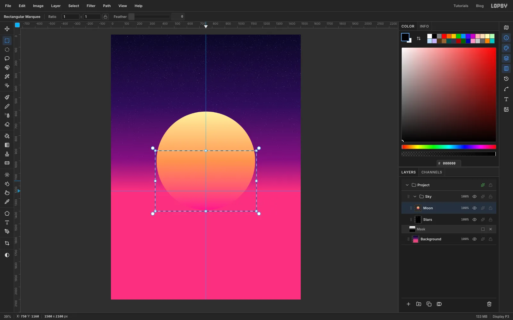

Click **Add Layer** and name it **Moon**. (The screenshots use that name, but
it's the sun.)

Click once with the **Elliptical Marquee** and enter **360, 610** to
**1140, 1390**. That makes a circle 780 px wide, centred on the middle guide,
with its centre at y 1000. Set the gradient to three stops: `#FFF1A8`,
`#FF9A5C` at 50% and `#FF3D8B`. Drag from the top of the circle to the bottom,
then press [[Cmd+D]].

Now click once with the **Rectangular Marquee** and enter **350, 920** to
**1150, 1400**. This box covers the sun from a little above its middle to
past its bottom. The next filter only touches this part.

## Dissolve the bottom of the sun with Halftone

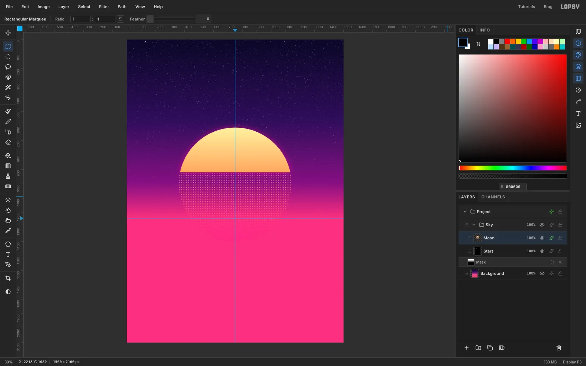

Choose **Filter → Halftone…**, set Dot Size to **12** and Angle to **0**, and
click **Apply**. Halftone turns the selected part into dots and makes the gaps
between them transparent, so the sky shows through. Press [[Cmd+D]] to deselect.

The classic synthwave sun is cut into horizontal slats. A halftone dissolve
gives the same "sinking into the grid" feel and looks like a printed retro
poster.

Open the layer effects and turn on **Outer Glow** with colour `#FF2E9A`,
Size **60** and Opacity **55**.

## Draw the aurora ribbon

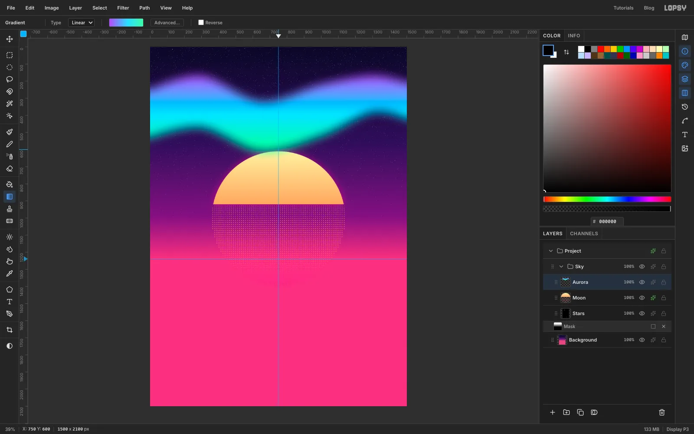

Click **Add Layer** and name it **Aurora**. With the **Pen** tool, draw a
closed ribbon shape across the whole width of the sky:

1. Click on the left edge of the canvas at about y 250.
2. Make the top edge wave: press and drag a little to the right at about
   (300, 170), (650, 320), (1000, 220) and (1300, 170). Dragging pulls out
   handles, so the curve stays smooth.
3. Click on the right edge at about y 210, then click lower on the same edge
   at about y 420.
4. Make the bottom edge wave back to the left: press and drag a little to the
   left at about (1300, 380), (1000, 520), (650, 610) and (300, 470).
5. Click the left edge at about y 530, then click the first anchor to close
   the path.

In the **Paths** panel, click **Path to Selection**, then **Delete Path**.
Choose **Select → Feather…** and enter **60**, so the ribbon gets soft edges.

Set a three-stop gradient: `#B44CFF`, `#29E0FF` at 55% and `#3DFFA8`. Drag
straight down from y 140 to y 600. Real auroras are green at the bottom and
redder or violet at the top. Press [[Cmd+D]].

## Bend the aurora with Mesh Warp

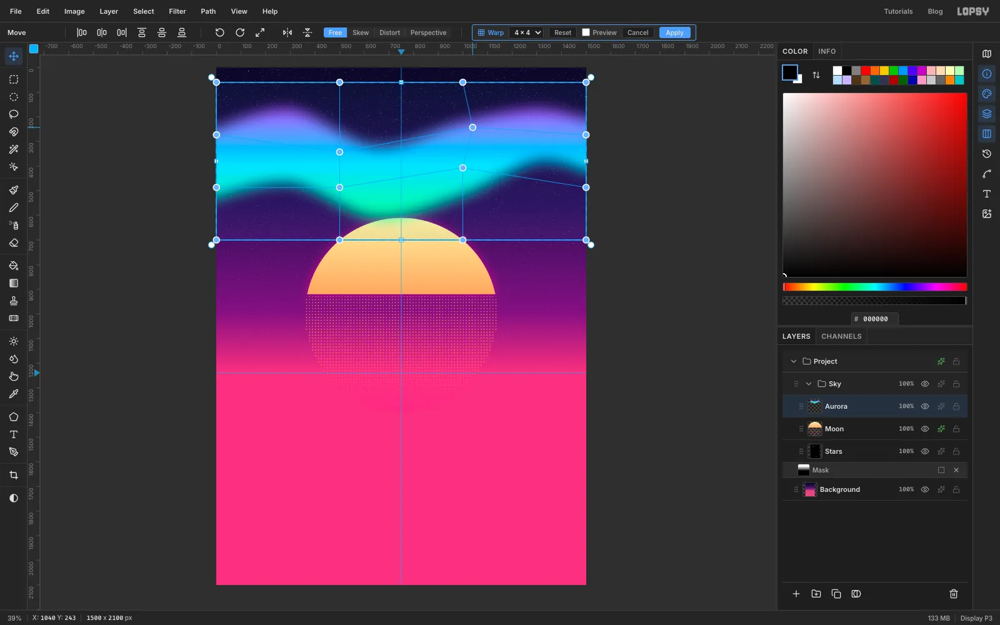

The Pen curve is a little too even. Click once with the Rectangular Marquee
and enter **0, 60** to **1500, 700**, so the warp only affects the band of
sky the aurora is in.

Switch to the **Move** tool and click **Mesh Warp** in the options bar. A
4 × 4 grid appears over the selected box. Drag three of its four inner
points. Make sure you press right on a handle, or the drag moves the whole
layer instead:

- the upper-left inner point **down about 70 px**,
- the lower-right inner point **up about 80 px**,
- the upper-right inner point **up about 30 px and right about 40 px**.

Click **Apply**, then press [[Cmd+D]].

## Cut the curtains into the aurora's mask

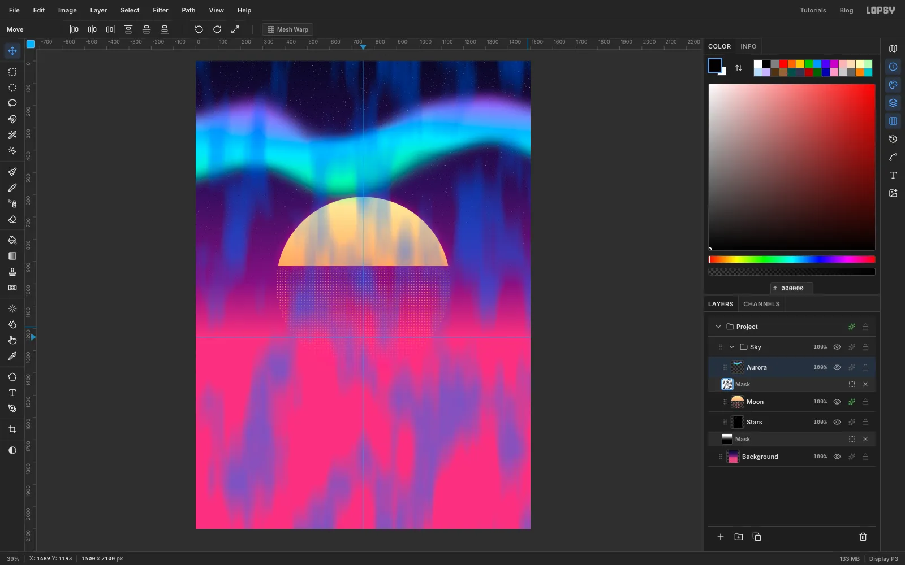

Aurora light hangs in vertical curtains. You'll make them in a layer mask,
which you can still change later.

Click **Add Mask**, then click the mask thumbnail. Filters now run on the mask
instead of the colours. Run these four in order:

1. **Filter → Clouds…**: Scale **16**. Big soft light and dark patches.
2. **Filter → Add Noise…**: Amount **60**, Mode **Mono**. Fine grain to
   streak.
3. **Filter → Motion Blur…**: Angle **90**, Distance **250**. Smears
   everything vertically into curtains.
4. **Filter → Brightness/Contrast…**: Brightness **35**, Contrast **75**.
   Separates the curtains from the gaps.

The blue overlay shows the mask while you edit it. Click the **Aurora** name
in its row to stop editing.

## Let the aurora glow with Screen

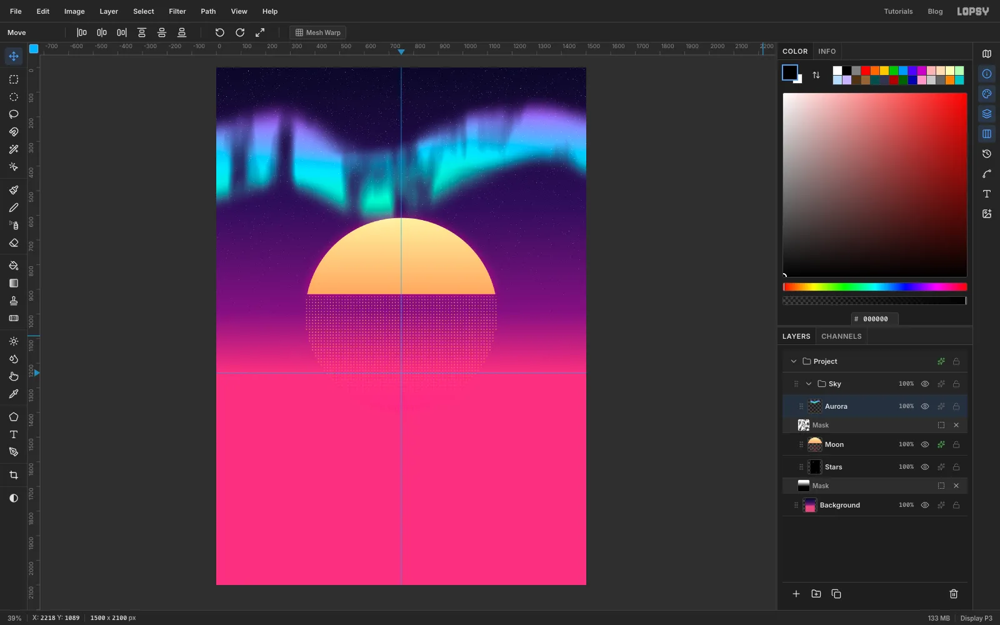

Set the Aurora layer's blend mode to **Screen**. Screen only ever brightens,
so the aurora glows on top of the stars and the sky instead of covering them.
The Sky group is done. Click its arrow to collapse it.

## Draw the back mountain range with the Pen

Select the **Sky** row, click **New Group** and name it **Mountains**. Add a
layer named **Back Range**.

With the **Pen** tool, make only plain clicks (no drags), so every corner
stays sharp:

1. Start on the horizon at the bottom-left corner (0, 1239).
2. Go up the left edge to about y 1060.
3. Zigzag peaks across the canvas. Make the highest peaks near the sides,
   at about (190, 935) on the left and (1270, 940) on the right. Bring the
   ridge lowest in the middle, at about (760, 1200), so it doesn't hide the
   sun.
4. Come down the right edge to (1500, 1239), then click the first anchor to
   close.

Click **Path to Selection** and **Delete Path** in the Paths panel. Fill the
selection with a gradient from `#4A1F7A` to `#1E0B3F`, dragged from y 930
down to the horizon, then deselect.

## Light the ranges with Stroke and Outer Glow

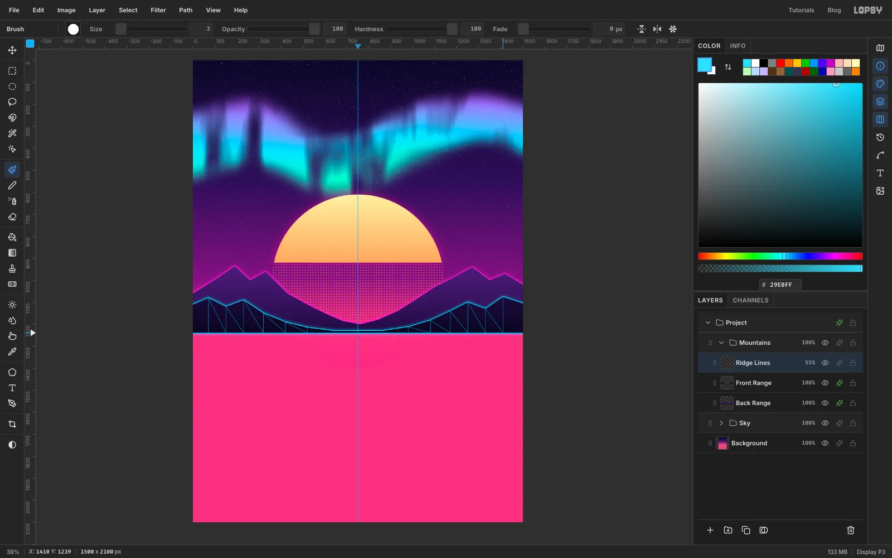

On **Back Range**, turn on **Stroke** (`#FF3BD4`, Width **3**) and **Outer
Glow** (`#FF3BD4`, Size **24**, Opacity **70**).

Add a layer named **Front Range** and draw a lower ridge the same way. Start
at the bottom-left (0, 1239), go up the left edge to (0, 1110), then click
these corners from left to right: (70, 1080), (150, 1120), (230, 1090),
(320, 1150), (420, 1190), (520, 1215), (640, 1230), (860, 1230),
(980, 1212), (1080, 1182), (1170, 1140), (1250, 1100), (1330, 1130) and
(1410, 1075). Finish at (1500, 1105) and (1500, 1239) and close the path.
Fill it with a `#1A0B3A` to `#0A0420` gradient, from y 1070 down to the
horizon, then deselect. Give it a cyan **Stroke**
(`#29E0FF`, Width **3**) and **Outer Glow** (`#29E0FF`, Size **20**,
Opacity **70**).

For the wireframe, add a layer named **Ridge Lines**. Set the foreground to
`#29E0FF` and pick the **Brush** at Size **3**, Hardness **100**. Draw
straight lines with a click and a [[Shift]]-click. On the left hills, start at
each corner of the ridge from x 70 to x 520. Draw one line straight down to
the horizon, and a second line diagonally down to the horizon point under the
next corner. That makes a strip of triangles. Do the same on the right hills,
from x 980 to x 1410. The middle corners end up hidden behind the tree, so
you can skip them. Lower the layer's opacity to **55%**.

## Lay the floor and burst the grid lines from the horizon

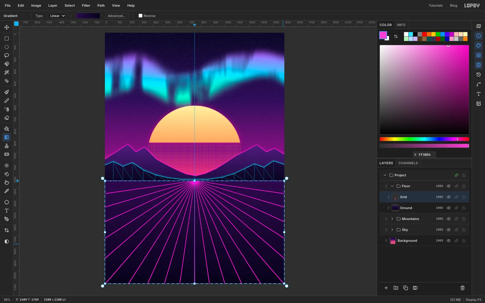

Collapse **Mountains**, select its row, click **New Group** and name it
**Floor**. Add a layer named **Ground**.

Click once with the Rectangular Marquee and enter **0, 1239** to
**1500, 2100**, which is everything below the horizon. Fill it with a gradient
from `#2A0B4A` at the horizon to `#06021A` at the bottom.

Keep the selection. Add a layer named **Grid**, set the foreground to
`#FF3BD4` and choose **Filter → Sunburst…**. Enter Rays **44**, Width **5**,
Taper **35**, Center X **50** and Center Y **59**, and click **Apply**.
Center Y is a percentage of the canvas height, and 59% of 2100 is the horizon,
so the rays fan out from the vanishing point. The selection keeps them below
the horizon. Press [[Cmd+D]].

## Add the cross lines, closer and closer toward the horizon

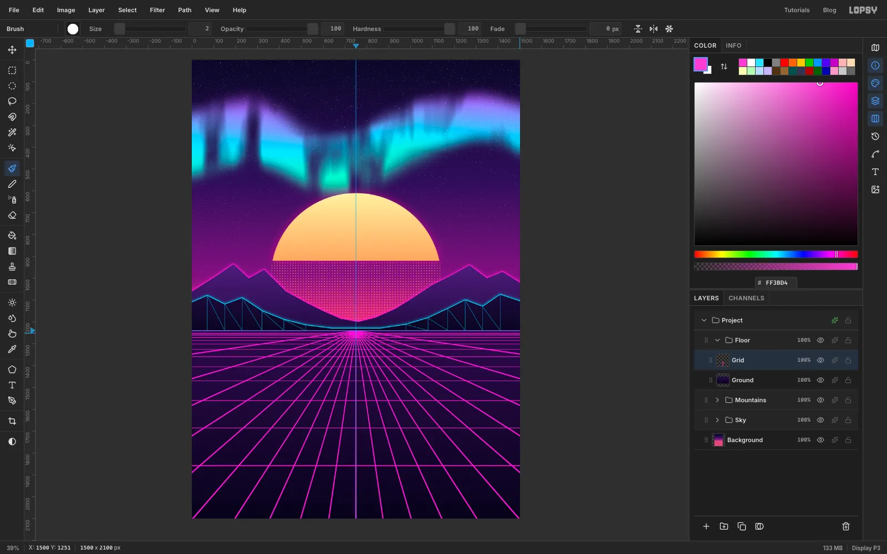

Still on **Grid**, use the **Brush** to draw horizontal lines across the
whole width. Click on the left edge, then [[Shift]]-click on the right edge
at the same height.

Start low and work up toward the horizon. Make each gap about three quarters
of the one below it: the lines go at y **1858, 1685, 1560, 1470, 1405,
1359, 1325, 1301, 1284, 1271, 1262, 1256** and **1251**. Near lines should
be heavier than far ones. Use Size **5** for the first line, **4** for the
next two, **3** for the three after that and **2** for the rest.

## Make the grid glow and fade into a haze

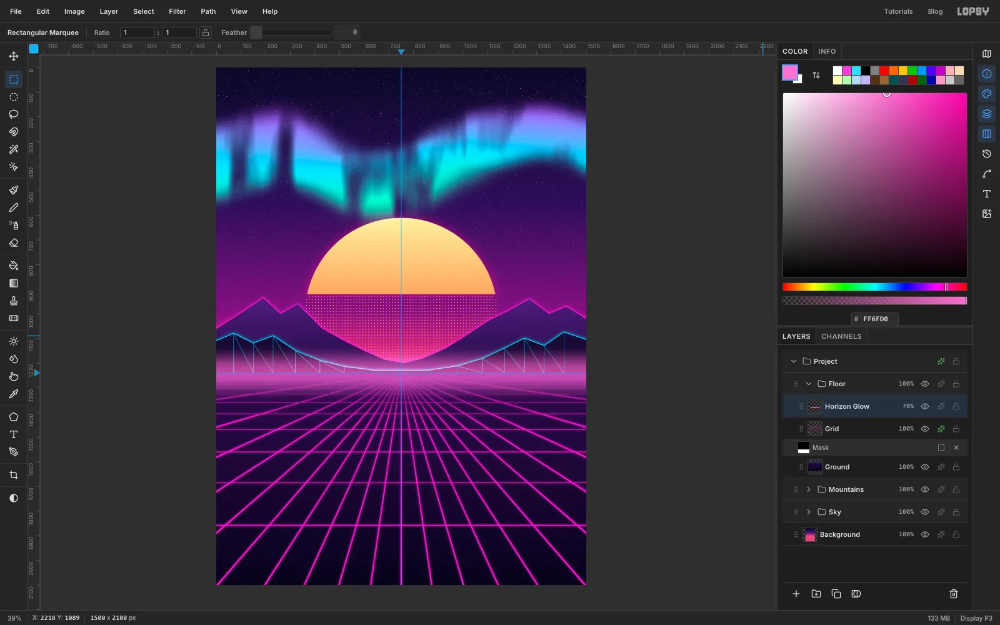

Give **Grid** an **Outer Glow** of `#FF3BD4`, Size **14**, Opacity **85**.

The thin lines at the horizon blur together, so fade them out. Click **Add
Mask** and click the mask thumbnail. In the gradient's **Advanced…** editor,
set the stops to black then white, and drag from the horizon (y 1239) down to
y 1439. Click the **Grid** name to leave the mask.

Add a layer named **Horizon Glow**. Marquee **0, 1180** to **1500, 1300**,
choose **Select → Feather…** with **60**, set the foreground to `#FF6FD0`
and **Edit → Fill**. Deselect, set the blend mode to **Screen** and the
opacity to **70%**.

## Let it snow behind the tree

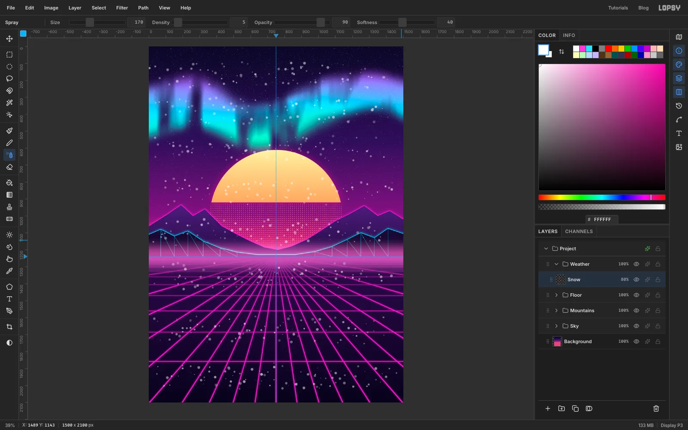

Collapse **Floor**, select its row, and make a **New Group** named
**Weather** with a layer named **Snow**. Snow goes in front of the
background but behind the tree and the lettering, so neither gets spotty.

Set the foreground to white and pick the **Spray** tool (J). Set Size
**170**, Density **5**, Softness **40** and Opacity **90**. Drag long zigzags
across the full width, with big quick moves, in about eight rows from the top
of the sky to near the bottom of the floor.

Apply **Filter → Gaussian Blur…** with Radius **1** to soften the flakes,
and lower the layer to **80%** opacity.

## Draw the bottom tier of the tree

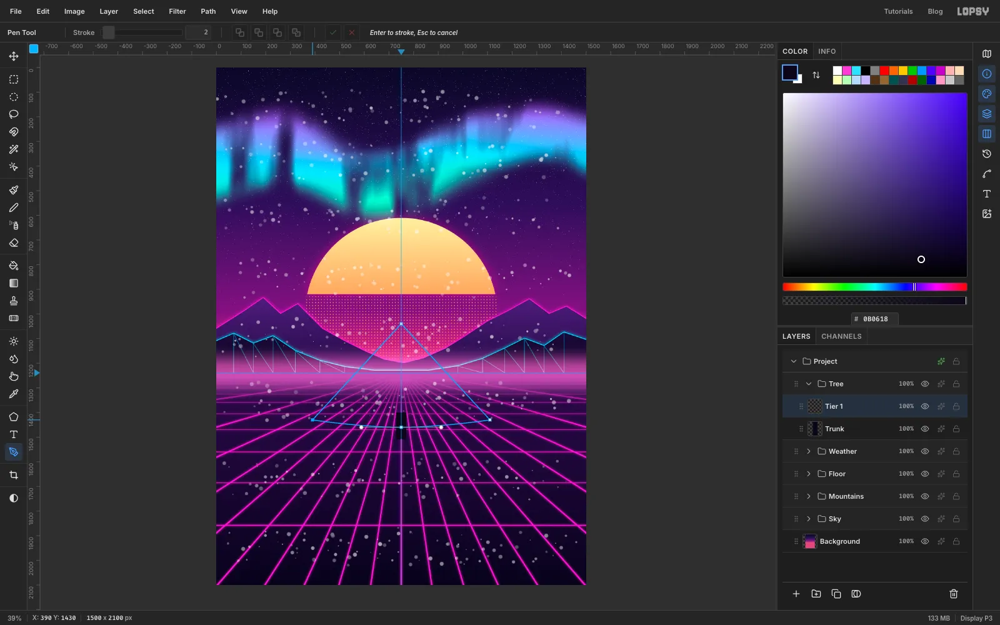

Collapse **Weather**, select its row, and make a **New Group** named **Tree**.

Add a layer named **Trunk**. Marquee **730, 1400** to **770, 1508**, fill it
with `#0B0618` and deselect. Only the bottom of this narrow trunk will show
under the branches.

Add a layer named **Tier 1** and draw the bottom tier with the **Pen**:

1. Click the left corner at (390, 1430).
2. Click the top point at (750, 1040), on the centre guide.
3. Click the right corner at (1110, 1430).
4. At the middle of the bottom edge, press at (750, 1460) and drag left to
   about x 590. That curves the bottom edge like the hem of a skirt.
5. Click the first anchor to close the path.

## Fill and outline the first tier

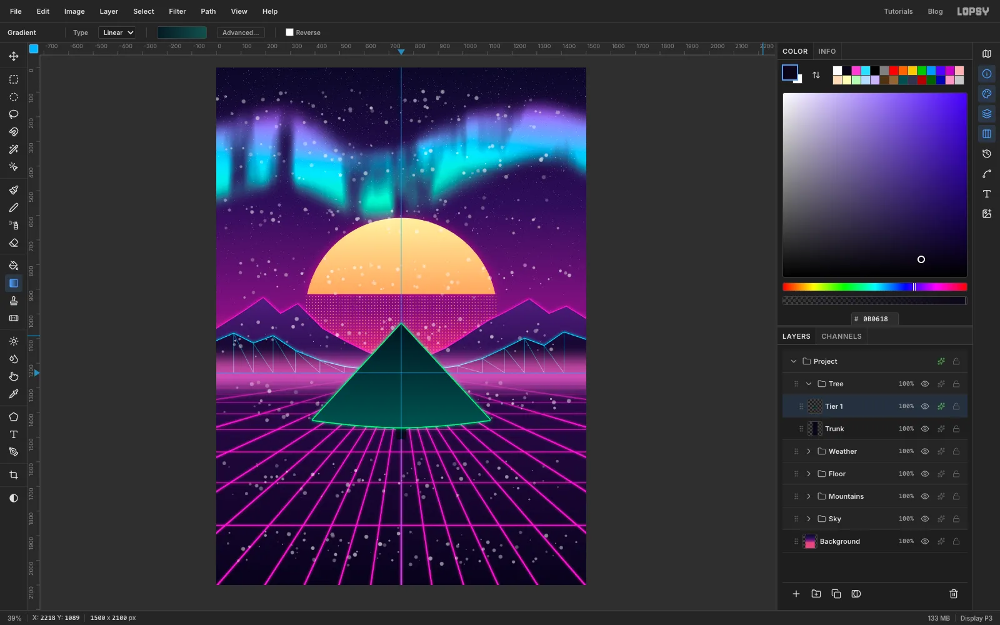

Click **Path to Selection** and **Delete Path**. Fill with a gradient from
`#061A24` near the top to `#11524E` at the hem: drag from about 40 px below
the top point down to the bottom of the curve. A lighter hem makes each tier
look lit from below by the grid. Deselect.

Turn on **Stroke** (`#3DFF8E`, Width **4**) and **Outer Glow** (`#3DFF8E`,
Size **22**, Opacity **75**).

## Duplicate the tier to build the rest of the tree

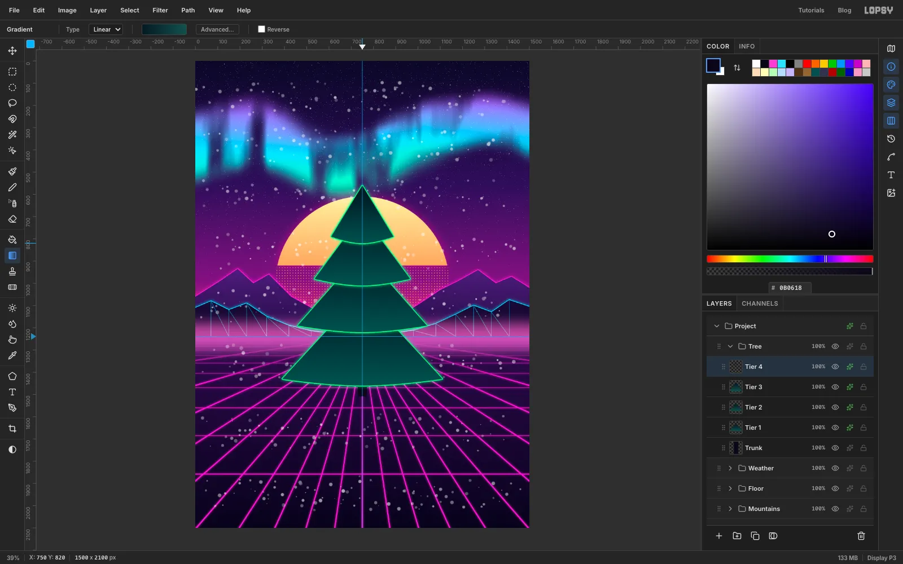

The other three tiers need exactly the same effects. Instead of setting them
up again, copy the styled tier:

1. Click **Duplicate Layer** and rename the copy **Tier 2**.
2. Choose **Select → All**, press [[Delete]] and deselect. The pixels are
   gone, but the copy keeps the Stroke and Outer Glow.
3. Draw the next tier with the Pen the same way, fill it with the same
   gradient and deselect.

Repeat for each tier, always duplicating the newest one, so each smaller tier
sits on top:

- **Tier 2**: corners at (460, 1190) and (1040, 1190), top at (750, 860).
- **Tier 3**: corners at (535, 980) and (965, 980), top at (750, 690).
- **Tier 4**: corners at (610, 790) and (890, 790), top at (750, 560).

Each tier's curved bottom drops 30 px below its corners, like the first one.

## String the lights with a spaced brush

Add a layer named **Lights**, set the foreground to `#FFE7A0` and pick the
**Brush** at Size **12**, Hardness **90**. Open the brush presets (the tip
button in the options bar) and set **Spacing** to **200%**, the maximum. Now one drag
lays a row of separate dots instead of a solid line.

Drag one sagging string across each tier, from just inside one edge to just
inside the other. Swap the high end each time: the top tier's string rises to
the left, the next one to the right, and so on. Let each string dip 20–40 px in
the middle.

Set Spacing back to **10%** when you're done, then give the layer an **Outer
Glow** of `#FFC94D`, Size **16**, Opacity **90**.

## Hang the baubles

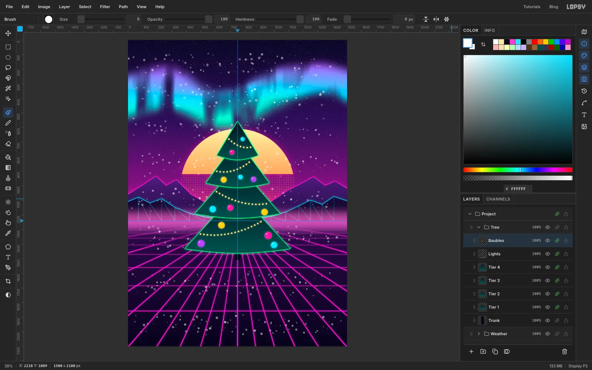

Add a layer named **Baubles**. For each bauble, drag a small circle with the
**Elliptical Marquee** (hold [[Cmd]] for a perfect circle), set the colour
and choose **Edit → Fill**. Use 32–52 px circles in `#FF3EA5`, `#3BE8FF`,
`#FFD447` and `#B04CFF`, two or three per tier.

Put them in the gaps between the light strings, never on a string, and
spread the colours so two of the same colour never sit side by side. This
tree has twelve.

Deselect, then with the **Brush** at Size **8** and white, click once near
the upper-left of each bauble for a highlight. Add **Inner Glow**
(`#1A0636`, Size **10**, Opacity **70**) to darken each bauble's rim so it
looks round, and **Outer Glow** (`#FFFFFF`, Size **14**, Opacity **45**).

## Add the gifts and the star

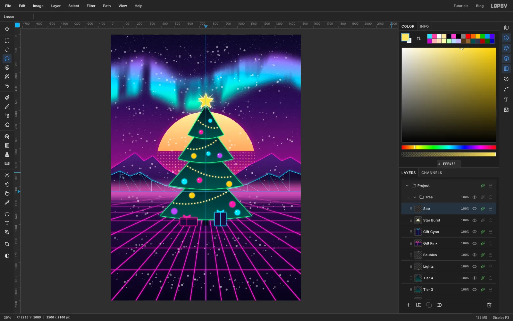

Add a layer named **Gift Pink**. Marquee **548, 1445** to **680, 1508**,
fill it with `#1A0B3A` and deselect. With the Brush at Size **6** in
`#FF3EA5`, Shift-click a vertical ribbon at x 600 and a horizontal one at
y 1456. Off-centre ribbons look more like a real wrapped box. Draw the bow
with the **Pen**: two triangles about 25 px wide and 20 px tall, whose points
meet on the ribbon at the top edge of the box. Turn each into a selection
(**Path to Selection**, then **Delete Path**) and fill it with `#FF3EA5`.
Add a 12 px circle on the same spot for the knot, and deselect. Add
**Stroke** `#FF3EA5`, Width **3**, and **Outer Glow** `#FF3EA5`, Size **14**,
Opacity **75**.

Do the same on a layer named **Gift Cyan**: a tall, narrow box from
**820, 1405** to **910, 1508** with a single vertical ribbon at x 865, in
`#29E0FF`, and the same Stroke and Outer Glow in `#29E0FF`. Both boxes end on
the same floor line as the trunk, y 1508.

Add a layer named **Star Burst**, set the foreground to `#FFF6C8` and run
**Filter → Sunburst…** with Rays **8**, Length **5**, Width **30**, Taper
**100**, Fade **60**, Center X **50** and Center Y **25**. That makes eight
thin spikes of light around the treetop.

Add a layer named **Star**. With the Pen, click the ten corners of a
five-pointed star in order, starting at the top point: (750, 463),
(765, 504), (809, 506), (775, 533), (786, 575), (750, 551), (714, 575),
(725, 533), (691, 506) and (735, 504). Click the first anchor to close it,
then **Path to Selection** and **Delete Path**. Fill it with `#FFE45E` and
deselect. Give it a
white **Stroke** of **3** and an **Outer Glow** of `#FFE45E`, Size **36**,
Opacity **90**.

## Copy just the tree for a reflection

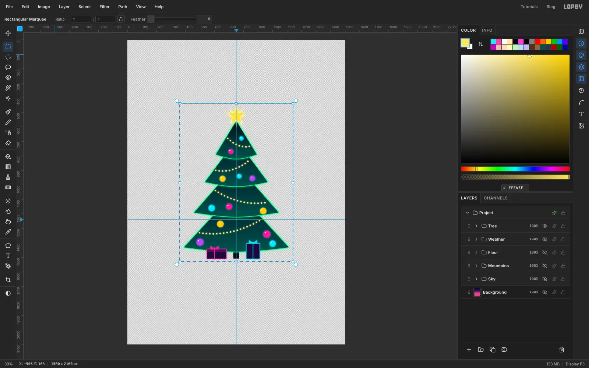

A glossy synthwave floor reflects what stands on it. Collapse **Tree**, then
click the eye icons of **Weather**, **Floor**, **Mountains**, **Sky** and
**Background** to hide everything except the tree.

Marquee around the tree from **360, 440** to **1140, 1530** and choose **Edit
→ Copy Merged**. Copy Merged copies what you see, so you get the whole tree
with its effects in one piece. Turn all the eyes back on and press [[Cmd+D]].

## Flip the copy into the floor

Expand **Floor**, select **Horizon Glow** and choose **Edit → Paste**. The
paste lands just above the selected layer, inside the Floor group and below
the tree. Rename it **Reflection** and deselect.

Choose **Image → Flip Vertical**. With the **Move** tool, drag the copy
straight down until its top edge, the flipped bottoms of the gifts, sits on
the floor line at y 1508. The rest of it hangs off the bottom of the canvas,
which is fine.

Apply **Filter → Motion Blur…** with Angle **90** and Distance **12**, so
it looks like it's on a slightly rippled floor. Click **Add Mask**, click the
mask thumbnail, set the gradient stops to white then black, and drag a
gradient from y 1508 down to y 1800. Click the
**Reflection** name to leave the mask, set
the blend mode to **Screen** and the opacity to **70%**. Screen drops the
dark parts and keeps only the neon edges and the lights.

## Make the neon pill for the tagline

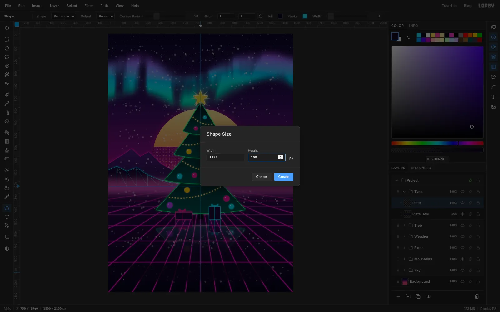

Collapse **Floor** and **Tree**, select the **Tree** row and make a **New
Group** named **Type**.

The tagline will sit on the brightest part of the grid, so start with a dark
halo. Add a layer named **Plate Halo**, marquee **170, 1872** to
**1330, 2010**, feather it by **20**, fill it with `#0D0420`, deselect and
set the opacity to **85%**.

Add a layer named **Plate** and pick the **Shape** tool. Choose **Rectangle**
and **Pixels**, and set **Corner Radius** to **50**. Click the Fill swatch
and type `#0A0420`. Click the Stroke dash to add a stroke, type `#29E0FF` and
set Width to **3**. Then click once at (750, 1940) without dragging and enter
**1120 × 100**. A 50 px radius on a 100 px tall box makes the ends fully
round. Give the plate an **Outer Glow** of `#29E0FF`, Size **16**, Opacity
**70**.

## Set MERRY and select its letters

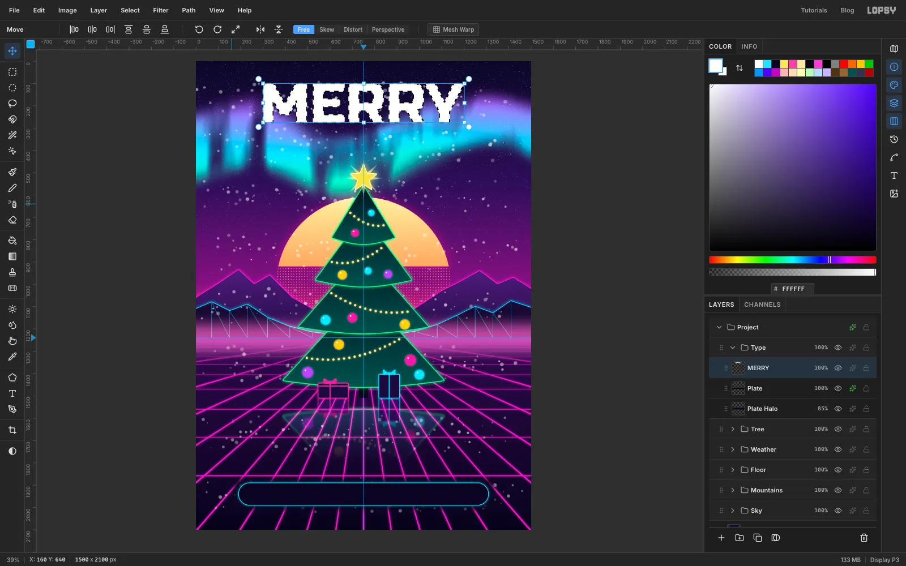

Pick the **Text** tool, choose **Russo One**, Size **250**, colour white,
and click in an empty part of the sky. Type `MERRY` and press [[Tab]] to finish. Don't click inside
existing text, or you'll edit that text instead.

With the **Move** tool, drag the word up to the top and centre it: the
letters run from about x 300 to x 1200 and from y 100 to y 274. Use the
arrow keys for the last few pixels.

Click **Rasterize Layer** at the bottom of the Layers panel, then
[[Cmd]]-click the layer's thumbnail. That selects exactly the letter shapes.

## Paint the chrome

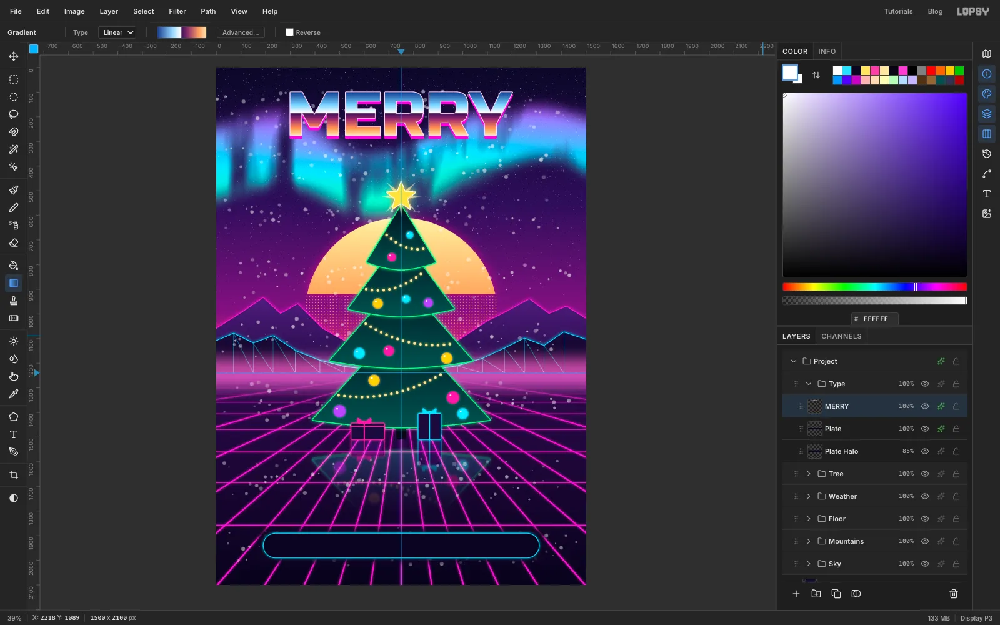

The chrome look is a reflection of a sky over a desert: blue sky, a bright
horizon line, then dark ground lit orange. Set up a seven-stop gradient:

- `#1B3B8C` at 0%, `#8FD4FF` at 30% and `#FFFFFF` at 48%,
- `#3A1450` at 50%, so the horizon is a hard edge,
- `#8A2E6E` at 62%, `#FF9E5E` at 85% and `#FFE3B0` at 100%.

Keep the 48% and 50% stops at least 1% apart, or they merge into one. Drag
from the top of the letters straight down to their bottom, then deselect.

Add **Stroke** `#FFD8F6`, Width **3**, for a bright rim, and **Drop Shadow**
`#FF2BD6` with Offset X **0**, Offset Y **12**, Blur **0** and Opacity
**100**. The shadow is a hard pink copy of the letters, not a soft shadow.

## Add the script and tilt it

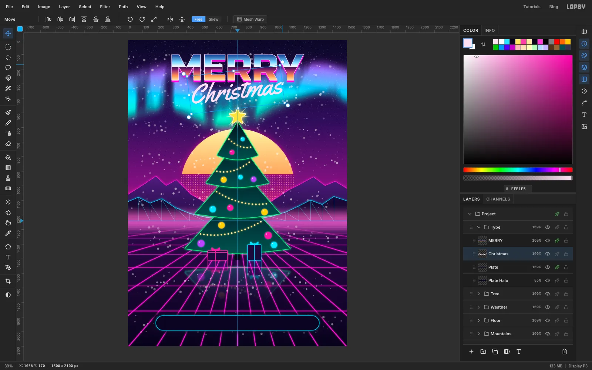

Select the **Plate** layer first. New text goes just above the selected layer,
so the script lands under MERRY: the chrome stays on top and the script tucks
behind its bottom edge.
With the **Text** tool, pick **Yellowtail**, Size **185** and colour
`#FFE1F5`. Click in the empty floor area, type `Christmas` and press [[Tab]].

Move it so it's centred on x 750 at about y 335, overlapping the bottom of
MERRY. Then, with the **Move** tool, hover just outside the top-right corner
of its box until the cursor turns into a rotate cursor, and drag up to
tilt it about **7°** counter-clockwise. Re-centre it after rotating.
Leave a clear strip of sky between the bottom of the script and the star's
top point.

Give it a **Stroke** of `#1A0830`, Width **4**. The dark outline cleanly
separates the script from the chrome and the pink shadow where they overlap.
Then add an **Outer Glow** of `#FF2BD6`, Size **18**, Opacity **95**, for
the neon tube.

## Seat the tagline in the pill

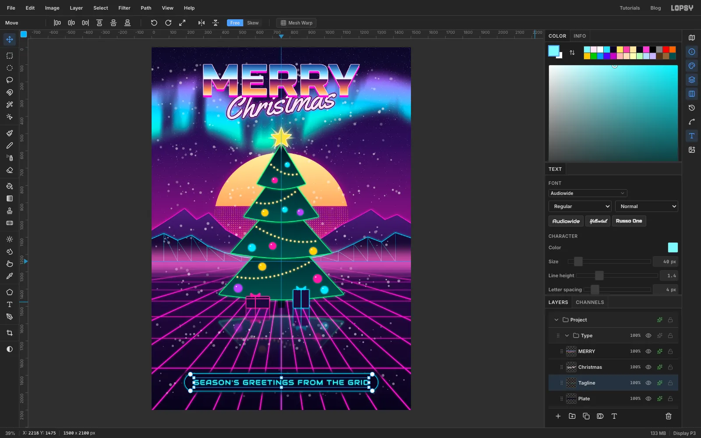

Select **Plate** again. Use the **Text** tool with **Audiowide**, Size
**40** and colour `#7DF9FF`. Click in an empty area and type
`SEASON'S GREETINGS FROM THE GRID`, then press [[Tab]]. In the **Text**
panel, set **Letter spacing** to **4**.

Centre the line in the pill at (750, 1940). Zoom in and check it by eye:
the space above the capitals should match the space below, and both ends of
the line should sit the same distance, about 60 px, from the round ends. Add a small **Outer Glow** of `#29E0FF`, Size **10**, Opacity **80**.

## Darken the corners

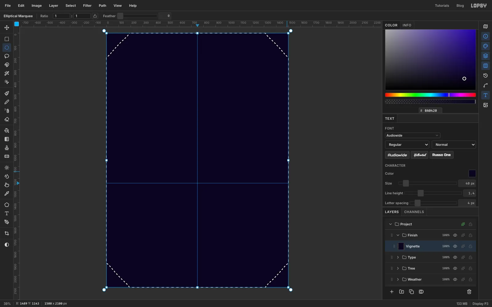

Collapse **Type**, select its row and make a **New Group** named
**Finish**. Add a layer named **Vignette**, choose **Select → All**, fill
it with `#0A0420` and press [[Cmd+D]].

Click once with the **Elliptical Marquee** and enter **-260, -200** to
**1760, 2300**. The ellipse is bigger than the canvas, so only the corners
fall outside it. **Select → Feather…** with **220**, then press [[Delete]]
to clear the middle. Deselect, set the blend mode to **Multiply** and the
opacity to **90%**.

## Add grain and export

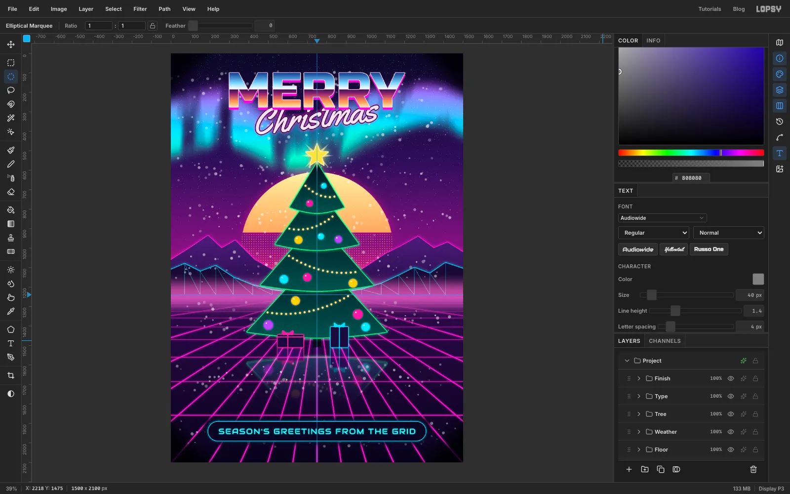

Add a layer named **Grain**, fill it with `#808080` and run **Filter → Add
Noise…** with Amount **40**, Mode **Mono** and Distribution **Gaussian**. Set
it to **Overlay** at **45%**. Overlay leaves mid-grey invisible, so only the
noise shows, as a fine print-like texture over the smooth gradients.

Choose **File → Quick Export PNG** to export the card, and **File → Save
Project** to keep every group, mask and effect editable.

> **Tip:** Want a different greeting? Hide **MERRY** and **Christmas** and
> set your own words in Russo One and Yellowtail. The chrome gradient and
> effects take a minute to rebuild with the stops above.
