Synthwave is the look of 1980s album covers and arcade cabinets, revived. A huge sun sinks behind a striped horizon, a glowing grid runs off to infinity, and everything is drawn in hot pinks, violets and cyans. The usual cast is sports cars and palm trees. This painting swaps them for something wilder: a grizzly bear standing at the edge of a rock ledge, staring into the sunset.

The bear is a silhouette. That's what makes it work: against a bright sun, a dark shape with a clear outline reads instantly, and a thin rim of light along its back says "backlit" without any interior detail. The trick is getting the outline right. You'll use a public-domain photo for the pose and proportions, then draw a simplified, slightly exaggerated shape over it: a clear shoulder hump, a dished muzzle, round ears and four separate legs.

The reference photo is
[Grizzly bear walking north of the road near Sedge Bay](https://commons.wikimedia.org/wiki/File:File-Grizzly_bear_walking_north_of_the_road_near_Sedge_Bay%3B-Jim_Peaco%3B-April%2C_2013%3B-Catalog_19072d%3B-Original_IMG_9797_%28f3bbca3c-1dd8-b71b-0b02-0ebbb19ae6ba%29.jpg)
by Jim Peaco of the US National Park Service. It's in the **public domain**. Download the 960 px preview: the steps below assume the photo is 960 × 598 px. Any side-on photo of a walking bear will do.

Along the way you'll use:

- the **Gradient** tool (linear and radial, with transparent stops), **Spray**, **Brush** dots and the **Eraser** for a starry sky
- the **Elliptical** and **Rectangular Marquee** with [[Shift]] to add bands, for the classic striped sun
- **Motion Blur**, **Select → Inverse** and **Inner Glow** for cloud bars clipped to the sun
- the **Lasso** for low-poly mountains, plus **Copy**, **Paste**, scale handles and **Merge Down** for a row of pines
- **Copy Merged**, **Flip Vertical**, **Brightness/Contrast** and a **layer mask** for the lake reflection
- **Define Pattern**, **Fill with Pattern** and the **Perspective** transform for the neon grid
- the **Pen** tool, **Path to Selection** and **Feather** for the ridge, the bear and the mist
- a dropped reference photo, **Flip Horizontal**, **Outer Glow**, **Screen** layers and brush **Taper**
- rotation handles, **Group Layers**, a group move, **Chromatic Aberration**, **Add Noise**, and the Project's **Color Grading** and **Vignette** adjustments

The palette is violet and magenta around a yellow-to-pink sun, with cyan for the grid:

- Sky `#0B0426` → `#26094D` → `#5A1266` → `#B0236F` → `#F2546E`
- Horizon glow `#FF6FA0`, stars `#FFF4FB`, star glow `#FFC6EA`
- Sun `#FFE66B` → `#FF9A3D` → `#FF2D7A`, sun glow `#FF3D8B`
- Cloud bars `#2A0A48`, cloud edge `#FFB050`
- Mountains `#7A2A8E` → `#1E0838`, facets `#5A1F7C`, rim `#FF5FA8`
- Hills `#1A0730`, pines `#0D0420`
- Lake `#B3266F` → `#3D0D5C` → `#0A0320`, mist `#FF8CC0`
- Grid `#3FE8FF`
- Ridge `#2D0A5F`, lit top `#5E1A72`, lit planes `#46157E` / `#3A1270`, shadow planes `#1C0640`
- Cracks `#12041F`, crack lip `#7E2C9E`
- Bear `#0A0314`, paw shadows `#0A0214`, rim pink `#FF4FA0` / `#FFB0D8`, rim cyan `#42D9FF`
- Claws `#F2C6E6`, grass `#B02A86`, shooting star glow `#FF9AD0`

> **Tip:** Positions are in document pixels, written `x, y`, with `0, 0` at the top left. The status bar at the bottom shows where the pointer is. **Edit → Fill** fills the selection with the foreground colour, and [[Cmd+D]] deselects. To load a layer's shape as a selection, [[Cmd]]-click its thumbnail in the Layers panel.

> **Tip:** For an exact rectangle or ellipse, make sure nothing is selected ([[Cmd+D]]), then click once with a marquee tool without dragging. A **Rectangular Selection** (or **Elliptical Selection**) dialog opens where you can type the *From* and *To* corners.

> **Tip:** Blend modes and layer effects live in a layer's effects drawer: click the sparkle icon on its row. To change a layer's opacity, click the `100%` on its row and drag the slider.

## Set up the canvas and paint the sky

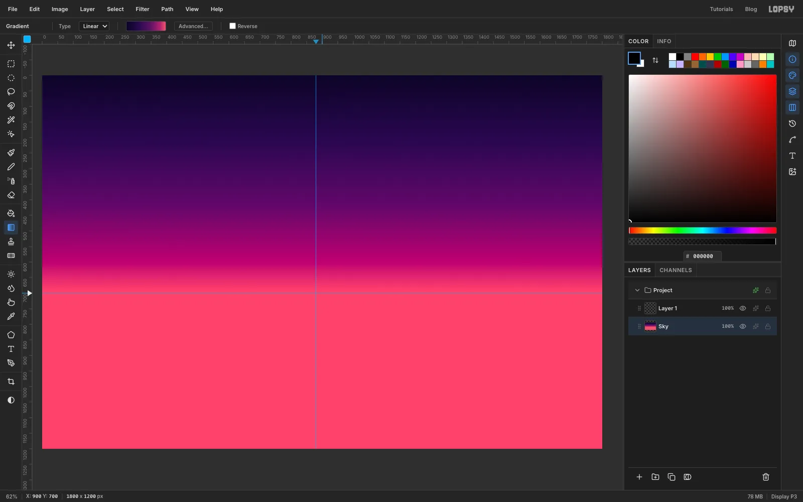

1. Create a new document **1800** × **1200** px.
2. Click the left ruler at `700` to drop a horizontal guide. This is the horizon. Click the top ruler at `880` for a vertical guide. The sun, its reflection and the grid will all line up on it.
3. Double-click the **Background** layer's name and rename it *Sky*.
4. Pick the **Gradient** tool, set **Type** to **Linear** and click **Advanced…** to open the Gradient Editor. Set up five stops: `#0B0426` at 0%, `#26094D` at 30%, `#5A1266` at 60%, `#B0236F` at 86% and `#F2546E` at 100%. Click the bar to add a stop, then type its colour into the **Hex** field.
5. Drag from the top edge straight down to the horizon guide.

## Add a glow on the horizon

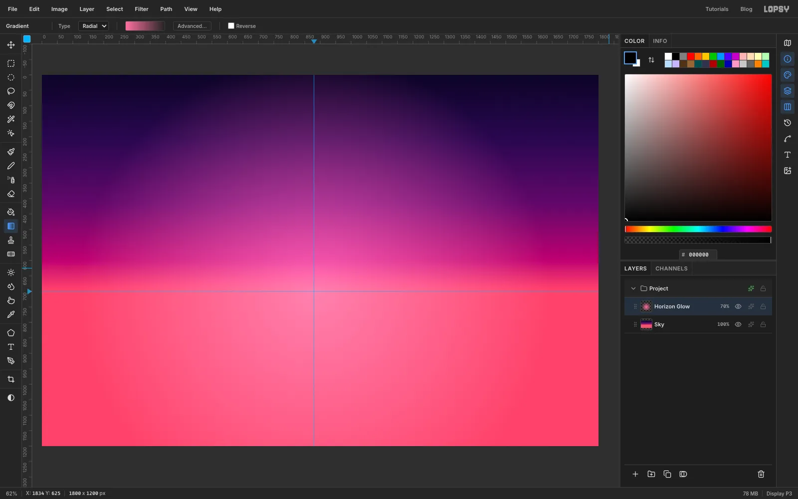

The sun needs something to sit in. A soft glow along the horizon makes the bottom of the sky feel hot.

1. Rename **Layer 1** to *Horizon Glow*.
2. Switch the Gradient tool to **Radial**. In the editor, set both stops to `#FF6FA0` and drag the right-hand stop's **Opacity** all the way down to 0.
3. Drag from where the two guides cross (`880, 700`) out to the right, to about `1640, 700`.
4. Set the layer's blend mode to **Screen** and its opacity to **70%**.

## Spray a field of stars

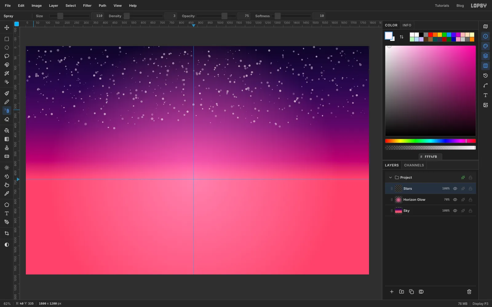

1. Add a new layer called *Stars* and set the foreground colour to `#FFF4FB`.
2. Pick the **Spray** tool and set **Size** to **110**, **Density** to **3**, **Opacity** to **75** and **Softness** to **10**. A low density and a small cloud give scattered dots instead of a mist.
3. Drag zig-zag passes across the whole width of the sky. Make six passes: start near the top and work down to about `y 360`, so the stars thin out toward the horizon.

## Add bright stars and clear the sun's halo

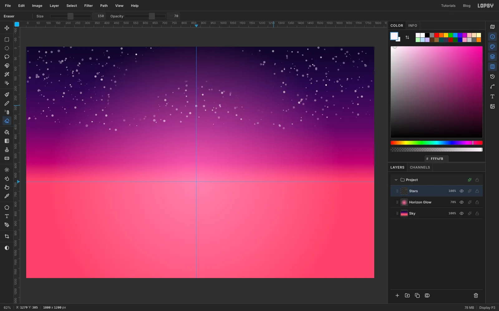

1. Pick the **Brush** with **Hardness 60** and **Opacity 100**. Click about ten single dots at **Size 5**, ten at **Size 7** and six at **Size 10**, scattered across the sky. Different sizes make the sky feel deep. Keep them clear of where the sun will go: anywhere within about 360 px of `880, 450`.
2. The sun's glow would wash out stars close to it, so remove them. Pick the **Eraser** at **Size 150** and **Opacity 70**. The sun will be a circle of radius 300 centred on the vertical guide, 250 px above the horizon. Drag an arc around the top half of that circle, about 40 px outside it, from roughly 8 o'clock round to 4 o'clock. Then drag a second, wider arc about 85 px further out.
3. Open the effects drawer and turn on **Outer Glow**: **Size 10**, **Opacity 80**, colour `#FFC6EA`.

## Draw the sun

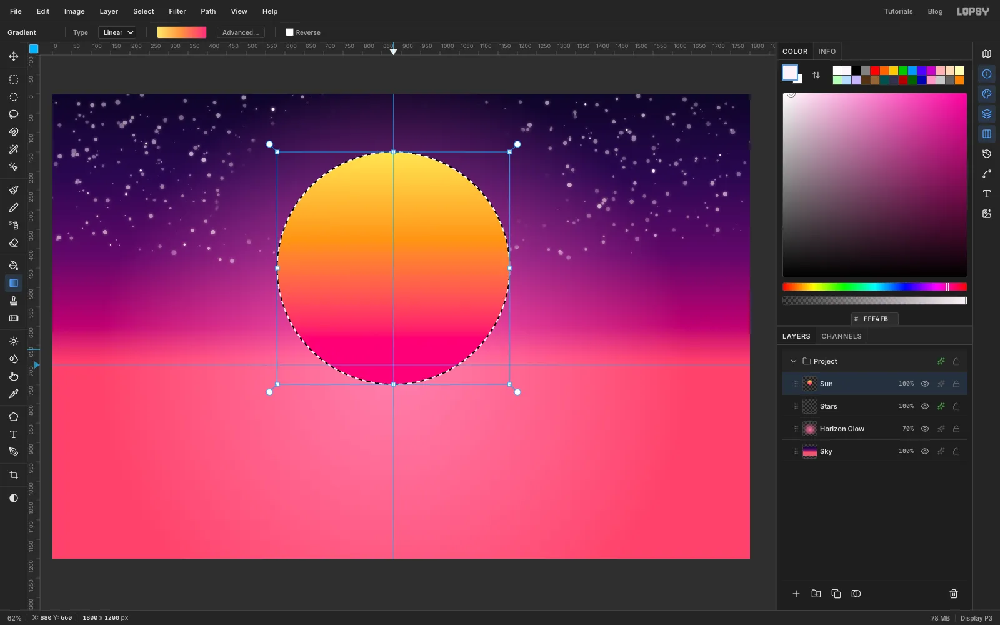

1. Add a new layer called *Sun*.
2. Click once with the **Elliptical Marquee** and enter **From** `580, 150` and **To** `1180, 750`. That's a circle of radius 300 centred on the vertical guide. Its bottom dips below the horizon, which is what you want.
3. Pick the **Gradient** tool, **Linear**, with three stops: `#FFE66B` at 0%, `#FF9A3D` at 45% and `#FF2D7A` at 100%. Drag from the top of the circle (`880, 150`) down to about `880, 660`.

## Select the sun's stripes

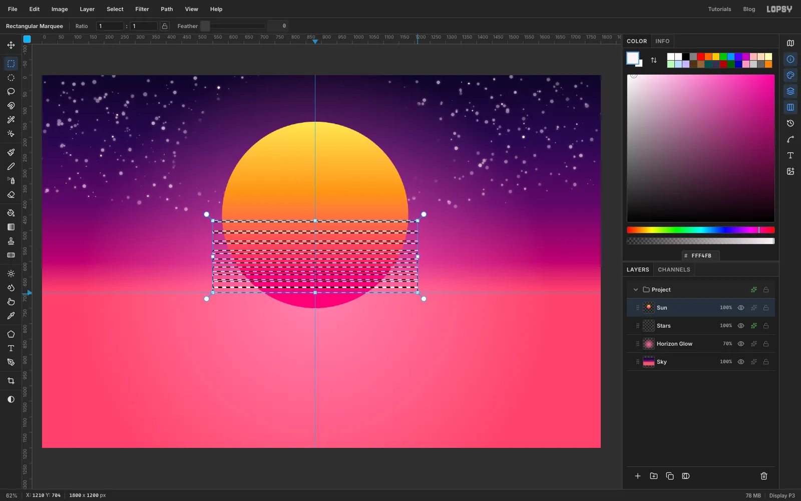

The synthwave sun is sliced by horizontal gaps that start hairline-thin in the middle and get thicker, and closer together, toward the horizon.

1. Press [[Cmd+D]] to deselect and zoom in to 100% ([[Cmd+1]]) so thin bands are easy to drag. Pick the **Rectangular Marquee** and drag a hairline band, about 4 px tall, across the sun just below its middle. Run it a little past both edges.
2. Hold [[Shift]] and drag eight more bands below it. Make each one a couple of pixels taller than the last, and leave a slightly smaller gap above each one, so the stripes crowd together toward the horizon. The last band ends just below the horizon guide.

> **Tip:** For the exact layout used here, the bands' tops are at `y 468`, `502`, `534`, `564`, `592`, `618`, `642`, `664` and `684`, and they're 4, 6, 8, 10, 12, 14, 16, 18 and 20 px tall. Press [[Cmd+0]] to fit the canvas again when you're done.

## Cut the stripes and add a glow

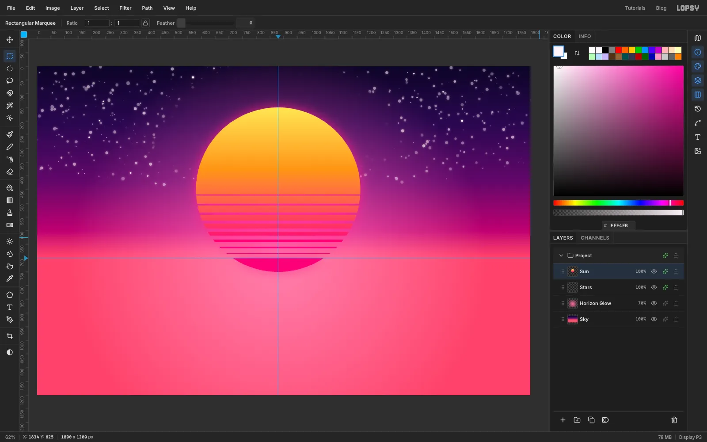

1. Press [[Delete]] to cut the bands out of the sun, then [[Cmd+D]].
2. Turn on **Outer Glow** for the Sun layer: **Size 70**, **Opacity 75**, colour `#FF3D8B`.

## Brush in the cloud bars

1. Add a layer called *Clouds* and set the foreground colour to `#2A0A48`.
2. Pick the **Brush** at **Size 14**, **Hardness 80**, **Opacity 100**. Drag five long, nearly level strokes across the sun at about `y 300`, `334`, `372`, `398` and `424`. Vary their lengths, and start some at the left edge and some at the right.
3. Switch to **Size 8** and add two thinner strokes, one at about `y 262` and one at `y 352`. Don't worry that the ends hang past the sun: you'll trim them next.

## Clip the clouds to the sun

1. Choose **Filter → Motion Blur…**, set **Angle 0** and **Distance 40**, and apply. The ends of the bars stretch out into wisps.
2. [[Cmd]]-click the **Sun** layer's thumbnail to select the sun disc, then choose **Select → Inverse**.
3. With the Clouds layer active, press [[Delete]], then [[Cmd+D]]. The bars now live only inside the disc.
4. Turn on **Inner Glow** for the Clouds layer: **Size 3**, **Opacity 80**, colour `#FFB050`. The sun is behind the clouds, so their edges glow.

## Lasso the far mountains

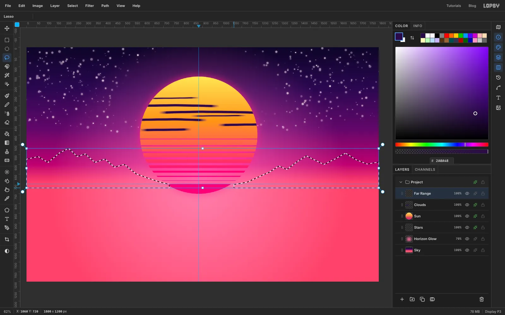

1. Add a layer called *Far Range*.
2. Pick the **Lasso** and draw a jagged range on the left. Start below the horizon at the left edge and drag up and down through sharp peaks, with straight runs between them, between about `y 520` and `y 620`. Then come down to the horizon at about `x 730`, and close the shape below the horizon.
3. Hold [[Shift]] and draw a second range on the right, from about `x 1060` to past the right edge, with peaks between `y 540` and `y 640`, lowest near the sun. Leave the middle open: that's where the sun sinks.

## Shade the mountains

1. Keep the selection. In the Gradient tool's editor, delete stops until there are two, and set them to `#7A2A8E` and `#1E0838`. Drag a **Linear** gradient from about `y 530` down to the horizon, then deselect.
2. Lasso a few thin triangular facets on the slopes that face the sun: on the left range these are the right-hand slopes just below each peak, and on the right range the left-hand slopes. Hold [[Shift]] to add each one. Fill them with `#5A1F7C` and deselect. This low-poly shading is a synthwave staple.
3. Turn on **Inner Glow**: **Size 6**, **Opacity 70**, colour `#FF5FA8`. Every ridge line now catches the light.

## Add the near hills

1. Add a layer called *Near Hills*.
2. Lasso a low, rounded hill that starts at about `y 630` on the left edge and slopes gently down to meet the horizon at about `x 470`. Close it below the horizon.
3. Fill with `#1A0730`, deselect, and give it an **Inner Glow** of **Size 3**, **Opacity 60**, colour `#FF3D8B`.

## Draw the first pine

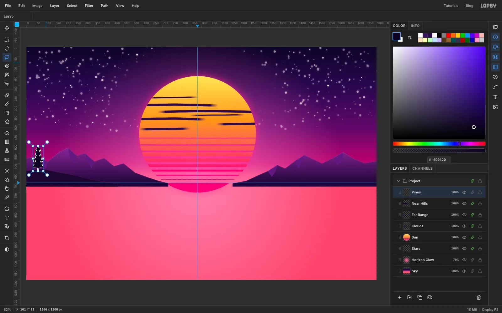

1. Add a layer called *Pines*.
2. With the **Lasso**, draw a pine about 130 px tall standing on the hill near the left edge. Its base is at about `60, 640`. Zig-zag down from the tip in four tiers, each tier a little wider than the one above. Make the tiers slightly uneven so it looks natural. Finish with a short trunk.
3. Fill with `#0D0420`. Keep the selection and press [[Cmd+C]] to copy the tree.

## Paste and shrink more pines

Trees further away should be smaller, so each copy gets scaled down a little more.

1. Press [[Cmd+V]]. The copy pastes in place as a new layer, already selected, with the **Move** tool active.
2. Drag the copy along the hill to its new spot.
3. Hold [[Cmd]] and drag its bottom-right corner handle inward to shrink it evenly. Press [[Enter]] to commit, then choose **Layer → Merge Down** to merge it into Pines.
4. Repeat for five more trees, six in all, moving right along the hill. Their bases sit at about `x 128`, `200`, `268`, `340` and `402`, and their heights are about 96, 112, 78, 64 and 46 px. Keep each base on the slope of the hill.

## Push the hills back with haze

1. Press [[Cmd+D]], then add a layer called *Haze*.
2. Select a rectangle from `0, 480` to `1800, 700`.
3. Make a **Linear** gradient with both stops `#FF6FA0`: the left stop at **Opacity 0**, the right stop at about **16%**. Drag from `900, 500` down to the horizon and deselect.

Keep the haze light. Too much and the mountains turn to mush.

## Paint the lake

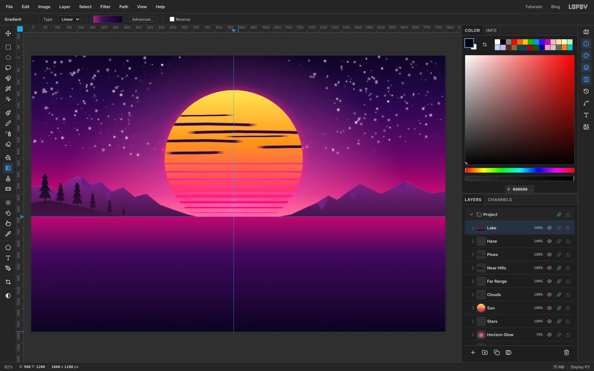

1. Add a layer called *Lake*.
2. Select from `0, 700` to `1800, 1200`.
3. Drag a **Linear** gradient from the horizon to the bottom edge, with stops `#B3266F` at 0%, `#3D0D5C` at 32% and `#0A0320` at 100%. Deselect.

## Copy the sky for a reflection

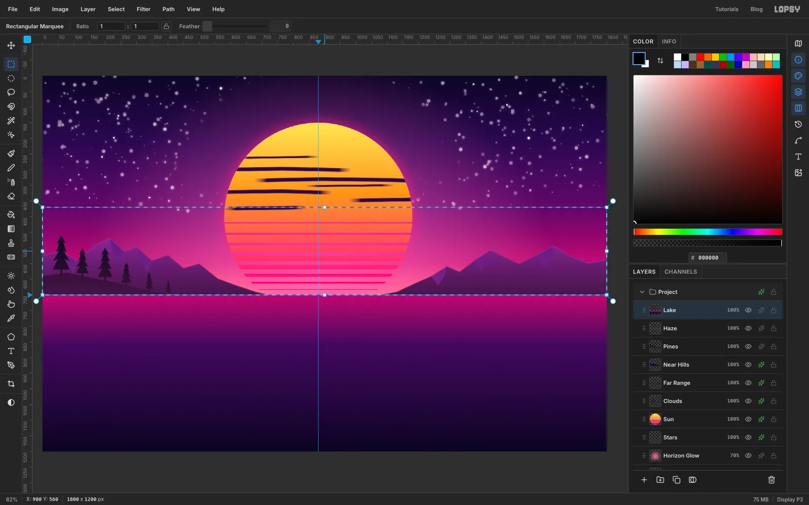

1. Select from `0, 420` to `1800, 700`: everything just above the horizon, including the bottom of the sun and the mountains.
2. Choose **Edit → Copy Merged**. This copies what you see, from every layer, not just the active one.

## Flip the reflection under the horizon

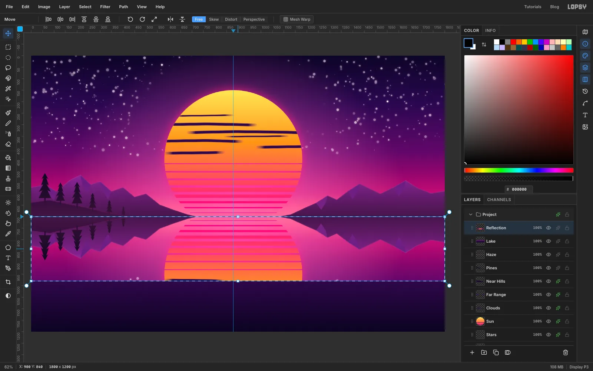

1. Press [[Cmd+V]] and rename the new layer *Reflection*. It pastes in place with the Move tool active.
2. Click **Flip Vertical** in the options bar.
3. Drag the layer straight down by 280 px so its top edge sits on the horizon. Hold your hand steady, or nudge it with [[Shift]] + arrow keys. Press [[Enter]], then [[Cmd+D]].
4. Choose **Filter → Motion Blur…** with **Angle 0** and **Distance 24**. Water smears reflections sideways.
5. Choose **Filter → Brightness/Contrast…** and set **Brightness −25** and **Contrast 30**. A reflection is always a little darker than what it reflects, and the extra contrast keeps the hills readable.

## Cut ripples into the reflection

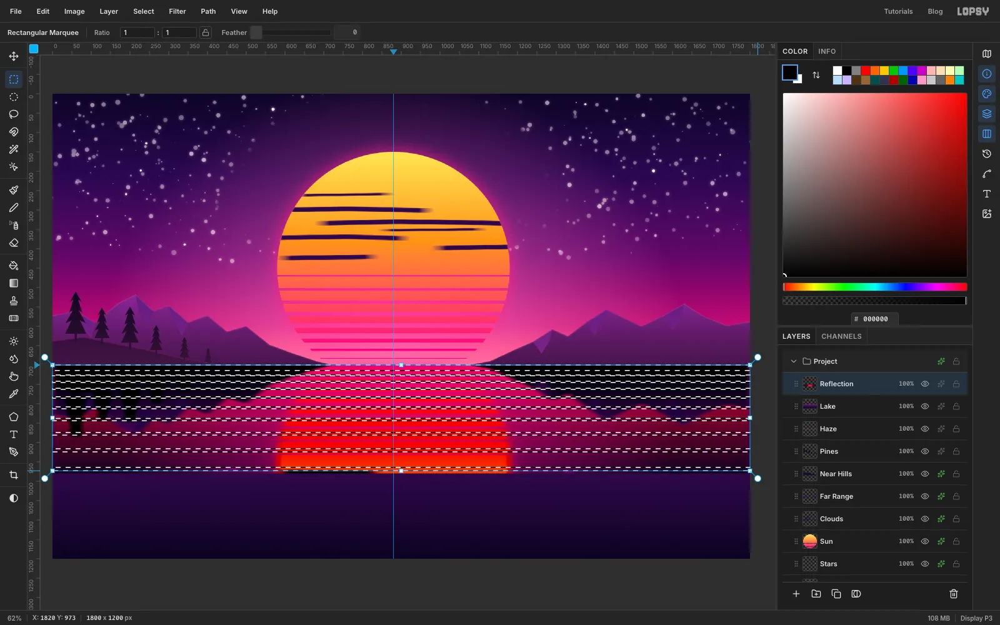

1. With the **Rectangular Marquee**, drag thin bands across the whole width of the reflection, holding [[Shift]] for each one after the first. Start with a 2 px band just under the horizon. Make each band a little taller and leave a bigger gap before it than the last, the way ripples spread out as they come toward you. Ten bands, ending about 9 px tall near `y 965`, is plenty. Zoom to 100% for the thinnest ones.
2. Press [[Delete]] and deselect. The lake shows through the gaps like ripples.

## Fade the reflection with a mask

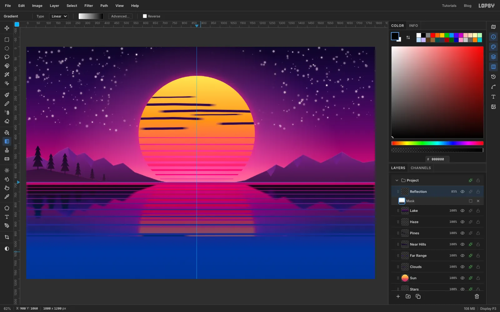

1. Set the Reflection layer's opacity to **85%**.
2. Click **Add Mask** at the bottom of the Layers panel, then click the new **Mask** thumbnail under the layer to edit it.
3. Drag a **Linear** gradient from white at the horizon (`900, 710`) to black at about `900, 1060`. The reflection now fades out as it comes toward the viewer.
4. Click the Reflection layer's name to go back to editing its pixels.

## Select the sun's glint

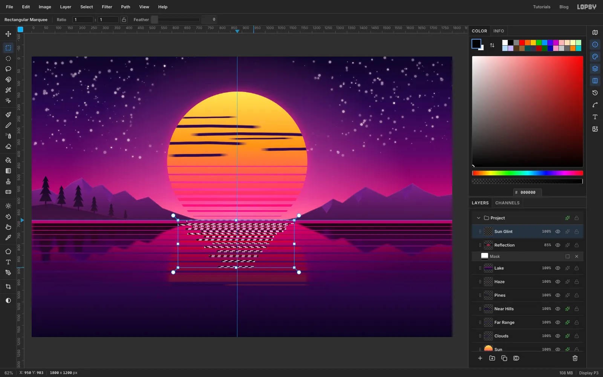

A low sun throws a column of broken light across water, straight toward you.

1. Add a layer called *Sun Glint*.
2. With the **Rectangular Marquee**, select a stack of short bars under the sun, holding [[Shift]] for each extra bar. Start just under the horizon with a bar about 500 px wide, centred on the vertical guide. Make each bar a little narrower than the last, nudge them left and right of centre by 10 to 20 px so they look broken, and get them slightly thicker and further apart as you go down. End at about `y 900` with a bar about 150 px wide. Fifteen bars, from 2 px thick at the top to 5 px at the bottom, works well. Zoom in to 100% to place them.

## Paint the glint and add mist

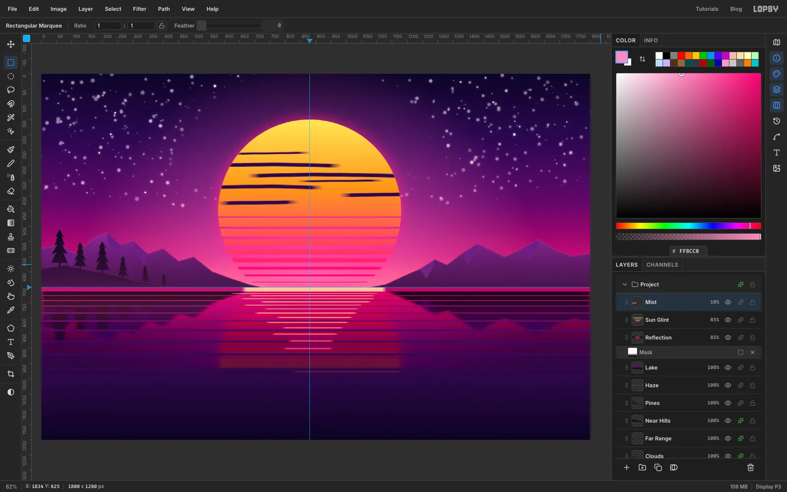

1. Drag a **Linear** gradient through the bars, top to bottom, from `#FFE66B` through `#FF9A3D` (50%) to `#FF2D7A`. Deselect.
2. Apply **Motion Blur** with **Angle 0**, **Distance 14**. Set the layer to **Screen** at **85%**.
3. Add a layer called *Mist*. Select a long band from the left edge, from `0, 712` to `760, 800`, and choose **Select → Feather…** with **40** px. Fill it with `#FF8CC0`, deselect, and set the layer to **Screen** at **10%**.

## Make a grid tile

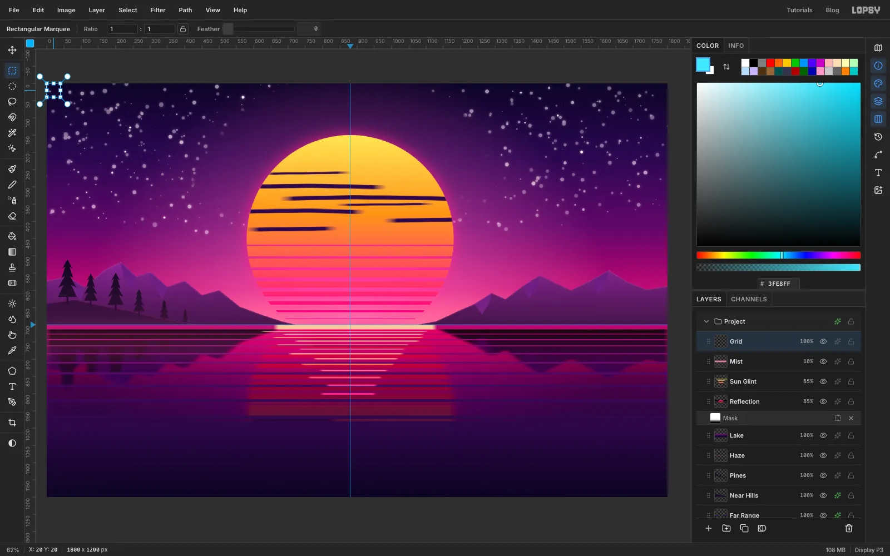

The grid starts as one tile: a square with lines along two of its sides.

1. Add a layer called *Grid* and set the foreground colour to `#3FE8FF`.
2. Select `0, 0` to `40, 2`, fill it and press [[Cmd+D]]. Then select `0, 0` to `2, 40`, fill that too and press [[Cmd+D]].
3. Select exactly `0, 0` to `40, 40` and choose **Edit → Define Pattern**.
4. Press [[Delete]] to clear the tile, then [[Cmd+D]]. It's stored as a pattern now.

## Fill the lake with the pattern

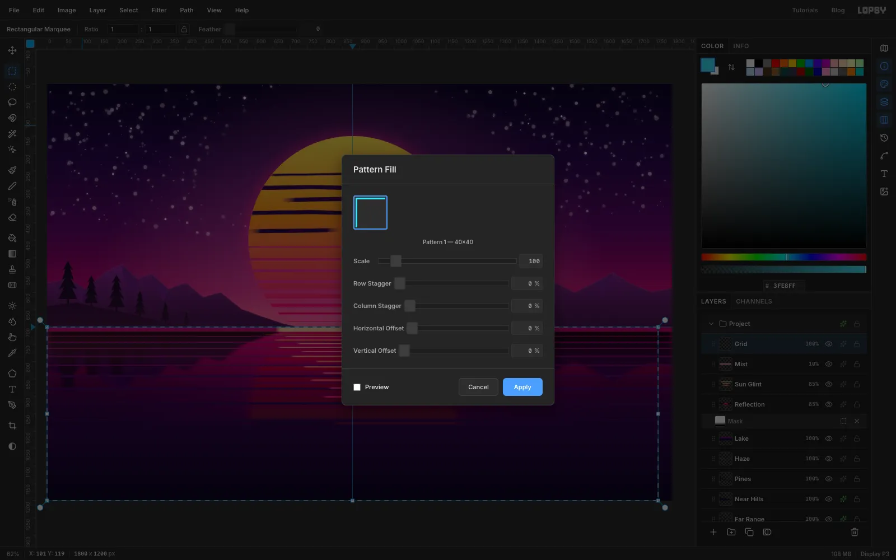

1. Select from `0, 700` to `1760, 1200`. That's 1760 px wide, centred on the guide at 880, so the grid's vanishing point lands right under the sun.
2. Choose **Edit → Fill with Pattern…**. The tile you just defined is already picked. Click **Apply**.

## Pull the grid into perspective

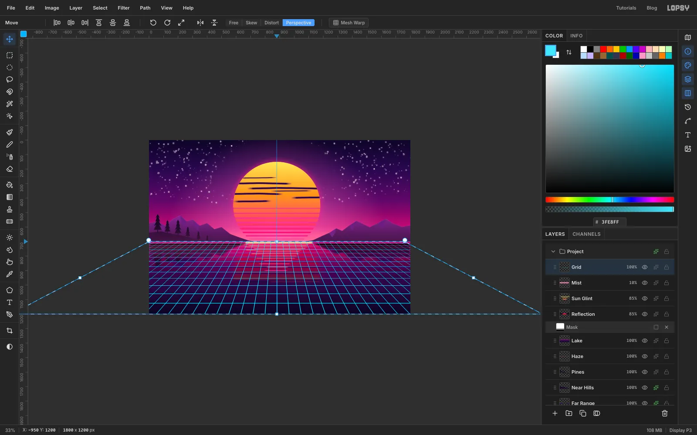

1. Pick the **Move** tool. With the grid still selected, click **Perspective** in the options bar.
2. Press [[Cmd+-]] twice to zoom out to about 33%, so there's room to drag past the canvas.
3. Drag the bottom-left corner handle out to the left, as far as the window allows: about `x −950`, roughly half a canvas-width past the edge. In Perspective mode the bottom-right corner moves out to match.
4. Leave the top edge alone. The grid's lines now fan out toward you, and its rows bunch up toward the horizon.
5. Press [[Enter]] to commit, [[Cmd+0]] to fit the canvas back in the window, and [[Cmd+D]].

> **Tip:** Drag the bottom corners while the box is still a rectangle. At this zoom, once one edge has moved, the other edge's corners are hard to grab, because the rotation handles sit on top of them.

## Make the grid glow

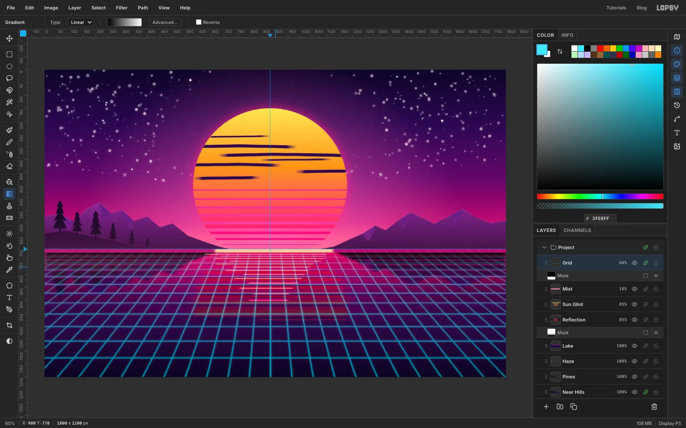

1. Set the Grid layer to **Screen** and its opacity to **60%**.
2. Turn on **Outer Glow**: **Size 9**, **Opacity 85**, colour `#3FE8FF`.
3. Add a mask to the Grid layer, click the mask thumbnail, and drag a **Linear** gradient from black at the horizon to white about 70 px below it. The thinnest, most crowded lines fade into the horizon instead of turning into a solid band.
4. Click the Grid layer's name to leave mask editing.

## Outline the ridge with the Pen

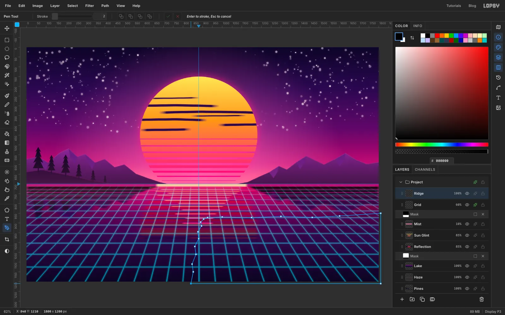

The bear needs something to stand on. A dark ledge in the foreground also frames the scene.

1. Add a layer called *Ridge*.
2. Pick the **Pen** tool. Click (don't drag) to place corner points. Start at the bottom edge at about `x 840` and climb a ragged cliff edge up to a tip at about `925, 872`: zig-zag a little, so it looks like broken rock rather than a ruled line. Then run along a nearly level top to the right edge at about `y 850`, go down the right edge and along the bottom, and click the first point to close the path.
3. In the **Paths** panel, click **Path to Selection**, then **Delete Path**. Fill the selection with `#2D0A5F` and deselect.

## Facet the rock

Shade the rock in flat planes, like the mountains, so it belongs to the same world.

1. With the **Lasso**, select a band about 25 px deep along the top of the ledge. Fill it with `#5E1A72`, then press [[Cmd+D]]. That's the lit top surface the bear will stand on.
2. Select four angled planes that face up and left, toward the sun and the lake: two on the cliff edge, and two broad ones on the face. Hold [[Shift]] to add each one after the first. Fill them with `#46157E`, then [[Cmd+D]].

## Shade the rest of the rock

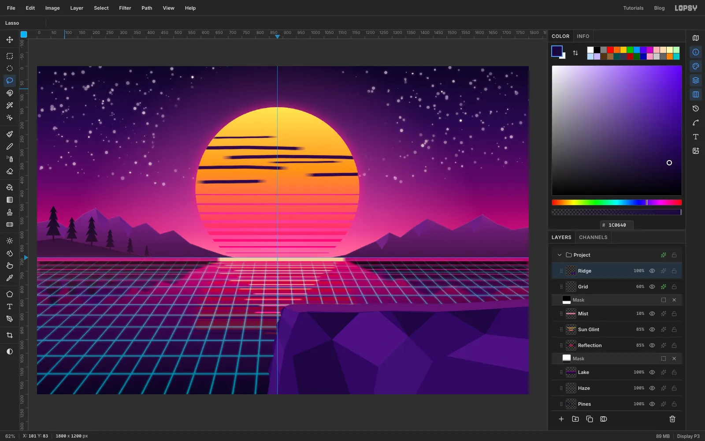

1. Select three planes beside the bright ones, two on the cliff edge and one low on the face. Fill them with `#3A1270`, then [[Cmd+D]].
2. Select four shadow planes: three triangles tucked just under the top band, and one wedge low on the face near the cliff edge. Fill them with `#1C0640`, then [[Cmd+D]].

## Cut cracks into the rock

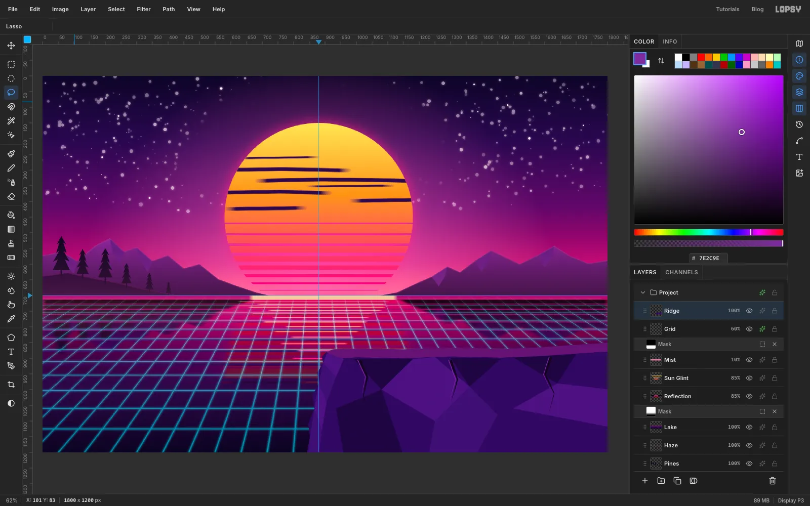

1. Lasso three cracks running down from the top of the ledge, at about `x 1010`, `1300` and `1620`. Make each one a thin wedge, about 9 px wide at the top and tapering to a point 130–190 px down, with a kink or two. Hold [[Shift]] for the second and third. Fill with `#12041F`.
2. Lasso a much thinner sliver just to the left of each crack, about 3 px wide, and fill it with `#7E2C9E`. That's the lip of the crack catching the light. Deselect.

## Rim-light the ridge

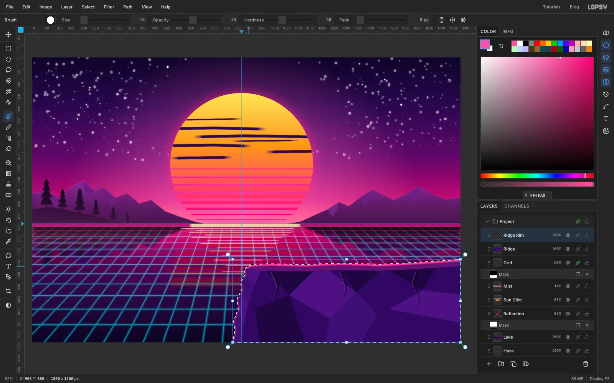

1. Add a layer called *Ridge Rim*. [[Cmd]]-click the Ridge thumbnail.
2. Pick the **Brush** at **Size 18**, **Hardness 30**, colour `#FF4FA0`, and drag along the top edge of the ledge, just inside the selection. The selection keeps the light on the rock.
3. Drop to **Size 10** and **Opacity 45**, and drag down the ragged cliff edge on the left.
4. Deselect and set the layer to **Screen**.

## Drop in the bear photo

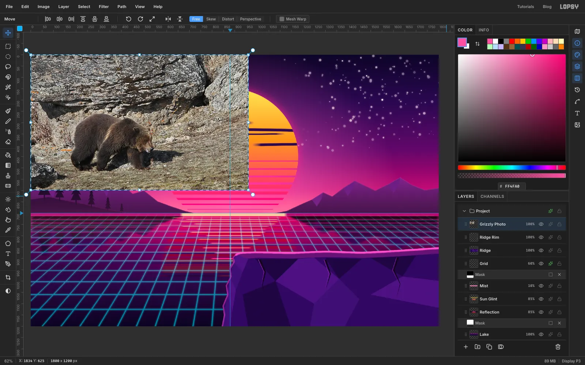

1. Drag the downloaded bear photo from your folder onto the canvas. It lands at the top-left corner as a new layer, selected, with the Move tool active. Rename it *Grizzly Photo*.

## Flip and scale the photo

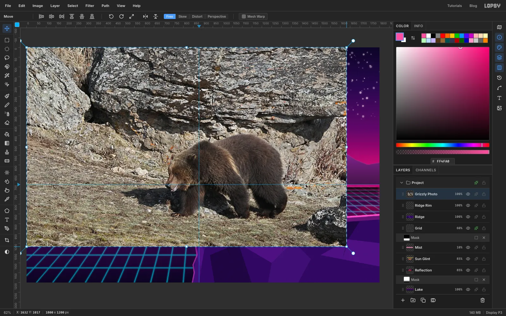

1. Click **Flip Horizontal** in the options bar. The bear now faces left, toward the sun.
2. Hold [[Cmd]] and drag the bottom-right corner handle out until the bear is about as long as the ledge's top, from the cliff tip to a little short of the right edge. Here the photo ended up at 170% of its size.

## Place the photo over the ledge

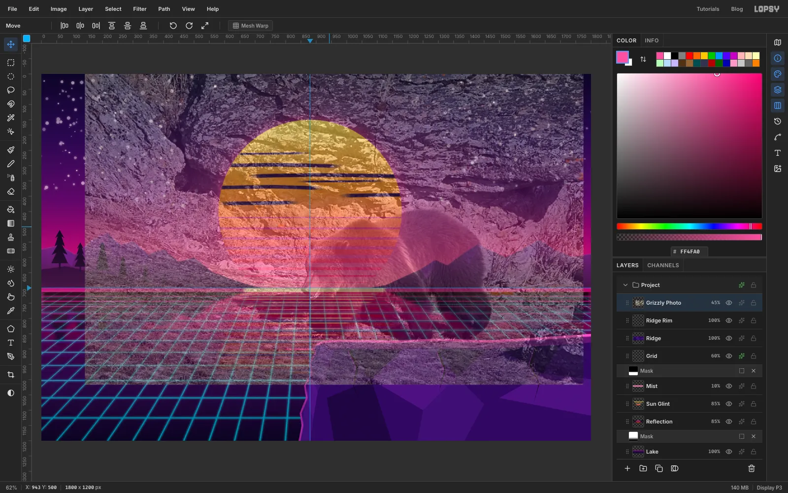

1. Drag the photo right until the bear's paws rest on the lit top of the ledge and its nose reaches the sun's right-hand stripes. Press [[Enter]] and deselect.
2. Set the photo's opacity to **45%** so you can see the painting through it.

## Add contact shadows

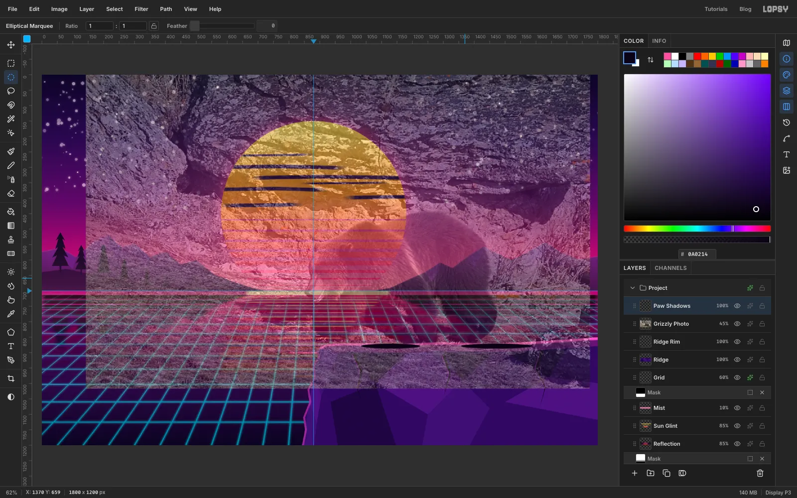

Feet that touch the ground cast a tight, dark shadow. It's a small thing, but without it the bear floats.

1. Add a layer called *Paw Shadows*.
2. With the **Elliptical Marquee**, drag a flat ellipse, about 16 px tall, under the bear's front paws in the photo, a little wider than the pair. Hold [[Shift]] and drag a second one under the hind paws.
3. Fill with `#0A0214`, deselect, and apply **Filter → Gaussian Blur…** at **Radius 2**.

## Draw the bear over the photo

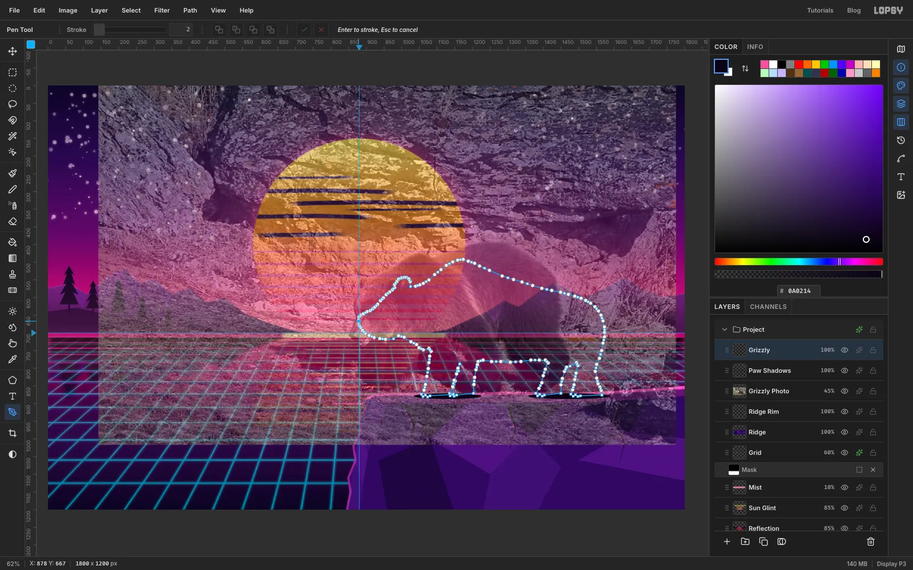

1. Add a layer called *Grizzly*.
2. Pick the **Pen** and trace the bear, using the photo for the pose and proportions. **Simplify and exaggerate as you go**, because a silhouette lives or dies by its outline:
   - Start at the nose. Run up a short, slightly dished muzzle to the forehead, then over one small, round ear.
   - Raise a clear **shoulder hump** above the front legs. That hump is what says "grizzly" rather than "black bear".
   - Let the back slope down to rounded hips, then round off the rump.
   - Draw four separate legs with gaps between them: thick front legs, hind legs angled at the hock. Give each paw a flat bottom with a few small claw nicks at the toes, standing on the contact shadows.
   - Keep the belly a smooth curve, and finish under the jaw, with a small notch where the throat meets the chest.
3. Use short drags for the smooth parts of the outline, the back, head and rump, and plain clicks for corners: the ear tip, the throat notch and the paws. Expect to place a lot of points, roughly every 20–30 px, so the shape stays under control. Close the path on the nose.

## Fill the bear

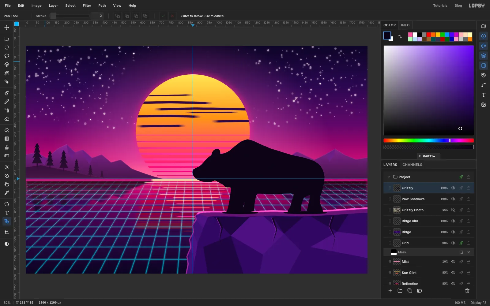

1. Click **Path to Selection**, then **Delete Path**. Fill with `#0A0314` and deselect.
2. Click the eye on the **Grizzly Photo** layer to hide it. Keep the layer, in case you want to check the pose later.

## Rim-light the bear

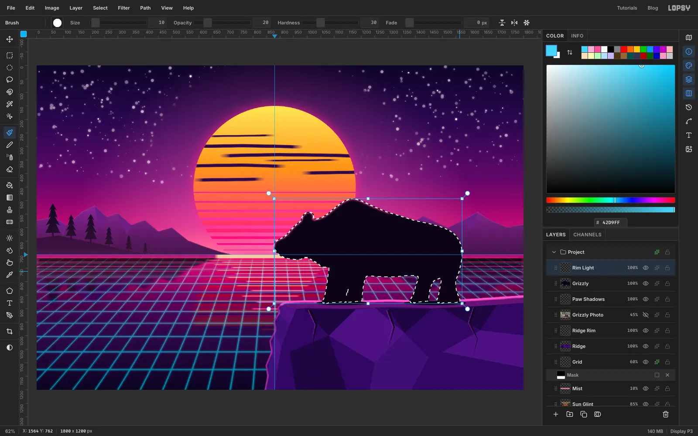

The light comes from the sun behind the bear, so the brightest rim is on the edges that face it: the muzzle, the head and the top of the hump.

1. Add a layer called *Rim Light* and [[Cmd]]-click the Grizzly thumbnail.
2. Brush along the top of the bear from the nose, over the head and hump, and down the back, with the **Brush** at **Size 28**, **Hardness 0**, colour `#FF4FA0`. Keep the brush's centre just outside the edge, so only the soft rim lands inside.
3. Go over the same edge again with **Size 10**, **Hardness 60**, colour `#FFB0D8`, for a crisp bright line.
4. Add a hint of cool light on the rump with `#42D9FF` at **Size 10**, **Hardness 30** and **Opacity 20**. Keep it faint, almost invisible: that edge faces away from the sun.
5. Deselect and set the layer to **Screen**.

## Add claws and a halo

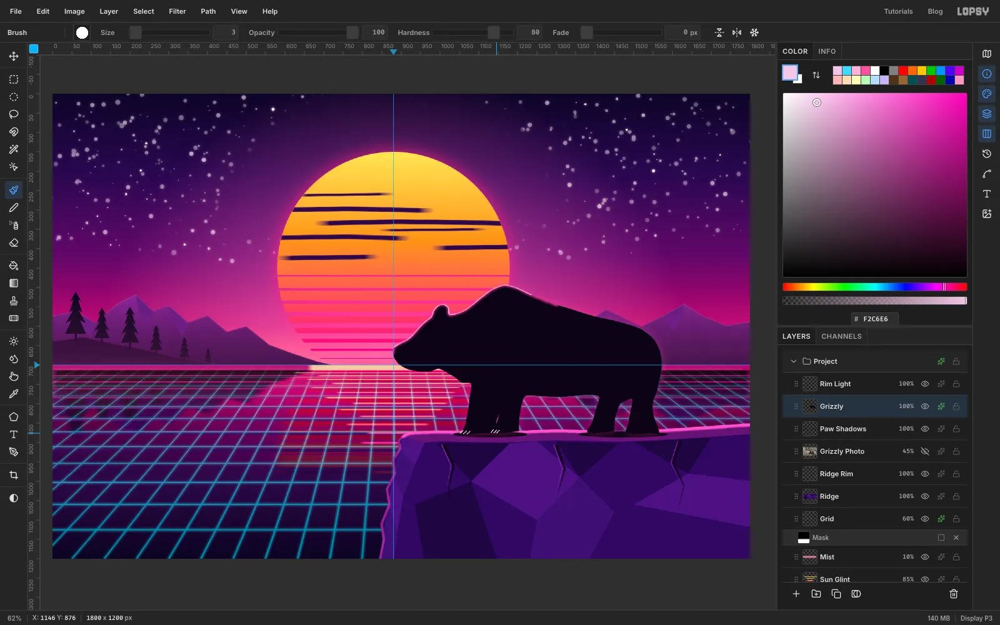

1. Still on the Rim Light layer, set the Brush to **Size 3**, **Hardness 80**, **Opacity 100**, colour `#F2C6E6`. Flick three short curved claws forward at the toes of each front paw.
2. Click the **Grizzly** layer and turn on **Outer Glow**: **Size 30**, **Opacity 40**, colour `#FF4FA0`. The bear now sits in a soft halo of sunlight.

## Grow tapered grass along the ledge

1. Click the **Rim Light** layer, then add a layer called *Grass* so it lands above the bear.
2. Set the foreground colour to `#B02A86` and the Brush to **Size 4**, **Hardness 100**, **Opacity 100**.
3. Click the brush-tip thumbnail at the left of the options bar to open the **Brushes** modal, and on the **Shape** tab set **Taper** to **26**. Taper shrinks each stroke as it goes, down to nothing after 26 px, so draw each blade from the ground up to its tip.
4. Work along the top of the ledge in uneven clumps of three to eight blades, each 6–25 px tall and leaning a little either way, with gaps between clumps. Leave the paws clear so the bear's feet stay planted.
5. Set **Taper** back to **0**, then give the layer an **Outer Glow** of **Size 4**, **Opacity 60**, colour `#FF4FA0`.

## Draw and rotate a shooting star

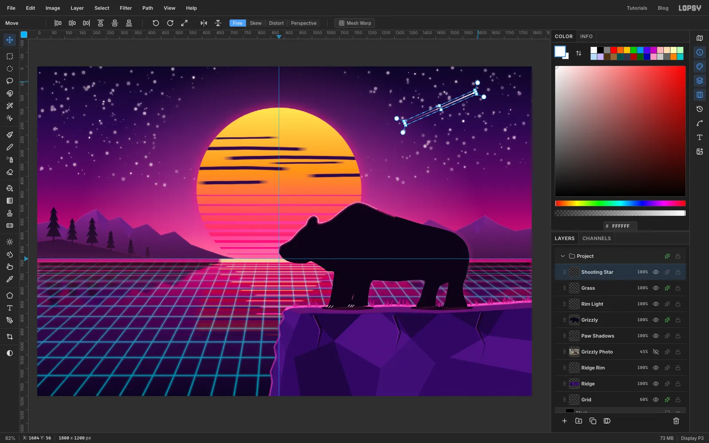

1. Add a layer called *Shooting Star*.
2. Select a thin strip from `1330, 148` to `1600, 152`. Drag a **Linear** gradient across it from left to right, from white at **Opacity 0** to solid white. Deselect.
3. With the **Brush** at **Size 9**, **Hardness 70**, click once at the bright right-hand end for the head.
4. With the **Rectangular Marquee**, drag a loose box around the streak and its head. Pick the **Move** tool, grab the small round rotation handle just outside the box's top-right corner, and drag it up and round until the streak tilts up to the right, about a quarter of the way to vertical (24° here).

## Make the shooting star glow

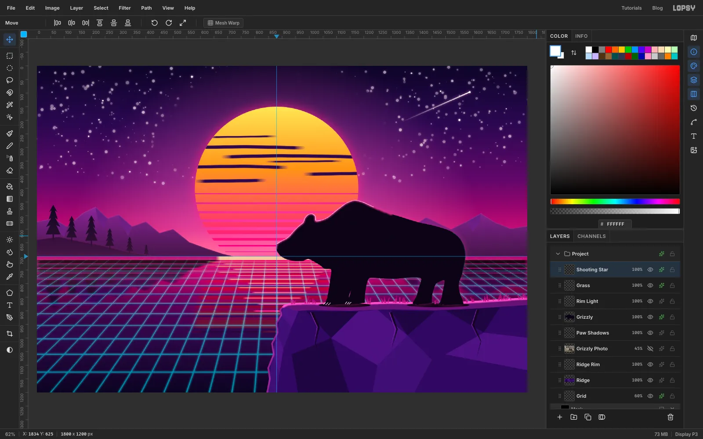

1. Press [[Enter]] to commit the rotation, then [[Cmd+D]].
2. Turn on **Outer Glow**: **Size 14**, **Opacity 80**, colour `#FF9AD0`.

## Group the layers

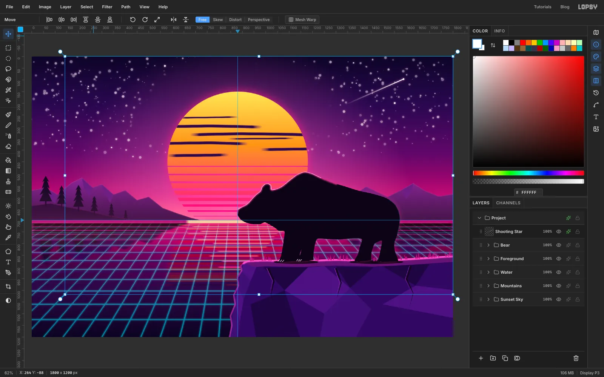

With over 20 layers, it's time to tidy up. For each group, click its bottom layer, [[Shift]]-click its top layer, choose **Layer → Group Layers**, rename the group and collapse it:

- **Sunset Sky**: Sky to Clouds
- **Mountains**: Far Range to Haze
- **Water**: Lake to Grid
- **Foreground**: Ridge and Ridge Rim
- **Bear**: Grizzly Photo to Grass

Leave Shooting Star on its own at the top.

## Nudge the bear as a group

Grouping pays off when something needs adjusting. The bear's back sat a little too close to the sun's edge.

1. Click the **Bear** group's row.
2. With the **Move** tool, drag anywhere on the canvas about 12 px to the left. The silhouette, paw shadows, rim light, claws and grass all move as one.

## Split the grid's colours

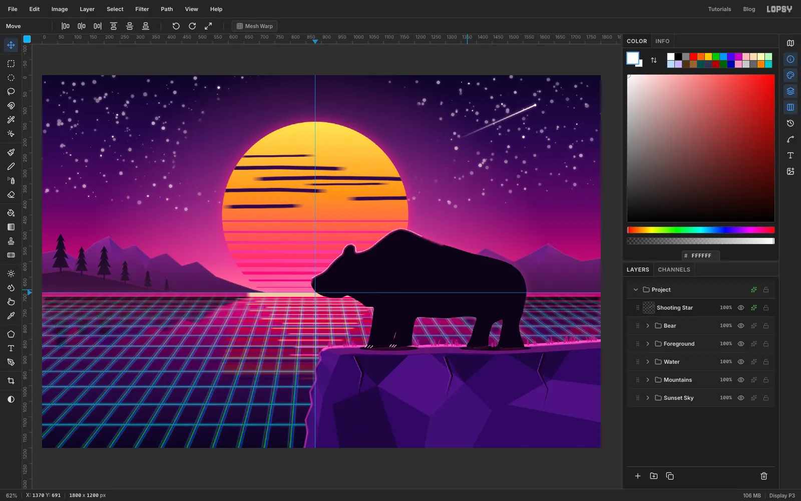

1. Expand the **Water** group and click the **Grid** layer.
2. Choose **Filter → Chromatic Aberration…** with **Amount 4** and **Direction 0**. The grid gets a VHS-style colour fringe.
3. Collapse the group again.

## Add an overall glow

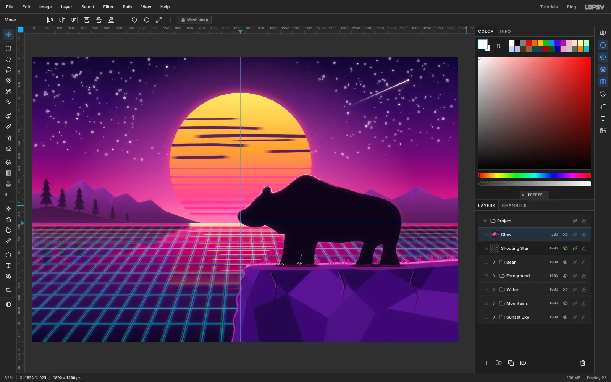

1. Click the **Shooting Star** layer so the next layer lands at the top.
2. Choose **Select → All**, then **Edit → Copy Merged**, and press [[Cmd+V]]. Rename the new layer *Glow* and deselect.
3. Apply **Gaussian Blur** at **Radius 36**, then set the layer to **Screen** at **28%**. Bright areas now bloom softly, as if seen through a lens.

## Add scanlines and grain

1. Add a layer called *Scanlines*. With black as the foreground colour, select `0, 0` to `6, 2`, fill it and press [[Cmd+D]]. Select `0, 0` to `6, 6`, choose **Edit → Define Pattern**, then press [[Delete]] and [[Cmd+D]].
2. Choose **Select → All**, then **Edit → Fill with Pattern…** and **Apply**. Deselect, and set the layer to **Multiply** at **14%**.
3. Add a layer called *Grain*. Fill it with mid grey `#808080`. Choose **Filter → Add Noise…**, set **Amount 40**, click **Mono** and **Gaussian**, and apply. Set the layer to **Overlay** at **16%**.

## Grade the colours

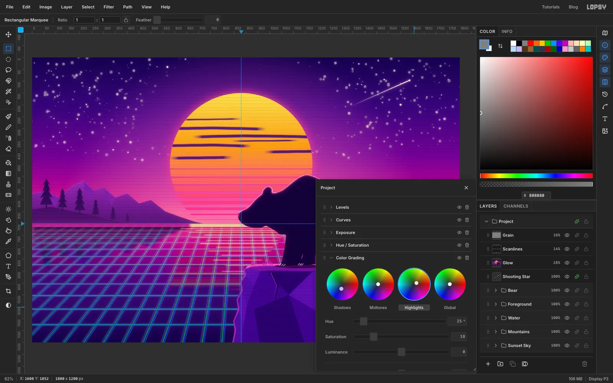

1. Choose **Layer → Adjustment Layer…** and click **Got it**. The Project group's adjustments open.
2. Every new document already has a neutral **Color Grading** adjustment here. Click its arrow to expand it.
3. Click the **Shadows** tab and set **Hue 255**, **Saturation 30**. The darks lean blue-violet.
4. Click the **Highlights** tab and set **Hue 25**, **Saturation 18**. The sun and glints get a touch warmer.

## Finish with a vignette

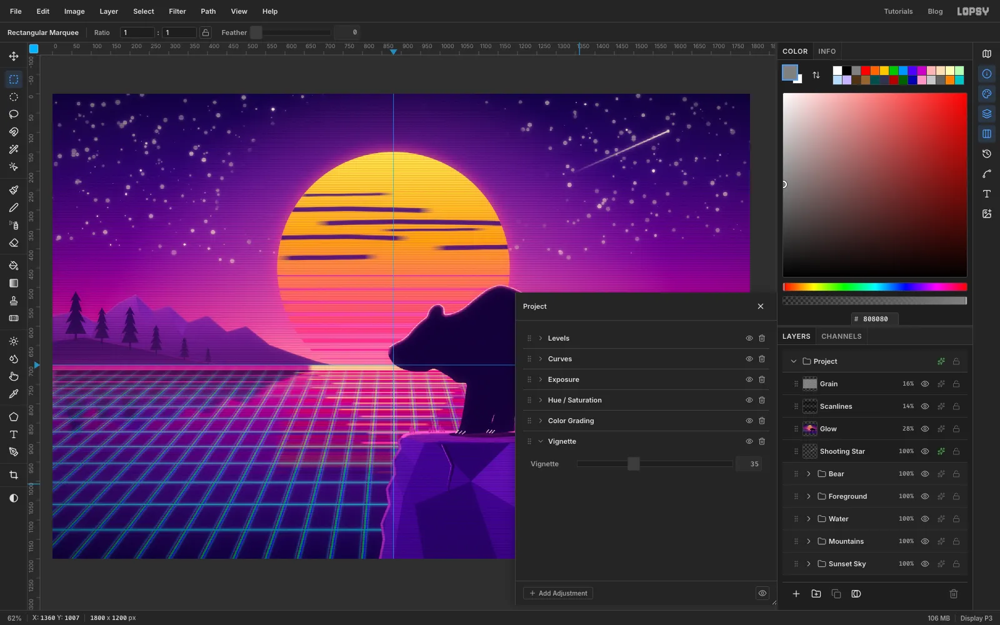

1. Click **Add Adjustment** and choose **Vignette**.
2. Set **Vignette** to **35**. The corners darken and pull the eye toward the bear and the sun.

That's it. Save the project with **File → Save Project**, and export it with **File → Quick Export PNG**.
