Nothing says "another year older" quite like a keytar. In this tutorial
you'll make **Keytar Zenith**, a 5 × 7 inch synthwave birthday card: a striped
sun going down behind neon mountains, a grid floor running to the horizon, a
keytar built entirely from simple shapes, and a chrome headline with a neon
script over it.

You'll work on a 1500 × 2100 px canvas from the back of the scene to the
front. The landscape is gradients, selections and straight brush lines. The
keytar is drawn flat inside a group, then the whole group is scaled and
rotated in one go. The type uses two tricks worth knowing: **Skew** to slant
live text, and a gradient poured into the text's own outline for the chrome.

A few things to know before you start:

- **Gradients.** The Gradient tool takes its colours from the **Advanced…**
  editor, not from the foreground colour. Click the bar to add a stop, click
  a stop to select it and type its hex. Delete any stops left over from the
  previous gradient.
- **Layer effects.** Click the sparkle button on a layer row to open the
  effects drawer, tick an effect and set its values. Blend mode is at the top
  of the same drawer. Groups don't have effects of their own, so the glows in
  this piece go on individual layers.
- **Adding to a selection.** Hold [[Shift]] while you drag with any selection
  tool to add to what's already selected. That's how you'll select six sun
  stripes or eleven black keys and fill them in one go.
- **Straight lines.** With the Brush, click once, then [[Shift]]+click
  somewhere else to draw a straight line between the two points.
- **Straight-edged shapes.** The Lasso is freehand, so for shapes with ruler
  straight sides you'll use the **Pen**: click each corner, click the first
  point again to close the shape, then click **Path to Selection** and
  **Delete Path** in the **Paths** panel (open it from the icon strip on the
  right). You're left with a selection to fill.
- **Undo.** [[Cmd+Z]] steps back and [[Cmd+Shift+Z]] steps forward again. Use
  [[Ctrl]] instead of [[Cmd]] on Windows and Linux.

The palette:

- Night sky `#07021A` → `#2A0A5E` → `#6A1590` → `#C2338F` → `#FF8A5C`
- Stars `#FFFFFF` / `#8DF6FF`
- Sun `#FFF27A` → `#FFB03A` → `#FF3D8B` → `#D4218F`, glow `#FF4FA3`
- Floor `#3A0B63` → `#1B0638` → `#06010F`
- Grid `#3CF0FF`, grid glow `#18A8FF`, horizon line `#FFE3F4`
- Mountains `#170A3A`, lit faces `#3B1670`, edge `#FF4FD8`
- Keytar body `#8CFBFF` → `#19C8E8` → `#2456D8`, glow `#38D6FF`, neck `#1B1140`
- Keys `#FFF8F0` / `#140A2E`, key bed `#0B0620`
- Controls `#FFE45C` / `#FF3D8B` / `#7CFF6B`
- Lightning `#FFF9C4`, edge `#FF8A1F`, glow `#FFD21F`
- Chrome `#FFFFFF` → `#8FE6FF` → `#2A3FB5` → `#1A0B3F` → `#FF7A3D` → `#FFD86B` → `#FFFDE8`
- Script `#FFF4FA`, neon pink `#FF2E97`
- Tagline `#EAFDFF`, band `#0A0220`, gold script `#FFE45C`

## Make the canvas and paint the sky

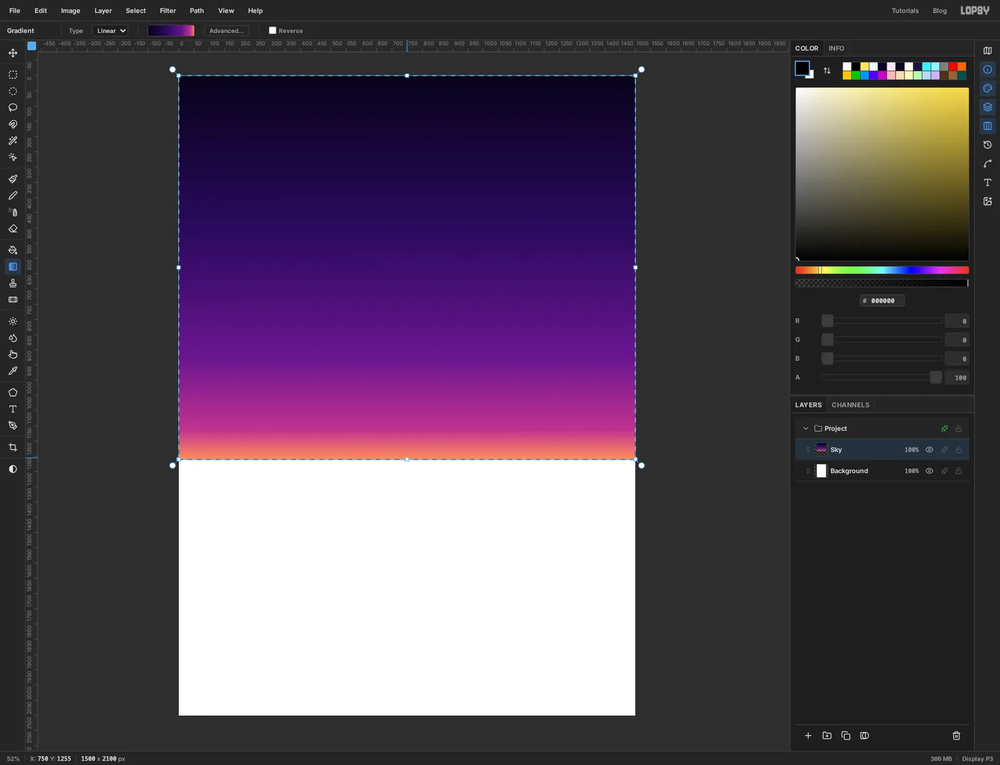

Choose **File → New**, make a **1500 × 2100** px document with a white
background and click **Create**. Double-click **Layer 1** in the Layers panel
and rename it **Sky**.

The horizon sits at 1250 px, three fifths of the way down. With the
**Rectangular Marquee**, drag from the top-left corner of the canvas to the
right edge, a touch below where the horizon will be. Watch the X/Y readout in
the status bar as you drag.

Pick the **Gradient** tool and set Type to **Linear**. In **Advanced…**, make
five stops: `#07021A` at the left end, `#2A0A5E` at 40%, `#6A1590` at 74%,
`#C2338F` at 93% and `#FF8A5C` at the right end. Drag from the top of the
canvas straight down to the horizon. Keeping most of the sky violet, with the
pink and orange squeezed into a thin band at the bottom, makes the sun's pink
stripes stand out later. Press [[Cmd+D]] to deselect.

## Drop two guides and fill the floor

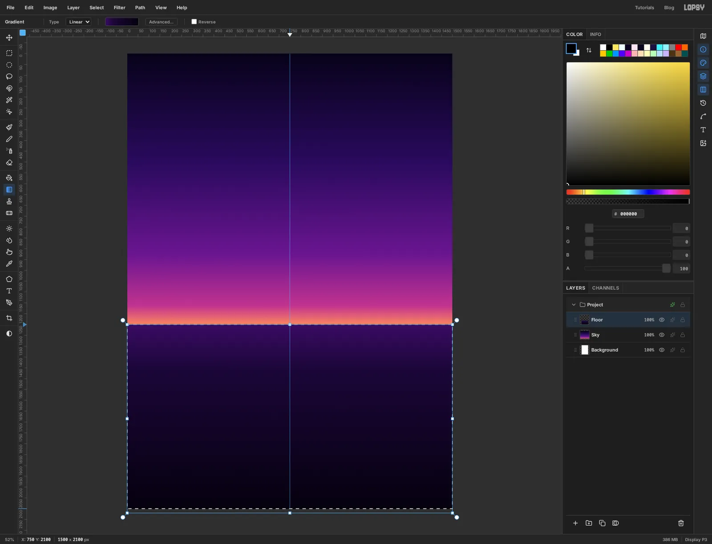

Hold [[Cmd]] and click the top ruler near the middle. A plain click drops a
guide wherever you click, and [[Cmd]]+click snaps it to the nearest tidy
fraction of the canvas, which here is the centre at **750**. Then click the
left ruler at **1250** for the horizon.

Click **Add Layer** and name the layer **Floor**. Drag a marquee from the
left edge at the horizon down past the bottom-right corner. The top edge
snaps onto the guide when you get close.

In the Gradient editor make three stops, `#3A0B63`, `#1B0638` at 25% and
`#06010F`, and drag from the horizon to the bottom of the canvas. Deselect.

## Spray the stars

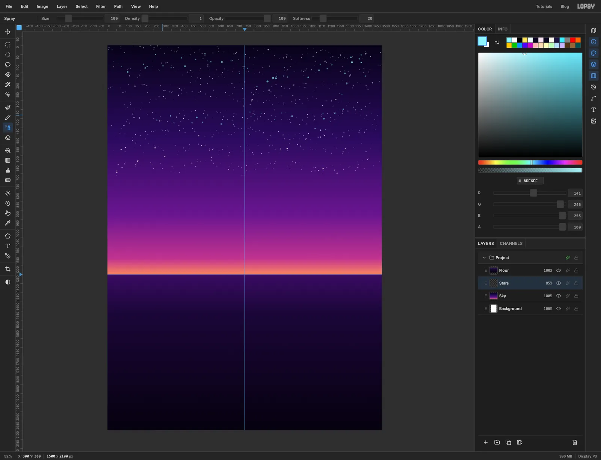

Click the **Sky** layer, then **Add Layer**, and name the new layer
**Stars**. A new layer always lands just above the selected one, so Stars
sits between the sky and the floor.

Pick the **Spray** tool ([[J]]). Set Size **60**, Density **1**, Opacity
**100** and Softness **20**, and set the foreground colour to `#FFFFFF`. With
Density at 1 the spray drops a single dot every 20 px or so, so loose zig-zag
drags across the sky leave a sparse trail of stars instead
of a cloud. Make seven or eight passes, starting at the top and working down
to about a third of the way to the horizon. A few strays lower down are fine.

Change the colour to `#8DF6FF`, raise Size to **100** and make one more
wandering pass for a few larger cyan stars. If a pass looks too regular,
[[Cmd+Z]] it and try again. Then click the layer's opacity (the **100%** on
its row) and bring it down to **85%**.

## Fill the sun with a gradient

Select **Stars**, click **Add Layer** and name it **Sun**.

Pick the **Elliptical Marquee** and drag a circle about **760 px** across,
centred on the vertical guide, with its top around y 550 and its bottom
dipping about 60 px below the horizon. Starting the drag at the top-left of
the circle's bounding box, around (370, 550), and ending at (1130, 1310) does
it.

In the Gradient editor make four stops: `#FFF27A`, `#FFB03A` at 40%,
`#FF3D8B` at 75% and `#D4218F`. Drag from the top of the circle to the
bottom. Deselect.

## Cut the stripes

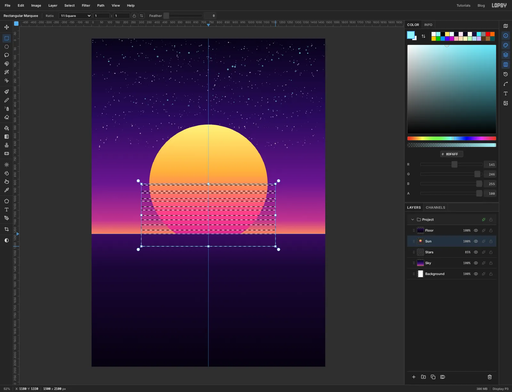

The stripes are just gaps. Pick the **Rectangular Marquee** and drag a thin
strip, about 8 px tall, right across the sun just below its middle. Then hold
[[Shift]] and drag five more strips below it, each a little taller than the
last and a little further apart: roughly 12, 17, 22, 28 and 34 px tall. Make
every strip wider than the sun so it cuts all the way through.

Still holding [[Shift]], drag one more rectangle over the sliver of sun that
hangs below the horizon guide. Its top edge snaps to the guide.

Press [[Delete]] to clear all seven areas at once, then deselect. If a stripe
is in the wrong place, each [[Cmd+Z]] removes one rectangle from the
selection, so you can back up and redraw just that one.

## Give the sun a glow

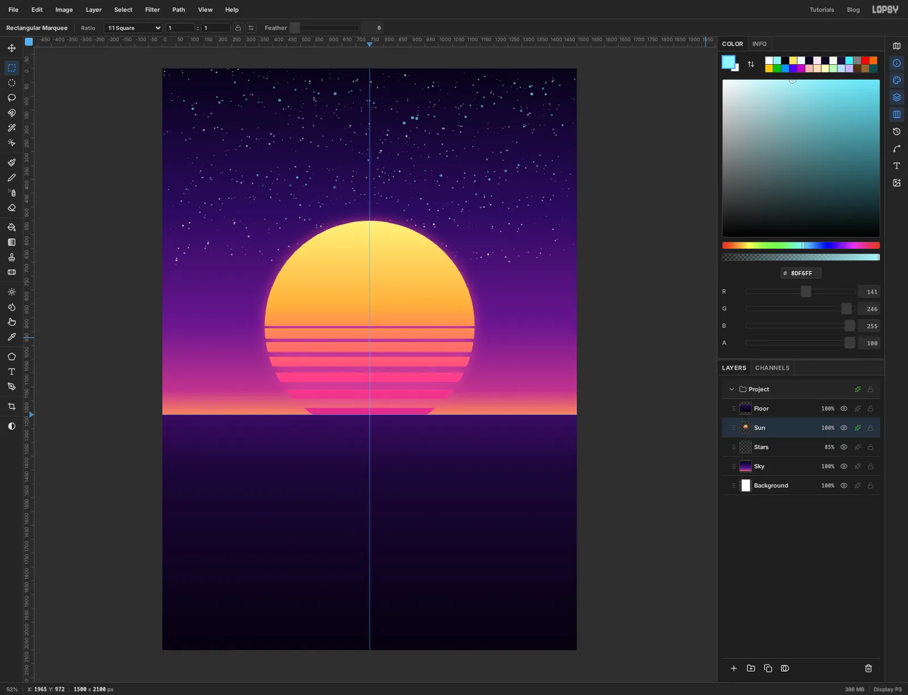

Open the **Sun** layer's effects drawer and tick **Outer Glow**. Set Size
**70**, Opacity **70** and the glow colour to `#FF4FA3`. Close the drawer.

The glow follows every edge of the layer, including the stripes, which gives
the gaps a soft pink haze.

## Draw the grid rays from the vanishing point

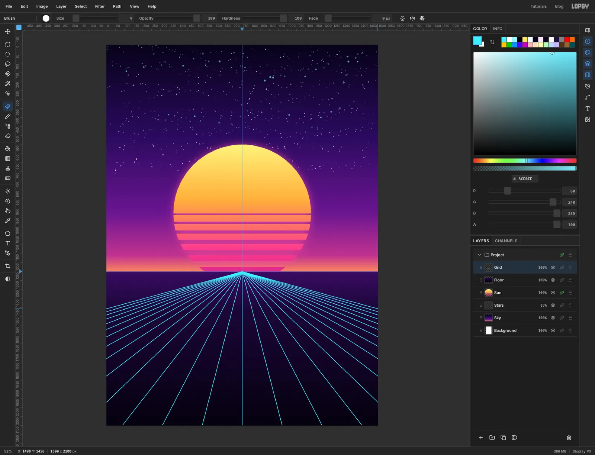

A synthwave floor is a flat grid seen in perspective, and every line running
away from you meets at one point on the horizon. Yours is where the two
guides cross.

Select **Floor**, click **Add Layer** and name it **Grid**. Pick the
**Brush**, set Size **4** and Hardness **100**, and set the foreground colour
to `#3CF0FF`.

Click once where the guides cross, then [[Shift]]+click on the bottom edge of
the canvas straight below. That's the centre line. Every other ray starts the
same way: click the crossing point, then [[Shift]]+click where the ray should
end.

The rays are evenly spaced along the bottom edge, 220 px apart. Three each
side of centre end on the canvas: at x 530, 310 and 90 on the left, and 970,
1190 and 1410 on the right.

The fourth ray onward would end past the corner, so they leave through the
side edges instead. To find where, count the ray's number out from the centre
line, divide **2880** by it and add the result to the horizon's 1250. Ray 4
ends at y **1970** on the left and right edges, ray 5 at **1826**, ray 6 at
**1730**, ray 7 at **1661**, ray 8 at **1610**, and so on. You don't need to be
exact. The gaps shrink as you climb, and by ray 14 (y **1456**) the lines are
about 12 px apart on the edge.

Stop at ray 14 for now, as in the screenshot. You'll add the tightly packed
rays near the horizon after the cross lines, when it's easier to judge how
far up to take them.

## Add the cross lines

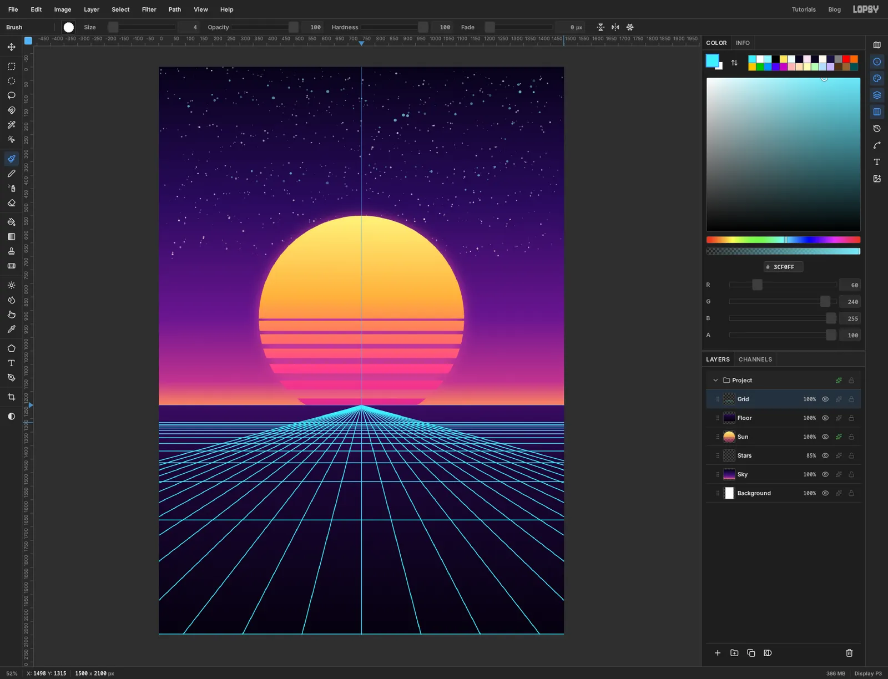

Cross lines get closer together as they go into the distance. An easy rule
that looks right: measure down from the horizon. The first line is the full
height of the floor below it, the second half that, the third a third, the
fourth a quarter, and so on.

The floor is 850 px tall, so the thirteen lines sit at these heights:

- **2097** (the bottom edge), **1675**, **1533**, **1463**
- **1420**, **1392**, **1371**, **1356**
- **1344**, **1335**, **1327**, **1321**, **1315**

For each one, click on the left edge of the canvas and [[Shift]]+click on the
right edge at the same height. Hover first and read the Y value in the status
bar. If a line lands in the wrong place, [[Cmd+Z]] removes just that line.

## Finish the rays, add a glow and fade the grid into the horizon

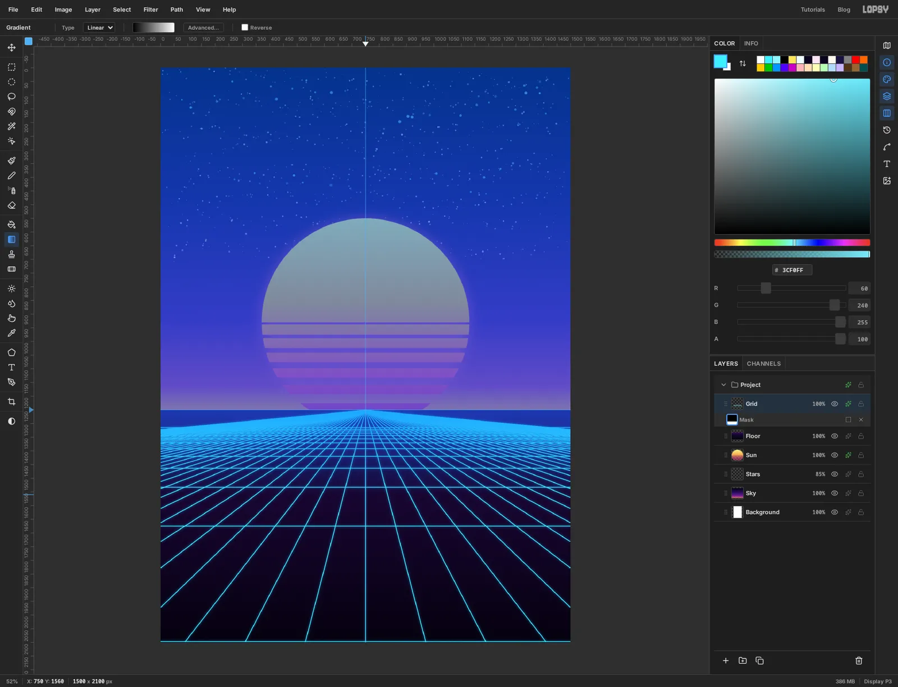

Go back to the rays and keep adding them up both side edges with the same
rule (2880 divided by the ray number, plus 1250) until the fan reaches about
70 px below the horizon. That's ray 40, at y **1322**, so 26 more each side.
From ray 20 or so they're only a few pixels apart on the edge and you can
place them by eye. Near the top they almost merge, which is fine because that
part is about to fade out.

Open the **Grid** layer's effects and tick **Outer Glow**: Size **14**,
Opacity **80**, colour `#18A8FF`.

Now the fade. With Grid selected, click **Add Mask** in the Layers panel. You
are now painting on the mask, and Lopsy shows the hidden parts with a blue
overlay. Pick the Gradient tool, set two stops, `#000000` then `#FFFFFF`, and
drag from just below the horizon down about 300 px. Black hides the layer, so
the crowded lines at the horizon disappear and the grid fades in below them.

Click the **Grid** layer's name to leave the mask. The blue tint goes away.

## Light the horizon and select the mountains

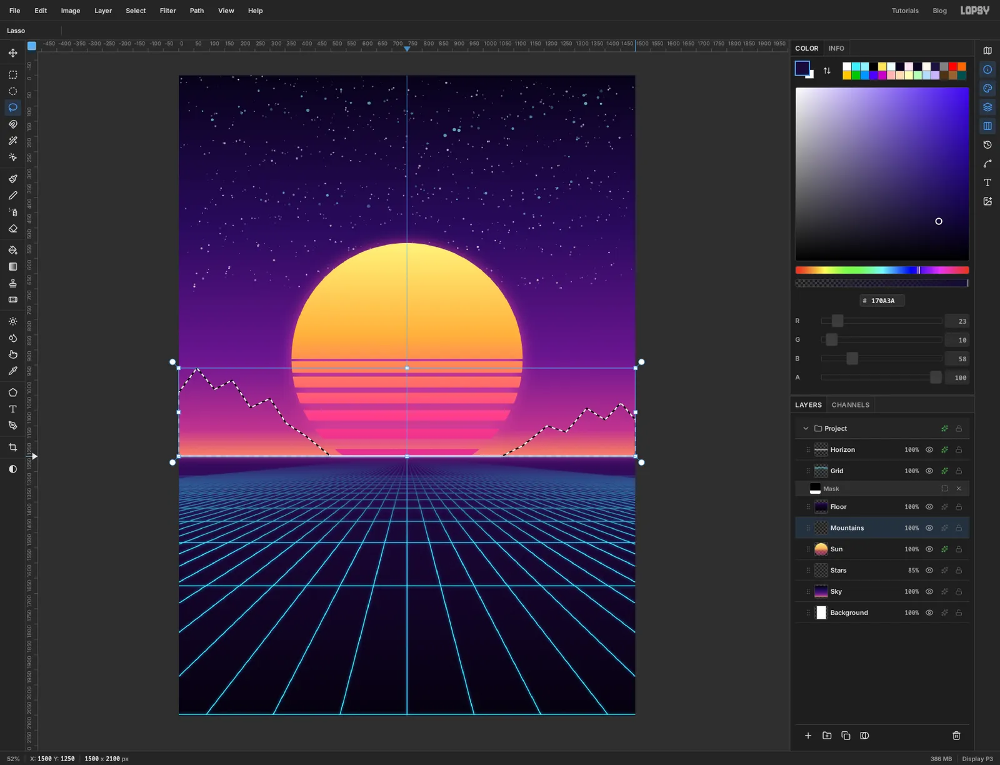

With **Grid** selected, add a layer named **Horizon**. Drag a marquee the
full width of the canvas and about **7 px** tall across the horizon guide,
set the foreground to `#FFE3F4` and choose **Edit → Fill**. Deselect, then
give the layer an **Outer Glow**: Size **36**, Opacity **85**, colour
`#FF5FA8`.

Select the **Sun** layer and add a layer named **Mountains** above it. Pick
the **Lasso**. Starting at the left edge on the horizon, drag up the edge to
about y 1040, then trace four or five peaks that step down toward the sun and
come back to the horizon around x 500. Hold [[Shift]] and trace a second,
lower range on the right, from the right edge in to about x 1060. Make the
two ranges different heights so they don't mirror each other.

Fill with `#170A3A` and deselect.

## Add lit faces, a neon edge and the sun's reflection

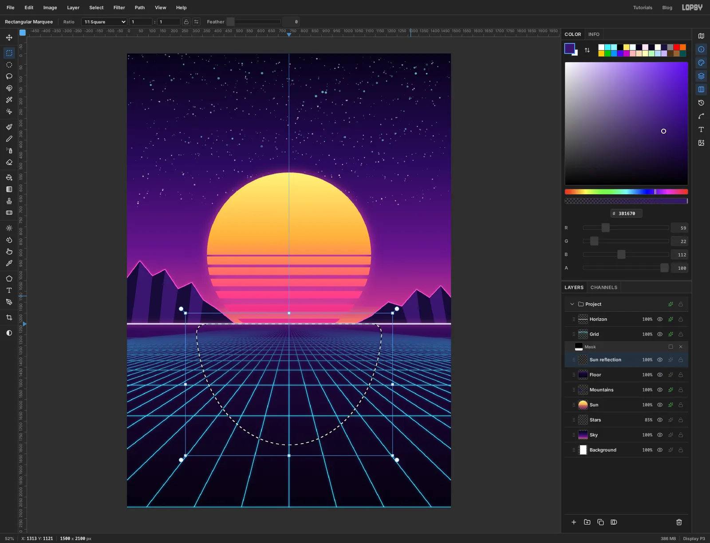

Still on **Mountains**, use the Lasso with [[Shift]] to select one face of
each peak: a narrow four-sided shape from the summit down to the horizon.
Fill them all with `#3B1670` and deselect. Then add two effects:

- **Stroke**: Width **4**, colour `#FF4FD8`
- **Outer Glow**: Size **18**, Opacity **60**, colour `#FF2FB0`

For the reflection, select **Floor** and add a layer named **Sun
reflection**. With the **Elliptical Marquee**, drag a tall ellipse centred on
the point where the guides cross, a little wider than the sun and reaching
about 560 px below the horizon. Switch to the **Rectangular Marquee**, hold
[[Shift+Alt]] and drag a rectangle over the part below the horizon. Holding
both keys keeps only the overlap, so you're left with the bottom half of the
ellipse. Choose **Select → Feather…** and enter **50**.

## Pour in the reflection

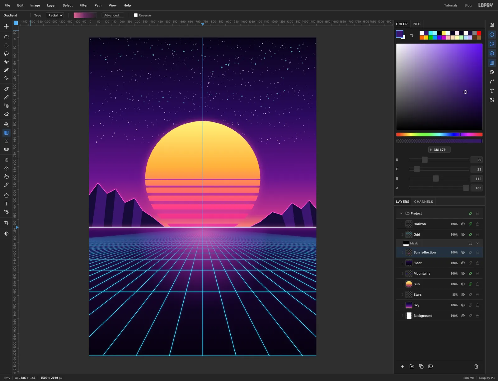

In the Gradient tool, switch Type to **Radial**. Make three stops and use the
opacity bar under the colour picker to make them fade out: `#FF6FA8` at about
85% opacity, `#C22BB0` at 40% opacity in the middle, and `#3A0B63` at 0%.
Drag from the crossing point of the guides straight down about 550 px.

Deselect, open the layer's effects drawer and set its blend mode to
**Screen**. The reflection lightens the floor without hiding it.

This is a good moment for **File → Save Project**.

## Draw the keytar body in a group

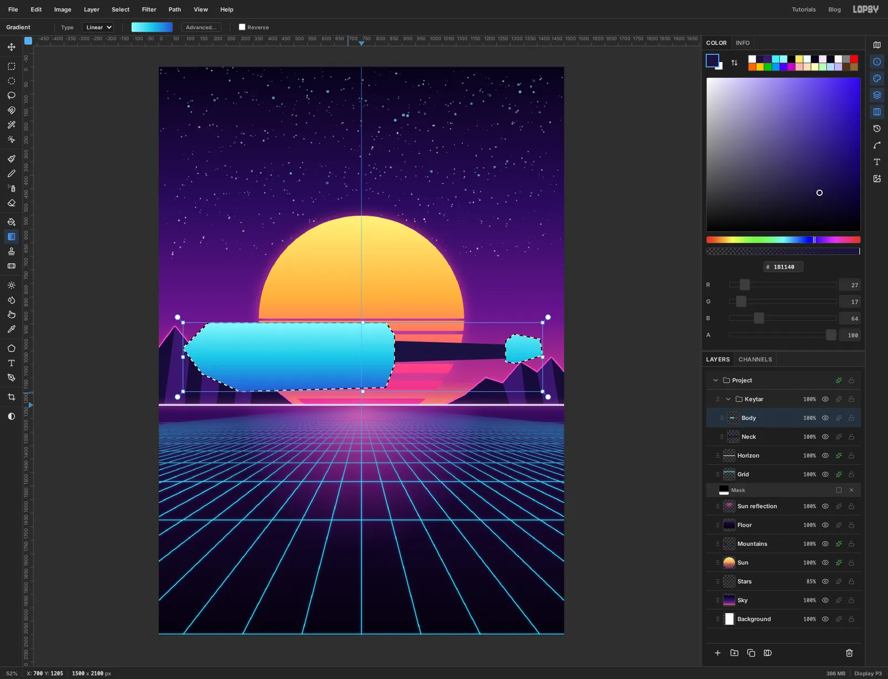

You'll build the keytar lying flat, where rectangles are easy, and tilt it
afterwards. Before you start, choose **View → Snap to Guides** to turn
snapping off. Several keys land next to the centre guide and you don't want
them jumping onto it.

Select **Horizon**, click **New Group** and name the group **Keytar**. With
the group selected, click **Add Layer** and name it **Neck**. Layers you add
now go inside the group.

- **Neck.** Pick the **Pen** and click four corners for a long, thin bar: it
  starts a little right of the middle of the canvas and runs about 430 px to the
  right, around 80 px tall at the left end and narrowing to about 50 px at
  the right. Click the first point again to close it, then **Path to
  Selection** and **Delete Path** in the Paths panel. Fill it with `#1B1140`
  and deselect.
- **Body.** Add a layer named **Body**. With the Pen, click eight corners for
  a long slab about 780 px wide and 250 px tall, overlapping the left end of
  the neck. Give it a pointed tail on the left (the tip sits near x 90,
  halfway up the slab) and clip the two right-hand corners at an angle. Let
  the bottom edge rise slightly toward the tail. Close the path and convert
  it to a selection as before.
- **Headstock.** With the body still selected, pick the **Lasso**, hold
  [[Shift]] and trace a small six-sided shape over the right end of the neck,
  about 140 px wide and a little taller than the neck. It's small enough to
  draw freehand, and the white outline you add next tidies its edges.

With both shapes selected, set the Gradient tool back to **Linear** with
stops `#8CFBFF`, `#19C8E8` at 50% and `#2456D8`, and drag from the top of the
body to the bottom. Deselect.

Give **Body** a **Stroke** (Width **5**, `#FFFFFF`) and an **Outer Glow**
(Size **46**, Opacity **65**, `#38D6FF`). Give **Neck** the same Stroke and
an Outer Glow of Size **30**, Opacity **60**, `#38D6FF`.

## Add a shine, the key bed and one key

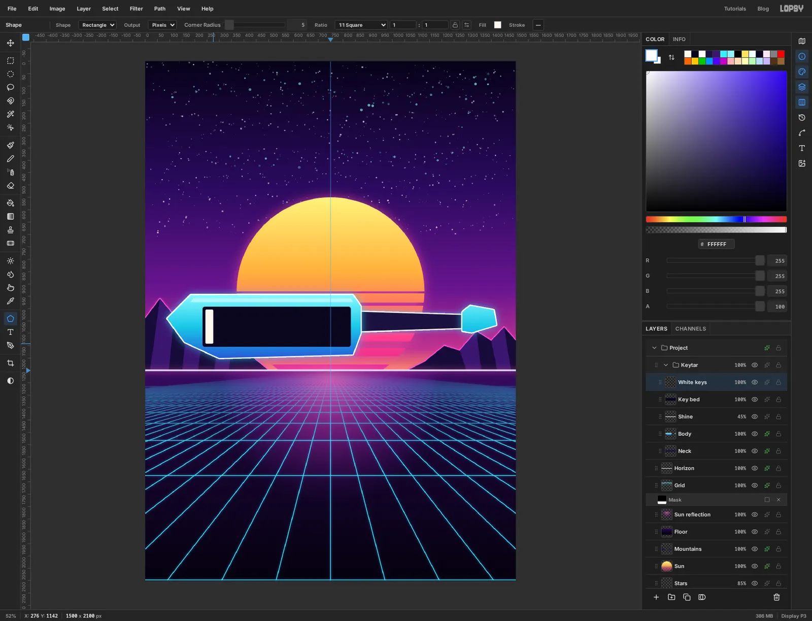

Select **Body** and add a layer named **Shine**. With the Rectangular Marquee,
drag a thin strip, about 16 px tall, just inside the top edge of the body, fill it with `#FFFFFF` and set the layer's
opacity to **45%**.

Add a layer named **Key bed**. Pick the **Shape** tool, set Shape to
**Rectangle**, Corner Radius **10** and the Fill swatch to `#0B0620`. Shapes
draw from the centre outward, so start the drag in the middle of where the
bed should be, around (532, 1073), and pull out to a corner until the
rectangle is about **600 × 160** px.

Add a layer named **White keys**. Change the fill to `#FFF8F0` and Corner
Radius to **5**, and draw one key at the left end of the bed: **32 px** wide
and **138 px** tall, with a small margin from the bed's edge.

## Double the key into a keyboard

Drawing sixteen keys one at a time is slow. Doubling is faster:

1. Choose **Layer → Duplicate Layer**. The copy sits exactly on top of the
   original.
2. Pick the **Move** tool and nudge the copy right by one key plus a gap,
   **36 px**: [[Shift+→]] three times (10 px each) and [[→]] six times.
3. Press [[Cmd+E]] to merge the copy down. You now have two keys on one
   layer.

Repeat with twice the distance each time: duplicate, nudge **72 px**, merge
for four keys; **144 px** for eight; **288 px** for sixteen. The last round is
28 presses of [[Shift+→]] and 8 of [[→]], which is tedious but still quicker
than drawing eight more keys and lining them up.

If the spacing slips, [[Cmd+Z]] back to before the last duplicate and count
the nudges again.

## Select the black keys

Add a layer named **Black keys**. With the **Rectangular Marquee**, drag a
rectangle **20 px** wide and **84 px** tall, hanging from the top of the
keys and centred on the gap between the first and second white keys. Hold
[[Shift]] and add the rest.

Black keys come in a group of two, then a group of three, with a missing one
between groups. Sixteen white keys have fifteen gaps. Counting from the left,
put a black key on gaps 1 and 2, skip 3, then 4, 5 and 6, skip 7. The pattern
repeats: 8 and 9, skip 10, then 11, 12 and 13, skip 14, and one last key on
gap 15. That's eleven.

Set the foreground to `#140A2E`, choose **Edit → Fill** and deselect.

## Add the controls and a model number

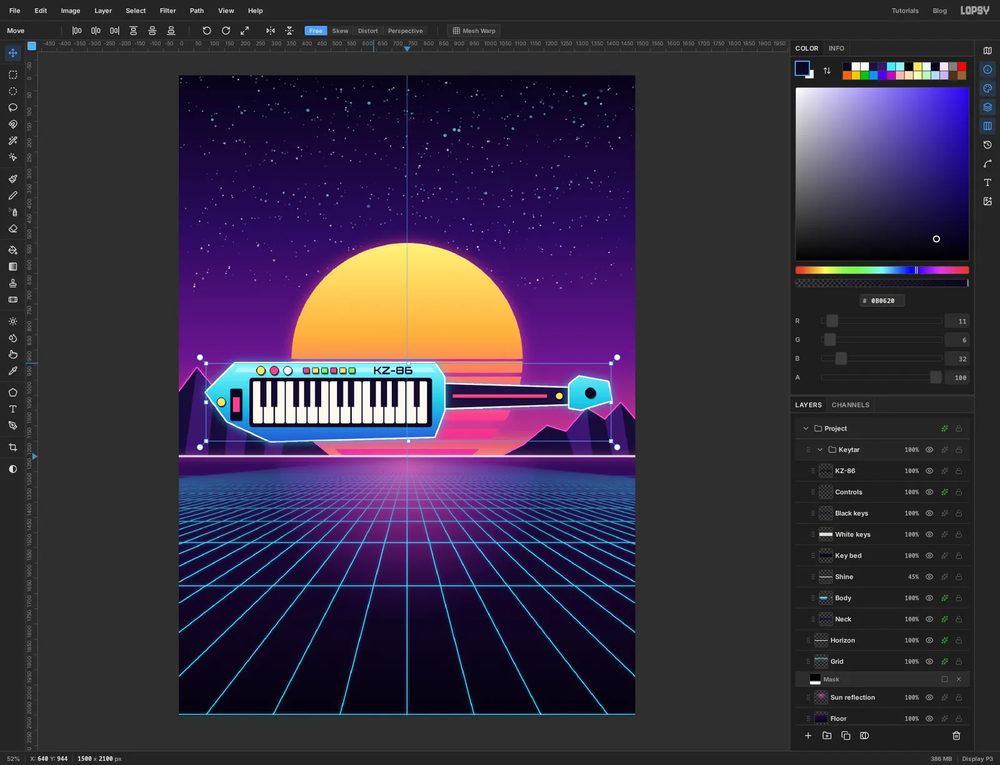

Add a layer named **Controls**. Everything on it is a small marquee filled
with **Edit → Fill**. Use the screenshot for where each one goes:

- Three round knobs above the left end of the keys, in `#FFE45C`, `#FF3D8B`
  and `#FFFFFF`. Use the Elliptical Marquee, about 26 px across.
- Six small square lights to their right, alternating `#FF3D8B`, `#FFE45C`
  and `#7CFF6B`.
- On the tail: a tall slot in `#0B0620` with a shorter `#FF3D8B` slider
  inside it, and a `#FFE45C` button beside it.
- On the neck: a long thin `#FF3D8B` strip down the middle and a small
  `#FFE45C` dot near the headstock.
- A `#0B0620` circle on the headstock.

Give the layer a **Stroke** (Width **2**, `#0B0620`) and a **Drop Shadow**
(Offset X **2**, Offset Y **3**, Blur **2**, Opacity **60**) so the controls
look raised.

Set the foreground to `#0B0620`, pick the **Text** tool, choose **Orbitron**,
weight **Bold**, Size **34**, and click in the empty strip above the right
half of the keys. Type `KZ-86` and press [[Tab]] to commit. Because a layer
inside the group was selected, the text joins the group.

Click the **Keytar** group row and pick the **Move** tool. With nothing
selected on the canvas ([[Cmd+D]]), handles appear around the whole
instrument.

## Scale the whole group

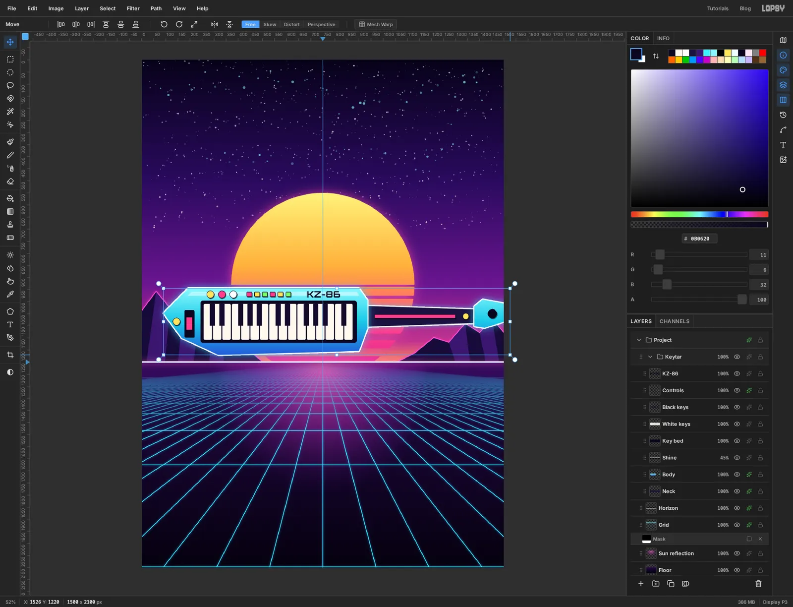

With the **Keytar** group still selected and the Move tool active, hold
[[Cmd]] and drag the bottom-right corner handle outward about 100 px. Holding
[[Cmd]] keeps the proportions. Every layer in the group, including the text,
scales together.

Press [[Cmd+D]] to commit. The keytar now pokes off the right side of the
canvas, so click **Align center horizontally** in the options bar to centre
the group.

## Rotate the group

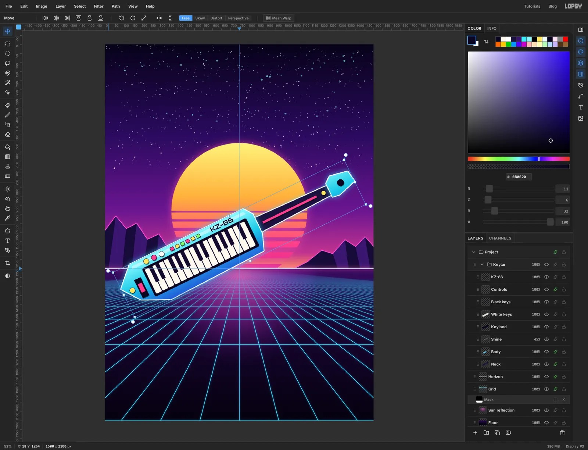

Move the pointer just outside the top-left corner of the handles, onto the
round rotation handle, and drag downward. The whole group turns about its
centre. Stop at about **26°** anticlockwise, with the tail low on the left and
the headstock high on the right, crossing the sun.

Press [[Cmd+D]] to commit. If it sits too low, nudge it up with
[[Shift+↑]]; three presses were enough here. The `KZ-86` label is still live
text, and it turned with everything else.

The rotation of all eight layers is a single undo step, so if the angle is
off, one [[Cmd+Z]] puts the keytar flat again and you can have another go.

## Ground it with a glow and add shooting stars

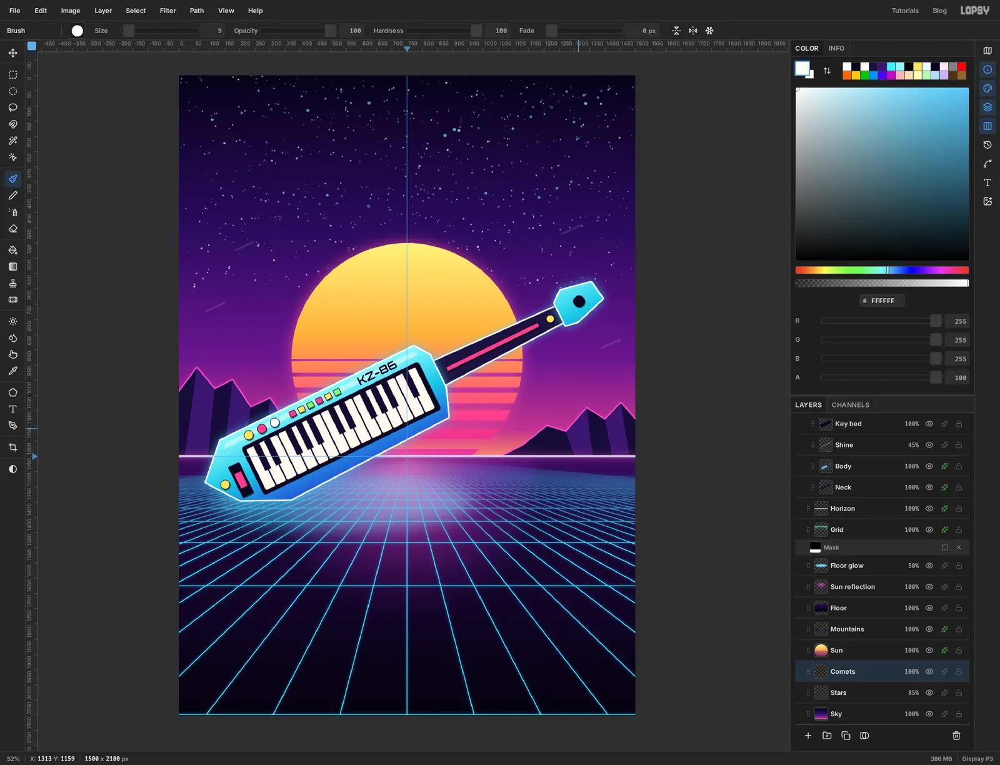

A glow on the floor ties the keytar to the scene. Select **Sun reflection**
and add a layer named **Floor glow**. Drag a wide, flat ellipse on the grid
under the keytar's body, about 860 × 190 px. Feather it by **60**
(**Select → Feather…**), fill with `#38D6FF` and deselect. Set the blend mode
to **Screen** and the opacity to **50%**.

Select **Stars** and add a layer named **Comets**. With the Brush at Size
**9** and `#FFFFFF`, click four single dots in open sky, away from where the
title will go. Then choose **Filter → Motion Blur…**, set Angle **155** and
Distance **70**, and click **Apply**. Each dot becomes a faint streak.

## Draw one lightning bolt, then copy and rotate it

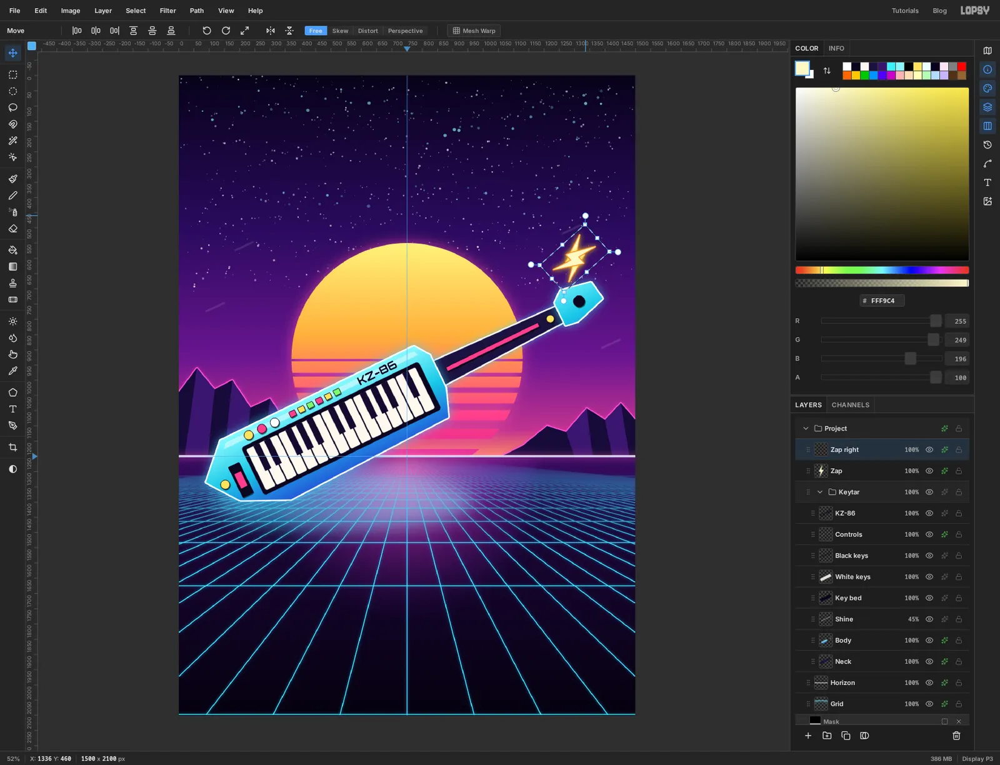

Click the **Project** row at the top of the Layers panel, then **Add Layer**,
so the new layer goes above the Keytar group instead of inside it. Name it
**Zap**.

With the Pen, click six points for a lightning bolt just above the headstock,
about 60 px wide and 160 px tall: a zig-zag with one sharp tip at the top and
one at the bottom. Close the path, click **Path to Selection** and **Delete
Path**, fill with `#FFF9C4` and deselect. Add an **Outer Glow**
(Size **26**, Opacity **90**, `#FFD21F`) and a **Stroke** (Width **3**,
`#FF8A1F`).

For the second bolt, choose **Layer → Duplicate Layer** and rename the copy
**Zap right**. Drag a marquee loosely around the bolt, with some room to
spare, so the Move tool's handles frame just that area. Pick the Move tool
and drag the rotation handle to turn the copy about **48°** clockwise. Press
[[Cmd+D]], then drag the bolt to the right of the headstock.

## Finish the bolts

Select **Zap** again, duplicate it, name the copy **Zap left**, and do the
same in the other direction: marquee, rotate about **48°** anticlockwise,
deselect, and drag it to the left of the headstock.

Keep the tips of all three bolts inside the card, with a little sky between
the right-hand one and the edge. Because the effects were on the layer before
you duplicated it, every copy has the same glow and outline.

## Set the headline

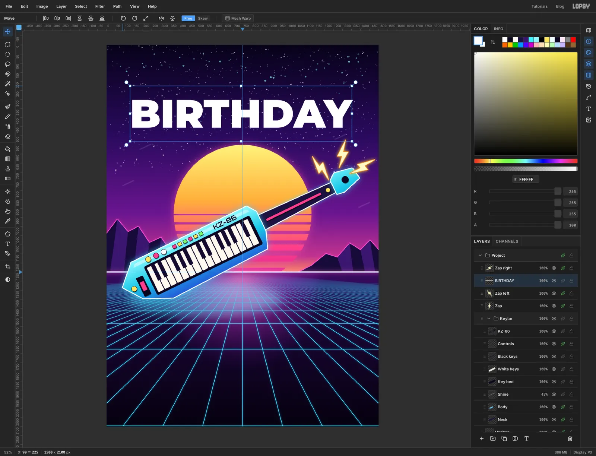

Select a normal layer first, such as **Zap right** at the top of the stack. If a text layer is
selected when you change the font, that layer gets restyled.

Set the foreground to `#FFFFFF`. Pick the **Text** tool, choose
**Montserrat**, weight **Black** and Size **218**. Click in the sky around
(90, 225), type `BIRTHDAY` and press [[Tab]].

Switch to the Move tool and click **Align center horizontally**. The word
should span most of the card with an equal margin of about 140 px each side,
and clear the top of the sun by 90 px or so.

## Slant it with Skew

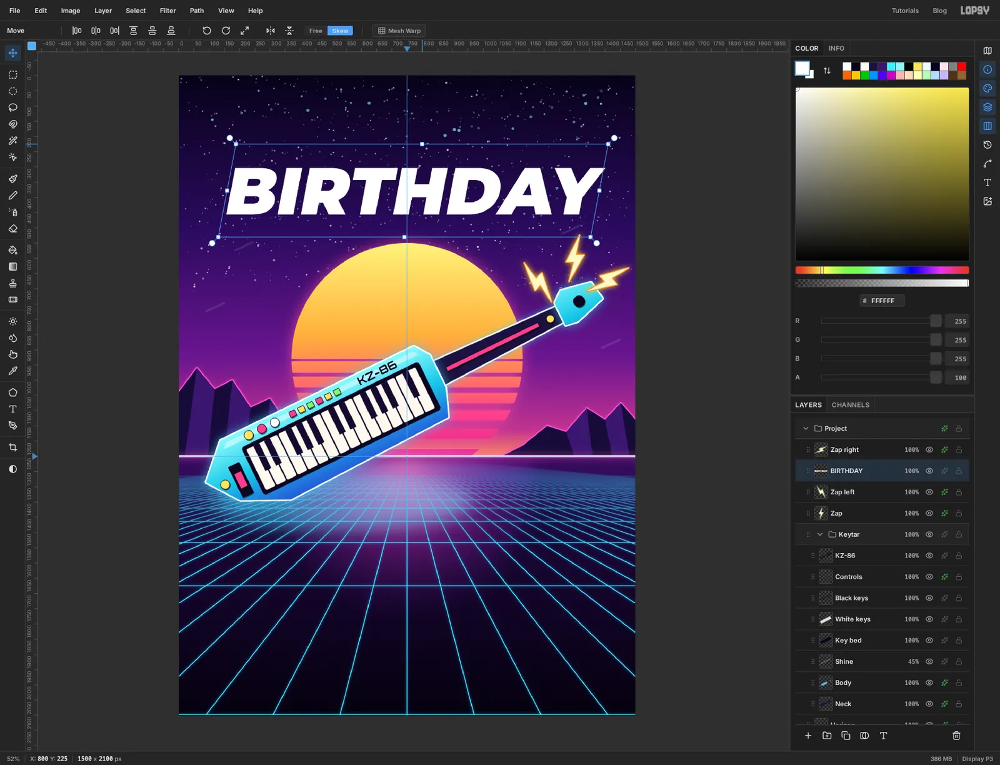

With the **BIRTHDAY** layer selected and the Move tool active, click **Skew**
in the options bar. Drag the handle in the middle of the top edge about
**58 px** to the right. The bottom edge stays where it is and the letters
lean over.

The slant is applied as soon as you let go. Click **Free** to switch the
handles back, and click **Align center horizontally** again, since the slant
shifts the word a little. The text is still editable.

## Pour chrome into the letters

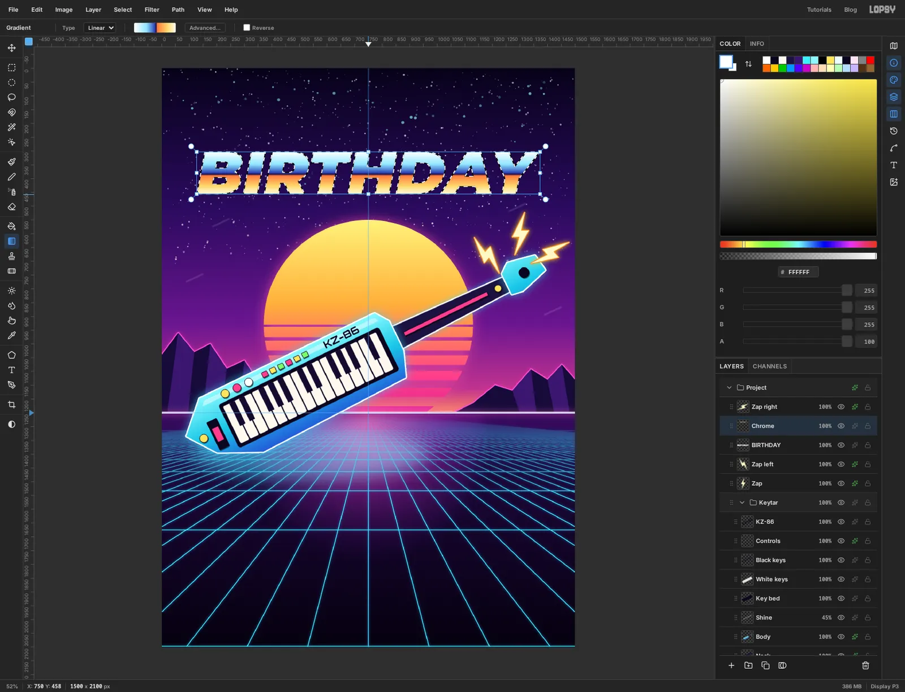

Hold [[Cmd]] and click the **BIRTHDAY** layer's thumbnail. That loads the
letters as a selection. Click **Add Layer** and name the new layer
**Chrome**.

In the Gradient editor (Type **Linear**), build the chrome from seven stops:

- `#FFFFFF` at the left end
- `#8FE6FF` at 30%
- `#2A3FB5` at 50%
- `#1A0B3F` at 53%
- `#FF7A3D` at 56%
- `#FFD86B` at 80%
- `#FFFDE8` at the right end

The three stops crammed together in the middle make the hard "horizon" line
that sells the chrome. Drag from the top of the letters to the bottom, then
deselect.

Now the rim. On **Chrome**, add a **Stroke**: Width **4**, `#14072E`. On the
white **BIRTHDAY** layer underneath, add:

- **Stroke**: Width **12**, `#FFFFFF`
- **Outer Glow**: Size **40**, Opacity **85**, `#FF2E97`
- **Drop Shadow**: Offset X **10**, Offset Y **14**, Blur **6**, Opacity
  **70**, colour `#2A0A5E`

The wide white stroke shows around the thin dark one, which gives the
letters a double outline.

## Write Happy in neon script

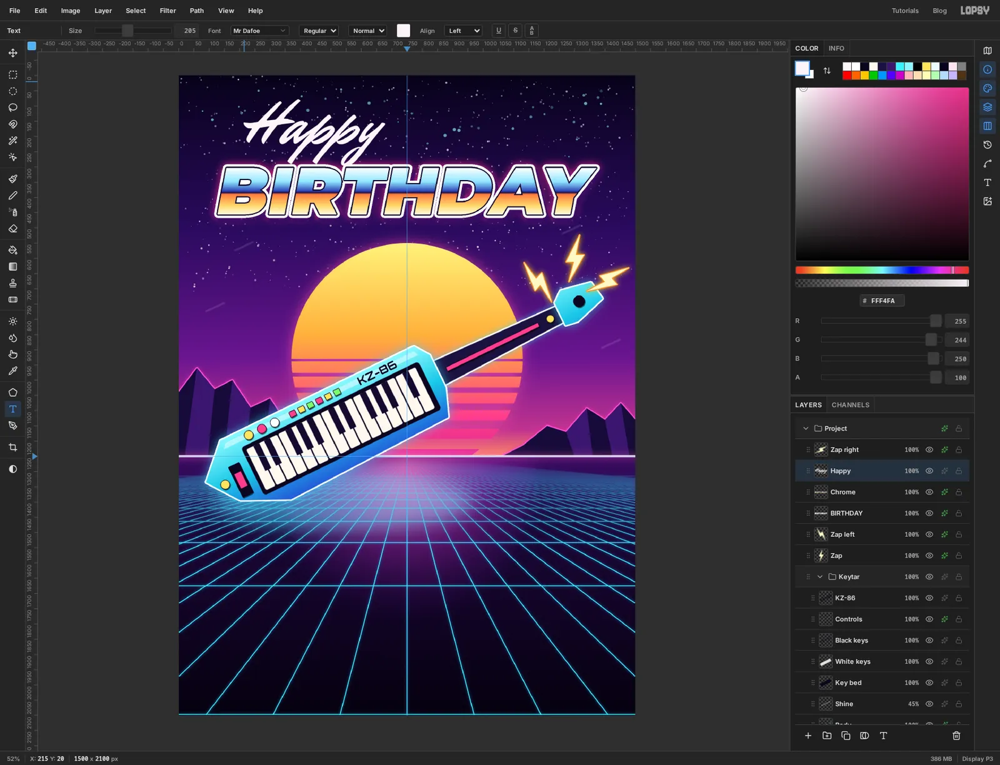

Select **Chrome**, set the foreground to `#FFF4FA`, and with the Text tool
choose **Mr Dafoe** at Size **205**. Click near the top of the card, around
(215, 20), type `Happy` and press [[Tab]].

Position matters here. The script should sit above the left half of
BIRTHDAY, and the tails of the two p's and the y should come down close to
the chrome without running into it.

## Tilt and light the script

With the Move tool, drag the rotation handle outside the top-left corner
downward to tilt the word about **6°** anticlockwise, so it rises to the
right. If the descenders touch the chrome, nudge the word up with the arrow
keys; it took 14 px here.

Add three effects to turn it into neon:

- **Stroke**: Width **3**, `#FF2E97`
- **Outer Glow**: Size **34**, Opacity **95**, `#FF2E97`
- **Drop Shadow**: Offset X **6**, Offset Y **8**, Blur **4**, Opacity
  **80**, colour `#2A0A5E`

## Seat the bottom type

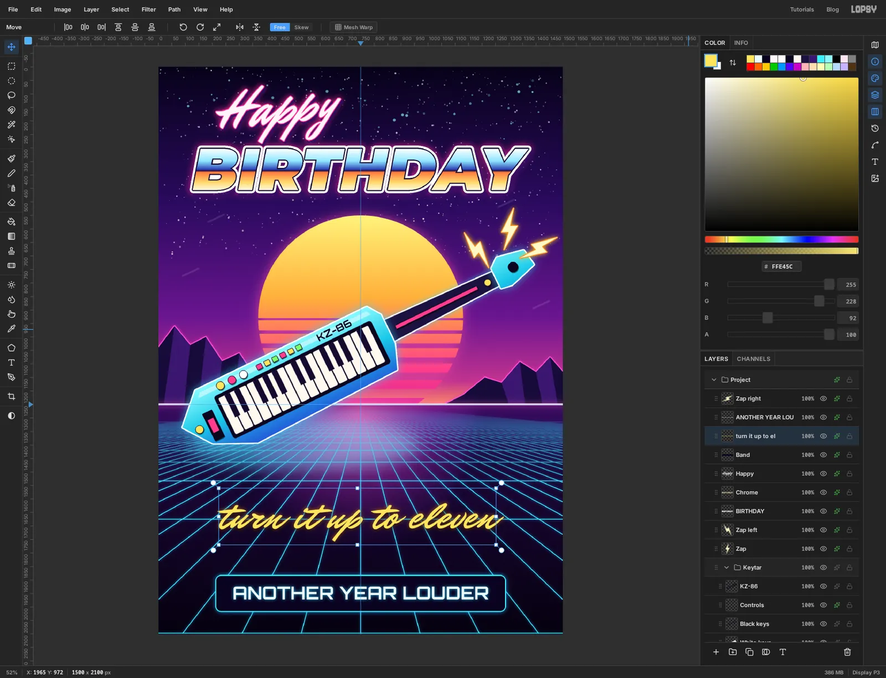

Select **Happy** and add a layer named **Band**. With the Shape tool
(Rectangle, Corner Radius **18**, fill `#0A0220`), draw a band about
**1070 × 130** px, centred left to right, near the bottom of the card. Leave
around 85 px of grid below it. Add a **Stroke** (Width **4**, `#3CF0FF`) and
an **Outer Glow** (Size **24**, Opacity **80**, `#18A8FF`).

With **Band** selected, set the foreground to `#EAFDFF`. In the Text tool
choose **Orbitron**, weight **Bold**, Size **66**. Click on open grid above
the band, clear of any other text. Type
`ANOTHER YEAR LOUDER` and press [[Tab]].

With the Move tool, drag the line down into the band and click **Align center
horizontally**. Seat it carefully: the capitals should have the same space
above and below them, and about 60 px of band at each end. Add an **Outer
Glow** (Size **18**, Opacity **80**, `#18C8FF`).

Select **Band** again, set the foreground to `#FFE45C`, and with the Text
tool choose **Mr Dafoe** at Size **150**. Click in open grid, type
`turn it up to eleven` and commit. Drag it so the tails of the p's stop about
50 px above the band, and centre it. Add:

- **Outer Glow**: Size **22**, Opacity **85**, `#FF8A1F`
- **Drop Shadow**: Offset X **0**, Offset Y **6**, Blur **26**, Opacity
  **100**, colour `#06010F`

The wide dark shadow dims the grid lines behind the script so it stays
readable.

## Add scanlines with a pattern

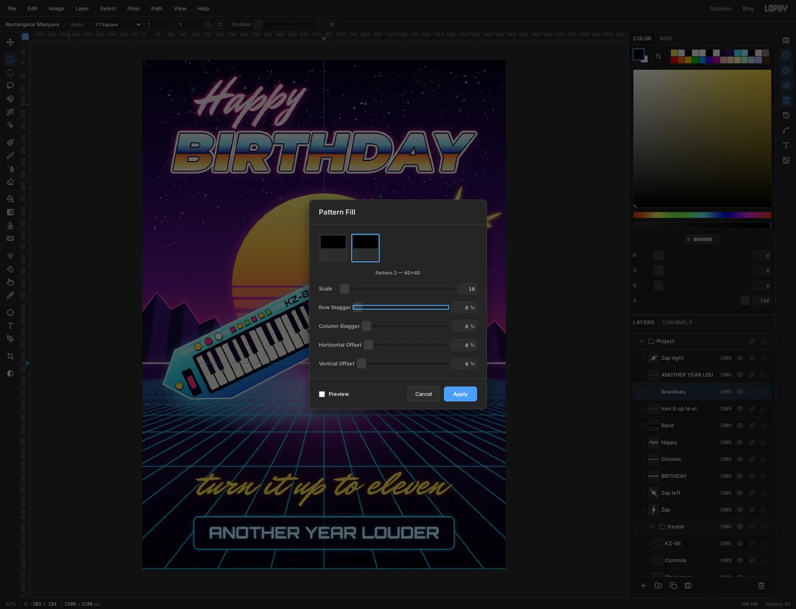

Scanlines are one tile repeated. Add a layer named **Scanlines**, then drag
its row by the grip on the left up to the very top of the stack, just under
**Project**, so the lines run over the type and the lightning as well.

1. Drag a small marquee in the top-left corner of the canvas, **40 px** wide
   and **20 px** tall, and fill it with `#000000`.
2. Drag a new marquee from the same corner, **40 × 40** px, so it holds the
   black strip and an equal empty strip under it.
3. Choose **Edit → Define Pattern**.
4. Press [[Delete]] to clear the tile and deselect.
5. Choose **Edit → Fill with Pattern…**. Your tile is in the picker. Set
   Scale to **10** so the stripes repeat every 4 px, and click **Apply**.

Set the layer's blend mode to **Multiply** and its opacity to **12%**. Keep
it low: stronger scanlines turn the sun and the white keys grey.

## Darken the corners

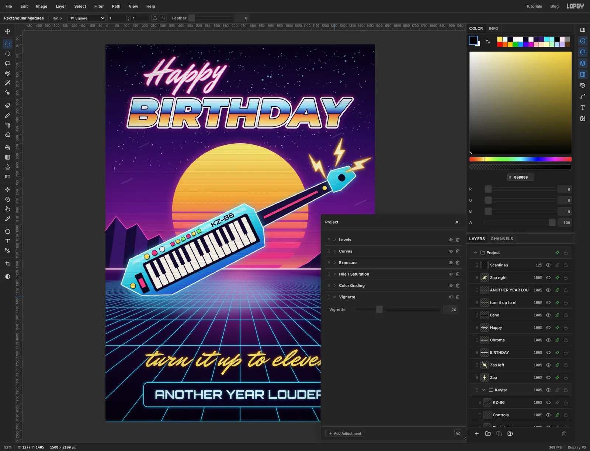

Click the sparkle button on the **Project** row at the top of the Layers
panel. For a group this opens its adjustments. Click **Add Adjustment**,
choose **Vignette** and set it to **26**. Close the drawer.

Adjustments on Project affect everything in the document and stay editable,
so you can come back and change the amount.

## Hide the guides and export

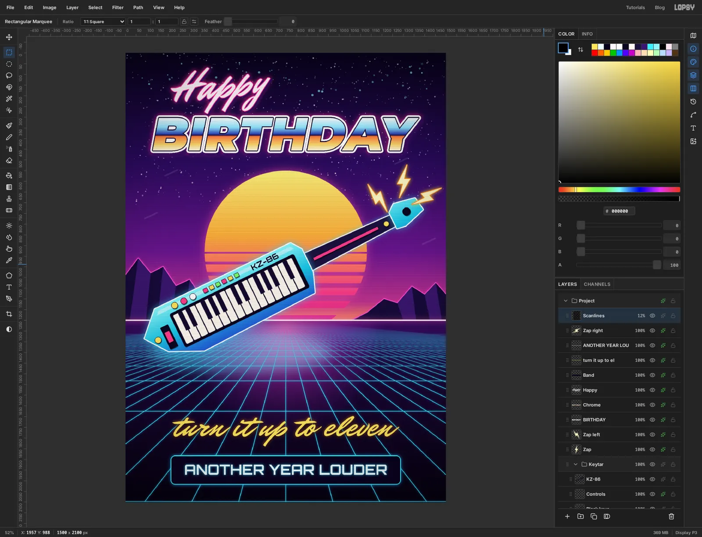

Choose **View → Show Guides** to hide the guides and look the card over. Check
that the chrome and script don't collide, the tagline is centred in its band,
and the lightning stays inside the card.

Choose **File → Save Project** to keep an editable copy, then **File → Quick
Export PNG** for the image. At 1500 × 2100 px it prints as a 5 × 7 inch card
at 300 dpi.

> **Tip:** To personalise it, click the tagline with the Text tool and type a
> name or an age. The band, glow and position all stay as they are.
