Synthwave (also called outrun) borrows its look from 80s album covers, arcade cabinets and VHS boxes. A huge striped sun sits on the horizon, a neon grid races away under it, the sky is full of lasers and stars, and the lettering is polished chrome with a hot-pink script slapped across it. This tutorial turns that poster into something useful: a menu for an all-night roadside diner called **Octane Café**.

The scene fills the top half and keeps going behind the menu, so the grid floor reads as the ground the cards sit on. The menu itself is four dark glass cards with neon tube frames. Their headings sit in breaks cut into the tubes, the way a real neon sign leaves a gap for its lettering.

Along the way you'll use:

- the **Gradient** tool with multi-stop gradients, ruler **guides**, and **Edit → Fill**
- **Add Noise** and **Threshold** for stars, and **Sunburst** for laser rays
- Shift-drag marquees that **add to the selection**, **Feather**, and **Delete**
- the **Lasso**, **Inner Glow**, **Outer Glow** and the **Pencil** with [[Shift]]-click lines
- the **Brush** with **Taper**, **Duplicate Layer**, **Image → Flip Horizontal**, corner scaling and **Group Layers**
- text with letter spacing, **Rasterize Layer**, a chrome gradient inside the letters and a **Perspective** transform
- rotating live text with its own handles, **Stroke** and **Drop Shadow** effects
- the **Shape** tool for rounded panels and neon tubes, copy and paste, and **Merge Down**
- area text with **Line height** and **Align right**
- **Define Pattern** and **Fill with Pattern** for scanlines, **Chromatic Aberration**, grain and a vignette

The palette is neon on a deep purple night:

- Sky `#08021E` → `#24094A` → `#5E1272` → `#C62370` → `#FF8A4C`
- Sun `#FFF27A` → `#FFB238` → `#FF4F7E` → `#E21F86`, glow `#FF2F8E`
- Laser pink `#FF4FD8`, grid pink `#FF3BD0`, ridge pink `#FF6AD0`
- Mountains `#3A1470` → `#160634`, near range `#12042A`, rims `#3FE7FF` / `#FF3FB4`
- Floor `#6A1478` → `#2A0849` → `#07010F`, vanishing fade `#3C0A58`
- Palm silhouettes `#0A0118`
- Chrome `#F2FBFF` → `#86CFFF` → `#2A3A9C` → `#120F3A` → `#FF7A3A` → `#FFD39A` → `#FFFFFF`
- Script pink `#FF4FB2`, outline `#2A0838`
- Card glass `#120624`, cyan tube `#3FE7FF`, pink tube `#FF4FD8`
- Headings `#8AF5FF` / `#FF5FDC`, items `#EFE6FF`, prices `#FFD34E`

> **Tip:** Positions are in document pixels, written `x, y`. The status bar at the bottom shows where the pointer is. **Edit → Fill** fills the selection (or the whole layer if nothing is selected) with the foreground colour, and [[Cmd+D]] deselects. To load a layer's shape as a selection, [[Cmd]]-click its thumbnail in the Layers panel.

> **Tip:** Blend modes live in the **Blend** dropdown at the top of a layer's effects drawer (the sparkle icon on its row). To change a layer's opacity, click the `100%` readout on its row and drag the slider. Gradient stops are set in the Gradient tool's **Advanced…** editor: click the bar to add a stop, and type its colour into the **#** field.

## Paint the night sky

1. Create a new document **1500** × **2100** px.
2. Click the left ruler at `980` to drop a horizontal guide. This is the horizon. Click the top ruler at `750` for a vertical guide down the middle.
3. Click the **Background** layer and choose the **Gradient** tool. Set **Type** to **Linear** and open **Advanced…**. Make five stops: `#08021E` at 0%, `#24094A` at 42%, `#5E1272` at 72%, `#C62370` at 90% and `#FF8A4C` at 100%.
4. Drag straight down from the top edge to the horizon guide. Everything below the guide comes out orange, but the floor will cover it later.

## Scatter the stars

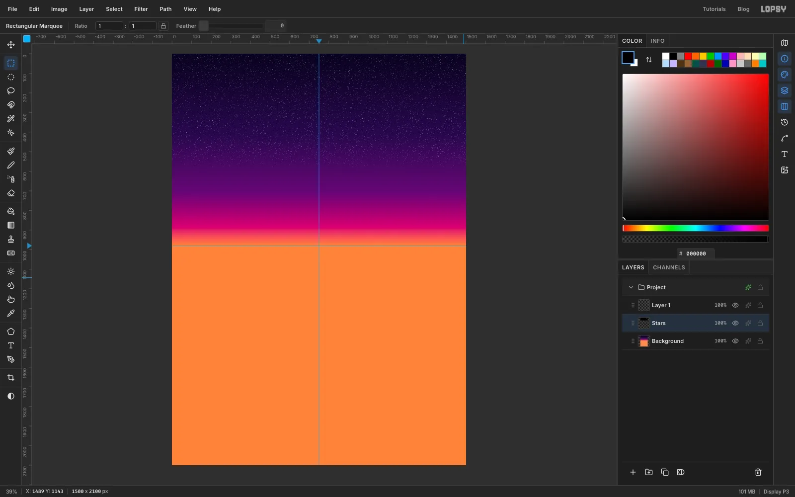

1. Add a new layer and name it `Stars` (double-click a layer's name to rename it). Fill it with black, `#000000`.
2. Run **Filter → Add Noise…** with **Amount** `100` and **Mono**.
3. Run **Filter → Threshold…** with **Level** `49`. Only the brightest specks of noise turn white, which gives you a fine star field.
4. Set the layer's blend mode to **Screen**. The black disappears and only the stars stay.
5. Draw a rectangular marquee from `0, 560` to the bottom-right corner, choose **Select → Feather…** and enter `140`, then press [[Delete]] and deselect. The stars now fade out before the horizon glow.

Noise on black is quite dark, so its brightest specks only reach about 50. That's why the Threshold level is so low.

## Fire laser rays from the sun

1. Add a layer called `Laser Rays` above Stars. Set the foreground colour to `#FF4FD8`.
2. Run **Filter → Sunburst…** with **Rays** `28`, **Length** `150`, **Width** `9`, **Taper** `70`, **Fade** `75`, **Softness** `25`, **Center X** `50`, **Center Y** `40` and **Opacity** `70`. Center Y `40` puts the burst roughly where the middle of the sun will be.
3. Set the layer to **Screen**. Marquee everything below the horizon guide, press [[Delete]], deselect, and drop the layer to `55%` opacity.

## Paint the sun

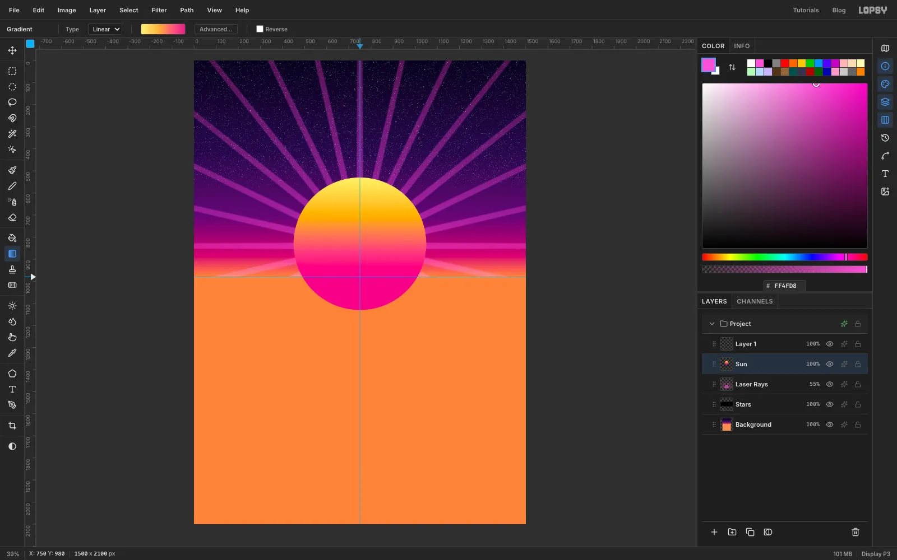

1. Add a layer called `Sun`.
2. With the **Elliptical Marquee**, drag from `450, 530` to `1050, 1130`. That's a circle 600 px across, centred at `750, 830` on the middle guide.
3. Set up a linear gradient: `#FFF27A` at 0%, `#FFB238` at 40%, `#FF4F7E` at 75% and `#E21F86` at 100%. Drag from the top of the circle straight down to the horizon guide, then deselect.

The bottom of the circle hangs below the horizon. Leave it there, because the floor will hide it.

## Cut the sun's slits

The famous outrun sun has slits across its lower half that get thicker towards the horizon. The thin ones are only a few screen pixels tall at the default zoom, so zoom in on the bottom of the sun first.

1. With the Sun layer still active, choose the **Rectangular Marquee**. Drag a thin box across the whole sun, about 8 px tall, starting around `y 760`.
2. Hold [[Shift]] and drag four more boxes below it, so each one adds to the selection. Make each a little taller than the last (roughly 10, 13, 16 and 19 px) and leave a gap of about 20 px between them.
3. Still holding [[Shift]], drag one last box from about `y 940` down to the horizon guide. It snaps onto the guide.
4. Press [[Delete]], then deselect.

> **Tip:** This is a good moment to test undo. Press [[Cmd+Z]] twice and the slits come back. Press [[Cmd+Shift+Z]] twice and they're cut again, exactly as before.

## Make the sun glow

Open the Sun layer's effects drawer, enable **Outer Glow** and set **Size** `70`, **Spread** `10`, **Opacity** `80` and the colour `#FF2F8E`.

## Add the far mountains

1. The rays are a bit strong now that the scene is filling in. Click **Laser Rays** and lower it to `40%`. Then click **Sun** and add a layer called `Far Range`.
2. With the **Lasso**, draw a low jagged ridge across the whole width. Start below the horizon at the left edge, zigzag between about `860` and `950` along the top, keep the middle lower (around `930`–`950`) so most of the sun still shows, and close the shape below the horizon on the right.
3. Fill the selection with a linear gradient from `#3A1470` to `#160634`, dragged from `y 860` down to the horizon. Deselect.
4. Add an **Inner Glow** with **Size** `10`, **Opacity** `85` and colour `#3FE7FF`. The glow runs along every edge, so the ridge gets a cyan rim of moonlight.

## Add the near mountains

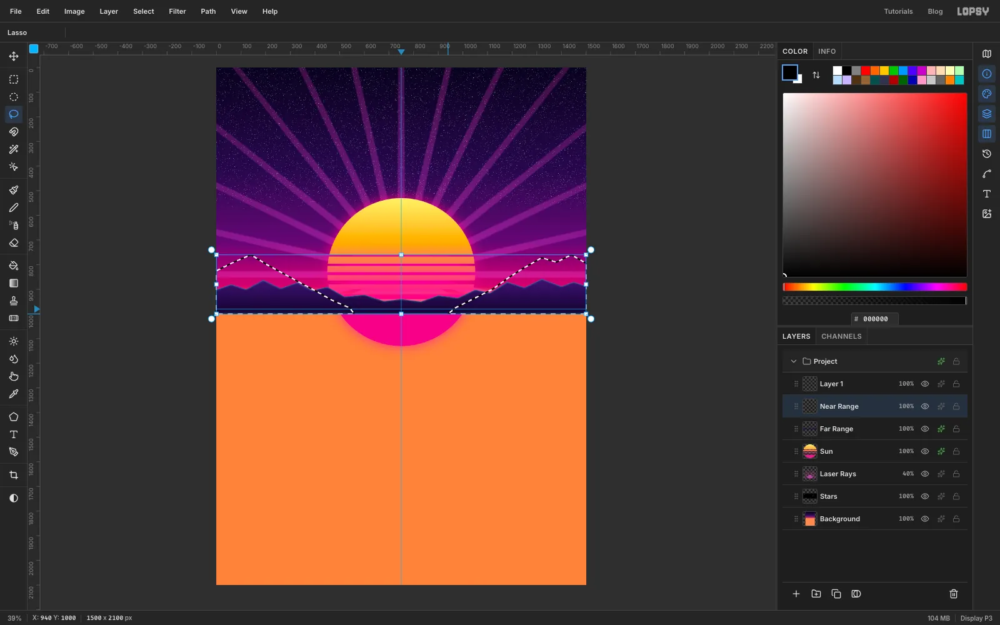

1. Add a layer called `Near Range`.
2. Lasso a big slope on the left: start at the left edge around `y 830`, peak at about `140, 760`, then run down to the horizon at about `x 560`. Close the shape below the horizon.
3. Hold [[Shift]] and lasso a matching slope on the right. Start at about `x 940` on the horizon, climb to peaks at about `1320, 772` and `1440, 760`, and close it past the right edge.
4. Fill with `#12042A`, deselect, and add an **Inner Glow** with **Size** `8`, **Opacity** `90` and colour `#FF3FB4`.

## Draw wireframe ridges

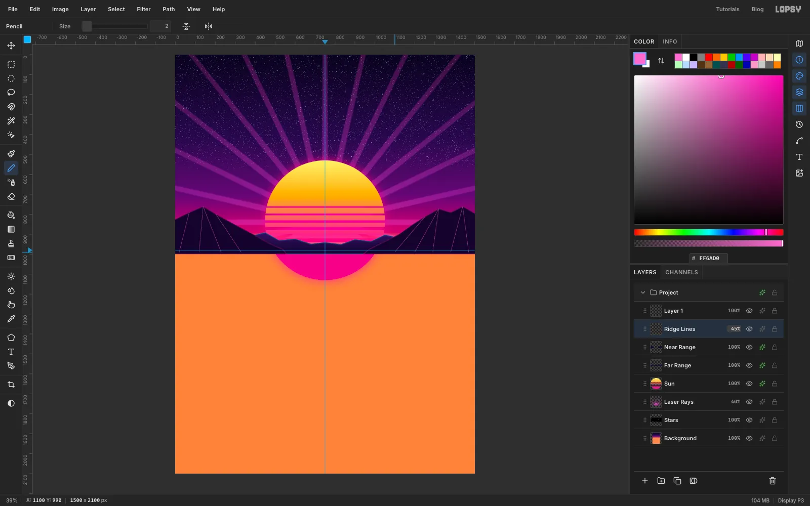

1. Add a layer called `Ridge Lines`. Choose the **Pencil**, set **Size** to `2` and the colour to `#FF6AD0`.
2. Click on a peak, then [[Shift]]-click where its slope meets the horizon. The Pencil draws a straight line between the two clicks. Do two or three lines from each peak, fanning outwards, then a couple more from the smaller shoulders.
3. Lower the layer to `45%` so the lines read as a hint of wireframe rather than outlines.

## Lay down the floor

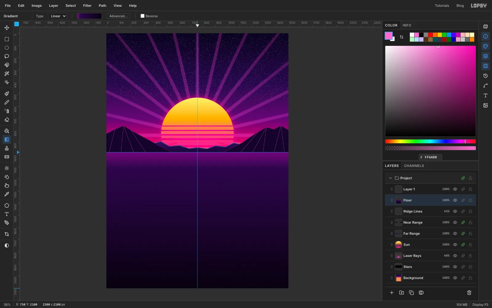

1. Add a layer called `Floor`. Marquee from the horizon guide at `0, 980` to the bottom-right corner.
2. Fill it with a linear gradient: `#6A1478` at 0%, `#2A0849` at 12% and `#07010F` at 100%, dragged from the horizon to the bottom edge. Deselect.

## Draw the grid rows

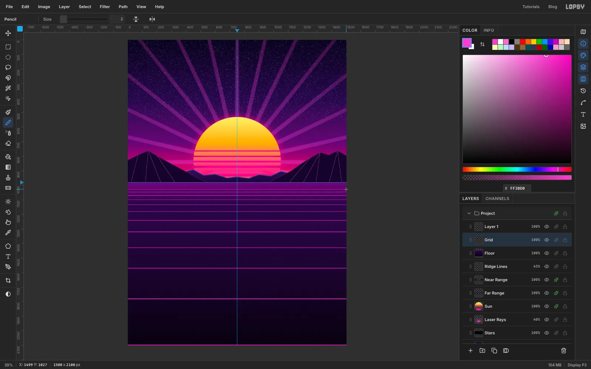

A floor seen in perspective has rows that crowd together as they get further away. Rows that sit at equal distances on the ground appear at `980 + 1120 ÷ distance`, so the gaps shrink quickly as they near the horizon.

1. Add a layer called `Grid`. Choose the **Pencil**, set the colour to `#FF3BD0`.
2. For each row, click at the left edge and [[Shift]]-click at the right edge. Use **Size** `4` for the nearest rows at `2097`, `1780` and `1569`; **Size** `3` for `1428`, `1319` and `1240`; and **Size** `2` for the far rows at `1180`, `1133`, `1098`, `1070`, `1046` and `1027`.

## Draw the grid columns

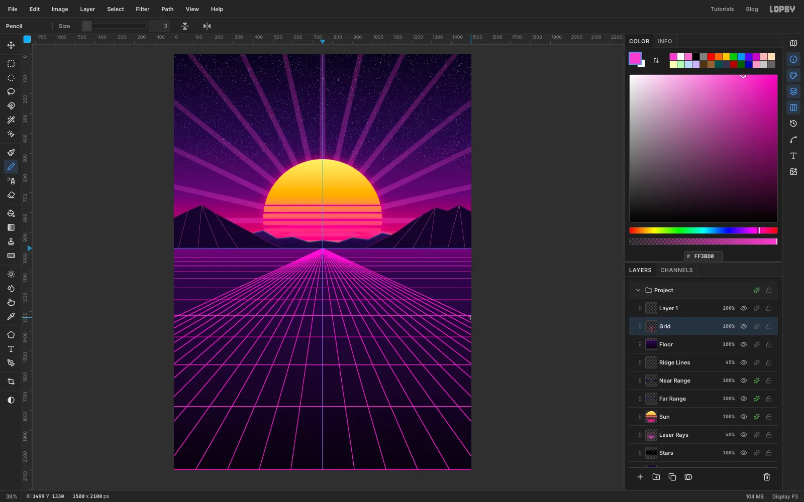

All the columns meet at one vanishing point in the middle of the horizon, at `750, 981`.

1. Still on the Grid layer, set the Pencil **Size** to `3`.
2. Click the vanishing point and [[Shift]]-click the bottom edge straight below it. Then click the vanishing point again and [[Shift]]-click the bottom edge `160` px to the left. Keep going in `160` px steps on both sides.
3. Past `x 110` on the left and `x 1390` on the right, the next line would hit the bottom edge outside the canvas. Aim each line as if it would hit the bottom edge another `160` px further out, and stop it where it crosses the side edge. Each one leaves a little higher than the last. Do eleven of these on each side, so the last one leaves the canvas at about a third of the way down the floor.
4. Add an **Outer Glow** to the Grid layer: **Size** `14`, **Spread** `0`, **Opacity** `90`, colour `#FF2FB0`.

For reference, the side-edge crossings land at about `y 2029`, `1854`, `1729`, `1635`, `1563`, `1504`, `1457`, `1417`, `1383`, `1354` and `1330`. You don't need them exactly. What matters is that every line points at the vanishing point.

## Calm the vanishing point

Where all the columns meet, they pile up into a solid pink blob. Fade them out instead.

1. Add a layer called `Vanishing Fade`. Marquee from `0, 980` to `1500, 1280`.
2. Choose a **Radial** gradient: `#3C0A58` at 0%, `#3C0A58` at 50% with about 92% opacity (drag the stop's opacity bar), and `#3C0A58` at 100% with zero opacity.
3. Drag from the vanishing point at `750, 980` straight down about `270` px, then deselect.

## Add the horizon haze

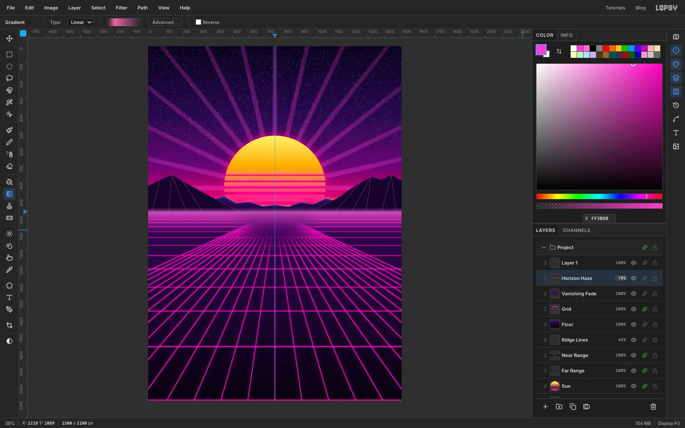

1. Add a layer called `Horizon Haze`. Marquee from `0, 956` to `1500, 1106`.
2. Set a linear gradient of `#FF5AA8` at 0% with zero opacity, `#FF6AB4` at 20% with about 90% opacity, and `#7A1A8C` at 100% with zero opacity. Drag from the top of the marquee to the bottom, then deselect.
3. Set the layer to **Screen** at `70%`.

## Paint a palm trunk

1. Click **Horizon Haze** and add a layer called `Palm Left` above it.
2. Choose the **Brush**. In the brush settings set **Size** `34`, **Hardness** `100`, **Spacing** `5` and **Taper** `520`. Taper thins the end of the stroke, so start at the thick end.
3. Set the colour to `#0A0118`. Drag from `112, 1130` up and slightly to the right in a gentle curve, ending at the crown at about `245, 560`.

The trunk starts below the horizon on purpose. The menu cards will cover its base later, so the palm looks planted in the ground.

## Draw the first frond

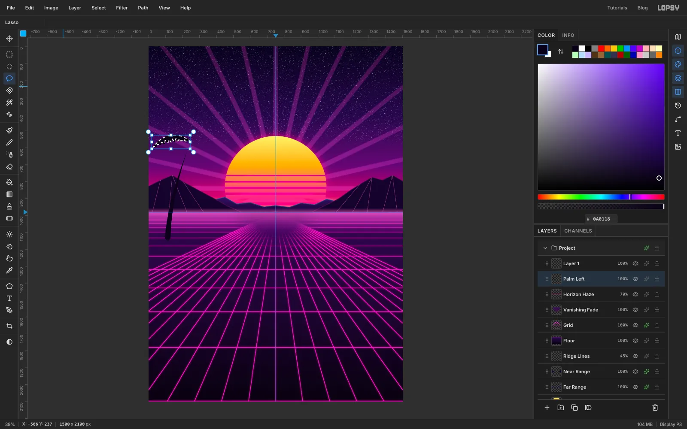

Each frond is a long, curved leaf with a saw-tooth lower edge. Draw it with the **Lasso**, then fill it with **Edit → Fill**:

1. Start at the crown and draw the top edge: curve up and out to the left, then let the tip droop back down, about `250` px from the crown.
2. Come back to the crown along the bottom edge, zigzagging in and out so the leaflets look ragged. The leaf is widest in the middle and comes to a point at both ends.
3. Choose **Edit → Fill**.

## Add the rest of the fronds

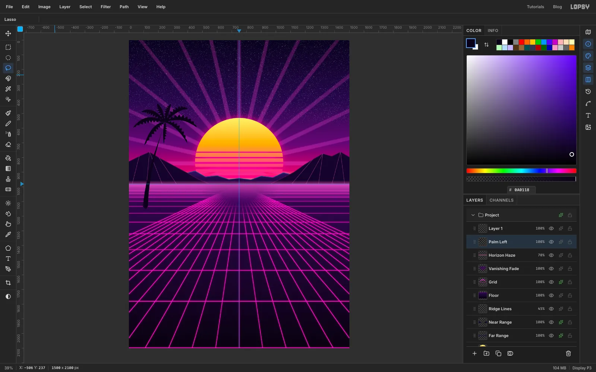

Draw and fill eight more fronds the same way, all starting at the crown:

- one more long, drooping frond to the far right, and a slightly shorter one on each side above the long ones
- two short fronds pointing up, one leaning left and one leaning right
- three that hang down: one down and to the right, one down and to the left, and a short one almost straight down

The long side fronds droop the most. Deselect when you're done.

## Add coconuts and a rim of light

1. Fill three small overlapping circles (about `24` px across) just under the crown with the same `#0A0118`.
2. Add an **Outer Glow** with **Size** `12`, **Spread** `0`, **Opacity** `55` and colour `#FF3FB4`. It separates the silhouette from the dark sky.

## Duplicate and flip the palm

1. Choose **Layer → Duplicate Layer**, rename the copy `Palm Right` and click its row.
2. Choose **Image → Flip Horizontal**, so the copy leans the other way.
3. If the copy is still on the left, drag it to the right of the sun with the **Move** tool. In the screenshot it has already landed on the right side.

## Scale the second palm down

A second palm of exactly the same size looks pasted. Make it smaller, as if it stands further away.

1. Draw a rectangular marquee just around the right palm.
2. Choose the **Move** tool. Hold [[Cmd]] and drag the top-left corner handle down and to the right by about a sixth of the palm's width. [[Cmd]] keeps the proportions.
3. Press [[Cmd+D]] to commit the transform.

## Move the second palm into place

With the Move tool, drag the right palm so its trunk base sits at about `1380, 1120`, just as low as the left one. Its crown should end up a little lower than the left palm's.

## Group the palms

Click **Palm Left**, [[Shift]]-click **Palm Right**, and choose **Layer → Group Layers**. Rename the group `Palms`.

> **Tip:** Click the group row and press [[Shift+Down]] twice with the Move tool. Both palms move together. Press [[Cmd+Z]] twice to put them back.

## Set the title

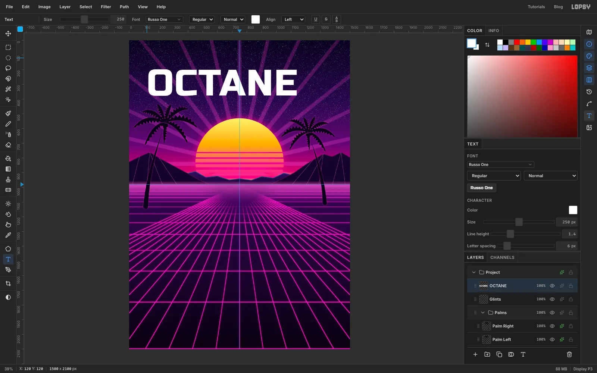

1. Click **Layer 1** (the empty layer at the top of the stack) and rename it `Glints`. Clicking it first makes the text land above everything. It's only a placeholder, and you'll delete it once the title is done.
2. Choose the **Text** tool. Pick the font **Russo One**, set the size to `250` and the colour to white. Click in an empty part of the sky and type `OCTANE`, then press [[Tab]] to finish. The layer takes its name from the text.
3. In the **Text** panel set **Letter spacing** to `6`.
4. With the **Move** tool, nudge the word with the arrow keys until it's centred on the middle guide, at about `y 300`. [[Shift]]+arrow moves 10 px at a time.

## Fill the letters with chrome

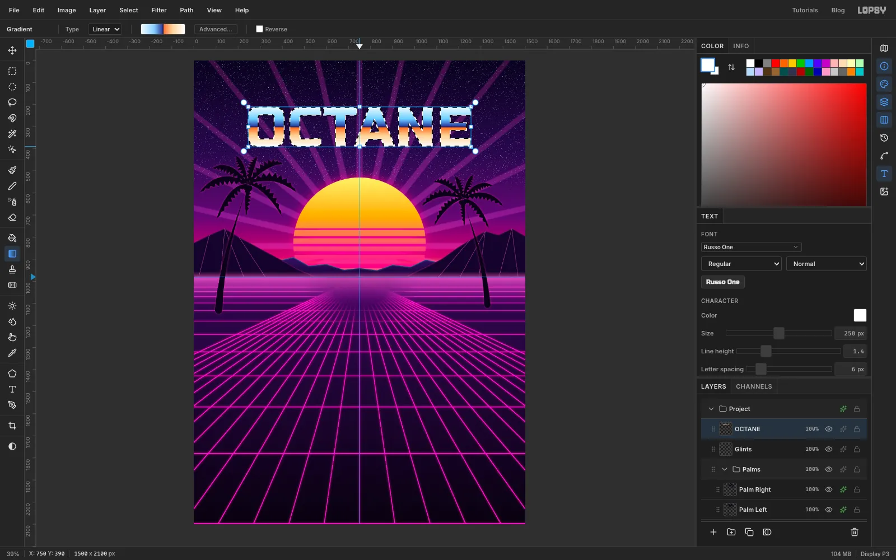

Classic 80s chrome reflects a sky above and a desert below, split by a hard horizon line.

1. Click **Rasterize Layer** at the bottom of the Layers panel. The gradient needs pixels to paint on.
2. [[Cmd]]-click the OCTANE thumbnail to select the letters.
3. Set a linear gradient: `#F2FBFF` at 0%, `#86CFFF` at 30%, `#2A3A9C` at 49%, `#120F3A` at 50%, `#FF7A3A` at 53%, `#FFD39A` at 72% and `#FFFFFF` at 100%.
4. Drag from the top of the letters straight down to their bottom (about `y 210` to `y 390`). Deselect.

## Lean the title back

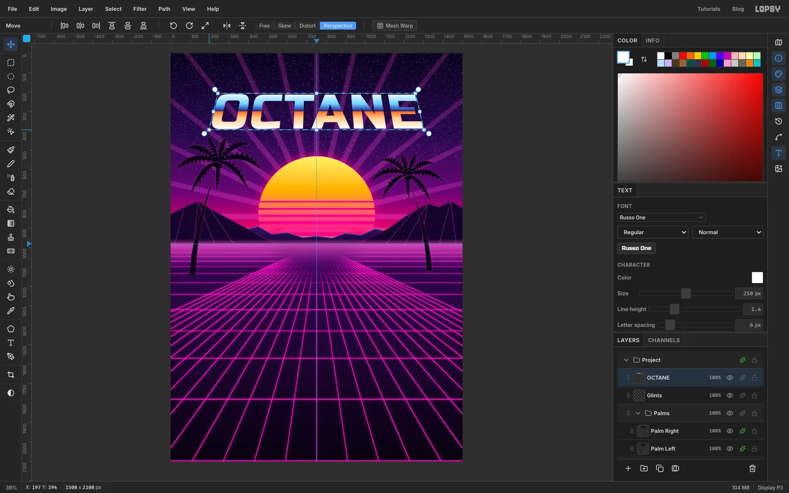

1. Draw a rectangular marquee just around the title.
2. Choose the **Move** tool and click **Perspective** in the options bar.
3. Drag the bottom-left corner handle about `45` px to the left. The bottom-right corner moves out by the same amount, so the bottom of the word gets wider than the top.
4. Press [[Cmd+D]] to commit.

## Give the title its outline and extrusion

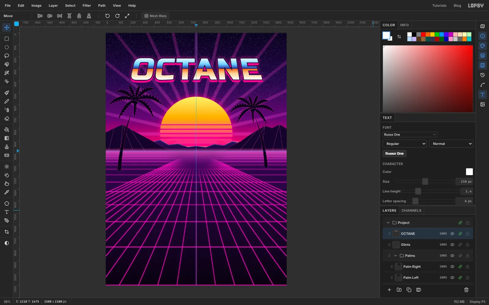

On the OCTANE layer, add three effects:

- **Stroke**: **Width** `6`, colour `#1A0533`
- **Drop Shadow**: **Offset X** `0`, **Offset Y** `16`, **Blur** `0`, **Spread** `0`, **Opacity** `100`, colour `#FF2F8E`. With no blur, the shadow reads as a solid extrusion.
- **Outer Glow**: **Size** `34`, **Opacity** `70`, colour `#FF3FB4`

## Write the script

1. The Glints layer isn't needed any more, so click it and delete it with the trash icon. Then click **OCTANE** and add a layer called `Sparkles` above it. You'll paint on it in a moment.
2. Choose the **Text** tool, pick **Mr Dafoe**, size `240`, colour `#FF4FB2`. Click in an empty part of the canvas and type `Café` (on a Mac, [[Option+E]] then [[E]] types the é). Press [[Tab]] and rename the layer `Cafe Script`.
3. Nudge it with the Move tool so it's centred at about `845, 567`, across the top of the sun and clear of the title's pink extrusion.

## Tilt the script

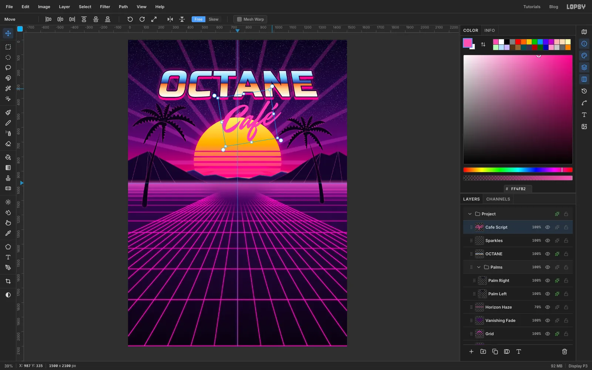

Live text has its own transform handles, so you can rotate it without rasterizing. With the **Move** tool, hover just outside the top-right corner of the text's frame until the round rotation handle shows, then drag it up about `9°`, counter-clockwise, so the word rises to the right. Don't hold [[Cmd]], which snaps the angle to 15° steps. The word stays editable.

## Turn the script into neon

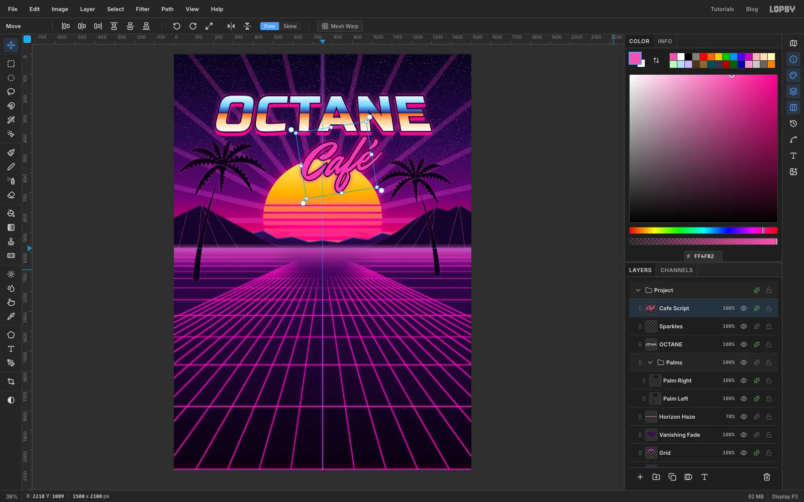

Add a **Stroke** with **Width** `6` and colour `#2A0838`, then an **Outer Glow** with **Size** `30`, **Spread** `5`, **Opacity** `95` and colour `#FF1F8F`. The dark outline keeps the pink readable where it crosses the yellow sun.

## Add the tagline

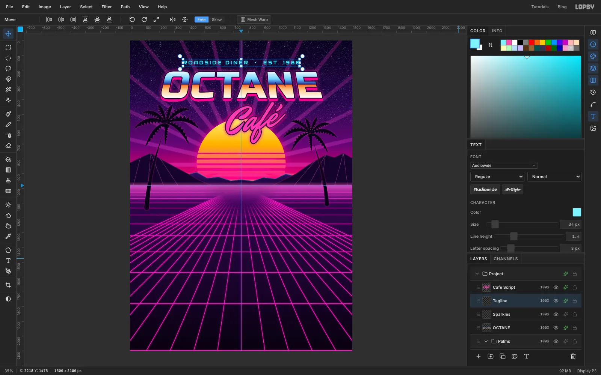

1. Click the **Sparkles** layer so the Text tool doesn't restyle the script. Choose the Text tool, pick **Audiowide**, size `34`, colour `#7DF3FF`.
2. Click in the empty sky near the top left and type `ROADSIDE DINER  •  EST. 1986` (on a Mac, [[Option+8]] types the bullet). Press [[Tab]] and rename the layer `Tagline`.
3. Set **Letter spacing** to `8` and centre it at about `750, 148`.
4. Add an **Outer Glow** with **Size** `12`, **Opacity** `70` and colour `#2FD8FF`.

## Add sparkles to the chrome

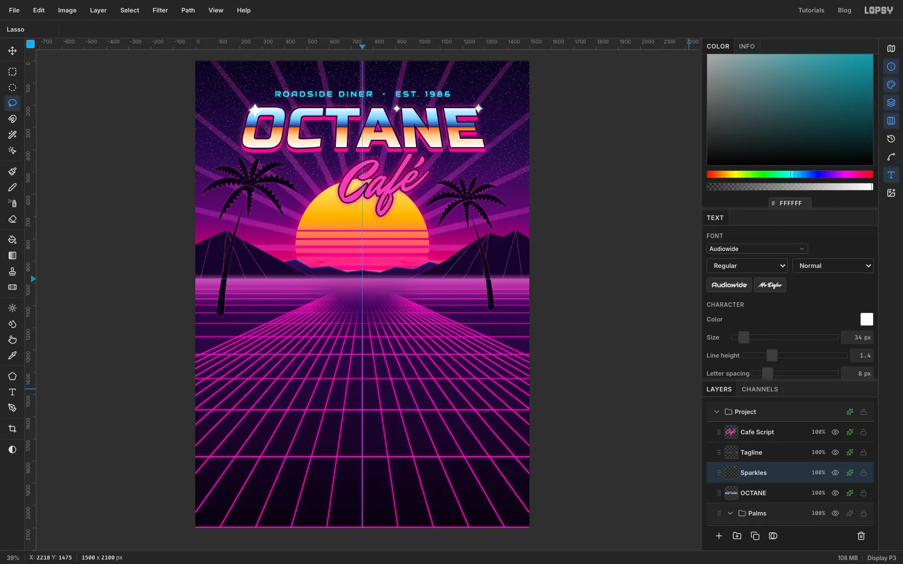

1. Click the **Sparkles** layer. With the **Lasso**, draw a four-pointed sparkle with long, thin points and pinched sides. Make one about `70` px across on the top-left corner of the **O**, a smaller one on the top of the **N**, and a medium one on the top-right corner of the **E**. Fill each with white.
2. Add an **Outer Glow** with **Size** `16`, **Opacity** `90` and colour `#BFF6FF`.

Put sparkles on corners, where light would really catch the metal. A sparkle in the middle of a letter edge looks like a mistake.

## Draw the glass panels

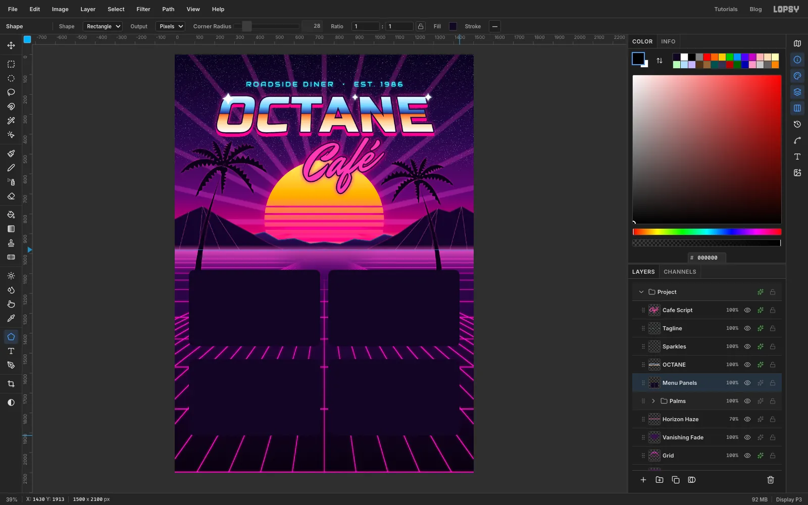

1. Click the **Palms** group and collapse it (the arrow at the left of its row), then add a layer called `Menu Panels`. It lands above the group instead of inside it.
2. Click the vertical guide on the top ruler at `750` to remove it. Shapes snap to nearby guides, and this one would pull the card edges sideways.
3. Choose the **Shape** tool. Set **Shape** to **Rectangle**, **Output** to **Pixels** and **Corner Radius** to `28`. Click the **Fill** swatch and type `#120624`. Remove the stroke.
4. Shapes grow out from where you press, so press at each card's centre and drag to its bottom-right corner:
   - **Fuel Station** (`70, 1080` to `730, 1465`): press at `400, 1272`, drag to `730, 1465`
   - **The Grill** (`770, 1080` to `1430, 1465`): press at `1100, 1272`, drag to `1430, 1465`
   - **Shakes & Floats** (`70, 1528` to `730, 1913`): press at `400, 1720`, drag to `730, 1913`
   - **After Midnight** (`770, 1528` to `1430, 1913`): press at `1100, 1720`, drag to `1430, 1913`
5. Set the layer to `92%`, so the grid only ghosts through the glass and never crosses the item names.

## Bend the first neon tubes

1. Add a layer called `Cyan Tubes`. Keep the Shape tool and its corner radius, but this time remove the fill and set the **Stroke** to `#3FE7FF` with **Width** `5`. Draw over the Fuel Station card the same way, from `400, 1272` to `730, 1465`.
2. Add a layer called `Pink Tubes`. Change the stroke to `#FF4FD8` and draw over The Grill card, from `1100, 1272` to `1430, 1465`.

## Copy the tubes to the bottom row

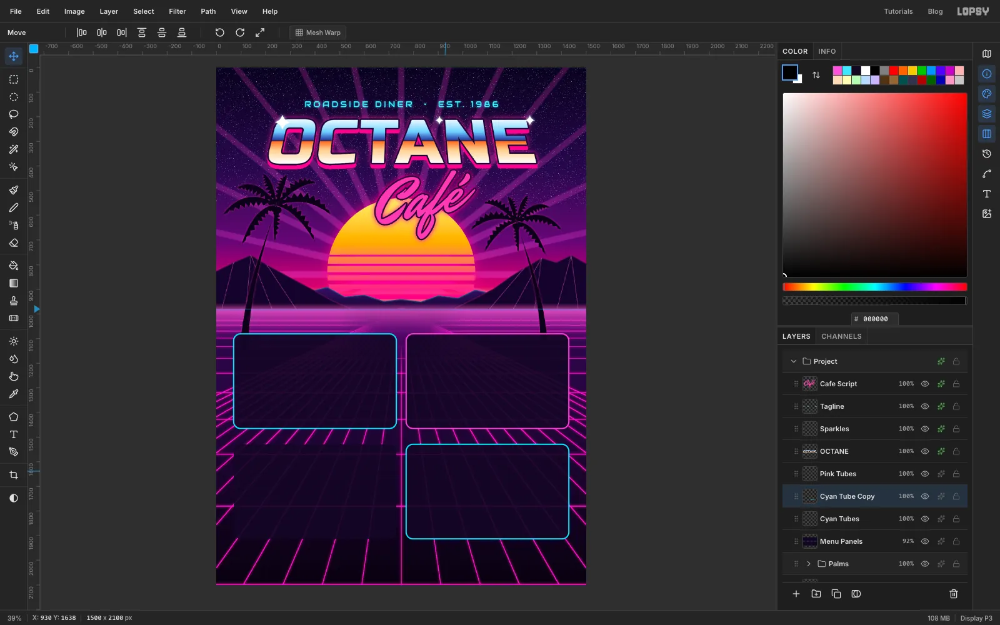

The bottom cards are the same size, so copy the frames instead of drawing them again. The colours cross over, so each row has one of each.

1. Click **Cyan Tubes**. Draw a marquee about `6` px outside the Fuel Station frame, then press [[Cmd+C]] and [[Cmd+V]].
2. With the **Move** tool, press inside the box (not on a handle, which would stretch it) and drag the copy down and to the right onto the After Midnight card. Line it up with the card's edges, using the arrow keys for the last few pixels ([[Shift]]+arrow moves 10 px). Deselect.
3. Choose **Layer → Merge Down** to merge the copy into Cyan Tubes.
4. Do the same with the pink frame: copy it from The Grill, drag it down and to the left onto Shakes & Floats, deselect and merge it down into Pink Tubes.

## Light up the tubes

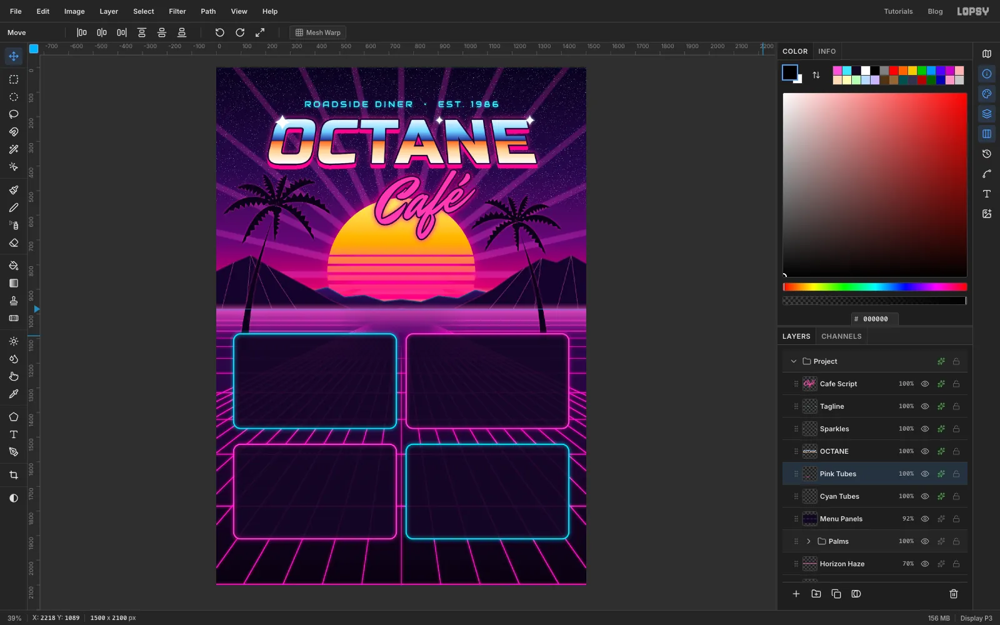

Give **Cyan Tubes** an **Outer Glow** with **Size** `22`, **Spread** `8`, **Opacity** `95` and colour `#2FD8FF`. Give **Pink Tubes** the same glow in `#FF2FC8`.

## Place the first heading

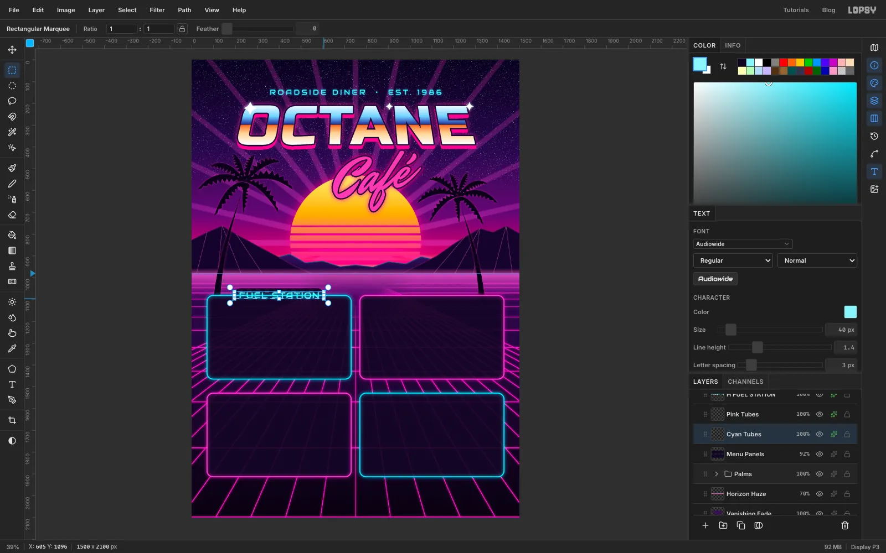

Each heading sits on its card's top edge. Its colour matches the frame: `#8AF5FF` on cyan cards and `#FF5FDC` on pink ones.

1. Click **Pink Tubes**, so new text lands above the tubes. With the **Text** tool in **Audiowide**, size `40`, colour `#8AF5FF`, type `FUEL STATION` in an empty spot. Set **Letter spacing** to `3` and rename the layer `H FUEL STATION`.
2. Nudge it with the Move tool until the middle of the letters sits on the card's top edge, centred on the card at `400, 1080`. Add an **Outer Glow** (**Size** `14`, **Opacity** `80`, colour `#2FD8FF`).
3. Click **Menu Panels**. With the Shape tool (fill `#120624`, no stroke, **Corner Radius** `30`), press at `400, 1080` and drag to `605, 1112`. This dark tab keeps the heading off the bright horizon behind it.

## Cut a gap in the tube

Click **Cyan Tubes**. Draw a marquee from `195, 1064` to `605, 1096`, about 24 px either side of the heading, and press [[Delete]]. The tube now stops short of the lettering on both sides, like real neon.

Do the same for the other three headings, centred on their cards' top edges: **THE GRILL** at `1100, 1080`, **SHAKES & FLOATS** at `400, 1528` and **AFTER MIDNIGHT** at `1100, 1528`. Use pink text and the pink glow `#FF2FC8` on the pink cards. For each one, make the tab and the gap about 24 px wider than the heading on each side.

## Set the first card's items and prices

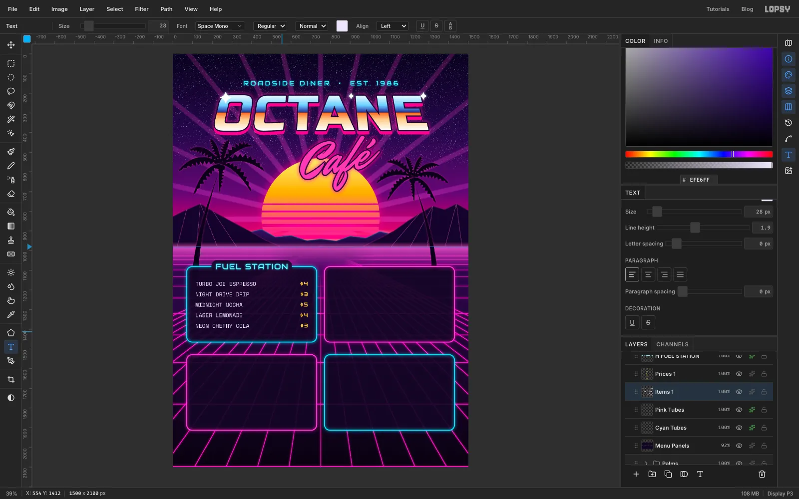

Use area text, so the lines stay evenly spaced and the prices line up on the right.

1. Click **Pink Tubes** again. Choose the Text tool, **Audiowide**, size `28`, colour `#FFD34E`. In the **Text** panel, set **Line height** to `1.9`.
2. Drag a text box from `546, 1142` to `686, 1412`. Type the prices, one per line: `$4`, `$3`, `$5`, `$4`, `$3`. Press [[Tab]], click **Align right** in the Text panel, and rename the layer `Prices 1`.
3. Click **Pink Tubes** again. Pick **Space Mono**, size `28`, colour `#EFE6FF`. Drag a box from `114, 1142` to `514, 1412`. Type the items, one per line: `TURBO JOE ESPRESSO`, `NIGHT DRIVE DRIP`, `MIDNIGHT MOCHA`, `LASER LEMONADE`, `NEON CHERRY COLA`. Press [[Tab]], click **Align left**, check that **Line height** is still `1.9`, and rename the layer `Items 1`.

Keep each box only as tall as its five lines. A taller box can catch your next click and add the next column to it.

## Fill in the other cards

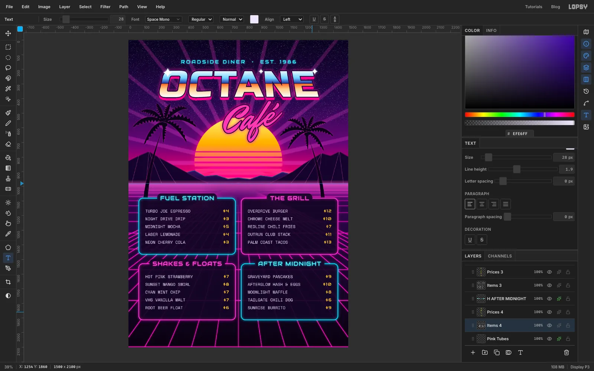

Repeat the two columns for the other three cards, in the same spots relative to each card (the right card's boxes are `700` px further right, the bottom row's `448` px lower). Number the layers `Prices 2`, `Items 2` and so on:

- **The Grill**: Overdrive Burger `$12`, Chrome Cheese Melt `$10`, Redline Chili Fries `$7`, Outrun Club Stack `$11`, Palm Coast Tacos `$13`
- **Shakes & Floats**: Hot Pink Strawberry `$7`, Sunset Mango Swirl `$8`, Cyan Mint Chip `$7`, VHS Vanilla Malt `$7`, Root Beer Float `$6`
- **After Midnight**: Graveyard Pancakes `$9`, Afterglow Hash & Eggs `$10`, Moonlight Waffle `$8`, Tailgate Chili Dog `$6`, Sunrise Burrito `$9`

Type the items in capitals, like the first card.

## Add the footer

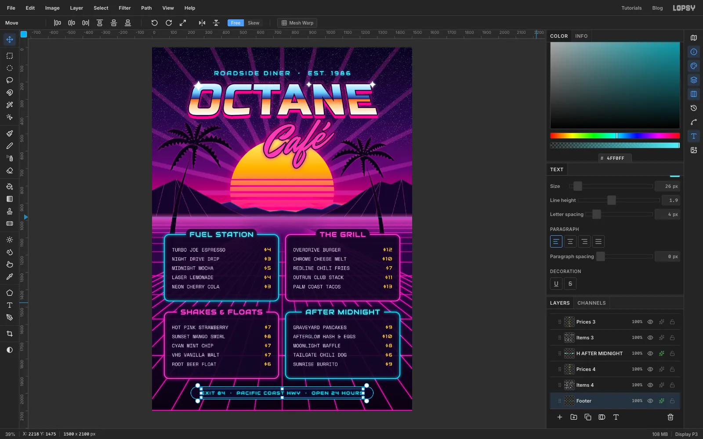

1. Click **Pink Tubes** and add a layer called `Footer Pill`. With the Shape tool (fill `#120624`, no stroke, **Corner Radius** `34`), press at `750, 1996` and drag to `1275, 2030`. Add a **Stroke** of **Width** `3` in `#3FE7FF`.
2. Make a text layer in **Audiowide**, size `26`, colour `#4FF0FF`, reading `EXIT 84  •  PACIFIC COAST HWY  •  OPEN 24 HOURS`, and rename it `Footer`. Set **Letter spacing** to `4` and centre it on the pill at `750, 1996`.
3. Add an **Outer Glow** with **Size** `12`, **Opacity** `75` and colour `#2FD8FF`.

Keep the hours consistent everywhere. An all-night diner can't also close at 6 AM.

## Lay on scanlines

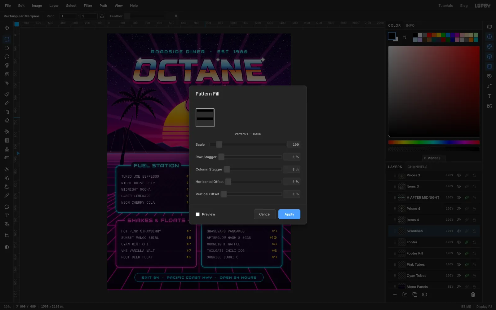

1. Click **Footer** and add a layer called `Scan Tile`. With the **Pencil** at **Size** `2` in black, draw two short horizontal lines in the top-left corner of the canvas: one across `y 1` and one across `y 9`, each from `x 0` to `x 15`.
2. Marquee from `0, 0` to `16, 16` and choose **Edit → Define Pattern**. Deselect and delete the Scan Tile layer.
3. Add a layer called `Scanlines` and choose **Edit → Fill with Pattern…**. Pick the striped tile and click **Apply**.
4. Set the layer to **Overlay** at `18%`. The stripes are faint, like an old CRT.

## Split the title's colours

Click **OCTANE** and run **Filter → Chromatic Aberration…** with **Amount** `4` and **Direction** `0`. The red and blue channels slide apart a few pixels, so the chrome looks like it was paused on a VHS tape.

## Add grain and a vignette

1. Click **Scanlines** and add a layer called `Grain`. Fill it with `#808080`, run **Add Noise** with **Amount** `30` and **Mono**, and set it to **Overlay** at `30%`.
2. Add a layer called `Vignette`. Set a radial gradient of `#05000F`: zero opacity at 0% and 60%, full opacity at 100%. Drag from about `750, 1050` straight down past the bottom edge of the canvas.
3. Set it to **Multiply** at `55%`.

## Stick on the 24/7 badge

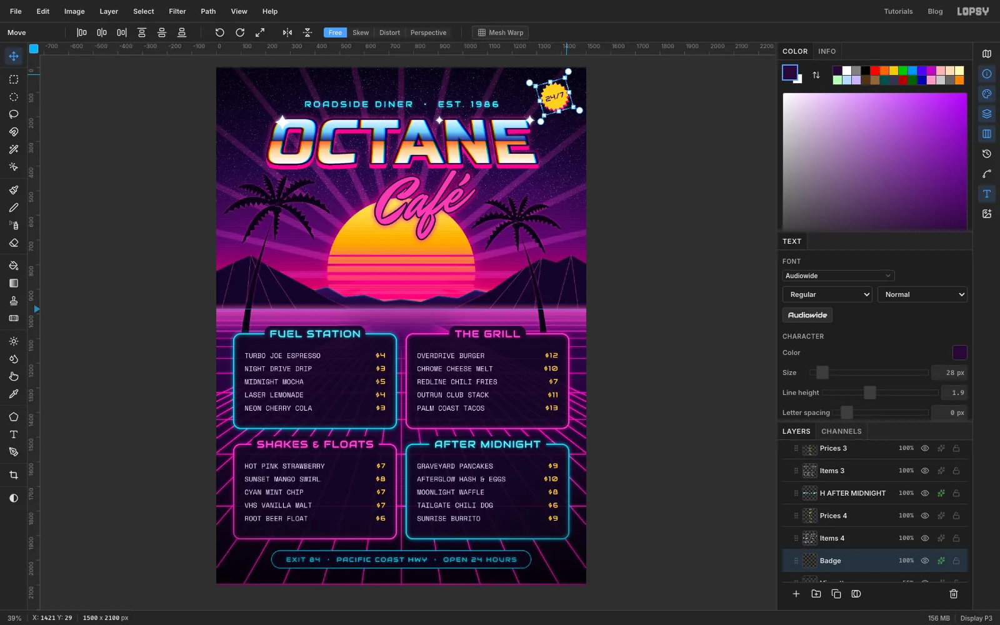

1. Click **Vignette** and add a layer called `Badge`. With the **Lasso**, draw a jagged starburst about `115` px across in the empty top-right corner, centred near `1372, 118`. Zigzag in and out with short points all the way round. It doesn't need to be perfectly regular. Fill it with `#FFD34E`.
2. Make a text layer in **Audiowide**, size `28`, colour `#2A0838`, reading `24/7`. Centre it on the badge, click **Rasterize Layer**, then **Layer → Merge Down** into the badge.
3. Give the badge a **Drop Shadow**: **Offset X** `4`, **Offset Y** `6`, **Blur** `0`, **Spread** `0`, **Opacity** `100`, colour `#FF2F8E`.
4. Draw a marquee just around the badge. With the **Move** tool, drag its round rotation handle about `16°` counter-clockwise, so 24/7 rises to the right. Don't hold [[Cmd]], which snaps to 15° steps. Press [[Cmd+D]] to commit.

Save your work with **File → Save Project**, and use **File → Quick Export PNG** to export the finished menu.
