Synthwave (also called retrowave or outrun) is the 2010s take on 80s
album sleeves and arcade cabinets: a sun cut into slices sinking behind
neon mountains, a sky going from violet to hot pink, chrome or neon type, and
a VHS haze over everything. It suits a roller rink, which still has the
disco ball, the coloured lights and the glossy floor.

In this tutorial you'll make a flier for **Roller Lounge**, an imaginary
Friday skate night. The scene is painted from scratch. The hero is a real
photograph of a quad roller skate that you cut out with the Magic Wand and
recolour with a Gradient Map, so it sits in the scene like an 80s airbrush
illustration. The flier is **1200 × 1600 px**.

Along the way you'll use:

- the **Gradient** tool, a **layer mask** and **Add Noise** + **Threshold** for the sky and stars
- **Shift-added marquees** to slice the sun, and the **Pen** tool to stroke neon ridge lines
- **Copy Merged**, **Flip Vertical** and **Motion Blur** for floor reflections
- the **Shape** tool for the rink ovals and the info panel
- **Pixelate**, **Define Pattern**, **Fill with Pattern**, **Lens Distortion**, **Bloom** and **Sunburst** for the disco ball
- the **Magic Wand**, **Grow**, **Shrink** and **Inverse** to cut out a photo
- a **Gradient Map** adjustment on a group
- scale and rotation handles on pixels and on live text
- selection maths (move the outline, invert, intersect) for a rim light
- the **Brush** with **Taper**, the **Spray** tool and the **Pencil**
- text in **Mr Dafoe**, **Monoton** and **Michroma** with **Stroke**, **Drop Shadow** and **Outer Glow**
- **Chromatic Aberration**, a scanline pattern, grain and a vignette for the VHS finish

The palette:

- Sky `#0E0326` → `#2E0B57` → `#8E1A6B` → `#F0476A` → `#FFA552`
- Sun `#FFF07A` → `#FF9A3D` → `#FF2D7A`
- Neon pink `#FF4FB8`, pink glow `#FF3FB4`, sun glow `#FF3C8E`, title glow `#FF1F8F`, ridge pink `#FF6FD0`
- Neon cyan `#3DEBFF`, cyan glow `#18C8FF`, pale cyan type `#D9FDFF`, small cyan type `#7DF9FF`
- Far range `#6A2A8C` → `#2A0E4A`, near range `#24093F` → `#0C0320`
- Floor `#4A1466` → `#1E0838` → `#08020F`, horizon `#FFD2E6`
- Disco ball `#EDE4FF` → `#B49DF2` → `#5E3FAA` → `#170A33`, grout `#160A30`, chain `#BFA9EA`
- Beams `#FFFFFF` → `#FF9BE6` → `#7A5CFF` (fading to transparent)
- Skate map `#2E1656` → `#6431B4` → `#E0338F` → `#FFB86B` → `#FFF6D8`
- Rim orange `#FF9A3C`, spark gold `#FFE27A`, trail yellow `#FFD36B`
- Panel ink `#0E0424`, pale pink type `#FFB3DD`, date pink `#FF8FD0`, footer `#FFD1E8`

> **Tip:** Positions are in document pixels, written `x, y`. The status bar
> at the bottom shows where the pointer is. **Edit → Fill** fills the
> selection with the foreground colour, and [[Cmd+D]] deselects. New layers
> appear directly above the selected layer, and inside a group if that group
> is expanded and selected. Collapse each group when you've finished it.

> **Tip:** For an exact rectangle or circle, pick the **Rectangular** or
> **Elliptical Marquee**, make sure nothing is selected, and click the
> canvas once without dragging. A dialog asks for the **From X / Y** and
> **To X / Y** corners. Effects and the **Blend** dropdown live in each
> layer's effects drawer (the sparkle icon on its row).

## Set up the canvas and paint the sky

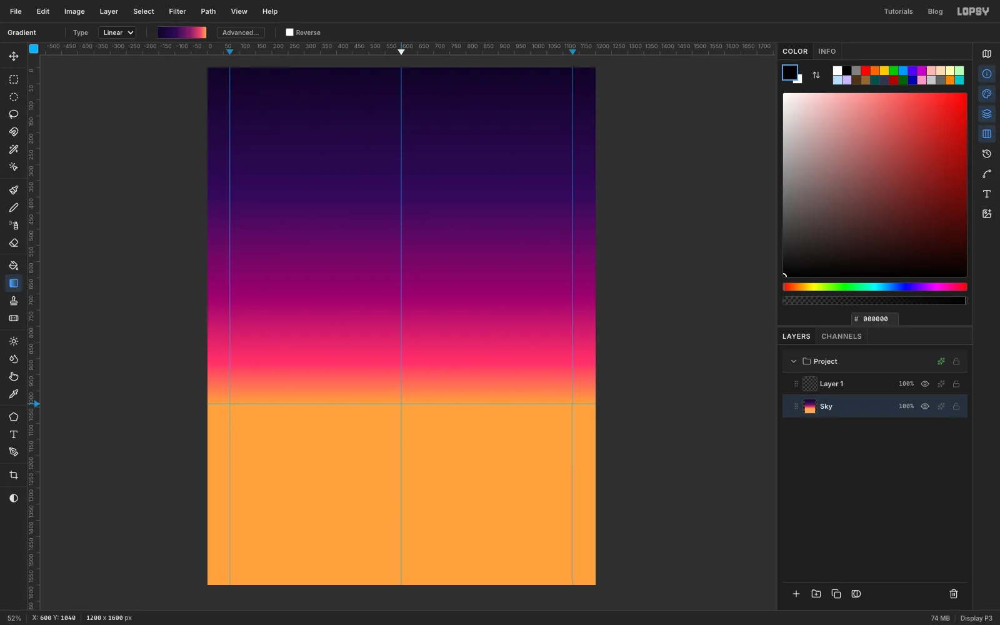

Choose **File → New**, enter **1200 × 1600** and click **Create**. Click
the top ruler at `600` for a centre guide, and at `70` and `1130` for the
side margins. Click the left ruler at `1040`: that is the horizon.

Rename *Background* to *Sky*. Pick the **Gradient** tool, set it to
**Linear** and open **Advanced…**. Give it five stops: `#0E0326` at 0%,
`#2E0B57` at about 38%, `#8E1A6B` at about 68%, `#F0476A` at about 88% and
`#FFA552` at 100%. Drag from the top edge straight down to the horizon
guide. Everything below the horizon will be covered by the floor later.

## Scatter stars and fade them out

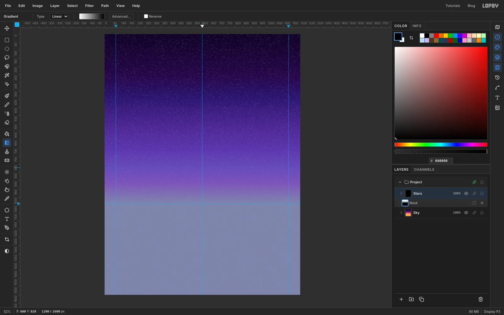

Rename *Layer 1* to *Stars*, fill it with black and choose
**Filter → Add Noise…** with **Amount** `100` and **Mono** on. Then
**Filter → Threshold…** at `49`. Only the brightest specks survive, and
they become sharp white stars. Set the layer's **Blend** to **Screen** so
the black disappears.

Stars shouldn't reach the glowing horizon. Click **Add Mask** at the bottom
of the Layers panel, then click the mask thumbnail to edit it. Pick the
**Gradient** tool, open **Advanced…**, delete the middle stops and set the
two that remain to white and black. Drag from about `y 250` down to
`y 820`.

## Draw the sun

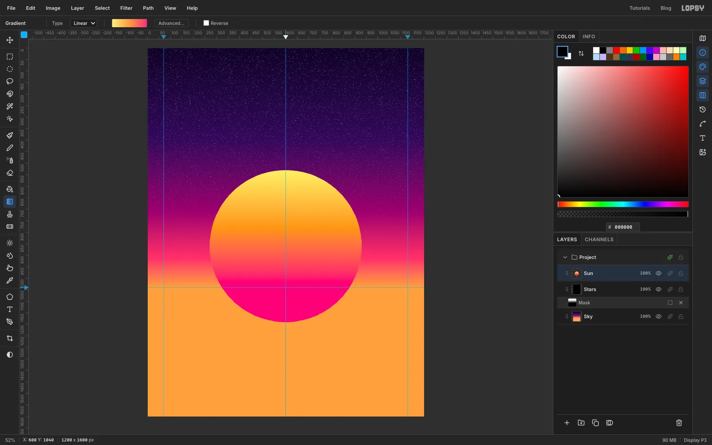

Click *Stars* and add a layer named *Sun*. With the **Elliptical Marquee**,
click once and enter **From** `270, 530` **To** `930, 1190`: a 660 px
circle whose lower part sits below the horizon.

Fill it with a linear gradient: `#FFF07A`, `#FF9A3D` at 50%, and `#FF2D7A`.
Drag from the top of the circle down to the horizon, then deselect.

## Select the sun's slits

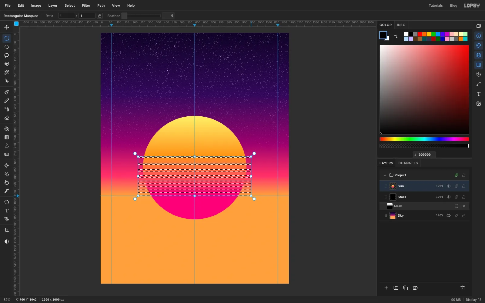

The classic synthwave sun is cut by horizontal slits that get thicker as
they go down. Zoom in so the thin bands are easy to
drag, and pick the **Rectangular Marquee**. Drag the first band across the
sun a little below its middle (about `y 790`), starting left of the circle
and ending right of it. Make it about 5 px tall. Then hold [[Shift]] and
drag six more bands under it, each a few pixels thicker than the last and
with the gaps between them shrinking, so the last one is about 24 px tall
and ends at the horizon. Shift adds each band to the selection.

## Cut the slits and light the sun

Press [[Delete]] to cut all seven slits at once, then deselect. Add an
**Outer Glow** in `#FF3C8E` with **Size** `70` and **Opacity** `70`.

To compare, press [[Cmd+Z]] twice: the glow and the slits disappear.
[[Shift+Cmd+Z]] twice brings them back.

## Lasso the far mountains

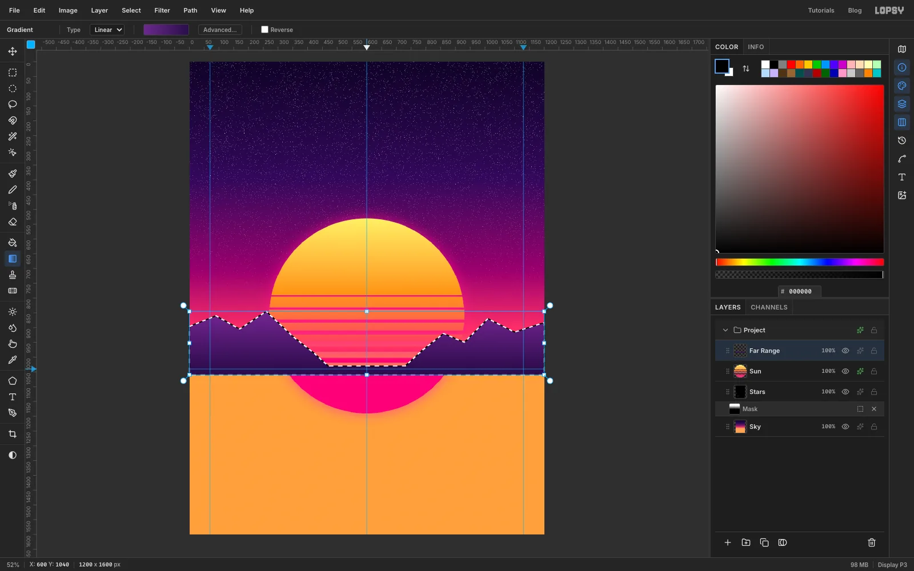

Click *Sun* and add a layer named *Far Range*. With the **Lasso**, trace a
row of sharp peaks from the left edge to the right edge, between about
`y 845` and `y 930`. Bring the line down to the horizon around `x 470` and
`x 730` so the middle stays open for the sun. Close the shape below the
horizon.

Fill the selection with a linear gradient from `#6A2A8C` at the peaks to
`#2A0E4A` at the horizon, and deselect.

## Add the near range and stroke the ridges

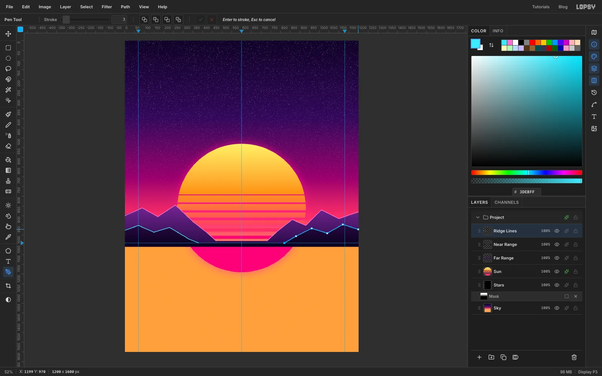

Add a layer named *Near Range* and lasso a lower row of hills in front,
between about `y 945` and `y 1040`, again leaving the middle open. Fill it
from `#24093F` to `#0C0320`, darker than the far range so it reads as
closer.

Add a layer named *Ridge Lines*. Set the foreground to `#FF6FD0`, pick the
**Pen** tool and set its **Stroke** to `3`. Click an anchor on each peak and
valley of the far range's left side, then press [[Enter]]. The path is
stroked with the foreground colour. Do the same for its right side. Switch
the foreground to `#3DEBFF` and stroke both halves of the near range.

## Make the ridges glow

Give *Ridge Lines* an **Outer Glow** in `#FF3FB4`, **Size** `14` and
**Opacity** `85`. Thin lines with a glow read as neon tubes.

## Lay the rink floor

Add a layer named *Floor*. Select from `0, 1040` to `1200, 1600` and fill
it with a linear gradient from `#4A1466` at the horizon, through `#1E0838`
at about 35%, to `#08020F` at the bottom.

## Copy the skyline

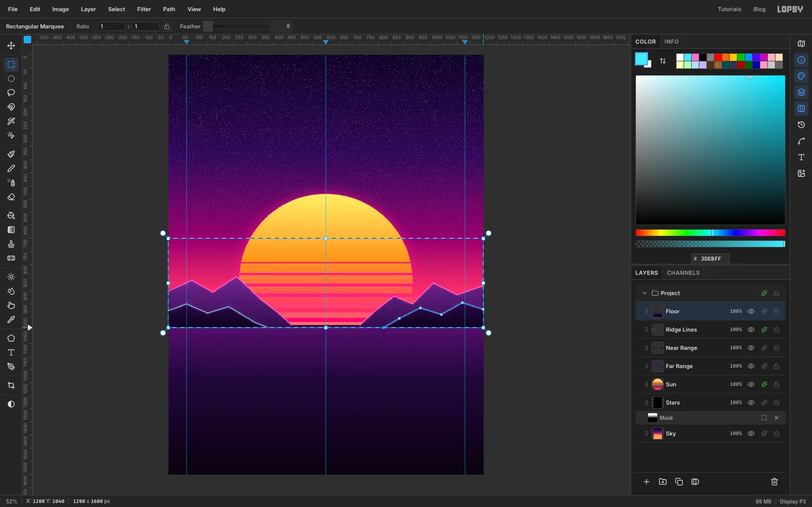

A polished floor reflects what's above it. Select from `0, 700` to
`1200, 1040`, the band with the sun and the mountains, and choose
**Edit → Copy Merged** ([[Shift+Cmd+C]]). Copy Merged copies what you see,
across all layers, not just the active one.

## Flip it onto the floor

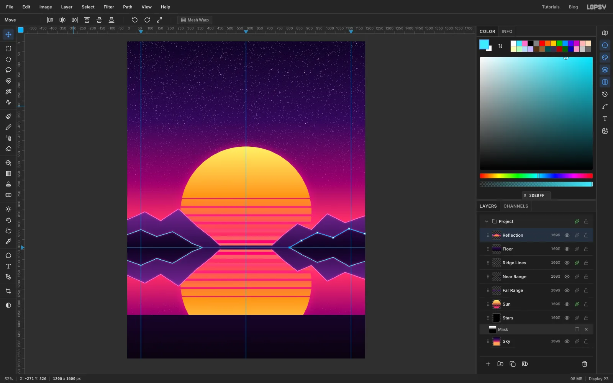

Paste with [[Cmd+V]]. The copy lands in place on a new layer; rename it
*Reflection* and deselect. Choose **Image → Flip Vertical**. Then, with the
**Move** tool, hold [[Shift]] and drag it straight down until its top edge
meets the horizon.

## Blur and fade the reflection

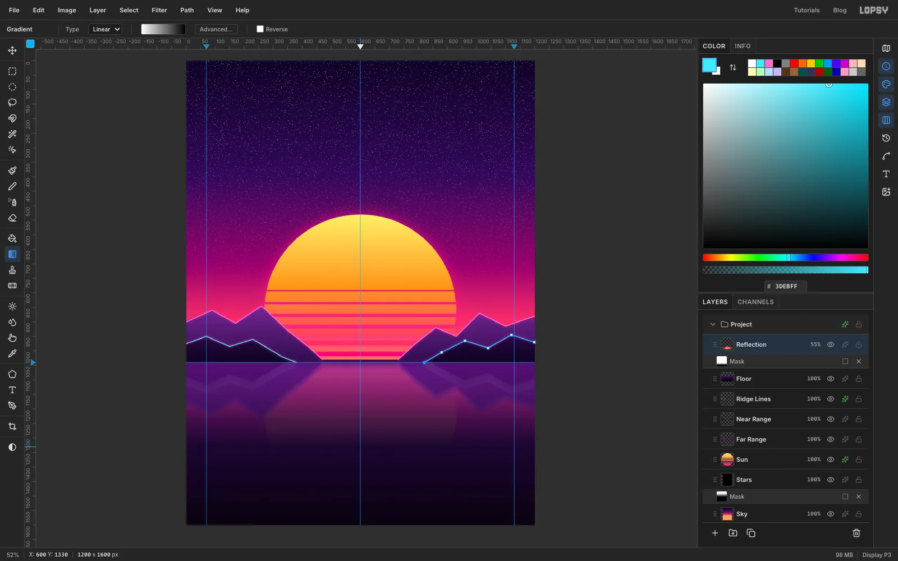

Choose **Filter → Motion Blur…** with **Angle** `90` and **Distance** `30`
to streak it like light on lacquered wood. Set the **Blend** to **Screen**
and the opacity to **55%**.

Add a mask, click its thumbnail, and drag the white to black linear
gradient from just below the horizon down to about `y 1330`, so the
reflection fades into the floor.

## Draw the horizon line and the rink ovals

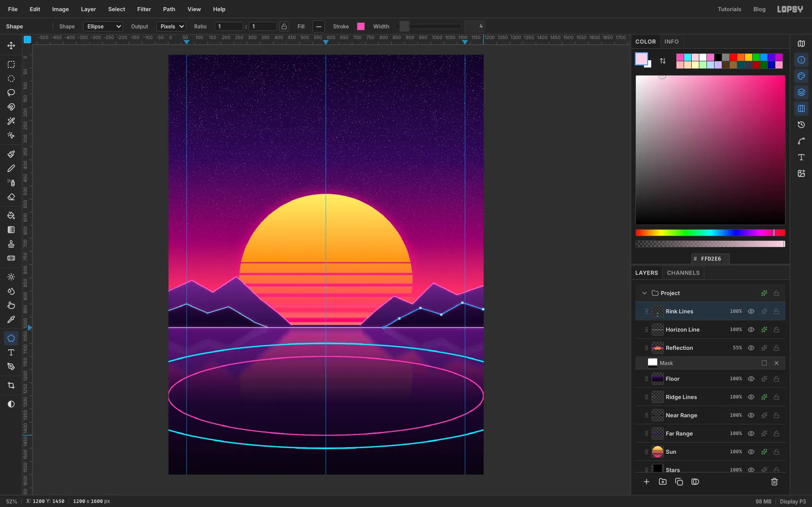

Add a layer named *Horizon Line*. Set the foreground to `#FFD2E6`, pick the
**Pencil** at **Size** `3`, click on the horizon at the left edge and
[[Shift]]-click on it at the right edge. Give it an **Outer Glow** in
`#FF3FB4`, **Size** `22`, **Opacity** `90`.

Add a layer named *Rink Lines*. Pick the **Shape** tool, set **Shape** to
**Ellipse**, remove the fill and set the stroke to `#3DEBFF`, **Width**
`5`. Shapes grow from where you press, so press at `600, 1300` and drag
out past the right edge of the page to about `1390, 1500`. Change the
stroke to `#FF4FB8`, **Width** `4`, and draw a smaller oval from the same
centre out to about `1200, 1450`.

## Make the ovals glow

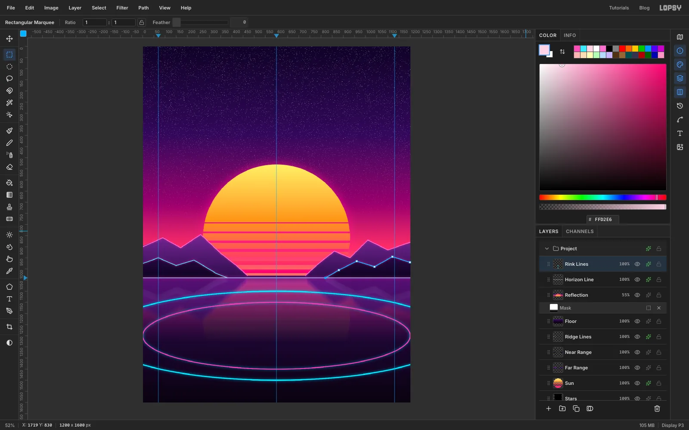

Give *Rink Lines* an **Outer Glow** in `#18C8FF`, **Size** `18`,
**Opacity** `80`. Both ovals start below the horizon because they are
much wider than they are tall, the way a flat oval looks in perspective.

## Start the disco ball

Click *Rink Lines*, click **New Group** and name it *Disco Ball*. Inside
it, add a layer named *Beams* and then one named *Ball*.

You'll build the ball big and in the middle of the page, because
**Lens Distortion** always bends around the centre of the canvas. On
*Ball*, select a circle from `80, 280` to `1120, 1320`. Fill it with a
linear gradient: `#EDE4FF`, `#B49DF2` at 28%, `#5E3FAA` at 62% and
`#170A33`. Drag from the top-left of the circle to the bottom-right.

## Break it into mirror tiles

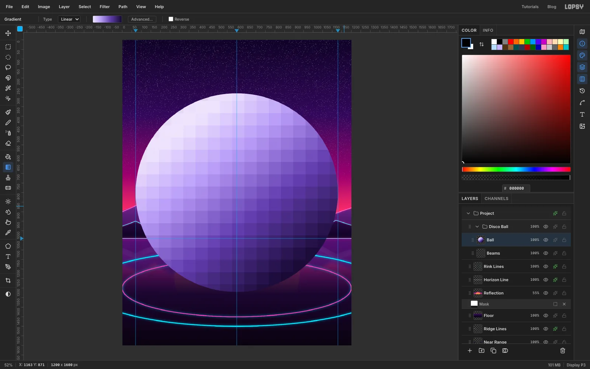

Keep the selection. Choose **Filter → Add Noise…** with **Amount** `30`,
which makes each tile a slightly different shade, then
**Filter → Pixelate…** with **Block Size** `64`. Deselect.

## Make the grout

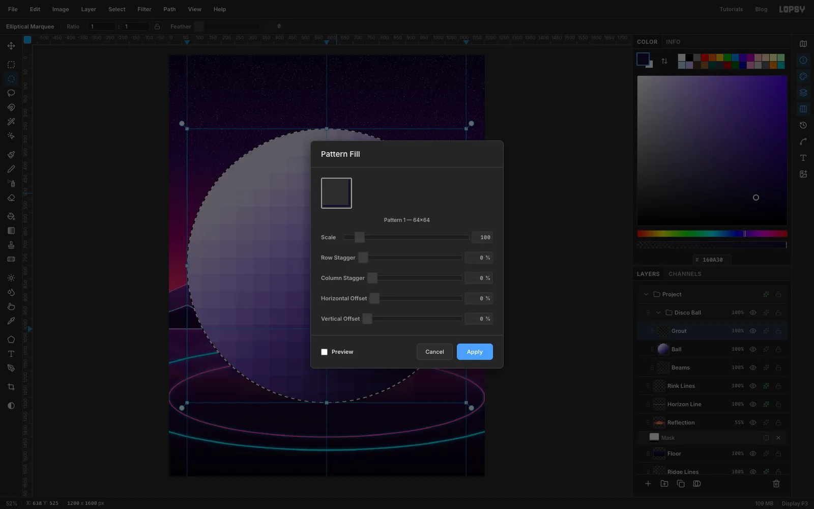

Mirror tiles need dark gaps between them. Add a temporary layer named
*Tile* and select from `0, 0` to `64, 64`. Set the foreground to
`#160A30`, pick the **Pencil** at **Size** `4`, and draw a straight line
down the square's right edge and another along its bottom edge
([[Shift]]-click from one end to the other). The selection stops the
pencil spilling outside the square. Keep the selection and choose
**Edit → Define Pattern**. Then deselect and delete the *Tile* layer.

Click *Ball* and add a layer named *Grout*. Select the same circle again,
`80, 280` to `1120, 1320`, and choose **Edit → Fill with Pattern…**. Pick
your new pattern and click **Apply**.

## Merge the grout

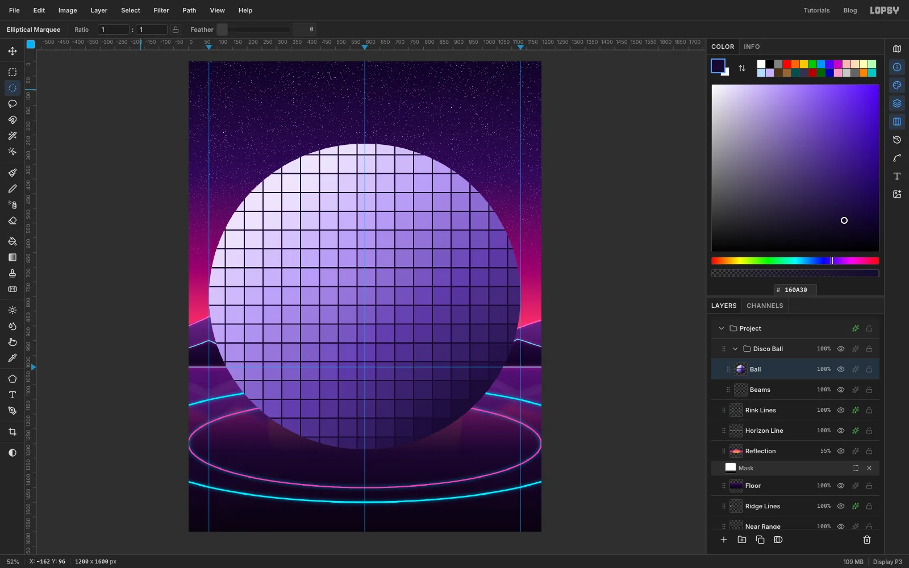

Deselect and choose **Layer → Merge Down** to merge *Grout* into *Ball*.
Both the pattern and Pixelate's blocks are lined up with the top-left corner of the
document, so the lines land exactly between the tiles.

## Bend it into a sphere

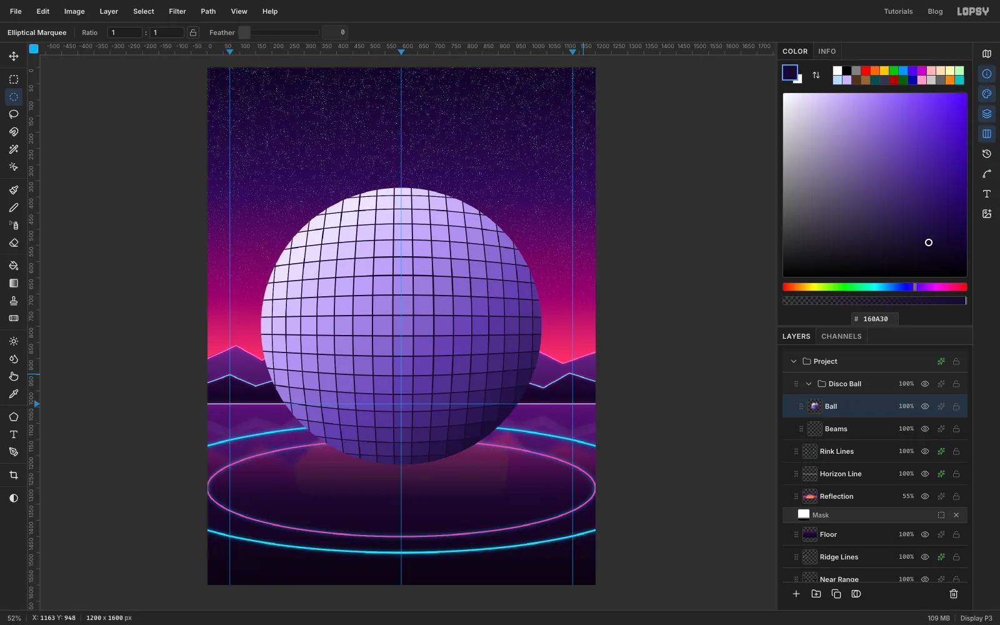

Choose **Filter → Lens Distortion…** with **Strength** `100` and **Zoom**
`100`. Barrel distortion swells the middle and squeezes the edges, which is
exactly how tiles look on a ball.

## Add glints

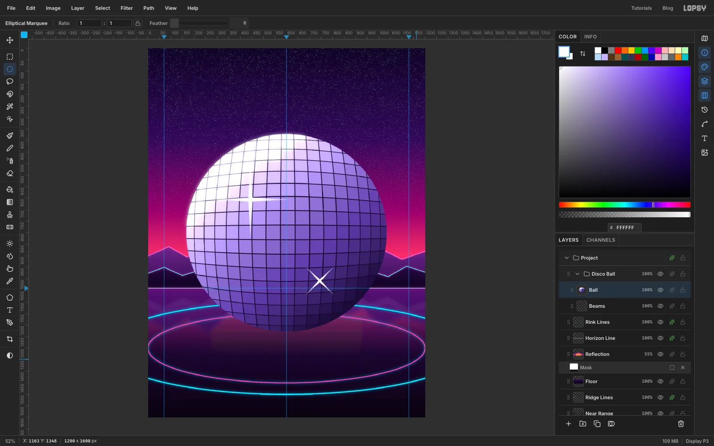

Choose **Filter → Bloom…** with **Threshold** `82`, **Radius** `24` and
**Intensity** `90` so the lightest tiles shine.

Set the foreground to white and choose **Filter → Sunburst…**. For a
four-point sparkle, use **Rays** `4`, **Length** `14`, **Width** `7`,
**Taper** `100` and **Fade** `55`, and set **Center X** `37` and
**Center Y** `41` (percent of the canvas) to put it on the ball's upper
left. Run it again with **Length** `7`, **Fade** `50`, **Rotation** `45`,
**Center X** `62` and **Center Y** `63` for a small sparkle lower right.

## Shrink the ball

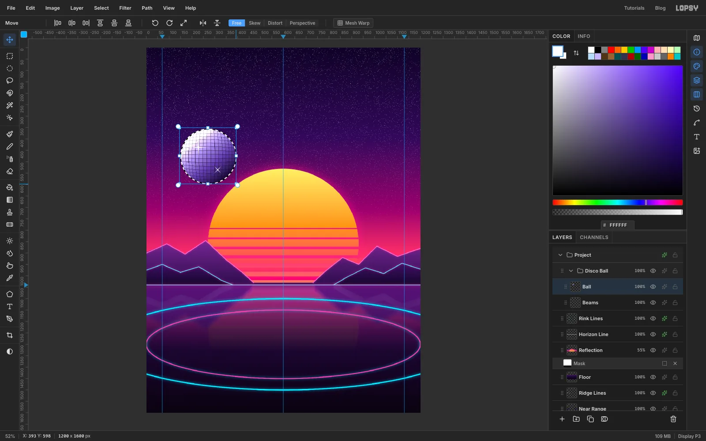

[[Cmd]]-click the *Ball* thumbnail to select its pixels. Pick the **Move**
tool, hold [[Cmd]] to keep it round, and drag the bottom-right corner
handle in toward the top-left until the ball is about 230 px across.
Press [[Cmd+D]] to commit.

## Hang it at the top

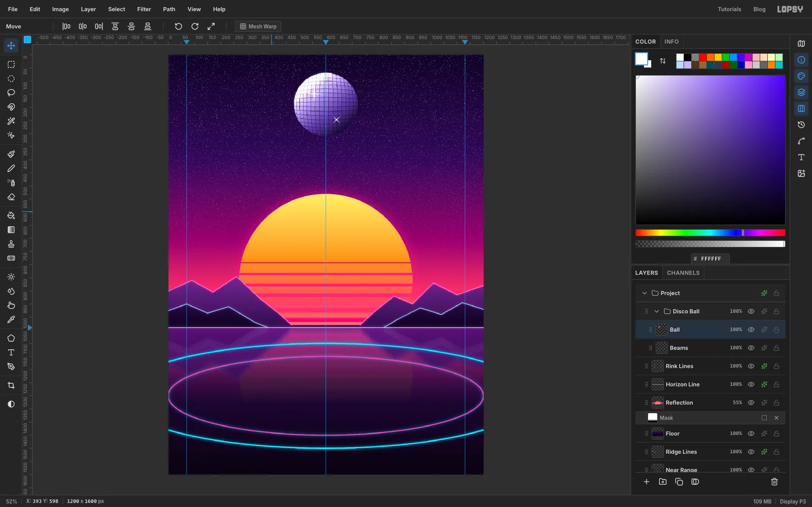

Drag the ball up to the top of the page. It snaps to the centre guide; use
the arrow keys to settle it with its centre at about `600, 188`, so the
ball sits about 70 px below the top edge.

Add a layer named *Chain* inside the group. Set the foreground to
`#BFA9EA`, pick the **Pencil** at **Size** `4`, click at the top edge on
the centre guide and [[Shift]]-click the top of the ball.

## Lasso the light beams

Click *Beams*. With the **Lasso**, draw a long, thin wedge that starts as a
point at the centre of the ball and opens out toward the left edge. Hold
[[Shift]] for three more wedges: a very narrow one down across the left
half of the sun, a wide one down across the right half, and a narrow one
out to the right edge. Vary the widths, from a sliver to about three times
as wide, because beams that all match look like stripes. The edges don't
need to be perfectly straight: the blur in the next step softens them.

## Fill and soften the beams

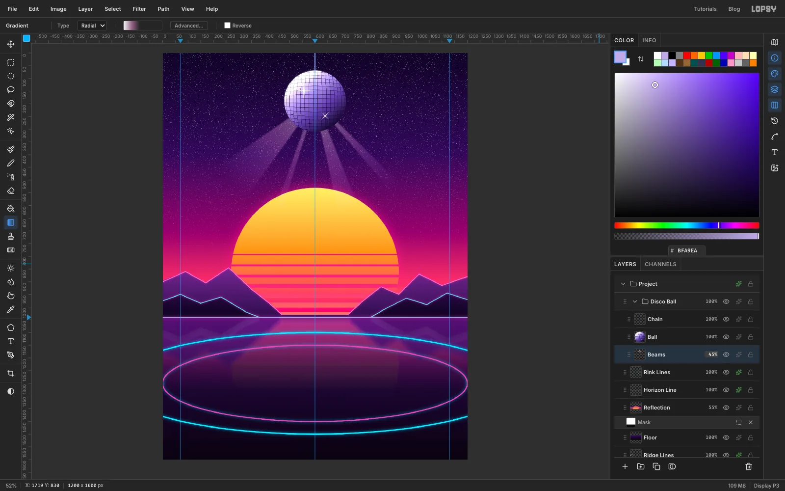

Fill the wedges with a **Radial** gradient: white at 95% opacity, then
`#FF9BE6` at about 22% and 50% opacity, and `#7A5CFF` at 0% opacity by about
42%. Drag from the centre of the ball straight down past the bottom of
the page. Deselect, choose **Filter → Gaussian Blur…** at `6`, set the
**Blend** to **Screen** and the opacity to **45%**.

## Bring in the skate photo

Collapse *Disco Ball*, select it, and click **New Group**. Name the new
group *Skate*. This tutorial uses the public-domain photo
[Roller-hockey-(Quad)-Skate.jpg](https://commons.wikimedia.org/wiki/File:Roller-hockey-(Quad)-Skate.jpg)
from Wikimedia Commons. Download it and drag it from your desktop onto the
canvas. Lopsy shrinks it to fit the page and puts it on a new layer.
Rename the layer *Skate Photo*.

## Select the yellow backdrop

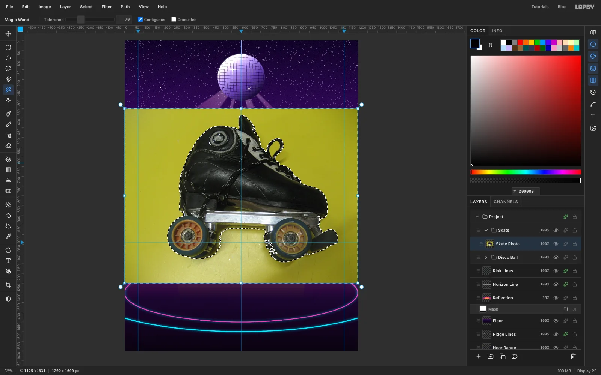

A flat, bright backdrop makes the cutout easy. Pick the **Magic Wand**,
set **Tolerance** to `70` and leave **Contiguous** on. Click the yellow at
the top left. Then [[Shift]]-click the other yellow areas the first click
missed: the bottom right corner, the gap under the plate between the
wheels, and the strip to the right of the toe.

## Cut out the skate

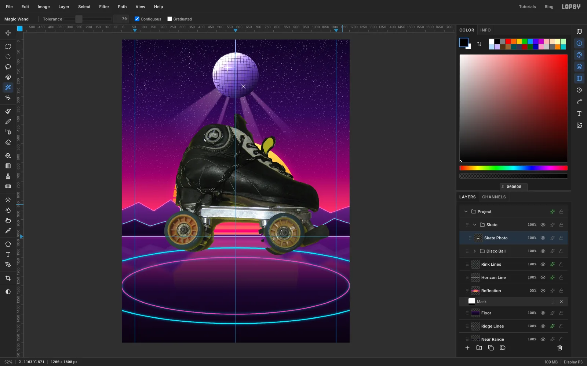

Choose **Select → Grow…** `1` so the edge pixels go too, then press
[[Delete]] and deselect.

A thin yellow fringe always survives around a cutout. [[Cmd]]-click the
*Skate Photo* thumbnail, choose **Select → Shrink…** `2`, then
**Select → Inverse** ([[Shift+Cmd+I]]) and press [[Delete]]. That trims a
2 px band all round the silhouette. Deselect.

## Recolour it with a Gradient Map

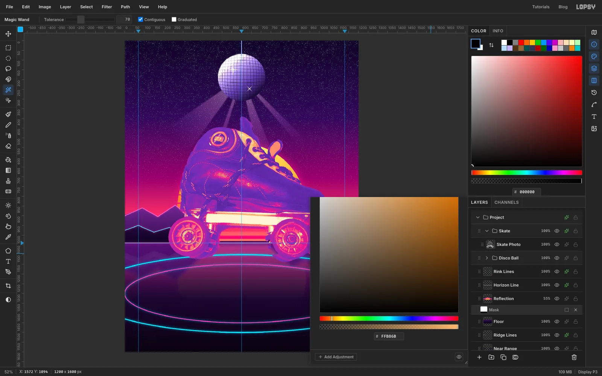

Choose **Filter → Desaturate**, then **Filter → Brightness/Contrast…** with
**Brightness** `28` and **Contrast** `30`. That lifts the black leather so
there is detail to colour.

Click the sparkle icon on the *Skate* group row. Groups get adjustments
instead of effects. Click **Add Adjustment → Gradient Map** and set five
stops: `#2E1656`, `#6431B4` at 26%, `#E0338F` at 56%, `#FFB86B` at 80% and
`#FFF6D8`. Every grey in the photo is replaced by a colour from that ramp, so
the shadows go violet, the midtones pink and the chrome plate peach.

## Scale the skate

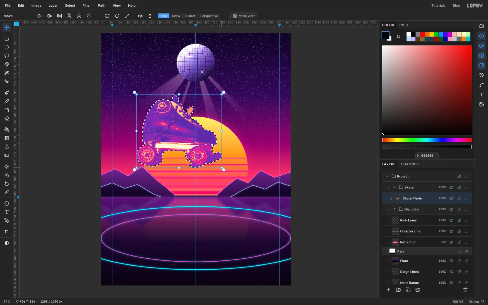

Close the drawer and click *Skate Photo*. [[Cmd]]-click its thumbnail,
pick the **Move** tool, and [[Cmd]]-drag the bottom-right corner handle in
until the skate is about 540 px wide. Press [[Cmd+D]].

## Tilt the toe up

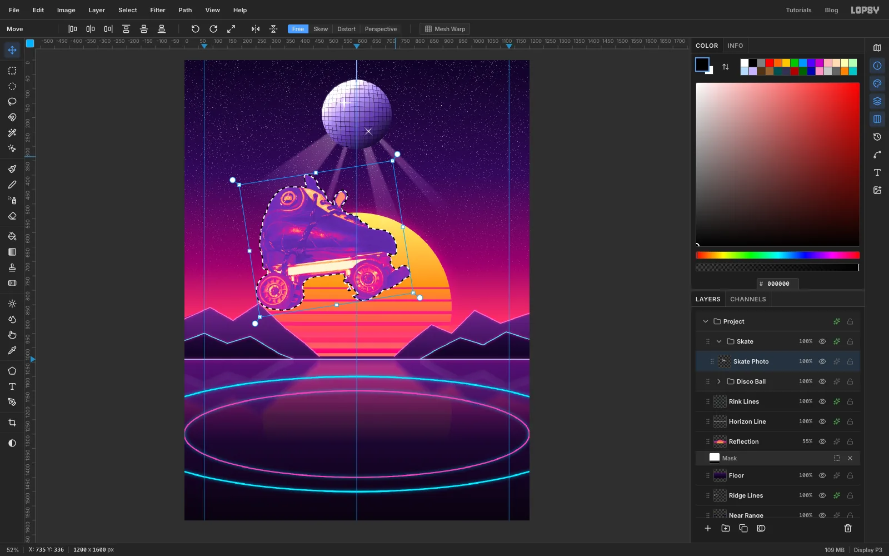

[[Cmd]]-click the thumbnail again and drag the rotation handle just
outside the top-right corner counter-clockwise by about 9°. A raised toe
makes the skate look like it's rolling forward. Press [[Cmd+D]].

## Put it on the rink

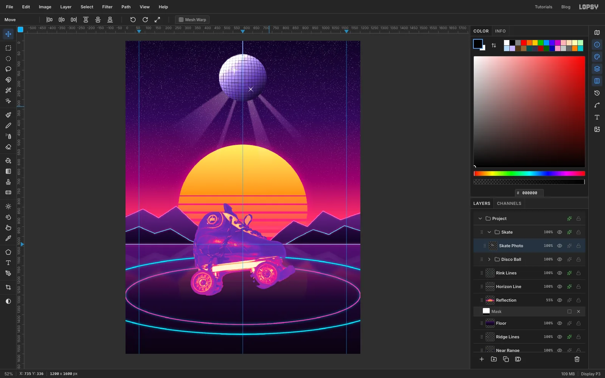

Move the skate so it is centred on the page with its wheels on the floor,
at about `y 1300`. That leaves room for the info panel below.

## Give it a cyan halo

Collapse *Skate*, click *Disco Ball* and add a layer named *Skate Glow*.
It sits between the two groups, behind the skate. Expand *Skate*,
[[Cmd]]-click the *Skate Photo* thumbnail, choose **Select → Grow…** `8`
and fill with `#3DEBFF`. Deselect, blur it with **Gaussian Blur** `26` and
set the **Blend** to **Screen**.

## Draw tapered speed trails

Add a layer named *Speed Trails*. Pick the **Brush**, set **Hardness**
`100` and **Fade** `0`, then open the brush settings and set **Taper** to
`340`. Taper shrinks the end of each stroke to a point.

Drag five horizontal strokes from inside the skate's heel out past the
left edge, all below the horizon: pink `#FF4FB8` at **Size** `20`, cyan
`#3DEBFF` at `14`, yellow `#FFD36B` at `18`, pink at `11` and cyan at `16`,
spaced about 50 px apart. Give the layer an **Outer Glow** in `#FF3FB4`,
**Size** `16`, **Opacity** `80`.

## Reflect the skate in the floor

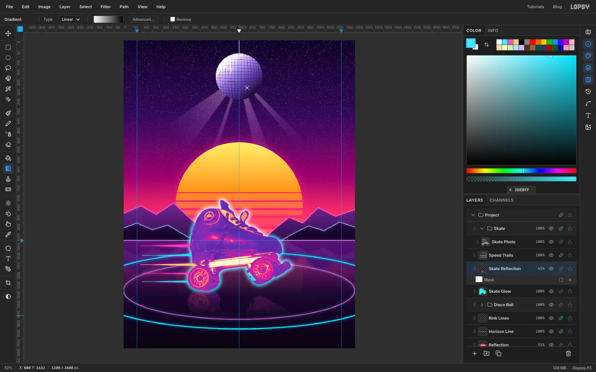

Click *Skate Glow*, [[Cmd]]-click the *Skate Photo* thumbnail and choose
**Edit → Copy Merged**. This copies the recoloured skate, not the grey
photo. Paste, rename the new layer *Skate Reflection* and deselect.

Choose **Image → Flip Vertical** and drag the copy straight down with
[[Shift]] until its wheels touch the real wheels. Add **Motion Blur** with
**Angle** `90` and **Distance** `8`, set the opacity to **45%**, and add
a mask. Pick the **Gradient** tool again, set it back to **Linear** with
just a white and a black stop, and drag on the mask from the wheels down
about 150 px.

## Add contact shadows

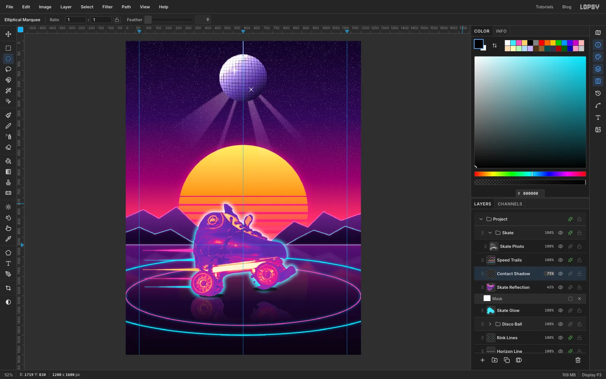

Add a layer named *Contact Shadow*. With the **Elliptical Marquee**, drag a
flat ellipse about 125 × 22 px under the rear wheel, then [[Shift]]-drag
another under the front wheel. Fill with black, deselect, blur with
**Gaussian Blur** `7`, set the **Blend** to **Multiply** and the opacity to
**75%**. Without them, the skate looks like it is floating.

## Select a rim along the top edges

The sun is behind the skate, so its top edges should catch warm light.
Collapse *Skate*, click it and add a layer named *Rim Light* above the
group. Expand *Skate* again.

[[Cmd]]-click the *Skate Photo* thumbnail. Pick the **Rectangular
Marquee** and nudge the outline (not the pixels) down about 10 px with
[[Shift+Down]], then a few pixels right with [[Right]]. Invert it with [[Shift+Cmd+I]]. Now
[[Cmd+Shift+Option]]-click the thumbnail: that intersects the skate's
shape with the inverted, shifted outline. What's left is a thin crescent
along the top and left edges.

## Paint the rim light

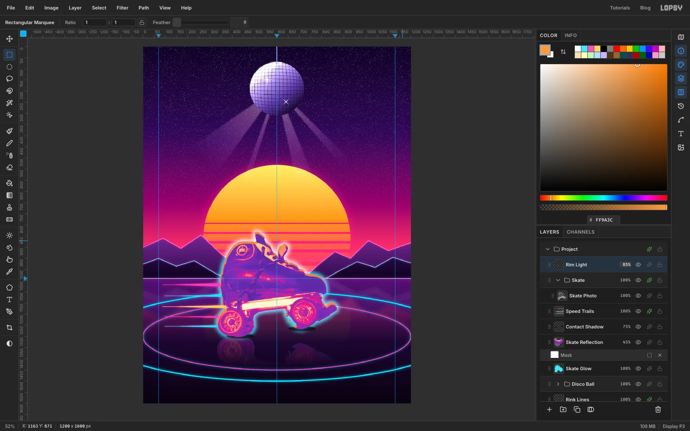

Click *Rim Light* and fill with `#FF9A3C`. Deselect, soften it with
**Gaussian Blur** `2`, and set the opacity to **85%**.

## Spray sparks from the wheel

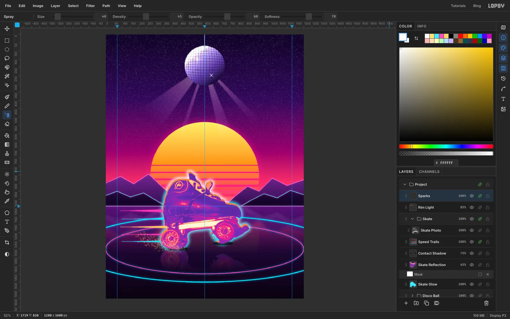

Add a layer named *Sparks*. Pick the **Spray** tool with **Size** `80`
and **Density** `45`, set the foreground to `#FFE27A`, and drag from the
bottom of the rear wheel back and up to the left. Switch to white at
**Size** `40` for a shorter, brighter burst. Give it an **Outer Glow** in
`#FF8A3D`, **Size** `10`, **Opacity** `90`.

## Set LOUNGE in Monoton

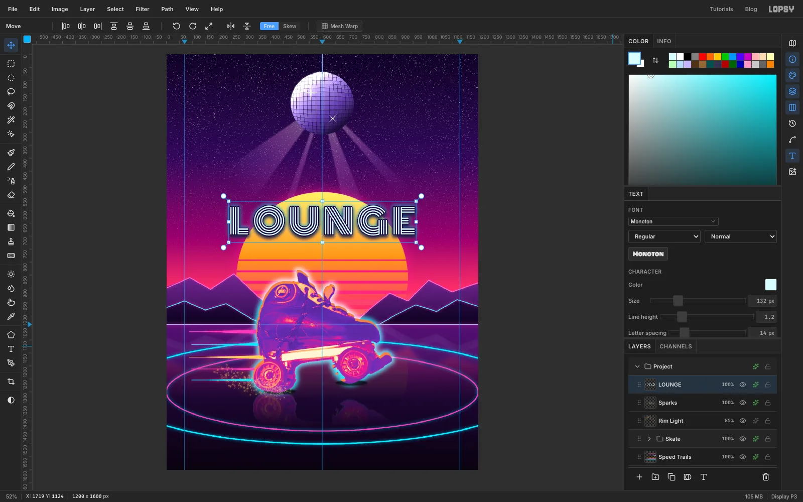

With *Sparks* selected, pick the **Text** tool and choose **Monoton** at
**Size** `132`, colour `#D9FDFF`, with **Letter spacing** `14` in the Text
panel. Click in an empty part of the sky, type `LOUNGE` and press [[Tab]]
to commit. Move it so it is centred on the guide at about `y 640`, over the
top of the sun.

Pale cyan lines vanish against yellow, so give it a dark base: a
**Drop Shadow** in `#12042A` with **Offset** `0, 8`, **Blur** `18`,
**Spread** `20` and **Opacity** `85`, and a **Stroke** in `#1A0638`,
**Width** `3`. Then an **Outer Glow** in `#18C8FF`, **Size** `26`,
**Opacity** `95`.

## Write Roller in neon script

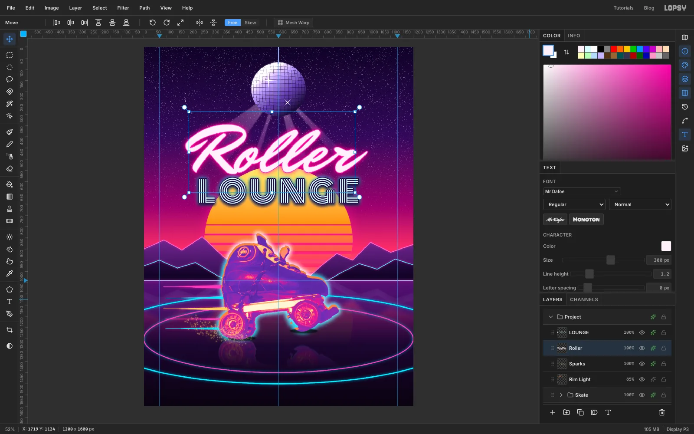

Click *Sparks* again first, so the new settings don't restyle LOUNGE.
Choose **Mr Dafoe** at **Size** `300`, colour `#FFF0FA`, letter spacing
`0`. Click in empty sky above LOUNGE, type `Roller` and press [[Tab]].
Centre it a little above LOUNGE. Its tail can tuck behind the E.

Add a **Stroke** in `#FF4FB8`, **Width** `3`, and an **Outer Glow** in
`#FF1F8F`, **Size** `34`, **Opacity** `100`. The near-white letters with
a pink edge and glow look like a lit tube.

## Tilt the script

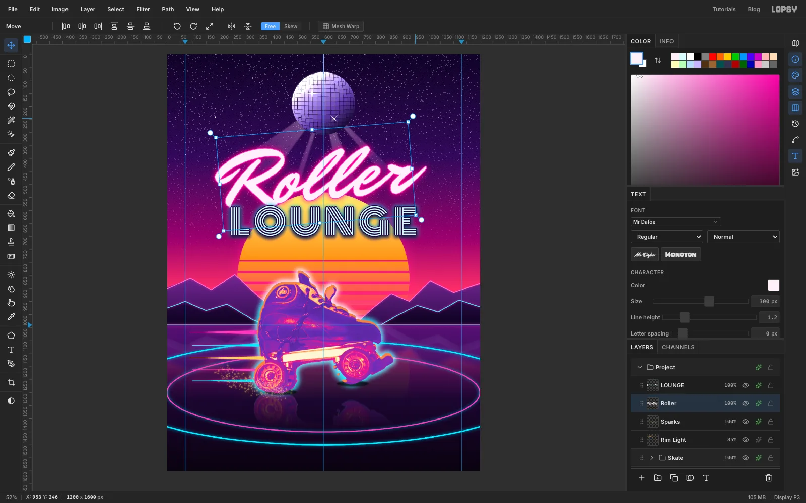

With the **Move** tool, drag the rotation handle at the top-right of the
text box counter-clockwise by about 5°. Script titles usually climb toward
the right. The text stays editable after rotating. Nudge it back so it is
centred over LOUNGE, with clear sky between it and the ball.

## Add a VHS colour fringe

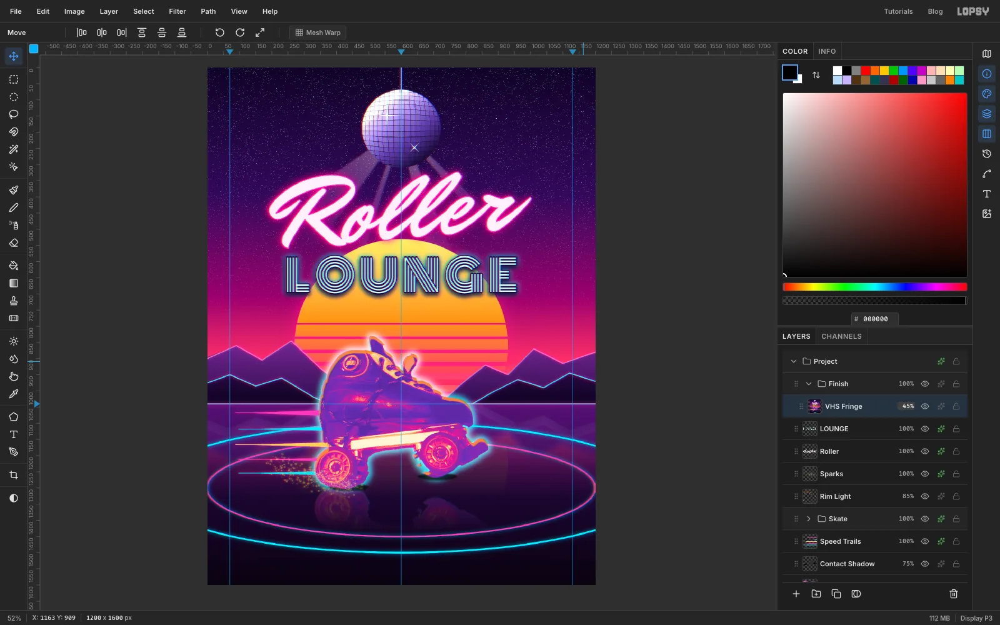

The artwork gets its VHS finish before the small type goes on, so the
type stays sharp. Click *LOUNGE* and click **New Group**. Name it
*Finish*.

Press [[Cmd+A]], **Edit → Copy Merged**, and paste. Rename the new layer
*VHS Fringe* and deselect. Choose **Filter → Chromatic Aberration…** with
**Amount** `4` and **Direction** `0`, and set it to **45%** opacity. The red
and blue channels slide apart a little, like an old tape.

## Add scanlines

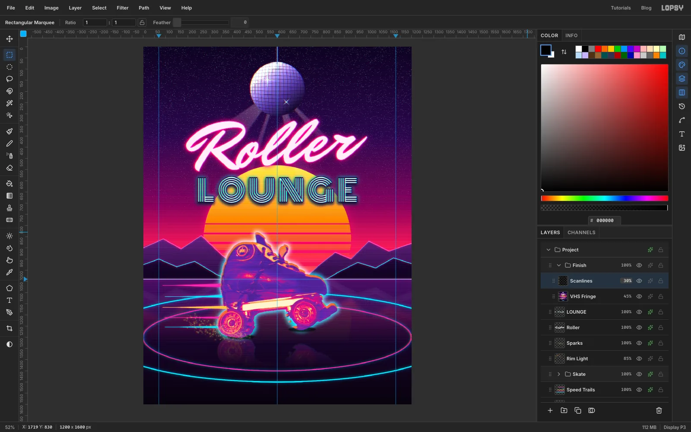

Add a layer named *Scanline Tile*. Select from `0, 0` to `4, 2` and fill
it with black, then select from `0, 0` to `4, 4` and choose
**Edit → Define Pattern**. Deselect and delete the tile layer.

Add a layer named *Scanlines*, choose **Edit → Fill with Pattern…**, pick
the new 4 × 4 pattern and click **Apply**. It tiles a dark line every 4 px.
Set the **Blend** to **Overlay** and the opacity to **30%**.

## Add grain and a vignette

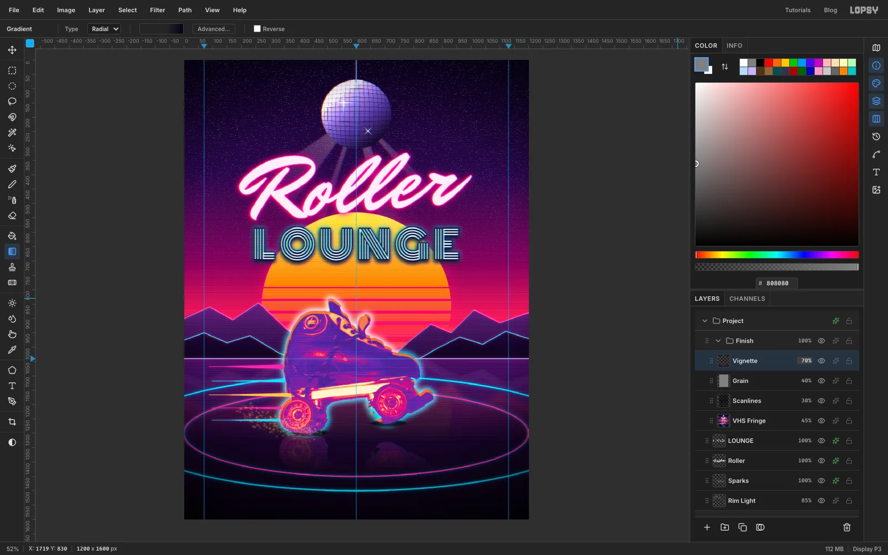

Add a layer named *Grain*, fill it with `#808080` and choose
**Filter → Add Noise…** with **Amount** `22`, **Mono** and **Gaussian**.
Set it to **Overlay** at **40%**. Mid grey disappears in Overlay, leaving
only the grain.

Add a layer named *Vignette*. Use a **Radial** gradient that is
transparent from 0% to 60% and turns `#0A0218` at 100%. Drag from the
middle of the page, about `600, 760`, down past the bottom edge. Set it to
**Multiply** at **70%**. The corners darken and pull the eye toward the
skate.

## Draw the info panel

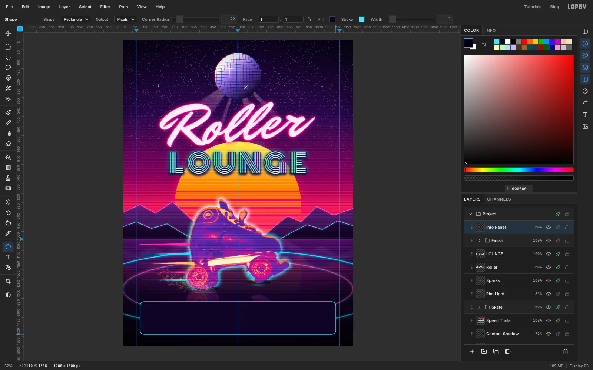

Collapse *Finish*, click it, and add a layer named *Info Panel*. It lands
above the group, so the texture won't touch the panel or its text. Pick
the **Shape** tool, choose **Rectangle**, fill `#0E0424`, stroke `#3DEBFF`
at **Width** `3`, **Corner Radius** `22`. Press on the centre guide at
`600, 1452` and drag to `1110, 1538`. That makes a panel from `x 90` to
`1110`, about 60 px above the bottom edge. Set it to **92%** opacity and
add an **Outer Glow** in `#18C8FF`, **Size** `18`, **Opacity** `75`.

The rink ovals would show faintly through the panel. [[Cmd]]-click the
*Info Panel* thumbnail to select its shape, click *Rink Lines*, press
[[Delete]] and deselect. Then click *Info Panel* again.

## Divide it into columns

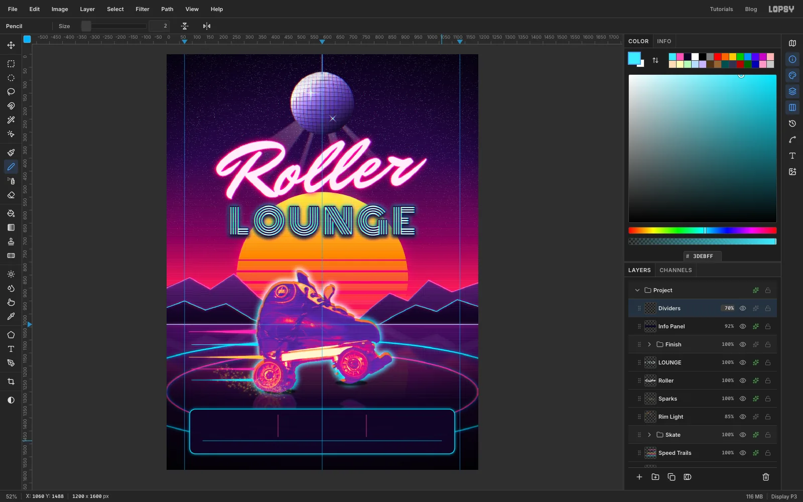

Add a layer named *Dividers*. Set the foreground to `#FF4FB8` and pick the
**Pencil** at **Size** `2`. Click at `430, 1388` and [[Shift]]-click at
`430, 1472`. Draw the second divider the same way at `x 770`. Switch to
`#3DEBFF` and draw a line across at `y 1488` from `x 140` to `x 1060`.
Set the layer to **70%** opacity.

## Set the event details

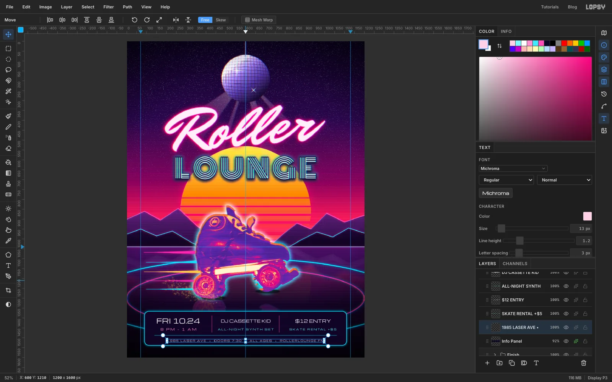

Everything in the panel is **Michroma**. Before each line, click
*Info Panel* so the new settings don't restyle the text you just made.
With the **Text** tool, click where there's no other text (the skate is a
good spot) to start a new line, type it, press [[Tab]], then move it into
place. Centre each column's lines on the middle of its column (`x 260`,
`600` and `940`), with the main lines about 40 px above the second lines:

- `FRI 10.24` at **Size** `34`, white
- `8 PM – 1 AM` at `17`, `#FF8FD0`, letter spacing `4`
- `DJ CASSETTE KID` at `20`, white
- `ALL-NIGHT SYNTH SET` at `14`, `#7DF9FF`, letter spacing `3`
- `$12 ENTRY` at `22`, white
- `SKATE RENTAL +$5` at `14`, `#7DF9FF`, letter spacing `3`

Below the cyan line, centre the footer: `1985 LASER AVE • DOORS 7:30 •
ALL AGES • ROLLERLOUNGE.FM` at **Size** `13`, `#FFD1E8`, letter spacing
`3`. Leave at least 40 px between the outer text and the panel's sides.

## Add the corner tags

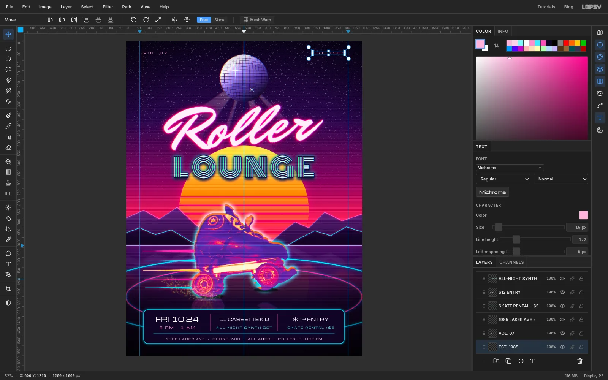

Still in Michroma, set `VOL. 07` and `EST. 1985` at **Size** `16`,
`#FFB3DD`, letter spacing `6`. Put `VOL. 07` with its left edge at `x 90`
and `EST. 1985` with its right edge at `x 1110`, both centred at about
`y 60`. Lining them up with the panel's sides gives the top and the bottom
of the page the same margins.

Export with **File → Quick Export PNG**, and save the project with
**File → Save Project** so you can change the date for next Friday.
