Old science textbooks explained the world in plates: one sheet, a few numbered figures, fine ink lines, and a caption under each. This tutorial builds one of those plates about how a hurricane works. It has four figures that tell one story:

- **Fig. 1** is a real satellite photo of Hurricane Irma, turned into a two-colour print with rings showing how far its winds reach.
- **Fig. 2** cuts the storm in half so you can see the warm air going in at the bottom, up the eyewall and out at the top.
- **Fig. 3** is a bar chart of the Saffir–Simpson scale.
- **Fig. 4** plots wind and pressure against distance from the eye.

You'll need the satellite photo. It's [Hurricane Irma Sep 7 Aqua MODIS Eye Zoom](https://commons.wikimedia.org/wiki/File:Hurricane_Irma_Sep_7_Aqua_MODIS_Eye_Zoom_(36255383704).jpg) by Pierre Markuse, from NASA data, under CC BY 2.0. It has a zoomed inset in the top right corner and a caption strip along the bottom. Before you start, crop it to a square about 1,100 px across with the eye in the middle, so the inset and the caption stay out. You can open the photo in Lopsy, crop it with the **Crop** tool ([[C]]) and export it, or use any image viewer. The poster credits the photo in its footer, and yours should too.

Along the way you'll use:

- **guides**, the **grid** with **Snap**, and exact-corner marquees
- a dropped photo, a **Cmd-drag scale** and a **layer mask**
- **Group Layers** plus a **Gradient Map** adjustment for the duotone
- **Duplicate Layer**, **Halftone**, **Multiply** and **Overlay**
- the **Brush** with **Radial Symmetry** for compass ticks and a dotted ring
- **Fill → Shrink → Delete** for crisp rings and frames
- the **Lasso** and **Elliptical Marquee** with **Shift** (add) and **Alt** (subtract)
- **Define Pattern** and **Fill with Pattern** for hatching
- the **Pen** tool, stroked with **Enter**, for smooth arrows and curves
- **Stroke** layer effects for outlines and paper halos
- live text in **Barlow Condensed**, **IBM Plex Mono** and **Instrument Serif**, including two labels turned 90°
- **Group Layers** and an arrow-key nudge on the grid

The palette is navy ink on warm paper, with the storm categories as the only strong colour:

- Paper `#EEE7D7`, ink `#1D2733`, card `#F4EFE3`
- Rule blue `#3E6A85`, dot grey `#5E7383`, hairlines `#B9BDB4`
- Duotone `#0F1A26` → `#2A4E66` → `#93AFB9` → `#F4EFE3`
- Categories `#EBC55E` / `#E39A4A` / `#D16B3E` / `#B4453F` / `#7E3150`
- Sea `#C9744C` → `#3F7D84` → `#1E4C58`
- Cloud `#F7F4EC`, inflow label `#A8492A`

> **Tip:** A data poster only works if things line up, so this tutorial gives positions in document pixels. The status bar at the bottom of the window shows the pointer's X and Y. For a selection with exact corners, pick a marquee tool and click once on the canvas without dragging while nothing is selected: a dialog opens where you can type the corners. If you'd rather not measure, open the project with the **Follow along** button and work over it.

> **Tip:** Name every layer as you make it: double-click its name in the Layers panel. Later steps pick layers by name, text layers included.

## Set up the paper and guides

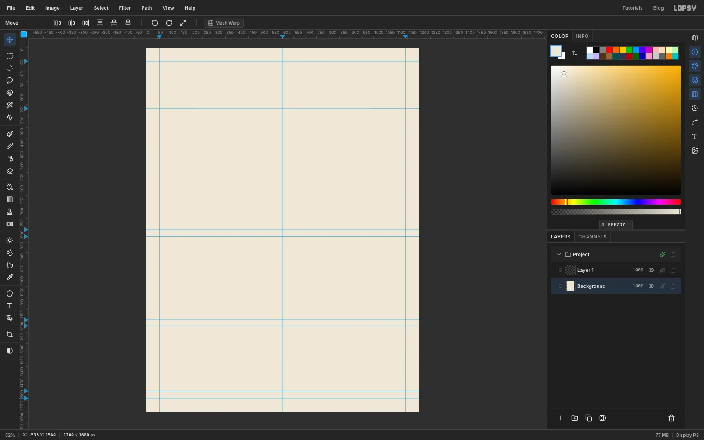

Open [Lopsy](/) and create a new document **1200** wide by **1600** tall.

1. Select **Background**, set the foreground colour to `#EEE7D7` and choose **Edit → Fill**. With nothing selected it fills the whole layer.
2. Click the top ruler at `60`, `600` and `1140` for the two side margins and the centre line.
3. Click the left ruler at `60` and `268` for the top margin and the bottom of the header. I also dropped a few more horizontal guides lower down as rough markers for the figure bands. Their exact heights don't matter.

## Add grain and a double frame

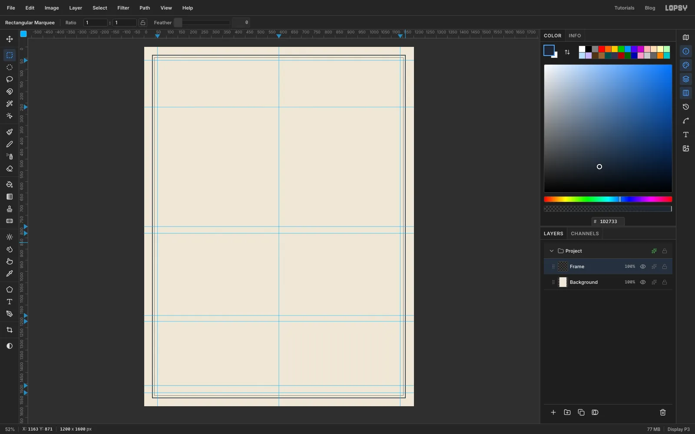

Real paper is never perfectly flat. With **Background** still selected, choose **Filter → Add Noise…**, set **Amount** to `4`, pick **Mono** and **Gaussian**, and click **Apply**.

Rename **Layer 1** to `Frame` by double-clicking its name. The frame is two rings, each made with the same trick: fill a rectangle, shrink the selection, then delete the middle.

1. Make an exact-corner selection from `36, 36` to `1164, 1564`. Set the foreground to `#1D2733` and choose **Edit → Fill**.
2. Choose **Select → Shrink…**, set **Amount** to `3`, click **Apply**, and press [[Delete]]. You're left with a 3 px ink border.
3. Repeat with a selection from `46, 46` to `1154, 1554` and a shrink of `1` for the thin inner rule.
4. Deselect with [[Cmd+D]].

## Drop in the satellite photo and scale it down

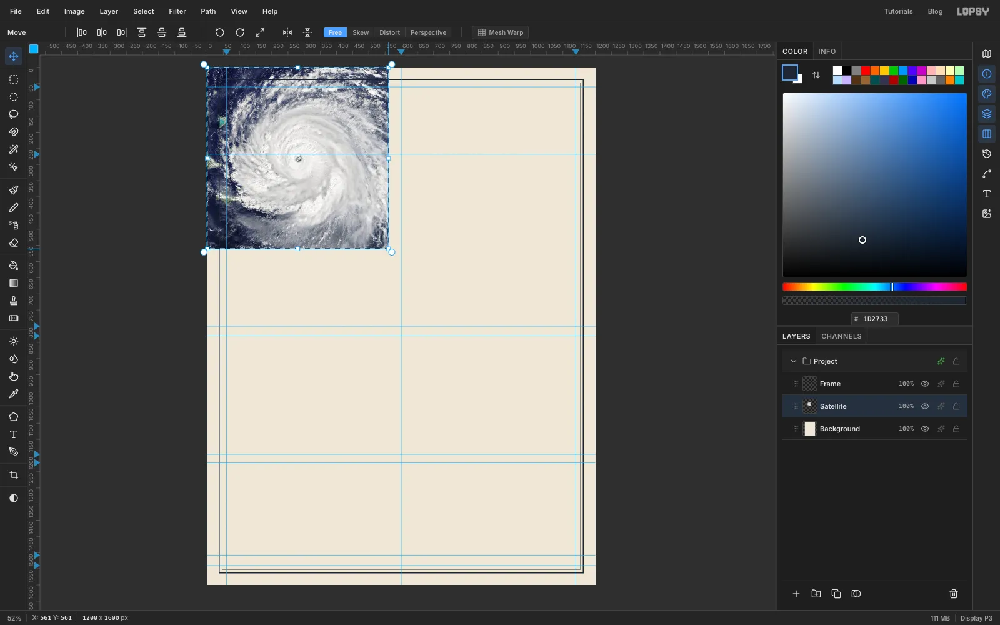

Click **Background** so the photo will land just above it, then drag your cropped photo file onto the canvas. It arrives as a new layer in the top left corner, already selected. Rename it `Satellite`.

The plan view will be a circle 470 px across. To fit a good part of the storm inside that circle, scale the photo down to 561 px wide: hold [[Cmd]] and drag its bottom-right handle up and to the left. [[Cmd]] keeps it square. Watch the status bar and let go at about `561, 561`. Press [[Enter]] to apply, then [[Cmd+D]].

## Centre the photo on the plan view

Pick the **Move** tool ([[V]]) and drag the photo until its centre, the eye, sits at about `330, 548`. That puts the plan view's centre 330 px from the left edge, which leaves room for callouts on the right. Deselect if a selection is left behind.

## Mask the photo to a circle

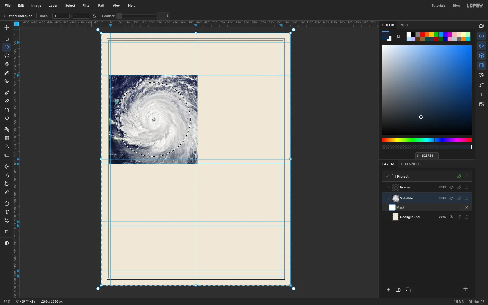

1. With **Satellite** selected, click **Add Mask** at the bottom of the Layers panel. A white mask appears under the layer.

   > **Tip:** Add Mask always starts white, so an active selection doesn't carry into the mask. Paint or fill the mask instead.

2. Click **Edit mask for Satellite** on the mask row. Now anything you fill goes into the mask, not the photo.
3. Pick the **Elliptical Marquee** and make an exact-corner selection from `95, 313` to `565, 783`. That's a 470 px circle around `330, 548`.
4. Choose **Select → Inverse** so everything *outside* the circle is selected.
5. Set the foreground to black and choose **Edit → Fill**. Black in a mask hides, so the corners of the photo disappear.
6. Deselect, and click the **Satellite** name to leave mask edit mode.

## Turn the photo into a two-colour duotone

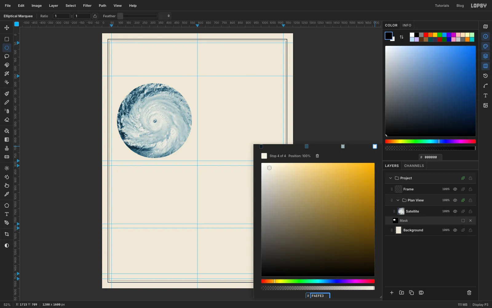

Old plates were printed in one or two inks, so the photo should look printed too. A **Gradient Map** replaces each brightness with a colour from a gradient. In Lopsy it lives on a group, so first put the photo in a group of its own:

1. With **Satellite** selected, choose **Layer → Group Layers** and rename the new group `Plan View`.
2. Click the **✦** (effects) button at the right of the group's row. The drawer that opens holds the group's adjustments. Click **Add Adjustment → Gradient Map**.
3. Click the gradient bar at about 40% and again at about 72% to add two stops, so there are four.
4. Click each stop in turn and type its colour into the hex field: `#0F1A26` at the dark end, `#2A4E66`, `#93AFB9`, and `#F4EFE3` at the light end.

The ocean goes deep navy, the clouds go a soft blue-grey, and the brightest tops turn the colour of the paper. Close the drawer.

## Add a light halftone screen

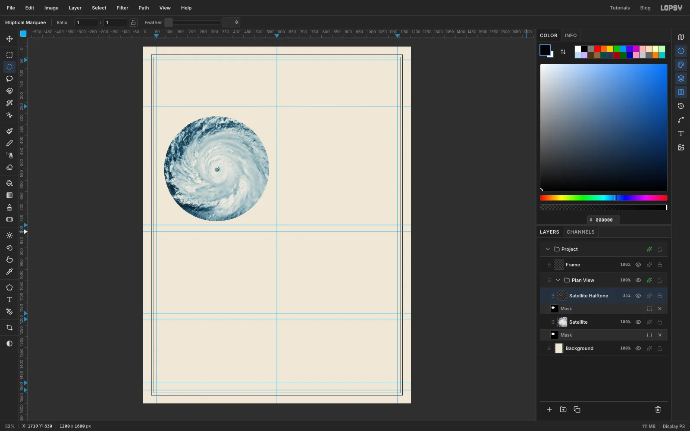

A dot screen makes the photo feel printed rather than pasted in.

1. Select **Satellite** and choose **Layer → Duplicate Layer**. Rename the copy `Satellite Halftone`. It keeps the circle mask.
2. Choose **Filter → Halftone…** and set **Dot Size** to `4`, **Angle** to `45` and **Softness** to `1`. Click **Apply**.
3. Open the layer's **✦** drawer, set the blend mode to **Multiply**, and close it.
4. Set the layer's opacity to `35%` with the percentage on its row.

The dots only darken, so the photo underneath still shows through, and the Gradient Map colours the dots navy as well.

## Draw the wind-field rings

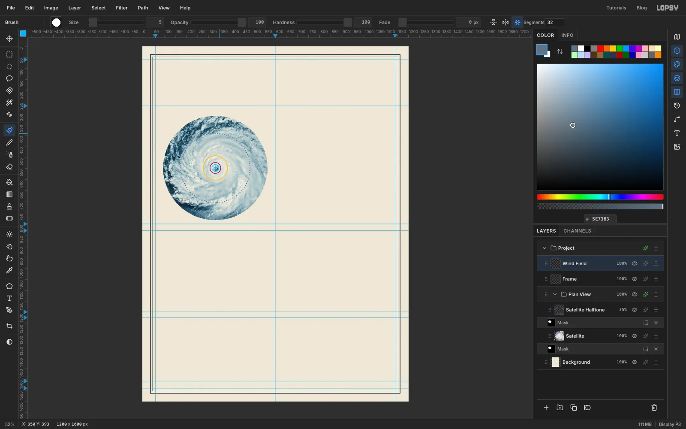

The rings show how far each wind speed reaches from the eye. On this disc, 1 km is about 0.52 px.

Click the **Frame** layer, click **Add Layer**, and name the new layer `Wind Field`. Make each solid ring with **Fill → Shrink → Delete**, the biggest first, all centred on `330, 548`:

1. **Hurricane-force winds, 110 km out:** an exact-corner circle from `273, 491` to `387, 605`, filled with yellow `#EBC55E`, shrunk by `4`, then [[Delete]].
2. **The Category 5 core, 50 km out:** a circle from `304, 522` to `356, 574`, filled with plum `#7E3150`, shrunk by `3`, then [[Delete]].

Tropical-storm winds reach 300 km out, which is 157 px. That one is a dotted ring in a quieter grey, so it doesn't compete with the other two:

1. Pick the **Brush** ([[B]]) and set **Size** to `5` and **Hardness** to `100`. Set the foreground to `#5E7383`.
2. Turn on **Radial Symmetry** in the options bar and set its count to `32`.
3. Hold [[Cmd]] and click the eye at `330, 548`. That sets the centre of the symmetry.
4. Click once at `330, 391`. You get 32 dots evenly spaced round the ring.
5. Click twice more just clockwise of the first dot, at about `340, 391` and `351, 392`. That gives 96 dots in all, close enough to read as a dotted line.

Turn **Radial Symmetry** off. Then open the layer's **✦** drawer, tick **Stroke**, and set a 1 px ink `#1D2733` stroke with the position **outside**. The thin outline keeps the yellow readable on the pale clouds.

## Add a rim and compass ticks

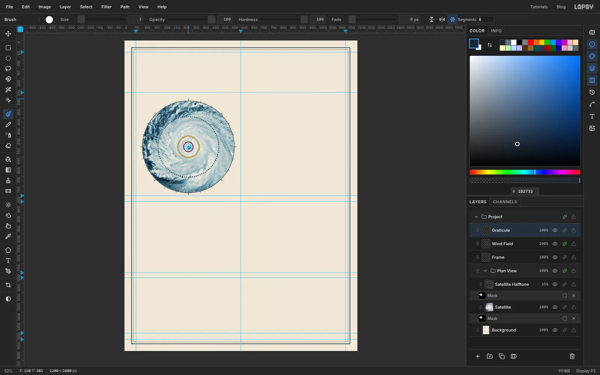

Add a layer called `Graticule`.

1. **Rim:** select a circle from `92, 310` to `568, 786`, just outside the photo. Fill it with ink, shrink by `2`, and press [[Delete]].
2. **Short ticks:** pick the **Brush** with **Size** `2`, turn **Radial Symmetry** on with a count of `24`, and [[Cmd]]-click the centre again. Click at `330, 310`, then [[Shift]]-click at `330, 304`. [[Shift]]-click draws a straight line from the last point, and the symmetry repeats it every 15°.
3. **Long ticks:** set the count to `8` and the **Size** to `3`, [[Cmd]]-click the centre, then click at `330, 310` and [[Shift]]-click at `330, 301`. These land every 45°, on top of every third short tick.

## Draw a faint crosshair

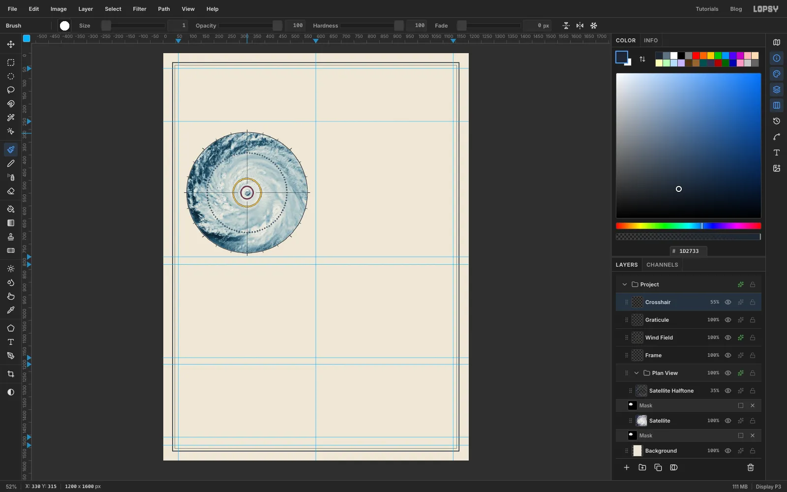

Add a layer called `Crosshair`. Set the symmetry count to `4`, the brush **Size** to `1`, and [[Cmd]]-click the centre. Click at `330, 512` and [[Shift]]-click at `330, 315`, just inside the rim. The four arms start 36 px from the eye, so they never cover it.

Turn **Radial Symmetry** off and set the layer's opacity to `55%`.

## Lay the sea for the cross-section

Fig. 2 is drawn 8 px lower than its final spot, because at the end you'll nudge the whole figure up on the grid. Use the numbers as given.

Add a layer called `Sea` and make an exact-corner selection from `60, 1136` to `1140, 1166`. Pick the **Gradient** tool, click **Advanced…** and set three stops: `#C9744C` at the left end, `#3F7D84` at about 30%, and `#1E4C58` at the right end. Drag from the top of the selection straight down to the bottom. The thin orange line along the top stands for the warm surface water that feeds the storm.

## Build the cloud from shapes

The cross-section is drawn with a strong vertical stretch, about 15 times, so the storm doesn't look like a thin pancake. Each kilometre of height is 17 px, and sea level is at `y 1136`, so 16 km is at `y 864`.

Add a layer called `Section Cloud`. The cloud is one big selection built from pieces:

1. **Left half:** pick the **Lasso** ([[L]]) and trace the left anvil and eyewall in one closed loop. Start at a thin point on the left at about `132, 929`. Run along the top, rising gently to about `540, 881` beside the eye. Come down the eye side of the eyewall, slanting slightly inward, to `596, 1127`. Run left along the cloud base to `504, 1127`. Go up the outside of the eyewall, then curve out smoothly along the underside of the anvil and back to the tip. Smooth that inside corner: a sharp right angle there looks like a shelf.
2. **Right half:** hold [[Shift]] and trace the same shape flipped left to right around x `620`, the middle of the eye. A point at x `540` on the left becomes x `700` on the right, so the right eyewall's inner wall starts at x `644` at the bottom. The gap between the two halves is the eye. It's narrow at the bottom and wider at the top.
3. **Rainband towers:** pick the **Elliptical Marquee** and [[Shift]]-drag overlapping ellipses to build cauliflower towers. Stack each one up from the cloud base like a pile of slightly wobbly cushions, and finish it with a cluster of three at the top. For the tallest left tower, between x `404` and `458`: start with an ellipse about 54 px wide and 46 px tall centred at `431, 1111`, just above the base. Add four more of about the same size, each about 20 px higher and a few pixels left or right of the one below. Then add three smaller ones round the top, the highest reaching about `y 1010`. I made five towers: two on the left, reaching about 6 and 7 km, and three on the right, at about 7, 5 and 3 km. Keep them below the anvil.
4. **Lumpy edges:** add a few more [[Shift]] ellipses down the outside of each eyewall, and two or three bumps at the top of each eyewall for the overshooting storm tops.

## Flatten the cloud bases

Real cumulus clouds have flat bottoms where the air reaches the height at which it condenses. Pick the **Rectangular Marquee**, hold [[Alt]], and drag a rectangle from just above the sea at about `70, 1128` down past the sea's bottom edge. [[Alt]] subtracts it, so every tower now ends in a straight line half a kilometre above the water.

## Fill the cloud and outline it

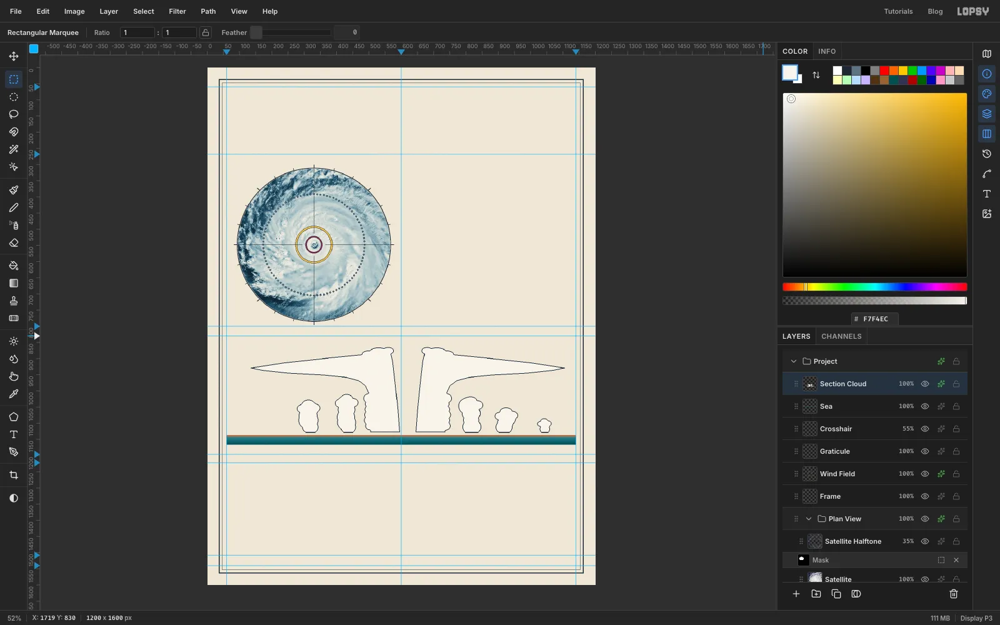

Set the foreground to `#F7F4EC` and choose **Edit → Fill**, then deselect. Open the layer's **✦** drawer, tick **Stroke**, and set a 2 px ink stroke with the position **inside**. An inside stroke keeps the outline crisp right against the paper.

## Make a hatch tile and load the cloud's shape

Engravers shaded with lines, not soft blurs. First make a hatch tile to paint with:

1. Add a temporary layer. Pick the **Pencil** ([[N]]) at **Size** `1` with the foreground set to rule blue `#3E6A85`. In the empty strip under the frame, click at `1168, 1575` and [[Shift]]-click at `1175, 1568`. That's a diagonal across an 8 px square.
2. Select exactly that square, from `1168, 1568` to `1176, 1576`, and choose **Edit → Define Pattern**.
3. Deselect, then delete the temporary layer with the bin button at the bottom of the Layers panel.

Now work out where the shading goes. With the light coming from the top left, it belongs on the lower right edge of each cloud:

1. Click **Section Cloud**, then **Add Layer**, and name the new layer `Cloud Shade`.
2. [[Cmd]]-click the **Section Cloud** thumbnail to select the cloud's shape.
3. With the **Rectangular Marquee** active, press [[Shift+Left]] and then [[Shift+Up]]. That moves the selection outline 10 px up and to the left, without moving any pixels.

## Select a shading band

1. Choose **Select → Inverse**. Everything except the shifted cloud is now selected.
2. Hold [[Cmd]], [[Shift]] and [[Alt]] together and click the **Section Cloud** thumbnail again. That intersects the selection with the real cloud, so you're left with a 10 px band along the lower right of every cloud.

## Fill the band with hatching

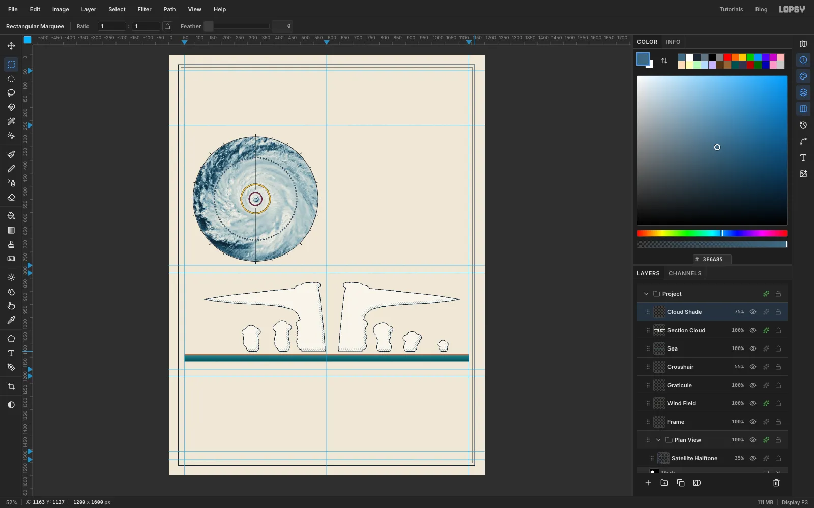

Choose **Edit → Fill with Pattern…**, pick the diagonal tile you just defined, and click **Apply**. Deselect and set the layer's opacity to `75%`. The hatching gives the clouds volume and looks drawn rather than airbrushed.

## Add the height axis, scale bar and tropopause

Add a layer called `Section Axis`. Pick the **Pencil** at **Size** `1` with ink as the foreground.

1. **Axis:** click at `104, 1136` and [[Shift]]-click at `104, 864`.
2. **Ticks:** draw one every 17 px, the same way, pointing left from the axis toward where the numbers will go. Make them 6 px long, and 12 px long at 0, 5, 10 and 15 km.
3. **Scale bar:** the section's horizontal scale is about 1.1 px per km, so 100 km is 111 px. Fill a 3 px bar from `975` to `1086` at about `y 997`, and draw a short tick at each end.

Add a layer called `Tropopause`. That's the ceiling where the storm's clouds stop rising. Pick the **Brush** at **Size** `3`. Click the brush tip swatch at the left end of the options bar to open the **Brushes** panel, and on its **Shape** tab set **Spacing** to `300%`. Each dab now lands well apart from the last, which gives a dotted line. With rule blue as the foreground, click at `116, 864` and [[Shift]]-click at `1128, 864`. Then switch to ink and draw the sinking air down the eye, from `621, 908` to `621, 1102`. Set **Spacing** back to `1%` when you're done.

## Draw the airflow with the Pen

This is the heart of the plate: one loop of air. It comes in warm and moist over the sea, rises up the eyewall, and spreads out as cold cirrus at the top.

Add a layer called `Airflow`. Pick the **Pen** tool ([[P]]) and set **Stroke** to `5`.

1. **Warm air in and up:** set the foreground to `#D16B3E`. Click at `128, 1126` to start. At each of the next points, press and drag a short way, about 20–40 px, in the direction the air is travelling. That pulls out handles that keep the curve smooth through the point. The points are: along the sea at `330, 1126`, rising at `466, 1116`, curving up into the eyewall at `532, 1075`, straight up at `548, 983`, and turning left at `544, 925`. Finish with a plain click at `522, 900`. Press [[Enter]] to stroke the path with the foreground colour, then delete the path in the **Paths** panel.
2. **Cold air out:** in rule blue, draw a second path the same way: click at `502, 896`, drag through `420, 900` and `290, 915`, and click at `186, 930`. Stroke it and delete the path.
3. **The right side:** draw both paths again as mirror images. To get each point, subtract its x from `1240` and keep the y, so `128, 1126` becomes `1112, 1126`.

For arrowheads, pick the **Lasso** and drag a small triangle at the end of each path in three straight strokes, about 20 px long and 18 px across the base, pointing the way the path ends. Fill it in that path's colour. Add an ink one pointing down at the bottom of the dotted line in the eye.

Finish with a 2 px **Stroke** effect in `#F4EFE3`, position **outside**. The pale halo lifts the arrows off the cloud outlines where they cross.

## Rule the chart grids

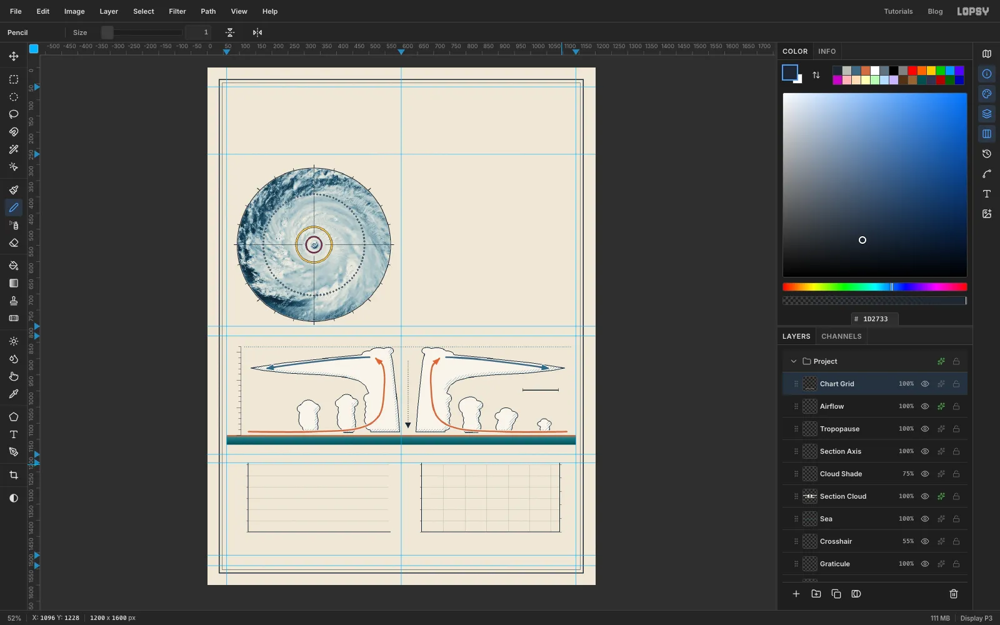

Add a layer called `Chart Grid`. Both plots run from `y 1228` at the top to `y 1436` at the bottom.

1. **Hairlines:** pick the **Pencil** at **Size** `1` in `#B9BDB4`. For Fig. 3 (x `128`–`560`), draw a horizontal line every 50 km/h. Each 50 km/h is about 35 px. Fig. 4 runs from x `664` to `1090` and gets the same horizontals, plus a vertical line every 50 km. Each 50 km is about 67 px, so 300 km lands at x `1063`, with a little room left before the pressure axis at x `1090`.
2. **Axes:** switch to ink at **Size** `2`. Fig. 3 gets a left axis and a baseline. Fig. 4 gets a left axis for wind, a baseline and a right axis for pressure.
3. **Ticks:** add 6 px ink ticks at **Size** `1` beside each axis.

## Draw the Saffir–Simpson bars

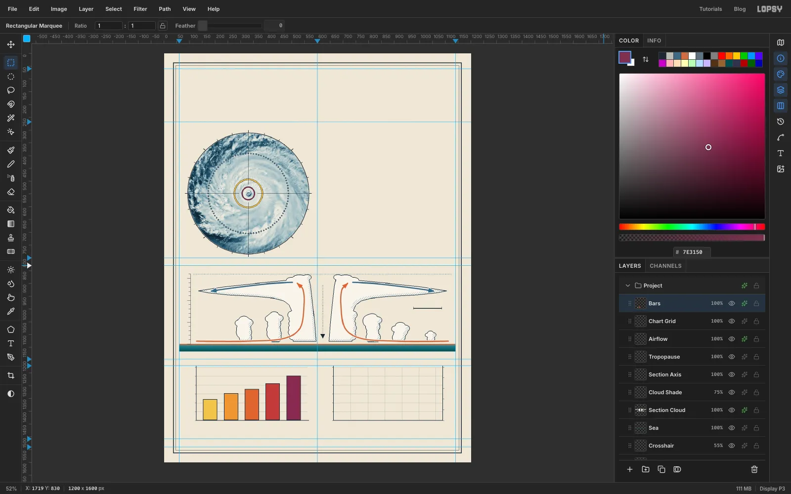

Add a layer called `Bars`. Each bar is 56 px wide with about 25 px between them, and its height is the category's minimum wind speed on the 0–300 km/h scale. All five run down to the baseline at `y 1436`:

1. CAT 1, 119 km/h: from `153, 1354`, in yellow `#EBC55E`
2. CAT 2, 154 km/h: from `235, 1329`, in orange `#E39A4A`
3. CAT 3, 178 km/h: from `316, 1313`, in red-orange `#D16B3E`
4. CAT 4, 209 km/h: from `397, 1291`, in red `#B4453F`
5. CAT 5, 252 km/h: from `479, 1261`, in plum `#7E3150`

Make each bar with an exact-corner rectangle down to the baseline and **Edit → Fill** it in its colour. Then give the layer a 2 px ink **Stroke**, position **inside**.

These are the same colours used in Fig. 1: yellow is the hurricane-force ring and plum is the Cat 5 core. Keeping colours consistent across figures is what makes a plate read as one piece.

## Plot wind and pressure

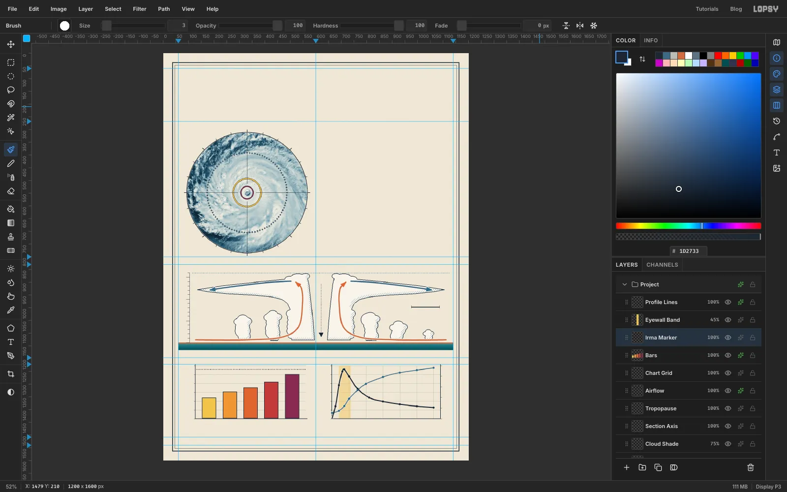

1. **Eyewall band:** add a layer called `Eyewall Band`. Fill a rectangle from 20 km to 55 km out (x `691`–`737`), the full height of the plot, in yellow, and set the layer to `45%`. That's where the fastest winds are.
2. **Curves:** add a layer called `Profile Lines`. The left axis is wind, 0 to 300 km/h, and the right axis is pressure, 910 hPa at the baseline up to 1010 at the top. Here are the data points, as distance from the eye:

   - **Pressure, hPa:** 0 km 921, 20 km 925, 36 km 934, 50 km 948, 75 km 964, 100 km 976, 150 km 989, 200 km 997, 250 km 1002, 300 km 1006
   - **Wind, km/h:** 0 km 0, 10 km 70, 20 km 190, 30 km 268, 36 km 280, 50 km 240, 75 km 170, 110 km 119, 150 km 98, 200 km 82, 250 km 71, 300 km 63

   With the **Pen**, click the first point, press-and-drag through the middle ones, and click the last, as you did for the arrows. Stroke the pressure curve in rule blue at **Stroke** `3` and the wind curve in ink at **Stroke** `4`. The wind passes 119 at 110 km and 63 at 300 km, which match the yellow ring and the dotted ring in Fig. 1, so the figures agree. Ink rather than red keeps red meaning Category 4 only.
3. **Data dots:** pick the **Brush** at **Size** `9` and click once on every data point, in each curve's colour. Give the layer a 2 px paper-coloured **Stroke** outside, so the dots stand off the lines.
4. **Irma's peak:** click **Bars**, add a layer called `Irma Marker`, and draw a dotted ink line across Fig. 3 at 280 km/h, using the 300% spacing trick again.

## Add rules, leaders and the Cat 5 stamp

1. **Rules:** on the **Frame** layer, fill a 4 px ink rule across the page at `y 256` and a 1 px rule at `y 264`, for a classic heavy-and-light header rule. Add 1 px dividers at `y 813`, `1172` and `1500`.
2. **Leaders:** add a layer called `Leaders`. With the **Pencil** at **Size** `1`, click on a feature, [[Shift]]-click at `x 600` on its callout row, then [[Shift]]-click at `x 610`. The four leaders are:
   - cirrus at the top right, from `505, 432` to the row at `y 458`
   - the eye, from `328, 546` to `y 524`
   - the eyewall, from `348, 566` on the plum ring to `y 590`
   - a rainband at the lower right, from `446, 640` to `y 656`

   Click a 7 px **Brush** dot on each feature end. Keep the eye and eyewall ends well apart, or the two leaders read as one. A 1 px paper **Stroke** outside keeps the leaders visible over the clouds.
3. **Scale bar:** on the same layer, fill an ink bar from `66, 790` to `170, 795`. That's 104 px, or 200 km at this scale. Then fill `118, 791` to `169, 794` with paper colour `#F4EFE3`, leaving a thin ink border round the right half. That gives the classic two-block bar.
4. **Legend keys:** add a layer called `Legend Keys` with three grey brush dots, a short yellow bar and a short plum bar, stacked down the right column at `x 622`. Give the layer a 1 px ink **Stroke**.
5. **Stamp:** add a layer called `Cat 5 Stamp` and make two plum rings around `1100, 344`, one of radius 37 shrunk by `3` and one of radius 31 shrunk by `1`.

## Label the charts

Before typing anything, add one empty layer at the top called `Type Anchor`, and click it before every new piece of text. When a text layer is selected, the Text options restyle that layer, so starting each new label from an ordinary layer keeps the last one safe.

Work from the bottom of the page upward. A click with the **Text** tool ([[T]]) inside an existing text line's box edits that text instead of starting a new one, and the box reaches below and to the right of the words. Building upward means you never click into a line you've already set.

Three typefaces do all the work: **Barlow Condensed** for titles, **IBM Plex Mono** for data, and **Instrument Serif** for prose. Check each label's **Letter spacing** in the **Text** panel as you go. It's `0` unless a step says otherwise, and the last value carries over to the next new text. Rename each text layer after its job, such as `Title`, `Fig 3 Head` or `Alt 5`.

Within each list below, the items run from the bottom of the page up, so you can type them in that order.

- **Footer:** at `y 1512`, a two-line source note in Plex Mono at `10` px: "Satellite: NASA Aqua/MODIS via Worldview, processed by Pierre Markuse (CC BY 2.0). Wind scale: NOAA Saffir–Simpson." and "Profile curves idealised from Irma’s best-track data. Not for navigation." On the right, "LOPSY TECHNICAL PLATES · Nº 07" in Barlow Condensed SemiBold at `16` px, right-aligned to the margin.
- **Axis numbers:** Plex Mono at `11` px. Wind numbers and distances are ink, and pressure numbers are blue. Fig. 4 shares the `0` on its distance axis, so leave the wind axis's `0` off. Add "DISTANCE FROM THE EYE, km" under Fig. 4.
- **Bars:** values in Plex Mono Medium at `14` px, sitting 9 px inside each bar's top edge. They're ink on the three lighter bars and paper-coloured on the two darker ones, so each has enough contrast. Category names go underneath in Barlow Condensed SemiBold at `17` px.
- **Series:** "WIND, km/h" above the ink curve, "PRESSURE, hPa" below the blue one, and a small "← EYEWALL" just right of the yellow band.
- **Irma's peak:** "IRMA, 7 SEP 2017: 280 km/h" in Plex Mono Medium at `11` px, just under the dotted line in Fig. 3 and about 14 px in from the axis.
- **Titles:** "FIG. 3  SAFFIR–SIMPSON SCALE" and "FIG. 4  WIND AND PRESSURE PROFILE" in Barlow Condensed SemiBold at `28` px with `1` px letter spacing.

## Label the cross-section

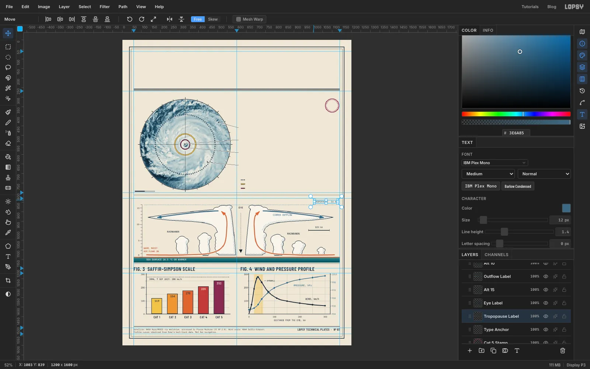

Keep going upward, still in Plex Mono Medium at `11`–`12` px unless noted:

- "SEA SURFACE 26.5 °C OR WARMER" in paper colour on the teal band, starting at `x 128`. That's the minimum water temperature a hurricane needs.
- `0` beside the bottom tick, lifted a few pixels so it doesn't touch the orange surface line.
- "WARM, MOIST / AIR FLOWS IN" on two lines in dark orange `#A8492A`, starting at `x 112` just above the incoming arrow. It labels the air, not the water.
- `5` and `10` beside their long ticks, right-aligned to `x 88`.
- "RAINBANDS" twice: over the two left towers, and beside the right towers just left of the scale bar. Put "100 km" over the scale bar.
- "CIRRUS OUTFLOW" in rule blue inside the right anvil, under its arrow.
- "EYE" in ink at `13` px, centred in the gap between the overshooting tops, and `15` beside the top long tick.
- One line along the top, just above the dotted tropopause:
  - "FIG. 2  CROSS-SECTION THROUGH THE EYE" in Barlow Condensed SemiBold at `28` px.
  - "VERTICAL SCALE EXAGGERATED ABOUT 15×" in Plex Mono at `12` px.
  - "TROPOPAUSE  16 km" in rule blue, right-aligned.

  Type them right to left. The title sits above the plot, like the other three.

## Set the headline and the Fig. 1 text

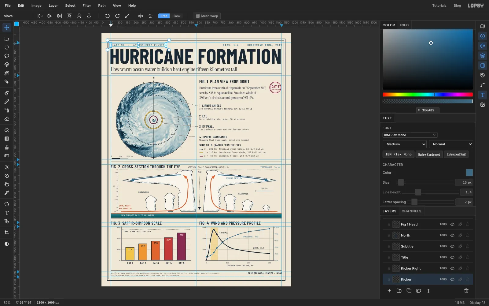

- **Scale bar labels:** `0`, `100` and `200 km` in Plex Mono at `11` px over the bar under the disc.
- **Legend rows:** in Plex Mono at `13` px, starting at `x 652` beside the keys:
  - "r = 300 km  tropical-storm winds, 63 km/h and up"
  - "r = 110 km  hurricane-force winds, 119 km/h and up"
  - "r =  50 km  Category 5 core, 252 km/h and up"
- **Legend title:** "WIND FIELD (RADIUS FROM THE EYE)" in Barlow Condensed SemiBold at `18` px, at `y 700`.
- **Callouts:** four titles in Barlow Condensed SemiBold at `21` px, each centred on its leader row (`y 656`, `590`, `524` and `458`). Each has a note in Plex Mono at `13` px just under it. Type the note first, then the title above it:
  - "4  SPIRAL RAINBANDS": "Showers that feed warm, moist air inward"
  - "3  EYEWALL": "The tallest storms and the fastest winds"
  - "2  EYE": "Calm, sinking air, about 30 km across"
  - "1  CIRRUS SHIELD": "Ice-crystal exhaust fanning out 12–15 km up"
- **Stamp:** "280 km/h" in tiny plum Plex Mono, with "CAT 5" in plum Barlow Condensed Bold above it, centred in the rings.
- **Fig. 1 caption:** at `x 620, y 338`, in Instrument Serif at `22` px, on three lines: "Hurricane Irma north of Hispaniola on 7 September 2017, / seen by NASA’s Aqua satellite. Sustained winds of / 280 km/h circled a central pressure of 921 hPa."
- **Fig. 1 title:** "FIG. 1  PLAN VIEW FROM ORBIT" in Barlow Condensed SemiBold at `28` px.
- **North:** a small "N" over the top tick.
- **Deck:** "How warm ocean water builds a heat engine fifteen kilometres tall" in Instrument Serif at `36` px, just above the header rule.
- **Headline:** "HURRICANE FORMATION" in Barlow Condensed Bold at `132` px with `0` letter spacing. It fills the measure from margin to margin.
- **Kickers:** "PLATE 07 · ATMOSPHERIC PHYSICS" top left and "FIGS. 1–4 · HURRICANE IRMA, 2017" top right, in Plex Mono Medium at `15` px with `2` px letter spacing, in rule blue.

## Turn the axis titles on their side

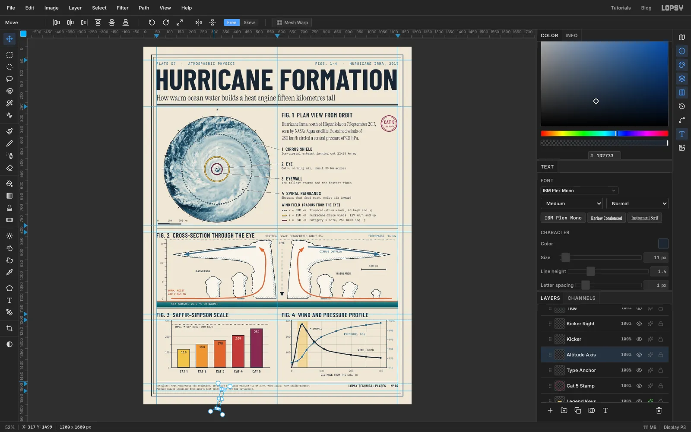

The two charts that measure height and speed need a vertical axis title.

1. Click **Type Anchor** and type "ALTITUDE, km" in Plex Mono Medium at `11` px, in the empty strip below the frame.
2. Switch to the **Move** tool. Live text has its own handles. Hold [[Cmd]] and drag the round rotate handle at its top right corner a quarter turn anticlockwise. [[Cmd]] snaps the angle to 15° steps, so stop when it reads −90°. If it lands one step short, press [[Cmd+Z]] and drag a little further.
3. Drag it with the **Move** tool up beside the Fig. 2 axis, then use the arrow keys to centre it between the frame and the altitude numbers.

Do the same with "MIN. SUSTAINED WIND, km/h" for Fig. 3. The text stays live, so you can still fix a typo later.

## Group each figure

A plate with seventy layers needs some order.

1. Click **Sea**, then [[Cmd]]-click every other Fig. 2 layer: the cloud, shade, axis, tropopause, airflow and every Fig. 2 label.
2. Choose **Layer → Group Layers** and name the group `Fig 2 Section`.
3. Do the same with **Plan View**, **Wind Field**, **Graticule** and **Crosshair**, and name that group `Fig 1 Plan`. A group can hold another group, so the duotone keeps working.

Grouping changes nothing on screen: each group goes where its top layer was, and the stacking order stays the same.

## Nudge Fig. 2 into place on the grid

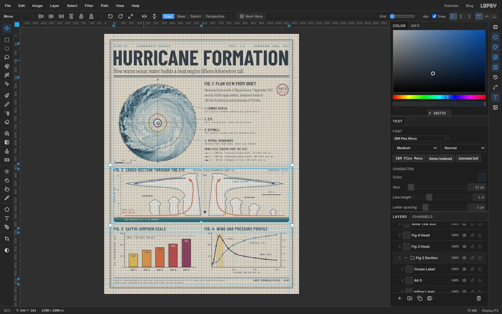

Fig. 2 was built 8 px low. Now centre it between its rules:

1. Choose **View → Show Grid** and drag the **Grid** slider in the options bar all the way left, to `4px`. Check that **Snap** is ticked.
2. Select the **Fig 2 Section** group and pick the **Move** tool.
3. Press [[Up]] twice. With grid snap on, each arrow press moves exactly one grid cell, so the whole figure goes up 8 px together. If you go too far, [[Cmd+Z]] steps back one press at a time.
4. Hide the grid again.

## Add paper grain

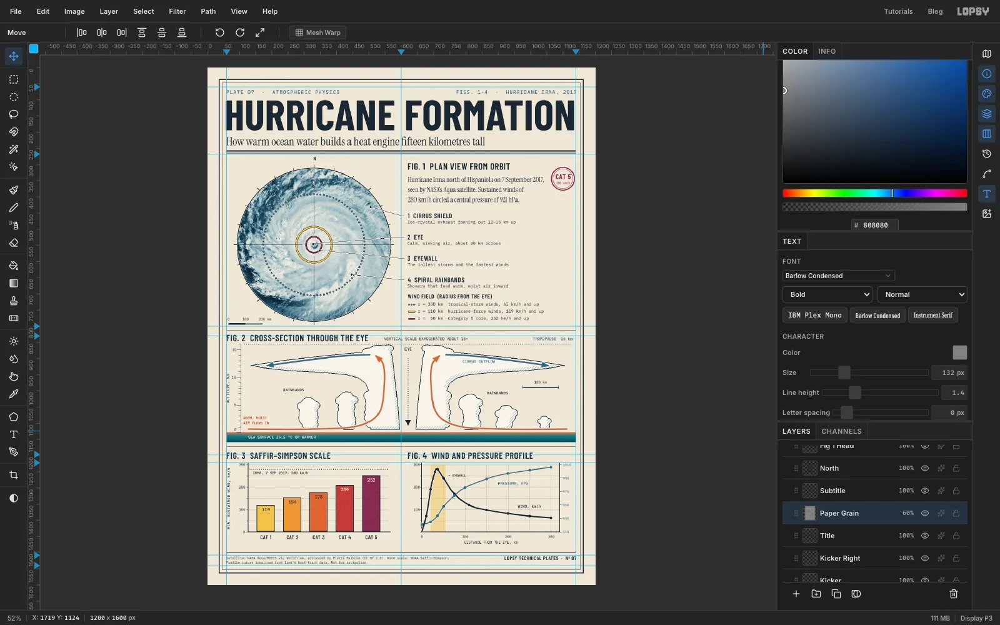

One last layer makes the whole plate feel printed.

1. Click **Title**, the headline's text layer, then **Add Layer**, and name the new layer `Paper Grain`. Fill it with mid-grey `#808080`.
2. Choose **Filter → Add Noise…** with **Amount** `80`, **Mono** and **Gaussian**.
3. Set its blend mode to **Overlay** and its opacity to `60%`. Mid-grey disappears in Overlay mode, so only the speckle is left.

The grain sits over the artwork and the headline, while the small labels above it stay crisp.

Choose **File → Save Project** to keep everything editable, then **File → Quick Export PNG** for the finished plate.
