In the late 1950s and 60s, American tiki bars sold a Polynesian fantasy:
carved idols, flaming cocktails, bamboo and a sunset that never ended. The
look came back in the 90s through painters like Josh Agle (Shag), who drew
it in flat colour with hard edges and no blending. That flat style suits a
billboard, which gets about three seconds of attention from someone driving
past.

This billboard sells one drink, the Zombie, a rum punch so strong that
Don the Beachcomber is said to have limited guests to two. The layout splits
the board in two. A carved tiki mug sits in front of a striped sun on the
left, and a two-line headline holds the right. Everything is built from
selections, flat fills and a few brush clicks. The only soft textures are a
wood grain and a fine print grain.

Along the way you'll use:

- typed-in **marquee** corners, **Edit → Fill** and ruler **guides**
- Shift-drag to **add** to a selection and Option-drag to **subtract** from it
- the **Pen** tool with **Path to Selection** from the Paths panel
- Shift-click straight **brush** strokes and single-click brush puffs
- **Duplicate Layer** on a group, the Move tool's **Flip Horizontal**, and
  scale and rotate handles
- **Define Pattern** and **Fill with Pattern** with a vertical offset
- **Add Noise**, **Motion Blur** and **Fibers** for wood grain
- **Copy** and **Paste** to repeat a row of teeth
- **Sunburst** with background-colour gaps for a paper umbrella
- **Stroke** and **Drop Shadow** effects, [[Cmd]]-click thumbnail selections,
  and a gradient through type
- **Group Layers**, a group move and undo

The palette is a 60s sunset with a carved-wood mug and lime "zombie" accents:

- Sky `#0F4E58` / `#1A6769` / `#2C8580` / `#E36B6E` / `#F08A52` / `#F59A4A`
- Sun `#FFF2A8` → `#FFD24F`
- Clouds `#F6A48C`, cloud highlight `#FCD9A8`
- Volcano `#2A1428` → `#4A2238` → `#6B2E45`, lava `#FF5A1F` / `#FF7A2A` / `#FFD56A`, smoke `#8E4A63`
- Sea `#2A7C78` / `#145A60`, waves `#5FB3A8`, glints `#FFD27A`
- Palms `#0A2226`, trunk rings `#1E4A4E`
- Counter `#5C2E14`, counter lip `#B86C34`, grain grey `#808080`
- Tapa cream `#F1DDB0`, tapa brown `#3B1E10`, tapa rust `#C8522A`, keylines `#2A1206`
- Mug `#5E2E14` / `#8E4A22` / `#B4652E`, raised carving `#B8682E`, recesses `#1E0C04`
- Drink `#C8381C` / `#E8682E`, teeth `#F1DDB0`
- Eyes `#B6FF3B`, eye rim `#6ED62A`
- Foam `#7ED23A` / `#B8FF6A` / `#E4FFB8`
- Straw `#F6EEDF` / `#D8321E`, umbrella `#1FA59A` / `#FFF1D0`, umbrella stick `#E9D3A8`
- Headline `#FFF7E0` → `#FFE79A` → `#FFC857`, outline and shadow `#3B1E10`
- Tagline `#3A1C2E`, info line `#F1DDB0`

> **Tip:** Positions are in document pixels, written `x, y`, and the status bar shows where the pointer is. **Edit → Fill** fills the selection with the foreground colour, and [[Cmd+D]] deselects. To load a layer's shape as a selection, [[Cmd]]-click its thumbnail in the Layers panel.

> **Tip:** For an exact rectangle or circle, choose the **Rectangular** or **Elliptical Marquee** and click once on the canvas without dragging (with nothing selected). A dialog asks for the **From** and **To** corners. A circle of radius `r` around `x, y` runs from `x − r, y − r` to `x + r, y + r`.

> **Tip:** Blend modes live in the **Blend** dropdown at the top of a layer's effects drawer (the sparkle icon on its row). New layers land directly above the layer you have selected, so click the layer you want underneath before you press **Add Layer**.

## Set up the canvas and a flat banded sky

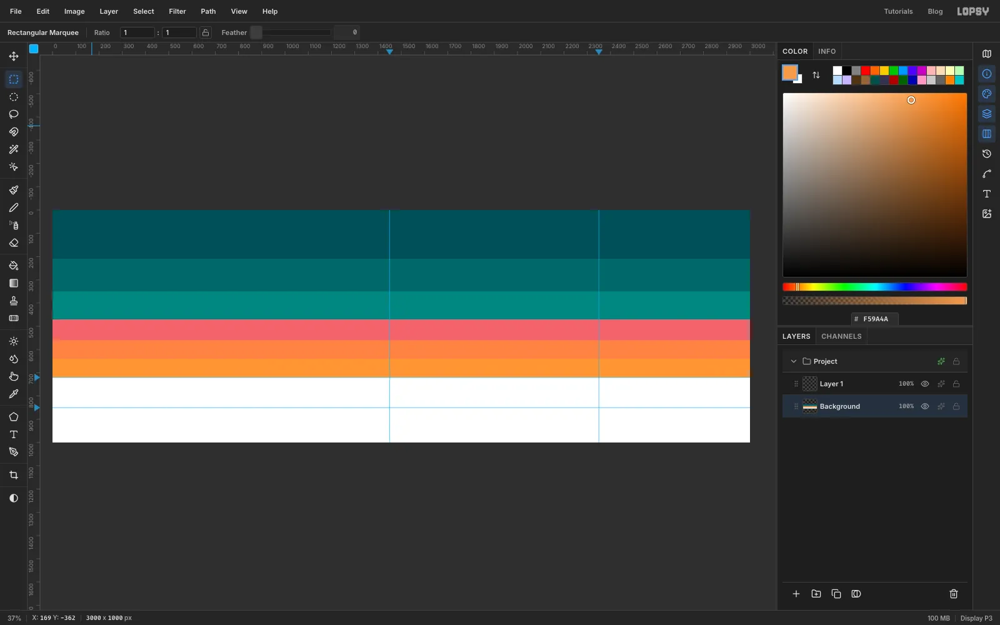

1. Create a new document **3000** × **1000** px. That's a 3:1 ratio, close
   to a standard roadside billboard. Ignore the empty *Layer 1* it starts
   with; you'll delete it at the end.
2. Click the left ruler at `720` for the horizon and at `850` for roughly
   where the bar counter will start. Click the top ruler at `1450` and
   `2350`. Those two guides mark the column the headline will sit in.
3. Click the **Background** layer. Instead of a gradient, the sky is six
   flat bands, each a full-width rectangle filled with **Edit → Fill**.
   Select each one with the Rectangular Marquee dialog and fill it:
   - `0, 0` to `3000, 210` in `#0F4E58`
   - `0, 210` to `3000, 350` in `#1A6769`
   - `0, 350` to `3000, 470` in `#2C8580`
   - `0, 470` to `3000, 560` in `#E36B6E`
   - `0, 560` to `3000, 640` in `#F08A52`
   - `0, 640` to `3000, 720` in `#F59A4A`

The sudden jump from teal to coral is deliberate. Flat bands with hard edges
are what make it look like a 60s print rather than a photo.

## Paint the sun

Deselect, click **Background** and add a layer named *Sun*. Make a circle
selection from `430, 230` to `1090, 890`. That's a radius of 330 around
`760, 560`, so its lower part dips below the horizon.

Choose the **Gradient** tool, set it to **Linear**, open the gradient editor
and set the two stops to `#FFF2A8` and `#FFD24F`. Drag from the top of the
circle (`760, 230`) straight down to the horizon (`760, 720`).

## Cut the sun's slits

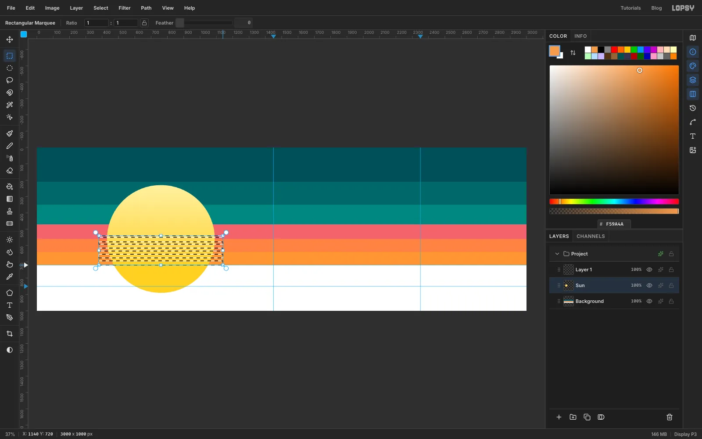

The striped "setting sun" is a classic of retro posters. Press [[Cmd+D]] to
drop the circle selection, then click once with the **Rectangular Marquee**
and type the first slit, `380, 540` to `1140, 550`. Zoom in to 100% (these
bands are thin), hold [[Shift]] and drag four more rectangles across the
full width of the sun, each a little thicker than the last:

- `578` to `592`
- `616` to `634`
- `654` to `676`
- `694` to `720`

[[Shift]] adds each new rectangle to the selection. Press [[Delete]] to cut
all five slits at once, then deselect. The sky bands show through the gaps.

## Add flat clouds

Add a layer named *Clouds* above *Sun*. Choose the **Brush**, set **Size**
`40` and **Hardness** `100`, and set the foreground to `#F6A48C`. A brush
dragged in a straight line leaves a pill with round ends, which is all a
Shag-style cloud is. Click at the start of each bar, then [[Shift]]-click at
the end:

- `1010, 262` to `1250, 262`
- `1060, 304` to `1330, 304`
- `960, 346` to `1200, 346`

Set **Size** `16` and the colour to `#FCD9A8`. Add a short highlight along
the top-left of each bar, about 12 px above its centre and about half its
length. Finally, select a thin rectangle from `1080, 326` to `1104, 370` and
press [[Delete]] to split the bottom bar in two. Deselect.

## Draw the volcano with the Pen

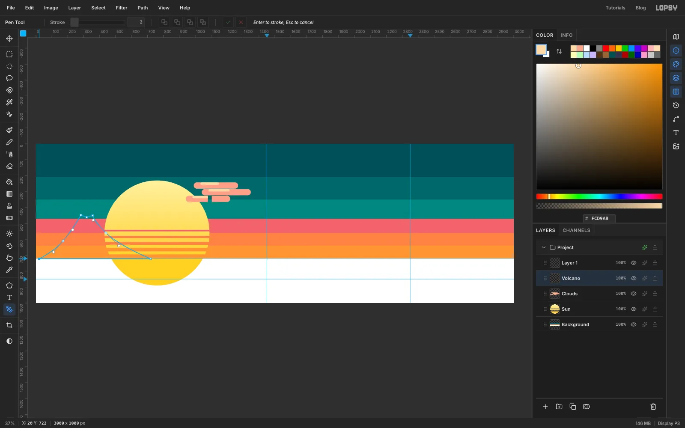

Add a layer named *Volcano* above *Clouds* and choose the **Pen** tool
([[P]]). Click and drag where you want curves, and just click for corners:

1. Click `20, 722` on the horizon.
2. Press at `170, 610` and drag toward `230, 540`. The handle bends the left
   flank inward.
3. Click the crater rim at `282, 448`, its floor at `318, 462` and the right
   rim at `356, 450`.
4. Press at `440, 560` and drag toward `520, 640` to curve the right flank.
5. Click `720, 722`, then click the first anchor to close the path.

In the **Paths** panel, click **Path to Selection**. Choose the
**Gradient** tool, set it to **Linear**, and in the gradient editor set the
end stops to `#2A1428` and `#6B2E45`. Click the bar at 55% to add a middle
stop and make it `#4A2238`. Drag from the left flank (`150, 600`) to the
right flank (`560, 560`), so the volcano gets lighter toward the sun.
Deselect.

## Add lava and a smoke plume

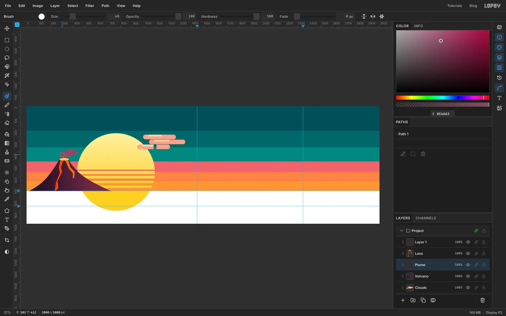

Add a layer named *Lava* above *Volcano*. With the **Lasso**, draw a thin
zigzag ribbon from the crater at about `300, 455` down the left flank to the
horizon at about `245, 720`, and fill it with `#FF5A1F`. Draw a shorter
ribbon down the right side of the crater to about `400, 610` and fill it with
`#FF7A2A`. Then make an elliptical selection from `280, 442` to `360, 462`
over the crater and fill it with `#FFD56A` for the glow.

Click *Volcano* again and add a layer named *Plume*, so the smoke sits
behind the lava. Choose the **Brush** (still **Hardness** `100`) in
`#8E4A63`. Click once for each puff, changing **Size** between clicks:

- `302, 412` at `40`
- `322, 424` at `58`
- `350, 402` at `62`
- `386, 392` at `52`
- `418, 394` at `36`

Keep the plume small and low. The palm fronds will cross this corner
later, and a tall plume would collide with them.

## Lay the sea and waves

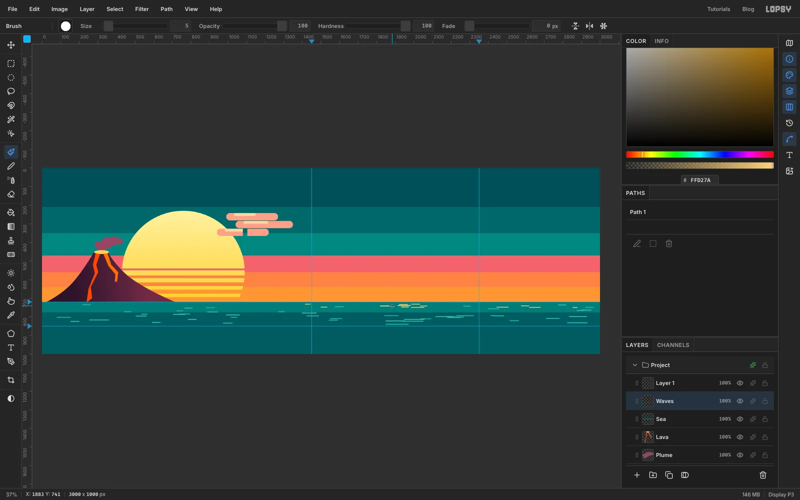

Click *Lava* and add a layer named *Sea*. Select `0, 720` to `3000, 1000`,
fill it with `#145A60`, then select `0, 720` to `3000, 776` and fill it with
`#2A7C78`. The lighter band reads as the water nearest the horizon.

Add a layer named *Waves*. Set the Brush to **Size** `6` in `#5FB3A8` and
scatter about forty short horizontal dashes across the sea with click and
[[Shift]]-click. Make them longer the lower they are, from about 30 px near
the horizon to about 120 px near the bottom. Then set **Size** `5` in
`#FFD27A` and add a dozen short gold glints just under the horizon on the
right, where the sunlight would catch the water.

## Draw the palm trunk

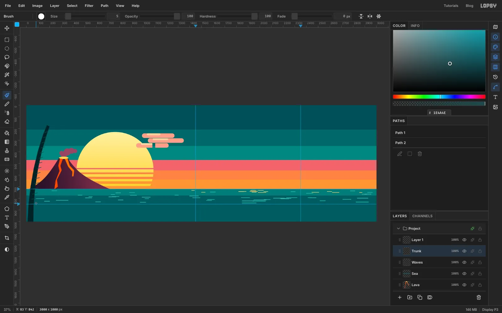

Add a layer named *Trunk* above *Waves*. The trunk is a long, gently
curving wedge, about 50 px wide at the base and 22 px at the crown, leaning
to the right as it rises from the bottom left corner. With the **Pen**,
click up the left edge and back down the right edge:

- up the left: `10, 1000`, `18, 860`, `36, 700`, `64, 540`, `100, 390`,
  `144, 250`, `176, 172`
- down the right: `198, 182`, `172, 262`, `132, 398`, `100, 548`,
  `76, 706`, `62, 862`, `60, 1000`

Close it on the first anchor, then **Path to Selection** and fill it with
`#0A2226`. Deselect.

For the trunk rings, set the Brush to **Size** `5` in `#1E4A4E`. Every
40-odd pixels up the trunk, click just inside the left edge and
[[Shift]]-click just inside the right edge, slightly higher, so each ring
tilts with the lean.

## Add the fronds

Add a layer named *Fronds* above *Trunk*. Each frond is one **Lasso** shape
starting at the crown (`186, 176`). Drag out along the top edge of the leaf
in a saw-tooth, with each tooth raked back toward the crown. Go round the
tip and come back along the underside the same way. Fill each one with
`#0A2226` before you draw the next. Make seven of them:

- one up and to the left, one straight left and one straight up
- one long one to the upper right, about 380 px, curving down at the tip
- one shorter one to the right, drooping about 110 px
- one hanging down to the left
- one short one pointing almost straight up

Let the long ones run off the top and left edges, and keep the drooping one
clear of the volcano's crater. Finish with an elliptical selection from
`156, 162` to `216, 206`, filled with the same colour, to cover the joins at
the crown.

## Group the palm

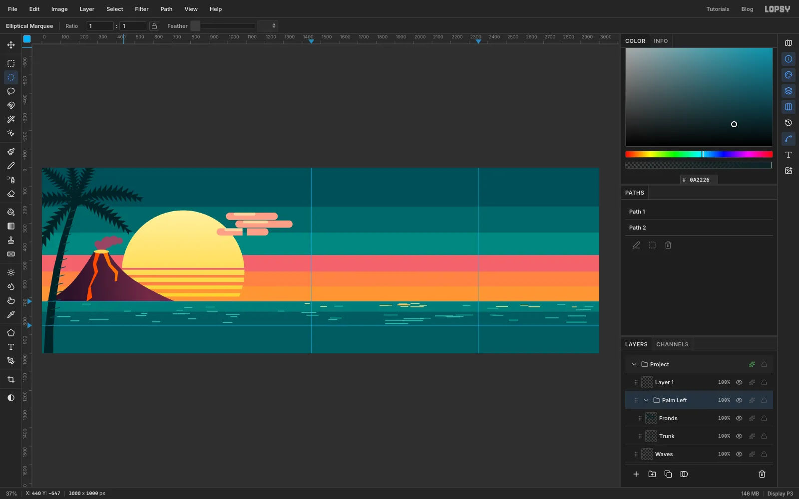

Click *Trunk*, [[Shift]]-click *Fronds*, and choose **Layer → Group
Layers** ([[Cmd+G]]). Name the group *Palm Left*.

## Duplicate and flip the palm

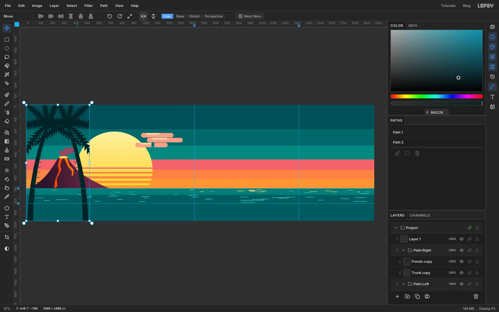

With *Palm Left* selected, choose **Layer → Duplicate Layer** and rename the
copy *Palm Right*. Choose the **Move** tool and click **Flip Horizontal** in
the options bar. The whole group mirrors in place: trunk, fronds and all.

## Push the copy to the right edge

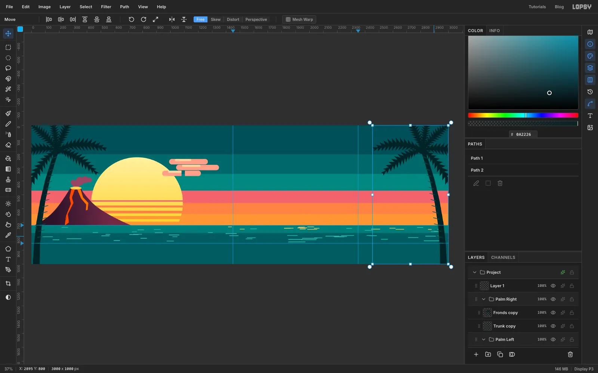

Drag *Palm Right* to the right, about `2450` px, until the right side of
its box sits on the right edge of the canvas. Zoom in on the top right
corner to check that the two edges meet.

The precise edge matters. The original fronds were cut off where they left
the canvas, so the flipped copy has a straight cut along its right side and
across its top. With that cut exactly on the canvas edge, nobody can see it.

## Shrink the crown

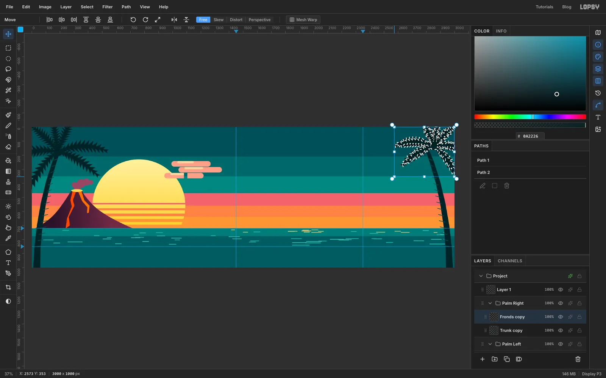

The right palm should be a little smaller so it doesn't crowd the headline.
Expand *Palm Right*, click *Fronds copy* and [[Cmd]]-click its thumbnail to
select its shape. With the **Move** tool, hold [[Cmd]] and drag the
**bottom-left** corner handle up and to the right until the fronds are about
78% of their size. [[Cmd]] keeps the proportions. Dragging that corner keeps
the opposite one (top-right) pinned, so the cut edges stay on the canvas
edges. Press [[Cmd+D]] to commit.

## Re-seat the trunk under the crown

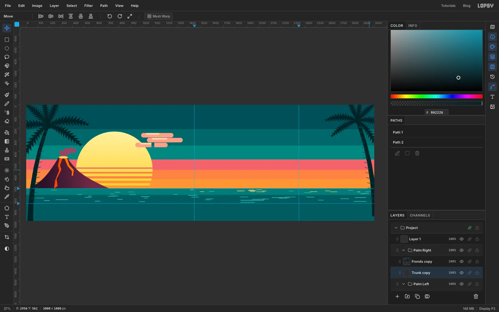

Shrinking the fronds moved the crown up and to the right. Click *Trunk
copy* and drag it about `40` px right and `40` px up, so the top of the
trunk meets the crown again. Its bottom is still well below the canvas, and
the bar counter will cover it anyway. Collapse both palm groups.

## Build the bar counter

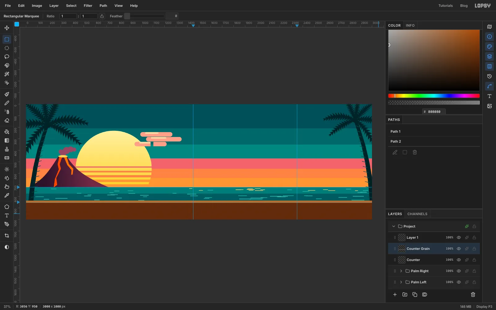

Click *Palm Right* and add a layer named *Counter*. Select `0, 852` to
`3000, 1000` and fill it with `#5C2E14`. Select `0, 836` to `3000, 856` and
fill it with `#B86C34` for the lip.

Add a layer named *Counter Grain*. Select `0, 836` to `3000, 1000` and fill
it with `#808080`. Choose **Filter → Add Noise…** with **Amount** `60` and
**Mode** **Mono**, then **Filter → Motion Blur…** with **Angle** `0` and
**Distance** `90`. That streaks the noise sideways into wood grain.
Deselect and set the layer's **Blend** to **Overlay**. Mid grey disappears
in Overlay, so only the streaks show.

## Make a tapa-cloth tile

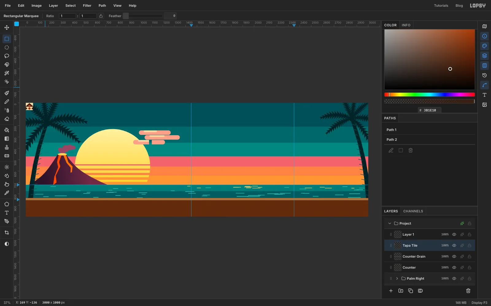

Tapa is the pounded bark cloth of the Pacific, printed with bands of
triangles and diamonds. Add a layer named *Tapa Tile* and zoom in on the top
left corner. Select `0, 0` to `64, 64` and fill it with cream `#F1DDB0`.
Then, using the **Pen** and **Path to Selection** for each shape, fill:

- a triangle `0, 30` → `32, 2` → `64, 30` in `#3B1E10`
- a smaller notch inside it, `18, 30` → `32, 16` → `46, 30`, in `#C8522A`
- a 4 px bar from `0, 30` to `64, 34` in `#3B1E10`
- a diamond `32, 36` → `46, 49` → `32, 62` → `18, 49` in `#C8522A`, with a
  small diamond in its centre in `#3B1E10`
- half a diamond against each side edge in `#3B1E10`:
  `0, 36` → `14, 49` → `0, 62` and `64, 36` → `50, 49` → `64, 62`

The two half-diamonds meet to make whole ones when the tile repeats. Select
`0, 0` to `64, 64` and choose **Edit → Define Pattern**. Deselect, then
delete the *Tapa Tile* layer with the trash button.

## Fill the tapa band

Click *Counter Grain* and add a layer named *Tapa Band*. Select `0, 852` to
`3000, 916` and choose **Edit → Fill with Pattern…**. Pick your tile and set
**Vertical Offset** to `31`.

The offset is needed because patterns tile from the top of the document,
not from the selection. At `852` the band would start 20 px into a tile, and
20 px is 31% of 64. Without the offset, the band shows half a triangle row,
the diamonds, then half a triangle row again.

Deselect. Choose the **Pencil**, set **Size** `4` and colour `#2A1206`, and
draw a keyline along each edge of the band. Click at `0, 851` and
[[Shift]]-click at `2999, 851`, then do the same along `917`.

If you want to check that the motif repeats evenly, **View → Show Grid**
overlays a grid. Turn it off again afterwards, because showing the grid also
switches on snapping.

## Shape the mug

Click *Tapa Band* and add a layer named *Mug Shadow*. Select an ellipse
from `600, 838` to `980, 854` and fill it with `#2A1206`. This hard shadow
sits the mug on the counter.

Add a layer named *Mug* and draw its barrel with the **Pen**: a tall
barrel about 360 px wide that bulges slightly in the middle and tucks in at
the base. Click `612, 340`, `602, 450`, `598, 560`, `602, 680`, `614, 790`, `628, 850`,
`932, 850`, `946, 790`, `958, 680`, `962, 560`, `958, 450` and `948, 340`,
then close it on the first point. Click **Path to Selection**. Choose the
**Elliptical Marquee**, hold [[Shift]] and drag from `612, 306` to
`948, 374` to add a rounded top to the selection.

## Shade the mug in flat strips

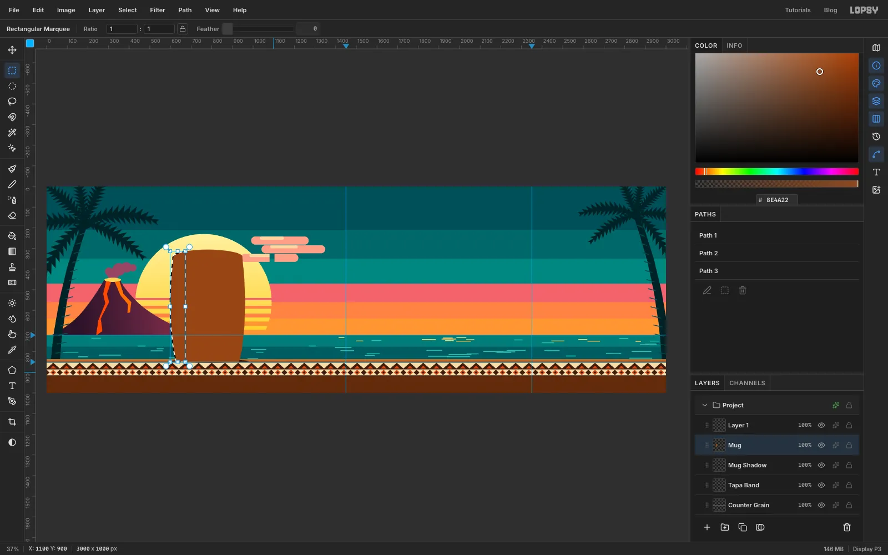

Fill the selection with `#8E4A22`. To shade the barrel in three flat tones
without a gradient, cut the selection down with the
**Rectangular Marquee**:

1. Hold [[Option]] and drag a rectangle from `672, 200` to `1100, 900`.
   [[Option]] subtracts, so only a strip down the left side is left. Fill it
   with `#5E2E14`.
2. [[Cmd]]-click the *Mug* thumbnail to reselect the whole mug, then
   [[Option]]-drag from `450, 200` to `900, 900`. That leaves the right
   edge. Fill it with `#5E2E14` too.
3. Reselect the mug once more, then [[Option]]-drag from `450, 200` to
   `700, 900` and again from `744, 200` to `1100, 900`. A 44 px strip just
   left of centre is left. Fill it with `#B4652E` for the highlight.

Deselect.

## Add wood grain to the mug

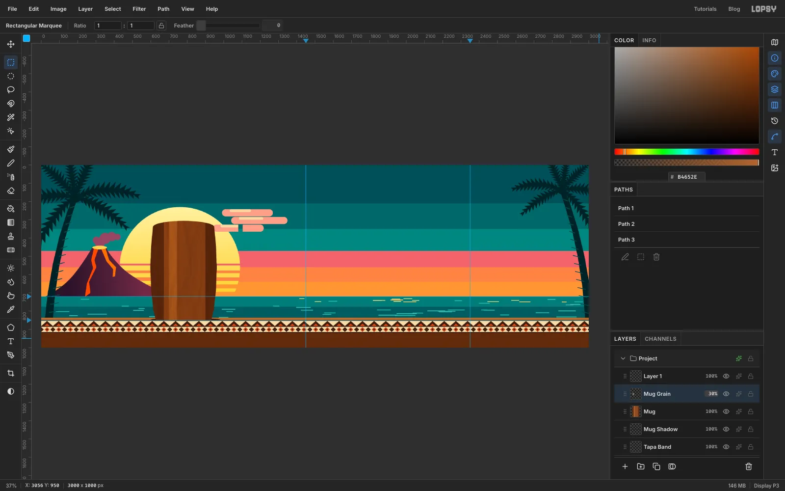

Add a layer named *Mug Grain* and [[Cmd]]-click the *Mug* thumbnail. Choose
**Filter → Fibers…** with **Variance** `24` and **Strength** `40`. The
fibres only fill the selection. Deselect, set the **Blend** to
**Multiply** and the layer opacity to `30%`.

## Fill the rim with the drink

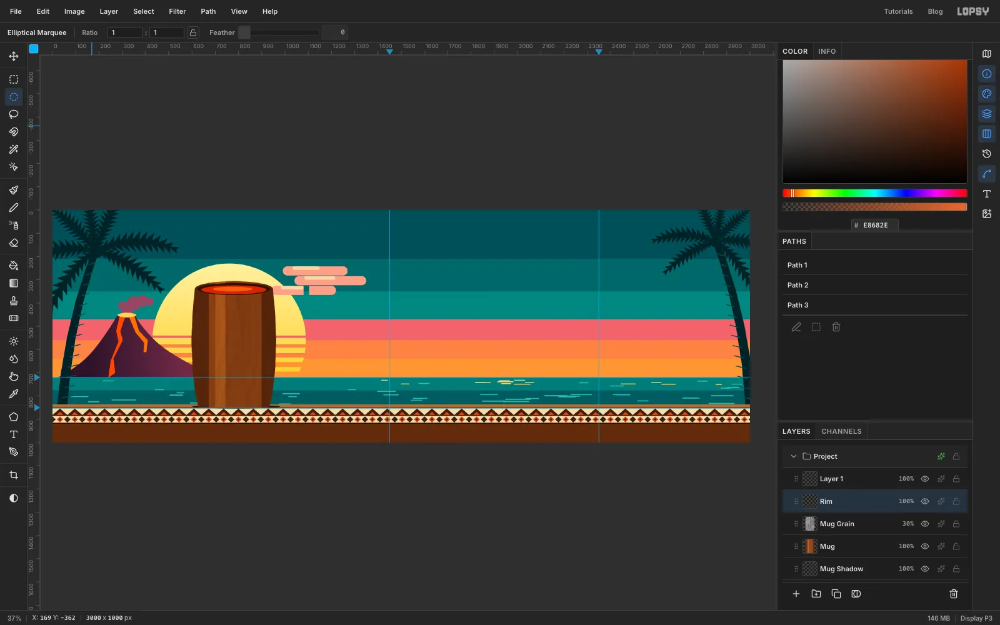

Add a layer named *Rim*. Fill three ellipses one inside the other, using the
Elliptical Marquee dialog for each:

- `624, 314` to `936, 366` in `#2A1206`, the inside of the mug
- `640, 324` to `920, 362` in `#C8381C`, the drink
- `690, 330` to `860, 350` in `#E8682E`, light on the surface

## Carve the eye sockets, mouth and chin band

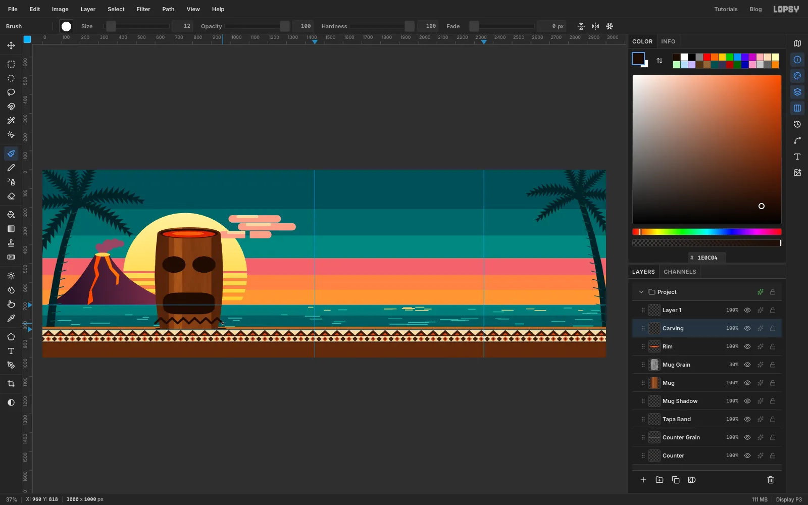

Everything cut *into* the wood goes on one layer, in near black `#1E0C04`.
Add a layer named *Carving*.

1. Fill two elliptical eye sockets, from `638, 461` to `762, 549` and from
   `798, 461` to `922, 549`.
2. With the **Lasso**, draw a wide, squarish mouth with rounded corners
   from about `642, 654` to `918, 770`, and fill it.
3. Set the Brush to **Size** `12`. Click at `600, 818`, then [[Shift]]-click
   every 30 px across the mug, alternating between `y 790` and `y 818`, to
   carve a zigzag band near the base.

## Add teeth with copy and paste

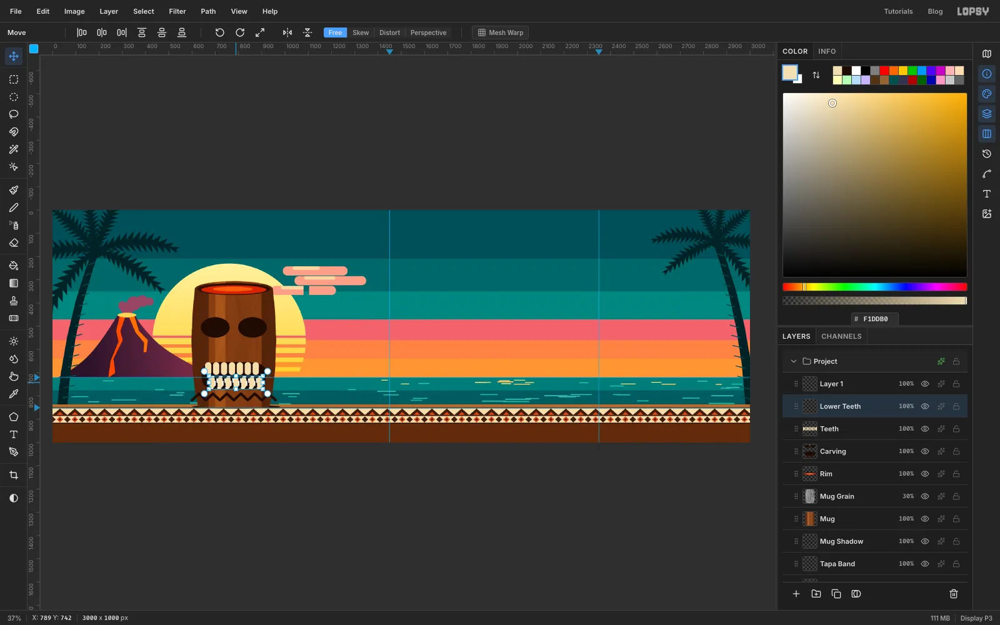

Add a layer named *Teeth* above *Carving*. Set the Brush to **Size** `28` in
`#F1DDB0` and draw seven short vertical strokes for the top row: click at
`670, 668` and [[Shift]]-click at `670, 696`, then repeat every `34` px to
`874`. The round brush gives each tooth a rounded end.

The bottom row is the same, so copy it. Select `650, 648` to `910, 716`,
choose **Edit → Copy**, then **Edit → Paste**. The paste lands in place on
a new layer, already selected, with the Move tool active. Rename the layer
*Lower Teeth* and drag it about `60` px down and half a tooth to the right,
so the rows stagger. A small drag is easier zoomed in, or use the arrow
keys for the last few pixels. Deselect.

## Trim the teeth to the mouth

The tops and bottoms of the teeth stick out past the mouth. [[Cmd]]-click
the *Carving* thumbnail and choose **Select → Inverse**. Now everything
except the carving is selected. Click *Teeth* and press [[Delete]], then
click *Lower Teeth* and press [[Delete]]. Deselect.

## Raise the brow and nose, and light the eyes

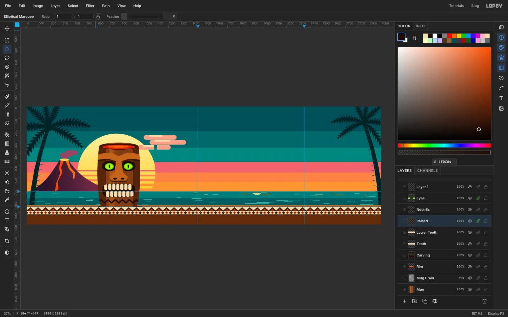

Click *Lower Teeth* and add a layer named *Raised*. With the **Lasso**,
draw the parts that stand out from the wood and fill them with `#B8682E`:

- a heavy brow across the whole mug, from `600, 410` up to a point between
  the eyes at `780, 420`, out to `962, 410`, then back along a line about
  40 px lower that dips to `780, 470` in the middle
- a broad nose that narrows at the top (`756–804` at `y 464`) and flares
  out to `702–858` at about `y 600`, with a flat base at `628`

Give *Raised* a **Drop Shadow** in `#1E0C04` with **Offset X** `0`,
**Offset Y** `12`, **Blur** `6` and **Opacity** `75`, so the brow and nose
cast shadows down the face.

Add a layer named *Nostrils* and fill two small ellipses, `732, 604` to
`764, 620` and `796, 604` to `828, 620`, in `#1E0C04`.

Add a layer named *Eyes*. Fill ellipses from `668, 486` to `732, 530` and
from `828, 486` to `892, 530` with lime `#B6FF3B`, then two narrow slit
pupils (`694, 492` to `706, 524` and `854, 492` to `866, 524`) with
`#1E0C04`. Give the layer a **Stroke** of **Width** `6` in `#6ED62A`. A
hard rim like this reads as a glow without blurring anything.

Finally, [[Cmd]]-click the *Mug* thumbnail, choose **Select → Inverse**,
and press [[Delete]] on *Carving* and then on *Raised* to trim the brow and
zigzag to the mug's outline. Deselect.

## Stripe the straw

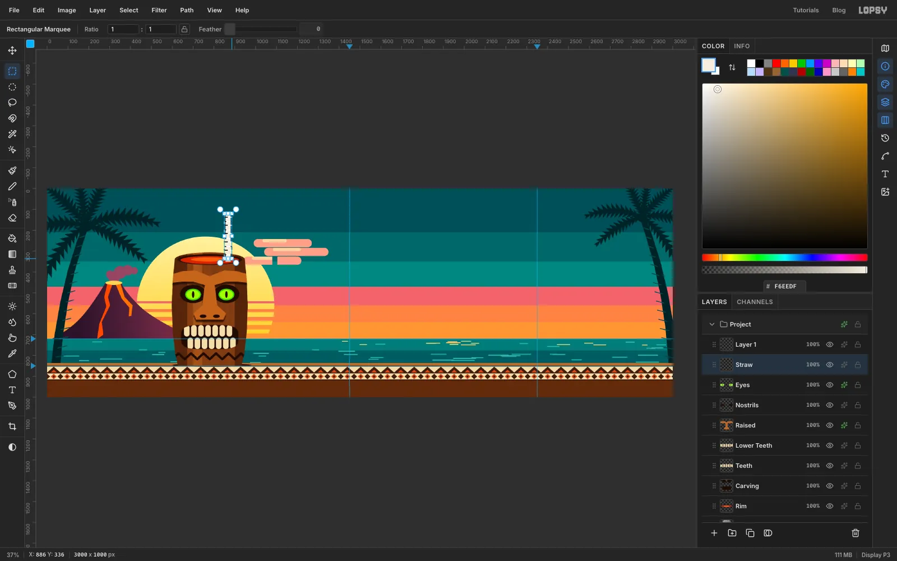

Click *Eyes* and add a layer named *Straw*. Select `856, 110` to `880, 350`
and fill it with `#F6EEDF`. Select a stripe from `850, 120` to `886, 138`,
then hold [[Shift]] and drag five more stripes, each 18 px tall and 40 px
apart (`158`, `198`, `238`, `278` and `318`). Fill them with `#D8321E` and
deselect.

## Tilt the straw

[[Cmd]]-click the *Straw* thumbnail. With the **Move** tool, drag the
rotate handle just outside a corner of the box until the straw leans about
`16°` to the right. Deselect to commit.

## Make a paper umbrella with Sunburst

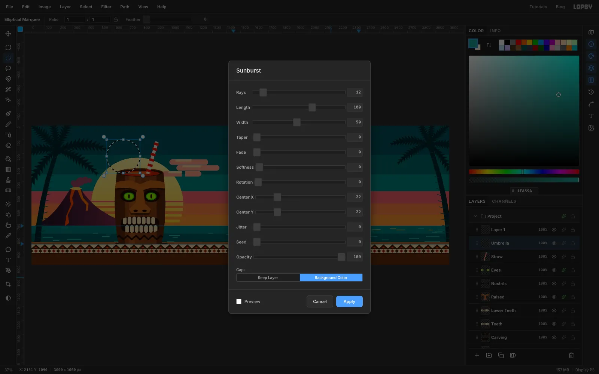

Click *Straw* and add a layer named *Umbrella*. Set the foreground to
`#FFF1D0` and press **Swap Colors** ([[X]]) so cream becomes the background
colour, then set the foreground to `#1FA59A`. Select a circle from
`540, 100` to `780, 340`.

Choose **Filter → Sunburst…** and set **Rays** `12`, **Width** `50`,
**Length** `100`, **Center X** `22` and **Center Y** `22`. The centre is
measured in percent of the canvas: `660 ÷ 3000` and `220 ÷ 1000`. Set
**Gaps** to **Background Color** so the gaps between rays are cream rather
than empty, then click **Apply**. The selection keeps the rays inside the
circle.

## Squash and tilt the umbrella

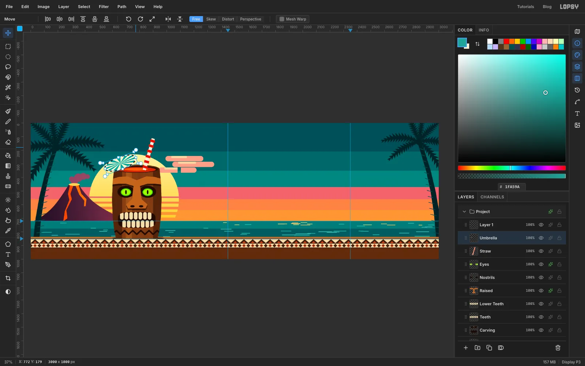

With the **Move** tool, drag the **top-middle** handle about `150` px down.
The circle becomes a shallow oval, like an open cocktail umbrella seen from
the side. Then drag a rotate handle to tilt it about `20°` to the left.

## Lift the umbrella and add its stick

Drag the umbrella about `40` px left and `120` px up, clear of the rim,
where the foam will go next. Deselect.

Choose the **Pencil** at **Size** `6` in `#E9D3A8`. Click the centre of the
umbrella at `624, 186` and [[Shift]]-click inside the rim at `700, 330` to
draw the stick.

## Pile on the zombie foam

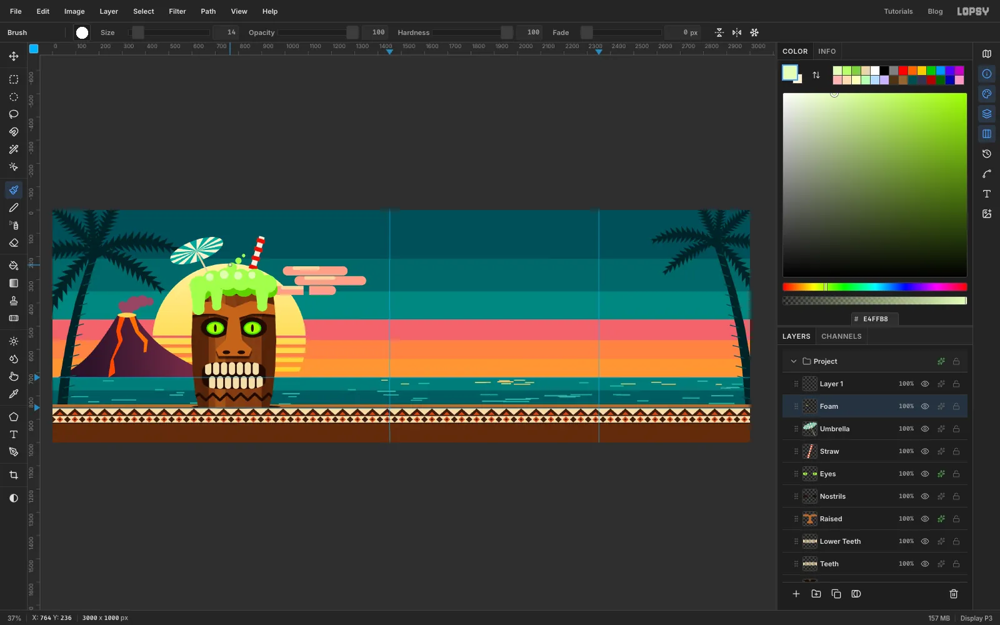

Click *Umbrella* and add a layer named *Foam*. The foam is three flat tones
of brush clicks:

1. **Shadow:** Brush in `#7ED23A`. Click a row of six puffs along the rim,
   from `640, 346` to `934, 342`, at **Size** `70`–`94`.
2. **Body:** Switch to `#B8FF6A`. Click a second row slightly higher and to
   the left, from `632, 326` to `926, 318`, at **Size** `78`–`96`, so a
   rim of the darker green shows underneath. Add three rising bubbles at
   `772, 248` (`44`), `800, 218` (`28`) and `822, 196` (`16`).
3. **Drips:** Still in `#B8FF6A`, use the **Lasso** to draw a tapering drip
   down from the rim, then fill a circle at its end so it finishes in a
   round bulb. Make three: a long one at `x 628` that ends above the left
   eye, a short one at `706`, and a medium one at `902`.
4. **Highlights:** In `#E4FFB8`, click smaller puffs (**Size** `32`–`38`)
   on the upper left of four body puffs, plus one tiny one on the biggest
   bubble.

## Type the headline

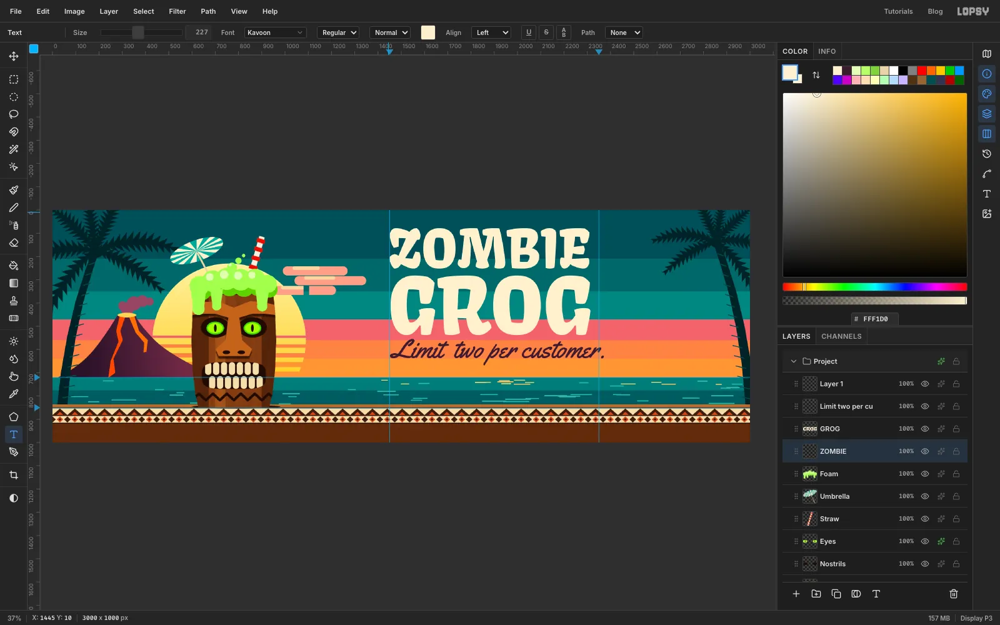

Text clicks near existing type edit that type, so type the lines from the
bottom up, in empty sky just right of the left guide. Before each new line,
click *Foam* in the Layers panel, so the font settings you change don't
restyle the line you just typed. Choose the **Text** tool:

1. Set the font to **Yellowtail**, **Size** `112` and colour `#3A1C2E`.
   Click in the orange band and type `Limit  two per customer.`, with two
   spaces after "Limit", because Yellowtail's word space is very tight.
   Press [[Tab]] to commit.
2. Click *Foam*. Set the font to **Kavoon**, **Size** `335` and colour
   `#FFF1D0`. Click in the upper teal bands and type `GROG`.
3. Click *Foam* again, set **Size** `227` and click near the top of the sky
   to type `ZOMBIE`.

Don't worry about exact positions yet; you'll line everything up next.

The two Kavoon sizes are chosen so the four-letter GROG comes out the same
width as the six-letter ZOMBIE, about 860 px, giving a justified block.

## Line up the type

With the **Move** tool, drag each line so it's centred halfway between
the two vertical guides (`x 1900`). The status bar's coordinates help. Stack
them with a modest margin above ZOMBIE (about 65 px), a small gap between
ZOMBIE and GROG, and a bigger gap under GROG. That extra room leaves space
for GROG's shadow and keeps the tagline's descenders clear of the horizon at
`720`.

## Outline the letters and select them

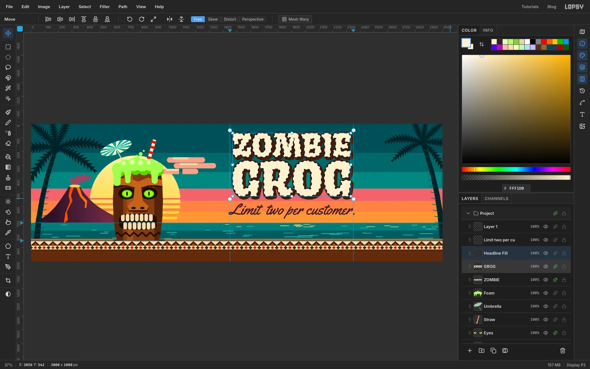

Give both *ZOMBIE* and *GROG* a **Stroke** of **Width** `10` in `#3B1E10`
and a **Drop Shadow** in the same colour with **Offset X** `14`,
**Offset Y** `14`, **Blur** `1` and **Opacity** `100`. That's the hard,
carved-sign shadow of a 60s tiki menu.

Click *GROG* and add a layer named *Headline Fill*. [[Cmd]]-click the
*ZOMBIE* thumbnail, then [[Cmd+Shift]]-click the *GROG* thumbnail to add
it, so both words are selected.

## Run a sunset gradient through the letters

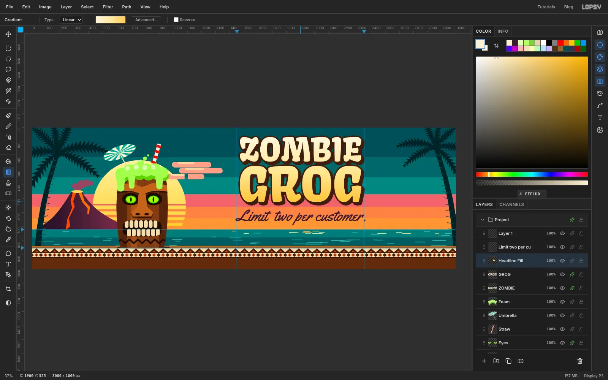

Choose the **Gradient** tool and set three stops: `#FFF7E0`, `#FFE79A` at
55% and `#FFC857`. Drag from the top of ZOMBIE (`1900, 66`) to the bottom
of GROG. The gradient only fills the letters, and the outlines and shadows
on the layers below stay in place. Deselect.

## Tilt and thicken the tagline

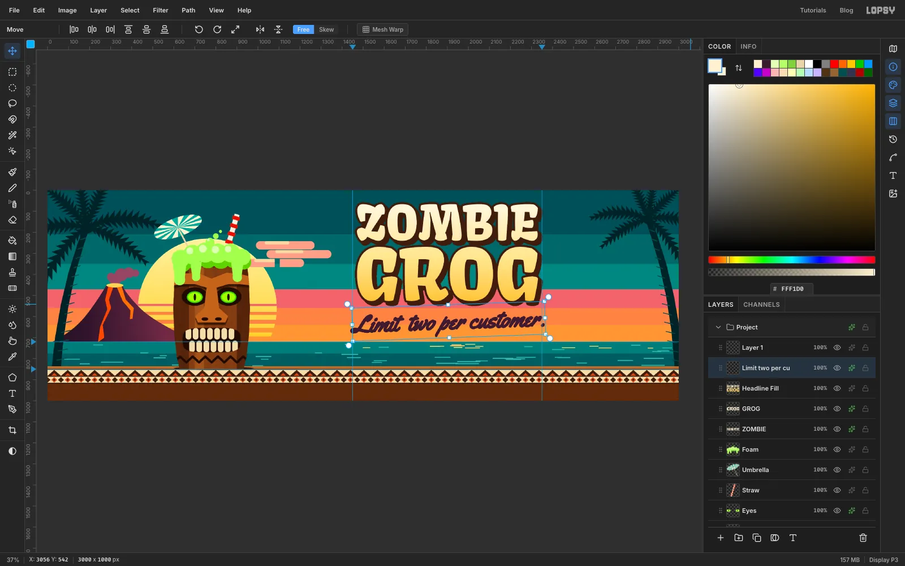

Click the tagline layer. With the **Move** tool, drag a rotate handle to
tilt it about `2°` anticlockwise, so it rises to the right, then press
[[Cmd+D]]. A script line at a slight angle feels hand-painted.

Script strokes are thin at a distance, so give the tagline a **Stroke** of
**Width** `3` in the same plum, `#3A1C2E`. That thickens every letter evenly.

## Add the info line on the counter

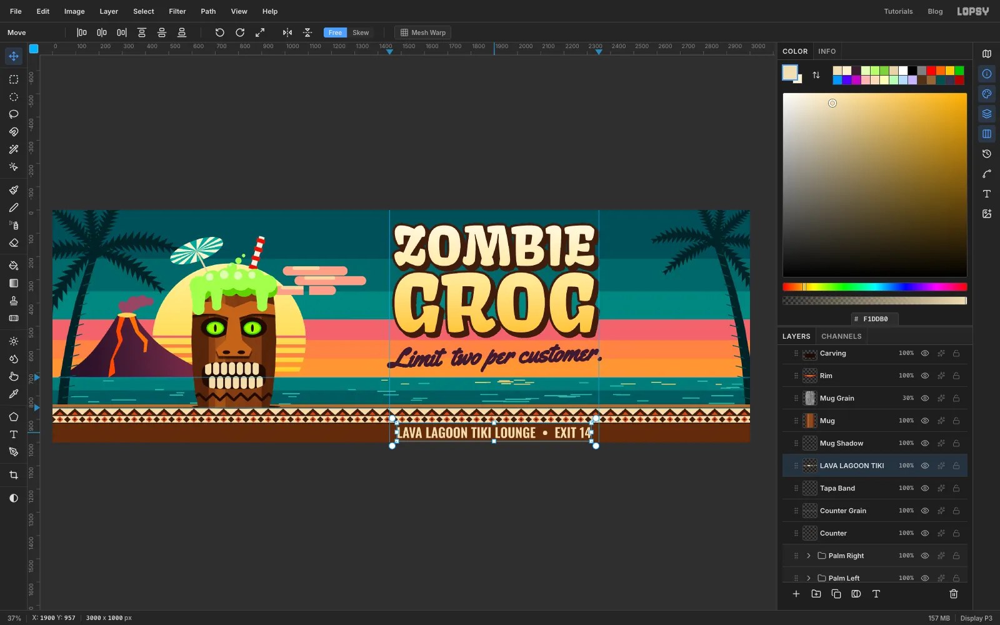

Click *Tapa Band* in the Layers panel. Choose the Text tool, set the font
to **Oswald**, the weight to **SemiBold**, **Size** `56` and colour
`#F1DDB0`. Click in the empty brown strip below the tapa band, near the
left guide, and type `LAVA LAGOON TIKI LOUNGE  •  EXIT 14` with two spaces
either side of the bullet. Press [[Tab]], then drag it so it's centred on
`x 1900` under the headline and centred top to bottom in the brown strip.

## Organise the layers into groups

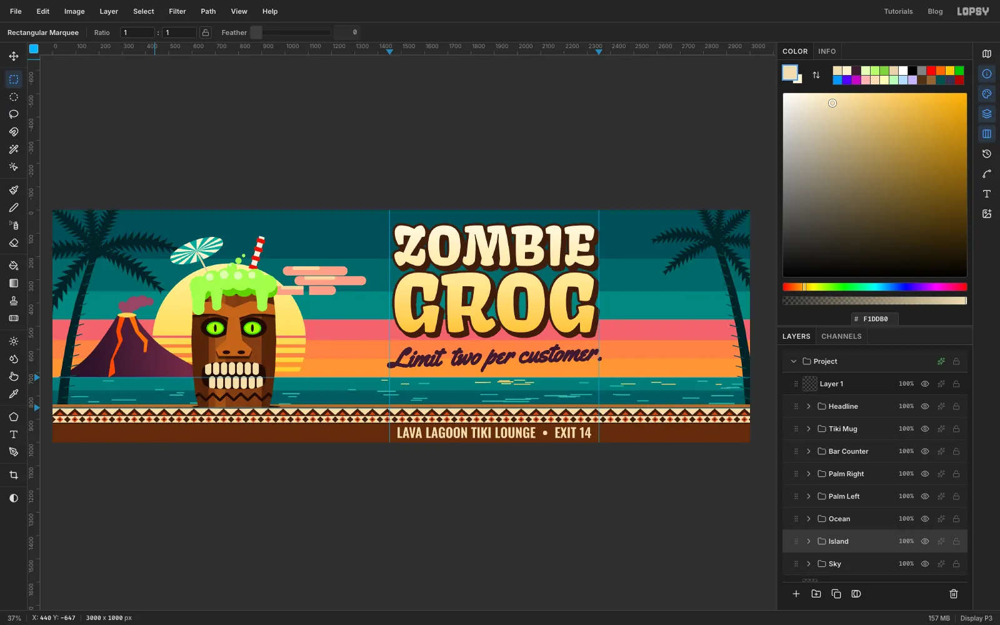

Group each part of the board with [[Cmd+G]]. For each group, click its top
layer and [[Shift]]-click its bottom layer, then name the group and
collapse it:

- *Headline*: the tagline, *Headline Fill*, *GROG* and *ZOMBIE*
- *Tiki Mug*: *Foam* down to *Mug Shadow*
- *Bar Counter*: the info line down to *Counter*
- *Ocean*: *Waves* and *Sea*
- *Island*: *Lava*, *Plume* and *Volcano*
- *Sky*: *Clouds* and *Sun*

## Try out the layout by moving the whole mug

Groups make it easy to test the layout. Click *Tiki Mug* and drag it with
the **Move** tool. The mug, foam, straw, umbrella and shadow all move
together. Here it's moved `120` px right, which crowds the headline, so
press [[Cmd+Z]] to put it all back.

## Add print grain

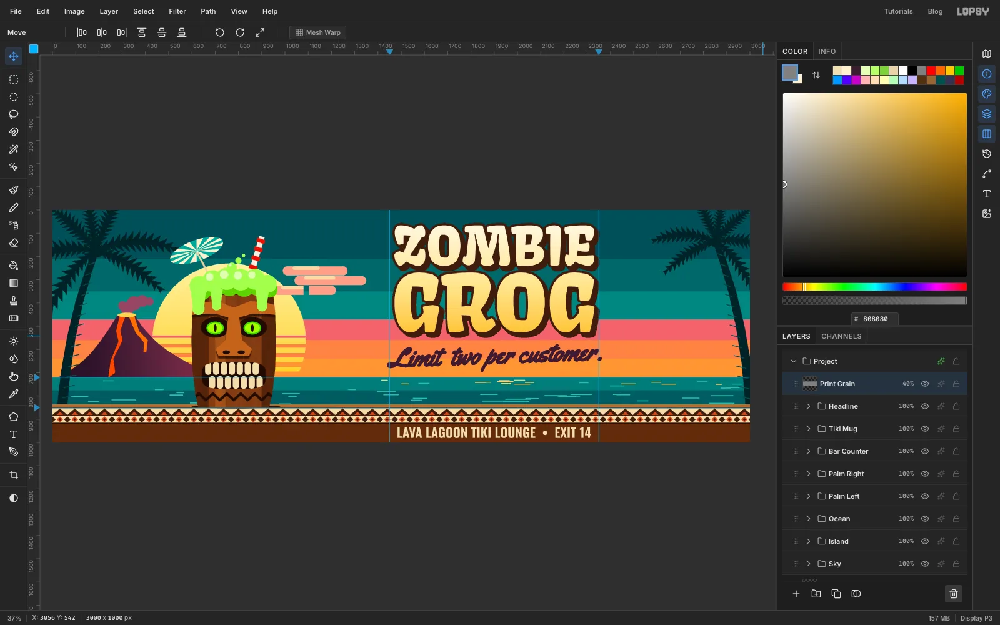

Click *Headline* and add a layer named *Print Grain*. With nothing
selected, **Edit → Fill** fills the whole layer, so fill it with `#808080`, then choose **Filter → Add Noise…** with **Amount** `30`,
**Mode** **Mono** and **Distribution** **Gaussian**. Set the **Blend** to
**Overlay** and the opacity to `40%`. Like the counter grain, the grey
disappears and only the noise is left, which makes the flat colours look
printed. Delete the empty *Layer 1* the document started with.

Export with **File → Quick Export PNG**, and save the project with
**File → Save Project**.
