Old USGS topographic maps have their own quiet look. There's a cream sheet, fine brown contour lines with every fifth one drawn heavier, and a green wash wherever trees grow. Lakes get rings of blue lines, and the names are set in small, carefully spaced type. It's a lovely look to borrow for an invitation, especially one that asks guests to walk somewhere.

This tutorial makes **Timberline Supper**, an invitation to dinner at a mountain lodge. The whole invitation is a map of the walk. You won't draw a single contour line by hand. Instead you'll paint a grey **heightmap**, where white is high and black is low, and let Lopsy's filters turn it into contours. **Posterize** cuts the heights into terraces, and **Find Edges** traces where one terrace meets the next. The same heightmap then gives you the timberline tint and the hillshade, so everything lines up.

Along the way you'll use gradients, Clouds, Liquify, Posterize, Find Edges, Threshold, the Magic Wand, Brightness/Contrast, the Pen tool, the Spray tool, layer effects, text on a path, rotated text, copy and paste, transforms, guides and groups.

The document is **1500 × 2100 px**, a 5 × 7 inch card at 300 dpi.

The palette:

- Paper `#F0ECDD`
- Contours `#A87C52`, index contours `#855C37`
- Woodland `#D2DFB5` (on Multiply)
- Lake `#BED7E6`, shore and creeks `#4479B1`
- Trail red `#B83F34`
- Ink `#1E1E1E`

The fonts are **Playfair Display SC** for the title, **Barlow Condensed** for the small caps labels, and **Old Standard TT** for the invitation text and place names. All three are in Lopsy's font list.

A few habits that save trouble:

- **Fills don't clear the selection.** After **Edit → Fill**, press [[⌘D]] before you draw the next selection.
- **The exact-corners dialog.** With nothing selected, click once with the Rectangular (or Elliptical) Marquee and a dialog asks for the exact corners. Use it whenever a step gives coordinates. Positions in this tutorial are in pixels from the top-left corner of the page.
- **New layers land above the active one.** Click the row you want to build on before you click **Add Layer**.
- **Text uses the current colour.** Set the foreground to ink `#1E1E1E` before you type, unless a step says red or blue.

## Set up the paper and guides

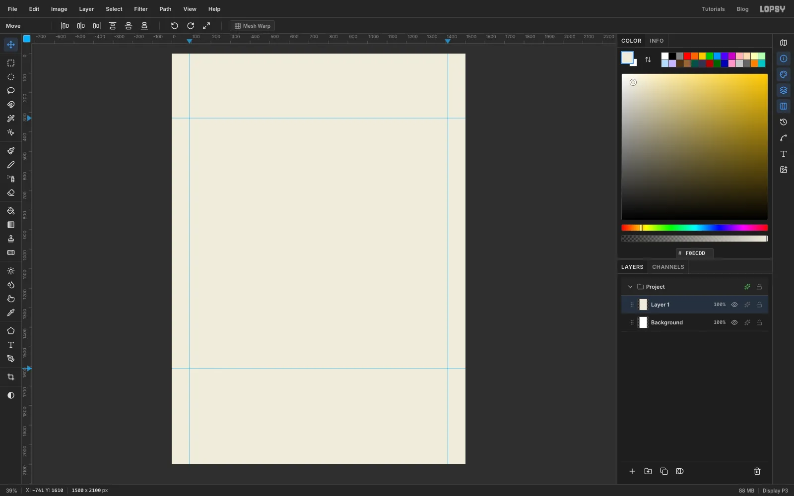

1. Choose **File → New** and make a **1500 × 2100** pixel document. It starts with a white **Background** and an empty **Layer 1**.
2. Click **Layer 1**, set the foreground to `#F0ECDD` and choose **Edit → Fill**. This is the paper.
3. Click the top ruler at **90** and at **1410** to drop two vertical guides. Then click the left ruler at **330** and **1610** for two horizontal ones.

The guides mark the map frame, with room for the title above and the invitation details below.

## Shape the mountain with gradients

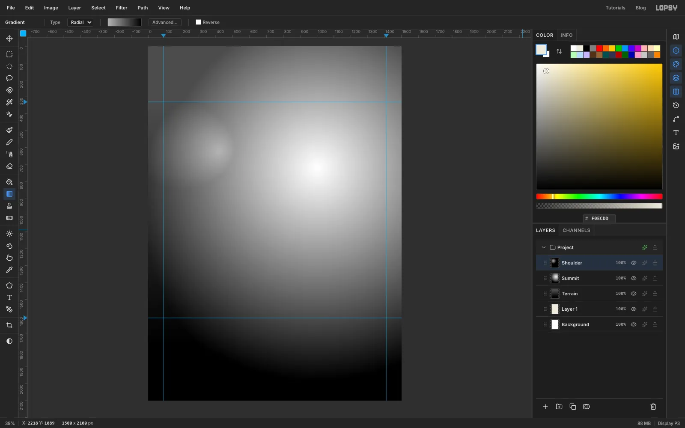

The heightmap is three gradients, each on its own layer. White will be the top of the mountain and black the lowest ground.

1. Add a layer called **Terrain**. Pick the **Gradient** tool, set **Type** to **Linear**, open **Advanced…** and set the stops to `#4C4C4C` and `#000000`. Drag from the top edge of the frame straight down to just below the bottom edge. The land now falls gently to the south.
2. Add a layer called **Summit**. Switch to **Radial** with stops `#FFFFFF` and `#000000`. Drag from where the peak goes, at about **1000, 720**, out about 1250 px to the left. Open the layer's effects (the sparkle icon on its row) and set **Blend** to **Lighten**.
3. Add a layer called **Shoulder** for a lower second peak. Drag a radial gradient from `#B4B4B4` to black, starting at about **420, 620** and going about 640 px down. Set it to **Lighten** too.

Lighten keeps whichever layer is brighter at each point, so the peaks merge the way hills do. Click **Shoulder** and choose **Layer → Merge Down** twice, so all three end up on **Terrain**.

## Roughen it with Clouds

Smooth gradients would give you perfect bullseye contours, and no mountain looks like that.

1. Add a layer, run **Filter → Clouds…** with **Scale** 3, and set the layer's opacity to **16%** (click the percentage on its row). Merge it down.
2. Add another layer, run **Clouds…** with **Scale** 9 for small bumps, set it to **9%**, and merge it down too.

Clouds is random, so your mountain will look different from this one. That's fine.

## Push ridges out with Liquify

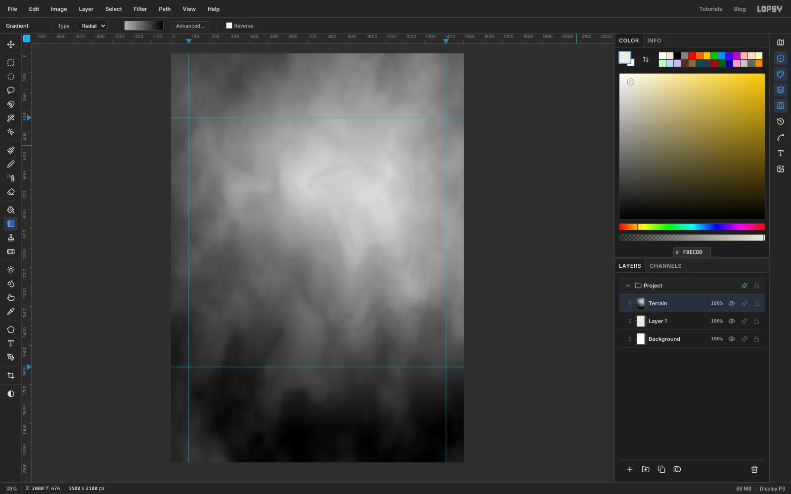

Real mountains have spurs, ridges running down from the top, with valleys between them.

1. With **Terrain** active, open **Filter → Liquify…** and set **Mode** to **Push Forward**, **Brush Size** to **260** and **Pressure** to **85**.
2. Drag outward from just below the summit: once to the south-east, once straight south, and once west toward the shoulder. Each drag pulls bright, high ground out into a ridge.
3. For valleys, drag the other way. Start at the bottom edge between two ridges and push up toward the summit, which carries dark, low ground uphill.
4. Click **Apply**.

## Soften the heightmap

Run **Filter → Gaussian Blur…** with **Radius** 9. Blurring removes the pixel-level noise, which would otherwise turn into ragged little contour islands.

## Carve the creek valleys and the lake basin

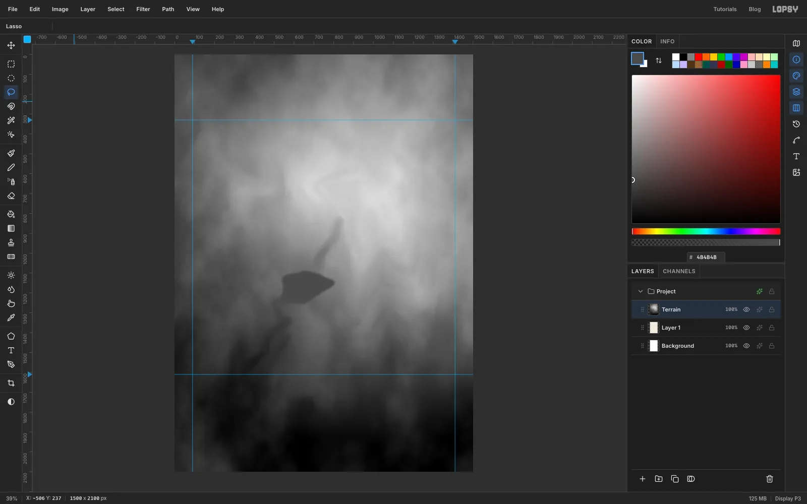

Decide now where the water goes, because contours have to bend around it.

1. Open **Liquify…** again with **Brush Size** 110 and **Pressure** 100. Follow the line the creek will take, from the bottom edge up to the lake, with short strokes that each push uphill. Do the same for a small stream coming down from below the summit to the lake. Apply, then do a second pass with **Brush Size** 90. Contours crossing these grooves will now bend into a V pointing upstream, which is how a stream reads on a real map.
2. A lake surface is level, so flatten its basin. Lasso a lake shape a little larger than the lake you have in mind, at about **650, 1170**, and choose **Select → Feather…** with **10**.
3. Pick the **Eyedropper** ([[I]]) and click just below the lake, where the creek will flow out. Make that grey a shade darker (`#4B4B4B` here), choose **Edit → Fill** and press [[⌘D]].

## Posterize the heights into terraces

1. Click **Terrain** and choose **Layer → Duplicate Layer**. Name the copy **Contours work**.
2. Run **Filter → Posterize…** with **Levels** 21.

The heights are now 21 flat terraces. Each step between two terraces will become one contour line, so the map has 20 of them from bottom to top.

## Trace the terrace edges

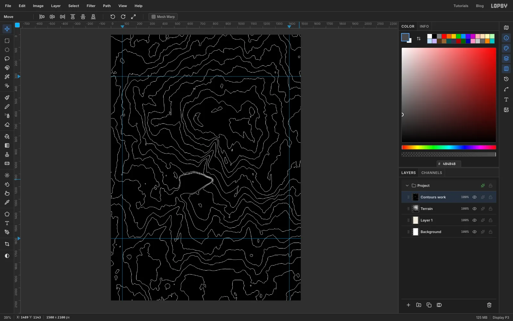

1. Choose **Filter → Find Edges**. It applies at once and outlines every step between terraces in grey on black.
2. Run **Filter → Threshold…** with **Level** 30 so every outline is pure white.

## Select just the lines

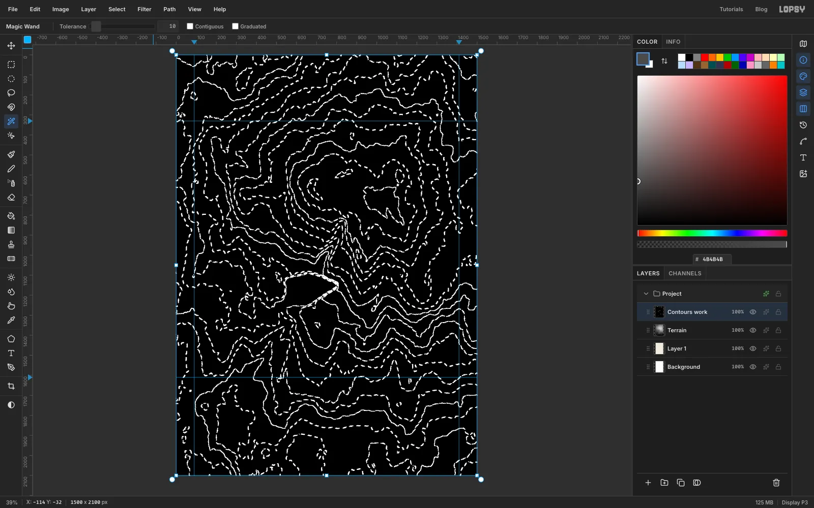

The lines are only two pixels wide and hard to click on, so select the black instead and flip the selection.

1. Pick the **Magic Wand** ([[W]]). In the options bar set **Tolerance** to **10** and untick **Contiguous**, so one click picks up every black area.
2. Click any black area.
3. Choose **Select → Inverse**. Now only the lines are selected.

## Fill the contours

1. Click **Add Layer** and name it **Contours**.
2. Set the foreground to `#A87C52` and choose **Edit → Fill**. Press [[⌘D]].
3. Click **Contours work** and delete it with the trash icon at the bottom of the Layers panel.

## Add heavier index contours

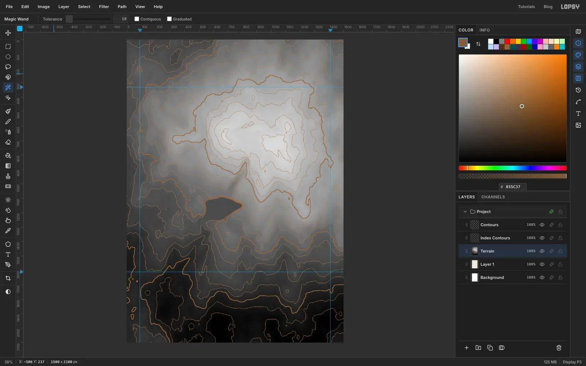

On a USGS map every fifth contour is a heavier **index contour**. With Posterize you get these by doing the last four steps again with fewer levels:

1. Click **Terrain**, duplicate it, and run **Posterize…** with **Levels** 5.
2. Run **Find Edges**, then **Threshold** at 30. Wand the black with Contiguous off and choose **Select → Inverse**.
3. Choose **Select → Grow…** with **1** to make the line thicker. Add a layer called **Index Contours** and fill it with `#855C37`.
4. Press [[⌘D]] and delete the work copy.

Levels 21 gives 20 steps and Levels 5 gives 4, so each heavy line lands exactly on every fifth thin one.

## Find the timberline

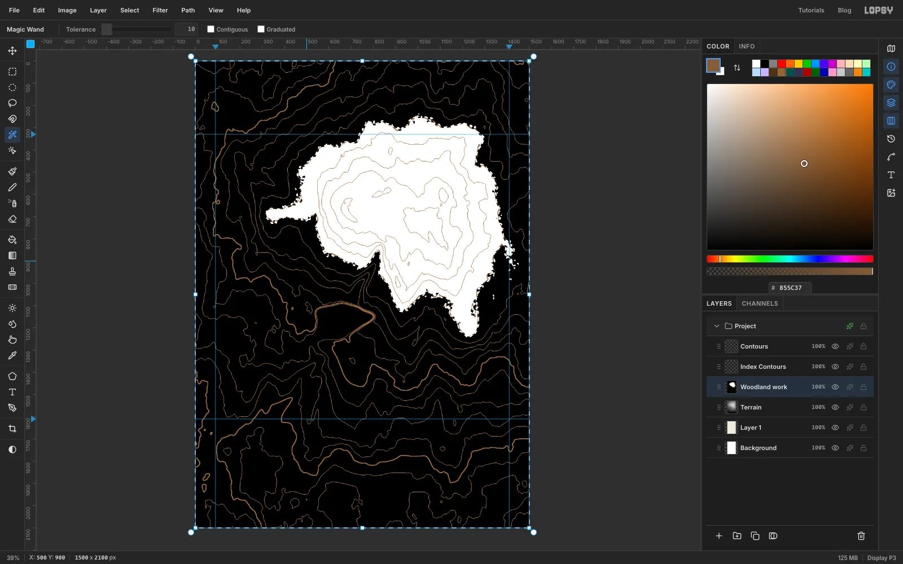

Trees stop at about the same height all around a mountain, so the woodland tint comes from the heightmap too.

1. Duplicate **Terrain** once more and name it **Woodland work**.
2. Trees don't stop neatly on a contour line, so rough up the copy first. Run **Filter → Add Noise…** with **Amount** 60, **Mono** and **Gaussian**, then **Gaussian Blur…** with **Radius** 10.
3. Run **Threshold…** with **Level** 159. That's the height of the third heavy contour counting up from the bottom, the one that rings the summit. Everything below it turns black.
4. Wand the black area with Contiguous off.
5. Add a layer called **Woodland**, fill the selection with `#D2DFB5` and set the layer to **Multiply**. Press [[⌘D]] and delete **Woodland work**.

## Start the hillshade with an offset copy

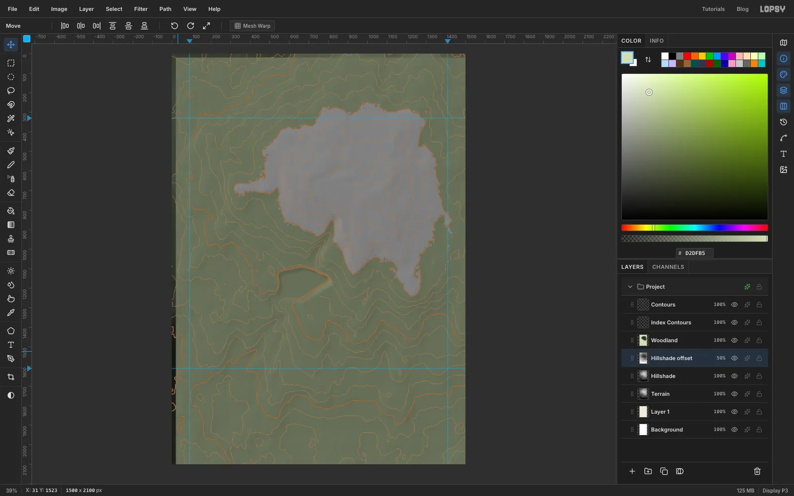

Hillshade is the soft shading that makes slopes look lit from the north-west. The trick is to compare the heightmap with a slightly shifted copy of itself.

1. Duplicate **Terrain** and name it **Hillshade**. Duplicate that and name the copy **Hillshade offset**.
2. On the copy, choose **Filter → Invert** and set its opacity to **50%**.
3. Press [[V]] for the Move tool, then press [[Shift+→]] twice and [[Shift+↓]] twice. That moves it 20 px right and 20 px down.

Where the two layers line up they cancel out to flat grey. Where the ground slopes, they don't, and that difference is your shading.

## Boost the relief

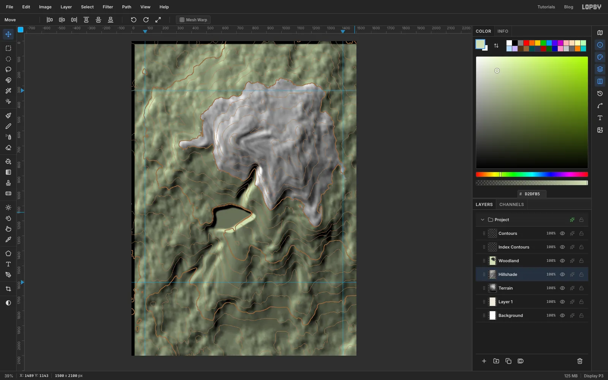

1. Click **Hillshade offset** and choose **Layer → Merge Down**. The result is mostly flat mid-grey with very faint relief.
2. Run **Filter → Brightness/Contrast…** with **Contrast** 100, four times. Each pass doubles the relief.
3. Run **Gaussian Blur…** with **Radius** 4 to smooth out the banding.

**Woodland** still sits on top, so the result looks green and harsh until the next step.

## Blend the shading and trim to the frame

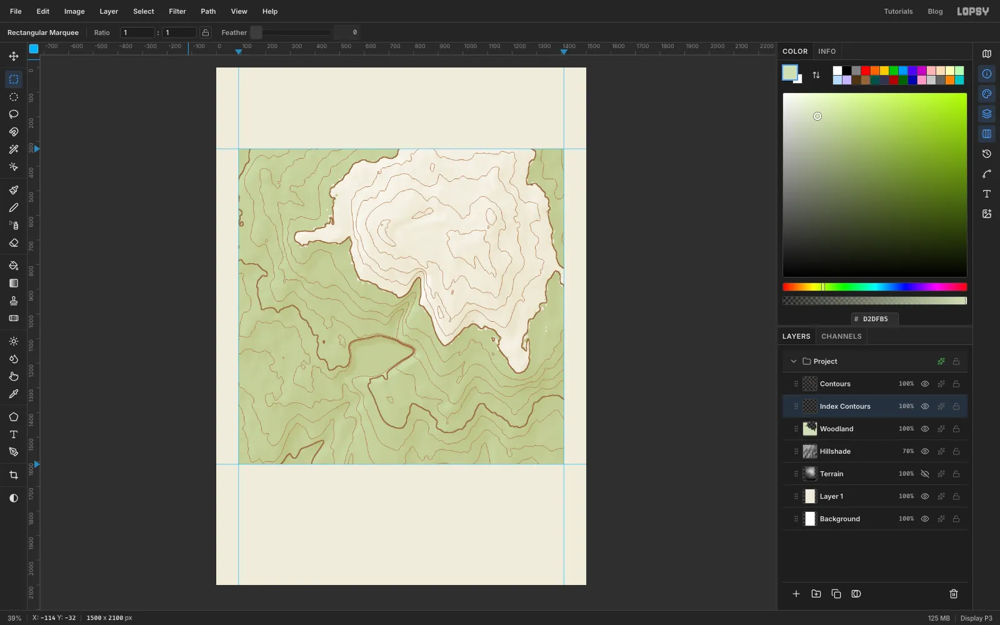

1. Set **Hillshade** to **Overlay** at **70%**. Mid-grey disappears in Overlay, so only the light and shade show.
2. Click the eye on **Terrain** to hide it. Keep the layer, though, in case you want to change the terrain later.
3. Trim the terrain layers to the frame. Press [[M]], click once on the canvas, and enter **90, 330** to **1410, 1610** in the exact-corners dialog. Choose **Select → Inverse**.
4. Click **Hillshade**, **Woodland**, **Contours** and **Index Contours** in turn, pressing [[Delete]] on each. The selection stays put while you switch layers. Then press [[⌘D]].

## Fill the lake and add waterlining

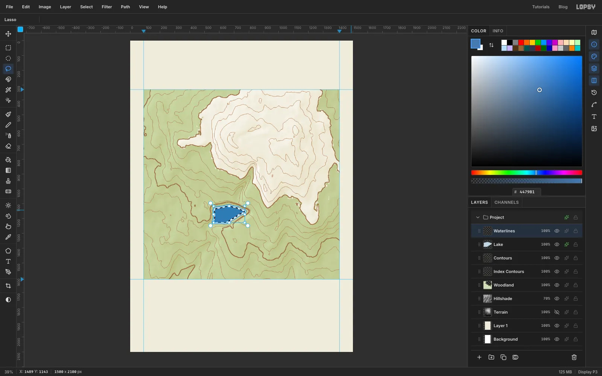

**Waterlining** is the old engraver's habit of repeating the shoreline as rings inside the water.

1. Click **Contours** and add a layer called **Lake**. With the Lasso ([[L]]), draw the lake inside the flat basin, about 225 × 125 px, and fill it with `#BED7E6`. **Keep the selection.**
2. Give it a shoreline. Open the layer's effects, tick **Stroke**, and set the colour to `#4479B1`, **Width** to 3 and **Position** to **inside**.
3. Add a layer called **Waterlines**, with the lake still selected, and set the foreground to `#4479B1`.
4. Choose **Select → Shrink…** with **9** and **Edit → Fill**. Then **Shrink…** by **2** (the screenshot shows this moment) and press [[Delete]]. That leaves a 2 px ring 9 px inside the shore.
5. Twice more: **Shrink…** by **7**, **Fill**, **Shrink…** by **2**, [[Delete]].
6. Press [[⌘D]] and set the layer to **45%**.

## Draw the creeks with the Pen

1. Add a layer called **Creek** and press [[P]] for the Pen tool. In the options bar set **Stroke** to **4**.
2. Start at the lake's south-west shore and work down along the valley you carved. Drag at each point to make a smooth curve rather than just clicking. Go just past the bottom of the frame, then press [[Enter]] to stroke the path in the foreground blue.
3. Draw the stream above the lake the same way at **Stroke** 3, from below the summit down to the lake's north shore.
4. Trim **Creek** to the frame with the same corner-dialog selection and Inverse.

The paths stay in the Paths panel after stroking. The white dots you'll see along the stream in later screenshots are its anchor points, not paint.

## Snap the frame to the guides

1. Make sure **View → Snap to Guides** is ticked.
2. Add a layer called **Neatline** and press [[M]].
3. Drag a marquee from near the top-left guide corner to near the bottom-right one. The corners snap onto the guides.

## Draw the neatline and edge ticks

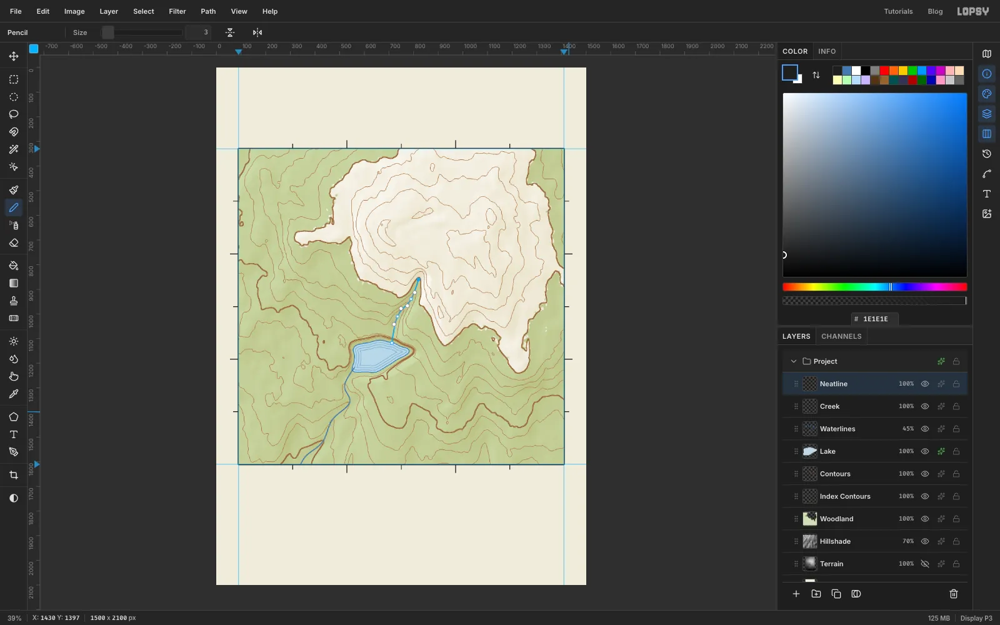

1. Choose **Select → Grow…** with **4**, set the foreground to `#1E1E1E`, and choose **Edit → Fill**.
2. Choose **Select → Shrink…** with **4** and press [[Delete]]. That leaves a crisp 4 px frame. Press [[⌘D]].
3. Pick the **Pencil** ([[N]]) at **Size** 3. To draw a straight tick, click on the outer edge of the frame, then hold [[Shift]] and click again a little further out.
4. Space short ticks (16 px) every 220 px along the top and bottom and every 213 px down the sides, so each edge is divided into six.
5. Make the ticks at the one-third marks longer, at 30 px. Those are at x 530 and 970 on the top and bottom, and y 757 and 1183 on the sides.

## Walk the Supper Trail

1. Add a layer called **Trail**. Pick the **Brush** ([[B]]) and open the brush settings. Set **Size** 9, **Hardness** 100, **Opacity** 100 and **Spacing** 230%. That much spacing turns a stroke into a row of dots.
2. Set the colour to `#B83F34`. Click at the trailhead near the bottom right, at about **1186, 1556**. Then [[Shift]]-click each switchback corner on the way up to the lodge site at about **822, 1048**. Shift-clicking draws a straight dotted line from the last point.
3. For the summit path, use **Size** 6, **Spacing** 260% and ink `#1E1E1E`, and Shift-click from the lodge up to the summit at about **1012, 726**.
4. Set **Spacing** back to 10% so later brush strokes are solid.

## Rotate the lodge symbol

1. Add a layer called **Lodge**. Use the exact-corners dialog to make a 26 × 26 square marquee centred on the lodge site, from **809, 1035** to **835, 1061**. Fill it with ink.
2. Press [[V]] and drag the round handle just outside a corner to rotate the square about 15°. A slightly turned building looks hand-placed.
3. Press [[⌘D]] to commit.

## Ring the lodge and mark the summit

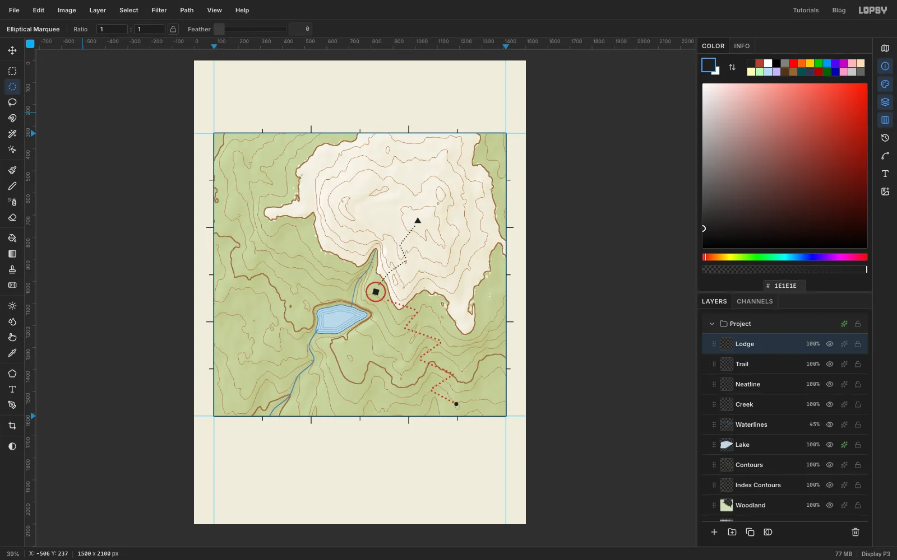

1. Add a layer for the ring. Pick the **Elliptical Marquee**, click once, and enter **776, 1002** to **868, 1094**. Fill it with `#B83F34`.
2. Choose **Select → Shrink…** with **6** and press [[Delete]], which leaves a ring. Press [[⌘D]] and choose **Layer → Merge Down** so the ring joins **Lodge**.
3. On **Lodge**, lasso a small triangle about 30 px wide on the summit and fill it with ink.
4. Fill an 18 px circle at the trailhead with ink.

## Add marsh tufts and clearings

1. Add a layer called **Marsh**. With the Pencil at **Size** 2 in `#4479B1`, Shift-click a short base line about 28 px long, then three little blades fanning up from it.
2. Copy the tuft around the lake's west shore. Marquee it and press [[⌘C]], then [[⌘V]]. The paste lands on its own layer on top of the original, so drag it to a new spot with the Move tool and choose **Merge Down**. Repeat a few times.
3. **Clearings.** Click **Woodland**, lasso two meadow shapes in the woods and press [[Delete]], so the paper shows through. Press [[⌘D]].

## Draw the rules, scale bar and north arrow

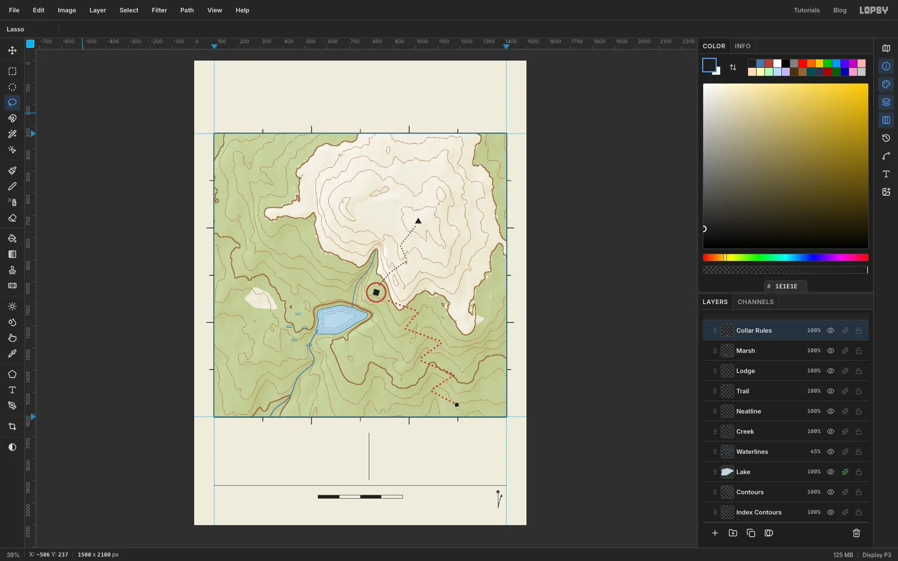

The **collar** is the margin under a map where the legend and scale live.

1. Click **Marsh** and add a layer called **Collar Rules**. With the Pencil at **Size** 2 in ink, Shift-click a rule across the frame's width at **y 1922**. Add a short upright rule at **x 790** from y 1684 to 1896, to split the collar into two columns.
2. **Scale bar.** Fill a rectangle from **558, 1964** to **942, 1980** with ink. Fill **655, 1966** to **750, 1978** and **845, 1966** to **940, 1978** with paper colour, so the second and fourth quarters turn white inside a black outline. At 300 dpi, 384 px is about 1.3 inches, which is one mile at 1:50 000.
3. **North arrow.** Set the foreground back to ink, because the scale bar left it on paper. Shift-click a vertical true-north line from **1372, 2024** up to **1372, 1960**, and lasso a small five-pointed star just above it. Add a second line from the same foot, leaning about 15° right, for magnetic north. Give it a half arrowhead: a small lassoed triangle with one barb on one side of the tip.

## Draw the legend lines

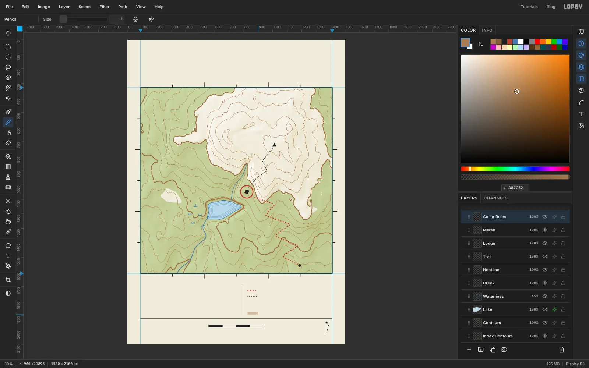

The legend symbols sit in a column at x 830. The rows are 38 px apart, at y 1734, 1772, 1810, 1848 and 1886.

1. With the Brush, draw a 70 px row of red dots (Size 9, Spacing 230%) on the first row and black dots (Size 6, Spacing 260%) on the second. Set Spacing back to 10% afterwards.
2. On the last row, use the Pencil to draw a 4 px line in `#855C37` with a 2 px line in `#A87C52` just under it, to stand for index and intermediate contours.

## Copy the lodge and summit into the legend

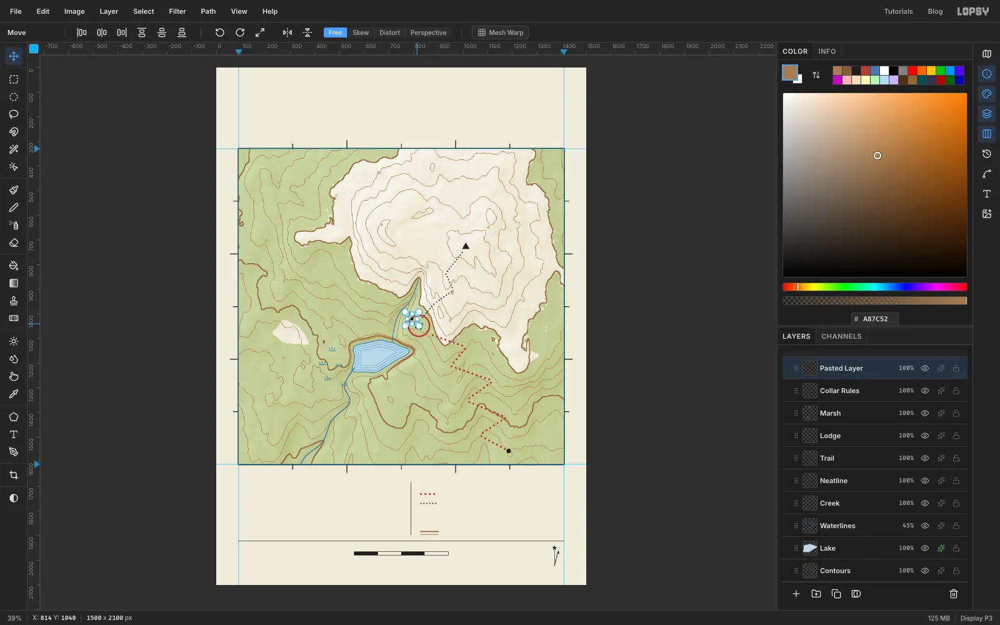

1. Click **Lodge**, marquee the lodge ring, and press [[⌘C]]. Click **Collar Rules** and press [[⌘V]]. The copy pastes in place, right on top of the map's lodge, on a new layer.
2. Marquee the pasted copy, press [[V]], and hold [[⌘]] while you drag a corner handle inward. [[⌘]] keeps the proportions, so it stays a circle. Stop at about 42% of the size and press [[⌘D]].
3. Drag it down to the third legend row and choose **Merge Down**.
4. Copy the summit triangle the same way, without scaling it, and put it on the fourth row.

Line each symbol up with the middle of the row where its label will go.

## Set the collar type

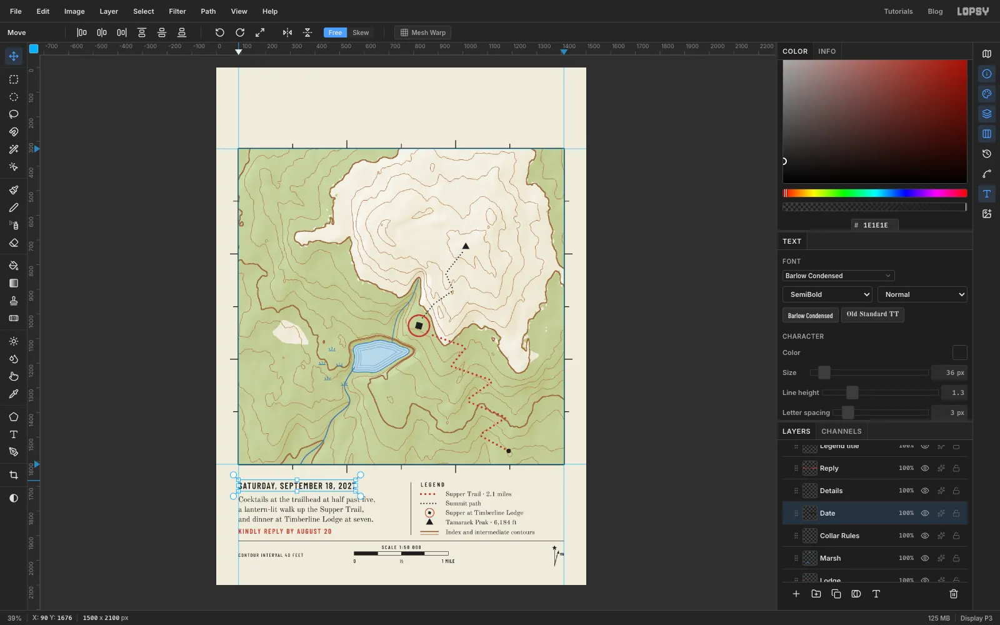

If you click on an existing text box with the Text tool, Lopsy edits it instead of starting a new one, and boxes extend down and to the right of where you clicked. So set the lowest line first and work upward. If a text layer is still active when you change the font settings, they apply to that layer, so click **Collar Rules** before each new line.

Work upward in this order, in ink unless a line says otherwise:

- Below the scale bar, the labels **0**, **½** and **1 MILE** in **Barlow Condensed** SemiBold 20, each centred under its point on the bar. Then **SCALE 1:50 000** just above the bar, with letter spacing 4.
- **CONTOUR INTERVAL 40 FEET** at the far left, level with the scale bar, in Barlow Condensed Medium 20 with letter spacing 3.
- **MN** in Barlow Condensed SemiBold 16 beside the tip of the magnetic north line.
- The five legend labels in **Old Standard TT** Regular 26, starting at x 930 and centred on their rows: **Supper Trail · 2.1 miles**, **Summit path**, **Supper at Timberline Lodge**, **Tamarack Peak · 6,184 ft**, **Index and intermediate contours**.
- **LEGEND** above them at x 830, top at y 1684, in Barlow Condensed SemiBold 24 with letter spacing 6.
- **KINDLY REPLY BY AUGUST 20** at the left, top at y 1872, in Barlow Condensed SemiBold 28 in red `#B83F34`, with letter spacing 4.
- The invitation in Old Standard TT Regular 31 with **Line height** 1.3, top at y 1740: *Cocktails at the trailhead at half past five, / a lantern-lit walk up the Supper Trail, / and dinner at Timberline Lodge at seven.*
- **SATURDAY, SEPTEMBER 18, 2027** at the top of the left column, top at y 1684, in Barlow Condensed SemiBold 36 with letter spacing 3.

Line up the left column at x 90, flush with the frame. Use the arrow keys with the Move tool to nudge.

## Label the contours and the trailhead

Map labels go above all the map art, so click **Marsh** before each new label. Most get a **halo**, a thin outline in the paper colour that cuts through any line beneath the letters. To add one, open the label's effects, tick **Stroke**, and set `#F0ECDD`, **Width** 3, **Position** outside.

1. **TRAILHEAD** in Barlow Condensed SemiBold 22, just right of the dot, with a halo.
2. **Contour labels.** The interval is 40 feet, so each heavy line is 200 feet higher than the one below. Here the heavy line ringing the summit is 6000, the next one down is 5800, and the lowest is 5600.
3. Find a spot where a heavy line runs fairly straight, near the trail's lower switchbacks. Lasso a box about 70 × 28 px along it. Click **Contours** and press [[Delete]], then click **Index Contours** and press [[Delete]], then press [[⌘D]]. That cuts a gap in the lines.
4. Click **Marsh** and type **5800** in Barlow Condensed SemiBold 22 in `#855C37`. Rotate it with the round corner handle to match the line (about 17° anticlockwise here), then nudge it into the gap.

## Set the creek name on a path

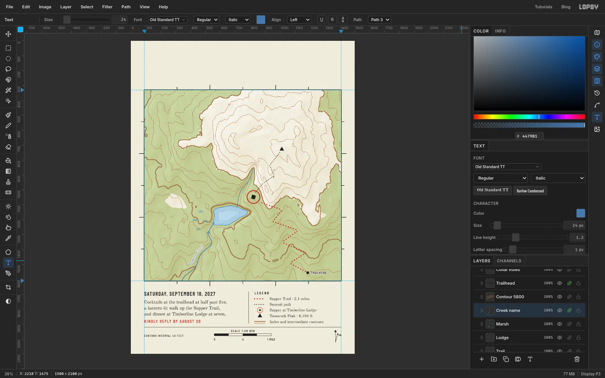

1. With the Pen, draw a gentle curve beside the lower creek, about 14 px to its upper left. Start downstream and work upstream, so the text reads uphill rather than upside down. Click the ✓ in the options bar to keep the path without stroking it.
2. Press [[T]] and set **Old Standard TT**, **Italic**, 24 px, `#4479B1`. Water names are traditionally set in italic. Click in an empty spot, type `Tamsin Creek` and press [[Tab]].
3. In the options bar, choose your new path in the **Path** dropdown. The text jumps onto the curve.
4. Give it a paper halo.

## Name the lake, meadow and lodge

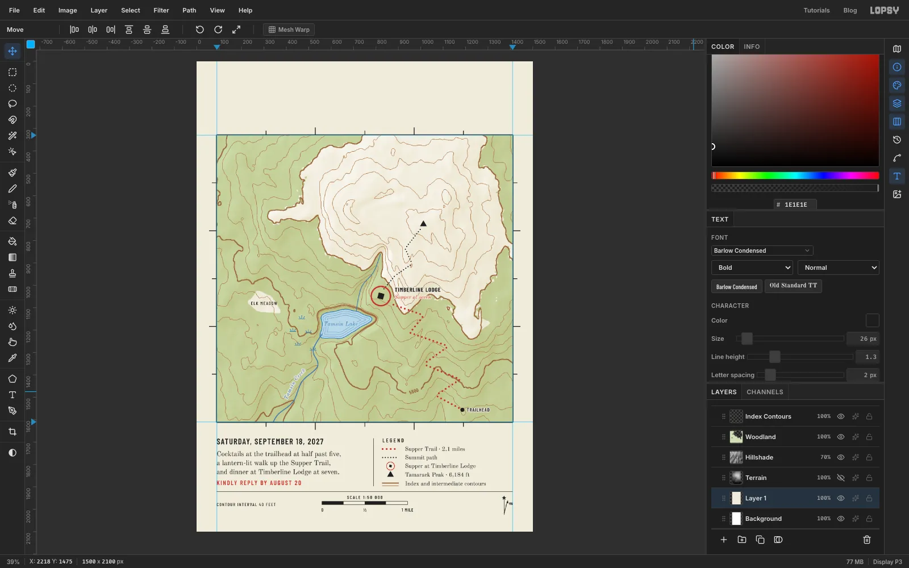

- *Tamsin Lake* in Old Standard TT Italic 25, `#4479B1`, centred in the lake. Instead of a paper halo, give it a 5 px halo in the lake colour `#BED7E6`, so the waterlines break around the name.
- **ELK MEADOW** in Barlow Condensed Medium 20 with letter spacing 3, centred in the clearing. It sits on bare paper, so it needs no halo.
- *Supper at seven* in red Old Standard TT Italic 24, just right of the ring, with a paper halo.
- **TIMBERLINE LODGE** in Barlow Condensed Bold 26 with letter spacing 2, just above it, with a paper halo. Keep both clear of the trail dots.

## Name the peaks

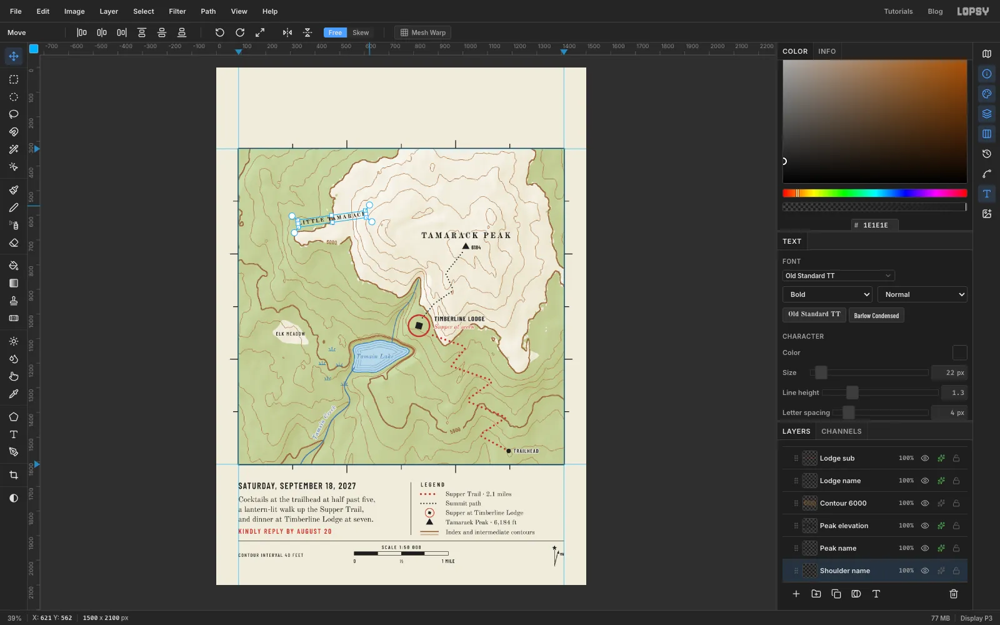

1. **6000.** Cut a gap in the heavy contour on the shoulder and set **6000** in it, as you did for 5800.
2. **6184** in Barlow Condensed SemiBold 22, just right of the summit triangle, with a paper halo.
3. **TAMARACK PEAK** in Old Standard TT Bold 32 with letter spacing 6, centred about 45 px above the triangle, with a paper halo.
4. **LITTLE TAMARACK** in Old Standard TT Bold 22 with letter spacing 4. Rotate it about 8° anticlockwise to follow the ridge, then move it onto the shoulder and give it a paper halo.

## Set the title

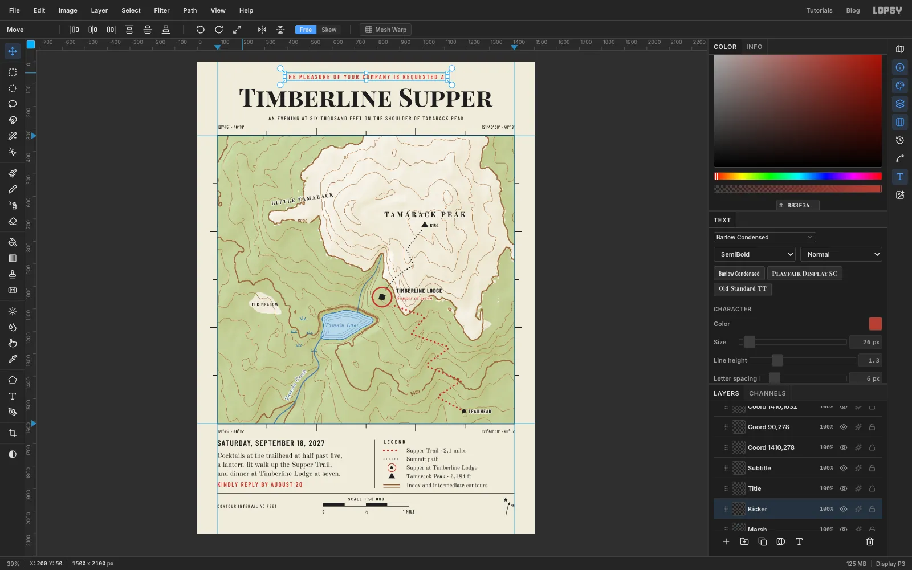

1. **Corner coordinates.** Set these in Barlow Condensed Medium 20, about 22 px outside each corner of the frame, with the right-hand ones aligned to the frame's right edge. The top corners read *121°45′ · 46°18′* and *121°40′30″ · 46°18′*. The bottom corners repeat the same longitudes with *46°15′*.
2. **Subtitle.** *AN EVENING AT SIX THOUSAND FEET ON THE SHOULDER OF TAMARACK PEAK* in Barlow Condensed Medium 24 with letter spacing 4, about 90 px above the frame.
3. **Title.** *Timberline Supper* in **Playfair Display SC** Bold 112, with its top at about y 120. Type it in normal case and the small caps font turns the lower case into small capitals.
4. **Kicker.** *THE PLEASURE OF YOUR COMPANY IS REQUESTED AT* in red Barlow Condensed SemiBold 26 with letter spacing 6, near the top of the page.

Centre the last three on x 750 by nudging with the arrow keys.

## Stipple the talus

Talus is the broken rock that piles up below a cliff, and topo maps show it as fine stippled dots.

1. Click **Marsh** and add a layer called **Talus**. Lasso an area below the east face of the peak, keeping well clear of the peak's name.
2. Pick the **Spray** tool ([[J]]) with **Size** 44, **Density** 12, **Opacity** 100 and **Softness** 0, in `#855C37`. Make three quick sweeps across the lasso. The selection keeps the dots inside it.
3. Press [[⌘D]] and set the layer to **75%**.

## Give the paper some grain

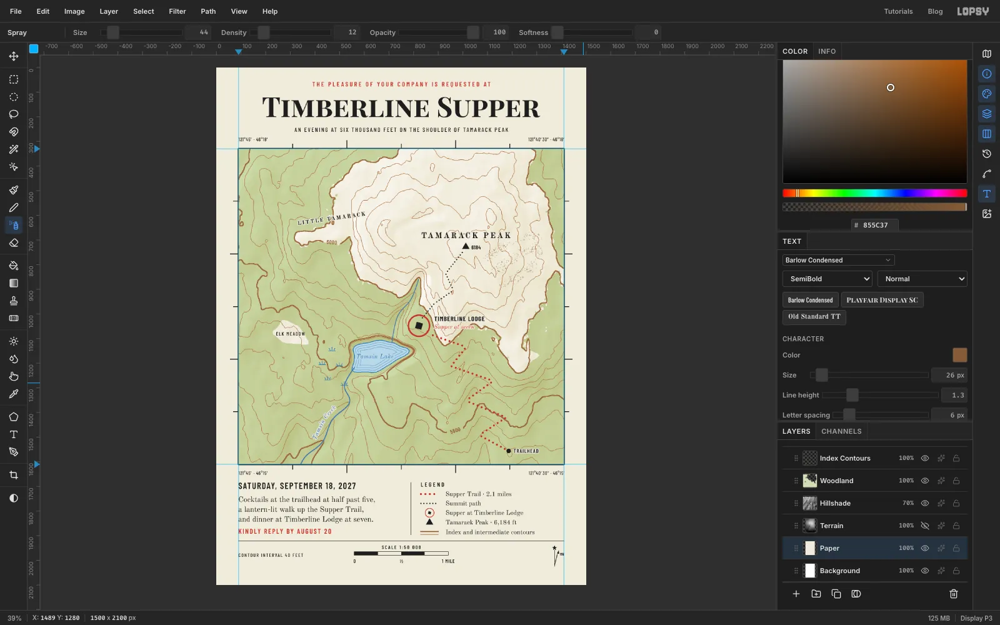

1. Click **Layer 1**, the cream fill from the first step, and rename it **Paper**.
2. Run **Filter → Add Noise…** with **Amount** 6, **Mono** and **Gaussian**. You'll barely see it, but it stops the cream from looking flat.

## Group the collar and export

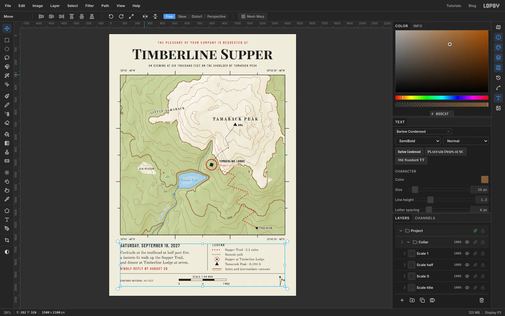

1. Click **Collar Rules**, then [[Shift]]-click the topmost collar text layer, which is **1 MILE** if you followed the order above. Choose **Layer → Group Layers** and name the group **Collar**.
2. Now the whole collar moves as one block. If you want to try the balance, nudge it with the arrow keys and press [[⌘Z]] to step it back.
3. Choose **File → Save Project** to keep the layers, and **File → Quick Export PNG** for the card.

At 300 dpi it prints 5 × 7 inches. A warm, uncoated card stock suits it.
