Studio posters for 1950s South Seas pictures sold an island in Technicolor:
a sky too pink to be real, palm and jungle leaves framing the scene, and a
title in chunky letters with a heavy shadow. This tutorial uses those tricks
for a made-up film, **Atoll Radio**, about a lone radio operator on a Pacific
atoll who hears a voice on the air.

It's a 1080 × 1600 px one-sheet (the 27 × 40 movie poster shape). It's a
photomontage: a real sunset photo, retouched and graded, with a radio mast,
signal rings and a jungle frame drawn on top, then the type.

The photo is [Sunset on Palmyra Atoll](https://commons.wikimedia.org/wiki/File:Sunset_on_Palmyra_Atoll.jpg)
by the USGS (CC BY 2.0) on Wikimedia Commons. Download the 2400 px version.
Any sunset over open water with a small island on the horizon will work, but
you'll have to adjust the positions.

Along the way you'll use:

- **Clone Stamp**, **Healing Brush**, **Gaussian Blur** and **Hue/Saturation** to retouch the photo
- a **layer mask** with a **Gradient**, and a group's **Color Balance** and **Saturation & Vibrance** adjustments for the grade
- the **Pencil** and **Brush** with [[Shift]]-click straight lines for the mast
- the **Shape** tool for the signal rings and the date pill, with **Show Grid** snapping
- the **Pen** tool and **Path to Selection** for the leaves, plus the **Eraser** and **Burn** tools
- the Brush's **Radial Symmetry** for the hibiscus flowers
- **Copy**, **Paste**, scaling and rotating with the **Move** tool, then undo and redo
- **Text** in Shrikhand, Yellowtail, Fjalla One and Bebas Neue, **Merge Down** and layer effects

The palette:

- Night plum `#2A0E33`, bottom band `#4A1A3E` → `#24102E` → `#0E0818`, sky shade `#14031B`
- Mast ink `#1B0A22`, guy wires `#5A1E48`, signal rings `#FFE7B0`
- Beacon red `#FF3D2E`, bloom `#FF8A3D`, halo `#FFF2B8`, lamp rim `#FF2A1A`, ring glow `#FFD27A`
- Monstera `#3DAA62` → `#0A3F2B`, veins `#7FCB86`
- Small monstera `#2F9A57` → `#083826`, veins `#74C07E`
- Banana `#86C25E` → `#3A8F4E` → `#17543A`, midrib `#D8EFA2`, striations `#245E2A`, stalk `#2E7A3C`
- Hibiscus `#F03A76`, petal light `#FF8DB3`, throat `#A30F3F`, petal veins `#B5194F`, inner glow `#A0103F`
- Stamen `#FFE3EC`, pollen `#FFD23F`
- Rim light gold `#FFC14D`, leaf shadow `#16031C`
- Title gradient `#FFF4B8` → `#FFC145` → `#FF5B3A`, title outline `#2A0730`, hard shadow `#12031A`
- Credit cream `#FFF0D2`, tagline peach `#FFE2B8`, billing orchid `#EBC8DA`, pill gold `#FFB43F`

Positions are given in document pixels. Watch **X** and **Y** in the status
bar at the bottom of the window as you move the pointer. Freehand shapes like
the leaves only need to be close.

## Set up the poster and guides

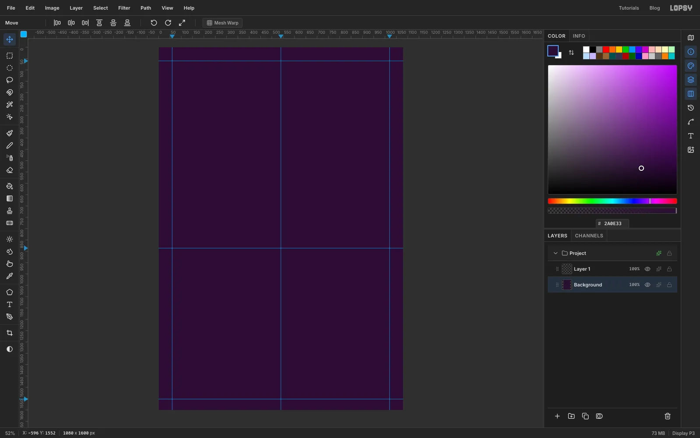

1. Choose **File → New**, set **Width** `1080` and **Height** `1600`, and click **Create**.
2. Click **Background** in the Layers panel, set the foreground colour to `#2A0E33` in the Color panel's hex field, and choose **Edit → Fill**.
3. Click the top ruler at `x 540` for a centre guide, and at `x 60` and `x 1020` for side margins.
4. Click the left ruler at `y 886` for the horizon, and at `y 60` and `y 1552` for the top and bottom margins. The bottom one is a little lower so it lands on a line of the 16 px grid you'll snap the date pill to.

## Drop in the sunset photo

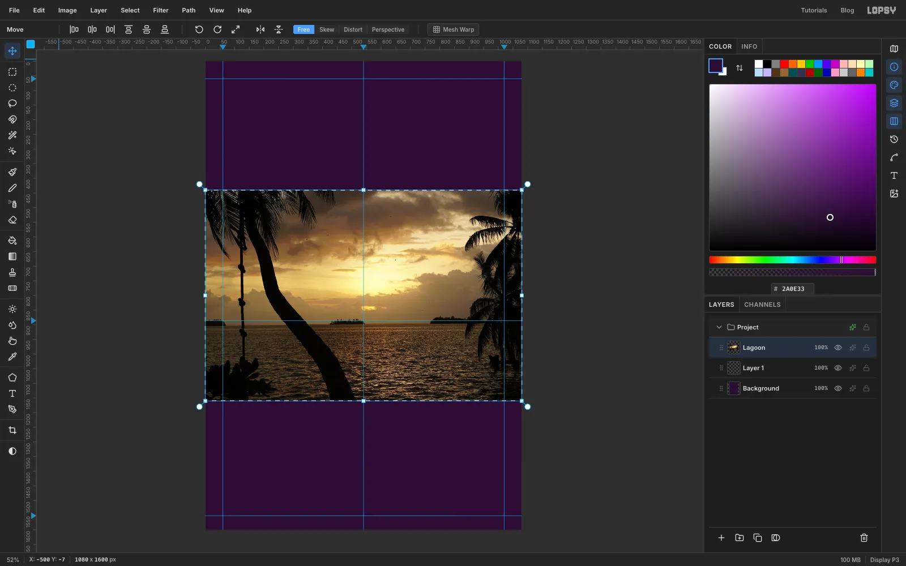

1. Click **Layer 1** so the photo lands above it. You'll delete the empty layer later.
2. Drag the photo file from your desktop onto the canvas. Lopsy puts it on a new layer and fits it to the poster's width, about 1080 × 720 px.
3. Double-click the new layer's name and rename it `Lagoon`.

## Scale the photo up

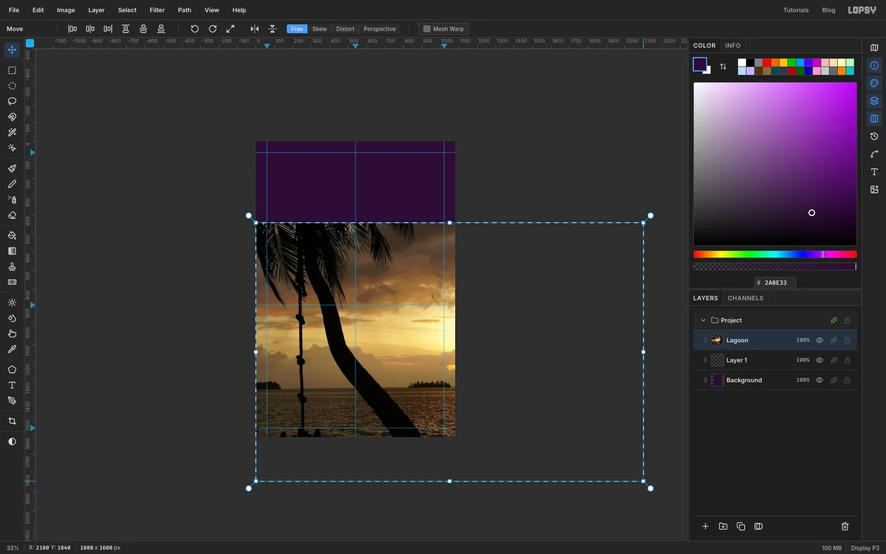

The photo needs to be about twice as big so the sea fills the poster and the middle islet sits in the centre.

1. Choose **View → Zoom Out** twice so you can see past the canvas.
2. With the **Move** tool, hold [[Cmd]] and drag the photo's bottom-right handle down and right until the photo is about `2100` px wide (watch the top ruler). [[Cmd]] keeps the proportions.
3. Drag from inside the photo, up and to the left, until the small middle islet sits on the centre guide and the horizon lines up with the `y 886` guide. The photo's top edge should be at the top of the canvas.
4. Press [[Cmd+D]] to commit the transform, then choose **View → Fit to Screen**.

## Clone out the palm trunk

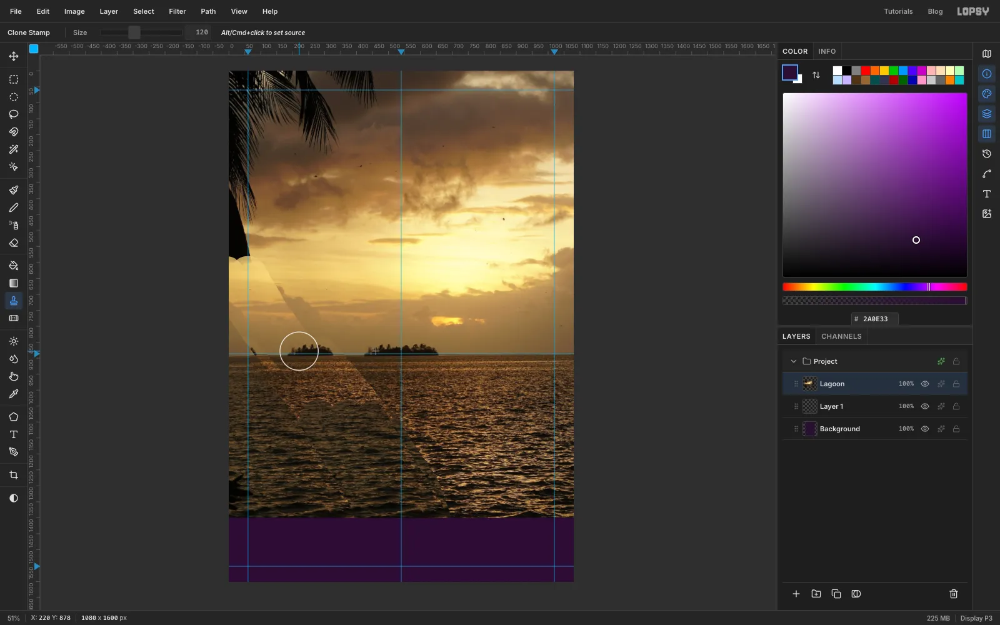

A palm trunk cuts across the left of the sea. You'll paint open water over it with the **Clone Stamp** (`S`).

The Clone Stamp keeps the distance between the point you [[Alt]]-click and the spot where your next stroke starts, so sample at the same height as the stroke, off to one side.

1. Set **Size** to `120`.
2. Start with the stretch of trunk just below the horizon. [[Alt]]-click the open water about 330 px to the right of the trunk. Paint three overlapping strokes down along the trunk, from the horizon to about `y 1130`: one down the middle and one along each edge.
3. Further down, the right side runs into the other palm. [[Alt]]-click about 290 px to the *left* of the trunk instead, and paint three more strokes down to the bottom of the photo.
4. Finally [[Alt]]-click the clouds about 240 px to the right of the trunk's last bit of sky, just above the horizon, and paint over it.

Cloning copies a second islet onto the horizon. That's fine. An atoll is a ring of islets.

## Heal the seams

The cloned bands are slightly lighter than the water around them. The **Healing Brush** (`H`) borrows texture from a source like the Clone Stamp, then matches the tone to where you paint.

1. Set **Size** to `70`.
2. For each visible edge of a cloned band, [[Alt]]-click about 70 px beside it, then drag along the edge.
3. Do the same along the top edge of the lower band, where it overlaps the first one at about `y 1094`.

The leftover fronds and the sliver of trunk at the far left don't matter. The jungle frame covers them later.

## Calm the sea

The water is busy. It will sit behind the title, so it should be softer than the sky.

1. With `Lagoon` still selected, drag a **Rectangular Marquee** from just below the horizon to the bottom of the canvas, a little wider than the canvas on both sides.
2. Choose **Filter → Gaussian Blur…** with **Radius** `2` and click **Apply**.
3. Choose **Filter → Hue/Saturation…**, set **Saturation** to `-15` and click **Apply**. Press [[Cmd+D]].

## Fade the photo into the bottom band

The bottom of the poster needs a dark, quiet band for the billing.

1. With `Lagoon` selected, click **Add Mask** at the bottom of the Layers panel, then click the mask thumbnail on the new **Mask** row to paint on the mask.
2. Pick the **Gradient** tool with **Type** **Linear**. Click **Advanced…**, set the left stop to `#FFFFFF` and the right stop to `#000000` with the **Hex color** field, and click **Done**.
3. Drag straight down from `y 1180` to `y 1400`.
4. Click **Background**. Open **Advanced…** again and set the stops to `#4A1A3E` and `#0E0818`. Click the middle of the bar to add a stop and make it `#24102E`. Drag from `y 1150` down to the bottom edge.

## Group the photo and grade it

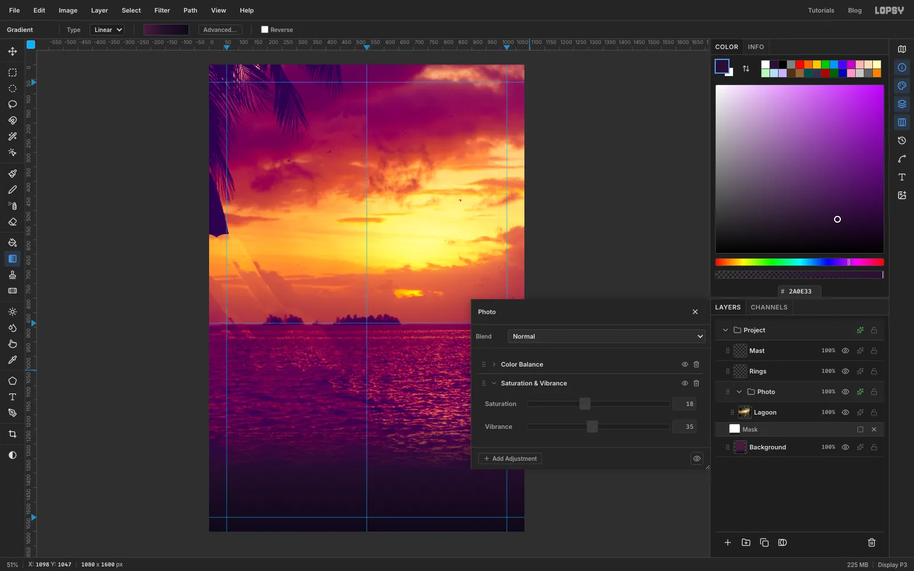

Adjustments live on groups in Lopsy, so the photo goes into its own group. The grade then stays editable.

1. Click **Layer 1** and click **Delete Layer**. You won't need it.
2. Click `Lagoon`, click **Add Layer** and rename the new layer `Rings`. Click **Add Layer** again and rename that one `Mast`. These two sit above the photo, outside the group you're about to make.
3. Click `Lagoon` and choose **Layer → Group Layers**. Rename the group `Photo`.
4. Click the ✦ button on the `Photo` row to open its adjustment drawer. Click **Add Adjustment → Color Balance**:
   - **Shadows**: Cyan — Red `14`, Magenta — Green `-22`, Yellow — Blue `30`
   - **Midtones**: Cyan — Red `10`, Magenta — Green `-14`, Yellow — Blue `4`
   - **Highlights**: Cyan — Red `8`, Yellow — Blue `-10`
5. Click **Add Adjustment → Saturation & Vibrance** and set **Vibrance** `35` and **Saturation** `18`. Close the drawer.

The shadows go violet, the clouds go magenta and the sun stays gold. That's the Technicolor look.

## Draw the radio mast

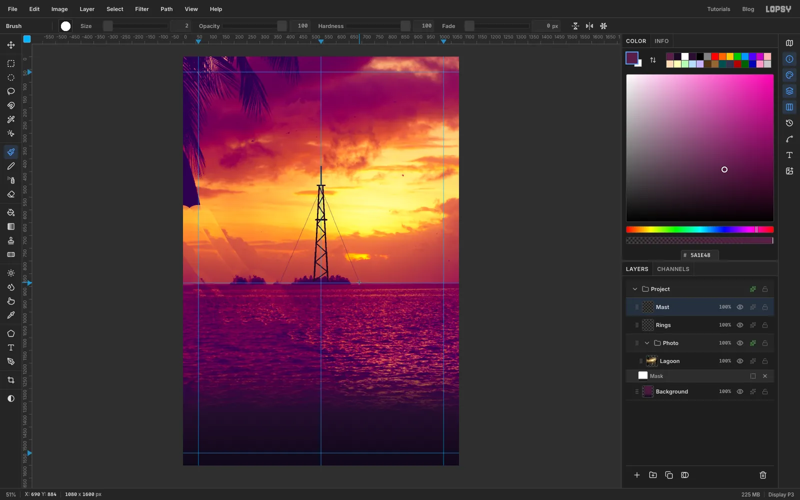

1. Click `Mast`. Pick the **Pencil** (`N`) at **Size** `5` with colour `#1B0A22`.
2. Draw the two legs. Click at `x 513`, `y 878` and [[Shift]]-click at `x 533`, `y 503`. Then click at `x 567`, `y 878` and [[Shift]]-click at `x 547`, `y 503`. The legs lean in toward the top.
3. Set **Size** to `3`. Click the bottom of the left leg, then [[Shift]]-click across to the right leg a little higher, then back to the left leg. Keep zig-zagging, about ten crossings up to the top.
4. Back at **Size** `5`, add a short crossbar at the top (`y 503`) and another at `y 638`, each a few pixels wider than the legs. Then draw the antenna straight up from `y 503` to `y 430`.
5. For the guy wires, switch to the **Brush** at **Size** `2`, **Hardness** `100`, **Opacity** `60`, colour `#5A1E48`. Click just below the top crossbar and [[Shift]]-click on the horizon at `x 380`, then again from the same point to `x 690`. A softer, plum wire reads as further away than solid black. Set **Opacity** back to `100`.

## Light the beacon

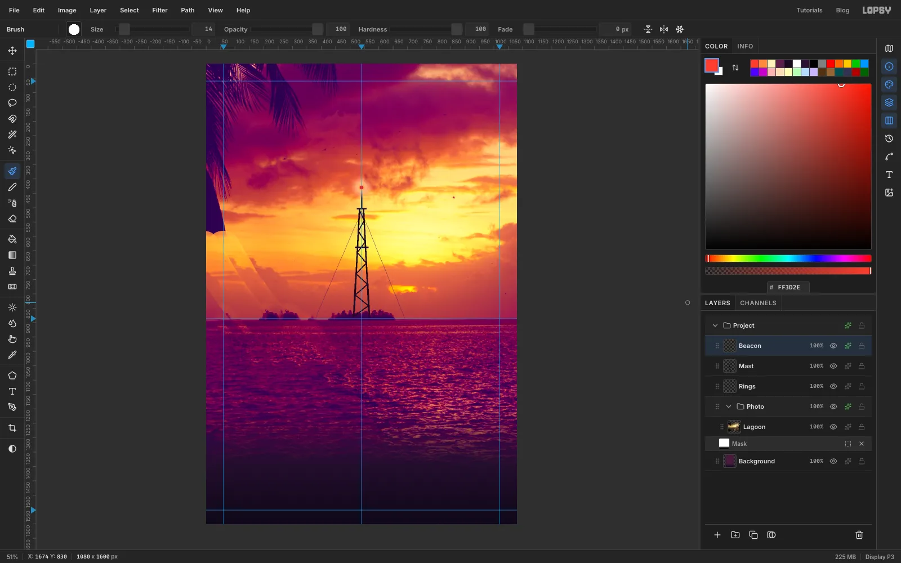

Glow effects blur the layer's shape, so a 14 px dot only gets a faint halo. Paint the wide glow by hand, and let Outer Glow add just a tight hot rim to the lamp.

1. With `Mast` selected, click **Add Layer** and name it `Beacon`.
2. With the **Brush** at **Hardness** `0`, **Size** `90` and **Opacity** `85`, click once on the tip of the antenna in `#FFF2B8`.
3. Click again at **Size** `40`, **Opacity** `90`, in `#FF8A3D`.
4. Set **Hardness** `100`, **Size** `14`, **Opacity** `100`, and click once more in `#FF3D2E`.
5. Open the layer's effects (✦), tick **Outer Glow** and set **Size** `10`, **Opacity** `80` and the colour `#FF2A1A`. Close the drawer.

## Draw the signal rings

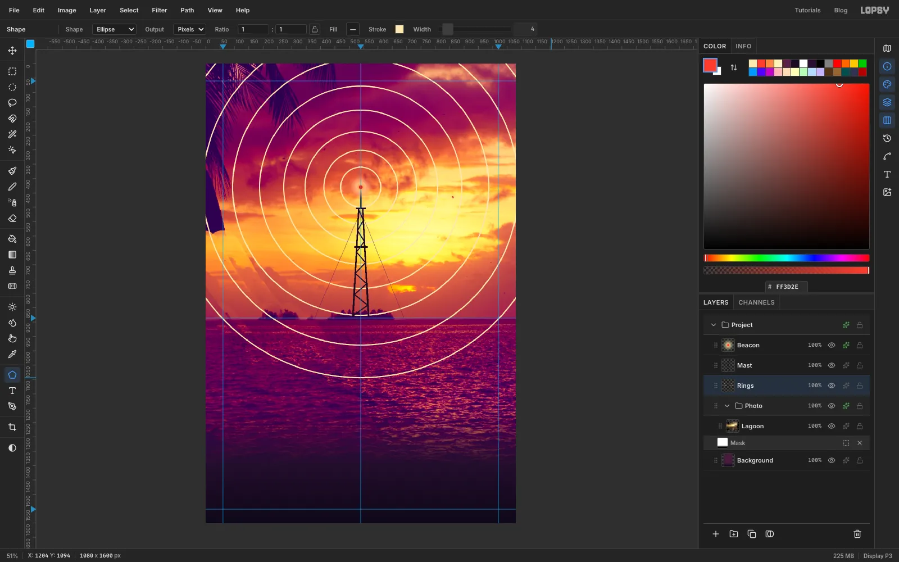

1. Click `Rings`. Pick the **Shape** tool (`U`) and set **Shape** to **Ellipse** and **Output** to **Pixels**.
2. Click the **Fill** swatch and click **Remove fill**. Click the **Stroke** swatch, type `FFE7B0` in its hex field and set **Width** to `4`.
3. Shapes grow from where you press. Hold [[Cmd]] for perfect circles, press on the beacon and drag out. Draw eight rings, starting with a radius of about `70` px and ending at about `660` px, which runs off the canvas. Make each gap a little wider than the one before, like ripples spreading out.

## Fade the rings with a mask

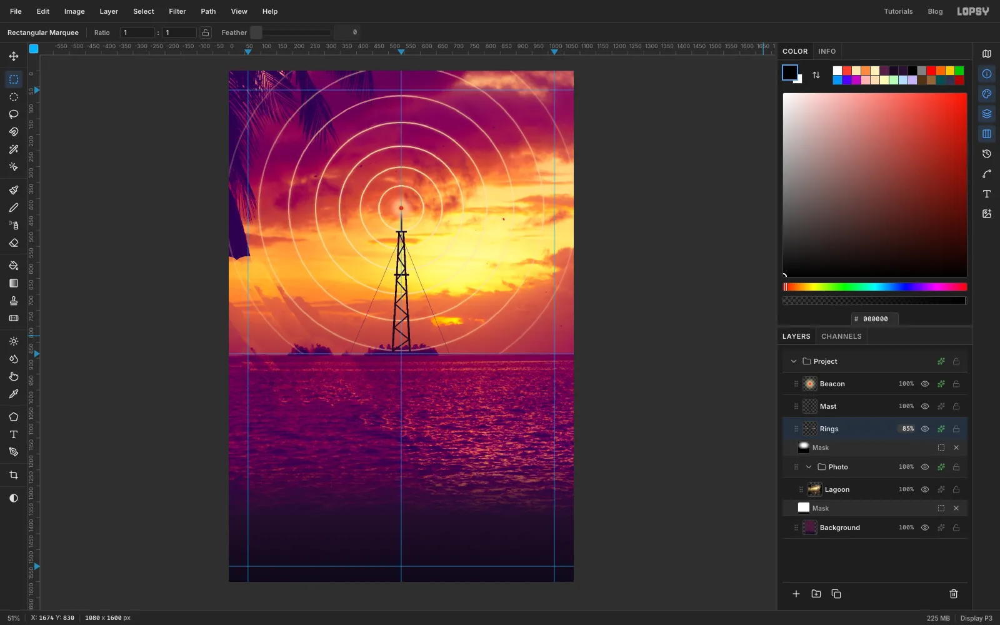

1. With `Rings` selected, click **Add Mask** and click the mask thumbnail.
2. Pick the **Gradient** tool and set **Type** to **Radial**. In **Advanced…** set the stops to `#FFFFFF` and `#000000`, then add a white stop about a third of the way along. Drag from the beacon straight down about 660 px. The inner rings stay solid and the outer ones fade.
3. Drag a marquee over everything below the horizon, set the colour to black and choose **Edit → Fill**. The rings now stop at the sea. Press [[Cmd+D]].
4. Click the `Rings` name to go back to the layer. Add an **Outer Glow** with **Size** `12`, **Opacity** `55` and colour `#FFD27A`. Set the layer's opacity to `85%`.

## Outline the first monstera leaf

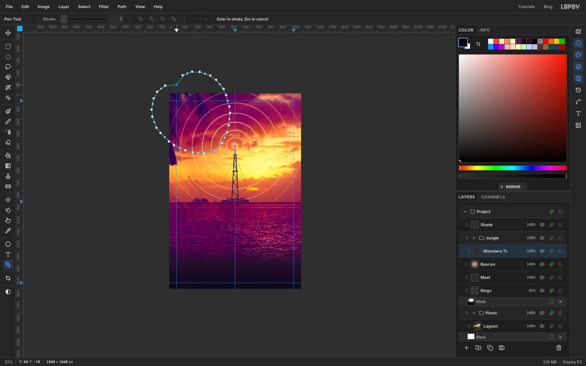

1. Click `Beacon`, click **Add Layer** and name it `Shade`. You'll use it later to darken the sky behind the type.
2. Click `Beacon` again and click **New Group**. Name the group `Jungle`. Make sure it sits under `Shade`. With the group selected, click **Add Layer** and name it `Monstera TL`. It goes inside the group.
3. Choose **View → Zoom Out** twice so there's room around the canvas.
4. Pick the **Pen** tool (`P`). The leaf's stalk is just off the top-left corner and its tip points down and right to about `x 370`, `y 470`. Click once at the stalk for a sharp notch. Then drag around the outline, one anchor at a time: out over the broad lobe, round to the tip, and back up the other side. Dragging pulls out curve handles. Click the tip without dragging so it stays pointed.
5. Click the first anchor to close the path.

## Vein, slit and hole the leaf

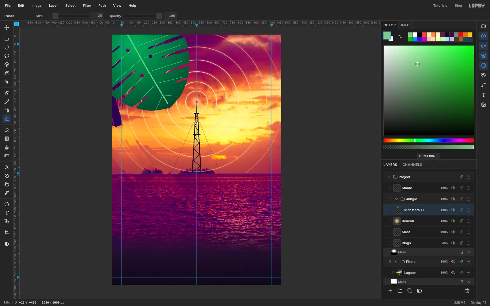

1. Open the **Paths** panel and click **Path to Selection**, then **Delete Path**.
2. Pick the **Gradient** tool, **Radial**, with stops `#3DAA62` and `#0A3F2B`. Drag from about a quarter of the way down the leaf to just past its tip. Press [[Cmd+D]].
3. With the **Pencil** at **Size** `6` in `#7FCB86`, draw the midrib from the stalk to the tip in two [[Shift]]-click lines. At **Size** `2`, draw five thin side veins on each side, angled toward the tip.
4. Pick the **Eraser** (`E`). Cut five slits on each side, between the veins. Start each one partway out from the midrib. Vary where they start and stagger the two sides, so they don't look stamped. For each slit, erase a narrow cut at **Size** `11` halfway to the edge, then a wider cut at **Size** `22` from there out past the edge. That tapers the slit open toward the margin.
5. At **Size** `25`, click three small holes near the midrib.

## Draw a banana leaf

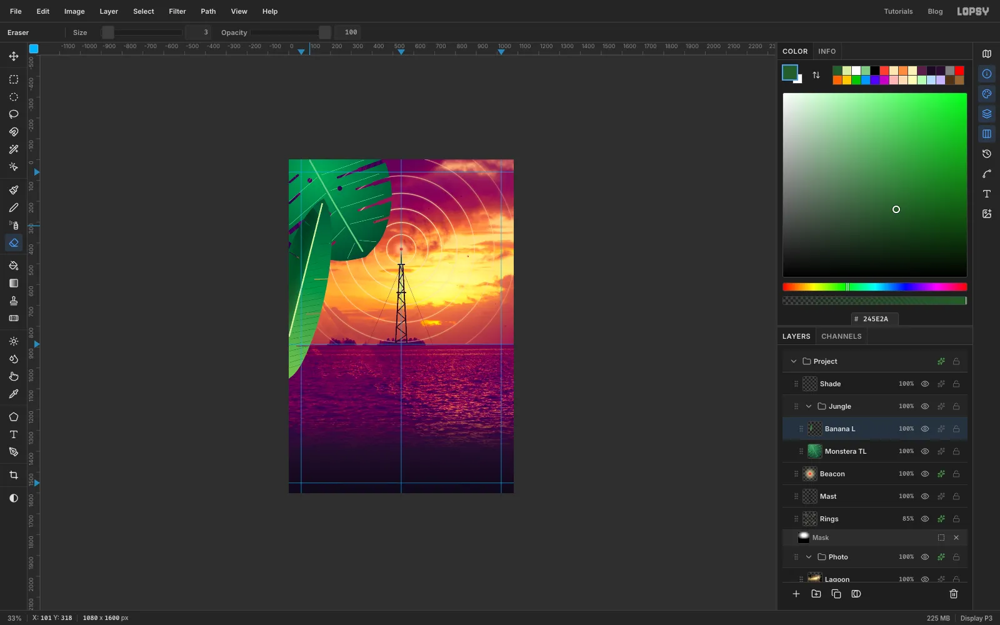

1. Click **Add Layer** and name it `Banana L`.
2. With the **Pen**, outline a long, narrow blade. It starts off the canvas at the bottom left, around `x -50`, `y 1060`, and rises to a point near `x 170`, `y 190`. It's widest about a third of the way up. Close it, then choose **Path to Selection** and **Delete Path**.
3. Pick the **Gradient** tool, **Linear**, with stops `#86C25E`, `#3A8F4E` at the middle and `#17543A`. Drag from the base to the tip. Press [[Cmd+D]].
4. With a **Size** `22` Pencil in `#2E7A3C`, draw the stalk coming in from off the canvas to the base of the blade.
5. [[Cmd]]-click the layer's thumbnail to select the leaf. Pick **Dodge & Burn** (`O`), set **Mode** to **Burn**, and set **Exposure** `45` and **Size** `108`. Drag it up the left half of the blade, then press [[Cmd+D]]. The leaf now curls away from the light.
6. With the **Pencil** at **Size** `6` in `#D8EFA2`, draw the midrib. At **Size** `1` in `#245E2A`, draw about fifteen fine striations on each side, slanting up toward the tip.
7. Pick the **Eraser** at **Size** `3`. Make eight short cuts in from the edges, four on each side, running along the striations. Banana leaves split like this in the wind.

## Finish the jungle frame

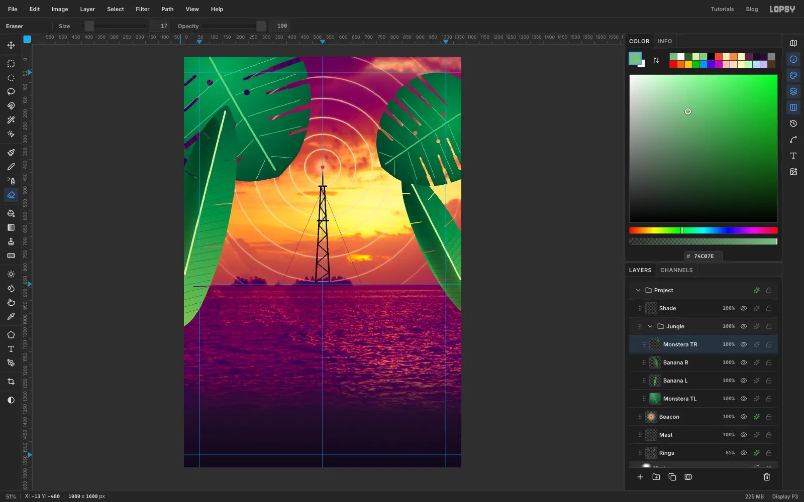

Build two more leaves the same way, each on its own layer inside `Jungle`.

1. `Banana R`: a shorter blade coming in from the bottom right, around `x 1150`, `y 1010`, with its tip near `x 855`, `y 430`. Give it the same fill, stalk, veins and splits, but burn its *right* half, the side away from the sun.
2. `Monstera TR`: a smaller monstera coming in from the right edge at about `y 190`, its tip pointing down and left to about `x 770`, `y 430`. Use stops `#2F9A57` and `#083826` and veins in `#74C07E`.

Keep the two sides different. A smaller, lower leaf on the right reads as a real tangle of jungle. A mirror image of the left would look stiff.

## Paint a hibiscus with radial symmetry

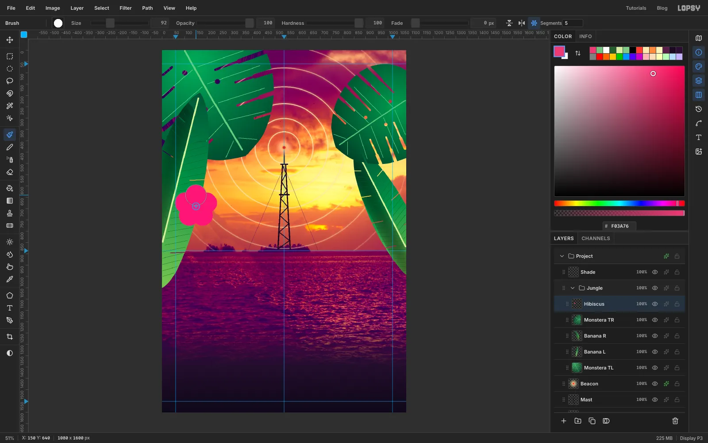

1. Click **Add Layer** and name it `Hibiscus`.
2. Pick the **Brush** and click **Radial Symmetry** in the options bar. Set **Segments** to `5`.
3. [[Cmd]]-click at `x 150`, `y 690` to move the symmetry centre there. It doesn't paint.
4. Set **Hardness** `100`, **Size** `64` and colour `#F03A76`. Drag from the centre about 48 px straight up. Then set **Size** `92` and click once about 50 px above the centre. Each mark repeats five times around the centre, so you get five rounded petals.

## Finish the flower

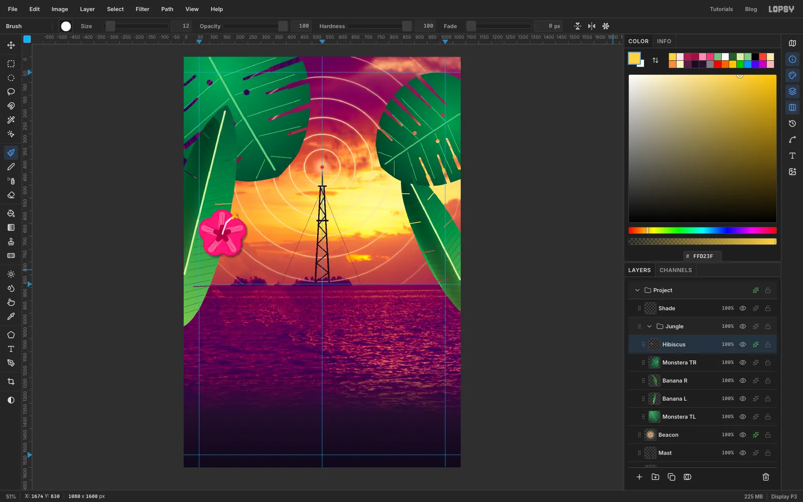

1. Still with symmetry on: at **Size** `22`, **Opacity** `55`, colour `#FF8DB3`, drag from about 28 px out to the petal's edge. Set **Opacity** back to `100`.
2. In `#A30F3F`, drag from the centre about 26 px out at **Size** `21`, then click the centre at **Size** `40`. That's the throat.
3. With a **Size** `1` Pencil in `#B5194F`, draw three fine veins out along one petal. Symmetry repeats them on all five.
4. Switch back to the **Brush** and click **Radial Symmetry** to turn it off.
5. With a **Size** `5` Pencil in `#FFE3EC`, draw the stamen as two [[Shift]]-click lines that bend up and to the right from the centre. Then click four pollen dots in `#FFD23F` at its tip with a **Size** `12` Brush.
6. Add an **Inner Glow** (**Size** `10`, **Opacity** `85`, `#A0103F`) and a **Drop Shadow** (**Offset** `6`, `6`, **Blur** `8`, **Opacity** `45`, `#16031C`).

## Copy a second flower

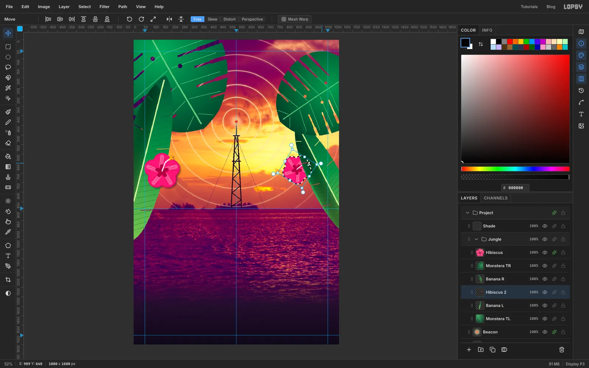

1. [[Cmd]]-click the `Hibiscus` thumbnail to select the flower and choose **Edit → Copy**.
2. Click `Banana L`, then choose **Edit → Paste**. The copy lands in place, on a new layer above `Banana L` and so below `Banana R`. Rename it `Hibiscus 2`.
3. With the **Move** tool, drag the copy to about `x 880`, `y 700`, against the left edge of the right-hand banana leaf. It tucks behind the leaf.
4. Hold [[Cmd]] and drag the bottom-right handle inward to shrink it by about a fifth. Then drag from just outside the top-right corner to rotate it about 32° clockwise.
5. Press [[Cmd+D]]. Not sure about the angle? Step back with [[Cmd+Z]] to compare the flower before the rotation, the scale and the move, then step forward again with [[Cmd+Shift+Z]].

## Shade the leaves and catch the sunset

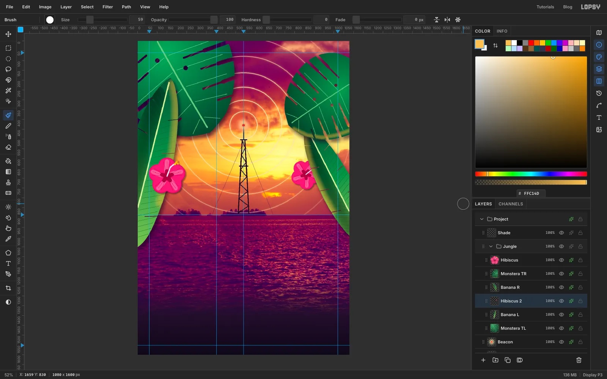

1. Give each of the four leaves a **Drop Shadow**: **Offset** `10`, `16`, **Blur** `28`, **Opacity** `60`, colour `#16031C`.
2. Copy and paste only bring the pixels, not the effects. Give `Hibiscus 2` its own **Inner Glow** (**Size** `5`, **Opacity** `75`, `#A0103F`) and **Drop Shadow** (**Offset** `5`, `5`, **Blur** `8`, **Opacity** `45`, `#16031C`). They're a little smaller than the first flower's, to match its size.
3. Now the rim light. Pick the **Brush** at **Hardness** `0`, **Opacity** `45`, colour `#FFC14D`. For each leaf, [[Cmd]]-click its thumbnail to load it as a selection. Then brush once along the edge that faces the sun, from halfway along the leaf to its tip. Use a brush about a tenth of the leaf's length, so `55` for the big monstera and `80` for the long banana leaf. The selection keeps the gold inside the leaf. Press [[Cmd+D]] and set **Opacity** back to `100`.

## Darken the sky for the type

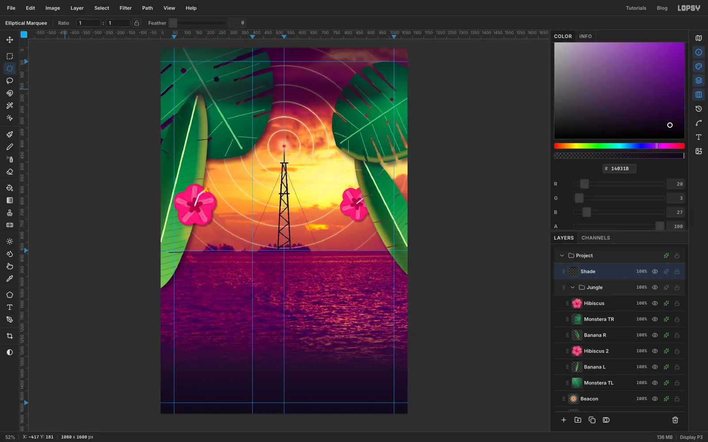

1. Click `Shade`. Drag a marquee over the top 280 px of the poster.
2. Pick the **Gradient** tool, **Linear**. In **Advanced…** set both stops to `#14031B`, and drag the right stop's **Opacity** strip to `0`. Set the left stop's to `65`. Drag from the top edge down to `y 280`.
3. Pick the **Elliptical Marquee** and drag an oval about 880 × 124 px centred at `x 540`, `y 198`. Choose **Select → Feather…** with `36`.
4. Set the colour to `#14031B` and the Color panel's **A** to `50`. Choose **Edit → Fill**, press [[Cmd+D]] and set **A** back to `100`.

## Set the credits and tagline

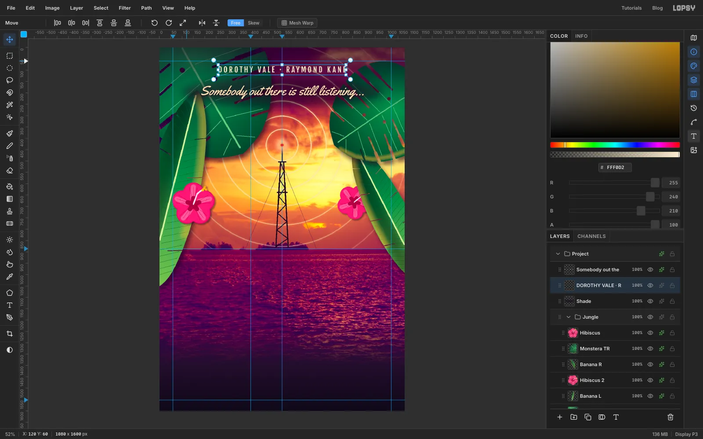

With a text layer selected, changing the font restyles that layer. So click `Shade` before you set up each new line.

1. Click `Shade` and pick the **Text** tool (`T`). Choose **Yellowtail**, size `58`, colour `#FFE2B8`. Click in the empty sky and type `Somebody out there is still listening...`. Press [[Tab]] to commit.
2. With the **Move** tool, use the arrow keys ([[Shift]] moves 10 px) to centre it on the centre guide, at about `y 196`. Add a **Drop Shadow**: **Offset** `0`, `4`, **Blur** `10`, **Opacity** `85`, colour `#16031C`.
3. Click `Shade` again. Choose **Fjalla One**, size `32`, colour `#FFF0D2`. Type `DOROTHY VALE · RAYMOND KANE` near the top and press [[Tab]]. In the **Text** panel set **Letter spacing** to `7`, then centre it at `y 96`.

## Set the title

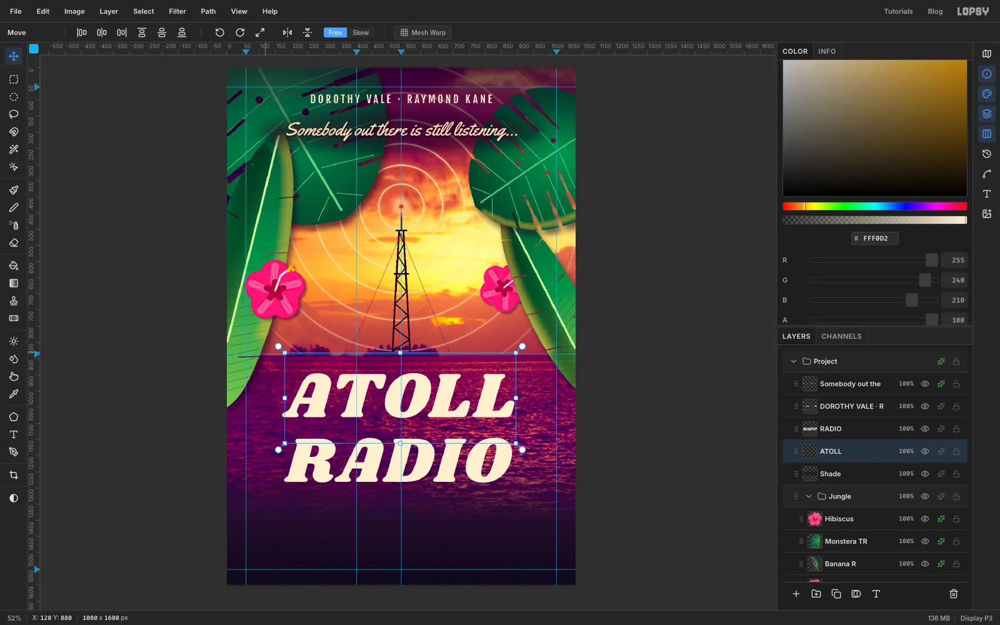

1. Click `Shade`, and in the **Text** tool choose **Shrikhand** at size `200` in `#FFF0D2`.
2. Set the bottom line first. Click in empty sea around `y 1100`, type `RADIO` and press [[Tab]].
3. Click `Shade` again, so the second line goes under the first in the Layers panel. Then click higher up, around `y 880`, and type `ATOLL`. If you click inside the first line's text box, you'll add to that line instead of starting a new one.
4. Nudge `RADIO` to centre on `x 530`, `y 1214` and `ATOLL` on `x 530`, `y 1014`. That's 10 px left of centre, because the tilt and the shadow will push the title's weight to the right.

## Tilt the title

1. Click `RADIO` and choose **Layer → Merge Down** to merge it into `ATOLL`. Merging turns both lines into pixels, so you can tilt and recolour them. Rename the result `Title`.
2. Drag a marquee around both lines with a little room to spare. With the **Move** tool, drag from just outside the top-right corner upward to rotate the title about 5° anticlockwise. Press [[Cmd+D]].

## Run a sunset gradient through the letters

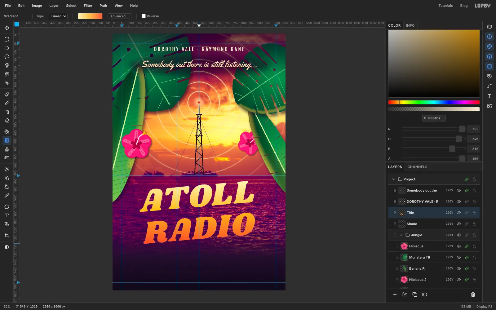

1. [[Cmd]]-click the `Title` thumbnail to select the letters.
2. Pick the **Gradient** tool, **Linear**, with stops `#FFF4B8`, `#FFC145` at 45% and `#FF5B3A`.
3. Drag from the top of `ATOLL` straight down to the bottom of `RADIO`. Press [[Cmd+D]].

## Outline the title and give it a hard shadow

1. Open `Title`'s effects and tick **Stroke**: **Width** `9`, colour `#2A0730`.
2. Tick **Drop Shadow**: **Offset** `12`, `14`, **Blur** `0`, **Opacity** `100`, colour `#12031A`. With no blur, the shadow is a solid offset copy, like the shadows on old printed posters.

## Set the billing block

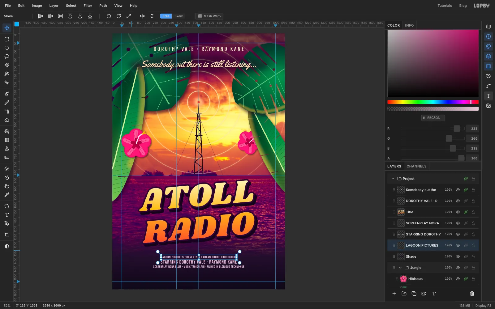

A billing block is tall, condensed capitals, with the stars' names larger than the rest. Set the three lines bottom-up in **Bebas Neue**, colour `#EBC8DA`, and centre each on `x 540`. Click `Shade` before each line.

1. Size `21`, **Letter spacing** `1`: `SCREENPLAY NORA ELLIS · MUSIC TEO KALANI · FILMED IN GLORIOUS TECHNI-HUE`, centred at `y 1458`.
2. Size `32`, **Letter spacing** `2`: `STARRING DOROTHY VALE · RAYMOND KANE`, centred at `y 1428`.
3. Size `21`, **Letter spacing** `2`: `LAGOON PICTURES PRESENTS A HARLAN ROOKE PRODUCTION`, centred at `y 1398`.

## Draw the date pill on the grid

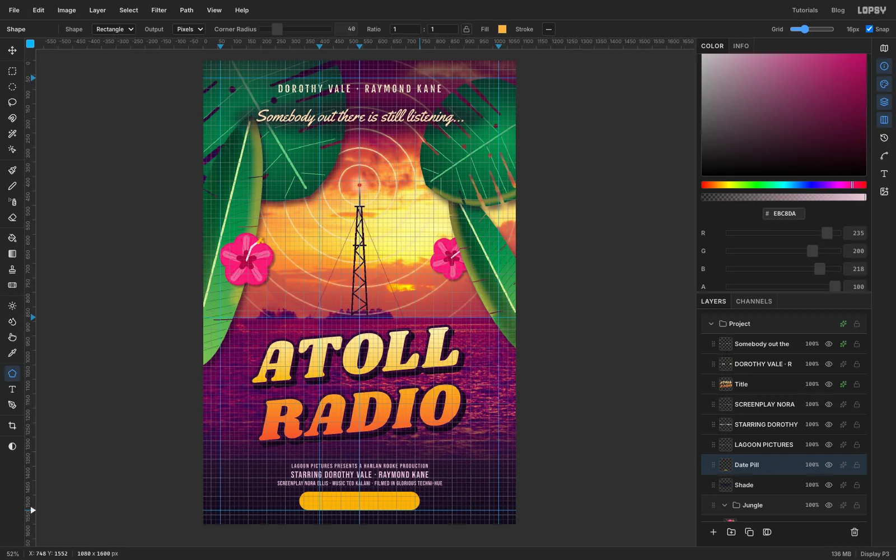

1. Click `Shade`, click **Add Layer** and name it `Date Pill`.
2. Choose **View → Show Grid**. The grid is 16 px and **Snap** turns on with it.
3. Pick the **Shape** tool, set **Shape** to **Rectangle**, the **Fill** to `#FFB43F`, remove the stroke, and set **Corner Radius** to `40`. That's more than half the height, so the ends come out fully round.
4. Press at `x 540`, `y 1520` and drag out to `x 748`, `y 1552`. The centre and the corner snap to the grid and to the bottom margin guide, so the pill is exactly 416 × 64 px.
5. Choose **View → Show Grid** again to hide the grid.

## Seat the date in the pill

1. With `Date Pill` selected, set up the **Text** tool with **Fjalla One**, size `30`, colour `#2A0730`. Click in the empty space under the pill and type `IN THEATRES JUNE 6`. Press [[Tab]].
2. Set **Letter spacing** to `6`.
3. Nudge it with the arrow keys until it's centred on the pill at `x 540`, `y 1520`. The line is all capitals with no descenders, so the letters' own height is what you centre. That leaves 20 px above and below and about 48 px at each end.

## Add film grain

1. Click the tagline's layer, click **Add Layer** and name it `Grain`. It goes on top of everything.
2. Set the colour to `#808080`, choose **Edit → Fill**, and run **Filter → Add Noise…** with **Amount** `22`, **Mono** and **Gaussian**.
3. Set its blend mode to **Overlay** and its opacity to `35%`. The grey disappears and only the speckle remains.

## Finish with a vignette

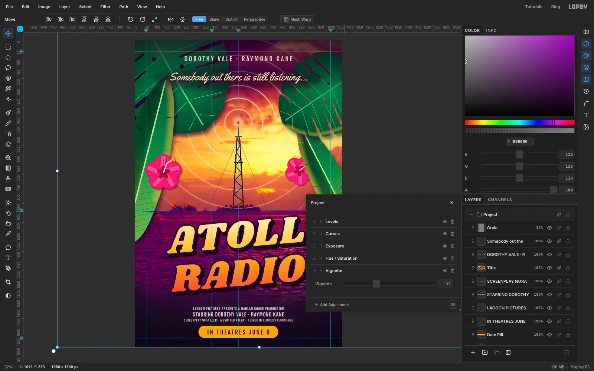

1. Choose **Layer → Adjustment Layer…** to open the document's own adjustment stack. Close the info box if one appears. The drawer already lists four neutral adjustments (Levels, Curves, Exposure and Hue / Saturation); leave them as they are.
2. Click **Add Adjustment → Vignette** and set it to `35`. Close the drawer.
3. Choose **File → Save Project** to keep the layers, and **File → Quick Export PNG** for the poster.
