*Uppercase Etiquette* is an imaginary zine about capital letters and the
manners they demand. This issue is called "On Shouting Politely". In this
tutorial you'll design its cover. Type does almost all the work.

The cover is a 1200 × 1600 px page, a 3:4 zine format. Two giant letters, a
lime **U** and a violet **E**, are printed in two inks that overlap. A black
label strip carries the title UPPERCASE. Underneath, the word *etiquette* is
deliberately set in lowercase and a proofreader has marked it up in pink. The
U's empty middle (its *counter*) holds the contents list and a rubber stamp.
Toner specks, darker edges and staples make it look photocopied.

Along the way you'll use:

- live **Text** in Archivo Black, Anton, DM Serif Display, Space Mono and Reenie Beanie, with letter spacing, line height and font weight from the **Text** panel
- the **Move** tool's rotation handles on live text, raster selections and a whole group
- **Duplicate Layer**, **Rasterize Layer**, **Merge Down**, **New Group** and the **Multiply** and **Overlay** blend modes
- ⌘-click on a layer thumbnail to load its shape as a selection, and ⌘⇧⌥-click to intersect two shapes
- **Select → Shrink** and **Feather**, the **Elliptical Marquee**, and the **Pen** tool with **Path to Selection**
- the **Shape** tool's path output and **text on a path**
- **Halftone**, **Add Noise**, **Gaussian Blur**, **Threshold** and **Motion Blur**, including filters run on a **layer mask**
- the **Brush**, the **Pencil** with [[Shift]]-click lines, the **Drop Shadow** effect, copy and paste, and undo and redo

The palette:

- Newsprint `#ECE7DA`, grain grey `#808080`
- Acid lime `#C9DC34`, overprint violet `#5A4BC0`
- Ink `#17161A`, fluoro pink `#E8357F`
- Halftone grey `#3C3C3C`, stamp mask grey `#A6A6A6`
- Staple grey `#5E5E64`, staple shine `#B4B4BA`

Positions are given as document coordinates. Watch **X** and **Y** in the
status bar at the bottom of the window as you move the pointer. Most things
only need to be close.

Two things about text in Lopsy will save you some confusion:

- **New text needs a raster layer selected first.** If a text layer is
  selected when you change the font, size or colour, you restyle that layer.
  Before each new piece of type, click a plain (non-text) layer in the Layers
  panel, then set up the Text tool.
- **Settings carry over.** The Text panel's letter spacing, line height and
  weight become the defaults for the next text you type. Set them back to
  `0`, `1.4` and **Regular** before starting new text.

Lopsy names each text layer after its text. Later steps refer to some of
them by short names like `Big E` or `Spine`, so rename those as you go
(double-click the name in the Layers panel). Each step says when.

[[Shift]] plus an arrow key nudges the active layer 10 px; the arrow on its
own nudges 1 px.

I typed each new piece of text in an empty patch of paper (around `x 150`,
`y 985`, between the U and the strip) and then dragged it into place with the
**Move** tool. A Text tool click on top of an existing text layer edits that
layer instead of starting a new one.

## Set up the page, guides and paper grain

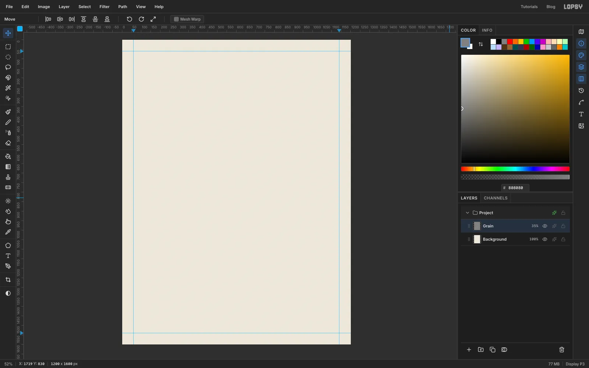

1. Choose **File → New**, set **Width** `1200` and **Height** `1600`, and click **Create**.
2. Click the top ruler at `x 60` and `x 1140`, and the left ruler at `y 60` and `y 1540`. These are your margins.
3. Click **Background**, set the foreground colour to `#ECE7DA` and choose **Edit → Fill**.
4. Rename **Layer 1** to `Grain` (double-click its name). Fill it with `#808080`, then run **Filter → Add Noise…** with **Amount** `30` and **Mono**.
5. Open the layer's effects drawer (the ✦ button on its row), set the blend mode to **Overlay** and close the drawer. Click the row's opacity and set it to `35%`. Grey disappears in Overlay, so only the grain is left.

## Type the giant E

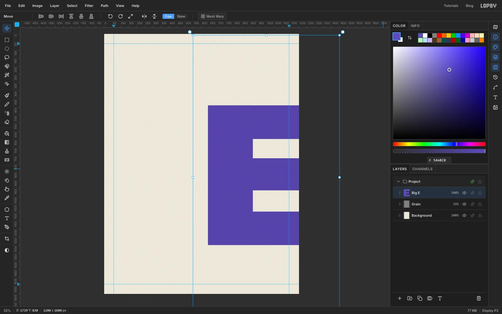

1. Click `Grain`, pick the **Text** tool and set **Size** to `1250` (type it, the slider stops at 500). Choose **Archivo Black** in the font browser and set the colour to `#5A4BC0`.
2. Click in the lower right of the page, type a capital `E` and press [[Tab]] to commit it. Rename the layer `Big E`.
3. With the **Move** tool, drag the E so its left edge sits at about `x 640` and its top at about `y 440`. The rest of it runs off the right edge of the page.
4. In the effects drawer, set the blend mode to **Multiply**. That makes it behave like transparent ink when other colours go under it.

## Tilt the E

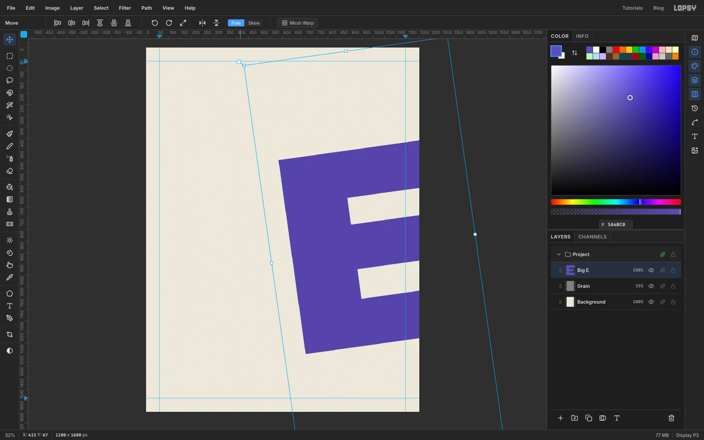

The Move tool shows handles around live text. You can turn it without
rasterizing it.

1. With the **Move** tool and `Big E` selected, hover just outside the top-left corner of its box until the round rotation handle lights up.
2. Drag upward about 8° anticlockwise, so the E leans back. Its bottom edge now rises gently to the right.

## Slide the U in underneath

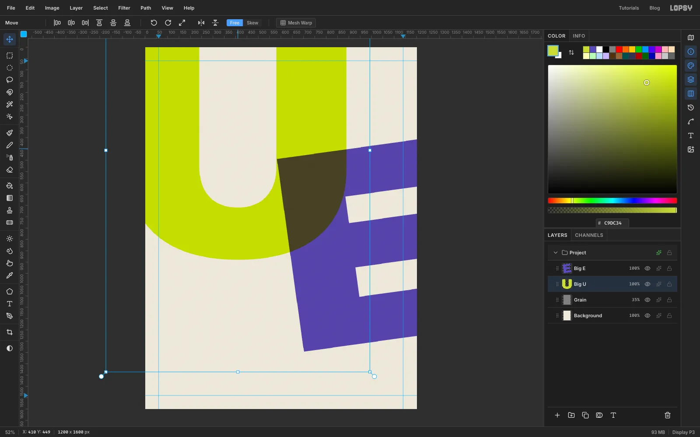

Click `Grain` again before you set up the U. New layers land directly above
the selected one, so the U ends up *under* the E and the E's Multiply darkens
it where they cross.

1. Pick the **Text** tool. Set **Size** `1400`, **Archivo Black**, colour `#C9DC34`.
2. Click near the top left of the page, type `U` and press [[Tab]]. Rename the layer `Big U`.
3. Move it so its left arm hangs about 70 px off the left edge and its top runs about 40 px past the top. Leave it on **Normal** so the lime stays pure.

## Cut a keyline from a copy of the E

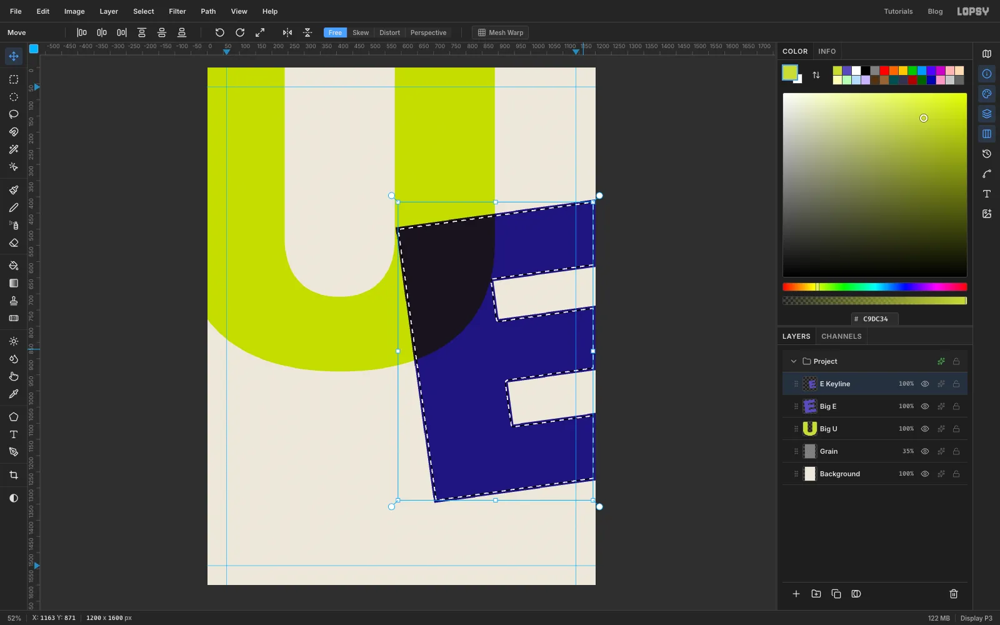

A thin black outline that doesn't quite line up with the violet looks like
a third printing plate that slipped.

1. Click `Big E` and choose **Layer → Duplicate Layer**.
2. Click **Rasterize Layer** (the **T** button at the bottom of the Layers panel) to turn the copy into pixels. Rename it `E Keyline`.
3. [[Cmd]]-click the copy's thumbnail to select its shape, then choose **Select → Shrink…** with `7`.
4. Press [[Delete]]. Only a 7 px rim is left.

## Ink and offset the keyline

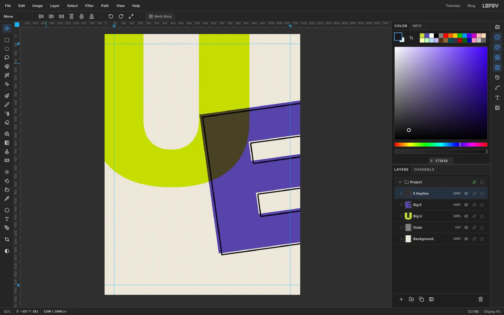

1. [[Cmd]]-click the keyline's thumbnail again, set the colour to `#17161A` and choose **Edit → Fill**. Press [[Cmd+D]].
2. With the **Move** tool, nudge the outline about 16 px right and 12 px down with the arrow keys, so it peeks out along the bottom and right of the violet.

## Select where the two letters overlap

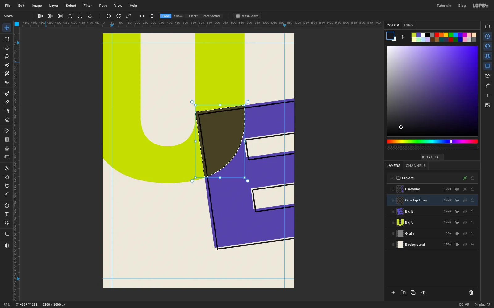

Where the inks cross, the violet over the lime would be a muddy olive. Instead
you'll print that patch as lime with a violet halftone on top.

1. Click `Big E` and click **Add Layer**. Name it `Overlap Lime`.
2. [[Cmd]]-click the U's thumbnail to select the U.
3. Hold [[Cmd+Shift+Alt]] and click the E's thumbnail. That keeps only the part of the selection inside the E, which is the overlap.
4. Set the colour to `#C9DC34` and choose **Edit → Fill**. Keep the selection.

## Halftone the overlap

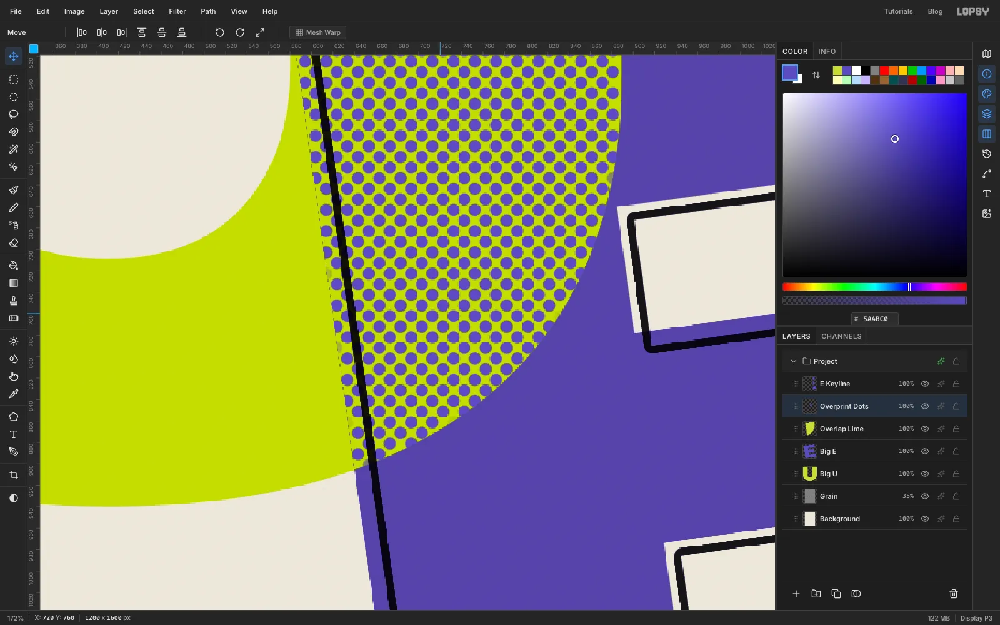

1. Click **Add Layer** and name it `Overprint Dots`.
2. Fill it (still inside the selection) with dark grey `#3C3C3C`.
3. Run **Filter → Halftone…** with **Dot Size** `14` and **Angle** `45`. The filter stays inside the selection and turns the grey into dots on transparency. Halftone sizes each dot by how dark the area is, so a dark grey gives big dots that cover about two thirds of the patch. The colour goes on next.
4. Press [[Cmd+D]], [[Cmd]]-click the dots layer's thumbnail and fill the dots with `#5A4BC0`. Press [[Cmd+D]].

## Draw the label strip with the Pen

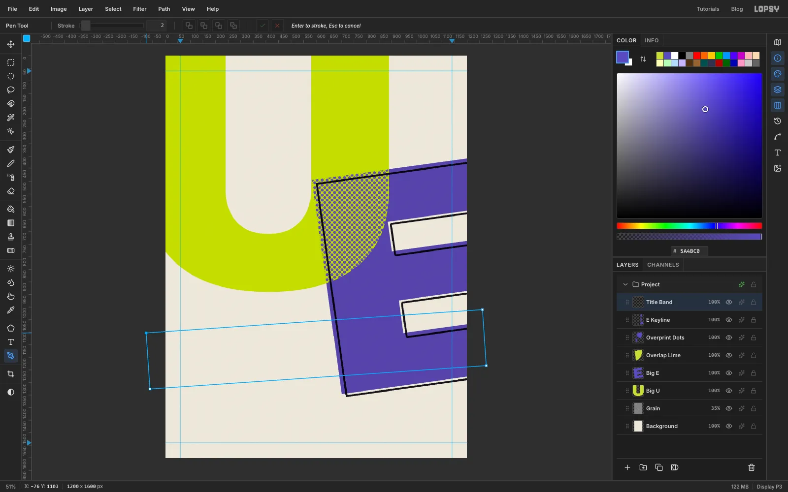

A strip that bleeds off both edges is easiest to draw as a tilted
rectangle with the Pen.

1. Click `E Keyline` and add a layer called `Title Band`.
2. Zoom out a little so there's grey around the page. Pick the **Pen** tool and click four corners of a tilted rectangle:
   - the top-left corner in the grey, about 75 px past the left edge, at `y 1100` or so
   - the top-right corner in the grey past the right edge, about 90 px higher than the first
   - the bottom-right corner straight below that, about 220 px down
   - the bottom-left corner about 220 px below the first point
3. Click the first point again to close the path. You want a strip about 220 px deep, tilted about 4° anticlockwise, running off both sides of the page. The screenshot shows the shape.

## Fill the strip

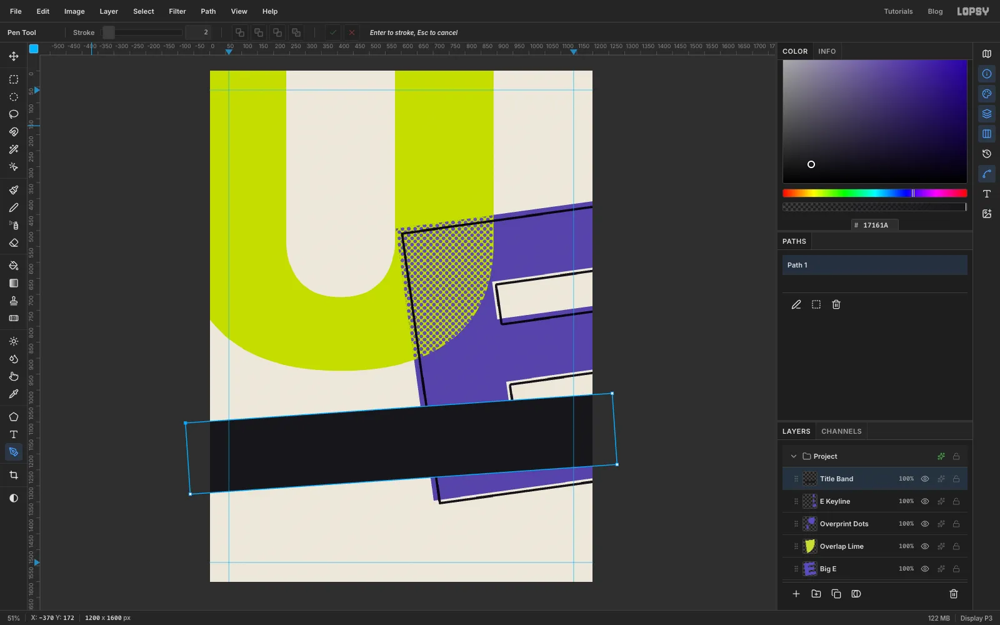

1. Open the **Paths** panel from the right-hand rail. Click **Path 1** so it's highlighted, then click the dashed-square icon under the list (**Path to Selection**).
2. Go back to the Layers panel, set the colour to `#17161A`, choose **Edit → Fill** and press [[Cmd+D]].

## Set UPPERCASE and turn it to match

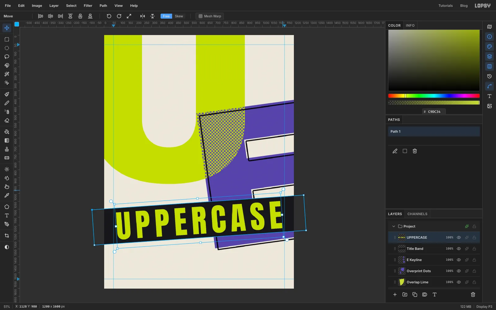

1. Click `Title Band`, pick the **Text** tool and set **Size** `200`, **Anton**, colour `#C9DC34`. Type `UPPERCASE` in clear paper and press [[Tab]]. The layer is already called `UPPERCASE`.
2. Open the **Text** panel from the right-hand rail and raise **Letter spacing** to about `27`, until the word is roughly 1040 px wide. Go back to the Layers panel.
3. Switch to the **Move** tool and drag the word onto the middle of the strip.
4. Drag the top-right rotation handle about 4° anticlockwise so the letters follow the strip. Nudge it back to the centre if it drifts.

## Add a misregistered pink plate

1. Click **Rasterize Layer**, then **Layer → Duplicate Layer**.
2. Click the *lower* `UPPERCASE` layer, [[Cmd]]-click its thumbnail and fill it with `#E8357F`. Press [[Cmd+D]].
3. Nudge it down 1 px with [[Down]].
4. Draw a **Rectangular Marquee** just around the pink word. With the **Move** tool, drag its top-right rotation handle about 1° further anticlockwise.
5. Press [[Cmd+D]] to drop it.

## Check the slip

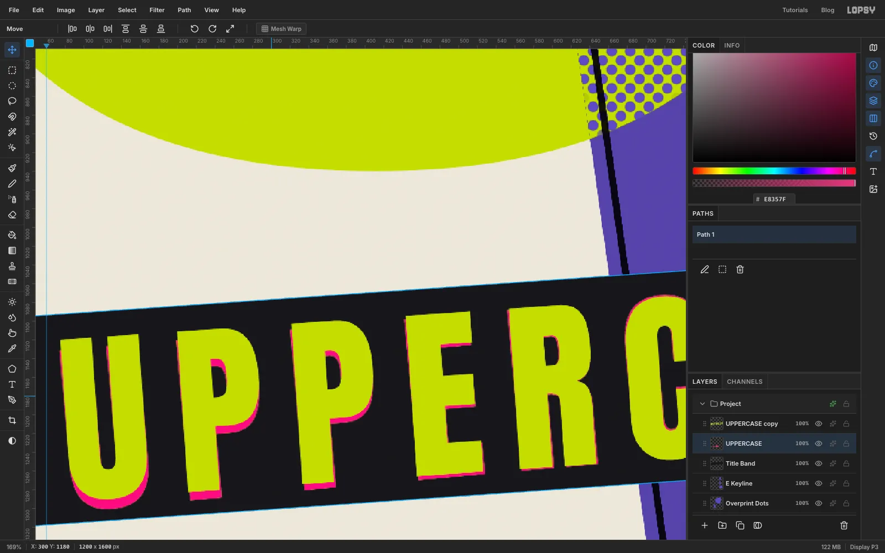

Zoom in on the title. Because the pink copy turned a little more than the
lime, it sits low on the left and high on the right. A plain offset would
look like a drop shadow. The changing gap looks like a plate that slipped on
the press.

## Merge the title into the strip

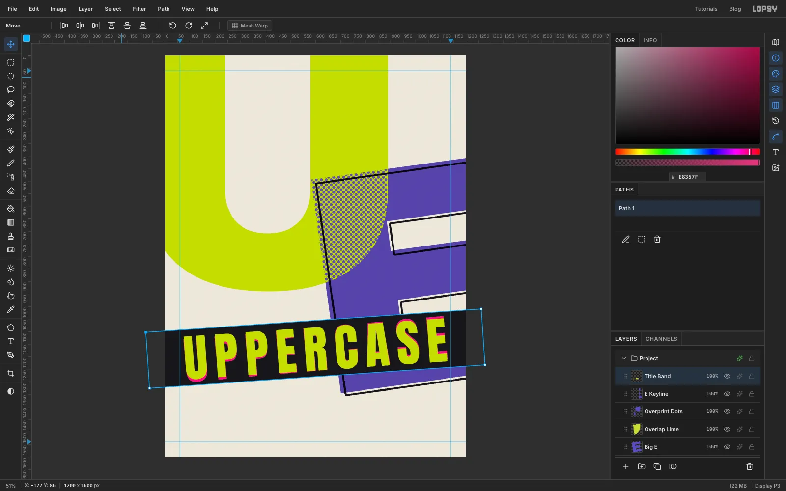

1. Click `UPPERCASE copy` (the lime one) and choose **Layer → Merge Down**. The lime merges onto the pink.
2. Choose **Merge Down** again to fold the title into `Title Band`.

## Set "etiquette" in lowercase

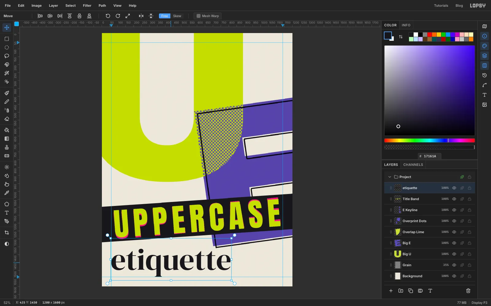

The joke is that the zine's own title breaks its rule.

1. Click `Title Band` and pick the **Text** tool. Set **Size** `190`, **DM Serif Display**, colour `#17161A`, and check the Text panel's letter spacing is back to `0`.
2. Type `etiquette` in clear paper and press [[Tab]].
3. Move it so it starts on the left margin guide, with a little clear paper between the strip and the dot on the i. The tail of the q should stay above the bottom guide.

## Circle the e

1. With `etiquette` selected, click **New Group** and rename it `Proof Marks`. Click **Add Layer** (it goes inside the group) and name it `Marks`.
2. Pick the **Brush**, **Size** `6`, colour `#E8357F`.
3. Draw one loose loop around the first e, starting at the top and overlapping where you began, the way you'd circle something with a pen.

## Add the triple underline

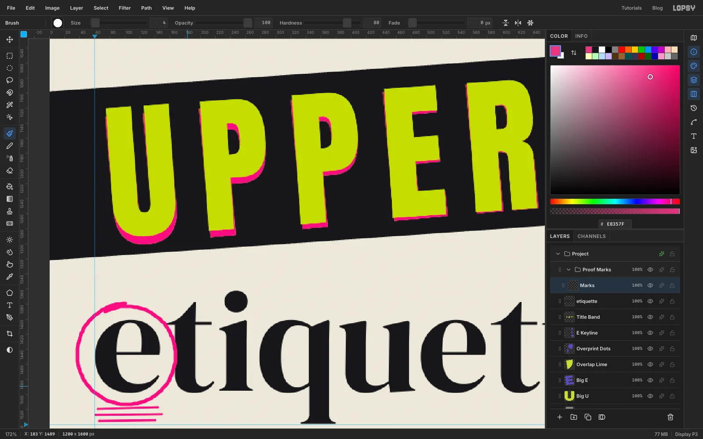

Three lines under a letter is the proofreader's mark for "make this a
capital".

1. Drop the brush **Size** to `4`.
2. Under the e, click and [[Shift]]-click three short, slightly uneven lines about 8 px apart. They don't need to match.

## Write the margin note

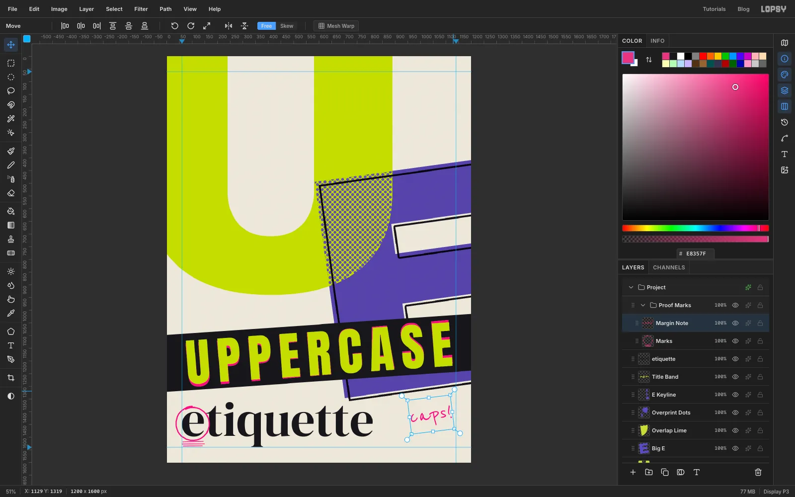

1. Click `Marks`, pick the **Text** tool and set **Size** `96`, **Reenie Beanie**, colour `#E8357F`. Type `caps!` in clear paper and press [[Tab]]. It lands inside the `Proof Marks` group.
2. With the **Move** tool, move it to the right of *etiquette*, with its right edge on the `x 1140` guide.
3. Drag its top-right rotation handle about 7° anticlockwise.

## Join the mark to the note

1. Click `Marks`. With the **Brush** at **Size** `4`, click and [[Shift]]-click three short strokes just left of *caps!*. That's the margin version of the triple underline.
2. Raise the brush to **Size** `5` and draw one smooth arc from the top of the circle, up over *etiquette* (below the strip) and down to the three strokes.

## Move the marks as one piece

Because the marks live in a group, you can reposition them all at once.
Click the `Proof Marks` group row and drag on the canvas with the **Move**
tool: the circle, lines, leader and note travel together. Put them back over
the e when you're done (or press [[Cmd+Z]]).

## Set the contents list

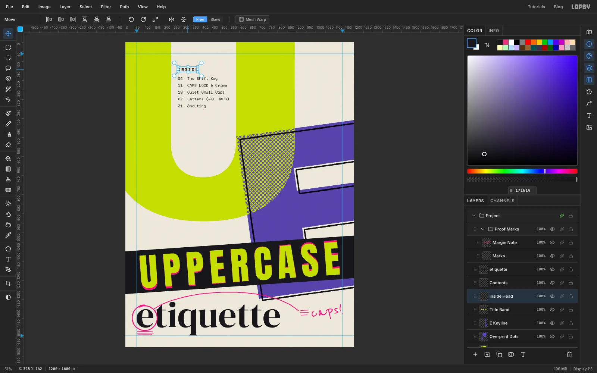

1. Click `Title Band` and pick the **Text** tool: **Size** `20`, **Space Mono**, colour `#17161A`, **Regular**, letter spacing `0`.
2. Type the list, pressing [[Enter]] after each line:
   - `04  The Shift Key`
   - `11  CAPS LOCK & Crime`
   - `19  Quiet Small Caps`
   - `27  Letters (ALL CAPS)`
   - `31  Shouting`
3. Press [[Tab]], rename the layer `Contents`, then set **Line height** to `1.8` in the Text panel.
4. Move it into the U's counter, centred between the two arms, with its top at about `y 182`.
5. Click `Title Band` again and type `INSIDE` at the same size and colour, with line height back at `1.4`. Set the **Font weight** to **Bold** and **Letter spacing** to `6`. Line its left edge up with the list, a little above it.

## Strike one item and correct it

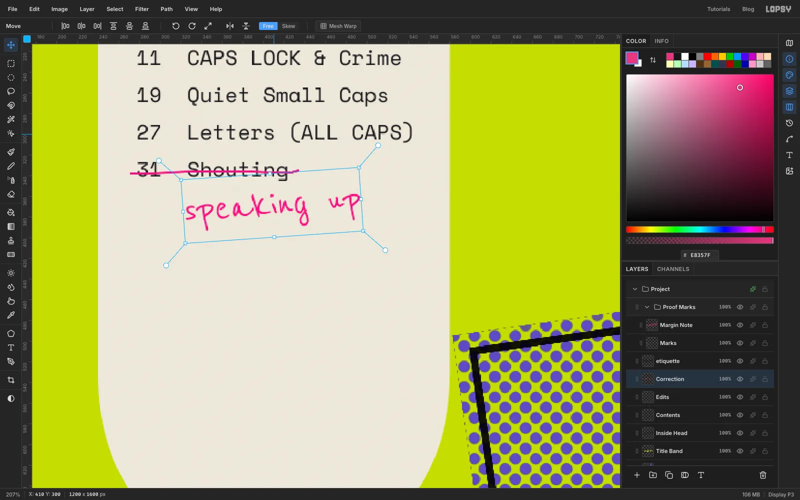

1. Click `Contents`, then click **Add Layer** and name it `Edits`. It sits above the list.
2. With the **Pencil** at **Size** `2` in `#17161A`, click and [[Shift]]-click a rule under INSIDE, as wide as the list.
3. Switch to the **Brush**, **Size** `3`, pink, and draw a slightly wobbly line through `31  Shouting`.
4. Click `Edits`, then type `speaking up` in **Reenie Beanie** at size `44`, pink, **Regular**, letter spacing `0`. Rename it `Correction`. Put it just under the struck line and, with the **Move** tool, tilt it about 4° anticlockwise.

## Add the masthead and the issue number

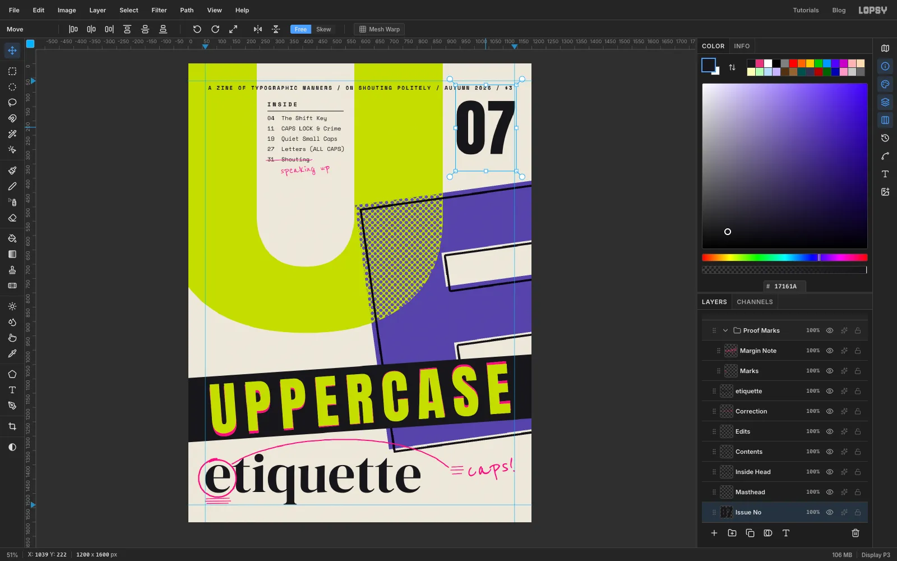

1. Click `Title Band` and type `A ZINE OF TYPOGRAPHIC MANNERS / ON SHOUTING POLITELY / AUTUMN 2026 / $3` in **Space Mono**, size `18`, colour `#17161A`.
2. Set it to **Bold** with **Letter spacing** `4`. It should now run almost margin to margin. Centre it across the page with its top at about `y 76`.
3. Click `Title Band` again and type `07` in **Anton** at size `215`, colour `#17161A`, letter spacing `0`. Move its right edge onto the `x 1140` guide, top at about `y 128`. Leave clear lime-free paper between it and the U's right arm.

## Run a line up the spine

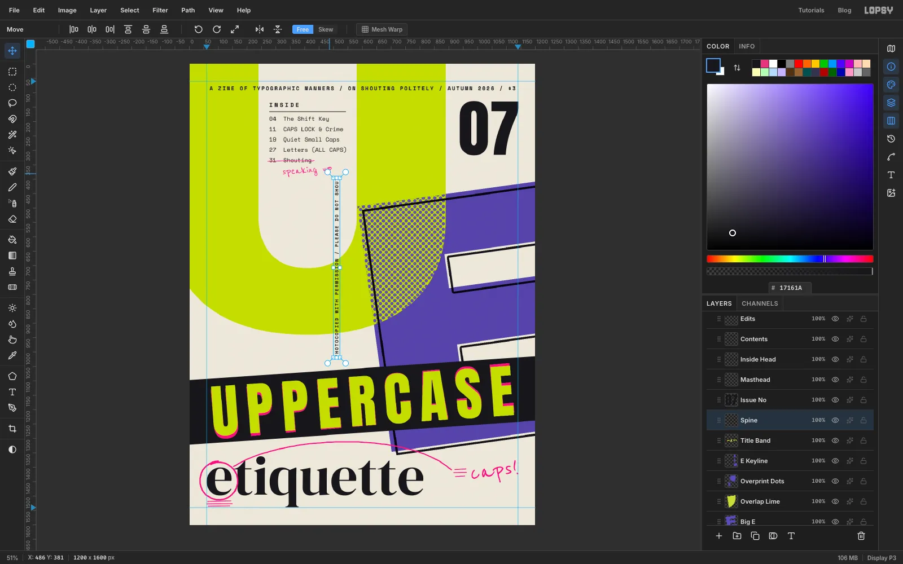

1. Click `Title Band` and type `PHOTOCOPIED WITH PERMISSION / PLEASE DO NOT SHOUT` in **Space Mono** size `16`, colour `#17161A`, **Bold**, **Letter spacing** `3`. Rename it `Spine`.
2. Switch to the **Move** tool. Hold [[Cmd]] and drag a rotation handle anticlockwise. [[Cmd]] snaps the angle to 15° steps, so stop at exactly 90°. The text now reads from bottom to top.
3. Move it into the left margin, about 20 px from the edge, starting a little below the top staple position (around `y 420`) and ending well clear of the strip.

## Draw the stamp rings

1. Click `Correction` (the *speaking up* text), click **New Group** and rename it `Stamp`. Click **Add Layer** and name it `Rings`.
2. Set the colour to `#E8357F`. Pick the **Elliptical Marquee** and, with nothing selected, click once on the canvas without dragging. In the dialog that opens, enter **From** `292`, `430` and **To** `528`, `666` and click **Select**. That's a 236 px circle centred on `x 410`, `y 548`. Fill it, choose **Select → Shrink…** `9` and press [[Delete]].
3. Press [[Cmd+D]] and make a second circle the same way from `336`, `474` to `484`, `622`. Fill it, **Shrink** `4` and press [[Delete]]. Press [[Cmd+D]].

## Make a circular path for the lettering

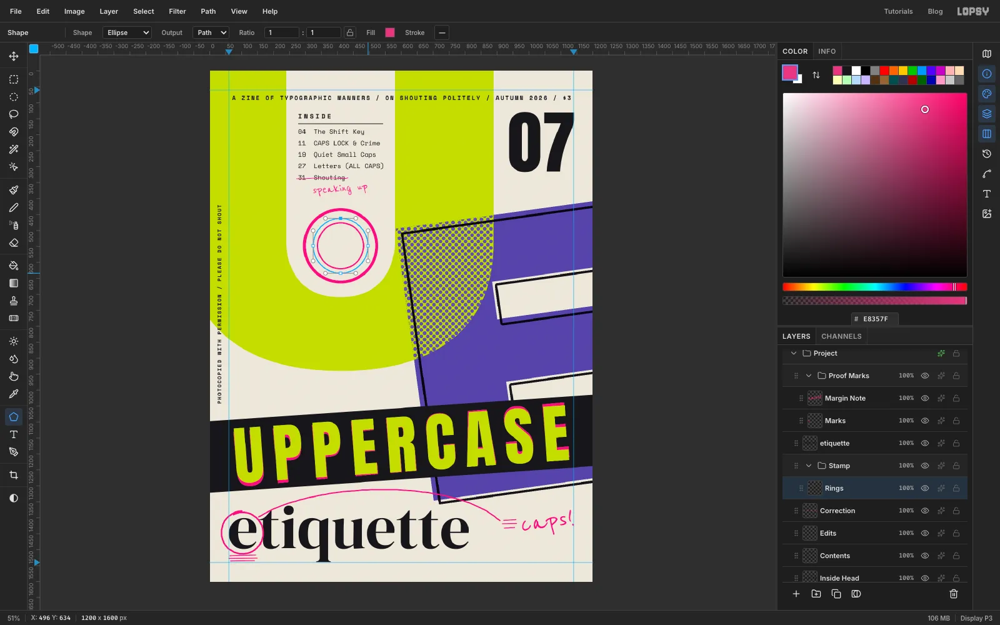

1. Pick the **Shape** tool. In the options bar set **Shape** to **Ellipse** and **Output** to **Path**.
2. Shapes grow from the centre. Press on the stamp's centre, hold [[Cmd]] to keep it a circle and drag out until the circle is 172 px across, sitting between the two rings.

## Wrap the motto around the ring

1. Click `Rings` and type `MIND YOUR CAPITALS * SPEAK UP POLITELY * ` (with a trailing space) in **Space Mono** size `17`, **Bold**, pink. Rename it `Ring Text`.
2. Set **Letter spacing** to about `2.5`, so one pass of the phrase is as long as the circle.
3. With `Ring Text` still active and the **Text** tool selected, pick the circle (**Path 2**) from the **Path** dropdown in the Text options bar, not the Path menu at the top of the window. The letters wrap around the ring. If the end overlaps the start, take a little spacing off.
4. Click `Rings` and type `OK!` in **Anton** size `74`, pink, letter spacing `0`. Centre it in the stamp.

## Tilt the whole stamp

1. Click `Ring Text` and click **Rasterize Layer**. Lopsy won't turn path text together with other layers until it's rasterized. Click the `OK!` layer and rasterize it too.
2. Click the `Stamp` group row and press [[Cmd+D]] so nothing is selected.
3. With the **Move** tool, drag the group's top-right rotation handle about 14° anticlockwise. Press [[Cmd+D]] to commit.

## Wear the stamp down with a noise mask

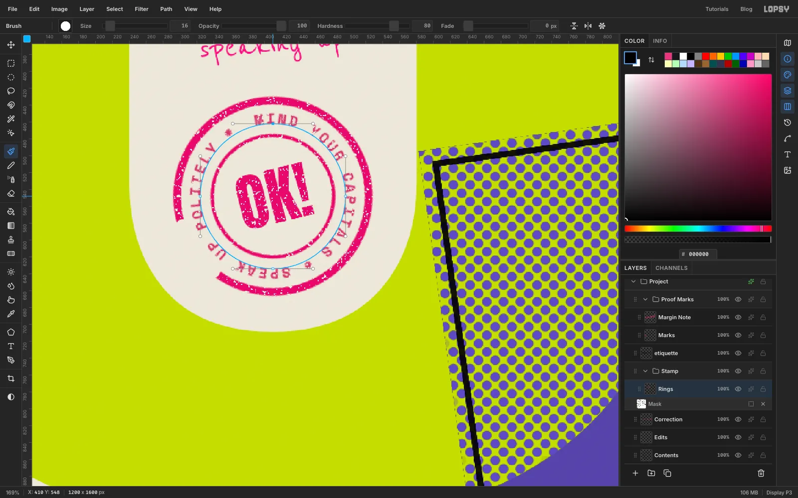

Real rubber stamps print unevenly. A mask made from clumped noise reproduces
that.

1. Click `Ring Text` and choose **Merge Down** twice, so the rings, the ring text and OK! are all one `Rings` layer.
2. Click **Add Mask**, then click the mask thumbnail (**Edit mask for Rings**) so you're painting on the mask.
3. Fill the mask with `#A6A6A6`. Run **Add Noise…** with **Amount** `100`, **Mono** and **Gaussian**, then **Gaussian Blur…** with **Radius** `2`.
4. Run **Threshold…** at **Level** `156`. The darker clumps turn black and hide the ink. If too much disappears, lower the level.
5. With the **Brush** at **Size** `16` in black, drag along a short stretch of the lower-left of the outer ring. That's a dry patch.
6. Click the layer name to leave the mask and set the layer to **Multiply**.

## Staple the spine

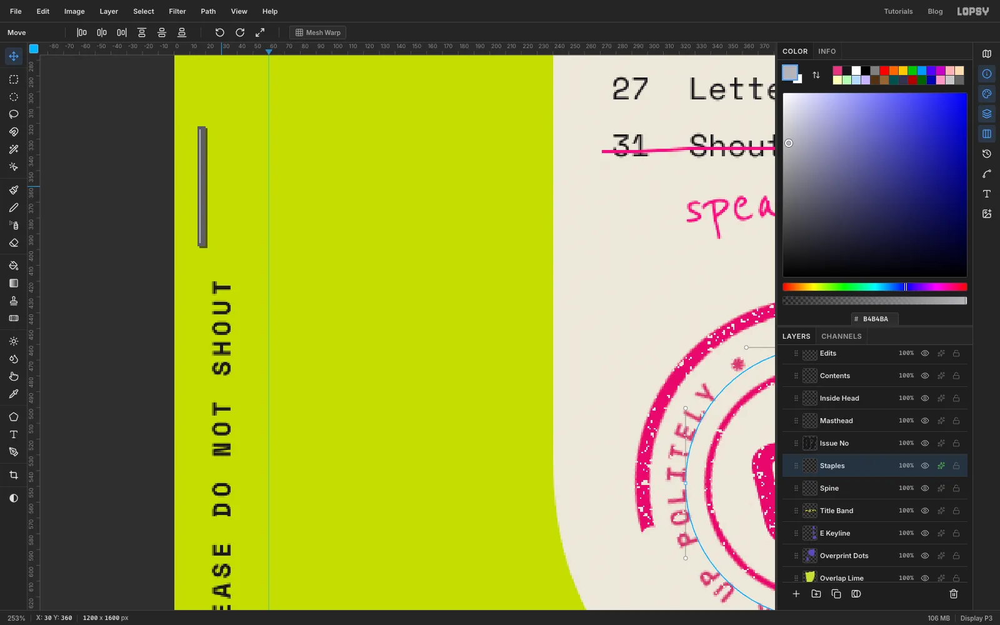

1. Click `Spine` and add a layer called `Staples`.
2. These shapes are too thin to drag at this zoom, so use the exact-corners dialog: pick the **Rectangular Marquee**, make sure nothing is selected and click once on the canvas. Enter **From** `15`, `322` and **To** `20`, `398`, click **Select** and fill it with `#5E5E64`. Press [[Cmd+D]], open the dialog again for `16`, `324` to `17`, `396` and fill that with `#B4B4BA` for the shine. Press [[Cmd+D]].
3. Add a **Drop Shadow** with **Offset X** `1`, **Offset Y** `1`, **Blur** `1` and **Opacity** `60`.
4. Drag a marquee loosely around the staple, press [[Cmd+C]] then [[Cmd+V]]. Press [[Cmd+D]] and drag the pasted copy straight down to about `y 1180`. Choose **Merge Down** so both staples share the shadow.

## Draw a barcode

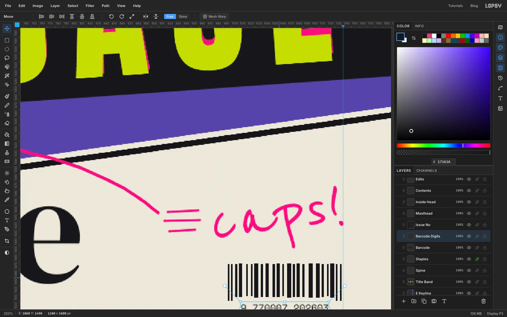

1. With `Staples` selected, add a layer called `Barcode` and pick the **Pencil** with `#17161A`.
2. Starting at about `x 996`, click at `y 1474` and [[Shift]]-click straight down to `y 1512`. Move a few pixels right and repeat until you reach the `x 1140` guide. Change the **Size** between `2` and `5` as you go, so the bars vary.
3. Make the first two bars and the last one longer, down to `y 1518`. Those are the guard bars.
4. Click `Barcode` and type `9 770007 202603` in **Space Mono** size `12`, centred under the bars.

## Sprinkle toner specks

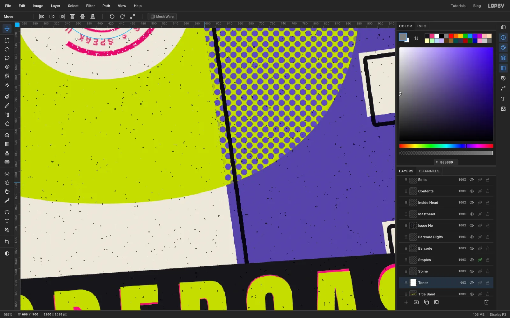

1. Click `Title Band` and add a layer called `Toner`. It sits under all the type, so the specks never land on the lettering. Fill it with `#808080`.
2. Run **Add Noise…** with **Amount** `100`, **Mono** and **Gaussian**, then **Gaussian Blur…** with **Radius** `3`. The blur clumps the noise into specks a few pixels wide.
3. Run **Threshold…** and drag the **Level** down until only a scattering of black specks is left. That was `116` for me. Noise is random, so yours may differ by a few.
4. Set the layer to **Multiply** at `60%`. The white disappears and only the specks print.

## Darken the copier edges

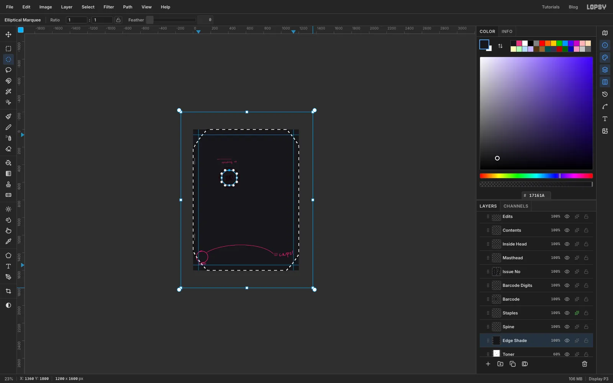

1. With `Toner` selected, add a layer called `Edge Shade` and fill it with `#17161A`.
2. Zoom out until there's plenty of grey around the page. With the **Elliptical Marquee**, drag from about `x -140`, `y -200` to `x 1360`, `y 1800`, so the ellipse reaches past every edge.
3. Choose **Select → Feather…** `60` and press [[Delete]]. (Lopsy's feather tops out around 63 px, so bigger values look the same.) Press [[Cmd+D]] and fit the page again with [[Cmd+0]].
4. Set it to **Multiply** at `22%`. The corners and edges go grey, the way a photocopier darkens them.

## Add a streak and a final grain, then save

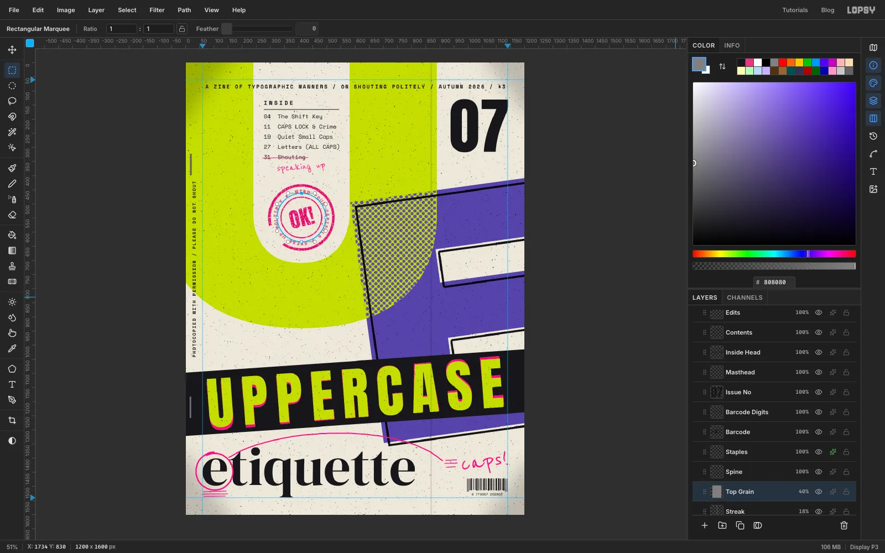

1. With `Edge Shade` selected, add a layer called `Streak`. Use the Rectangular Selection dialog again (click once with nothing selected) for **From** `866`, `0` and **To** `872`, `1600`, a thin full-height strip, and fill it with `#808080`. Press [[Cmd+D]].
2. Run **Add Noise…** at `100`, **Mono**, then **Motion Blur…** with **Angle** `90` and **Distance** `60`. Set it to **Multiply** at `18%`. It reads as a faint drum streak running down the page.
3. With `Streak` selected, add a layer called `Top Grain`, fill it with `#808080` and run **Add Noise…** at `24`, **Mono**. Set it to **Overlay** at `40%`. Now even the flat lime and violet have a bit of tooth.
4. Choose **File → Save Project** to keep the layers, and **File → Quick Export PNG** for the cover.
