Ukiyo-e prints were made by hand from carved wooden blocks, one block per
colour. Printers built their famous skies with **bokashi**: they wiped
the block with a damp rag so the ink thinned out into a gradient. They
drew mist as flat **kasumi** bands, and patterned the sea with **seigaiha**
scales. Hokusai's *Red Fuji* and Hiroshige's foreground plum branches are
the two prints this tutorial borrows from.

You'll make a 2400 × 1000 px billboard for **Sakura Airways**, an
imaginary airline. A red Fuji sits under a mackerel sky, a jet climbs past
it, and a cherry branch frames the corner. The type is set in traditional
cartouches: the airline's name runs down a vertical kanji column, and the
headline sits in a double-ruled panel.

Along the way you'll use:

- the **Gradient** tool for bokashi skies, mist and shading, plus a **layer mask** gradient for the contrail
- **Define Brush** and **Define Color Brush** to make a cloud-puff brush and a sakura stamp
- the **Brush** with **Radial Symmetry**, **Taper**, **Scatter** and **Angle Jitter**
- the **Pen** tool with **Path to Selection**, and ⌘-click thumbnail selections with **Inverse** to trim shapes
- the **Shape** tool's click-to-size dialog, **Duplicate Layer**, arrow nudges and **Merge Down** to build a pattern tile, then **Define Pattern** and **Fill with Pattern**
- **Copy**, **Paste**, rotation and scale handles, and transforming a whole group
- **Add Noise**, **Gaussian Blur**, **Emboss**, **Motion Blur** and **Clouds**
- vertical **Noto Serif JP** kanji and **Shippori Mincho** type, the Text panel's letter spacing, and **Stroke** effects

The palette:

- Paper `#EFE2C6`, mist `#F2E4C8`, cloud `#F7F0E0`
- Sky `#132744` / `#1C355A`, dawn `#E99A78`
- Fuji `#7E2418` → `#B4432B` → `#C9663B`, snow `#F6F0E2`
- Forest `#2D4A36` / `#1B3024`, ridge `#6E8A55`
- Sea `#3E6E8E` → `#14304A`, horizon `#24496A`
- Bark `#3A2620` / `#6B4A3A`, moss `#33402C`
- Petal `#F4B9C6` / `#D9667E`, stamens `#9E2F4A`
- Vermilion `#B83A2B`, sumi ink `#1E1A18`

> **Tip:** Positions are in document pixels, written `x, y`. The status bar
> shows where the pointer is. **Edit → Fill** fills the selection with the
> foreground colour, and [[Cmd+D]] deselects. New layers appear above the
> selected layer. If the selected row is an *expanded* group, the new
> layer goes inside it; if it's *collapsed*, the new layer goes next to it.
> So click the layer you want to build on first, and collapse groups you've
> finished.

> **Tip:** The **Gradient** tool keeps its stops from one use to the next,
> so each step below lists every stop it needs. In the stop editor, click
> the bar to add a stop, select a stop and click the delete button to
> remove one, and set each stop's colour and opacity below the bar.

> **Tip:** For an exact rectangle, pick the **Rectangular Marquee**, make
> sure nothing is selected, and click the canvas once without dragging. A
> dialog asks for the **From X / Y** and **To X / Y** corners. Effects and
> the **Blend** dropdown live in each layer's effects drawer (the sparkle
> icon on its row).

## Set up the canvas and guides

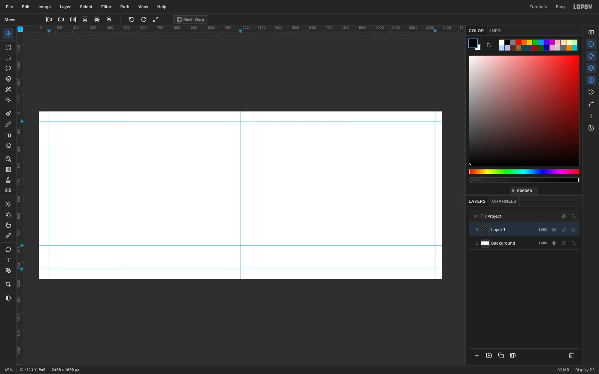

Choose **File → New**, enter **2400 × 1000** and click **Create**. Delete the
empty *Layer 1* with the trash button at the bottom of the Layers panel.

Click the top ruler at `60`, `1200` and `2360` to drop vertical guides for
the margins and the middle. Click the left ruler at `60`, `800` and `940`.
The guide at `800` is the horizon, where the sea will start.

## Lay down the paper

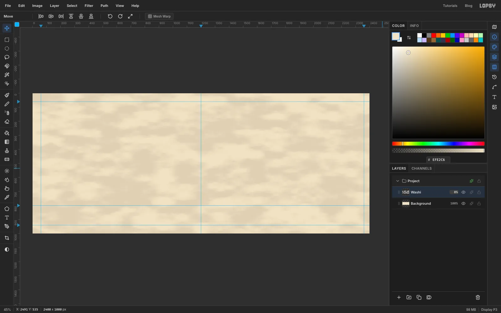

Click *Background*, set the foreground to paper `#EFE2C6`, select all with
[[Cmd+A]] and choose **Edit → Fill**. Deselect.

Add a new layer named *Washi* and choose **Filter → Clouds…** with
**Scale** `18`. Set its **Blend** to **Multiply** and its opacity to `8%`.
That leaves a faint, uneven tone like handmade paper.

## Grade the sky with ichimonji bokashi

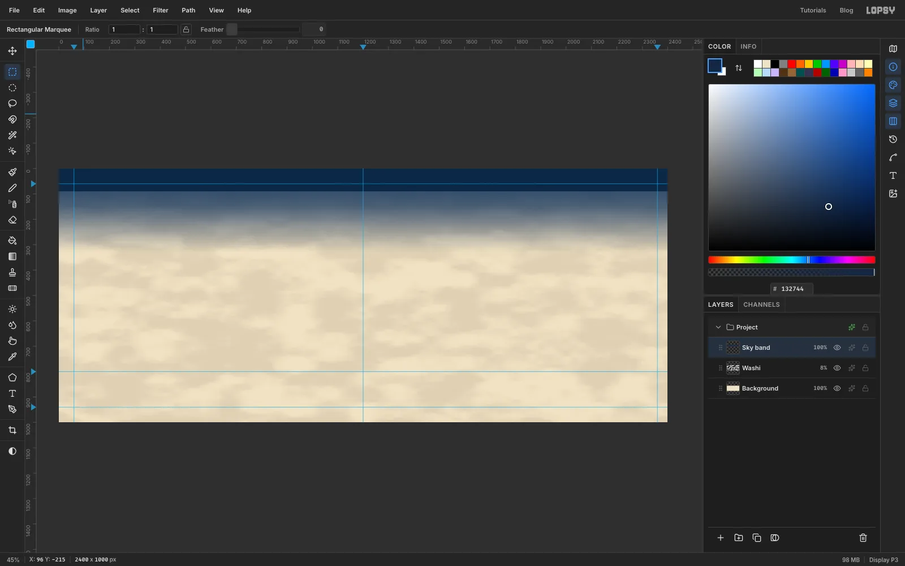

Add a layer named *Sky band*. Pick the **Gradient** tool, set it to
**Linear** and open the stop editor. Make three stops, all Prussian blue
`#1C355A`:

- `100%` opacity at the left end
- `75%` opacity at the middle
- `0%` opacity at the right end

Drag from the top edge straight down to `y 330`.

Printers often capped this kind of sky with a hard strip of solid ink. To
add one, select exactly `0, 0` to `2400, 90` and fill it with deep indigo
`#132744`. Then deselect.

## Add a dawn glow

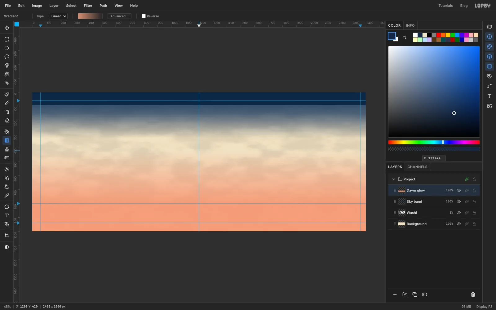

Add a layer named *Dawn glow*. Delete the middle stop so the gradient has
two stops, both dawn peach `#E99A78`: `90%` opacity at the start and `0%`
at the end. Drag from the horizon guide at `y 800`
straight up to `y 420`. Everything below the horizon will be covered by the
sea, so don't worry about the solid peach down there.

## Make a cloud-puff brush

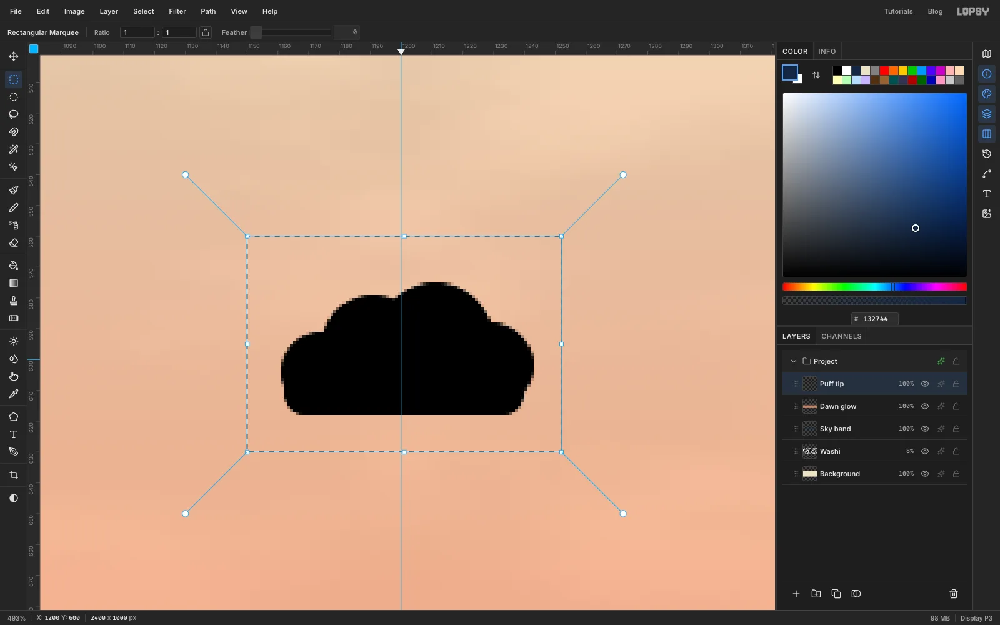

Hokusai's *Red Fuji* has a "mackerel sky" of small scalloped clouds. You'll
make a brush that stamps one puff.

Add a scratch layer named *Puff tip*. Pick the **Shape** tool, set
**Shape** to **Ellipse**, **Fill** to black and **Stroke** to none. Click
once on the canvas to open the **Shape Size** dialog, and make four
overlapping circles in a row, near `1200, 600`:

- `26 × 26` at `1174, 604`
- `34 × 34` at `1191, 596`
- `38 × 38` at `1211, 594`
- `28 × 28` at `1229, 602`

Switch **Shape** to **Rectangle** with **Corner Radius** `7` and click at
`1201, 610` for a `78 × 16` base, so the cloud has a flat bottom.

Select `1150, 560` to `1252, 630` and choose **Edit → Define Brush…**. Name
it *Cloud puff*.

> **Tip:** Define Brush works like Photoshop: **dark pixels paint** and
> white pixels don't. That's why the tip is black, even though the clouds
> will be cream.

Deselect and delete the *Puff tip* layer.

## Paint a mackerel sky

Add a layer named *Mackerel clouds*. The **Brush** now uses the *Cloud puff*
tip. Click the tip thumbnail in the options bar to open the **Brushes**
window:

- On the **Shape** tab, set **Spacing** to `40%` so the puffs overlap into
  scalloped rows.
- On the **Dynamics** tab, set **Scatter** to `12%` and **Size Jitter** to
  `25%`.

Set the foreground to cloud `#F7F0E0`.

Paint about nine short, nearly flat rows between `y 130` and `y 260`, each
80 to 260 px long. Change the **Size** between rows, from `34` for small
wisps up to `62` for the biggest bank. Keep the puffs below the indigo
strip and away from where the summit will be (around `880, 210`). Leave
the right third of the sky emptier, because the jet and the branch go
there.

Shift-click *Sky band*, *Dawn glow* and *Mackerel clouds*, choose
**Layer → Group Layers** and name the group *Sky*.

## Draw the mountain with the Pen

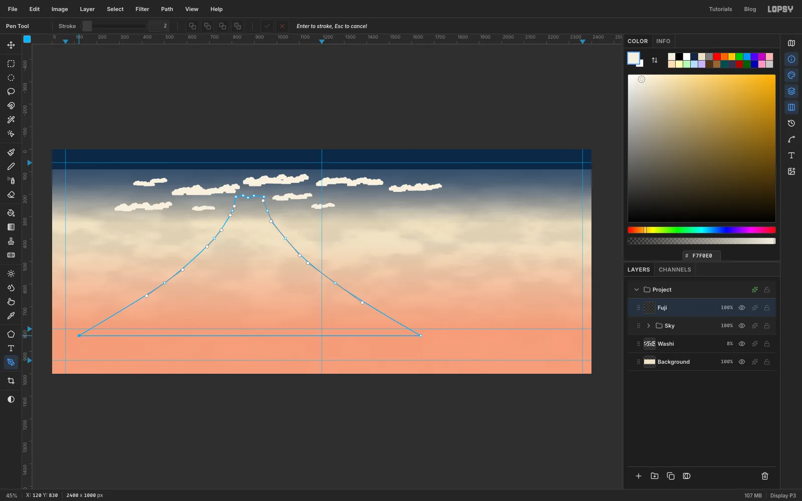

Collapse *Sky*, click it and add a layer named *Fuji*. Pick the **Pen**.
Start at the left foot, at `120, 830`. Starting at the left-most point
keeps the Pen's floating ✓/✗ buttons out of your way.

Work up the left slope. Click-drag at each point below, letting go at the
second position. The drag sets the curve handle, so the slope bends
inwards like Hokusai's:

1. `501, 595`, dragging to `581, 537`
2. `722, 397`, dragging to `754, 360`
3. `802, 274`, dragging to `811, 254`

Now plain-click the notched summit:

- `818, 212`
- `850, 206`
- `872, 216`
- `898, 207`
- `942, 212`

Come down the right slope with click-drags:

1. `958, 274`, dragging to `977, 319`
2. `1038, 397`, dragging to `1102, 473`
3. `1259, 595`, dragging to `1380, 683`

Plain-click the right foot at `1640, 830`, then click the first point to
close the path.

## Fill it with a red gradient

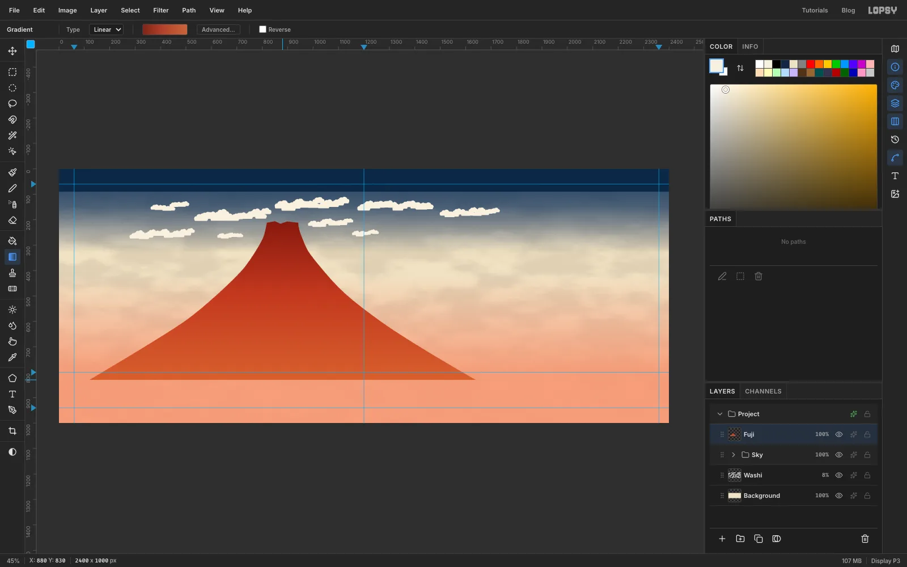

In the **Paths** panel, click **Path to Selection**, then **Delete Path**.

Set up a three-stop gradient, all at `100%` opacity:

- deep red `#7E2418` at the start
- red `#B4432B` at `45%` along the bar
- orange-red `#C9663B` at the end

Drag from the summit at `880, 212` straight down to `880, 830`, then
deselect.

## Select the shaded flank

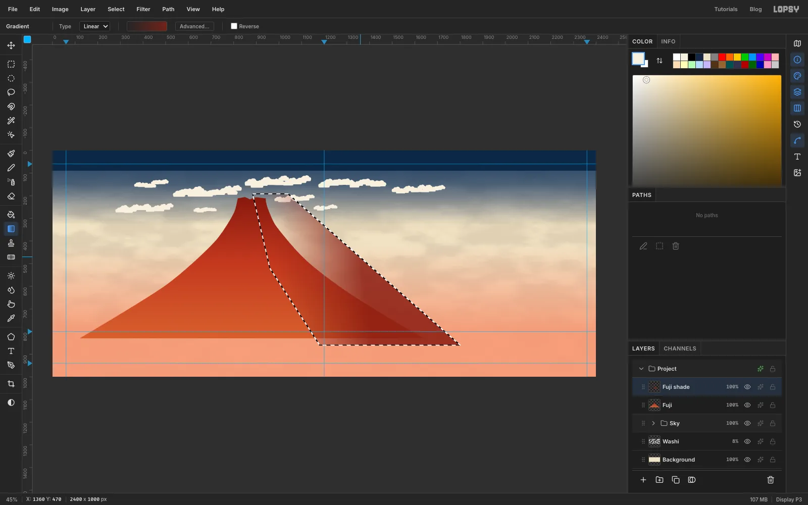

Woodblock printers shaded one side of a mountain with a second, darker
block. Add a layer named *Fuji shade*.

With the Pen, click these five points, then click the first one again to
close the shape:

- `884, 192`
- `1040, 192`
- `1800, 860`
- `1180, 860`
- `960, 520`

Click **Path to Selection** and **Delete Path**.

Set the gradient to two stops, both deep red `#7E2418`: `0%` opacity at
the start and `85%` at the end.
Drag from `980, 520` to `1360, 470`. The shade fades in towards the right
edge, like a bokashi wiped onto the block.

## Trim the shade to the mountain

Deselect. Then trim the shade to the mountain's outline:

1. [[Cmd]]-click the *Fuji* thumbnail to load the mountain's shape as a
   selection.
2. Choose **Select → Inverse**.
3. Press [[Delete]] on *Fuji shade*, then deselect.

Set *Fuji shade*'s **Blend** to **Multiply** at `55%`. You'll use this
draw-big-then-trim move a few more times.

## Draw the snow cap

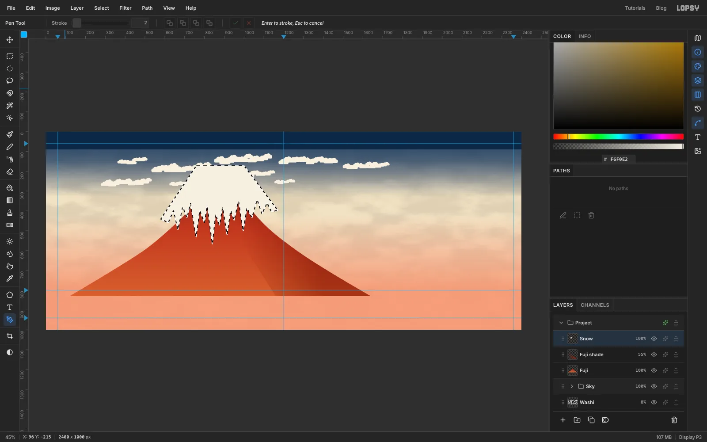

Add a layer named *Snow*. With the Pen, start outside the left slope at
`580, 441` and click a zigzag of corner points across the mountain:

- Alternate long fingers that reach down to between `y 480` and `y 570`
  with short notches between `y 340` and `y 420`.
- Make the fingers different widths and lengths. The snow in *Red Fuji* is
  anything but regular.
- Use about 25 points, roughly 25 px apart, and end outside the right slope
  at `1170, 397`.

To close the shape, click `1000, 172` and `760, 172` above the summit, then
click the first point.

Click **Path to Selection** and **Delete Path**, and fill with snow
`#F6F0E2`.

## Trim the snow

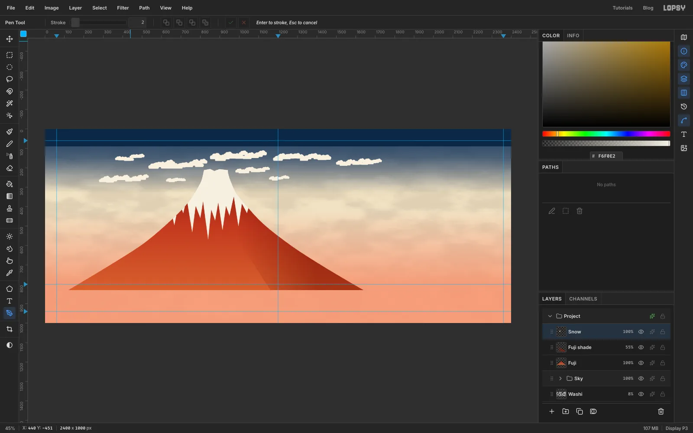

Deselect, then trim the snow the same way you trimmed the shade:
[[Cmd]]-click the *Fuji* thumbnail, choose **Select → Inverse**, press
[[Delete]] on *Snow*, and deselect.

## Emboss the snow (karazuri)

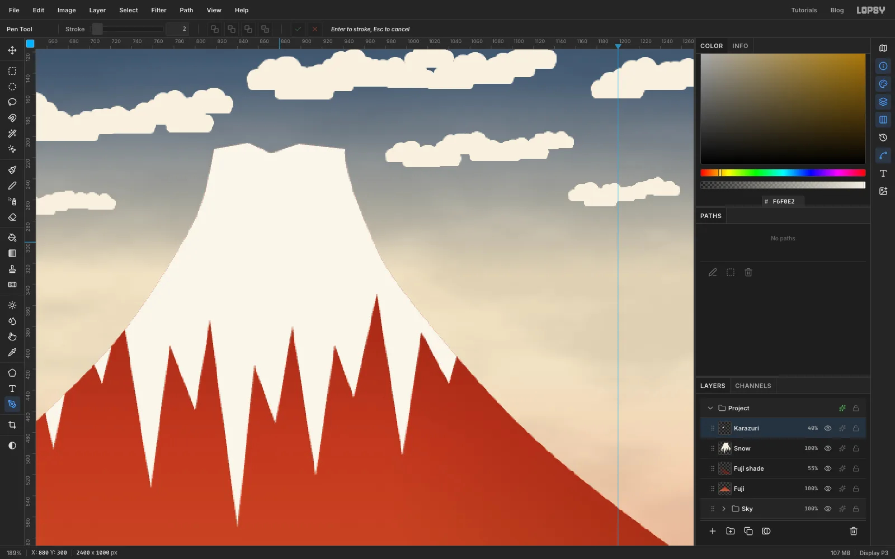

**Karazuri** is blind printing. The printer pressed an uninked block into
the paper so the snow stood up in relief. Here's how to fake it:

1. With *Snow* selected, click **Duplicate Layer** and name the copy
   *Karazuri*.
2. Choose **Filter → Add Noise…** with **Amount** `40`.
3. Choose **Filter → Gaussian Blur…** with **Radius** `2`.
4. Choose **Filter → Emboss…** with **Angle** `135` and **Strength** `30`.
5. Set the layer's **Blend** to **Hard Light** at `40%`.

The relief is subtle. Zoom in to see it.

## Plant the forest

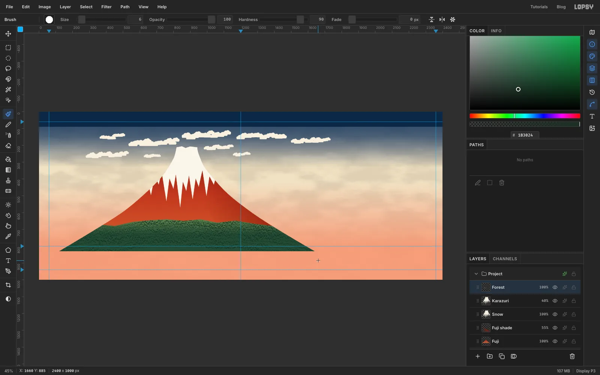

Add a layer named *Forest*. With the Pen, start below the mountain's left
foot at `60, 860`. Click a gently wavy tree line from `80, 720`, rising to
about `y 640` in the middle and falling back to `1680, 735` on the right,
with a point every 100 to 150 px. Finish at `1720, 860` and click the first
point to close.

Click **Path to Selection** and **Delete Path**, fill with forest green
`#2D4A36` and deselect. Then trim it to *Fuji* as before: [[Cmd]]-click the
*Fuji* thumbnail, **Select → Inverse**, [[Delete]], deselect.

[[Cmd]]-click the *Forest* thumbnail so that you only paint inside it:

1. Set two gradient stops of ridge green `#6E8A55`, `85%` opacity at the
   start and `0%` at the end, and drag from `900, 640` down to `900, 730`. That lights the top of the tree
   line.
2. Pick the **Brush** and choose the **Hard Round** preset. Set **Size**
   `6`, **Hardness** `90`, **Spacing** `45%`, **Scatter** `100%` and
   **Size Jitter** `60%`.
3. With dark pine `#1B3024`, paint about eight passes across the forest,
   each one following the tree line a little lower than the last. The
   scattered dots build up into a dense stipple of tree tops.

Deselect. Shift-click *Fuji*, *Fuji shade*, *Snow*, *Karazuri* and *Forest*,
group them as *Red Fuji* and collapse the group.

## Lay in the sea

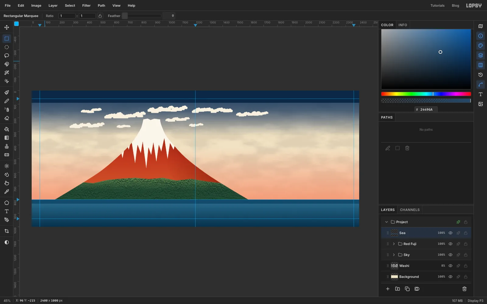

Click *Red Fuji* and add a layer named *Sea*. Select `0, 800` to
`2400, 1000`. Set two gradient stops, both at `100%` opacity: sea blue `#3E6E8E` at the
start and indigo `#14304A` at the end. Drag from the horizon down to the
bottom edge.

Select `0, 800` to `2400, 830` and fill it with `#24496A`. That gives the
water a hard, dark horizon line, which Hiroshige liked.

## Draw one seigaiha scale

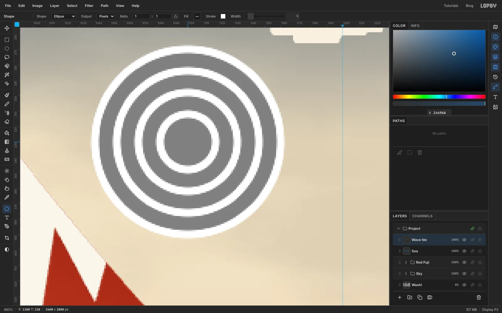

Seigaiha is a pattern of overlapping scallops, each made of concentric
rings. Add a scratch layer named *Wave tile*. Pick the **Shape** tool:

1. Set **Ellipse**, **Fill** grey `#808080`, **Stroke** white and
   **Width** `5`. Click at `1100, 330` and create a `120 × 120` circle.
2. Remove the fill so only the stroke is left. Click the same centre three
   more times for circles of `92`, `64` and `36`.

The grey matters. In **Overlay** mode, mid-grey vanishes and only the white
rings will show.

## Build the scale grid

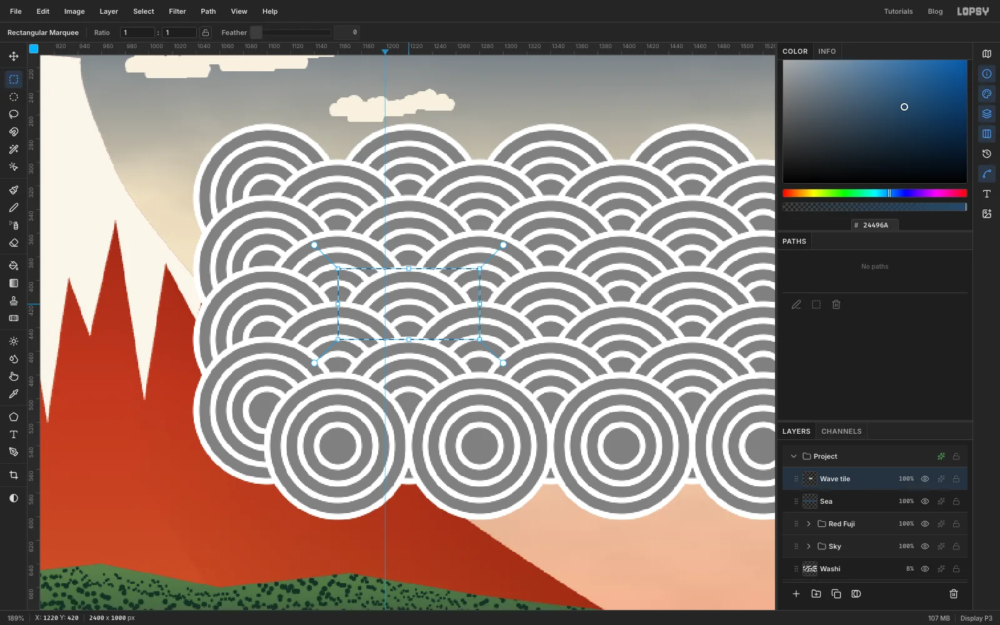

Pick the **Move** tool. Each **Shift**+arrow press moves the layer 10 px.
Build the grid in five rounds. In each round, click **Duplicate Layer**,
press the keys listed, then choose **Layer → Merge Down**. Each round copies
everything built so far, so the grid doubles every time:

1. **Shift+→** 12 times. That gives two scales side by side, one scale
   width (120 px) apart.
2. **Shift+→** 24 times. Now there's a row of four.
3. **Shift+→** 6 times and **Shift+↓** 3 times. The copied row sits half a
   scale over and a quarter down, tucked between the first row's scales.
4. **Shift+↓** 6 times.
5. **Shift+↓** 12 times.

Each copy lands above the original, so lower rows overlap the rows above
them, just like real seigaiha.

The pattern repeats every 120 px across and every 60 px down. Select
`1160, 390` to `1280, 450`, a 120 × 60 window in the middle of the grid
where every row is complete. Choose
**Edit → Define Pattern**. Deselect and delete *Wave tile*.

## Fill the sea with the pattern

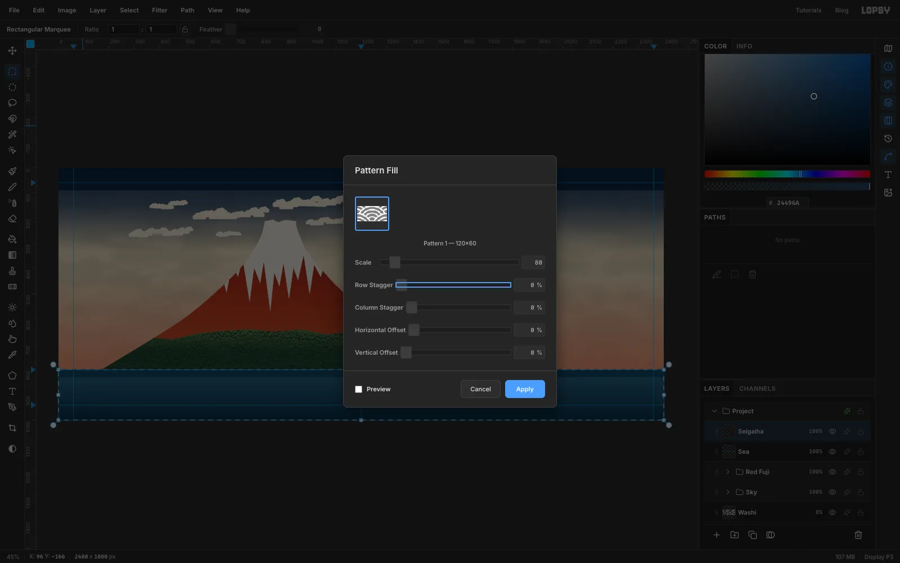

Add a layer named *Seigaiha* and select the sea again, `0, 800` to
`2400, 1000`. Choose **Edit → Fill with Pattern…**, pick the wave tile, set
**Scale** to `80` and click **Apply**.

## Blend the waves

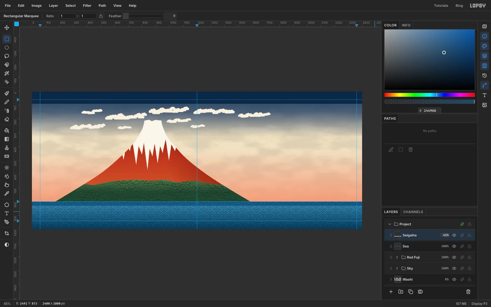

Deselect, set the *Seigaiha* layer's **Blend** to **Overlay** and its
opacity to `45%`. The grey discs disappear, and the white rings lighten the
blue gradient underneath.

## Select a stepped mist band

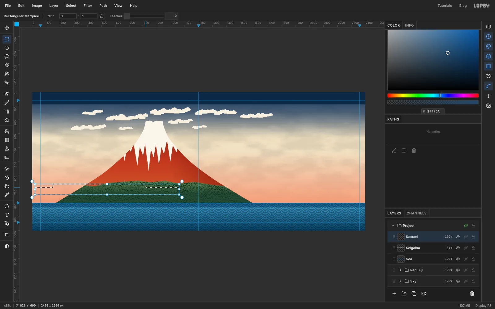

Kasumi mist bands are flat, squared-off strips, often stepped like a
staircase. Add a layer named *Kasumi*:

1. Select the base strip, `20, 688` to `1060, 740`.
2. Pick the **Rectangular Marquee**. Hold **Shift** and drag a shorter
   strip on top of the base, from about `150, 664` to `820, 690`. Shift
   adds it to the selection.

## Fade the mist bands

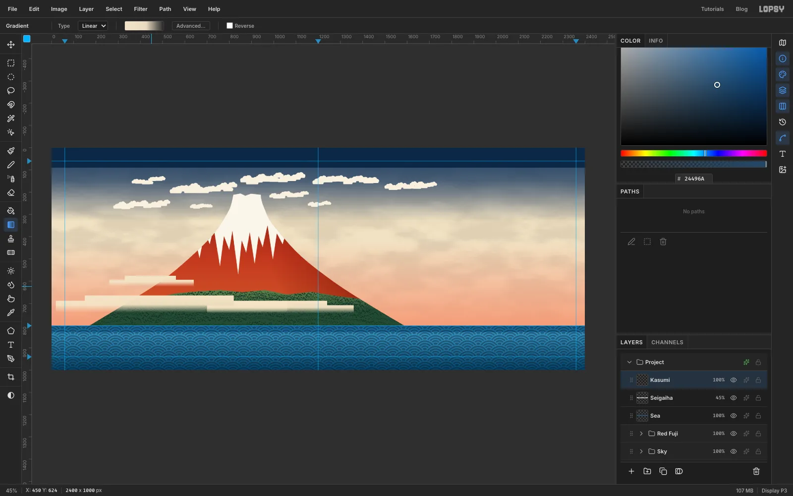

Set a three-stop mist gradient, all `#F2E4C8`: `100%` opacity at the
start, `95%` at a stop `55%` along the bar, and `0%` at the end. Drag from the top of the step down to the bottom of
the base strip, so the band is solid on top and fades out below. Deselect.

Make two more bands the same way:

- base `700, 708` to `1360, 744`, with a step at `820, 688` to
  `1240, 710`
- base `260, 594` to `640, 624`, with a step at `330, 576` to
  `560, 596`

## Paint a blossom with radial symmetry

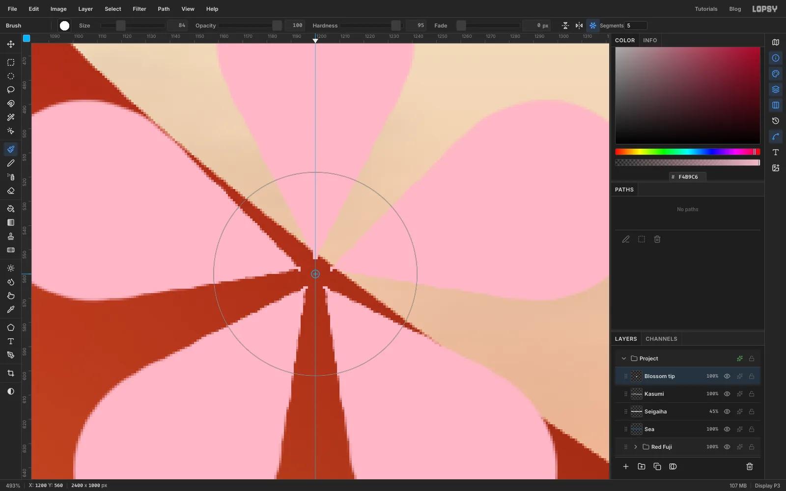

Click *Kasumi* and add a scratch layer named *Blossom tip*. Pick the
**Brush** with the **Hard Round** preset, click **Radial Symmetry** in the
options bar and set **Segments** to `5`. [[Cmd]]-click `1200, 560` to put
the symmetry centre there.

In the **Brushes** window, set **Size** to `84`, **Hardness** to `95`,
**Spacing** to `2%` and **Taper** to `92`. Taper shrinks each stroke to a
point. With petal pink `#F4B9C6`, drag from `1200, 460` straight down
towards the centre, stopping at `1200, 554`. That one stroke paints five
petals, wide at the tips and narrow in the middle.

## Finish the blossom and save it as a brush

Pick the **Eraser** at **Size** `30` and click once at `1200, 420`, the tip
of the top petal. Symmetry applies to the eraser too, so all five petals
get the sakura's notch.

Back on the **Brush**:

1. Set **Taper** back to `0` and turn **Radial Symmetry** off.
2. With the **Soft Round** preset at **Size** `60` and deep pink
   `#D9667E`, click the centre once.
3. Switch to **Hard Round**, turn **Radial Symmetry** back on and set
   **Segments** to `5` again, since the toggle always switches on at 8.
4. At **Size** `4` with `#9E2F4A`, click `1200, 554` and Shift-click
   `1192, 526`.
5. At **Size** `9`, click `1192, 524`.

That gives five stamens with round tips. Turn symmetry off.

Select `1088, 448` to `1312, 672` and choose **Edit → Define Color
Brush…**. Name it *Sakura*. A colour brush keeps its colours, so it stamps
whole blossoms. Deselect and delete *Blossom tip*.

## Paint the branch

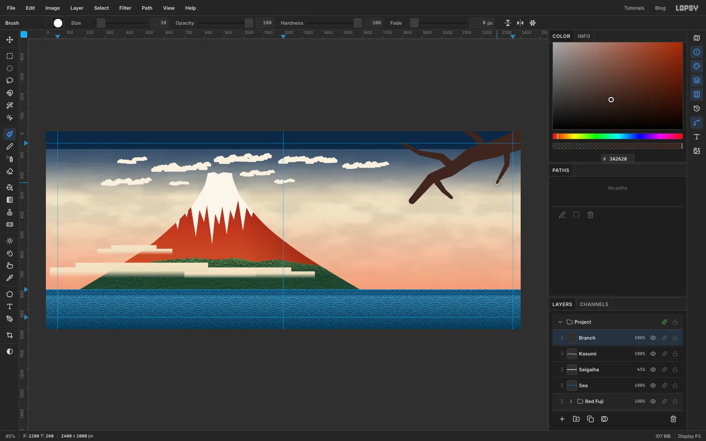

Add a layer named *Branch*. Choose the **Hard Round** brush with
**Hardness** `100` and bark brown `#3A2620`. Paint each bough as one drag,
from its thick end to its tip, setting **Size** and **Taper** in the
Brushes window first:

- **Main bough** (Size `100`, Taper `980`): from the right edge at
  `2400, 40` down and left through `2150, 120` and `1950, 236` to
  `1850, 352`, with a kink or two along the way.
- **Top twig** (Size `46`, Taper `260`): from `2215, 102` up to `2120, 0`.
- **Left twig** (Size `44`, Taper `420`): from `2060, 186` through
  `1890, 110` to `1800, 60`.
- **Lower twig** (Size `36`, Taper `250`): from `1960, 232` down to
  `2050, 335`.
- **Right twig** (Size `38`, Taper `300`): from `2330, 66` down to
  `2280, 260`.

Taper is measured in pixels. Set it a bit longer than the stroke, so the
bough starts thinning straight away and is still a few pixels wide at its
tip.

## Add moss and bark

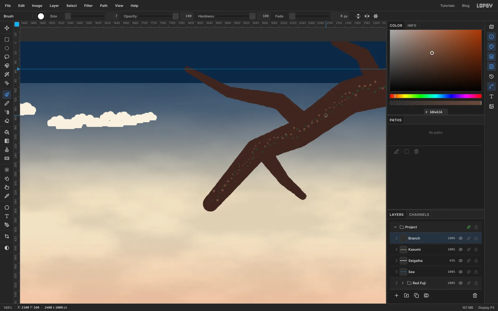

[[Cmd]]-click the *Branch* thumbnail. Set the brush **Size** to `7`,
**Taper** `0`, **Spacing** `240%`, **Scatter** `100%` and **Size Jitter**
`60%`.

1. Paint along the main bough in moss `#33402C`.
2. Paint along its top edge again in light bark `#6B4A3A`.

Deselect, then set **Scatter** and **Size Jitter** back to `0`.

## Stamp the blossoms

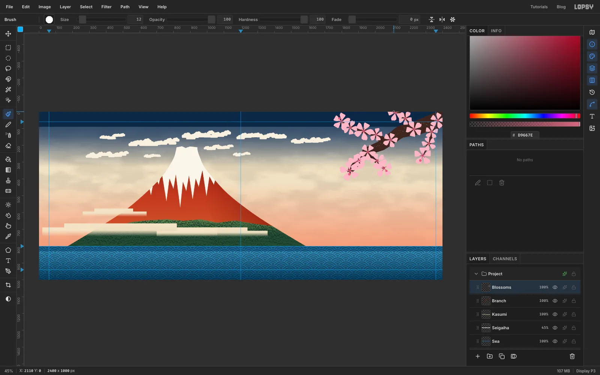

Add a layer named *Blossoms* and choose the *Sakura* preset. In
**Dynamics**, set **Angle Jitter** to `100%` and **Size Jitter** to `15%`,
so no two blossoms face the same way.

Click about 18 blossoms along the boughs. Vary the **Size** between `70`
and `102`, and set the biggest blossoms at the joints. Then pick
**Hard Round** in deep pink and click a few `12`–`16` px buds at the twig
tips.

## Copy a cluster

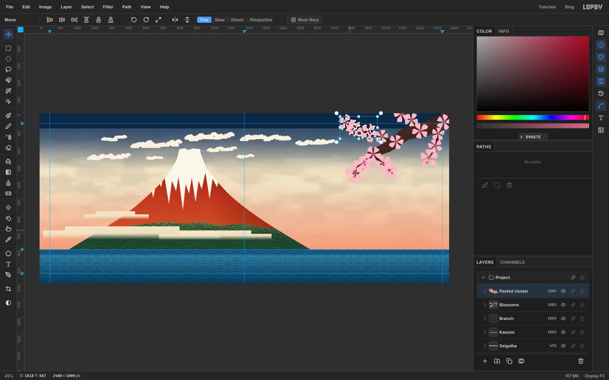

The lower twig looks bare. Select `1760, 20` to `1980, 150` around the
top-left cluster of blossoms. Press [[Cmd+C]], then [[Cmd+V]]. The copy
pastes in place on a new layer. Name it *Pasted cluster*.

## Rotate the copy into place

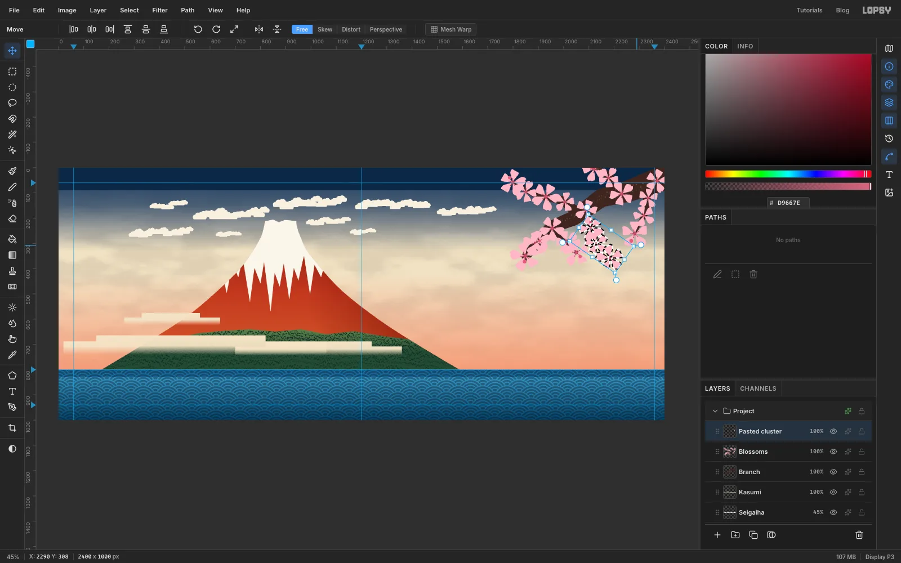

Deselect, and with the **Move** tool drag the copy down into the gap
between the lower and right twigs, centred around `2150, 300`. Then rotate it so it doesn't look
copied:

1. [[Cmd]]-click its thumbnail. The transform box now fits the blossoms.
2. Drag just outside the box's top-right corner to rotate it about `35°`
   clockwise.
3. Press [[Cmd+D]] to commit the rotation.

Choose **Layer → Merge Down** to merge it into *Blossoms*.

## Lift the whole branch

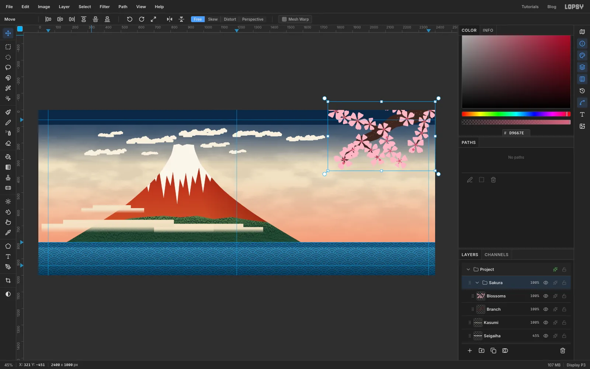

Shift-click *Branch* and *Blossoms*, group them as *Sakura*, and keep the
group selected. With the **Move** tool, press **Shift+↑** five times. The
whole branch moves up 50 px as one piece, which leaves room for the
headline panel below it. Collapse the group.

## Draw the jet's fuselage

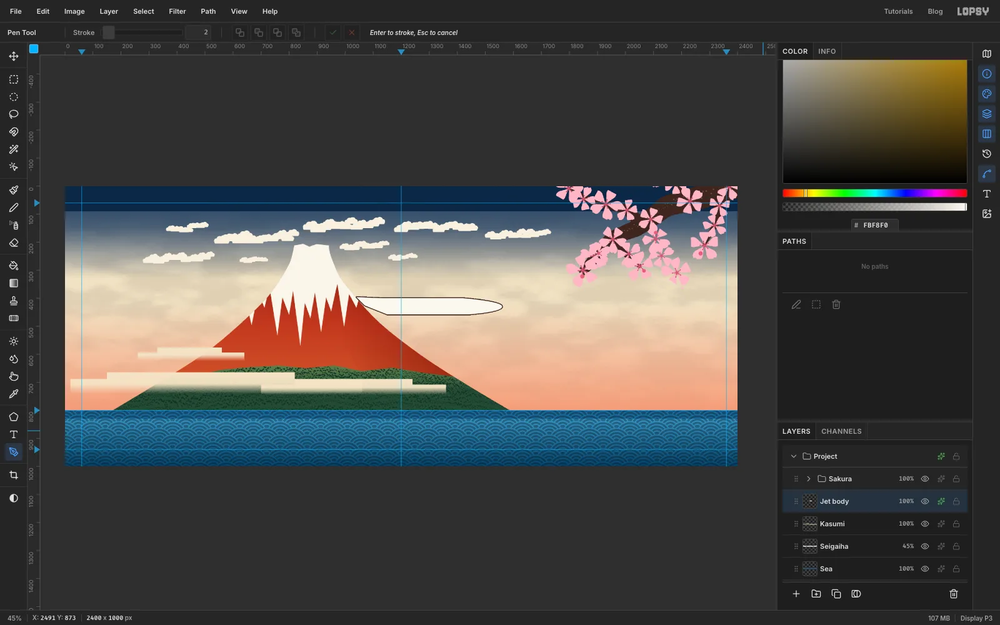

Draw the jet at twice its final size across the middle of the canvas, and
scale it down later. It's much easier to place points at that size. It
will cover part of Fuji for now, but you'll scale it and move it into the
sky afterwards.

Click *Kasumi* and add a layer named *Jet body*. With the Pen, click these
points:

1. `1040, 396`, the tail cone
2. `1130, 400`
3. `1420, 400`
4. `1560, 430`, the nose. Click-drag down to `1560, 450` so it's rounded.
5. `1440, 458`
6. `1150, 458`
7. `1070, 426`

Click the first point to close the shape. Click **Path to Selection** and
**Delete Path**, fill with `#FBF8F0` and deselect.

In the effects drawer, turn on **Stroke** with **Width** `3` in bark brown
`#3A2620`. That's the print's keyline: a brown sumi line instead of black.

## Add the fin, wing and livery

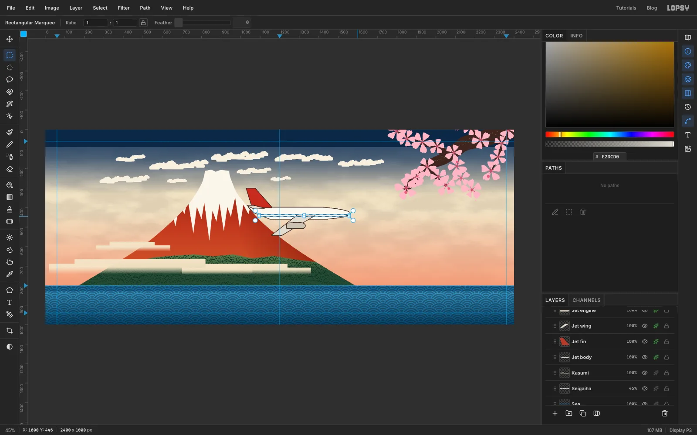

Draw each part on its own layer in the same way: add the layer, Pen the
shape, click **Path to Selection** and **Delete Path**, fill it, deselect,
and give it the same brown **Stroke** effect. Each is a simple
four-cornered shape:

- **Jet fin**, vermilion `#B83A2B`: a swept-back fin. Its top edge runs
  from `1030, 302` to `1074, 302`, and it leans back down to the top of
  the fuselage between `1060, 400` and `1160, 400`.
- **Jet wing**, `#E2DCD0`: the near wing, sweeping back and down from the
  middle of the fuselage. Its root runs from `1290, 440` to `1380, 440`
  and its tip from `1160, 542` to `1210, 542`.
- **Jet engine**, `#C9C2B4`: a small pod under the wing, from `1236, 482`
  to `1236, 506` at the back. Click-drag the front top corner at
  `1322, 482` towards `1340, 492` to round the intake.
- **Jet tailplane**, `#E2DCD0`: a thin sliver at the tail, from
  `1034, 390` back to `1122, 404`.

For a pink cheatline, add a layer named *Cheatline* and [[Cmd]]-click the
*Jet body* thumbnail. Pick the **Rectangular Marquee**, hold **Shift** and
**Option**, and drag a thin band across the fuselage from `1000, 436` to
`1600, 446`. Shift+Option keeps only where the two overlap. Fill it with
`#D9667E` and deselect.

## Add windows and the tail mark

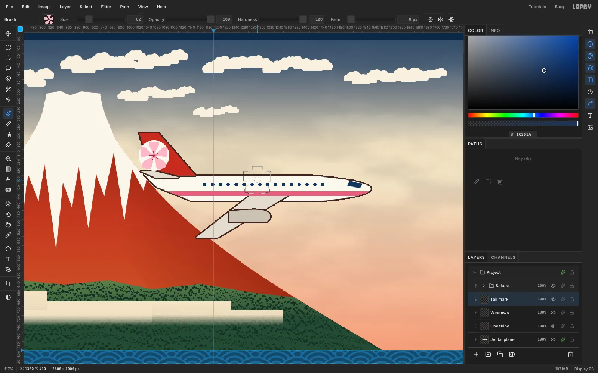

Add a layer named *Windows*. Use the **Hard Round** brush at **Size** `9`
with **Spacing** `240%`. Widely spaced dabs make a dotted line. In
Prussian blue, click `1180, 420` and Shift-click `1450, 420`.

For the cockpit, Pen a small four-point window at `1510, 412`,
`1540, 418`, `1536, 428` and `1506, 424`, and fill it with the same blue.

Add a layer named *Tail mark*. Make a `70 × 70` cream ellipse at
`1064, 354` with the Shape tool. Then stamp the *Sakura* brush on it at
**Size** `62`, with both jitters set back to `0`.

## Group and scale the jet

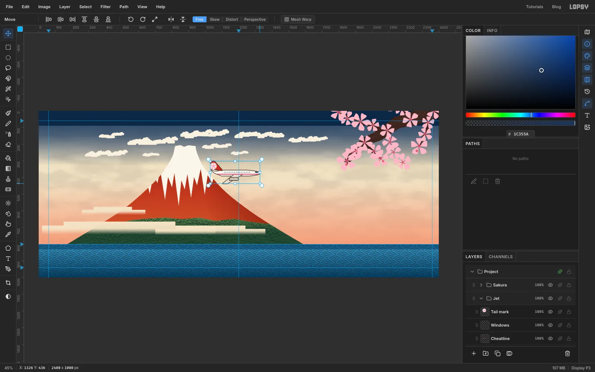

Shift-click the eight jet layers, group them as *Jet* and keep the group
selected. With the **Move** tool and nothing selected, the transform box
wraps the whole group.

Hold [[Cmd]] and drag the bottom-right handle in towards the top-left
until the box is a little over half its width, about `297` px instead of
`530`. [[Cmd]] keeps the proportions.

## Rotate the jet into a climb

Drag just outside the box's top-right corner, anticlockwise, until the nose
points up by about `12°`. A climbing plane reads as departing, which suits
an airline. Don't commit yet.

## Place the jet

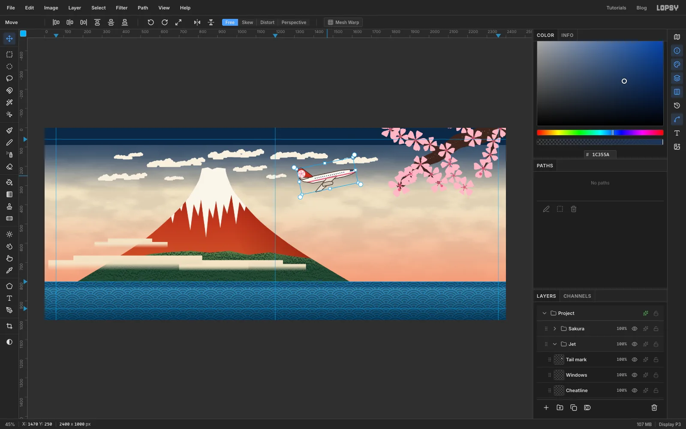

Drag inside the box to move the jet until its centre sits at about
`1470, 250`, to the right of the summit and clear of the clouds. Press
[[Cmd+D]] to commit. The tail cone should end up at about `1333, 274`.

## Trail a contrail

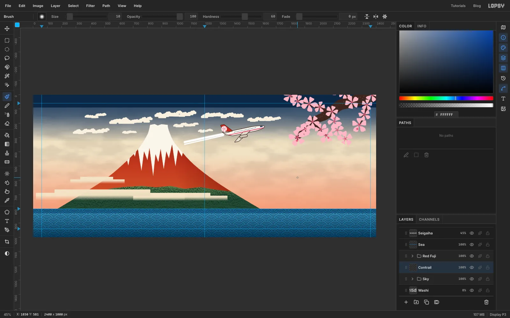

Click the collapsed *Sky* group and add a layer named *Contrail*. It sits
under *Red Fuji*, so the trail can never cover the mountain.

Use the **Soft Round** brush at **Size** `18` and **Hardness** `60`, in
white. Click `1060, 332` and Shift-click the tail at `1333, 274`. That's a
straight line at the jet's angle.

At **Size** `10`, draw a second line from `1060, 348` to `1333, 286` for
the other engine. Then choose **Filter → Gaussian Blur…** with **Radius**
`2`.

## Fade the contrail with a mask

Click **Add Mask** at the bottom of the Layers panel, then click the mask
thumbnail under the *Contrail* row to edit it.

Set two gradient stops, both at `100%` opacity: black at the start and
white at the end. Drag from the far end, `1060, 332`, to just
behind the tail at `1313, 274`. The trail is now strongest at the jet and
dissolves towards the mountain. Click the *Contrail* row again and set its
opacity to `90%`.

## Set the kanji cartouche

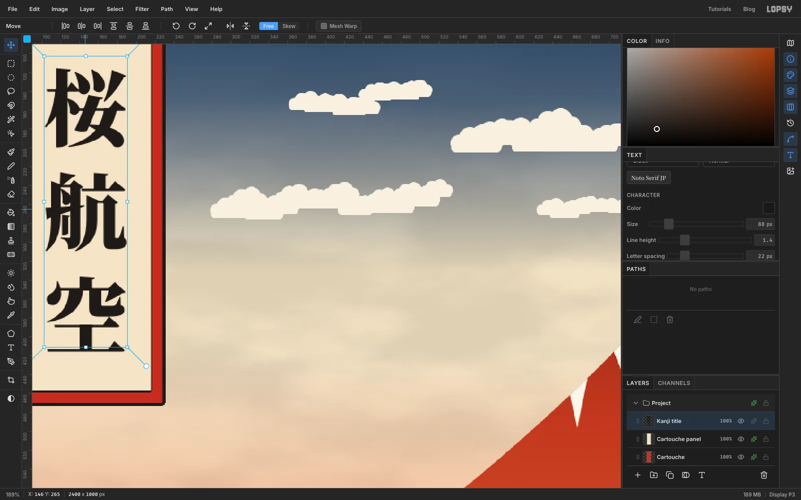

Collapse *Sakura*, click it and add a layer named *Cartouche*. Pick the
**Shape** tool: **Rectangle**, **Corner Radius** `0`, a vermilion fill and
no shape stroke. Click at `146, 265` and make it `163 × 410`. Then, in the
layer's effects drawer, turn on **Stroke** with **Width** `3` in sumi
`#1E1A18`.

Add a layer named *Cartouche panel* with a `139 × 384` mist-cream rectangle
at the same centre, and give it a **Stroke** effect of **Width** `2` in
sumi. The two
strokes make the double rule you see on print title cartouches.

Pick the **Text** tool and choose **Noto Serif JP** at weight **Black**,
**Size** `88`, in sumi. Click the **Vertical** toggle (the stacked A over
B), click inside the panel and type `桜航空` ("Sakura Airways"). If you
don't have a Japanese keyboard, copy the characters from this page and
paste them. Press [[Tab]] to commit, then double-click the new row and
rename it *Kanji title*.

Japanese fonts are large, so give the glyphs a moment to load. In the
**Text** panel, set **Letter spacing** to `22`. In vertical text that
spaces the characters down the column.

With the **Move** tool and the arrow keys, nudge the text until it sits
in the middle of the panel, with even space on the left and right and a
little more above and below.

## Stamp a hanko seal

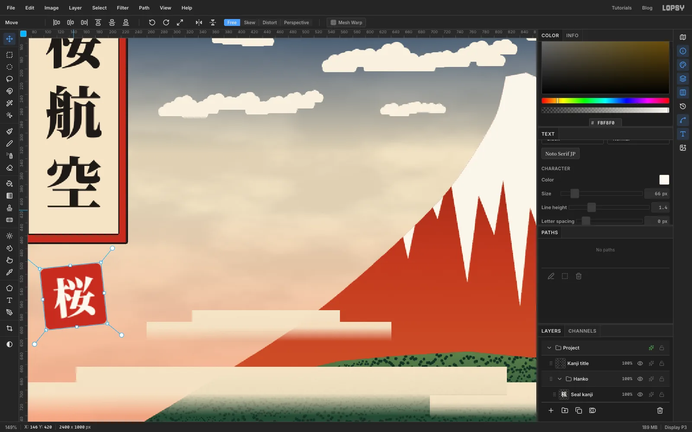

The Text panel keeps its letter spacing for the next text you create, so
reset it. Click a non-text row such as *Cartouche panel* first, so the
reset doesn't undo the spacing on the kanji. Then set **Letter spacing**
back to `0`.

Add a layer named *Seal*:

1. Draw a `95 × 95` vermilion rectangle at `146, 554`, with **Corner
   Radius** `8`.
2. Turn **Vertical** off, then type `桜` in Noto Serif JP Black at `66`,
   in cream `#FBF8F0`. Commit it and rename the row *Seal kanji*.
3. Centre the character on the square.

Group *Seal* and its text as *Hanko*. With the **Move** tool, drag just
outside a corner of the box to rotate the seal about `6°` anticlockwise,
like a stamp pressed by hand. Press [[Cmd+D]].

## Build the headline panel

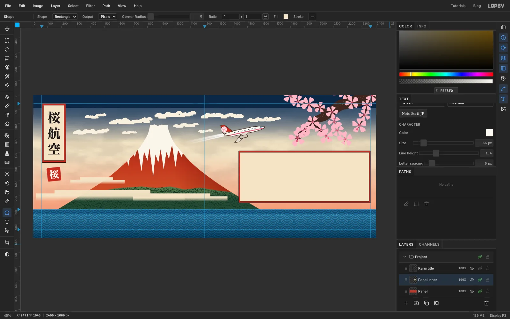

Collapse *Hanko*, click it and add a layer named *Panel*. Make a vermilion
rectangle `920 × 360` at `1900, 572` with **Corner Radius** `0`, so it runs
from `1440, 392` to `2360, 752`. Give it the same **Width** `3` sumi
**Stroke** effect.

Add *Panel inner*, a `900 × 340` mist-cream rectangle at the same centre
with a **Width** `2` **Stroke** effect.

The panel's corner deliberately covers Fuji's right foot. If an edge only
just touches the slope, it looks like a mistake. The panel also stays
about 50 px clear of the horizon and 30 px below the lowest blossom.

## Seat the headline

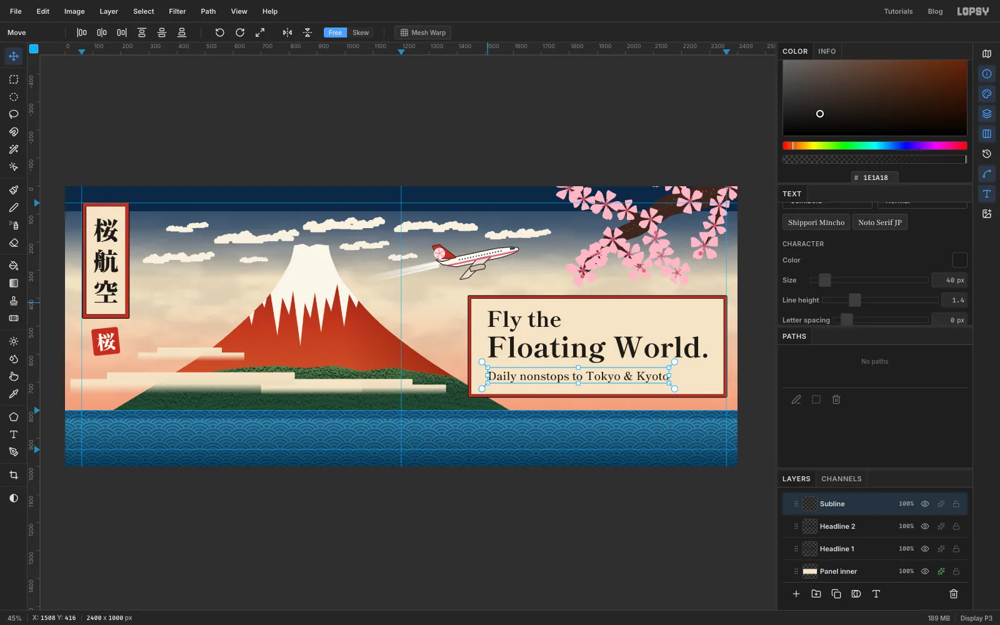

Use **Shippori Mincho** in sumi for all three lines. Create them from the
bottom up, because a Text click close to existing type edits it instead of
making a new layer. Commit each line with [[Tab]] and rename its row:

1. `Daily nonstops to Tokyo & Kyoto`, **SemiBold**, Size `40`. Name it
   *Subline*.
2. `Floating World.`, **ExtraBold**, Size `100`. Name it *Headline 2*.
3. `Fly the`, **ExtraBold**, Size `76`. Name it *Headline 1*.

Then arrange them with the **Move** tool and the arrow keys:

- Left-align all three lines about 60 px inside the panel.
- Tuck "Floating World." close under "Fly the".
- Leave a little more air above the subline.
- Centre the whole block vertically, so the space above "Fly the" matches
  the space below the subline.

The big line should end about as far from the panel's right edge as it
starts from the left.

## Give the headline a bokashi

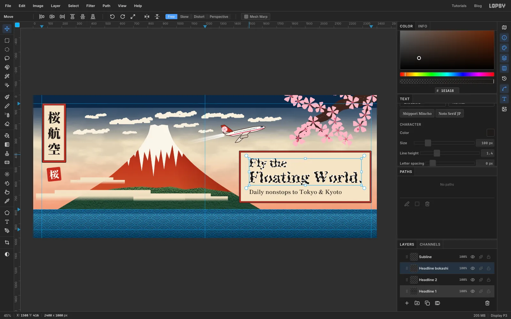

Click *Headline 2* and add a layer named *Headline bokashi*. [[Cmd]]-click
the *Headline 2* thumbnail, then **Shift**+[[Cmd]]-click *Headline 1*
to add it.

Drag a gradient from deep blue-black `#26324A` at the top of "Fly the" to
sumi `#1E1A18` at the bottom of "Floating World.", and deselect. The ink
looks hand-printed, a shade lighter at the top.

## Add the brand lockup

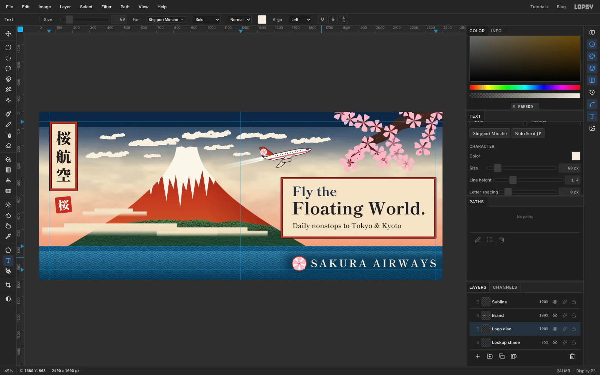

Add a layer named *Lockup shade*. Select `1460, 846` to `2400, 958` and
choose **Select → Feather…** `48`. Fill with indigo `#14304A` and set the
layer to `75%`. That calms the waves behind the name.

Add *Logo disc*: an `84 × 84` cream ellipse made with the **Shape** tool,
this time using the tool's own **Stroke** swatch in vermilion at **Width**
`5`. Stamp the *Sakura* brush in the middle at **Size** `74`.

Type `SAKURA AIRWAYS` in Shippori Mincho **Bold**, Size `60`, cream
`#F6EEDD`, commit it and name the row *Brand*. With it still selected, set
**Letter spacing** to `10`. Afterwards, click *Logo disc* and reset the
spacing to `0`.

Nudge the wordmark so its right edge lines up with the panel's right edge
at `2360`, centred on `y 902`. Put the disc 30 px to its left. Its left
edge then lines up with the headline's left edge.

Group everything from *Cartouche* to *Brand* as *Type*.

## Add the woodgrain

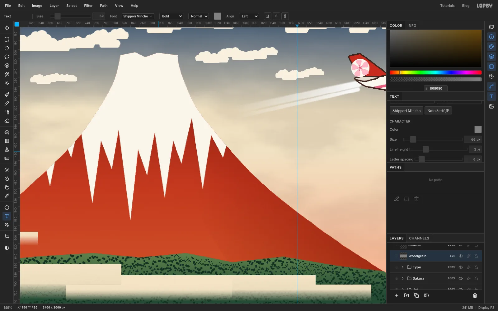

Collapse *Type*, click it and add a layer named *Woodgrain*, so it sits
above every group. Fill it with
grey `#808080`.

1. Choose **Filter → Add Noise…** with **Amount** `70`, **Mode**
   **Mono** and **Distribution** **Gaussian**.
2. Choose **Filter → Motion Blur…** with **Angle** `0` and **Distance**
   `40`.

That smears the noise into horizontal streaks, like the grain of a cherry
wood block. Set it to **Overlay** at `14%`.

## Age the print

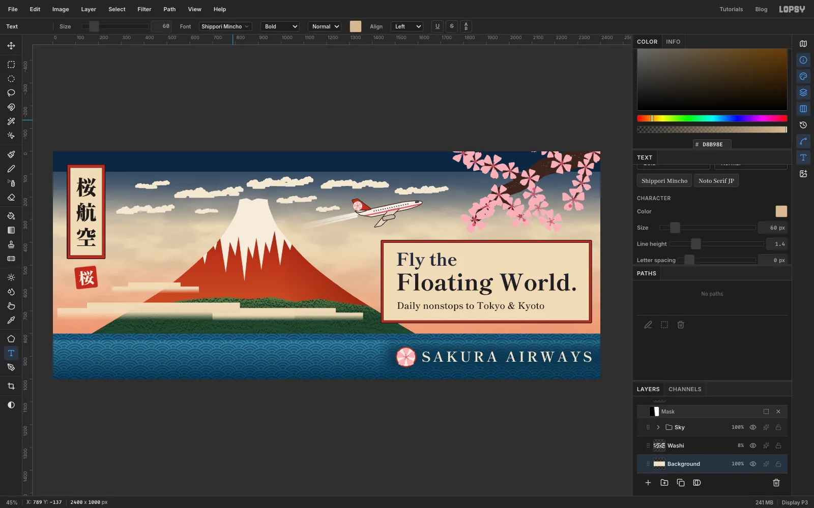

Add a layer named *Sepia wash*, fill it with `#D8B98E` and set it to
**Multiply** at `14%`. The whites warm up like old paper and the colours
sit together as one print.

Hide the guides with **View → Show Guides**. Export with **File → Quick
Export PNG** and save the project with **File → Save Project**.
