Vaporwave borrows its props from the shopping malls and screensavers of the 1980s and 90s. A Greek or Roman marble head, a striped sunset, palm trees, an endless neon grid, all in sticky pinks, violets and cyans, with a bit of VHS damage on top. In this tutorial you'll put those props into one quiet scene, **Fallen Titan**. A colossal marble head has toppled into a sea made of a glowing grid and is slowly going under.

It's a 1600 × 2000 px portrait painting with no text. The parts:

- a dusk sky with stars, a striped sun and dark cloud strata
- a neon grid sea, made from a tiny pattern tile that you tip back with the **Perspective** transform
- a real museum photo of a marble head: cut out, tinted, rim-lit, glitched and half sunk with a layer mask
- reflections, ripple rings and a glowing waterline
- a broken column, two palm silhouettes, then haze, vignette, grain and scanlines

You'll need one photo from Wikimedia Commons. It's public domain (**CC0**), from the Metropolitan Museum of Art:

- **Colossal marble head of the emperor Augustus MET DP337500.jpg**, the head seen from the front on a dark backdrop. Download the 960 px wide version.

The palette:

- Sky `#1B1240` → `#4A2482` → `#C8448E` → `#FF9B78`
- Sun `#FFF27A` → `#FF9D5C` → `#FF3F8E`, glow `#FF5FA8`
- Clouds `#33195A`, cloud rim `#FFB3C9`, haze `#FF6FB5`
- Sea `#43206F` → `#22124C` → `#090820`
- Neon grid `#45F0FF`, ripples `#7FF6FF`, waterline `#9FF8FF` / `#3FE8FF`
- Head tint `#FF5FA8` → `#B45CFF` → `#2FD6F5`, rim `#FF9A8A`, edge glow `#FF9AD5`, shade `#2A1450`
- Column `#1E1240` → `#4A2C82` → `#C77AC0` → `#FFD3BE` → `#7A3F94`, flutes `#140A2E`, glow `#FF6FB5`
- Palm silhouette `#120826`, palm rim `#FF4FA0`
- Vignette `#2A0E4A`, bottom shade `#0A0420`

> **Note:** Shortcuts are written for a Mac. On Windows use [[Ctrl]] wherever it says [[Cmd]].

## Set up the canvas and paint the sky

Open [Lopsy](/). In the **New Document** dialog choose **Pixels** and enter `1600` × `2000`.

Drop two guides by clicking the rulers:

- Click the left ruler at y `1120`. That's the horizon, a little under halfway down.
- Click the top ruler at x `800` to mark the centre line.

Click the **Background** layer. With the **Rectangular Marquee**, select everything from the top of the canvas to just below the horizon guide. Pick the **Gradient** tool and open **Advanced…**. Set four stops: `#1B1240`, `#4A2482` at 42%, `#C8448E` at 80% and `#FF9B78`. Drag from the top edge straight down to the horizon guide.

## Scatter a starfield

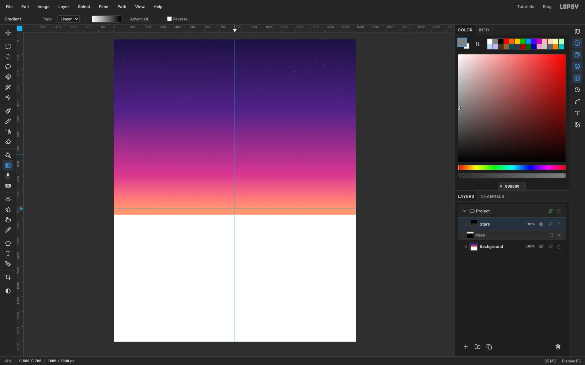

Press [[Cmd+D]] to deselect and rename `Layer 1` to `Stars`. Marquee the top 860 px of the canvas and fill it with mid grey `#808080` (**Edit → Fill**).

Press [[Cmd+D]] to deselect. Choose **Filter → Add Noise…** with Amount `100`, **Mono** and **Gaussian**. Then **Filter → Threshold…** at Level `184`. Only the brightest specks of noise survive, as white dots on black.

Set the layer's blend mode to **Screen** so the black disappears. To fade the stars out lower down, click **Add Mask**, then click the mask thumbnail to edit it. Drag a white-to-black gradient from near the top down to about y `760`. Click the layer's name to go back to editing pixels.

## Fill the sun

Add a layer named `Sun`. Choose the **Elliptical Marquee** and click once on the canvas to open its size dialog. Enter From `430`, `530` To `1170`, `1270`. That's a 740 px circle on the centre line whose lower part dips below the horizon. The sea will hide that part later.

Set the gradient stops to `#FFF27A`, `#FF9D5C` at 50% and `#FF3F8E`. Drag from the top of the circle down to the horizon guide.

## Cut the sunset stripes

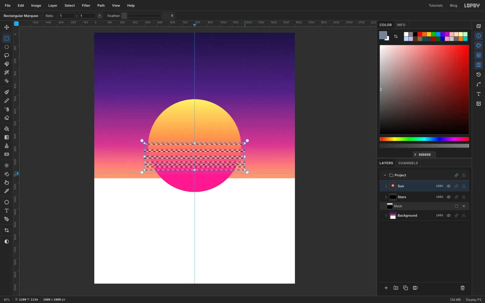

Deselect, then drag a thin, wide marquee across the sun a little below its middle. Hold [[Shift]] and drag five more bands below it. [[Shift]] adds each one to the selection. Make each band a little thicker than the last (about 8, 12, 16, 20, 24 and 28 px) and the gaps a little narrower, so the stripes crowd together toward the horizon.

Press [[Delete]] to cut all six at once.

## Give the sun a glow

Deselect. Open the Sun layer's **Layer Effects** (the sparkle icon on its row) and turn on **Outer Glow**: colour `#FF5FA8`, Size `90`, Opacity `70`.

## Draw cloud strata across the sun

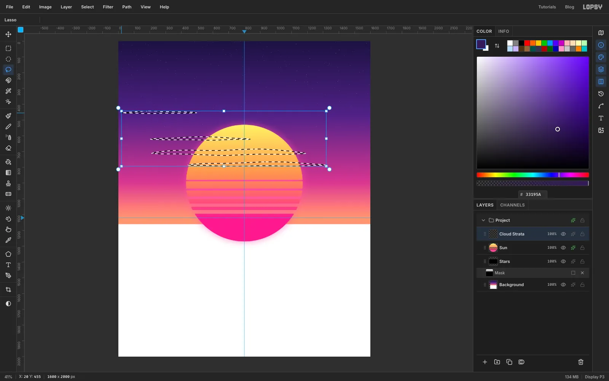

Add a layer named `Cloud Strata` and set the colour to `#33195A`. With the **Lasso**, draw a long, thin, lens-shaped cloud across the sun: a gently humped top edge and a flatter, slightly lumpy bottom. Hold [[Shift]] and draw three more:

- a shorter one just above it
- one lower down that runs off toward the right
- a thin streak in the empty sky at the upper left

Choose **Edit → Fill**.

## Light the cloud edges

Deselect and give the clouds an **Inner Glow** in `#FFB3C9`, Size `8`, Opacity `70`. It reads as the sun catching the edges of the clouds.

## Lay down the sea and a horizon haze

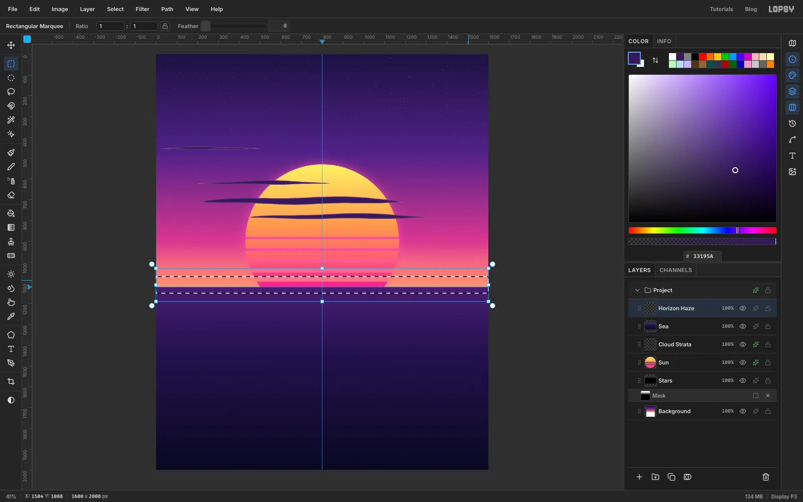

Add a layer named `Sea`. Marquee everything below the horizon guide and drag a gradient from the horizon to the bottom edge: `#43206F`, `#22124C` at 35%, `#090820`. This layer hides the bottom of the sun.

Add a layer named `Horizon Haze`. Marquee a band from about 50 px above the horizon to 30 px below it. Choose **Select → Feather…** with `40`, then fill with `#FF6FB5`. Deselect, set the layer to **Screen** and its opacity to `55%`.

## Make a grid tile

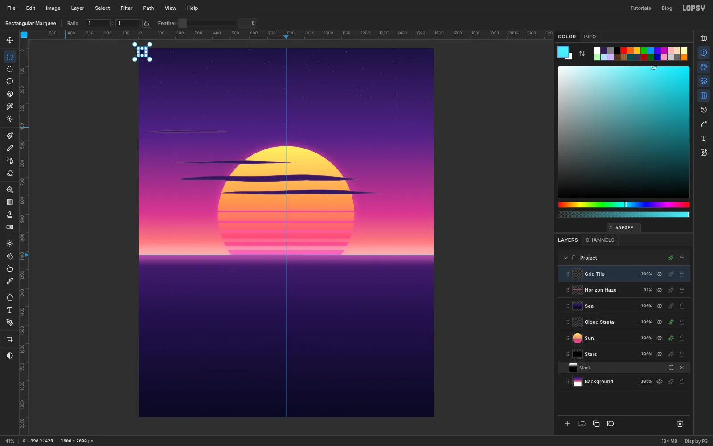

Add a layer named `Grid Tile` and set the colour to `#45F0FF`. In the top-left corner of the canvas, click once with the **Rectangular Marquee** to open its size dialog and fill two thin bars, pressing [[Cmd+D]] between them:

- From `0`, `0` To `40`, `2`: a horizontal bar
- From `0`, `0` To `1`, `40`: a vertical bar

Together they make one corner of a grid cell. The horizontal bar is thicker on purpose: the far rows get squashed by the perspective later and would vanish at 1 px. Select the 40 × 40 px square that contains them and choose **Edit → Define Pattern**. Then delete the `Grid Tile` layer. The pattern stays defined.

## Fill the sea with the grid

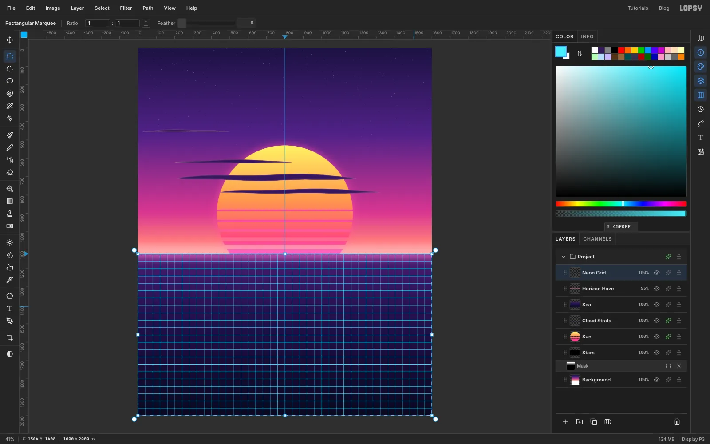

Click `Horizon Haze` and add a layer named `Neon Grid` above it. Marquee everything below the horizon and choose **Edit → Fill with Pattern…**. Your grid tile is already selected, so click **Apply**. You now have a flat grid: rows and columns 40 px apart.

## Tip the grid back with Perspective

Keep the marquee. Choose **View → Zoom Out** a few times, until the zoom in the corner reads about `8%` and there's plenty of grey pasteboard on both sides. Press [[V]] for **Move** and click **Perspective** in the options bar.

Hover just inside the bottom-left corner of the selection until the cursor turns into a diagonal resize arrow, then drag it far to the left, about two canvas widths. In Perspective mode the bottom-right corner mirrors it, so the bottom edge widens symmetrically.

> **Tip:** Do the bottom corners first, while the box is still a rectangle. At very low zoom the rotate handle next to a corner can steal the press. In Perspective mode a rotation does nothing, so if the drag doesn't change the grid, undo and grab a little further inside the corner.

## Widen the far edge and commit

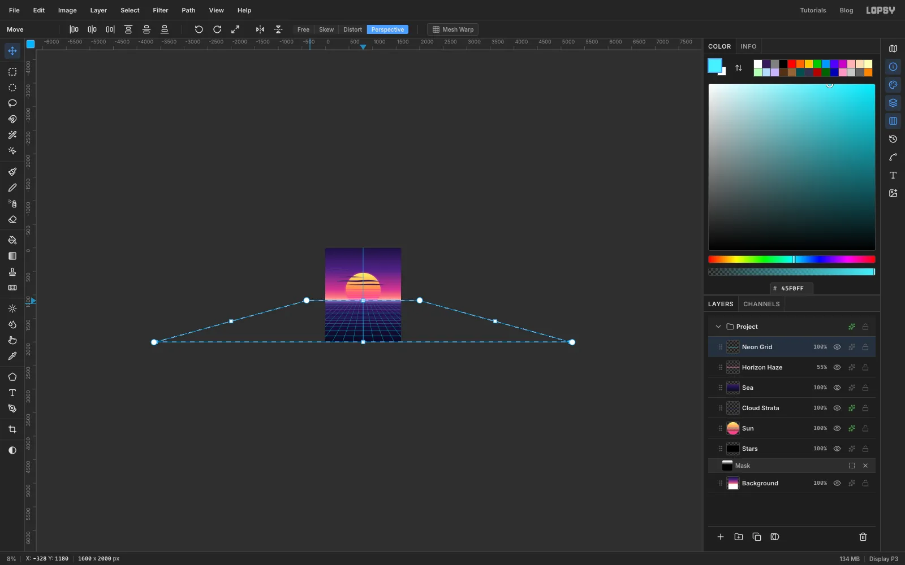

Now drag the top-left corner a little to the left, about a quarter of the canvas width. The top edge then spans the whole canvas, so the far rows run edge to edge along the horizon.

Press [[Cmd+D]] to commit and **View → Fit to Screen**. The transform is projective: the near rows come out tall and the far rows thin, like a real floor.

## Make the grid glow

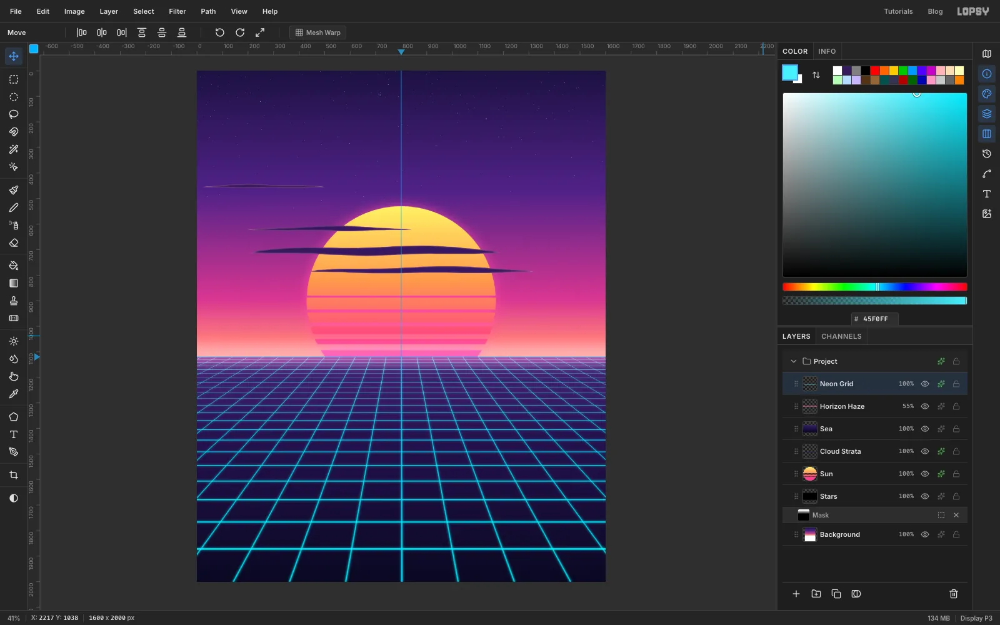

Set `Neon Grid` to **Screen** and give it an **Outer Glow** in `#45F0FF`, Size `14`, Opacity `80`.

## Bring in the marble head

With `Neon Grid` selected, click **New Group** and name the group `Titan`. Drag the downloaded photo of Augustus onto the canvas. It arrives as a new layer inside the group. Rename it `Titan Head`.

## Knock out the backdrop

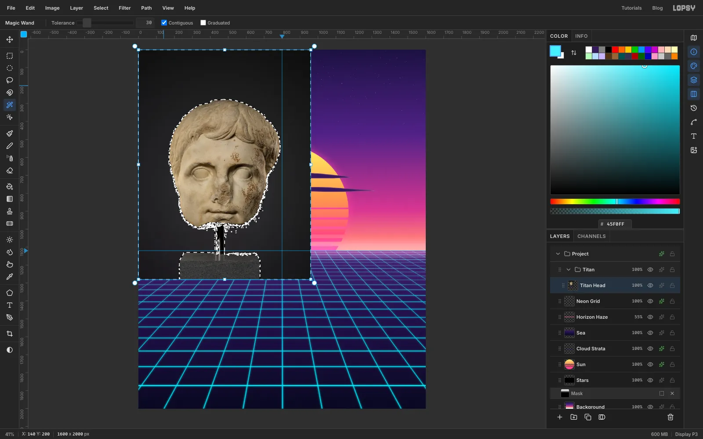

Press [[Cmd+D]]. Pick the **Magic Wand**, set Tolerance to `30` with **Contiguous** on, and click the dark backdrop near a corner of the photo. Press [[Delete]].

## Remove the stand and clean the edge

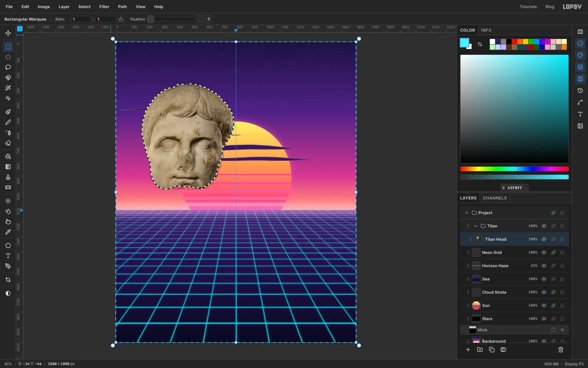

Marquee from just under the chin to the bottom of the canvas and press [[Delete]] to get rid of the metal rod and plinth.

The wand leaves a thin dark rim and a few loose specks. To clean them up:

1. [[Cmd]]-click the `Titan Head` thumbnail to select its pixels.
2. Choose **Select → Shrink…** with `3`, then **Select → Inverse**.
3. Press [[Delete]].

## Scale and tip the head over

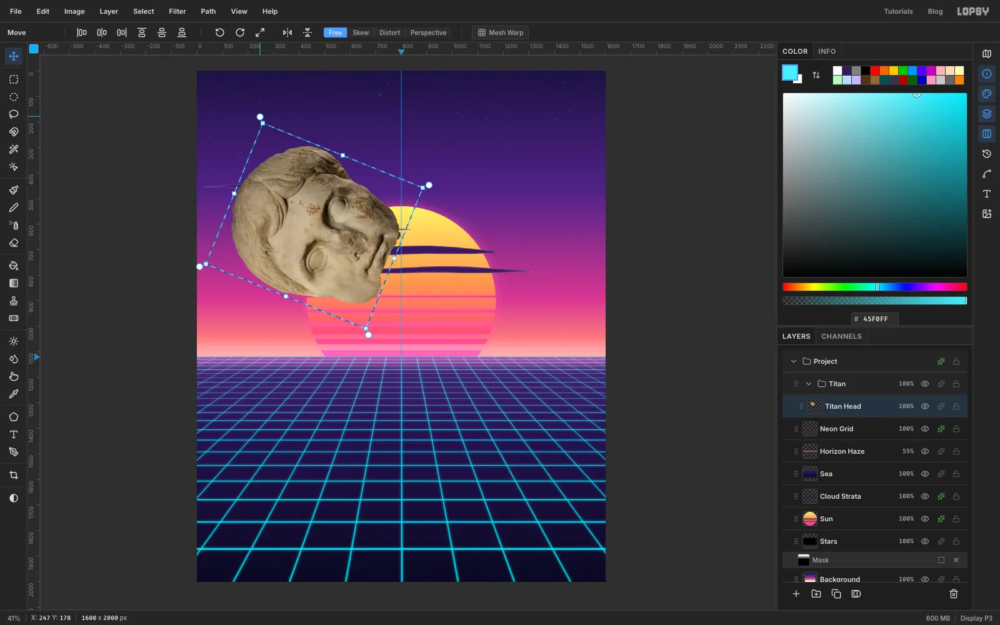

Press [[Cmd+D]], then marquee around the head. With **Move**, hold [[Cmd]] and drag the bottom-right corner handle inward a little, to about 94%.

Then drag the rotation handle outside the top-right corner about 68° counter-clockwise, so the head lies on its cheek with its face turned toward the viewer. Press [[Cmd+D]] to commit.

## Place the head in the sea

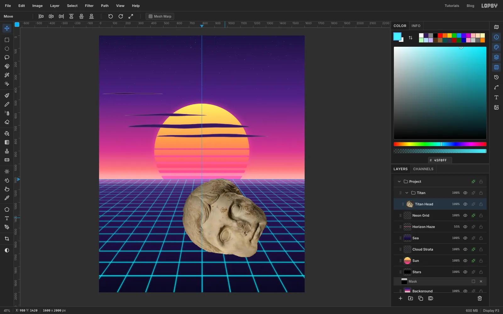

With nothing selected, drag the head with the **Move** tool so it sits a little right of the centre guide, with the top of the skull just touching the horizon. Placing it off-centre keeps the head and the sun from stacking up into a bullseye.

## Grey it down

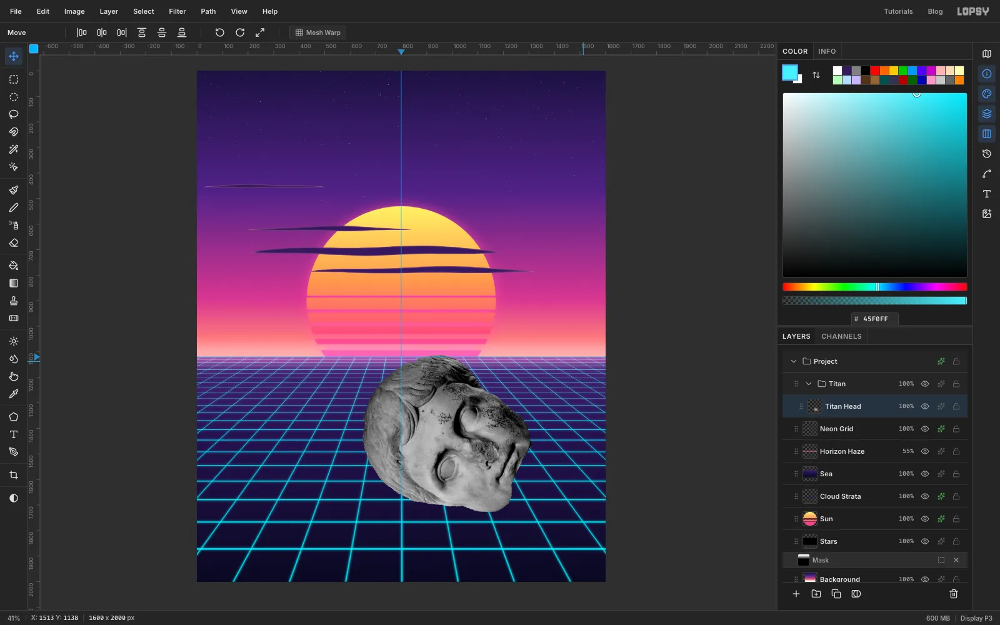

Choose **Filter → Desaturate**, then **Filter → Brightness/Contrast…** with Brightness `-4` (a touch darker) and Contrast `40`. Neutral marble takes colour much better than the warm museum stone.

## Tint it with a Color layer

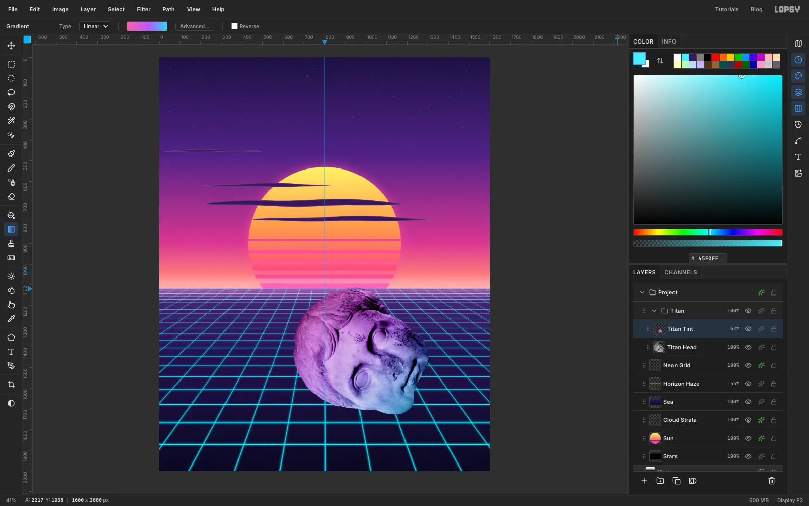

[[Cmd]]-click the head's thumbnail and add a layer named `Titan Tint`. Drag a gradient across the head from upper left to lower right: `#FF5FA8`, `#B45CFF` at 55%, `#2FD6F5`. Deselect.

Set the blend mode to **Color** and the opacity to `62%`, then choose **Layer → Merge Down** to bake the tint into the head.

## Backlight the skull

The sun is behind the head, so the top of the skull should catch its light.

[[Cmd]]-click the head's thumbnail again and add a layer named `Rim Light`. Open the Gradient tool's **Advanced…** editor and set just two stops: `#FF9A8A` and black. Drag from the top of the skull down about 170 px. Deselect.

Set the layer to **Screen** at `60%`. Black has no effect in Screen mode, so only the top edge brightens. Choose **Layer → Merge Down**.

## Shade the base

[[Cmd]]-click the thumbnail, add a layer named `Shade`, and set the gradient stops to white and `#2A1450`. Drag from the middle of the head down to its lower quarter, where the water will cut it off later (about y `1625`). Deselect.

Set it to **Multiply** at `45%`. White has no effect in Multiply, so only the lower half darkens. **Merge Down**.

## Slip a few glitch slices

A glitch slice is a thin band of the image that has jumped sideways:

1. Marquee a thin band (15–25 px tall) right across the head, through the forehead.
2. Press [[Cmd+C]], then [[Cmd+V]]. The band is pasted in place as a new layer.
3. With **Move**, drag it 60–90 px sideways.
4. **Layer → Merge Down**.

Do this three times: across the forehead, across the brow (drag that one the other way) and across the lower face. Keep the slices off the eyes so the face still reads. Copying instead of cutting leaves no holes behind.

## Split the colour inside the slices

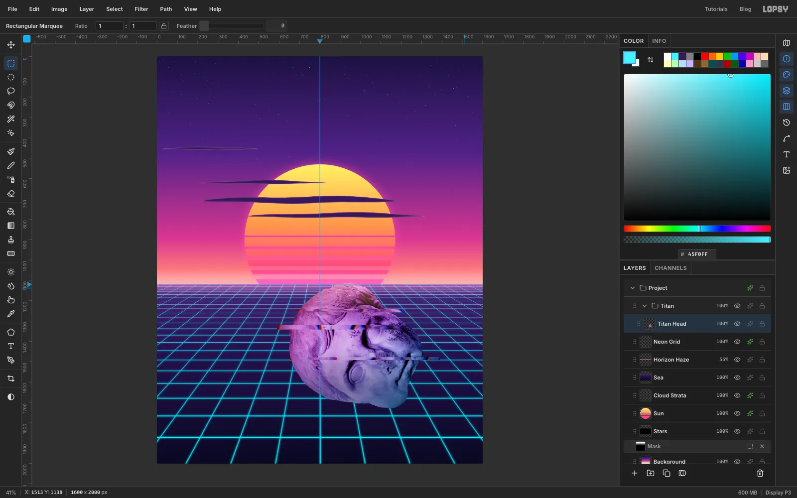

Select the three bands again. They're easy to find because each one sticks out past the side of the head. Drag a marquee over the first, then [[Shift]]-drag over the other two. Choose **Filter → Chromatic Aberration…** with Amount `5` and Direction `0`. The red and blue channels split apart only inside the slices, which makes them read as signal damage. The rest of the head stays sharp.

## Sink the head with a layer mask

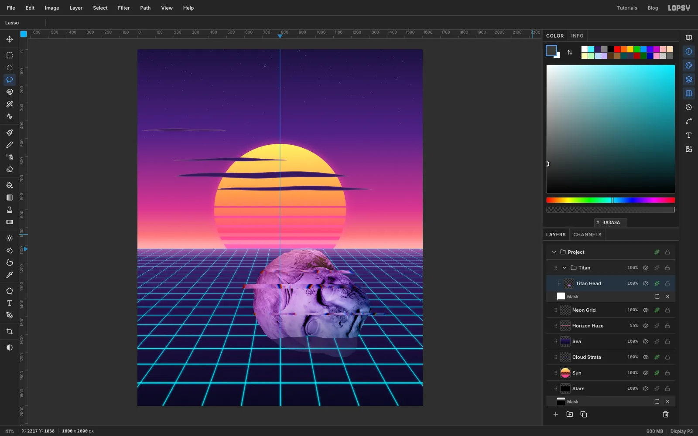

Deselect, click **Add Mask** and click the mask thumbnail. With the **Lasso**, draw a gently wavy line across the lower quarter of the head and close the lasso around everything below it.

Set the colour to dark grey `#3A3A3A` rather than black and choose **Edit → Fill**. Grey hides most of the drowned part but lets it show faintly under the grid. Click the layer's name to leave the mask.

Finally, give the head a subtle **Inner Glow** in `#FF9AD5`, Size `6`, Opacity `22`. It softens the cut-out edge into a faint pink rim.

## Flip a copy for the reflection

Click **Duplicate Layer** and rename the copy `Titan Reflection`. Click the **×** on its mask row to delete the copied mask. [[Cmd]]-click its thumbnail, press [[V]] and click **Flip Vertical** in the options bar.

## Fade the reflection into the water

Press [[Cmd+D]]. Drag the copy straight down until its waterline meets the original's, so the two mirror each other across the water. Lasso everything above the waterline and press [[Delete]].

Then:

- **Filter → Motion Blur…** with Angle `90` and Distance `20` for vertical streaks.
- **Add Mask** and drag a white-to-black gradient from the waterline to near the bottom of the canvas.
- Set the layer to **Screen** at `38%` and click its name to leave the mask.

## Move the reflection under the head

The copy landed above the head. Drag `Titan Reflection` by its grip (the dotted handle at the left of the row) and drop it just below `Titan Head`, under that layer's mask row. The reflection now sits under the head.

## Add ripple rings

Select `Titan Reflection` and add a layer named `Ripples`. It lands between the reflection and the head, so the head hides the far half of each ring.

Set the colour to `#7FF6FF`. Each ring is a filled ellipse with a slightly smaller ellipse deleted out of its middle. Work largest first, all centred under the head just below the waterline, at about x `980`, y `1630`:

1. With the **Elliptical Marquee** size dialog, select From `340`, `1569` To `1620`, `1689` and choose **Edit → Fill**.
2. Select From `342`, `1571` To `1618`, `1687` and press [[Delete]]. That leaves a 2 px ring.
3. Repeat for a ring 1000 × 88 px (3 px thick) and one 760 × 60 px (4 px thick).

Add two small rings at the bottom right, where the big palm's trunk will stand in the water.

Deselect and give the layer an **Outer Glow** in `#45F0FF`, Size `10`, Opacity `85`.

## Draw a glowing waterline

Select `Titan Head` and add a layer named `Waterline` above it. Pick the **Pencil** with Size `5` and colour `#9FF8FF`. Click where the waterline meets the left side of the head, then [[Shift]]-click every 20–30 px along the wave to the right side. Add an **Outer Glow** in `#3FE8FF`, Size `18`, Opacity `60`.

## Reflect the sun on the water

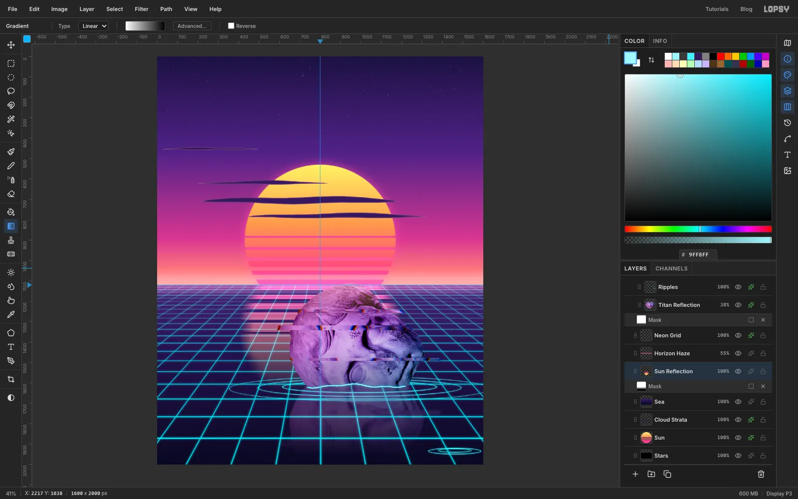

Click the `Sun` layer, marquee the part of the sun above the horizon and press [[Cmd+C]]. Click `Sea` and press [[Cmd+V]]. Rename the pasted layer `Sun Reflection`.

1. [[Cmd]]-click its thumbnail, press [[V]], click **Flip Vertical** and press [[Cmd+D]].
2. Drag it down until its top edge sits on the horizon.
3. Apply **Filter → Motion Blur…** with Angle `0` and Distance `60`. Then **Filter → Pixel Stretch…** with Amount `40`, Bands `34`, Seed `11` and RGB Split `0.35` for a VHS shimmer.
4. **Add Mask** with a white-to-black gradient about 520 px down from the horizon.
5. Set the layer to **Screen**.

## Build the column shaft

Collapse the `Titan` group, select it and click **New Group**. Name the new group `Ruins` and add a layer named `Column`.

Marquee a tall bar about 180 px wide near the left edge, from about a third of the way down to well below the horizon. Drag a gradient across it from left to right: `#1E1240`, `#4A2C82` at 50%, `#C77AC0` at 80%, `#FFD3BE` at 93%, `#7A3F94`. The highlight sits on the side facing the sun.

## Cut the flutes

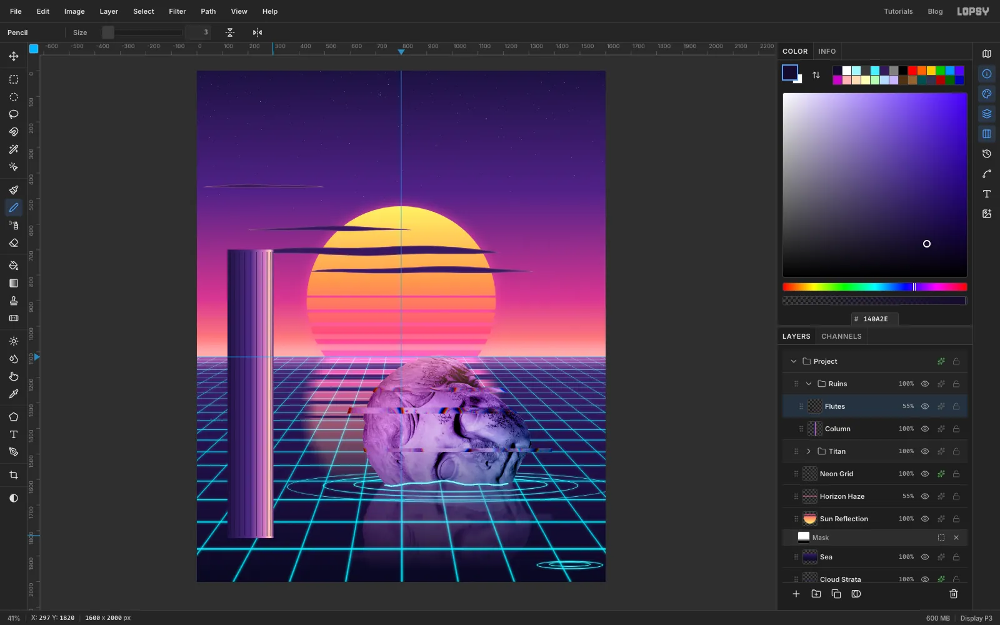

Add a layer named `Flutes`. Pick the **Pencil** with Size `3` and colour `#140A2E`. For each flute, click at the top of the shaft and [[Shift]]-click straight below it at the bottom. Draw eleven, spaced widely in the middle and bunched toward the edges, the way flutes look on a round column.

Set the layer to `55%` opacity and choose **Layer → Merge Down**.

## Break the top off

With the **Lasso**, draw an irregular, slanting break across the top of the shaft and close the lasso around everything above it. Press [[Delete]]. Do the same with a wavy lasso around the bottom of the shaft, a little lower than the head's waterline because the column stands closer to us.

## Lean it slightly

Marquee around the column and, with **Move**, drag the top-right rotation handle about 5° clockwise, as if the column has settled into the soft sea floor. Press [[Cmd+D]]. Then give it an **Outer Glow** in `#FF6FB5`, Size `30`, Opacity `45`.

## Reflect the column

The column gets a fainter reflection, built much like the head's:

1. **Duplicate Layer**, rename the copy `Column Reflection`, [[Cmd]]-click its thumbnail and **Flip Vertical**.
2. Drag it down to mirror the column across its waterline.
3. Lasso the part above the waterline and delete it.
4. **Filter → Motion Blur…** with Angle `0` and Distance `20`. A sideways smear suits a thin vertical shape better than streaks along its length.
5. A fading mask about 220 px tall, then **Screen** at `28%`.

## Ring the column's foot

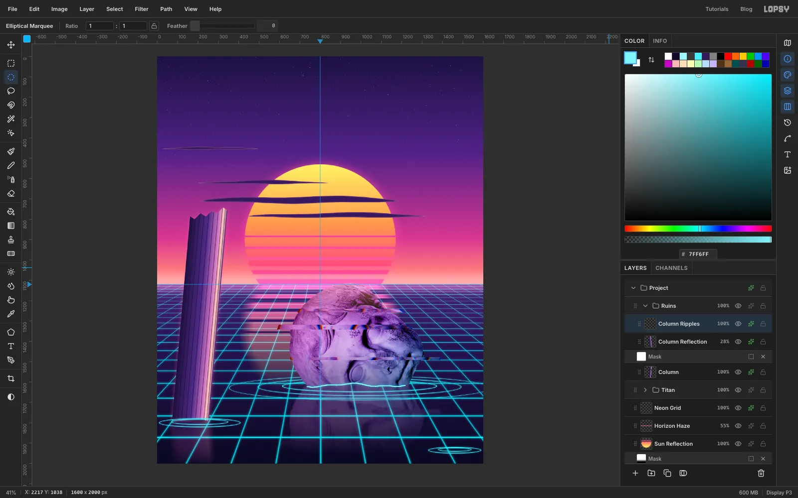

Add a layer named `Column Ripples` and draw two small rings around the column's foot, the same way as the head's: about 400 × 44 and 280 × 28 px. Give the layer a cyan **Outer Glow** in `#45F0FF`, Size `8`, Opacity `80`.

## Lasso the palm silhouette

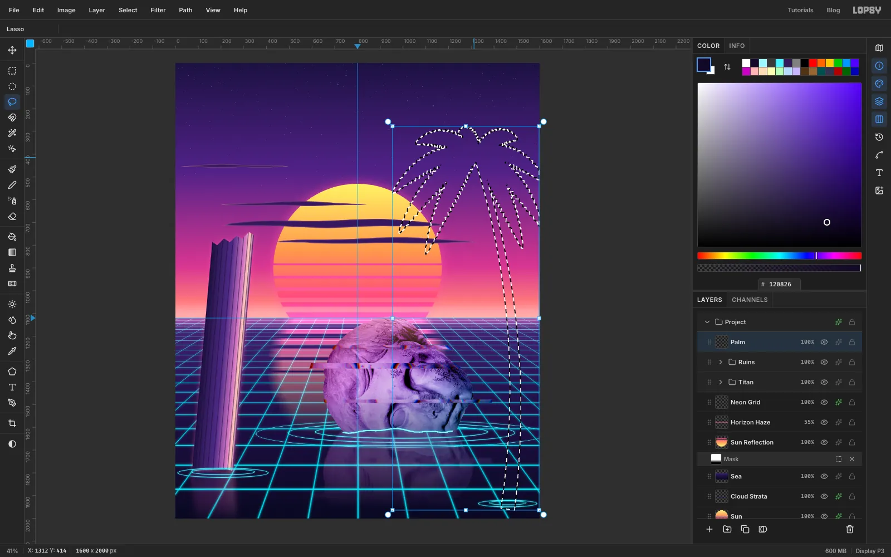

Collapse `Ruins`, select it and add a layer named `Palm` above it. Set the colour to `#120826`.

With the **Lasso**, draw the trunk: a long band that starts near the bottom-right corner, bows out to the right and narrows as it rises to a crown about four-fifths of the way across and a fifth of the way down.

Then hold [[Shift]] and draw nine fronds from the crown, one lasso each. Make each a narrow blade, about 80 px across at its widest and 250–440 px long, that arches out and droops toward a pointed tip. For the leaflets, zigzag in and out along both edges as you drag, in small even steps of about 15 px, so each edge becomes a fine sawtooth.

Make the fronds pointing up and right a bit shorter, and keep the ones on the left short enough that they only just overlap the edge of the sun.

Choose **Select → Feather…** with `1` to soften the edges, then **Edit → Fill**.

## Paint the midribs and coconuts

Pick the **Brush** (the colour is still `#120826`), open the brush settings and set Size `11`, Hardness `100` and **Taper** to about `650`. Drag from the crown out along the middle of each frond. The stroke thins as it goes, so each frond gets a solid stem that tapers to a point. It joins up the leaflet teeth near the tips.

Fill three small circles just under the crown for coconuts. Add an **Inner Glow** in `#FF4FA0`, Size `3`, Opacity `40` so the silhouette picks up a little sunset.

## Plant a distant palm in front of the sun

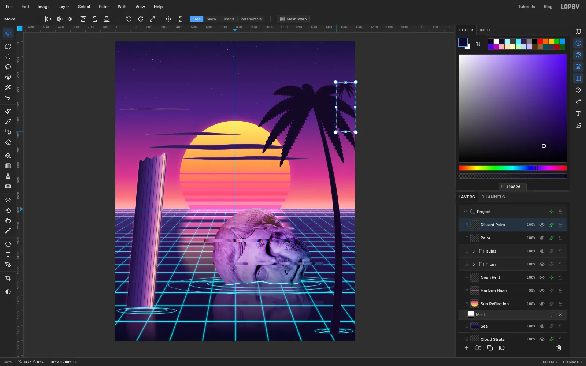

Click **Duplicate Layer** and rename the copy `Distant Palm`. Choose **Image → Flip Horizontal**, which mirrors the layer in place.

Marquee around it and, with **Move**, [[Cmd]]-drag the bottom-left corner handle up and to the right until the palm is only about 330 px tall. Press [[Cmd+D]]. Drag it over to the left so its foot stands exactly on the horizon in front of the left side of the sun. Set its opacity to `85%`.

## Shift the ruins as a group

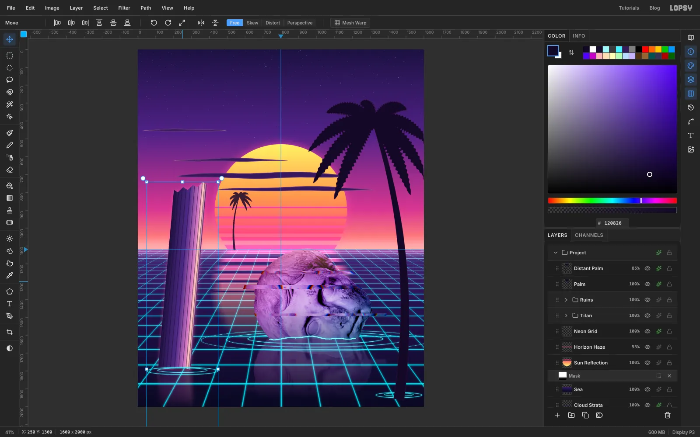

With the palms in, the column sits a little tight against the left edge. Groups move as one piece: click the `Ruins` group's row and drag on the canvas with **Move**. The column, its reflection and its ripples all slide about 40 px to the right together.

## Haze the empty sky

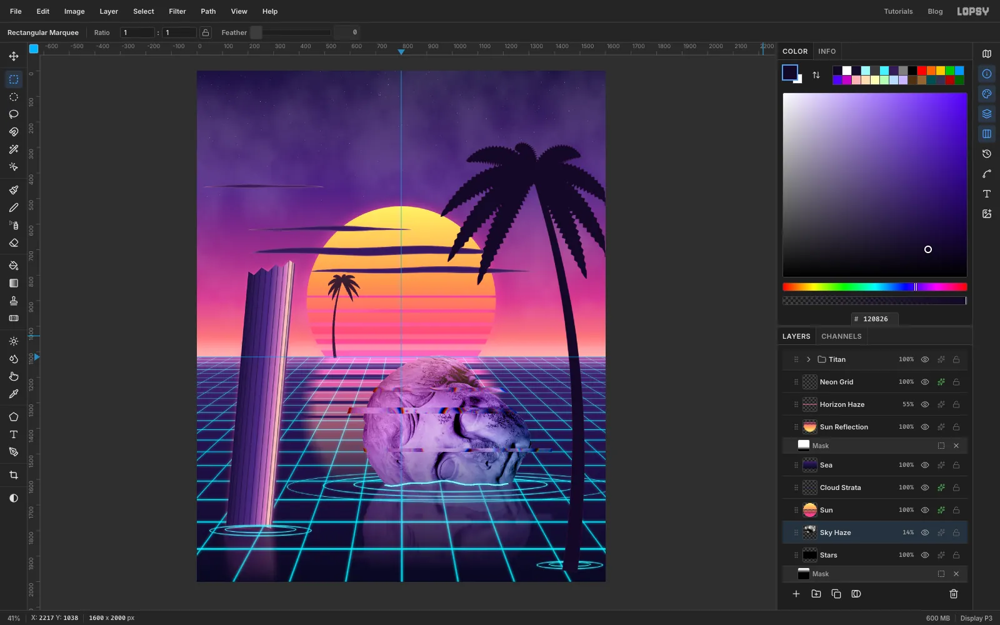

Click `Stars` and add a layer named `Sky Haze` above it. Marquee the top half of the canvas, **Feather** it by `80`, then choose **Filter → Clouds…** with Scale `6`. Deselect, set the layer to **Screen** at `14%`.

## Bloom the neon grid

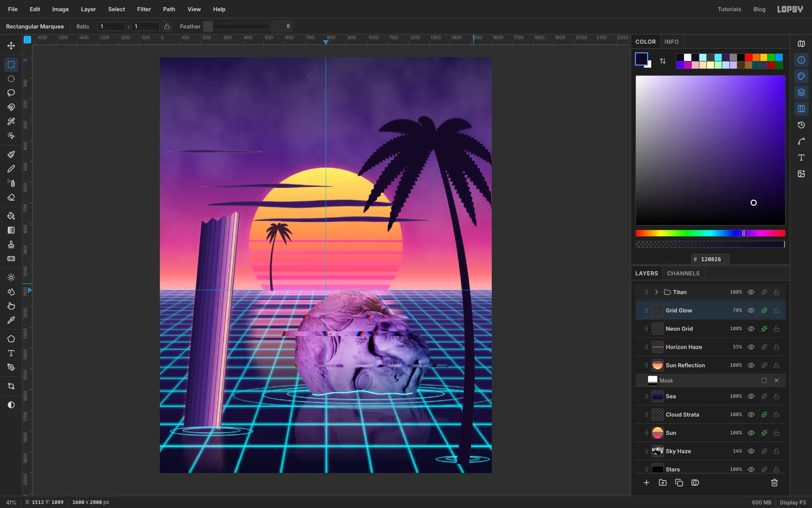

Click `Neon Grid`, click **Duplicate Layer** and rename the copy `Grid Glow`. Apply **Filter → Gaussian Blur…** with Radius `12` and set the copy's opacity to `70%`. The blurred copy, still on Screen, spreads a soft neon bloom around the sharp lines.

## Add a vignette and darken the foreground

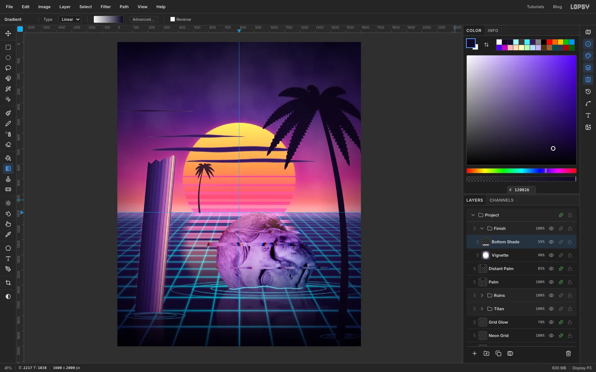

Select `Distant Palm` and click **New Group**. Name it `Finish`. It holds the layers that sit over everything.

- **Vignette:** add a layer, select all, and drag a radial gradient from just below the centre to past the bottom edge: white, white at 45%, `#2A0E4A`. Set it to **Multiply** at `90%`.
- **Bottom Shade:** add a layer, marquee the bottom 300 px and drag a white-to-`#0A0420` gradient down to the bottom edge. Set it to **Multiply** at `55%`. It stops the empty grid at the bottom from pulling the eye.

## Finish with grain and scanlines

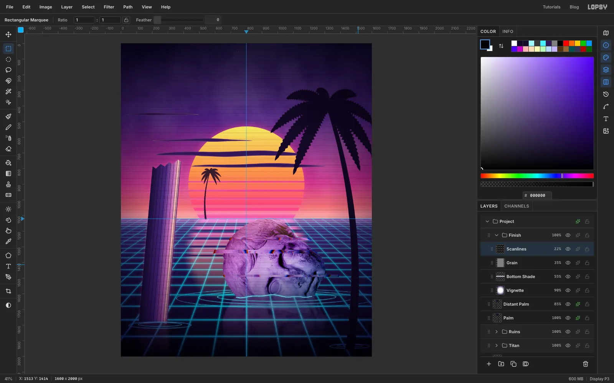

- **Grain:** add a layer, fill it with `#808080`, apply **Add Noise** with Amount `40`, **Mono** and **Gaussian**, and set it to **Overlay** at `35%`.
- **Scanlines:** add a layer and fill a 4 × 1 px black bar in its top-left corner. Select the 4 × 4 px square around it, choose **Edit → Define Pattern** and press [[Delete]]. Select all and use **Edit → Fill with Pattern…**. Set the layer to `22%` opacity.

Save the project with **File → Save Project** and export the painting with **File → Quick Export PNG**.
