Vaporwave borrows the clip art of the 1990s internet: pastel sunsets, marble statues, beige computers, Windows screensavers. It then arranges them like a dream you half remember. This tutorial makes **Sunset Screensaver**, a 1600 × 1600 px album cover for an imaginary mallsoft artist called **SOFT · DISK**.

The idea is simple. A beige CRT monitor sits on a marble plinth above a sea of clouds, running the old **3D Pipes** screensaver, and two of the pipes have escaped. They burst out of the glass, into the scene and around the monitor. A striped retro sun glows behind it all.

You'll use:
- **gradients** for the sky, the sun and every shiny pipe, including radial gradients for the ball joints
- a public-domain **cloud photo**, squashed into perspective, recoloured with a **Gradient Map** and faded with a **layer mask**
- the **Pen** tool to cut exact shapes (plinth faces, the monitor's sides, sparkles, a cursor) and turn them into selections
- the **Shape** tool's click-to-create dialog for the rounded bezel, screen and buttons
- **Clouds**, **Add Noise**, **Threshold**, **Pixel Stretch** and **Hue/Saturation**
- **Define Pattern** and **Fill with Pattern** for scanlines
- live type: a duplicated **RGB-split** title, engraved inscriptions and **text on a circular path**
- groups, rotation handles and **Copy Merged**

The whole cover is drawn as a simple oblique view. Front faces are flat rectangles, and every top or side face recedes up and to the left at the same slant: about 10 px left for every 7 px up. Keep that one slant everywhere and the monitor, the plinth and the pipes will all sit in the same space.

Some steps give positions in document pixels. Hover the canvas and read **X** and **Y** in the status bar at the bottom left to find them.

Three habits help throughout:
- **Name layers as you go.** Double-click a layer's name to rename it. Later steps refer to layers by name.
- **Exact selections:** with nothing selected, a single click with the **Rectangular** or **Elliptical Marquee** opens a dialog where you type **From X / Y** and **To X / Y**. This tutorial uses it for exact circles and thin strips.
- **Pen shapes to selections:** click the corners with the **Pen** tool, click the first corner again to close the shape, then in the **Paths** panel click **Path to Selection** and **Delete Path**. Every "Pen-select" below means exactly this.

Palette:

- Sky `#1A1040` → `#47236F` → `#B33C8E` → `#FF6F8E` → `#FFB487`
- Sun `#FFE98A` → `#FF9A52` → `#E8186E`
- Clouds `#3A1C6B` → `#A8489C` → `#FF8DAF` → `#FFF1E8`, haze `#FFC4D6`
- Marble `#FCE4F0` / `#F1C3DA` / `#B97AA0`, veins `#A8608A`, plinth shade `#8E4F80`
- Monitor beige `#F6EFE0` / `#E9DFC9` / `#B5A28C`, screen `#0E0A26`
- Pink pipe `#55093A` → `#FF3E9A` → `#FFE3F1`
- Teal pipe `#05404A` → `#13C8C0` → `#E6FFFC`
- Screen pipes lilac `#A98BFF`, yellow `#FFC93C`
- Title `#FFF4FA`, split cyan `#35E8FF`, split magenta `#FF2FB4`
- Engraving plum `#4A1546`, sticker yellow `#FFE14D`, sticker navy `#2A1060`

## Paint the sunset sky

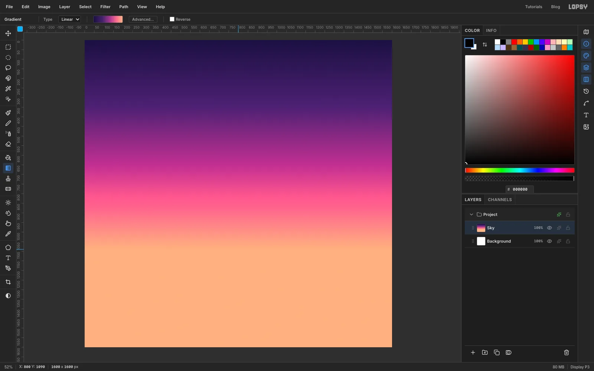

1. Create a **1600 × 1600 px** document with a white background, and rename `Layer 1` to `Sky`.
2. Pick the **Gradient** tool, set **Type** to **Linear** and click **Advanced…**. Make five stops: `#1A1040` at the left end, `#47236F` at about 32%, `#B33C8E` at about 60%, `#FF6F8E` at about 80% and `#FFB487` at the right end. Click the bar to add a stop, then type its colour in the **Hex** field. Click **Done**.
3. Drag from the top edge of the canvas straight down to about y 1090. Everything below that stays peach, which is where the horizon will sit.

## Place guides and draw the sun

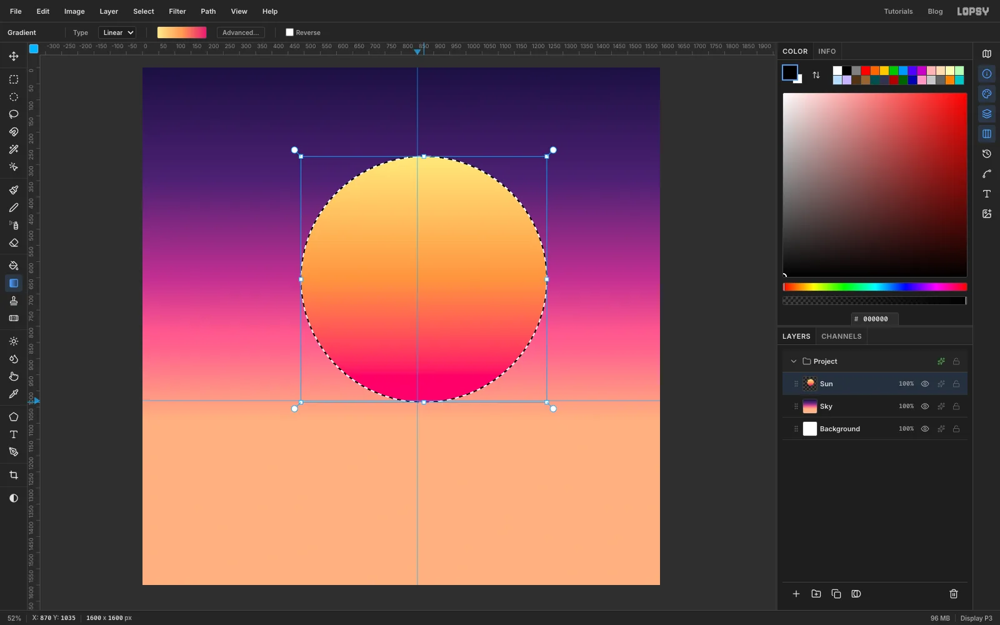

1. Click the top ruler at x **850** to drop a vertical guide down the middle of where the monitor will stand. Click the left ruler at y **1030** to mark the horizon.
2. Add a layer called `Sun`.
3. Pick the **Elliptical Marquee**, click once on the canvas, and type **From** `490`, `275` and **To** `1250`, `1035`. Click **Select**. That's a 760 px circle centred at (870, 655).
4. Set a linear gradient from `#FFE98A` through `#FF9A52` in the middle to `#E8186E`, and drag from the top of the circle to its bottom. Press [[Cmd+D]] to deselect.

## Cut the retro stripes

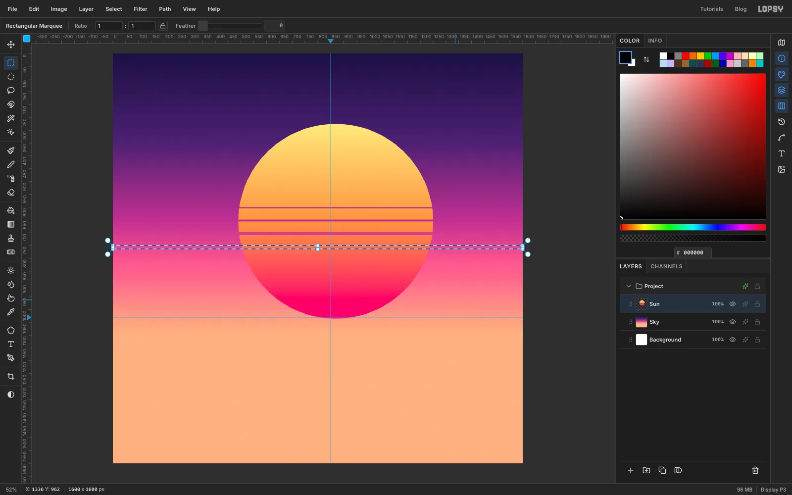

The classic synthwave sun is sliced by horizontal gaps that get wider toward the bottom.

With `Sun` selected, use the exact-corners dialog (one click with the **Rectangular Marquee**) to select each of these full-width strips, with **From X** `0` and **To X** `1600`. Press [[Delete]] after each one:
- y 600 to 605
- y 648 to 656
- y 698 to 709
- y 750 to 764
- y 804 to 822
- y 862 to 884

Finally, select from y **924** down to **1100** and press [[Delete]], so the sun ends cleanly just above the clouds. Deselect.

## Bring in the cloud photo

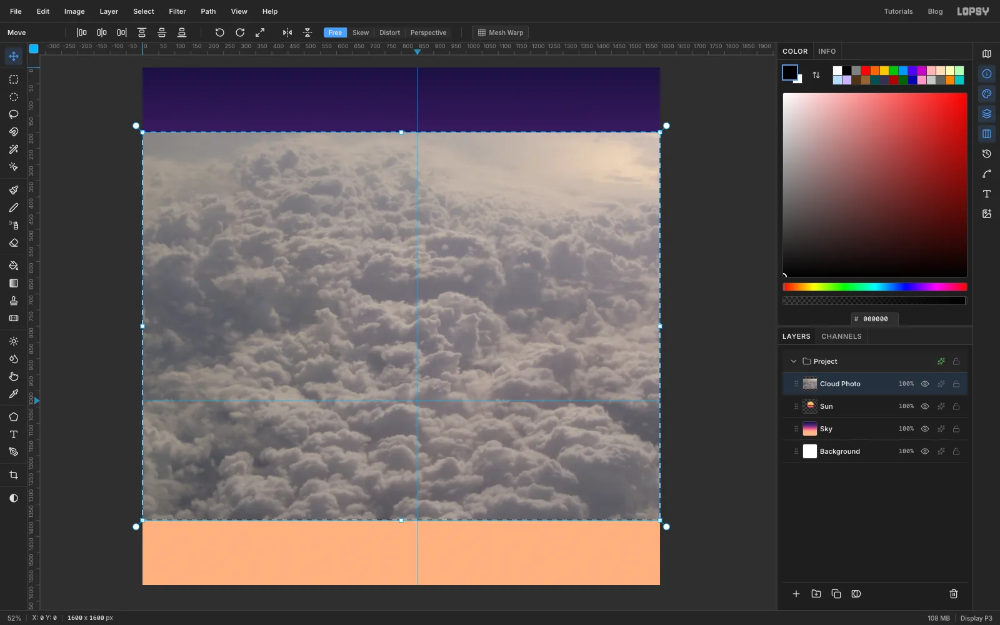

This cover uses [Clouds from airplane](https://commons.wikimedia.org/wiki/File:Clouds_from_airplane.JPG), a public-domain photo on Wikimedia Commons by Bizelburp123. Download the full-size file, then:

1. Select `Sun` so the photo lands above it.
2. Drag the file from your desktop onto the canvas. The photo is wider than the document, so Lopsy shrinks it to the full width and centres it.
3. Rename the new layer `Cloud Photo`.

## Squash the clouds into perspective

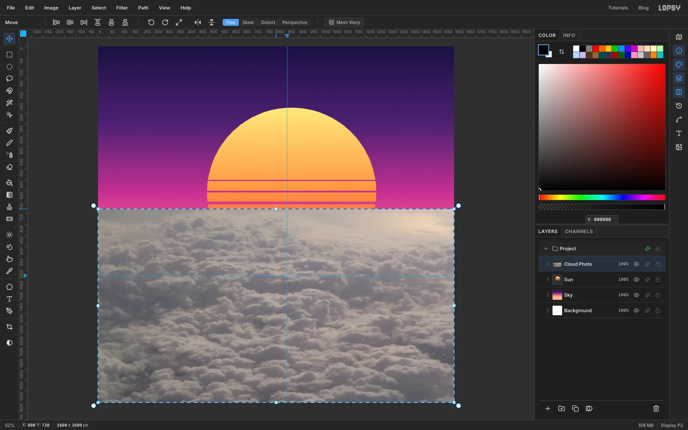

A sea of clouds seen from far away looks flatter than a photo taken from a plane window.

1. With the **Move** tool, drag the photo's **bottom-middle** handle down to the bottom edge of the canvas.
2. Drag the **top-middle** handle down to about y **730**.
3. Press [[Cmd+D]] to apply the transform. In Lopsy, [[Cmd+D]] commits a transform as well as dropping the selection.

## Recolour the clouds with a Gradient Map

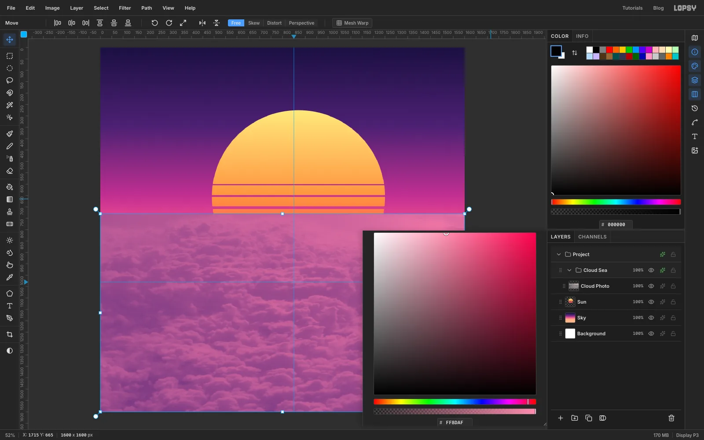

1. With `Cloud Photo` selected, choose **Layer → Group Layers** and rename the group `Cloud Sea`.
2. Click the group's effects button on its row to open the **Adjustments** drawer. Click **Add Adjustment → Gradient Map**.
3. Click the left stop and type `3A1C6B` in the **Hex** field. Click the right stop and type `FFF1E8`. Click the bar at about 42% and type `A8489C`, then at about 72% and type `FF8DAF`.

The shadows of the clouds turn violet and the tops turn pale peach. Close the drawer.

## Fade the horizon with a layer mask

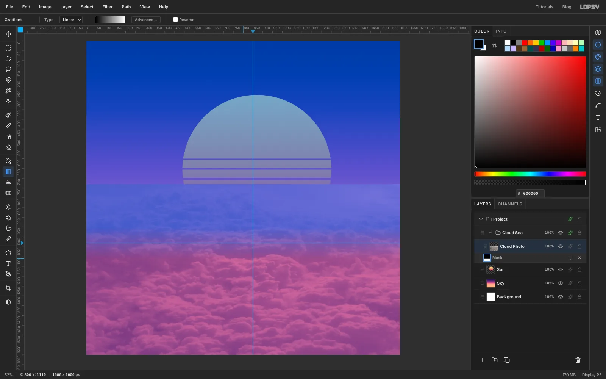

The top of the photo is hazy grey sky, which you don't want.

1. Select `Cloud Photo` and click **Add Mask** at the bottom of the Layers panel.
2. Click the small mask thumbnail under the layer to edit the mask. A blue overlay shows what's hidden.
3. Set a linear gradient from black to white and drag from y **950** straight down to y **1110**.
4. Click the `Cloud Photo` row to leave mask editing. The clouds now fade into the sky just below the sun.

## Make a starfield from noise

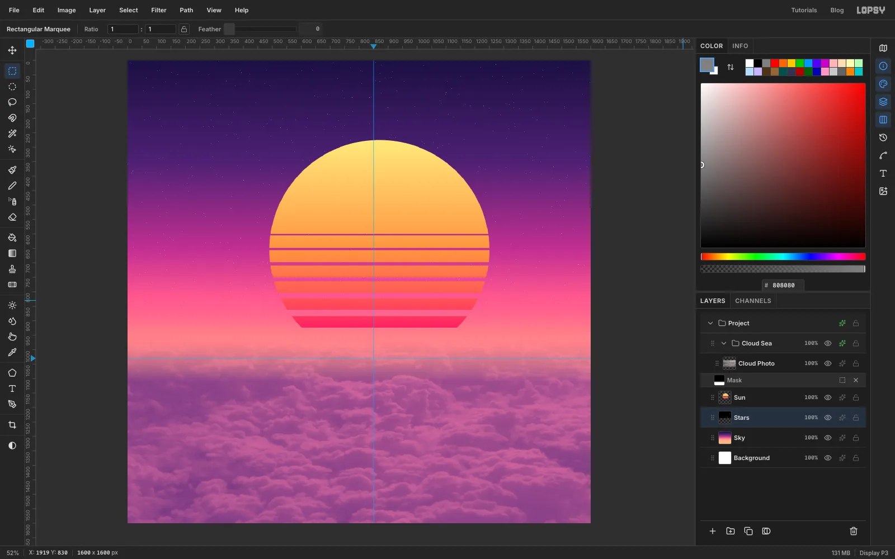

1. Select `Sky` and add a layer called `Stars`. Set the foreground to `#808080` and choose **Edit → Fill**.
2. Choose **Filter → Add Noise…**, pick **Mono** and **Gaussian**, set **Amount** to `100` and click **Apply**.
3. Choose **Filter → Threshold…** at **184**. Only a few hundred single pixels stay white.
4. Run **Filter → Gaussian Blur…** at **1**, then **Threshold** again at **28**. This rounds each pixel into a slightly bigger star.
5. On the Rectangular Marquee's options bar, set **Feather** to **80**. Drag a marquee from a little above y 860 down past the bottom of the canvas and press [[Delete]], so the stars fade out before the horizon. Set Feather back to **0**.
6. Set the layer's blend mode to **Screen** (open its effects with the ✦ button on its row). The grey-black disappears and only the stars show.

## Draw sparkles with the Pen tool

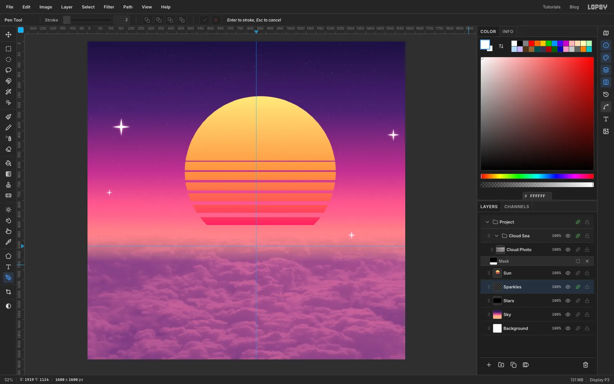

1. Add a layer called `Sparkles` and set the foreground to white.
2. Pen-select a thin four-point star centred at about (170, 430). Click its top tip at (170, 386), then go clockwise through (176, 424), (214, 430), (176, 436), (170, 474), (164, 436), (126, 430) and (164, 424). Choose **Edit → Fill**.
3. Make three smaller sparkles the same way, with their long tips 30 px from the centre at (1540, 470) on the right, 20 px at (1330, 975) just above the horizon, and 16 px at (110, 760) on the left.
4. Give the layer an **Outer Glow** in `#FF9BD0`: **Size** `18`, **Spread** `0`, **Opacity** `90`.

## Add a haze at the horizon

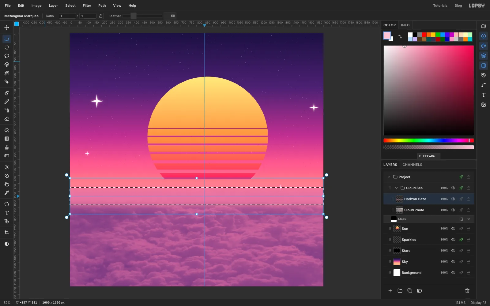

1. Expand `Cloud Sea`, select `Cloud Photo`, and add a layer called `Horizon Haze`. It lands inside the group, so the Gradient Map tints it too.
2. Set the marquee **Feather** to **60**. Drag a marquee the full width of the canvas from about y 975 to y 1085, and fill it with `#FFC4D6`.
3. Deselect and set Feather back to 0. Set the layer to **Screen** at **70%**.

## Build the marble plinth

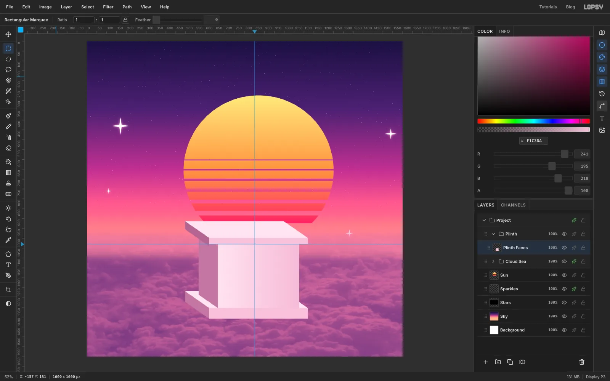

> **Tip:** The horizon guide runs right across the plinth's cap, and **Snap to Guides** would pull nearby marquee edges onto it. Turn off **View → Snap to Guides** while you build the plinth.

1. First grab a strip of the finished clouds to use later. Select `Horizon Haze`, drag a marquee from about (340, 1240) to (1260, 1500), and choose **Edit → Copy Merged**. Deselect.
2. Click the collapse arrow on `Cloud Sea`, select it, click **New Group** and name it `Plinth`. Add a layer called `Plinth Faces`.
3. **Base.** Pen-select the left face (620, 1354), (497, 1269), (497, 1323), (620, 1408) and fill it with `#B97AA0`. Pen-select the top face (620, 1354), (1120, 1354), (997, 1269), (497, 1269) and fill it with `#FCE4F0`. Drag a rectangular marquee for the front face from (620, 1354) to (1120, 1408) and fill it with `#F1C3DA`.
4. **Body.** Pen-select the left face (664, 1040), (566, 972), (566, 1286), (664, 1354) and fill it with `#B97AA0`. For the front, drag a marquee from (664, 1040) to (1076, 1354) and drag a left-to-right linear gradient across it from `#FBE3EF` to `#EDBDD6`.
5. **Cap.** Pen-select the left face (620, 998), (497, 913), (497, 955), (620, 1040) and fill it with the slightly darker `#A9698F`. Pen-select the top (620, 998), (1120, 998), (997, 913), (497, 913) and fill it with `#FCE4F0`. Fill a front marquee from (620, 998) to (1120, 1040) with `#F1C3DA`.

Drawing the base, then the body, then the cap means each box overlaps the one below it.

## Make it marble

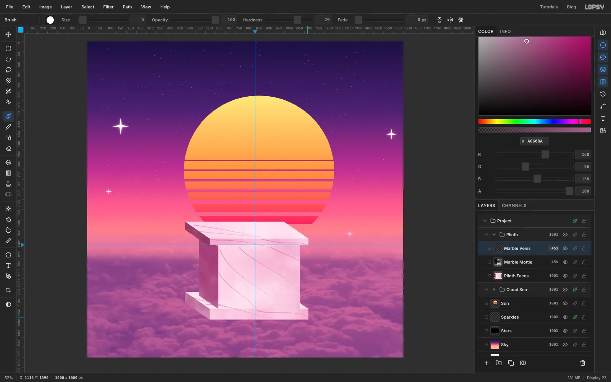

1. Add a layer called `Marble Mottle` and run **Filter → Clouds…** at **Scale 5**.
2. [[Cmd]]-click the `Plinth Faces` thumbnail to load the plinth's shape, choose **Select → Inverse**, click `Marble Mottle` and press [[Delete]]. Deselect, and set the layer to **Overlay** at **45%**.
3. Add a layer called `Marble Veins` and [[Cmd]]-click the `Plinth Faces` thumbnail again, so the brush can't paint outside the plinth.
4. Pick the **Brush**, colour `#A8608A`. In the Brushes panel set **Size 5**, **Hardness 70**, **Spacing 10** and **Taper 380**. Taper thins each stroke over its length, like a real vein.
5. Paint about ten long, gently wavy strokes running diagonally from upper left to lower right across the body, the cap's front and top, and the base. Deselect and set the layer to **45%**.

## Shade the plinth

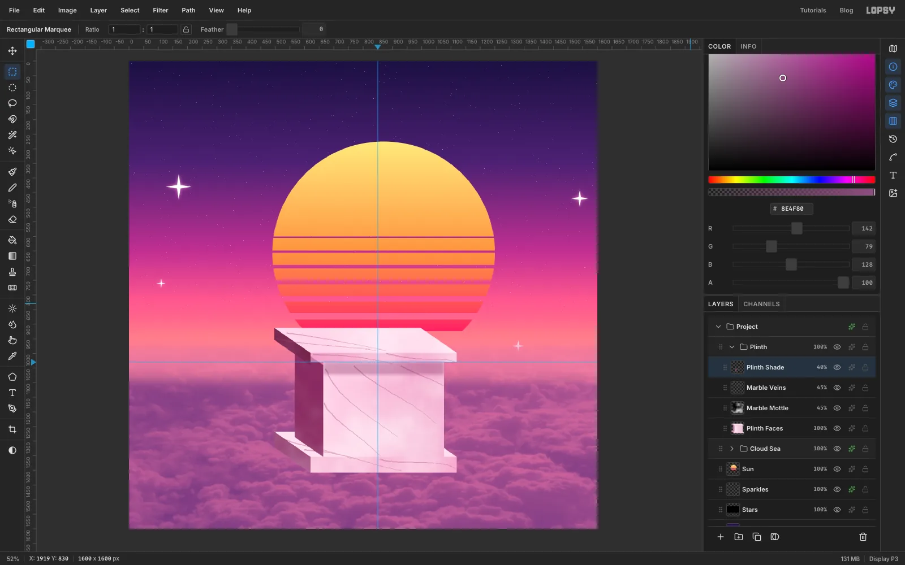

1. Add a layer called `Plinth Shade` and set the colour to `#8E4F80`. Pen-select each of the three left faces again (same corners as before) and fill them.
2. Set the marquee **Feather** to **10**. Drag a marquee across the top 30 px of the body's front face, from (664, 1042) to (1076, 1072), and fill it. That's the cap's shadow. Set Feather back to 0.
3. [[Cmd]]-click `Plinth Faces`, choose **Select → Inverse**, click `Plinth Shade` and press [[Delete]] to trim the feathered edge. Deselect.
4. Set the layer to **Multiply** at **40%**.

## Sink the plinth into the clouds

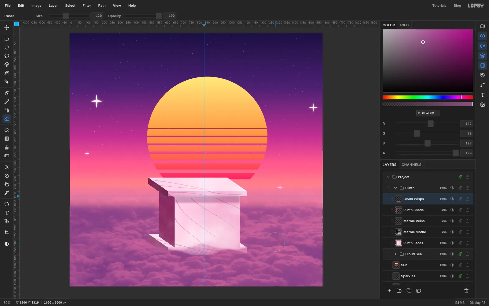

1. Press [[Cmd+V]]. The cloud strip you copied earlier pastes back in exactly the same place, on top of the plinth. Rename it `Cloud Wisps`.
2. Pick the **Eraser** at **Size 120**. Erase three wavy passes from one side of the strip to the other, each a little lower and fainter than the last:
   - **100%** opacity along y ≈ 1250
   - **55%** along y ≈ 1290
   - **25%** along y ≈ 1325

The base now disappears into the clouds instead of sitting on top of them. Turn **View → Snap to Guides** back on if you like.

## Build the monitor's body

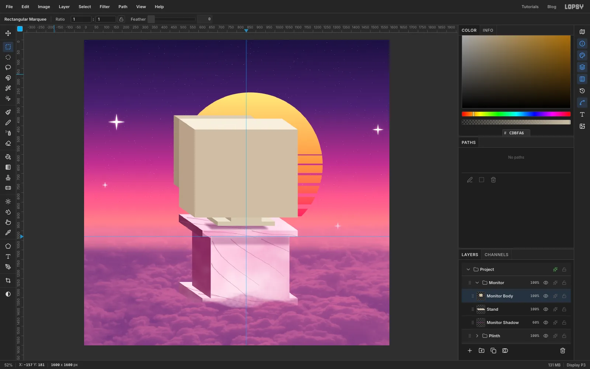

1. Collapse `Plinth`, select it, and make a **New Group** called `Monitor`.
2. **Contact shadow:** add a layer called `Monitor Shadow`. Pen-select a flat parallelogram on the cap's top through (668, 992), (968, 992), (928, 962) and (628, 962). Choose **Select → Feather…** at **10**, fill with `#6E3060`, and set the layer to **Multiply** at **60%**.
3. **Stand:** add a layer called `Stand`. Fill the neck's left face (770, 930), (737, 907), (737, 929), (770, 952) with `#A99A86`, its top (770, 930), (930, 930), (897, 907), (737, 907) with `#ECE4D3`, and its front (770, 930) to (930, 952) with `#D2C6B0`. Draw the stand's foot below it the same way, with its front from (700, 952) to (1000, 974) and its back corners 57 px left and 40 px up.
4. **The tube's back:** add a layer called `Monitor Body`. Pen-select the tube's left face (568, 463), (470, 395), (470, 755), (568, 823) and fill it with `#9D8C78`, then its top (568, 463), (968, 463), (870, 395), (470, 395) in `#D9CDB6`.
5. **The case:** fill the left face (580, 470), (498, 413), (498, 873), (580, 930) with `#B5A28C` and the top face (580, 470), (1120, 470), (1038, 413), (498, 413) with `#F6EFE0`. Fill a plain rectangle from (580, 470) to (1120, 930) with `#CDBFA6`; it shows behind the bezel's rounded corners.

## Add the rounded bezel

1. Add a layer called `Bezel`.
2. Pick the **Shape** tool. Set **Shape** to **Rectangle**, **Output** to **Pixels**, **Corner Radius** to **26**, the fill to `#E9DFC9`, and remove the stroke.
3. Click once at (850, 700). In the **Shape Size** dialog, type **540 × 460** and click **Create**. The bezel is drawn centred on your click.
4. [[Cmd]]-click the `Bezel` thumbnail to select just the rounded shape. Drag a linear gradient from `#F5EEDD` to `#D6C8AE`, from its top-left corner to its bottom-right. Deselect.

## Add vents, buttons and an LED

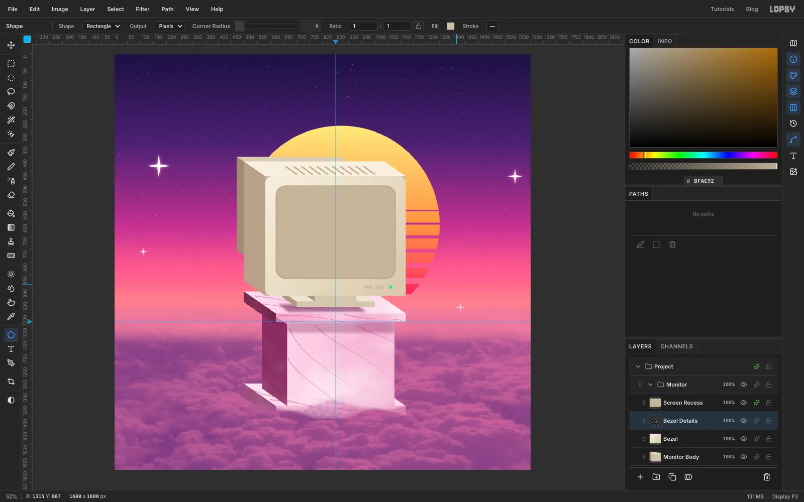

1. Add a layer called `Bezel Details`.
2. **Vents:** pick the **Pencil** at **Size 4**, colour `#BFAE92`. Draw eleven short slots across the top face, 30 px apart from x 700 to 1000. Click at y 462, then **Shift+click** about 41 px left and 29 px up, so each slot follows the receding slant.
3. **LED:** with the Shape tool set to **Ellipse**, click at (1062, 896) and make it **12 × 12** in `#5CF59C`.
4. **Buttons:** with **Rectangle** at radius **6**, make two **34 × 12** buttons in `#CDBFA4`, at (975, 896) and (1018, 896).

## Set the screen into a recess

1. Add a layer called `Screen Recess`. With the Shape tool (Rectangle, radius **40**, fill `#C4B59B`), click at (850, 685) and make it **462 × 360**. Give the layer an **Inner Glow** in `#6B5A40`: **Size 10**, **Opacity 55**.
2. Add a layer called `Screen` above it and make a rectangle **436 × 336**, radius **32**, in `#0E0A26`, at (850, 684). Add an **Inner Glow** in black with **Size 46**, **Spread 10** and **Opacity 85** for a slight CRT vignette.

## Catch the sunset on the edges

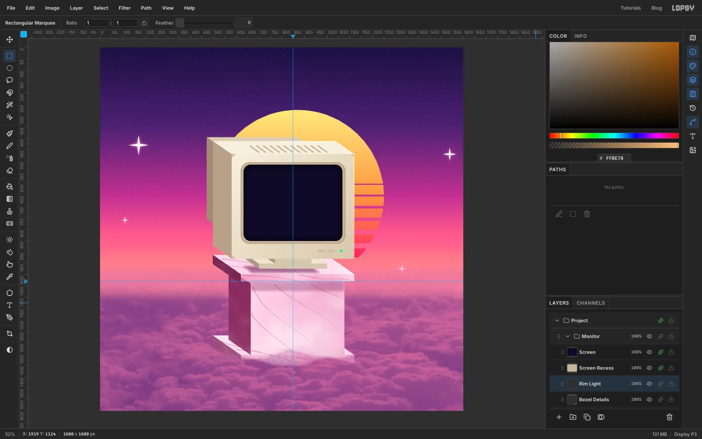

The sun sits behind the monitor, so its back and right edges should catch a little warm light.

1. Select `Bezel Details` and add a layer called `Rim Light`.
2. Pick the Pencil at **Size 3** in `#FFBE78`. Click at (740, 414) on the top face's back edge, then **Shift+click** along it to (1037, 414), down the slanted corner to (1118, 471), and down the right edge to (1118, 900).
3. Run **Gaussian Blur…** at **1**.
4. With marquee **Feather 60**, delete over the bottom of the right edge (from about y 760 down) and over the left end of the top line. The rim fades out where it leaves the sun.
5. Set Feather back to 0 and set the layer to **Screen**.

## Draw the screensaver on the screen

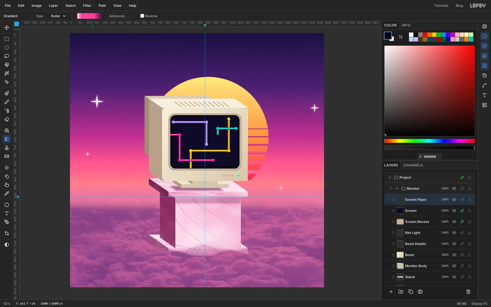

Every pipe in this cover is shaded the same way, with the light coming from the upper right to match the monitor and plinth.

- **Straight pipe:** draw a rectangular marquee around the segment. Use a **linear** gradient with five stops: the dark colour at both ends, the base colour at 25% and 55%, and the pale highlight at 38%. Drag it across the pipe's thickness: top to bottom on horizontal pipes, right to left on vertical ones.
- **Ball joint:** make an exact circle with the Elliptical Marquee dialog. Use a **radial** gradient: highlight at 0%, base colour at 18% and 70%, dark at 100%. Start the drag a little up and right of the circle's centre and drag about one and a half radii down-left.

The positions below are pipe centre lines. These screen pipes are **14 px** thick, so make each marquee 7 px either side of the line. For example, the first lilac pipe's marquee runs from (650, 553) to (860, 567).

1. Select `Screen` and add a layer called `Screen Pipes`.
2. **Lilac** (dark `#2C1A66`, base `#A98BFF`, highlight `#F1EBFF`): from (650, 560) right to (860, 560), then down to (860, 700). Joints of radius **10** at (650, 560), (860, 560) and (860, 700).
3. **Yellow** (`#5C3A00`, `#FFC93C`, `#FFF7D6`): from the bottom of the screen at (760, 850) up to (760, 740), right to (1000, 740), then up to (1000, 540). Joints at each corner and at the top end.
4. **Teal** (`#06464F`, `#13C8C0`, `#E8FFFC`): from (930, 640) up to (930, 600), then right to (1046, 600). Joints at (930, 600) and (1046, 600).
5. **Pink** (`#5A0A3A`, `#FF3E9A`, `#FFE3F1`): from (690, 800) up to (690, 640) and left to the screen's edge at (620, 640), plus a branch from (690, 800) right to (900, 800). Joints at (690, 640), (690, 800) and (900, 800).
6. [[Cmd]]-click the `Screen` thumbnail, choose **Select → Inverse**, click `Screen Pipes` and press [[Delete]], so nothing spills over the bezel.

## Run the pink pipe out of the screen

The two big escaped pipes are **40 px** thick. On this oblique view, anything coming toward you heads down and to the right and gets thicker, so those parts are Pen-drawn wedges rather than rectangles.

1. Collapse `Monitor`, select it, make a **New Group** called `Pipes`, and add a layer called `Pink Pipe`.
2. Set the pink linear gradient: `#55093A`, `#FF3E9A`, `#FFE3F1` at 38%, `#FF3E9A`, `#55093A`.
3. Draw the first straight pipe with a marquee from (250, 620) to (606, 660), and the second from (230, 640) down to (270, 1200).
4. Pen-select the wedge that swings toward you: (239, 1216), (404, 1341), (436, 1295), (261, 1184). It's 40 px wide where it leaves the corner and 56 px at the far end. Drag the gradient across it from its upper side to its lower side.
5. Switch to the pink radial joint gradient. Add joints of radius **30** at (606, 640), (250, 640) and (250, 1200), and a big end cap of radius **40** at (420, 1318).

## Burst the teal pipe out of the glass

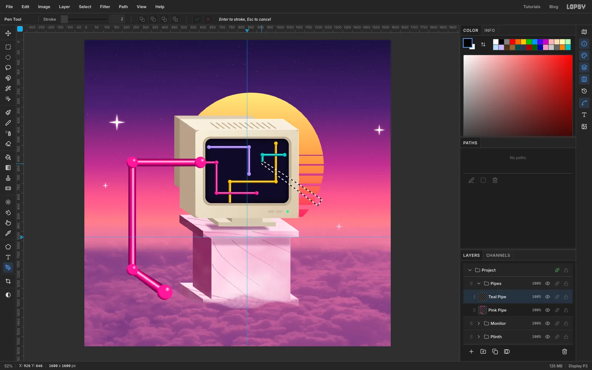

1. Add a layer called `Teal Pipe` above `Pink Pipe` and set the teal linear gradient: `#05404A`, `#13C8C0`, `#E6FFFC` at 38%, `#13C8C0`, `#05404A`.
2. Pen-select a wedge that starts 14 px wide at the teal screen pipe's corner and ends 40 px wide outside the monitor: (926, 646), (1219, 865), (1241, 833), (934, 634).
3. Drag the gradient across the wedge from its upper side to its lower side. The pipe now looks as if it's coming out of the screen toward you.

## Finish the teal pipe

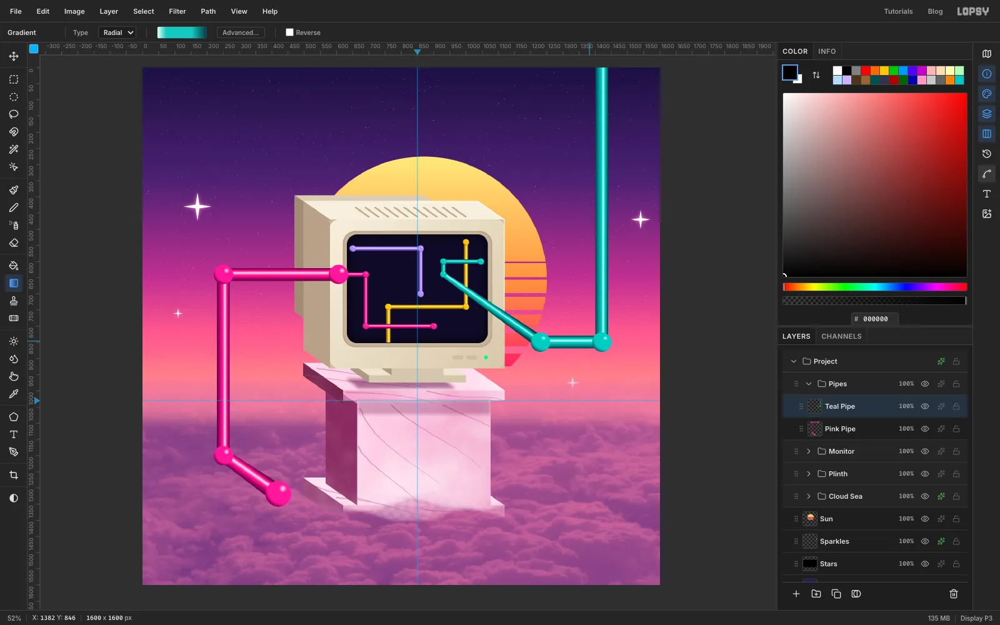

> **Tip:** Start marquees on the canvas. A press over the ruler doesn't make a selection, and the next gradient would fill the whole layer.

1. With `Teal Pipe` still selected and the teal linear gradient, draw a pipe with a marquee from (1230, 829) to (1420, 869).
2. Draw the riser with a marquee from (1400, 0) at the very top edge down to (1440, 849).
3. Switch to the teal radial joint gradient. Add a small joint of radius **10** where the wedge leaves the screen at (930, 640), and joints of radius **30** at (1230, 849) and (1420, 849).

## Set the title

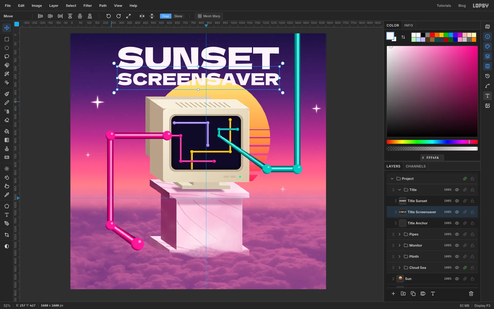

> **Tip:** With a text layer selected, the Text tool's options change *that* layer. Before each new piece of text, click an ordinary picture layer in the Layers panel.

1. Collapse `Pipes`, select it, make a **New Group** called `Title`, and add an empty layer called `Title Anchor`.
2. Pick the **Text** tool and set **Dela Gothic One** at **188 px** in `#FFF4FA`. Click above the sun, type `SUNSET` and click **✓** to commit. Rename the layer `Title Sunset`.
3. With the **Move** tool and the arrow keys, centre it on x 800 with the tops of its letters at about y 85.
4. Click `Title Anchor`. Type `SCREENSAVER` in the same font at **103 px**, which makes it the same width as SUNSET. Rename it `Title Screensaver` and centre it with the tops of its letters about 22 px below the bottom of SUNSET.

## Split the title into RGB

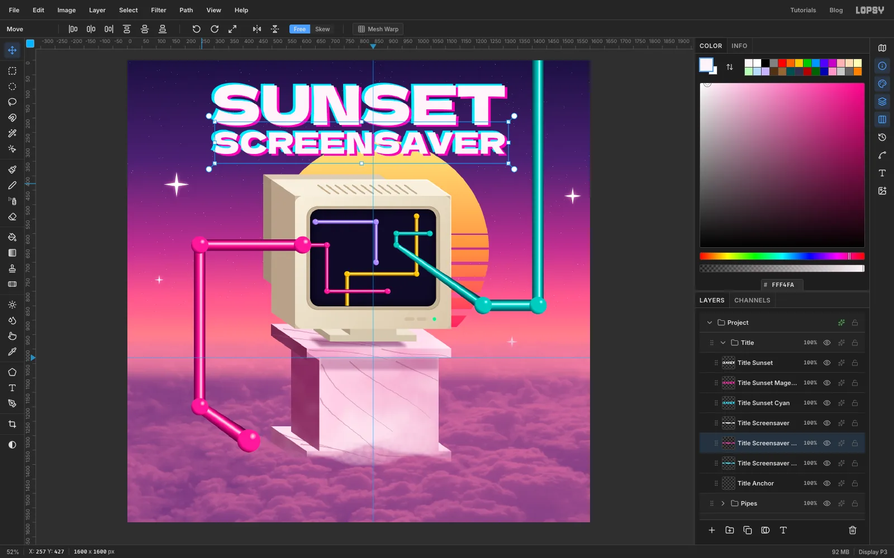

Do this for each title line:
1. Select the line and click **Duplicate Layer**. Rename the copy, for example `Title Sunset Cyan`.
2. With the Text tool active and the copy selected, click **Text color** in the options bar and type `35E8FF`. The whole copy turns cyan.
3. Drag the copy's row below the white line in the Layers panel. With the Move tool, nudge it **9 px left** and **6 px up**.
4. Duplicate the white line again, make that copy `#FF2FB4`, drag it below the white line too, and nudge it **9 px right** and **6 px down**.

The whole block now moves as one: select the `Title` group and drag it with the Move tool if you want to try a different position.

## Engrave the plinth

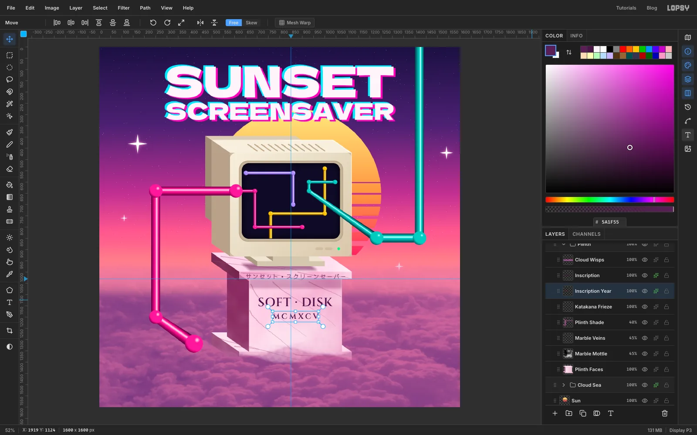

1. Collapse `Title`, expand `Plinth`, and click `Plinth Shade`. Each text layer will sit right above it.
2. Set **Cinzel**, **SemiBold**, **54 px**, colour `#4A1546`, and **Letter spacing 2** in the **Text** panel. Type `SOFT · DISK` and centre it on the body's front face, with the middle of the letters at about y 1132.
3. Click `Plinth Shade` again. Type `MCMXCV` (1995 in Roman numerals) in Cinzel SemiBold at **34 px** with letter spacing **8**, and centre it about 40 px under the artist name.
4. Give both an engraved edge: a **Drop Shadow** in `#FFD9EC` with **Offset X 0**, **Offset Y 2**, **Blur 1** and **Opacity 90**.
5. Click `Plinth Shade` again. Type `サンセット・スクリーンセーバー` (Sunset Screensaver in katakana) in **DotGothic16** at **24 px**, colour `#5A1F55`, letter spacing **6**. Centre it on the cap's front band.
6. Expand `Monitor`, click `Bezel Details`, and add `SUNSET 95` in **Michroma** at **14 px**, `#A08B6B`, letter spacing **4**, on the bezel's bottom-left.

## Add scanlines, glass glare and a cursor

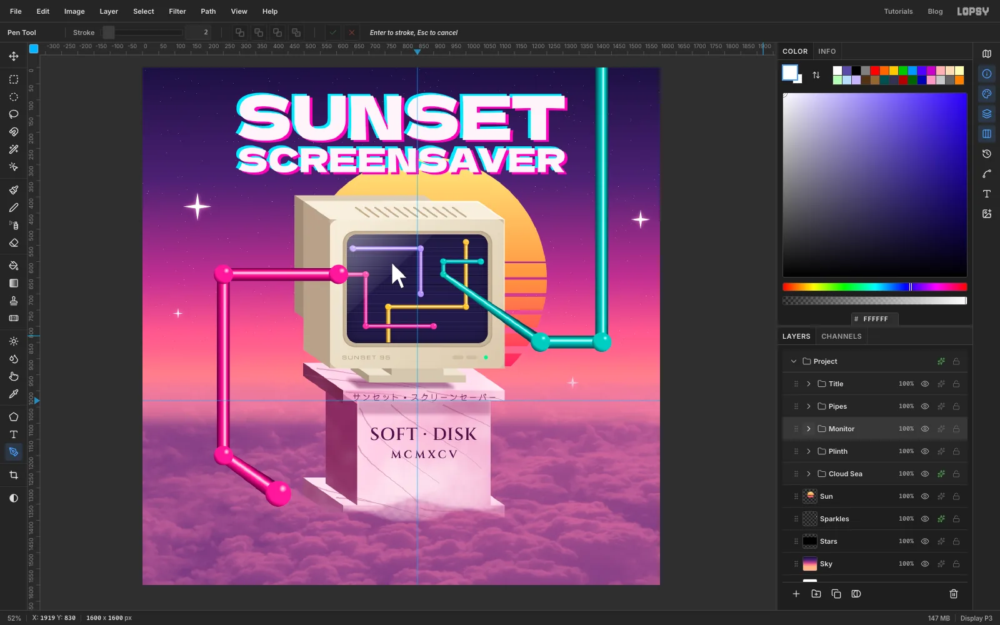

1. **Scanline tile:** inside `Monitor`, add a layer called `Scanline Tile`. With the marquee dialog, select (0, 0) to (4, 4) and fill it black, then select (0, 0) to (4, 2) and fill it `#5A4AA8`.
2. Select (0, 0) to (4, 4) again and choose **Edit → Define Pattern**. Define Pattern takes the selected area; with nothing selected it would take the whole layer. Deselect and delete the tile layer.
3. **Scanlines:** select `Screen Pipes` and add a layer called `Scanlines`. [[Cmd]]-click the `Screen` thumbnail, click `Scanlines`, choose **Edit → Fill with Pattern…**, pick your 4 × 4 pattern and click **Apply**. Deselect and set the layer to **Screen** at **45%**.
4. **Glare:** add a layer called `Glass Glare` and [[Cmd]]-click the `Screen` thumbnail. In the Gradient editor, make four white stops and set each one's transparency with the **Opacity** strip under the colour picker: 55% at the left end, 8% at 45%, 0% at 46%, and 0% at the right end. Drag from the screen's top-left corner, about (640, 520), to (900, 800). Set the layer to **Screen** at **70%**.
5. **Cursor:** select `Screen Pipes` and add a layer called `Cursor`. Pen-select the classic arrow: tip (772, 606), straight down to (772, 670), in to the notch at (788, 654), down the tail to (800, 682) and (808, 678), back up to (796, 650), and out to (816, 650). Fill it white and add a 3 px **Stroke** in `#0B0718`. It looks as if someone just nudged the mouse and the screensaver is about to wake up.

## Make the sticker disc

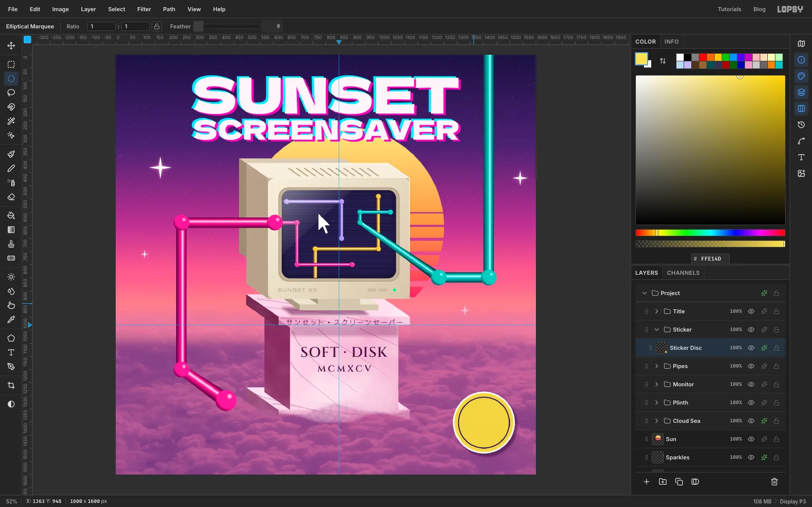

1. Collapse `Monitor`, select `Pipes`, make a **New Group** called `Sticker`, and add a layer called `Sticker Disc`.
2. With the Elliptical Selection dialog, fill three circles centred at (1402, 1402): radius **112** in `#FFE14D`, radius **99** in `#2A1060`, and radius **95** in `#FFE14D` again. That leaves a thin navy ring.
3. Add a white **Stroke** of **6** and a **Drop Shadow** in `#2A0838` (Offset 10 / 12, Blur 12, Opacity 50).
4. Run **Filter → Hue/Saturation…** with **Saturation −18**, so the yellow doesn't shout over the monitor.

## Wrap text around the sticker

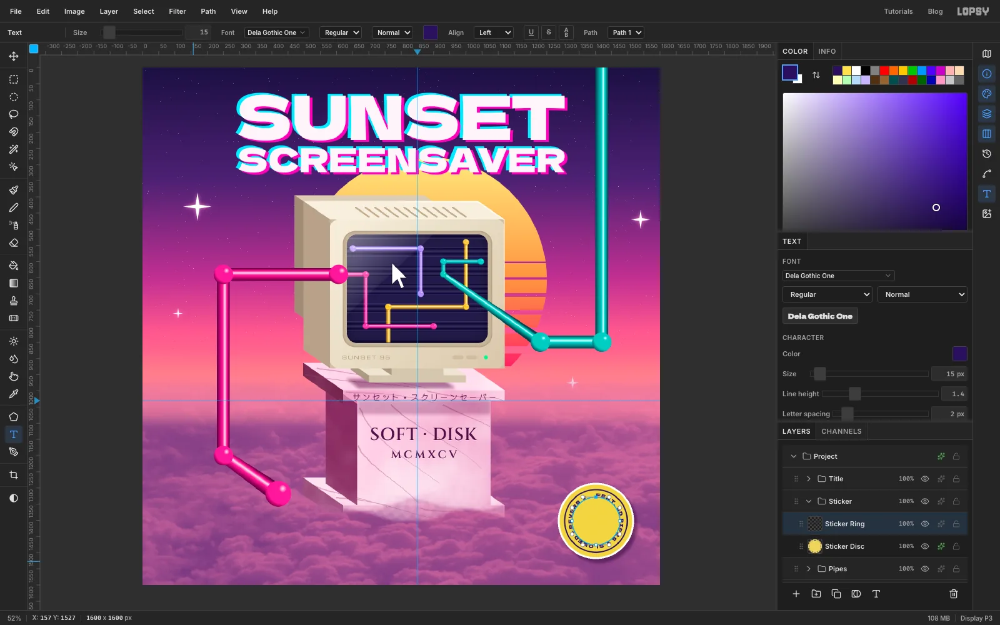

1. **Ring path:** pick the **Shape** tool, choose **Ellipse** with **Output: Path**, and [[Cmd]]-drag from the sticker's centre out about 74 px for a perfect circle. Set Output back to **Pixels**.
2. Click `Sticker Disc`. Type `FEAT. 3D PIPES ★ SLOWED + REVERB ★` in **Dela Gothic One** at **15 px**, `#2A1060`, letter spacing **2**, anywhere on the canvas.
3. With the Text tool still active, choose **Path 1** from the **Path** dropdown in the options bar. The text wraps round the ring. If it runs into itself or leaves a big gap, adjust the letter spacing.
4. Click `Sticker Disc` and add a big `２` in Dela Gothic One at **74 px**, `#2A1060`, centred just below the middle. Click `Sticker Disc` again and add a small `ＶＯＬ．` at **16 px** in `#7A1E6E` above it. These are full-width characters, the wide-spaced type vaporwave loves, so copy them from here rather than typing them.

## Tilt the sticker

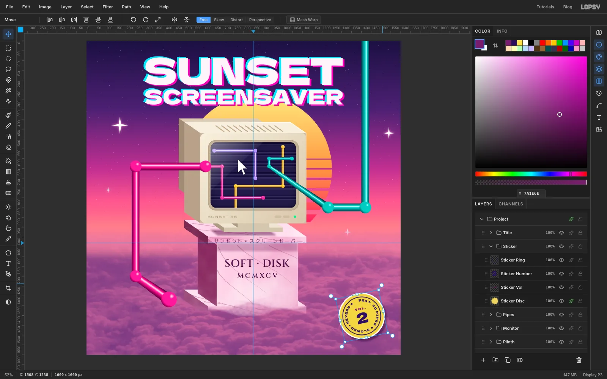

Text on a path can't be transformed together with other layers, so flatten it first.

1. Select the ring text and click **Rasterize Layer** at the bottom of the Layers panel. In the **Paths** panel, select `Path 1` and click **Delete Path**.
2. Select the `Sticker` group. With the **Move** tool, hover just outside the top-right corner of its box until the rotate cursor appears, and drag anticlockwise about **12°**.
3. Press [[Cmd+D]] to apply the rotation, then collapse the group.

## Add a VHS tracking strip

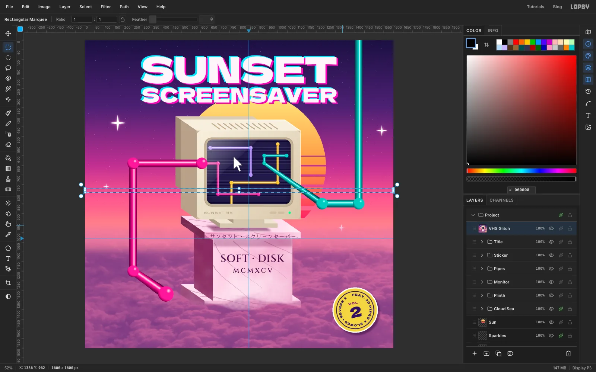

1. Select the `Title` group. Press [[Cmd+A]], choose **Edit → Copy Merged**, deselect, and press [[Cmd+V]]. Rename the copy `VHS Glitch`.
2. With the marquee dialog, select a thin strip from (0, 770) to (1600, 790).
3. Run **Filter → Pixel Stretch…** with **Amount 18**, **Bands 2**, **Seed 7** and **RGB Split 0.6**. The seed decides which bands move. If your strip doesn't tear sideways, try a few other seeds.
4. Run **Add Noise…** at **18**, **Mono**, **Uniform**, so the strip fizzes like worn tape.
5. Choose **Select → Inverse** and press [[Delete]], so only the strip stays on the merged copy. Deselect.

## Add film grain and export

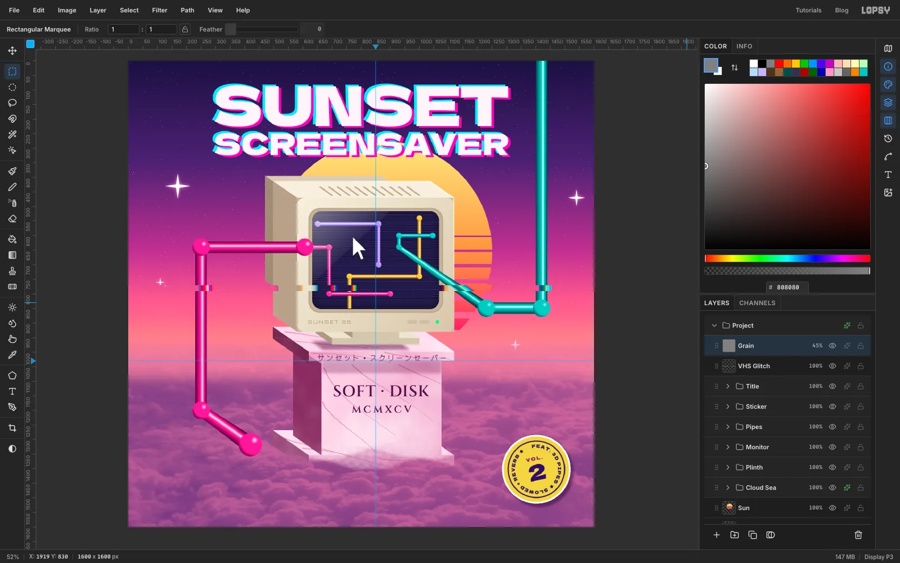

1. Add a layer called `Grain`, fill it with `#808080`, and run **Add Noise…** at **30**, **Mono**, **Gaussian**.
2. Set it to **Overlay** at **45%**. It ties the photo, the gradients and the type together as one printed sleeve.
3. Turn off **View → Show Guides** and choose **File → Quick Export PNG**.
